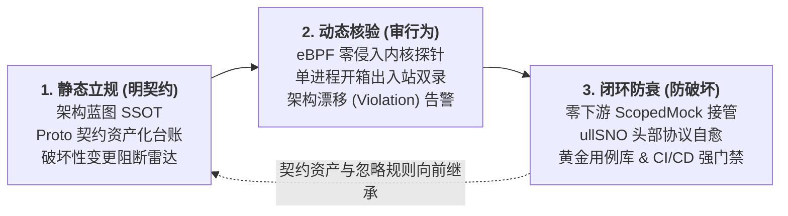
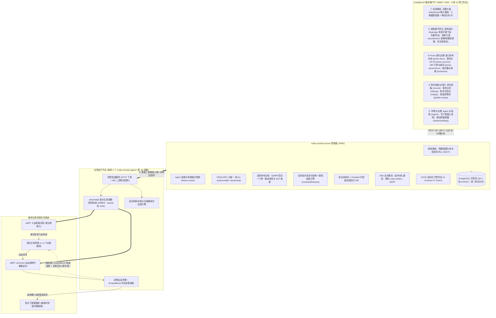

# 架构与活体契约治理平台 (`code-contract`)

> **产品定位**：以真实运行态为活水，架设微服务架构防漂移与活体契约防劣化的自愈防线  
> **当前版本**：`v0.3.0` | **服务标识**：`Code-Contract` (`contract`) | **专有协议**：DOPHI `CROS RPC` over IPv4 TCP

本项目基于 CodeBench 微前端架构与 `code-common` 公共底座构建，严格遵循 **SDD (Spec-Driven Development，规范驱动开发) + TDD (Test-Driven Development，测试驱动开发)** 工程模式：  
**「契约基线与特性边界 (`01-features`) ➔ 系统架构与数据模型 (`02-design`) ➔ 接口契约与任务拆解 (`03-api` & `04-tasks`) ➔ TDD 测试先行与分阶段交付」**

---

## 1. 产品本质与核心价值 (Core Essence & Values)

传统的接口与契约管理（Swagger、Postman、Proto 仓库等）普遍局限于**“设计态的静态文档”**，存在“文档与实现两张皮”、“无法感知生产实际调用”、“架构偷偷腐化漂移”及“跨微服务联调严重依赖完整下游环境”等系统性痛点。

`code-contract` 的业务本质是**「以契约治理为核心、以运行态真实流量为活水、以零侵入仿真为闭环的活体契约与微服务架构治理平台」**：
* **“流量录制与重放”是底座技术手段**：提供零代码侵入、零业务改造成本的高保真交互采集与本地回放。
* **“契约治理、架构防漂移与防劣化闭环”是真正的业务目的**：



### 三大治理支柱 (Three Governance Pillars)

| 治理维度 | 核心解决的痛点 | 平台提供的能力与技术机制 |
| :--- | :--- | :--- |
| **① 接口资产与规范治理**<br/>*(Contract Assets & Specs)* | 接口口口相传、Proto 散落各处、微服务职责边界模糊、存在大量无人认领的僵尸接口，代码重构容易无意破坏下游兼容性 | 1. 建立**三级架构元素**（子系统 ➔ 功能组 ➔ 功能模块）与物理进程蓝图（SSOT），支持**独占 (`EXCLUSIVE`)** 与**多实现 (`MULTI_IMPL` / `CONTRACT_LIB`)** 服务契约模型；<br/>2. **Git-Only 全生命周期与纯 Go `protocompile` 底座**：支持 Monorepo `1:N` Compilation Bundles 无状态同步、活体全注释接口参考文档 (`/proto-docs`) 与轻量只读源码/Commit Diff (`/proto-sources`)；<br/>3. **静态规范引擎与破坏性变更阻断雷达**：内置多段包名/词库合规检查、三护栏 AST 重复结构探测 (`Jaccard >= 0.85`)、分层逆向依赖守卫、含 `BASE_LIB` 传递影响的破坏性变更阻断，以及 Git MR 四合一自动化门禁 (`/proto-governance`)。 |
| **② 架构一致性与漂移治理**<br/>*(Architecture Drift Radar)* | 架构设计图与代码实际调用漂移，开发私自跨层调用、旁路直连，架构腐化无从察觉；缺乏端到端全景健康度量 | 1. **内核态 `cilium/ebpf` 动态探针**：零修改、零 SDK、不重启进程，亚秒级完成出入站双向无感采集；支持 `setcap` 免 sudo 特权运行；<br/>2. **实测拓扑与单层平铺数字孪生**：依据 CROS RPC 报文与 `ContractResolver` 动态还原调用边与多实现归属（Confirmed / External / Violation / ImplUnresolved），支持大规模拓扑单层平铺下钻、ELK 正交布局、作用域位置记忆及纯矢量 SVG/PNG 导出；<br/>3. **契约治理全景大盘**：落地三维封顶健康指数算法（规范性 40 分 + 一致性 30 分 + 回归保障率 30 分 = 100 分）与静态合标卡片，提供漂移 Top 榜与僵尸接口暴露。 |
| **③ 契约级防劣化与自愈重放**<br/>*(Contract Regression & Healing)* | 跨模块回归测试依赖一整套下游环境；接口变更容易破坏兼容性导致线上故障；缺乏沉淀高价值测试资产与自动化阻断手段 | 1. **零下游依赖因果闭包重放 (`ScopedMock`)**：单进程脱机运行，出口请求由局部因果池接管，**真实下游 0 字节外泄**；<br/>2. **二进制头部自愈**：自动改写应答 `ullSNO`、Trace 缓冲与发送时间戳，免除跨机器同步 Schema 负担；<br/>3. **双层语义 Diff 引擎**：自动比对协议状态码与 Protobuf 业务字段，精准定位破坏性改动；<br/>4. **黄金用例套件工坊**：一键将高价值事务固化为完全自包含快照，脱敏并永久免疫物理分区清理；<br/>5. **CI/CD 自动化门禁**：提供专有判定 API、有界排他锁排队与 PR 强阻断报告。 |

---

## 2. 系统总体拓扑 (System Topology)

系统采用 **「控制面主框架 (`code-contract-server`) + 独立数据面代理 (`code-contract-agent`)」同仓双二进制物理防腐** 架构：



---

## 3. 目录结构 (Repository Layout)

```text
code-contract/
├── docs/                # SDD + TDD 规范文档库 (00-prompt ~ 07-references)
├── cmd/
│   ├── server/          # 控制面入口 code-contract-server（微前端托管、契约中心、Diff 引擎）
│   ├── agent/           # 数据面探针入口 code-contract-agent（零数据库、零.pb、嵌入式 eBPF）
│   └── seed/            # Demo 拓扑与测试数据重置播种入口
├── demo/                # 4 进程完整微服务仿真集群与田字格 Tmux 可视化联调演示
├── internal/
│   ├── server/          # 控制面内部业务：callgraph/dashboard/decoder/diff/gitclient/hub/linter/notify/protodoc/recorder/security/topology
│   └── agent/           # 数据面内部服务：eBPF 探针生命周期、出站代理、报文自愈与 ScopedMock 接管
├── pkg/
│   ├── crosrpc/         # CROS RPC 协议解析与分帧库（主控与 Agent 共享）
│   ├── ebpf/            # cilium/ebpf 内核探针、Socket 预热与三态出站代理
│   ├── replay/          # 零 .pb 二进制 ScopedMock 匹配与 ullSNO 自愈引擎
│   └── version/         # 规范化语义版本号与构建指纹
├── config/              # 配置加载与模块级元数据常量 (ModuleKey="contract", TablePrefix="contract_")
├── models/              # GORM 数据模型（强制 contract_ 物理表前缀隔离）
├── handlers/            # HTTP 控制器、RBAC 权限守卫、审计 Diff、CI 门禁与物理隔离单元测试
├── frontend/            # React 18 + Vite 5 + Module Federation 微前端工程
├── scripts/             # 自动化构建与辅助脚本
├── Makefile             # 标准构建、测试与代码检查入口
├── AGENTS.md            # AI Agent 协作准则与架构红线
└── README.md            # 项目概览与 SDD+TDD 路线图
```

完整文档规范与分层索引请查阅 [`docs/README.md`](./docs/README.md)。

---

## 4. SDD + TDD 研发路线图 (Lifecycle Checklist)

- [x] **阶段一：特性清单与边界明确** (`docs/01-features/`)
  - [x] [`01-feature-matrix.md`](./docs/01-features/01-feature-matrix.md)（活体契约愿景、三层治理矩阵 `F-01~F-32`、验收场景 `SC-01~SC-16` 与 `Non-Goals`）
- [x] **阶段二：系统架构与模型设计** (`docs/02-design/`)
  - [x] [`01-system-architecture.md`](./docs/02-design/01-system-architecture.md)（主从协同、双模运行架构、微前端接入规范）
  - [x] [`02-data-plane-and-cros-rpc-engine.md`](./docs/02-design/02-data-plane-and-cros-rpc-engine.md)（CROS RPC 协议栈、eBPF 采集与二进制 Mock 引擎）
  - [x] [`03-architecture-elements-and-topology.md`](./docs/02-design/03-architecture-elements-and-topology.md)（三级架构模型 SSOT、多实现服务契约与拓扑一致性核验）
  - [x] [`04-control-plane-and-web-console.md`](./docs/02-design/04-control-plane-and-web-console.md)（控制面调度、Protobuf 编解码与参考文档中心、静态规范与 MR 门禁）
  - [x] [`05-database-schema.md`](./docs/02-design/05-database-schema.md)（30 张核心 `contract_*` 业务表 + `contract_settings` 配置表、黄金套件与按日范围分区设计）
  - [x] [`06-agent-observability-and-self-healing-design.md`](./docs/02-design/06-agent-observability-and-self-healing-design.md)（Agent 探针特权感知、体检诊断与全链路闭环自愈设计）
- [x] **阶段三：接口契约与 TDD 任务分解** (`docs/03-api/`, `docs/04-tasks/`)
  - [x] [`01-http-api-contract.md`](./docs/03-api/01-http-api-contract.md)（REST/SSE 契约、CI/MR 门禁鉴权、主从 HTTP/WS 信道协议与 RBAC 权限矩阵）
  - [x] [`01-roadmap.md`](./docs/04-tasks/01-roadmap.md)（Milestone 1~27 DAG 拓扑、特性矩阵覆盖与全局质量门禁）
  - [x] **M1~M27 作战卡全量交付 (100% Completed)**：
    - [x] [`02-m1-crosrpc-and-domain-models.md`](./docs/04-tasks/02-m1-crosrpc-and-domain-models.md)（CROS RPC 分帧与数据模型）
    - [x] [`03-m2-arch-proto-and-agent-control.md`](./docs/04-tasks/03-m2-arch-proto-and-agent-control.md)（架构契约与 Agent 调度信道）
    - [x] [`04-m3-agent-dataplane-ebpf-and-replay.md`](./docs/04-tasks/04-m3-agent-dataplane-ebpf-and-replay.md)（eBPF 数据面与脱机重放注入）
    - [x] [`05-m4-recording-topology-and-diff-engine.md`](./docs/04-tasks/05-m4-recording-topology-and-diff-engine.md)（实测拓扑还原与双层 Diff）
    - [x] [`06-m5-microfrontend-and-e2e-delivery.md`](./docs/04-tasks/06-m5-microfrontend-and-e2e-delivery.md)（微前端嵌入与单二进制交付）
    - [x] [`07-m6-hierarchical-topology-canvas.md`](./docs/04-tasks/07-m6-hierarchical-topology-canvas.md)（分层复合拓扑与一致性画布）
    - [x] [`08-m7-proto-schema-deepening-and-nested-contract-workbench.md`](./docs/04-tasks/08-m7-proto-schema-deepening-and-nested-contract-workbench.md)（契约资产化与嵌套字典树）
    - [x] [`09-m8-console-ia-restructuring-and-debug-workflow.md`](./docs/04-tasks/09-m8-console-ia-restructuring-and-debug-workflow.md)（控制台信息架构与调试流）
    - [x] [`10-m9-recording-drawer-and-process-tree-selection.md`](./docs/04-tasks/10-m9-recording-drawer-and-process-tree-selection.md)（协同录制抽屉与进程树选择）
    - [x] [`11-m10-arch-process-blueprint-and-premount-workflow.md`](./docs/04-tasks/11-m10-arch-process-blueprint-and-premount-workflow.md)（架构物理进程蓝图与 eBPF 自动预挂）
    - [x] [`12-m11-enhanced-proto-schema-asset-management.md`](./docs/04-tasks/12-m11-enhanced-proto-schema-asset-management.md)（多描述集资产台账与跨集依赖）
    - [x] [`13-m12-bidirectional-capture-and-agent-recording-ux.md`](./docs/04-tasks/13-m12-bidirectional-capture-and-agent-recording-ux.md)（单进程开箱双录与体验闭环）
    - [x] [`14-m13-packet-causality-call-tree-and-sequence-workbench.md`](./docs/04-tasks/14-m13-packet-causality-call-tree-and-sequence-workbench.md)（报文因果树、时序泳道与事务闭包）
    - [x] [`15-m14-governance-dashboard-and-ia-restructuring.md`](./docs/04-tasks/15-m14-governance-dashboard-and-ia-restructuring.md)（平台级治理大盘与 IA 升维）
    - [x] [`16-m15-golden-contract-suites-and-curation-workbench.md`](./docs/04-tasks/16-m15-golden-contract-suites-and-curation-workbench.md)（黄金契约套件与事务固化工作台）
    - [x] [`17-m16-design-time-breaking-change-radar.md`](./docs/04-tasks/17-m16-design-time-breaking-change-radar.md)（设计态破坏性变更阻断雷达）
    - [x] [`18-m17-ci-cd-quality-gate-and-automated-enforcement.md`](./docs/04-tasks/18-m17-ci-cd-quality-gate-and-automated-enforcement.md)（CI/CD 自动化强阻断门禁与凭据报告）
    - [x] [`19-m18-business-centric-packet-inspector-redesign.md`](./docs/04-tasks/19-m18-business-centric-packet-inspector-redesign.md)（面向业务视角的双模报文透视抽屉）
    - [x] [`20-m19-scalable-topology-focus-and-layout-persistence.md`](./docs/04-tasks/20-m19-scalable-topology-focus-and-layout-persistence.md)（大规模拓扑下钻聚焦与双层混合布局持久化）
    - [x] [`21-m20-multi-implementation-service-contract.md`](./docs/04-tasks/21-m20-multi-implementation-service-contract.md)（多实现服务契约建模、实测定位与重放隔离）
    - [x] [`22-m21-topology-single-layer-drilldown-and-layout-ux.md`](./docs/04-tasks/22-m21-topology-single-layer-drilldown-and-layout-ux.md)（架构拓扑单层平铺逐级下钻与 ELK 布局校准）
    - [x] [`23-m22-protocompile-layering-and-dependency-graph.md`](./docs/04-tasks/23-m22-protocompile-layering-and-dependency-graph.md)（纯 Go `protocompile` 底座、分层逆向守卫与矢量导出）
    - [x] [`24-m23-living-proto-docs-and-readonly-sources.md`](./docs/04-tasks/24-m23-living-proto-docs-and-readonly-sources.md)（活体接口参考文档中心与轻量只读源码视图）
    - [x] [`25-m24-static-lint-vocabulary-and-duplicate-ast.md`](./docs/04-tasks/25-m24-static-lint-vocabulary-and-duplicate-ast.md)（安全底座、静态规范引擎、原生词库与 AST 查重）
    - [x] [`26-m25-git-sync-and-monorepo-bundles.md`](./docs/04-tasks/26-m25-git-sync-and-monorepo-bundles.md)（Git 无状态同步与 Monorepo `1:N` Compilation Bundles）
    - [x] [`27-m26-mr-gates-notifications-and-compliance-dashboard.md`](./docs/04-tasks/27-m26-mr-gates-notifications-and-compliance-dashboard.md)（MR 四合一门禁、定向通知中心与静态合标大盘）
    - [x] [`28-m27-proto-ia-unbundling-and-four-workbenches.md`](./docs/04-tasks/28-m27-proto-ia-unbundling-and-four-workbenches.md)（Proto 契约 5 组 13 项菜单与四工作台正交拆分）
- [x] **阶段四：工程实施、架构决策与运维验证** (`docs/05-adr/`, `docs/06-ops/`)
  - [x] [`docs/05-adr/`](./docs/05-adr/)（ADR-01 ~ ADR-20 架构决策全景记录，含大规模拓扑、多实现契约、单层下钻、Proto 全生命周期、IA 拆解与 `code-contract` 更名重构）
  - [x] [`01-verification-and-deployment-guide.md`](./docs/06-ops/01-verification-and-deployment-guide.md)（联调测试与生产部署手册）
  - [x] [`02-e2e-browser-test-and-ux-review.md`](./docs/06-ops/02-e2e-browser-test-and-ux-review.md)（E2E 黑盒走查与交互走查记录）

---

## 5. 快速开始与常用命令

```bash
# 1. 后端依赖检查与全量单元测试（包含物理隔离数据库用例）
make test

# 2. 前端静态类型与代码质量检查（TypeScript + ESLint 严格模式）
make lint

# 3. 完整编译打包（生成前端静态资产、控制面单二进制与 Agent 单二进制）
make build

# 4. 启动控制面服务（默认监听 :8091）
./code-contract-server

# 5. 启动数据面 Agent（需特权或 setcap 权能，默认监听 :9091）
sudo ./code-contract-agent
# 或免 sudo 启动（提前执行: sudo setcap cap_net_raw,cap_net_admin,cap_bpf+ep ./code-contract-agent）
./code-contract-agent

# 6. 运行 4 进程微服务 Demo 集群（田字格 Tmux 可视化分屏联调）
cd demo && make tmux-demo
```

---

## 6. 🏷️ 版本历史 (Release History)

### v0.3.0 (2026-11-16)
* **🧭 架构拓扑单层平铺下钻与大规模聚焦治理 (M19 / M21 · ADR-15 / ADR-17)**：
  - 重构为「单层平铺逐级下钻」架构数字孪生画布（废除外层包裹框，仅展示直属子节点与左右 `FIRST/LAST` 外部传送门卡），配备面包屑导航、`1~2 Hop` 有向邻域与可见节点规模守卫；
  - 校准 ELK 单层正交参数（`110px` 层间净空）与 CSS `border-box` `1:1` 尺寸对齐，引入四向智能锚点路由、同锚点多边错位偏移与悬停流动点线聚光灯；
  - 落地按 `(view, focus_scope)` 隔离的双层混合布局持久化（`contract_topology_layouts` 团队官方基准 `SHARED` + 个人视图书签 `PRIVATE`），且仅用户显式拖拽/图钉固定才锁位。
* **🔀 多实现服务契约建模与调度拓扑闭环 (M20 · ADR-16)**：
  - 新增 `CONTRACT_LIB` 接口库模块类型、`contract_service_contracts` 与 `DISPATCH` 分发依赖，支持 `EXCLUSIVE`（独占）与 `MULTI_IMPL`（接口库定义 + 多进程实现 + 自定义运行期服务名）双模服务契约及同契约跨实现进程不相交守卫；
  - 统一 `ContractResolver` 实现实测端点消歧与第八类一致性状态 `IMPL_UNRESOLVED`，拓扑画布支持 `«interface»` 库卡、`REALIZATION` 实现图层及 `AGG|EXPAND` 模式切换；
  - Agent 侧新增 `dst_tag` 隔离防串用，Demo 集群新增支付 LIB 与 `ALIPAY/WECHAT` 双渠道实例验证。
* **📜 Proto 全生命周期治理与纯 Go `protocompile` 底座 (M22~M25 · ADR-18)**：
  - 引入纯 Go `github.com/bufbuild/protocompile` 四级虚拟解析器（零 `os/exec`），支持跨 Bundle `SourceCodeInfo` 精确裁剪、全局 `layer_level` 分层逆向依赖拦截（`409`）与 `BASE_LIB` 传递影响雷达，并交付 `/topology` 纯矢量 SVG/PNG 导出；
  - 交付全注释驱动的活体接口参考文档中心（`F-18`，支持 `@deprecated/@owner/@error_code`、Enum 字典、黄金 JSON 样本与 Markdown 手册导出）及轻量只读源码/Commit Diff 视图（零 `monaco-editor`）；
  - 构建 `CONTRACT_CRYPTO_KEY` AES-256-GCM 加密与 `SafeDialer` SSRF 防护底座（支持 `outbound_trusted_cidrs` 白名单），落地可配置静态规范引擎、原生 `BUILTIN_SEED` 领域词库、`3s` 超时降级 LLM 辅助及三护栏 AST 重复结构检测（`Jaccard >= 0.85`）；
  - 实现无状态 Git 同步、`GitRepo (1) -> GitProtoBundle (N)` Monorepo 多包模型与只读源码快照对账。
* **🛡️ Git MR 四合一门禁、定向通知中心与静态合标大盘 (M26 · ADR-18)**：
  - 交付 `POST /api/webhooks/git-mr/:repoId` 基线+补丁虚拟树四合一静态门禁（`uk_contract_mr_dedup` 消除 Fast-Forward 漏触发）、Bot 原位评论更新、管理员 `Override` 豁免（禁止豁免编译失败 + `P1` 审计）及主干合并自动编译入池；
  - 升级 `SSEBroker(userID)` 定向推送、站内持久化收件箱（`contract_notifications`）与跨机 `code-notifier` / SMTP 通知触达，适配微前端嵌入与独立壳双模 `NotificationBell`；
  - 治理大盘新增静态合规扩展卡片（`StaticComplianceCard`），保持原有 `40+30+30` 健康分公式稳定。
* **🗂️ Proto 契约控制台 IA 拆解与全仓更名 `code-contract` (M27 / ADR-19 / ADR-20)**：
  - 全局侧边栏升级为 **5 组 13 项**，拆出独立一级分组「Proto 契约治理」及四张正交工作台（`/proto-docs`、`/proto-sources`、`/proto-governance`、`/schemas`），并无损重定向全部 `/schemas?tab=*` 历史深链与 `#L<n>` 锚点；
  - 全仓正式更名为 `code-contract`（Go Module、二进制名 `code-contract-server` / `code-contract-agent`、`contract_*` 30+1 张表、环境变量 `CONTRACT_*` 与 API 响应头），彻底清理历史兼容垫片。

### v0.2.0 (2026-11-08)
* **🌟 平台级契约治理全景大盘 (M14)**：
  - 控制台默认落地治理大盘 (`/dashboard`)，确立 4 组 10 项清晰现代信息架构；
  - 引入公私域隔离的三支柱子分封顶健康指数（规范性 40 分 + 一致性 30 分 + 回归保障率 30 分 = 100 分）；
  - 架构违规漂移 Top 榜、未覆盖僵尸接口告警与未认领孤儿契约实时透视。
* **🏆 黄金契约套件与事务固化工作台 (M15)**：
  - 支持将生产高价值真实调用流一键沉淀为自包含黄金用例快照（二进制 Raw Packet + 闭包数据）；
  - 永久免疫 30 天流量物理分区清理，支持多用例集批量脱机回归演练、基线版本锁定与脱敏。
* **🚨 设计态契约破坏性变更阻断雷达 (M16)**：
  - 深度解析 Protobuf AST，精确识别删除字段、类型变更、wire type 漂移、tag 碰撞及保留编号冲突；
  - 自动化全网下游微服务消费血缘影响推导与风险评级；
  - 提供管理员加签（`allow_breaking` + 审计说明）紧急逃生舱。
* **🛡️ CI/CD 自动化流水线强阻断门禁 (M17)**：
  - 开放专用 CI 门禁判定 API（`POST /api/v1/gate/verify`）与 `X-Contract-CI-Token` SHA-256 常量时间安全比对；
  - 引入排他租约锁有界排队机制（Bounded Mutex Lease Queue），彻底消除高并发流水线踩踏冲突；
  - 支持实测边双向回传校验（Confirmed / External / Violation）与非零状态码强阻断，沉淀结构化 MR/PR 评估报告。
* **🔍 面向业务视角的 RPC 报文透视与双模解剖 (M18)**：
  - 抽屉信息架构从“网络抓包 Wireshark 视角”全面升维至“业务联调与排障视角”；
  - 打造请求入参与返回结果左右双栏孪生同屏对比视窗（Split View），支持 JSON 树高亮与独立一键复制；
  - 提供微秒级阶段耗时彩色甘特条（客户端传输 / 队列等待 / 服务端处理比例）；
  - 渐进式折叠底层协议专家手风琴区（24B CommHead 位图、SessionHead 字段表、ExtendHead 链路与 16B 对齐 HexDump 完整保留）。
* **⚡ 数据面 Agent 体验、高可用与自愈加固**：
  - 支持免 sudo 运行（`setcap CAP_NET_RAW,CAP_NET_ADMIN,CAP_BPF` Linux Capabilities 配置指引）；
  - 启动特权自检与全链路探针生命周期自动自愈；
  - 控制台新增 Agent 下载与一键接入说明 TAB，提供多架构二进制直下与自动化挂载脚本；
  - 现网主控 IP 默认白名单支持与动态白名单机制；
  - 配套田字格 Tmux 一键可视化 4 进程演示集群（Backend/Agent/SUT/Client）。
* **🎨 现代 Web 体验与生态准则合规**：
  - 严格遵循深浅双模主题 Design Tokens（`--color-*` 语义 Token）与扁平 BEM 规范；
  - 严格遵循标准通用分页规范（15/25/50/100，默认 25，5页滑动窗口，URL SearchParams 同步）；
  - 全量 22 个前端测试套件 78 个用例 + 后端单元测试 100% 零警告全绿通过，零 TypeScript 与 ESLint 告警。

### v0.1.0 (2026-11-05)
* **🌟 战略定位升维**：明确从纯技术视角的“业务流量录制工具”升维为“**基于真实流量的活体契约与微服务架构治理平台**”，确立“接口资产治理”、“架构漂移雷达”与“无依赖自愈防劣化”三大价值支柱。
* **🧩 核心架构与微前端集成**：
  - 基于 CodeBench 微前端模块联邦规范设计，支持主控控制面（`code-contract-server`）与数据面探针（`code-contract-agent`）物理防腐隔离。
  - 前端基于 React 18 + Vite 5 + Module Federation，暴露 `./App` 与 `./menu` 双模接入点。
* **🛡️ 业务协议与契约治理**：
  - 聚焦明文 IPv4 TCP CROS RPC 二进制分帧与 SessionHead 会话头解析（支持 V01~V05 会话头演进）。
  - 支持 Protobuf 描述集（`.pb`）同名多版本管理、联合编译冲突门禁检测与接口级 Diff 忽略规则继承。
* **⚡ 协同录制与排他租约**：
  - 严格区分团队共享（`SHARED`）与个人私有（`PRIVATE`）作用域，实现 Agent 动态排他租约互斥（`409 Conflict` 防并发争抢）。
  - 采用基于 TCP 会话对的单往返双模持久化（`raw_req_packet` + `raw_rsp_packet` 及 `payload_json`）。
* **🔄 双层 Diff 对账与单包调试重放**：
  - 支持单包即时重放、序列号 `ullSNO` 自愈与基于多字段维度的结构化 Diff 对账引擎。
  - Agent 严格落实重放零外泄（`MOCK_MISS` 阻断）与探针卫生管理（退出自动卸载 eBPF）。
* **🏷️ 规范版本号体系**：
  - 建立统一的语义版本号（SemVer）与构建指纹规范（`pkg/version`），支持 `v0.1.0 (commit: <hash>, built: <time>)` 精准溯源。
