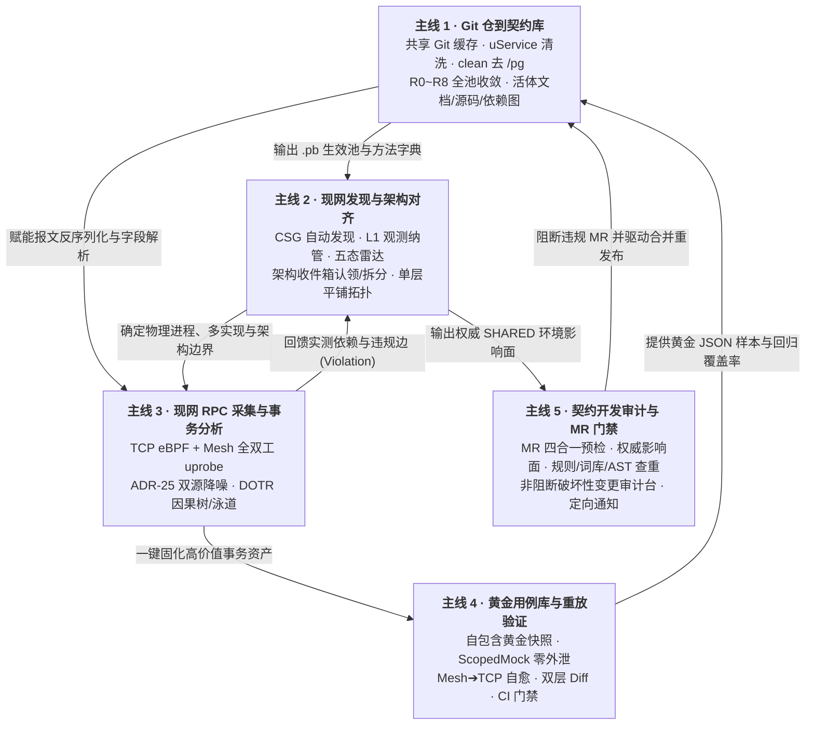
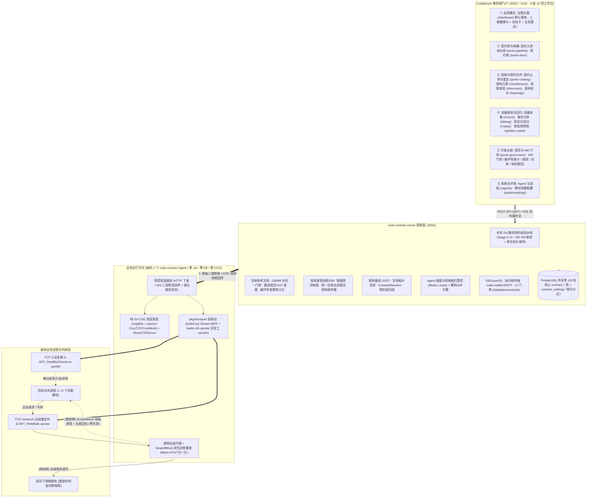

# 架构与活体契约治理平台 (`code-contract`)

> **产品定位**：以真实运行态为活水，架设微服务架构防漂移与活体契约防劣化的自愈防线  
> **当前版本**：`v0.5.0` | **服务标识**：`Code-Contract` (`contract`) | **专有协议**：DOPHI `CROS RPC`（纯 Go `tcp://` & `dophi_mesh://` 全双工采集/发现 ➔ `tcp://` 仿真重放）  
> **系统理念**：[《活体契约治理：以运行态为活水，构建微服务的五线自愈防线》](./docs/01-features/02-living-contract-philosophy.md)

本项目基于 CodeBench 微前端架构与 `code-common` 公共底座构建，严格遵循 **SDD (Spec-Driven Development，规范驱动开发) + TDD (Test-Driven Development，测试驱动开发)** 工程模式：  
**「契约基线与特性边界 (`01-features`) ➔ 系统架构与数据模型 (`02-design`) ➔ 接口契约与任务拆解 (`03-api` & `04-tasks`) ➔ TDD 测试先行与分阶段交付」**

---

## 1. 产品本质与五大核心主线 (Core Essence & Five Pillars)

传统的接口与契约管理（Swagger、Postman、静态 Proto 仓库等）普遍局限于**“设计态的静态文档”**，存在“文档与实现两张皮”、“无法感知生产实际调用”、“架构偷偷腐化漂移”及“跨微服务联调严重依赖完整下游环境”等系统性痛点。

`code-contract` 的业务本质是**「以契约治理为核心、以运行态真实流量为活水、以零侵入仿真为闭环的活体契约与微服务架构治理平台」**：
* **“流量录制与重放”是底层数据面技术手段**：提供零代码侵入、零业务改造成本的高保真交互采集与本地脱机仿真。
* **“契约炼金、架构对齐、事务洞察、防劣化回归与开发合规左移”五大主线构成完整的活体契约飞轮**：



### 五大核心能力主线 (Five Capability Lines)

| 能力主线 | 核心解决的痛点 | 平台提供的能力与技术机制 | 对应控制台入口 |
| :--- | :--- | :--- | :--- |
| **① Git/代码仓 ➔ 契约库**<br/>*(契约清洗、文档与依赖分析)* | Polyrepo 多仓 `.proto` 分散、存在私有 `uService` 语法与非标路径无法直接编译、跨仓副本冲突、接口文档与代码脱节 | 1. **复用平台 `code-bench` 真值源与共享 `codes/` 缓存**：两层并发锁（`RWMutex + flock`）与无工作树直读，500+ 仓毫秒级 `pg/` 白名单对齐（`CACHE_ONLY` / `FETCH_MISSING`）；<br/>2. **`rule-normalizer/v2` 与 `clean/` 去 `/pg` 扁平化**：注释感知 `uService` 转换、精确 `line_map` 溯源与 R0 分层排除；<br/>3. **Stage C+ 全池收敛与自封闭发布**：R4 双通道基座收割、R2 投票定标、R3 7 级仲裁、纯 Go `protocompile` R7 自愈与 R8 根因隔离，驱动阶段 ④ 拓扑层序单仓发布；<br/>4. **纯只读契约库**：全注释参考文档（`@deprecated/@owner/@error_code`、Enum 字典、黄金 JSON 与 Markdown 导出）、Raw/Clean 源码对照与跨包依赖关系图。 | **契约库与构建**<br/>`契约入库流水线` (`/proto-pipeline`)<br/>`契约库` (`/proto-docs`) |
| **② 现网发现 ➔ 进程与架构对齐**<br/>*(物理与逻辑双态治理)* | 先静态建模再抓包冷启动门槛极高；纸面架构与现网进程、多 PID 实例、多实现契约严重脱节，私自跨层调用与僵尸接口难以发现 | 1. **CSG 双层自动发现（100% 纯 Go）**：`pkg/rpcmon`（`CrosTCP` + `CrosMesh` 128B HELLO）+ `pkg/csgdlink`，隔离跨板 LDC、覆盖纯客户端与 `dophi_mesh://` 进程；<br/>2. **Discovery-First 与 L1 双粒度解耦**：`/discovery` 进程主轴视图、快照去重/脱敏/Diff、`Enroll` 观测纳管（`DISARMED`，不造假模块）与 `PhysicalReconciler` 周期衰减；<br/>3. **统一契约目录与架构收件箱**：三级 `.pb` 撮合（`EXACT`/`HEURISTIC`/`FINGERPRINT`）、五态健康雷达、`1 进程 : N 模块` 认领、`MULTI_IMPL` 拆分与依赖反向合成；<br/>4. **单层平铺架构数字孪生**：无外层包裹框、ELK 110px 正交对齐、四向智能锚点、作用域位置记忆与纯矢量 SVG/PNG 导出。 | **架构与契约对齐**<br/>`契约认领与雷达` (`/proto-catalog`)<br/>`架构元素` (`/architecture`)<br/>`现网发现` (`/discovery`)<br/>`架构拓扑` (`/topology`) |
| **③ 现网 RPC 采集 ➔ 事务分析**<br/>*(全双工无感观测与脉搏透视)* | 抓包需要改业务代码或重启进程；`dophi_mesh` 走共享内存旁路无 Socket 流量；基础设施日志刷爆录制并淹没业务主干 | 1. **纯 Go 可插拔传输驱动 (`pkg/transport`)**：`builtin-tcp`（全出站透明代理与按需入站钩子，支持 `setcap` 免 sudo 与 `ARMED` 零重启开录）+ `builtin-drt-uprobe`（`debug/elf` `.dynsym` 锚定 `DRT_WriteBulk` + `DRT_ReadNoCheckLen` 全双工采集 `dophi_mesh`）；<br/>2. **ADR-25 全链路降噪**：全局规则 + 服务标记双源合并、`Agent` 源头成对丢弃，事务树先完成耗时算账再折叠（异常破格绝不掩盖根因）；<br/>3. **业务视角事务剖析**：DOTR 因果调用树、多进程 `EGRESS ⇔ INGRESS` 跨跳缝合、微秒级阶段耗时甘特条、交互式 SVG 时序泳道、参数血缘与双栏入参/出参对比。 | **流量核验与回归**<br/>`流量采集` (`/record`)<br/>`事务分析` (`/debug`) |
| **④ 黄金用例库 ➔ RPC 重放验证**<br/>*(脱机回归与质量门禁)* | 跨微服务回归严重依赖全套下游环境；测试造数失真；流量分区清理后高价值用例流失 | 1. **自包含黄金契约套件**：将高价值调用事务一键固化为完全自包含快照（二进制报文 + 闭包），支持动态掩码脱敏并永久免疫 30 天分区清理；<br/>2. **零外泄因果闭包重放**：`ScopedMock` 局部因果池接管出口请求（**真实下游 0 字节外泄**），自动自愈 `ullSNO`/`aucTraceBuff`/`ullClientSendTime`，支持 `Mesh ➔ tcp://`（`ucProtocol: 4->1`）跨传输归一化与 CSG 三模沙箱（`CLIENT_INJECT`/`PUB_STUB`/`MOCK_SERVER`）；<br/>3. **双层语义 Diff 与 CI 门禁**：协议头状态码 + Protobuf 字段级精准比对，支持 `/api/gates/evaluate`（`X-Contract-CI-Token` + 有界排队锁）流水线强阻断。 | **流量核验与回归**<br/>`防劣化回归` (`/replay`)<br/>`黄金用例库` (`/golden-suites`) |
| **⑤ 契约开发审计 ➔ MR 流水线**<br/>*(研发期规范守护与变更审计)* | 接口命名混乱、重复结构体泛滥、破坏性变更在合入前无预警；或因阻断策略导致主干契约库同步断链 | 1. **Git MR 四合一自动化门禁 (`/api/webhooks/git-mr`)**：基线+补丁虚拟树（支持增删改名与 Fast-Forward 去重）、静态规则/词库/3s 降级 LLM 检查、`Jaccard >= 0.85` 三护栏 AST 重复探测、含 `BASE_LIB` 传递扩散与权威 `SHARED` 现网影响面的破坏性检查，支持原位评论回写与管理员 `Override` 审计；<br/>2. **非阻断上线破坏性变更审计台 (`BreakingChangeEvent`)**：取消入库与激活阶段硬阻断，让契约库真实反映代码仓现状，同时自动生成 `OPEN -> ACKNOWLEDGED` 审计事件归口规范台集中处置；<br/>3. **全网健康与定向触达**：治理大盘（三维封顶健康分 + 合标卡 + 五态雷达）、`SSEBroker(userID)` 定向推送、站内收件箱与跨机 `code-notifier`/SMTP 通知。 | **开发合规**<br/>`规范与 MR 门禁` (`/proto-governance`)<br/><br/>**全局概览**<br/>`治理大盘` (`/dashboard`) |

---

## 2. 系统总体拓扑 (System Topology)

系统采用 **「控制面主框架 (`code-contract-server`) + 独立数据面代理 (`code-contract-agent`)」同仓双二进制物理防腐** 架构：



---

## 3. 目录结构 (Repository Layout)

```text
code-contract/
├── docs/                # SDD + TDD 规范文档库 (00-prompt ~ 07-references)
├── cmd/
│   ├── server/          # 控制面入口 code-contract-server（微前端托管、四阶段流水线、契约中心、Diff 引擎）
│   ├── agent/           # 数据面探针入口 code-contract-agent（零数据库、零.pb、零 CGO、嵌入式 eBPF/uprobe）
│   └── resetdb/         # 本地隔离清库与状态重置工具入口 (make reset-db)
├── demo/                # 4 进程微服务仿真集群、CSG 服务与田字格 Tmux 可视化联调演示
├── internal/
│   ├── server/          # 控制面核心引擎：callgraph/dashboard/decoder/diff/discovery/gitclient/hub/linter/noise/notify/protodoc/recorder/security/topology
│   └── agent/           # 数据面内部服务：eBPF/uprobe 信道服务、CSG 双层发现融合与三模仿真控制器、出站代理与 ScopedMock
├── pkg/
│   ├── crosrpc/         # CROS RPC 协议解析与分帧库（主控、Agent 与 rpcmon 共享，支持 ucProtocol 0..7）
│   ├── agentproto/      # 主从 HTTP DTO、56B 二进制信封帧契约及纯标准库 NoiseMatcher
│   ├── csgdlink/        # CSG/dlink 控制面 32B 帧栈、只读发现与流式 Observer（100% 纯 Go 标准库）
│   ├── rpcmon/          # RPCMonitorService 统一监控模型、纯 Go CrosTCP & CrosMesh（128B HELLO + 40B 数据头 + 手写 Wire）
│   ├── csgmock/         # 内存态 MockCSGServer 控制面沙箱（实现 rpcmon.Provider，支持 Mesh->TCP 改写与五出口清理）
│   ├── ebpf/            # cilium/ebpf 内核探针（Socket eBPF + DRT_WriteBulk / DRT_ReadNoCheckLen uprobe）、预热与三态出站代理
│   ├── transport/       # Agent 纯 Go 可插拔传输驱动抽象 (Driver/Registry)、builtin-tcp 与 builtin-drt-uprobe (ADR-22/23)
│   ├── replay/          # 零 .pb 二进制 ScopedMock 匹配、ucProtocol (4->1) 发送期归一化与 ullSNO 自愈引擎
│   └── version/         # 规范化语义版本号与构建指纹
├── config/              # 配置加载与模块级元数据常量 (ModuleKey="contract", TablePrefix="contract_")
├── models/              # GORM 数据模型（43 张核心 contract_* 表 + contract_settings 物理前缀隔离）
├── handlers/            # HTTP 控制器、RBAC 权限守卫、审计 Diff、CI/MR 门禁与物理隔离单元测试
├── frontend/            # React 18 + Vite 5 + Module Federation 微前端工程（6 组 14 项工作台）
├── scripts/             # 自动化构建、多仓沙箱演练与辅助脚本
├── Makefile             # 标准构建、测试与代码检查入口
├── AGENTS.md            # AI Agent 协作准则与架构红线
└── README.md            # 项目概览与 SDD+TDD 路线图
```

完整文档规范与分层索引请查阅 [`docs/README.md`](./docs/README.md)。

---

## 4. SDD + TDD 研发路线图 (Lifecycle Checklist)

- [x] **阶段一：理念、特性清单与边界明确** (`docs/01-features/`)
  - [x] [`01-feature-matrix.md`](./docs/01-features/01-feature-matrix.md)（活体契约愿景、五大能力主线、特性矩阵 `F-01~F-54`、验收场景 `SC-01~SC-33` 与 `Non-Goals`）
  - [x] [`02-living-contract-philosophy.md`](./docs/01-features/02-living-contract-philosophy.md)（系统理念专文：《活体契约治理：以运行态为活水，构建微服务的五线自愈防线》）
- [x] **阶段二：系统架构与模型设计** (`docs/02-design/`)
  - [x] [`01-system-architecture.md`](./docs/02-design/01-system-architecture.md)（主从协同、双模运行架构、五线映射、Discovery-First 与共享 Git 四阶段流水线）
  - [x] [`02-data-plane-and-cros-rpc-engine.md`](./docs/02-design/02-data-plane-and-cros-rpc-engine.md)（CROS RPC 协议栈、纯 Go `pkg/transport` 双驱动与 `dophi_mesh` 全双工 uprobe、Agent 源头降噪、纯 Go `CrosTCP`/`CrosMesh` 监控与二进制 Mock 引擎）
  - [x] [`03-architecture-elements-and-topology.md`](./docs/02-design/03-architecture-elements-and-topology.md)（三级架构模型 SSOT、多实现服务契约、L0/L1/L2 双态对齐、统一目录五态雷达、架构收件箱与单层平铺拓扑核验）
  - [x] [`04-control-plane-and-web-console.md`](./docs/02-design/04-control-plane-and-web-console.md)（控制面调度、6 组 14 项控制台 IA、四阶段可视化流水线、只读契约库、静态规范/MR 门禁与非阻断破坏性审计台）
  - [x] [`05-database-schema.md`](./docs/02-design/05-database-schema.md)（43 张核心 `contract_*` 业务表 + `contract_settings` 配置表、黄金套件与按日范围分区设计）
  - [x] [`06-agent-observability-and-self-healing-design.md`](./docs/02-design/06-agent-observability-and-self-healing-design.md)（Agent 探针特权感知、体检诊断与全链路闭环自愈设计）
- [x] **阶段三：接口契约与 TDD 任务分解** (`docs/03-api/`, `docs/04-tasks/`)
  - [x] [`01-http-api-contract.md`](./docs/03-api/01-http-api-contract.md)（REST/SSE 契约、发现/纳管/四阶段流水线/降噪/破坏性审计、CI/MR 门禁鉴权、主从 HTTP/WS 信道协议与 RBAC 权限矩阵）
  - [x] [`01-roadmap.md`](./docs/04-tasks/01-roadmap.md)（Milestone 1~45 DAG 拓扑、特性覆盖矩阵与全局质量门禁）
  - [x] **M1~M45 作战卡全量交付 (100% Completed)**：
    - **M1~M14 · 协议底座、架构孪生、双向双录、因果树与治理大盘**：[`M1`](./docs/04-tasks/02-m1-crosrpc-and-domain-models.md) · [`M2`](./docs/04-tasks/03-m2-arch-proto-and-agent-control.md) · [`M3`](./docs/04-tasks/04-m3-agent-dataplane-ebpf-and-replay.md) · [`M4`](./docs/04-tasks/05-m4-recording-topology-and-diff-engine.md) · [`M5`](./docs/04-tasks/06-m5-microfrontend-and-e2e-delivery.md) · [`M6`](./docs/04-tasks/07-m6-hierarchical-topology-canvas.md) · [`M7`](./docs/04-tasks/08-m7-proto-schema-deepening-and-nested-contract-workbench.md) · [`M8`](./docs/04-tasks/09-m8-console-ia-restructuring-and-debug-workflow.md) · [`M9`](./docs/04-tasks/10-m9-recording-drawer-and-process-tree-selection.md) · [`M10`](./docs/04-tasks/11-m10-arch-process-blueprint-and-premount-workflow.md) · [`M11`](./docs/04-tasks/12-m11-enhanced-proto-schema-asset-management.md) · [`M12`](./docs/04-tasks/13-m12-bidirectional-capture-and-agent-recording-ux.md) · [`M13`](./docs/04-tasks/14-m13-packet-causality-call-tree-and-sequence-workbench.md) · [`M14`](./docs/04-tasks/15-m14-governance-dashboard-and-ia-restructuring.md)
    - **M15~M27 · 黄金套件、MR 门禁、单层拓扑、多实现契约与 Proto 活体文档**：[`M15`](./docs/04-tasks/16-m15-golden-contract-suites-and-curation-workbench.md) · [`M16`](./docs/04-tasks/17-m16-design-time-breaking-change-radar.md) · [`M17`](./docs/04-tasks/18-m17-ci-cd-quality-gate-and-automated-enforcement.md) · [`M18`](./docs/04-tasks/19-m18-business-centric-packet-inspector-redesign.md) · [`M19`](./docs/04-tasks/20-m19-scalable-topology-focus-and-layout-persistence.md) · [`M20`](./docs/04-tasks/21-m20-multi-implementation-service-contract.md) · [`M21`](./docs/04-tasks/22-m21-topology-single-layer-drilldown-and-layout-ux.md) · [`M22`](./docs/04-tasks/23-m22-protocompile-layering-and-dependency-graph.md) · [`M23`](./docs/04-tasks/24-m23-living-proto-docs-and-readonly-sources.md) · [`M24`](./docs/04-tasks/25-m24-static-lint-vocabulary-and-duplicate-ast.md) · [`M25`](./docs/04-tasks/26-m25-git-sync-and-monorepo-bundles.md) · [`M26`](./docs/04-tasks/27-m26-mr-gates-notifications-and-compliance-dashboard.md) · [`M27`](./docs/04-tasks/28-m27-proto-ia-unbundling-and-four-workbenches.md)
    - **M28~M32 · CSG 自动发现、纯 Go Mesh 传输与 Discovery-First 架构对齐**：[`M28`](./docs/04-tasks/29-m28-csg-service-discovery-and-multi-mode-simulation.md) · [`M29`](./docs/04-tasks/30-m29-pluggable-transport-and-mesh-uprobe-capture.md) · [`M30a`](./docs/04-tasks/31-m30a-discovery-workbench-and-snapshot-diff.md) · [`M30b`](./docs/04-tasks/32-m30b-physical-logical-decoupling-and-migration.md) · [`M31`](./docs/04-tasks/33-m31-quick-record-two-stage-attribution-and-catalog-radar.md) · [`M32`](./docs/04-tasks/34-m32-architecture-inbox-dependency-synthesis-and-mr-impact.md)
    - **M33~M45 · 500+ 平台仓共享缓存、`uService` 全池收敛与四阶段流水线闭环**：[`M33`](./docs/04-tasks/35-m33-shared-git-cache-foundation.md) · [`M34`](./docs/04-tasks/36-m34-platform-repos-pg-collect-and-normalizer.md) · [`M35`](./docs/04-tasks/37-m35-analyze-compile-clean-tree-and-dual-view.md) · [`M36`](./docs/04-tasks/38-m36-conflict-arbitration-blast-radius-and-memfs-retirement.md) · [`M37`](./docs/04-tasks/39-m37-ssot-and-bulk-sync-engine.md) · [`M38`](./docs/04-tasks/40-m38-export-dir-governance-and-stage-b-normalizer.md) · [`M39`](./docs/04-tasks/41-m39-dual-subtab-ia-and-governance-ledger.md) · [`M40`](./docs/04-tasks/42-m40-uservice-normalizer-v2-and-pg-flattening.md) · [`M41`](./docs/04-tasks/43-m41-shared-base-harvest-and-pool-stage-c-plus.md) · [`M42`](./docs/04-tasks/44-m42-protocompile-r7-r8-workspace-and-console-closure.md) · [`M43`](./docs/04-tasks/45-m43-workspace-topology-publish-and-pipeline-closure.md) · [`M44`](./docs/04-tasks/46-m44-proto-pipeline-four-stage-workbench.md) · [`M45`](./docs/04-tasks/47-m45-four-menu-ia-consumer-consolidation-and-e2e.md)
- [x] **阶段四：工程实施、架构决策、参考基线与运维验证** (`docs/05-adr/`, `docs/06-ops/`, `docs/07-references/`)
  - [x] [`docs/05-adr/`](./docs/05-adr/)（`ADR-01` ~ `ADR-30` 架构决策全景记录）
  - [x] [`01-verification-and-deployment-guide.md`](./docs/06-ops/01-verification-and-deployment-guide.md)（联调测试与生产部署手册）
  - [x] [`02-e2e-browser-test-and-ux-review.md`](./docs/06-ops/02-e2e-browser-test-and-ux-review.md)（E2E 黑盒走查与交互走查记录）
  - [x] [`docs/07-references/`](./docs/07-references/)（[`01-cros-rpc-protocol-spec.md`](./docs/07-references/01-cros-rpc-protocol-spec.md) & [`02-drt-uprobe-abi-reference.md`](./docs/07-references/02-drt-uprobe-abi-reference.md)）

---

## 5. 快速开始与常用命令

```bash
# 1. 后端依赖检查与全量单元测试（包含物理隔离数据库用例）
make test

# 2. 前端静态类型与代码质量检查（TypeScript + ESLint 严格模式）
make lint

# 3. 完整编译打包（生成前端静态资产、控制面单二进制与 Agent 单二进制）
make build

# 4. 启动控制面服务（默认监听 :8091）
./code-contract-server

# 5. 启动数据面 Agent（需特权或 setcap 权能，默认监听 :9091）
sudo ./code-contract-agent
# 或免 sudo 启动（提前执行: sudo setcap cap_net_raw,cap_net_admin,cap_bpf+ep ./code-contract-agent）
./code-contract-agent

# 6. 运行 4 进程微服务 Demo 集群（田字格 Tmux 可视化分屏联调）
cd demo && make tmux-demo
```

---

## 6. 🏷️ 版本历史 (Release History)

### v0.5.0 (2026-11-28)
* **🧭 按五大核心主线重塑信息架构与工作台体验 (M43~M45 + ADR-30)**：
  - 将控制台菜单重构为 **6 组 14 项**（`全局概览`、`契约库与构建`、`架构与契约对齐`、`流量核验与回归`、`开发合规`、`系统与环境`），全面对齐「Git 仓 ➔ 契约库」、「现网发现 ➔ 架构对齐」、「现网采集 ➔ 事务分析」、「黄金用例 ➔ 回归重放」与「开发规范与 MR 门禁」五大能力主线；
  - 新增系统理念专文 [《活体契约治理：以运行态为活水，构建微服务的五线自愈防线》](./docs/01-features/02-living-contract-philosophy.md)。
* **🏭 500+ 平台仓共享 Git 缓存、`uService` 清洗收敛与完全自封闭四阶段流水线 (M33~M45 · ADR-26~29)**：
  - 收口 `code-bench` `repositories` 为平台唯一真值源，基于 `code-common/backend/gitsync` 两层锁（`RWMutex + flock`）与无工作树直读下线 `go-git memfs` 与外部独立建仓；
  - 落地 `rule-normalizer/v2`（`uService` 注释感知转换、`clean/` 去 `/pg` 扁平化、精确 `line_map` 溯源）、Stage C+ 全池协调（R0~R4 基座收割、R2 投票定标、R3 7 级仲裁、纯 Go `protocompile` R7 自愈 & R8 根因隔离）与阶段 ④ 拓扑层序单仓编译发布引擎（`/proto-pipeline`）；
  - 下线历史外部 `.pb` 上传与在线 `.proto` 文本直编入口，确立纯只读契约库 `/proto-docs`（全注释双视图目录树、clean/ 懒加载源码对比、跨包依赖图全屏自适应与 SVG/PNG 导出）。
* **🔍 以「现网发现」为中心的物理/逻辑双态解耦与全链路降噪 (M30a~M32 · ADR-24 / ADR-25)**：
  - 上线 `/discovery` 进程主轴发现工作台、持久化快照与双模 Diff、L1 观测纳管（`Enroll` `DISARMED`，不造假模块）、`PhysicalReconciler`、一键直录 Saga（`target_pids[]`）、两阶段归因、统一契约目录（`/proto-catalog` 五态雷达）与架构收件箱（`1:N` 认领、`MULTI_IMPL` 拆分、依赖反向合成与 MR 权威影响面）；
  - 落地 `ADR-25` 双源噪音配置、Agent 源头零 `.pb` 成对丢弃（`DROP_AT_AGENT`）及事务树“先算账后折叠 + 异常破格”降噪。
* **⚡ `dophi_mesh` 全双工 uprobe 采集与非阻断破坏性变更审计归口**：
  - 在 `DRT_WriteBulk` 基础上新增 `DRT_ReadNoCheckLen` uprobe/uretprobe，实现 `dophi_mesh` 单进程全双工零侵入捕获（`docs/07-references/02-drt-uprobe-abi-reference.md`）；
  - 取消契约入库与激活阶段的破坏性变更硬阻断，新增 `contract_breaking_change_events`（43+1 表）并在 `/proto-governance` 新增「上线破坏性变更审计」页签实现 `OPEN -> ACKNOWLEDGED` 合规闭环。

### v0.4.0 (2026-11-23)
* **🧭 CSG 现网双层自动发现、纯 Go `CrosMesh` 监控与三模渐进仿真闭环 (M28 · ADR-21 v2.2.0)**：
  - 落地 100% 纯 Go `pkg/csgdlink`（32B dlink 帧栈、248B 实例与流式 `Observer`）、`pkg/rpcmon`（手写 Protobuf Wire 编解码、纯 Go `CrosTCPBackend` `CROSTCP_RPCMON` 与纯 Go `CrosMeshBackend` `CROSMESH_RPCMON` 4 次 128B HELLO + 40B 数据头 + CROS `ucProtocol=4`）及内存态 `pkg/csgmock.MockCSGServer`（彻底移除外部 C++ 探针子进程 `rpcmon_probe`）；
  - 实现 `LocateCSGEndpoints` 多租户定位（`31800+userId`）与 `DiscoverAndFuse` 双层融合，自动隔离跨板远端 LDC 实例，100% 补齐无 TCP 监听端口的纯客户端与 `dophi_mesh://` 进程，提供 `/agents` CSG 三态对账与管理员一键导入架构蓝图抽屉；
  - 支持 64B 运行期服务名 `proto_service_name` 别名映射（含 `^(.+-\d+)-(\d+)$` PID 归一化）及 `PASSTHROUGH` / `CLIENT_INJECT` / `PUB_STUB`（前置 `Sub==0` 门禁、零 `GET_BIND_ADDR` 端口游标污染）/ `MOCK_SERVER` 四档重放仿真策略与五出口幂等清理。
* **⚡ 纯 Go 可插拔传输驱动 (`pkg/transport`) 与「`dophi_mesh` 内核 uprobe 采集 ➔ `tcp://` 仿真重放」闭环 (M29 · ADR-22 v2.0.0 / ADR-23 v1.1.0)**：
  - 构建纯 Go `pkg/transport.Driver` 抽象（内置 `builtin-tcp` 与基于 Go 标准库 `debug/elf` 解析 `libdopra.so:DRT_WriteBulk` `.dynsym` 的 `builtin-drt-uprobe` 内核 uprobe 采集驱动，`ARMED` 期 0 uprobe 挂载、PID 级匿名 `perf_event_open` 零 tracefs 污染），严守九包 `CGO_ENABLED=0` 物理防腐红线（永久禁止外部 `.so` 插件与 `readelf`/`nm` 子进程）；
  - 解封 `pkg/crosrpc.ValidateCommHead` 支持 `ucProtocol ∈ [0..7]`（`StreamFramer` 保持默认 `<=1` 防伪帧），56B `EnvelopeHeader` 偏移 `26` 透传 `TransportProto (1=TCP, 4=MESH)` 零 DDL 迁移落盘；
  - 打通跨传输仿真重放闭环：`MOCK_SERVER` 自动将 `dophi_mesh://` 改写为 `tcp://` 并放行订阅，`ReplayExecutor` 与 `HealResponseFrames` 在 TCP 发送副本中原地将 `ucProtocol (4 -> 1)` 归一化。

### v0.3.0 (2026-11-16)
* **🧭 架构拓扑单层平铺下钻与大规模聚焦治理 (M19 / M21 · ADR-15 / ADR-17)**：
  - 重构为「单层平铺逐级下钻」架构数字孪生画布（废除外层包裹框，仅展示直属子节点与左右 `FIRST/LAST` 外部传送门卡），配备面包屑导航、`1~2 Hop` 有向邻域与可见节点规模守卫；
  - 校准 ELK 单层正交参数（`110px` 层间净空）与 CSS `border-box` `1:1` 尺寸对齐，引入四向智能锚点路由、同锚点多边错位偏移与悬停流动点线聚光灯；
  - 落地按 `(view, focus_scope)` 隔离的双层混合布局持久化（`contract_topology_layouts` 团队官方基准 `SHARED` + 个人视图书签 `PRIVATE`），且仅用户显式拖拽/图钉固定才锁位。
* **🔀 多实现服务契约建模与调度拓扑闭环 (M20 · ADR-16)**：
  - 新增 `CONTRACT_LIB` 接口库模块类型、`contract_service_contracts` 与 `DISPATCH` 分发依赖，支持 `EXCLUSIVE`（独占）与 `MULTI_IMPL`（接口库定义 + 多进程实现 + 自定义运行期服务名）双模服务契约及同契约跨实现进程不相交守卫；
  - 统一 `ContractResolver` 实现实测端点消歧与第八类一致性状态 `IMPL_UNRESOLVED`，拓扑画布支持 `«interface»` 库卡、`REALIZATION` 实现图层及 `AGG|EXPAND` 模式切换；
  - Agent 侧新增 `dst_tag` 隔离防串用，Demo 集群新增支付 LIB 与 `ALIPAY/WECHAT` 双渠道实例验证。
* **📜 Proto 全生命周期治理与纯 Go `protocompile` 底座 (M22~M25 · ADR-18)**：
  - 引入纯 Go `github.com/bufbuild/protocompile` 四级虚拟解析器（零 `os/exec`），支持跨 Bundle `SourceCodeInfo` 精确裁剪、全局 `layer_level` 分层逆向依赖拦截（`409`）与 `BASE_LIB` 传递影响雷达，并交付 `/topology` 纯矢量 SVG/PNG 导出；
  - 交付全注释驱动的活体接口参考文档中心（`F-18`，支持 `@deprecated/@owner/@error_code`、Enum 字典、黄金 JSON 样本与 Markdown 手册导出）及轻量只读源码/Commit Diff 视图（零 `monaco-editor`）；
  - 构建 `CONTRACT_CRYPTO_KEY` AES-256-GCM 加密与 `SafeDialer` SSRF 防护底座（支持 `outbound_trusted_cidrs` 白名单），落地可配置静态规范引擎、原生 `BUILTIN_SEED` 领域词库、`3s` 超时降级 LLM 辅助及三护栏 AST 重复结构检测（`Jaccard >= 0.85`）；
  - 实现无状态 Git 同步、`GitRepo (1) -> GitProtoBundle (N)` Monorepo 多包模型与只读源码快照对账。
* **🛡️ Git MR 四合一门禁、定向通知中心与静态合标大盘 (M26 · ADR-18)**：
  - 交付 `POST /api/webhooks/git-mr/:repoId` 基线+补丁虚拟树四合一静态门禁（`uk_contract_mr_dedup` 消除 Fast-Forward 漏触发）、Bot 原位评论更新、管理员 `Override` 豁免（禁止豁免编译失败 + `P1` 审计）及主干合并自动编译入池；
  - 升级 `SSEBroker(userID)` 定向推送、站内持久化收件箱（`contract_notifications`）与跨机 `code-notifier` / SMTP 通知触达，适配微前端嵌入与独立壳双模 `NotificationBell`；
  - 治理大盘新增静态合规扩展卡片（`StaticComplianceCard`），保持原有 `40+30+30` 健康分公式稳定。
* **🗂️ Proto 契约控制台 IA 拆解与全仓更名 `code-contract` (M27 / ADR-19 / ADR-20)**：
  - 全局侧边栏升级为 **5 组 13 项**，拆出独立一级分组「Proto 契约治理」及四张正交工作台（`/proto-docs`、`/proto-sources`、`/proto-governance`、`/schemas`），并无损重定向全部 `/schemas?tab=*` 历史深链与 `#L<n>` 锚点；
  - 全仓正式更名为 `code-contract`（Go Module、二进制名 `code-contract-server` / `code-contract-agent`、`contract_*` 30+1 张表、环境变量 `CONTRACT_*` 与 API 响应头），彻底清理历史兼容垫片。

### v0.2.0 (2026-11-08)
* **🌟 平台级契约治理全景大盘 (M14)**：
  - 控制台默认落地治理大盘 (`/dashboard`)，确立 4 组 10 项清晰现代信息架构；
  - 引入公私域隔离的三支柱子分封顶健康指数（规范性 40 分 + 一致性 30 分 + 回归保障率 30 分 = 100 分）；
  - 架构违规漂移 Top 榜、未覆盖僵尸接口告警与未认领孤儿契约实时透视。
* **🏆 黄金契约套件与事务固化工作台 (M15)**：
  - 支持将生产高价值真实调用流一键沉淀为自包含黄金用例快照（二进制 Raw Packet + 闭包数据）；
  - 永久免疫 30 天流量物理分区清理，支持多用例集批量脱机回归演练、基线版本锁定与脱敏。
* **🚨 设计态契约破坏性变更阻断雷达 (M16)**：
  - 深度解析 Protobuf AST，精确识别删除字段、类型变更、wire type 漂移、tag 碰撞及保留编号冲突；
  - 自动化全网下游微服务消费血缘影响推导与风险评级；
  - 提供管理员加签（`allow_breaking` + 审计说明）紧急逃生舱。
* **🛡️ CI/CD 自动化流水线强阻断门禁 (M17)**：
  - 开放专用 CI 门禁判定 API（`POST /api/v1/gate/verify`）与 `X-Contract-CI-Token` SHA-256 常量时间安全比对；
  - 引入排他租约锁有界排队机制（Bounded Mutex Lease Queue），彻底消除高并发流水线踩踏冲突；
  - 支持实测边双向回传校验（Confirmed / External / Violation）与非零状态码强阻断，沉淀结构化 MR/PR 评估报告。
* **🔍 面向业务视角的 RPC 报文透视与双模解剖 (M18)**：
  - 抽屉信息架构从“网络抓包 Wireshark 视角”全面升维至“业务联调与排障视角”；
  - 打造请求入参与返回结果左右双栏孪生同屏对比视窗（Split View），支持 JSON 树高亮与独立一键复制；
  - 提供微秒级阶段耗时彩色甘特条（客户端传输 / 队列等待 / 服务端处理比例）；
  - 渐进式折叠底层协议专家手风琴区（24B CommHead 位图、SessionHead 字段表、ExtendHead 链路与 16B 对齐 HexDump 完整保留）。
* **⚡ 数据面 Agent 体验、高可用与自愈加固**：
  - 支持免 sudo 运行（`setcap CAP_NET_RAW,CAP_NET_ADMIN,CAP_BPF` Linux Capabilities 配置指引）；
  - 启动特权自检与全链路探针生命周期自动自愈；
  - 控制台新增 Agent 下载与一键接入说明 TAB，提供多架构二进制直下与自动化挂载脚本；
  - 现网主控 IP 默认白名单支持与动态白名单机制；
  - 配套田字格 Tmux 一键可视化 4 进程演示集群（Backend/Agent/SUT/Client）。
* **🎨 现代 Web 体验与生态准则合规**：
  - 严格遵循深浅双模主题 Design Tokens（`--color-*` 语义 Token）与扁平 BEM 规范；
  - 严格遵循标准通用分页规范（15/25/50/100，默认 25，5页滑动窗口，URL SearchParams 同步）；
  - 全量 22 个前端测试套件 78 个用例 + 后端单元测试 100% 零警告全绿通过，零 TypeScript 与 ESLint 告警。

### v0.1.0 (2026-11-05)
* **🌟 战略定位升维**：明确从纯技术视角的“业务流量录制工具”升维为“**基于真实流量的活体契约与微服务架构治理平台**”，确立“接口资产治理”、“架构漂移雷达”与“无依赖自愈防劣化”三大价值支柱。
* **🧩 核心架构与微前端集成**：
  - 基于 CodeBench 微前端模块联邦规范设计，支持主控控制面（`code-contract-server`）与数据面探针（`code-contract-agent`）物理防腐隔离。
  - 前端基于 React 18 + Vite 5 + Module Federation，暴露 `./App` 与 `./menu` 双模接入点。
* **🛡️ 业务协议与契约治理**：
  - 聚焦明文 IPv4 TCP CROS RPC 二进制分帧与 SessionHead 会话头解析（支持 V01~V05 会话头演进）。
  - 支持 Protobuf 描述集（`.pb`）同名多版本管理、联合编译冲突门禁检测与接口级 Diff 忽略规则继承。
* **⚡ 协同录制与排他租约**：
  - 严格区分团队共享（`SHARED`）与个人私有（`PRIVATE`）作用域，实现 Agent 动态排他租约互斥（`409 Conflict` 防并发争抢）。
  - 采用基于 TCP 会话对的单往返双模持久化（`raw_req_packet` + `raw_rsp_packet` 及 `payload_json`）。
* **🔄 双层 Diff 对账与单包调试重放**：
  - 支持单包即时重放、序列号 `ullSNO` 自愈与基于多字段维度的结构化 Diff 对账引擎。
  - Agent 严格落实重放零外泄（`MOCK_MISS` 阻断）与探针卫生管理（退出自动卸载 eBPF）。
* **🏷️ 规范版本号体系**：
  - 建立统一的语义版本号（SemVer）与构建指纹规范（`pkg/version`），支持 `v0.1.0 (commit: <hash>, built: <time>)` 精准溯源。
