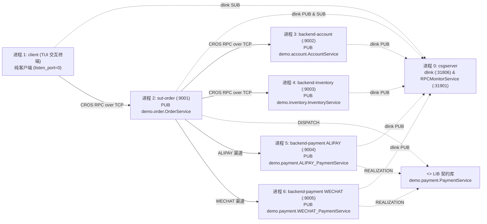

# CROS RPC + CSG 微服务仿真测试集群 (CROS RPC Benchmark Cluster)

> 本工程是基于 [`code-contract/docs/07-references/01-cros-rpc-protocol-spec.md`](../docs/07-references/01-cros-rpc-protocol-spec.md) 与 [`ADR-21`](../docs/05-adr/21-csg-aware-agent-service-discovery-and-replay-mock-adr.md) 规范构建的分布式电商交易微服务系统，内置标准 DOPRA `dlink` CSG 控制面仿真器 (`csgserver`) 与 `RPCMonitorService` 查询口，专门作为 `code-contract` 双层自动发现、旁路流量录制、架构拓扑校验及三模渐进式重放仿真（`CLIENT_INJECT` / `PUB_STUB` / `MOCK_SERVER`）的标准靶场应用。

---

## 1. 系统架构与 CSG 控制面拓扑



- **CSG 控制面 (`cmd/csgserver`)**：基于 `pkg/csgmock` 与 `pkg/rpcmon` 构建的本地 DOPRA `dlink` 服务注册中心与 `RPCMonitorService`（`--addr=127.0.0.1:31806`，`--monitor=127.0.0.1:31901`）。支持 `--query` 模式直接查询服务实例与客户端订阅快照。
- **Client (`cmd/client`)**：交互式 TUI 控制台，默认经 CSG `SUB` 发现 `demo.order.OrderService`（无监听端口纯客户端），支持 `[1]`~`[9]` 业务指令及 `[s]` 实时查看 CSG 服务目录。
- **SUT 订单网关 (`cmd/sut-order`)**：被测核心服务（监听 `:9001`）。启动时自动向 CSG `PUB` 自身服务并 `SUB` 下游账户、库存与双渠道支付服务，支持断开重连时的动态 CSG 重新解析。
- **Backend 1 账户资产服务 (`cmd/backend-account`)**：提供用户资金账本查询与扣款（监听 `:9002`，向 CSG `PUB` `demo.account.AccountService`）。
- **Backend 2 仓储库存履约服务 (`cmd/backend-inventory`)**：提供商品行情查询、库存预占锁定、实扣确认与回滚释放（监听 `:9003`，向 CSG `PUB` `demo.inventory.InventoryService`）。
- **Payment LIB 双实例 (`cmd/backend-payment`)**：基于统一接口契约 `demo/proto/payment.proto` (`demo.payment.PaymentService`) 实现的双渠道实例（ALIPAY `:9004` / WECHAT `:9005`），启动时向 CSG `PUB` 各自运行期服务名。

> 提示：所有业务进程均支持传入 `--csg=""`（或 `./start.sh --no-csg`）一键退化为静态端口直连模式。

---

## 2. 快速开始与常用命令

### 2.1 编译与测试
```bash
# 1. 运行所有单元与全链路集成测试 (包含静态集群与 CSG 三模端到端测试)
make test

# 2. 编译全部可执行二进制（含 csgserver 与 code-contract-agent）到 bin/ 目录
make build
```

### 2.2 启动微服务集群

#### 方式 A: Tmux 分屏可视化启动 (强烈推荐: 左 4 框 + 右 4 框)
```bash
./start.sh
# 或使用 make 别名
make tmux
```

分屏布局视图：
```text
┌───────────────────────────┬───────────────────────────┐
│   backend-account (:9002) │ csgserver (:31806/:31901) │
├───────────────────────────┼───────────────────────────┤
│  backend-inventory (:9003)│    sut-order (:9001)      │
├───────────────────────────┼───────────────────────────┤
│  payment ALIPAY (:9004)   │ code-contract-agent(:9091)│
├───────────────────────────┼───────────────────────────┤
│  payment WECHAT (:9005)   │       client (TUI)        │
└───────────────────────────┴───────────────────────────┘
```
- 常用参数：`./start.sh --build`（强制重编）、`./start.sh --stop`（一键停止会话并清空 `9001~9005, 9091, 31806, 31901` 端口）、`./start.sh --no-client`（保留终端而不自动启动客户端）、`./start.sh --no-csg`（静态端口模式）。

#### 方式 B: 后台守护进程启动与目录查询
```bash
# 后台拉起 csgserver + 4 下游 + sut-order (共 6 个后台服务进程)
make start

# 查询 CSG 上已发布的服务实例与客户端订阅明细
make csg-status
# 或直接执行：
./bin/csgserver --query --addr=127.0.0.1:31806 --monitor=127.0.0.1:31901 --op=all
```

### 2.3 启动 TUI 交互式客户端 & 停止集群
```bash
make run-client
make stop
```

---

## 3. TUI 客户端操作指南

进入客户端后，可使用键盘快捷键触发下列指令：

| 按键 | 指令名称 | 行为说明 | 预期业务状态 |
| :--- | :--- | :--- | :--- |
| `[1]` | **查询行情与资产** | 查询 Alice 可用余额（￥1000.00）与机械键盘实时行情（￥299.00，余量 10 件） | `SUCCESS` |
| `[2]` | **正向正常下单** | 购买 1 件机械键盘（预占库存 -> 扣减余额 -> 支付授权 -> 确认实物扣除） | `SUCCESS` (生成 `ORD-*` 订单) |
| `[3]` | **触发库存不足** | 申请购买 99 件 4K 电竞显示器（仅剩 2 件），SUT 快速熔断，不扣款 | `FAILED_STOCK` (Code 3002) |
| `[4]` | **触发余额不足并回滚** | 穷困买家 Bob (￥50.00) 购买 ￥299.00 机械键盘；预占库存成功后扣款失败，SUT 触发 `ReleaseStock` 补偿释放库存 | `FAILED_BALANCE` (Code 2002) |
| `[5]` | **查询上笔订单** | 获取此前下单成功的订单详情与履约状态 | `SUCCESS` |
| `[6]` | **取消订单与退款** | 取消上笔订单，触发全额退款入账与支付/库存回退 | `SUCCESS` |
| `[7]` | **自定义参数下单** | 表单交互输入买家 UserID、商品 SKU、购买数量与支付渠道 | 视参数而定 |
| `[8]` | **并发压力录制流** | 连续并发交替注入 10 笔 ALIPAY / WECHAT 混合订单，生成双实现录制样本 | 批量汇总统计 |
| `[9]` | **双渠道支付分发验证** | 依次走 ALIPAY (`:9004`) 与 WECHAT (`:9005`) 两个实例下单对比 | `SUCCESS` (双流水) |
| `[s]` | **查询 CSG 实时目录** | 经 `RPCMonitorService` 实时拉取 CSG 注册服务与订阅明细（仅 CSG 模式） | 实时目录展示 |
| `[q]` | **退出终端** | 安全执行 `UNSUB` 并断开连接退出 | — |

---

## 4. 与 `code-contract` 平台的联动验证场景 (M28 / ADR-21)

1. **CSG 双层自动发现与一键导入蓝图**：
   Agent 启动后自动探测本机 `csgserver (:31806)` 与 `RPCMonitorService (:31901)`；在 `/agents` 页面点击 **探测 CSG 现网拓扑** 即可看到 5 个服务实例及纯客户端 `client (listen_port=0)`，`contract_admin` 可一键导入生成 SSOT 架构蓝图。
2. **无侵入流量旁路录制与 `DLNK` 控制面快照**：
   启动对 `sut-order` 的录制，TUI 按 `[2]` 或 `[8]` 注入流量；Agent 同时捕获 `INGRESS/EGRESS` 报文与 `0x08 EVENT_CSG_OBSERVATION` 控制面快照。
3. **三模渐进式离线重放仿真**：
   - **`CLIENT_INJECT`**：经 CSG 动态解析 `sut-order` 在线端点注入重放，即使进程重启换端口亦无需修改 SSOT 静态端口。
   - **`PUB_STUB`**：当下游在线时触发前置 `409 CSG_SERVICE_ALREADY_PUBLISHED` 防抢占拦截；停止下游 (`kill -9 $(pgrep -f 'backend-')`) 后发起 `PUB_STUB` 重放，Agent 向 `csgserver` 注册本地 Mock Stub 端点并执行 `ullSNO` 自愈，`sut-order` 自动重解析完成全流程；重放结束后自动 `UNPUB` 零残留。
   - **`MOCK_SERVER`**：由 Agent 内置 `MockCSGServer` 沙箱全隔离接管 `dlink` 订阅并输出 `CSGSandboxReport`，真实 `csgserver` 零连接泄漏。

---

## 5. Proto 与契约治理全链路沙箱 (`proto-sandbox`)

在缺乏现网代码仓与真实 `.proto` 的开发环境下，可通过 `proto-sandbox` 一键在本地构建与 `ADR-26 / ADR-27 / ADR-28` 完全同构的多仓缓存与平台数据（复用本地 `config.yaml` 数据库与 `data/codes` 缓存，`CACHE_ONLY` 模式无远端网络依赖）。

### 5.1 沙箱仓库矩阵
- **A 组（电商联动 6 仓）**：`sandbox-common-base` (`BASE_LIB`)、`sandbox-order-gateway` (`GATEWAY`)、`sandbox-account-svc`、`sandbox-inventory-svc`（`server/pg/proto/` + `strip_prefixes`）、`sandbox-payment-alipay`、`sandbox-payment-wechat`。编译激活后可直接替代静态 `demo.pb`，打通「Git 源码 → 活体文档 → 架构认领/多实现契约 → 实时流量解码」。
- **B 组（现网病灶复刻 8 仓）**：`sandbox-fab-motion`（BOM/CRLF/C宏/缺 `syntax`/重复 `package`/`uService` DSL/块内裸 `import`/隐式 `VoidType`/`*TC` 非闭包）、`sandbox-fab-optics`（`extpg` & `pg.proto` 去 `/pg` 边界保护、`alpha/m1` 排除与 R3 主副本）、`sandbox-fab-sensor-copy`（等价与不等价 `symbol_diff` 冲突副本）、`sandbox-fab-broken`（Stage B `QUARANTINED`）、`sandbox-3m-legacy`（R0 `SBX-3M` 子系统排除）、`sandbox-no-proto-app`（大写 `PG/` 忽略、`NO_PROTO`）、`sandbox-unassigned-svc`（`_unassigned` 重定位）、`sandbox-missing-cache`（`NO_LOCAL_CACHE`）+ 共享基座 `sandbox-demo/shared-base/include`。

### 5.2 常用命令（在 `demo/` 目录执行）
```bash
# 1. 一键初始化本地 14 仓缓存、播种架构/词库、执行同步协调并激活 Group A 描述集
make sandbox-up
# （可选）额外生成 500 个规模压测仓：
./bin/proto-sandbox up --scale 500

# 2. 查看当前沙箱状态
make sandbox-status

# 3. 触发 Group C 动态演进剧本
make sandbox-mutate SCENARIO=breaking          # 破坏性字段变更 -> MR 门禁阻断与影响面
make sandbox-mutate SCENARIO=lint-and-dup      # 命名违规 + AST 重复簇检测
make sandbox-mutate SCENARIO=promote-no-proto  # 新增小写 pg/ -> NO_PROTO 晋升 HAS_PROTO
make sandbox-mutate SCENARIO=doc-update        # 新增 RPC 与 @error_code -> 刷新活体文档
make sandbox-mutate SCENARIO=rollback          # 回滚至 sandbox-v1 标签

# 4. 一键彻底清理所有沙箱数据库记录 (sandbox-* / SBX_* / sbx-* / SANDBOX_DEMO) 与本地缓存
make sandbox-down
```
