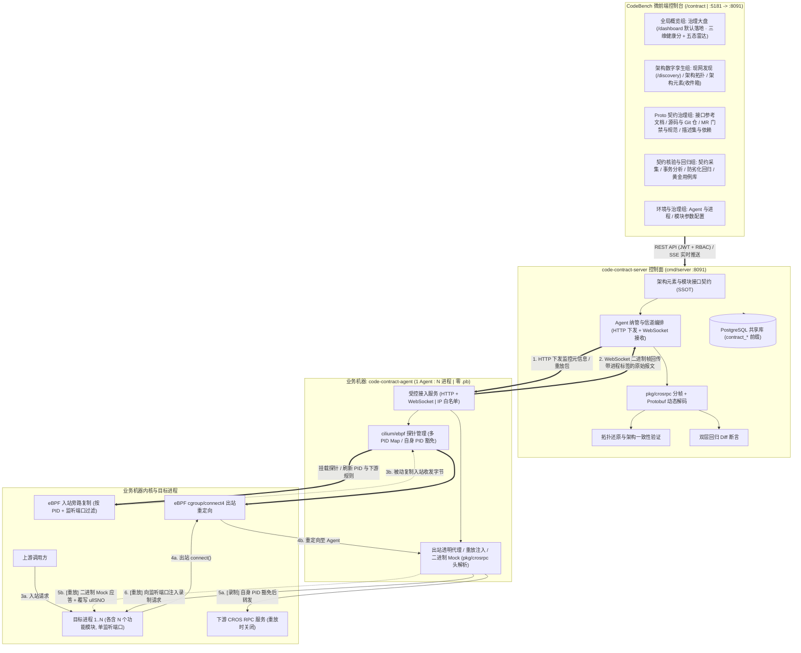
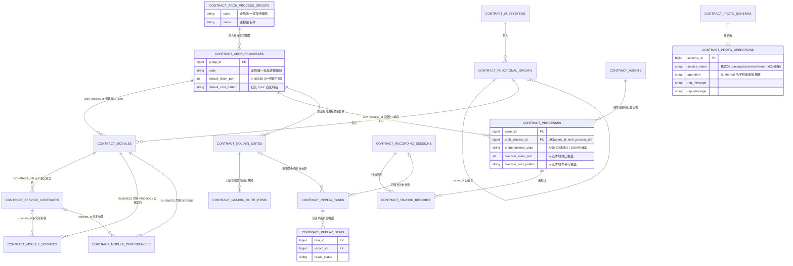

# 架构与活体契约治理 (`code-contract`) 特性清单与需求范围界定规范 (Feature Matrix & Scope)

- **文档编号**：`01-feature-matrix.md`
- **文档版本**：v2.26.0
- **更新日期**：2026-11-25
- **当前阶段**：阶段一：特性清单与边界明确（同步阶段二/三 SDD 定稿与 M30a~M32 规划）
- **状态**：M1~M29 已交付完成；依据 `ADR-24` (v1.1.0) 增补以「现网发现」为中心的活体契约流水线与物理/逻辑双态解耦规划（`M30a ~ M32`，暂未实施代码）
- **协议依据**：详见项目内置参考文档 [`docs/07-references/01-cros-rpc-protocol-spec.md`](../07-references/01-cros-rpc-protocol-spec.md)（文档编号：`01-cros-rpc-protocol-spec.md` v1.0.0，基于 DOPHI 平台 `cros_rpccore.ph` / `cros_rpctcp` 规范，本文所有字段名、偏移与取值均以该规范原文为准）、[`ADR-21`](../05-adr/21-csg-aware-agent-service-discovery-and-replay-mock-adr.md)（v2.2.0，基于 `csg-ver/` 现网真机实证与纯 Go `CrosMeshBackend` 的 CSG dlink 及 `RPCMonitorService` 协议基线）、[`ADR-22`](../05-adr/22-pluggable-transport-driver-and-mesh-capture-adr.md)（v2.0.0，纯 Go 可插拔传输驱动与跨传输重放契约）、[`ADR-23`](../05-adr/23-dophi-mesh-uprobe-bypass-capture-adr.md)（v1.1.0，`libdopra.so` DRT 共享内存环内核 uprobe 旁路观测实证与唯一采集通道）与 [`ADR-24`](../05-adr/24-csg-discovery-process-centric-and-physical-logical-boundary-adr.md)（v1.1.0，以「现网发现」为中心的活体契约工作流水线与物理/逻辑双态架构决策）

### 修订记录

| 版本 | 日期 | 修订要点 |
| :--- | :--- | :--- |
| v2.0.0 | 2026-10-27 | 重构为主控 + Agent 分离、架构拓扑驱动模型 |
| v2.1.0 | 2026-10-27 | 按 CROS RPC 协议规范收敛协议边界 |
| v2.2.0 | 2026-10-28 | 剥离 Agent 侧 `.pb` 依赖，收敛为纯二进制收集与重放 |
| v2.3.0 | 2026-10-28 | 支持单 Agent 多进程并发监控与任务级协同录制 |
| v2.4.0 | 2026-10-28 | 明确架构元素 SSOT、三级模型、模块级接口契约与多模块进程映射 |
| v2.5.0 | 2026-10-28 | 依据阶段一出口检视修订：新增「关键业务假设」；补充入站旁路采集与长连接前置条件；新增 Agent 实例纳管；PROVIDE 全局唯一与来源模块判定规则；重放结果状态与 Mock 未命中策略；`.pb` 版本管理；信道收敛为 HTTP + WebSocket；重排 P0/P1/P2；补充性能、存储保留与 eBPF 测试策略 NFR；补充术语表 |
| v2.5.1 | 2026-10-29 | 挂载项目内置协议规范 (docs/07-references/01-cros-rpc-protocol-spec.md)；明确服务名映射为 package 点分全名 ({package}.{serviceName}，现已全系统统一为完全点分规范)；依据协议原文固化 F-13 应答头回填字段清单 (ullSNO/aucTraceBuff/ullClientSendTime) 与精准偏移 |
| v2.6.0 | 2026-10-29 | 增补多人并发与双模持久化规范：Agent 与录制素材均划分公共级 (`SHARED`) 与个人级 (`PRIVATE`)，普通用户可自建自用私有 Agent（共享公共架构元素 SSOT）；确立 Agent 动态排他租约 (`Mutex Lease`，同 Agent 同时间仅 1 名用户操作，冲突返回 `409`)；支持有权限的录制素材在相同架构元素的进程间跨 Agent 重放；明确 `contract_traffic_records` 采用 `raw_req_packet` / `raw_rsp_packet` (`bytea`) + `payload_json` (`jsonb`) 双模往返存储与双轨分发管道 |
| v2.7.0 | 2026-10-29 | 依据架构检视与用户批复修订：1. 明确管理员特权（`contract_admin` 可穿透查看/审计所有 `PRIVATE` 素材与 Agent，普通用户严格防横向越权）；2. 明确共享环境（`SHARED` Agent）排他重放支持；3. 主控直接连接 Agent（内网互通）；4. 数据库表数量放开，规范化拆解为 13 张核心物理表（新增 `contract_process_modules` 关联表与 `contract_replay_items` 重放条目表）并引入 PostgreSQL 原生范围物理分区（`PARTITION BY RANGE (created_at)`）；5. 架构一致性验证结果扩充 `Not Monitored` 分类 |
| v2.8.0 | 2026-11-01 | 依据 M8 控制台信息架构重组修订（详见 ADR-07）：1. 菜单按操作频次重构为「`流量作业`（`流量录制` / `流量调试` / `流量重放`）➔ `架构与契约`（`架构拓扑` / `架构元素` / `Proto 契约`）➔ `环境与治理`（`Agent 与进程` / `模块参数配置`）」3 组 8 项，默认落地 `/record` 并无损兼容旧深链重定向；2. 拆分 `流量录制`（批次资产台账与跨页流转，`F-15.1`）与 `流量调试`（异常过滤、四段解剖、Trace 串联与单包快速重放调试闭环，`F-15.2`）；3. 剥离全屏 `架构拓扑` 与纯逻辑 `架构元素`，将物理业务进程（含进程分组 `group_name`）CRUD 唯一收口至 `Agent 与进程`（`F-15.3`）；4. 将基于 `.pb` 在线手填 JSON 主动组包发包调试归入 P2 演进项（`F-23`） |
| v2.9.0 | 2026-11-02 | 依据 M10 架构进程蓝图解耦与 eBPF 自动预挂待命设计修订（详见 ADR-08 / ADR-09）：1. **领域解耦**：在 `/architecture` 左树顶部引入 `[逻辑架构 \| 物理进程]` 切换器，新增 `contract_arch_process_groups` 与 `contract_arch_processes` 全局物理进程蓝图 SSOT（承载 `FM` 模块组装与默认端口/启动特征），`contract_processes` 收敛为宿主机 Agent `1:1` 挂载实例（`UNIQUE(agent_id, arch_process_id)`）并支持本地覆盖；2. **eBPF 默认自动预挂 (`ARMED`)**：前置完成存量连接诊断与一次重连就绪，停录回退 `ARMED` 不断开长连接；3. **三台同构分组进程树**：`/architecture`、`/agents` 与 `/record` 共享统一的分组进程树交互（`F-15.3`~`F-15.5`） |
| v2.9.1 | 2026-11-02 | 依据 ADR-09 架构检视修订：1. **多公共环境对等建模**：明确 `1 台 Agent = 1 套独立运行环境`（允许多套 `SHARED` 公共测试环境与多套 `PRIVATE` 个人环境各自 `1:1` 挂载同一 `ArchProcess`），Agent 支持可选 `fallback_agent_id` 指向联调关联公共环境；2. **按需入站钩子与三态代理闸门**：`ARMED` 待命期不挂载高频读写 tracepoint（零读写拦截损耗），`EgressProxy` 支持 `PASSTHROUGH \| CAPTURING \| REPLAY_MOCK` 三态切换（重放期帧级 Mock 接管既有代理连接并拒绝 `NEED_RECONNECT` 进程重放，守护零外泄红线），卸挂与 5m 失联执行优雅排水；3. **统一 7 态探针枚举、点分服务名与新系统免迁移干净重建** |
| v2.9.2 | 2026-11-02 | 依据 ADR-10 (v1.1.0) 架构检视定稿修订：1. **增强 .pb 描述集资产化治理**：增补 `F-03.5`（按制品聚合全景台账与服务级分页全局目录双模工作台）、`F-03.6`（`own_proto_files`/`external_imports` 去重拓扑闭包解析、联合类型池反射、同名版本 `DiffIgnorePaths` 向前自动继承与 `BASE_LIB` 基础公共库底座）、`F-03.7`（全局单一生效池、咨询锁串行化、`CompileTrialPool` 预编译演练、停用反向依赖门禁与批量防冲突仲裁），单文件上传上限提升至 `16MB`；2. **正式取消 `F-21`**（因 `code-proto` 外部排期推迟，取消联动强依赖，系统内形成完整自闭环的 IDL 描述集治理） |
| v2.9.3 | 2026-11-03 | 依据 ADR-11 (v1.0.0) 修订：1. **单进程开箱即用双录 (`INGRESS + EGRESS`) 与重放自动闭环**：`F-09` / `F-11` 升级目标 PID 默认全出站透明代理拦截（零下游拓扑前置即可同时采集入站与出站往返，非 CROS RPC 连接基于 `bytes.Index` SIMD 滑窗零副作用透传）与存量 `ESTABLISHED` 入站 Socket FD 预热；`F-08` 修正存量连接诊断为严格按 `/proc/<pid>/fd` 自有 Socket Inode 求交集并剔除已受控代理连接；`F-12` 自动合并历史 `EGRESS` 目的地址构建重放 Mock 端点集并增加写前 `"CSE.TCP"` 零外泄守卫；2. **双工作台职责消歧与零额外勾选体验**：`F-15.4` / `F-15.5` 明确 `/agents` 常驻待命与 `/record` 按次圈选文案，新增可用进程 `1..5` 自动预勾选、`[🔗 勾选关联下游]` 及 `/agents` ⇄ `/record` 双向一键深链闭环 |
| v2.10.0 | 2026-11-04 | 依据 ADR-12 (v1.0.0) 修订（对应 M13）：1. **协议阶段耗时补齐与发起序锚定**：`F-10` 补齐 V03/V04 `RPC_RSP_HEAD_S` 偏移 `40..47` (`ullServerRecvTime`) 与 `48..55` (`ullServerSendTime`) 解析及帧首字节到达定戳；`F-11` 在 `REQ` 到达瞬间原子分配单调发起 `SeqNo` 并记忆同连接 `MNG.acProcName` 对端身份；2. **DOTR 权威事务调用树、时序泳道与参数/实体血缘**：新增 `F-15.6`（`/debug` 默认采用「可折叠事务调用树 + 内联迷你甘特瀑布条」按根事务不割裂分页，提供平铺切换、多进程 `EGRESS ⇔ INGRESS` 跨跳缝合、同层兄弟 `串行/并发/补偿` 分类、业务软错误码透视、交互式 SVG 时序泳道 + 四段解剖联动抽屉、单事务参数传递血缘与跨事务有状态业务实体生命线）；3. **`RecordID` 级 `ScopedMock` 事务闭包重放打通**：`F-12` / `F-13` / `F-15.2` 端到端打通 `ScopedEgressMocks[recordID]` 局部因果池隔离、重放前下游闭包预览与跨事务前置状态依赖链一键连带回放 |
| v2.11.0 | 2026-11-05 | **战略定位升维**：将“业务流量监控与重放”升维为“**基于真实流量的活体契约、架构一致性与防劣化自愈平台**”；确立“接口资产治理”、“架构漂移雷达”与“无依赖自愈防劣化”三大支柱，将“录制与重放”准确界定为底层零侵入数据手段 |
| v2.12.0 | 2026-11-05 | **契约治理功能体系全景扩充**：依据治理深化研讨定稿，新增 `F-24`（契约治理全景大盘）、`F-25`（黄金契约套件资产库）、`F-26`（设计态契约破坏性变更阻断）与 `F-27`（CI/CD 自动化强阻断质量门禁），收敛 `F-20` 至 `F-25`，规划 M14~M17 工程作战与 `SC-09`~`SC-10` 验收场景 |
| v2.12.1 | 2026-11-05 | **依据 ADR-14 (v1.1.0) 架构深度检视加固**：1. `F-24` 升级为公私域隔离的**三支柱子分封顶健康指数**（40+30+30），明确 M14（4 组 9 项）➔ M15（4 组 10 项）无死链菜单演进并对齐 `F-15`；2. `F-25` 明确 `contract_golden_suite_items` 采用**完全自包含二进制+闭包快照**（免疫 30 天流量分区 `DROP TABLE`）并解耦 `ReplayTask` 双源外键；3. `F-26` 补齐 Service/Method 签名与 `ReservedRange` 级 AST 规则，增设管理员 `allow_breaking + breaking_reason` 回滚/重构审计逃生舱；4. `F-27` 补齐 Agent 重放期 `ObservedEgressCalls` 回传以单次闭环 `GATED_VIOLATION` 判定，增加 `wait_lease_seconds` 排队防并发踩踏、`503 vs 422` 状态码正交与 `X-Contract-CI-Token` SHA-256 常量时间鉴权 |
| v2.13.0 | 2026-11-07 | **面向业务开发者的报文调用与结果透视抽屉重构 (M18)**：依据业务调试真实痛点，重构 `F-15.2` 抽屉视觉层次：1. **业务第一原则**：将信息架构从“协议抓包 Wireshark 视角”升维为“**业务联调 Postman / APM 视角**”，默认以业务方法大标题、状态码胶囊与 TraceID 复制为首要视觉；2. **请求与响应左右双栏孪生对比 (Split View)**：彻底废弃必须切 Tab 才能查看应答的反直觉模式，左栏请求入参 JSON、右栏返回结果 JSON 左右同屏对照，一键复制；3. **阶段耗时甘特瀑布拆解**：微秒级拆解客户端传输、队列等待与服务端代码执行；4. **专家模式渐进式收纳**：将 24B CommHead 位图、SessionHead 字段表、ExtendHead 原始段与 16B HexDump 收纳为默认折叠的底层协议手风琴区，兼顾日常业务高效与底层排错深度 |
| v2.14.0 | 2026-11-09 | **大规模架构拓扑渐进式下钻聚焦、多维降噪与双层混合布局持久化 (ADR-15 / M19)**：针对生产规模（25 子系统 × 10 功能组 × 10 模块 ≈ 2,775 节点 + 上万条契约边）全展卡死与无法保存布局痛点，扩展 `F-04.1`~`F-04.3`：1. **C4 渐进式三级探索 (`F-04.1`)**：默认 `L0` 鸟瞰（~25 节点）、新增容器下钻聚焦子图（`Scoped Subgraph` + 面包屑 + 1-Hop 外部上下游折叠邻居卡）、叶子节点 `1/2-Hop` 邻域追踪（`Ego-Network`）与 `>150` 可见节点全展熔断守卫；2. **多维切片与视觉降噪 (`F-04.2`)**：支持按子系统/进程组多选、「我负责的 (`Owner`)」、一致性异常状态快筛，支持 Hover/选中 1-Hop 聚光灯 (`Spotlight`)、高扇入底座插头折叠 (`Hub Bus Pill`)、语义 LOD 与搜索候选下拉镜头飞跃 (`Camera Fly-To`)；3. **混合布局与双层持久化 (`F-04.3`)**：新增第 18 张表 `contract_topology_layouts`，支持 `contract_admin` 发布团队官方基准布局 (`SHARED`)、研发保存个人命名视图书签 (`PRIVATE`) 与 `localStorage` 实时草稿；拖拽锁定 `Pinned` 坐标，单点展开保持视口锚定并执行 AABB 邻居碰撞推开与 `ModelVersion` 增量 Diff 合并 |
| v2.14.1 | 2026-11-09 | **依据 ADR-15 (v1.1.0) 架构深度检视加固**：1. `F-04.1` 明确五段式管线（一致性叠加合成先于作用域裁剪，修正动态违规边丢失）、透明祖先聚焦、`LCA` 外部邻居代表规则与**有向** N-Hop 邻域，可见节点守卫改为覆盖滑杆/全展/滚轮/搜索/邻域/过滤/聚焦/书签全部入口的单一出口并删除搜索自动全展；2. `F-04.2` 统一状态快筛为 `ALL / ABNORMAL / VIOLATION_ONLY`，「我负责的」补齐后端 `MODULE.meta.owner_id`，Hub 判定统一为「不同顶层调用方 `≥ 8`」且违规边豁免折叠，统一聚光灯透明度、LOD 档位、飞跃参数与扁平 BEM 类名；3. `F-04.3` 由「全局 ELK + Pinned 覆写」改为「位置记忆 + 局部子树排版 + 自底向上碰撞消解」，拖拽不再触发 ELK，布局过期判定改用树结构指纹 `structure_version` + 节点集合 Diff，持久化拆分为按视图统一的位置层（团队基准，`revision` 乐观锁）与仅存差量的视角层（个人书签）；4. 新增 `SC-11` 大规模拓扑端到端验收场景与拓扑性能基线；M19 保持单里程碑，内部拆分 `M19-P1` ~ `M19-P7` 七个子阶段 |
| v2.15.0 | 2026-11-11 | **多实现服务契约、接口库建模与按目的进程实现定位 (ADR-16 / M20)**：面向「接口库 `FM A` 定义 + 多进程模块 `B/C/D` 实现 + 调度中心 `X` 按注册表分发」业务形态（详见 [`docs/05-adr/16-multi-implementation-service-contract-adr.md`](../05-adr/16-multi-implementation-service-contract-adr.md) 与作战卡 [`docs/04-tasks/21-m20-multi-implementation-service-contract.md`](../04-tasks/21-m20-multi-implementation-service-contract.md)），扩展 `F-02.1`、`F-04.4`、`F-05.1`：1. **关键假设演进**：修订 `A-05`（收窄为独占契约 `EXCLUSIVE` 全局唯一；多实现契约 `MULTI_IMPL` 按 `(contract_id, impl_key)` 与 `(contract_id, module_id)` 唯一），新增 `A-09`（同一多实现契约的实现模块两两分属不同 `ArchProcess`），明确 `A-03` 对 `CONTRACT_LIB` 接口库模块的豁免；2. **多实现服务契约与接口库建模 (`F-02.1`)**：`contract_modules` 新增 `module_kind ∈ {BUSINESS, CONTRACT_LIB}`，新增第 19 张核心业务表 `contract_service_contracts`，`contract_module_services` 扩展 `contract_id + impl_key` 并统一执行 `A-09` 进程互斥守卫，`contract_module_dependencies` 支持 `contract_id` 分发依赖 (`DISPATCH`)；3. **多实现契约拓扑表达 (`F-04.4`)**：逻辑视图渲染 `«interface»` 库卡与独立可开关的 `REALIZATION` 实现边图层，默认采用「按接口聚合 (`topo_contract_mode=AGG`)」并支持切换「按实现展开 (`EXPAND`)」，物理视图按实现展开且不渲染库模块；4. **多实现目的实现定位与第八类一致性状态 `IMPL_UNRESOLVED` (`F-05.1`)**：录制批次固化 `endpoint_snapshots` 端点字典快照，按目的进程消歧定位实现模块并回填 `traffic_records.dst_contract_id`，新增第八类一致性状态 `IMPL_UNRESOLVED`（实现待定，不计入 `UNCOVERED` 分母），重放下游 Mock 方法键扩展 `@dst_tag` 防止多实现应答串用；新增 `SC-12` 验收场景与 Non-Goal 11 |
| v2.16.0 | 2026-11-13 | **架构拓扑单层平铺逐级下钻重构、ELK 正交布局校准与全链路易用性升级 (ADR-17 / M21)**：依据 [`ADR-17`](../05-adr/17-topology-single-layer-drilldown-and-layout-ux-adr.md) 演进更新 `F-04`、`F-04.1`、`F-04.2`、`F-04.3` 与 `SC-11`：1. **单层平铺逐级下钻**：废除同屏多级「框中框」复合嵌套展开、全局层级滑杆 (`L0~Ln`)、`全展` 与滚轮语义展开；双击容器或点击 `[进入 ▸]` 直接下钻进入该作用域的单层平铺画布（不渲染聚焦根外层虚线包裹框，仅展示 `relativeDepth === 1` 直接子节点与左右 `FIRST/LAST` 外部传送门卡），顶栏提供层级面包屑、统计胶囊与 `Esc/Backspace` 返回上层；2. **ELK 单层参数与 `1:1 border-box` 对齐**：层间水平净空升至 `110px`、同层垂直 `48px`、`edgeNode 36px`，所有节点强约束 `box-sizing: border-box` 并像素级对齐 ELK 宽高；3. **四向智能锚点与多边错位防叠**：根据源/目标相对几何坐标自动优选 `Right->Left` / `Bottom->Top` / `Top->Bottom` / `Left->Right`，消除纵向回环；同锚点汇聚 `SmoothStep` 边自动施加标签偏移；4. **作用域隔离位置记忆与工具栏/抽屉提纯**：按 `(view, focus_scope)` 分桶记忆坐标且仅用户拖拽/`📌` 图钉节点锁定坐标；工具栏收敛为 4 个高频控制组 + `[⚙️ 筛选与图层]` Popover；`EdgeDetailDrawer` 显示节点中文名与类型徽章 |
| v2.17.0 | 2026-11-13 | **Proto 全生命周期治理收口与 Git-Only 参考文档/MR 协同边界修订 (ADR-18 v1.1.0 / M22~M25 Proposed)**：鉴于外部兄弟项目 `code-proto` 与原型项目 `protohub` 已正式废弃，依据 [`ADR-18`](../05-adr/18-proto-full-lifecycle-and-git-mr-governance-adr.md) 修订边界：1. 撤销 `Non-Goal 4` 中“接口变更 MR 追踪与 `.proto` 源码管理归属 `code-proto`”旧约束，更新 §2.3 SSOT 说明、`F-18`（升维为全注释驱动的「活体接口参考文档中心 (Reference Docs)」）与 `Non-Goal 7`；2. 将 `F-21` 由“已取消”重定义为“Git-Only `.proto` 源码全生命周期、Git/MR 门禁与统一编译入池”；3. 规划新增 `F-28`~`F-32`（确立 Git-Only 唯一写入口并取消 Web 在线编辑与悲观锁，涵盖纯 Go `protocompile` 编译底座、轻量只读 `.proto` 源码与 Commit Diff 视图、Git 无状态 API 同步与 MR 四合一静态门禁、可配置命名/词汇/带护栏重复消息抽取/分层校验、豁免审批与持久化通知及依赖图前端挂载/导出） |
| v2.18.0 | 2026-11-13 | **ADR-18 端到端验收场景与 NFR 安全基线补全**：新增 **4 个端到端验收场景（`SC-13` ~ `SC-16`）** 分别对应 M22~M25（纯 Go `protocompile` + `layer_level` 分层依赖拦截 + `F-32` 依赖图/导出、`F-18` 活体接口参考文档 + 只读源码溯源与 Markdown 导出、多段命名/词库迁移/带护栏 AST 重复消息 + LLM 3s 超时降级、无状态 Git 同步 + 含删减文件的 MR 四合一虚拟树门禁 + `Approve with Override` + `contract_notifications`/`code-notifier` 通知及 `F-24` 静态合标卡片），并补齐 Git SSRF/AES-256-GCM/前端增量红线 |
| v2.19.0 | 2026-11-13 | **ADR-18 v1.2.0 检视修订与跨机 `code-notifier` / Monorepo 边界校准**：1. M25 拆分为 `M25`（Git 仓库 `1:N` `GitProtoBundle` 多包无状态同步与只读历史）与 `M26`（MR 四合一门禁、`uk_contract_mr_dedup` Fast-Forward 修复、`SSEBroker(userID)` 定向推送与持久/邮件通知、大盘合标卡片）；2. 明确 `code-notifier` 部署在同内网另一台主机上的邮件服务角色，`SafeDialer` 在永久硬阻断云元数据（`169.254.169.254` 等）及默认拦截未授权内网/回环的前提下，支持管理员配置 `outbound_trusted_cidrs` 受信任白名单放行内网 GitLab/LLM 及跨机 `code-notifier`；3. 统一前端 M22~M26 增量 Chunk 预算 **`<= 150KB gzip`（`<= 500KB` raw）**（基于 M21 实测基线）与 `F-32` 程序化矢量 SVG/离屏 Canvas 导出方案 |
| v2.20.0 | 2026-11-13 | **依据 ADR-18 v1.3.0 清除无用的外部历史数据迁移设计**：明确 `code-proto` 与 `protohub` 均未开发完成且从未真正运行过，因此**不存在任何 SQLite/旧系统数据迁移需求**；彻底移除 `scripts/migrate_protohub_vocab` 与 `PROTOHUB_IMPORT` 设计，将 `SC-15` 与 `M24` 收敛为 `code-contract` 原生 `BUILTIN_SEED` 规则/词根幂等初始化、Web CRUD 维护与全仓零 SQLite 红线 |
| v2.21.0 | 2026-11-15 | **依据 ADR-19 (v1.0.0 / M27) 拆解 Proto 契约控制台信息架构**：1. 将全局侧边栏升级为 **5 组 13 项**，原 `架构与契约` 拆分为 `架构数字孪生`（`架构拓扑` `/topology`、`架构元素` `/architecture`）与独立一级分组 **`Proto 契约治理`**（`接口参考文档` `/proto-docs`、`源码与 Git 仓` `/proto-sources`、`MR 门禁与规范` `/proto-governance`、`描述集与依赖` `/schemas`）；2. 四工作台职责正交：日常文档/认领目录（`/proto-docs`）、源码/Git 仓（`/proto-sources`）及 MR 门禁/规则/词库/AST 重复簇（`/proto-governance`）彻底剥离全局 `.pb` 汇总条与上传按钮；`/schemas` 专注 `.pb` 描述集台账与跨包依赖图（2 页签）；3. 在 `App.tsx` 通过 `SchemasRouteWrapper` 无损重定向所有 `/schemas?tab=docs\|catalog\|sources\|mr-gates\|lint-*` 历史深链（保留全部 Query 与 `#L<n>` Hash）并更新 `F-15`、`F-18`、`F-24`、`F-28`~`F-32`、`SC-14` 路由说明 |
| v2.22.0 | 2026-11-18 | **依据 ADR-21 (v2.1.0 / M28) 纳入基于现网实证的 CSG 双层自动发现与多模式仿真测试体系**：1. 演进假设 **`A-02`**（兼容 CSG 动态端口与单端口多 64B 运行期服务，纯客户端或纯 `dophi_mesh://` TCP 端口为 `0`）、演进 **`A-07`**（明确 CSG `acServiceName[64]` 与 CROS RPC `ascServiceName[64]` 100% 字节级同一，支持 `<ClassName[:31]>-<svrName[:31]>` 64B 运行期名与 `proto_service_name` 映射到 `.pb` `{package}.{serviceName}` 及 `^(.+-\d+)-(\d+)$` PID 后缀归一化）并新增 **`A-10`**（单机多租户 `31800+userId` CSG 栈与跨板 LDC 实例同步隔离）；2. 增补既有特性 `F-02`、`F-03`、`F-08`、`F-11`、`F-12`、`F-13`、`F-15.5`、`F-27` 与 CSG 协议衔接，并新增 **`F-33`（CSG 现网服务与依赖拓扑双层自动发现、SSOT 三态对账及架构蓝图一键导入）**、**`F-34`（CSG 三模渐进式仿真测试架构：`CLIENT_INJECT` / `PUB_STUB` / `MOCK_SERVER` 与统一沙箱监控口 `rpcmon.Provider`）**；3. 新增端到端验收场景 **`SC-17`**、`Non-Goal 12` 与 CSG 术语表条目（全部协议与 `pkg/crosrpc` 100% 对齐，废弃临时帧协议） |
| v2.23.0 | 2026-11-19 | **依据 ADR-22 (v1.1.0) 与 ADR-23 (v1.0.0) 引入 Agent 可插拔传输驱动架构及 `dophi_mesh` 双轨旁路采集**：解封 `pkg/crosrpc.ValidateCommHead` (`ucProtocol ∈ [0..7]`)、扩展 56B `EnvelopeHeader` 并引入 `builtin-drt-uprobe` 采集通道 |
| v2.24.0 | 2026-11-19 | **依据 ADR-22 (v2.0.0) 与 ADR-23 (v1.1.0) 现网最终证伪/实证结论收敛架构**：1. **正式废弃 `plugin_transport.so` / `libdophimesh.so` 钩子方案**（该钩子仅限本进程内生效，P2P 网状拓扑下 Agent 侧引入无法监听其他进程交互），确立纯 Go **`builtin-drt-uprobe`** 为 `dophi_mesh` 采集的唯一正式驱动（零子进程、零 `.so` 插件、零 CGO）；2. **打通「现网 Mesh 采集 ➔ 测试态 `tcp://` 无缝重放」闭环**：Mock 阶段全部业务进程均支持 `tcp://`，只需 `MockCSGServer` / `PUB_STUB` 返回 `tcp://` 地址并在 TCP 重放发包副本中自动将 `ucProtocol` (`4 -> 1`) 归一化，彻底消除 Mesh 重放断链 |
| v2.25.0 | 2026-11-23 | **实现纯 Go `dophi_mesh` `RPCMonitorService` 查询闭环（`CrosMeshBackend`）并彻底移除外部 C++ 探针（ADR-21 v2.2.0）**：在 `pkg/rpcmon` 中落地纯 Go `CrosMeshBackend`（4 次 128B `MESH_SEC_HELLO` 握手 + 40B `MESH_MSG_DATA_HEAD_S` + CROS `ucProtocol=4`），`DiscoverAndFuse` 自动分流 `CROSTCP_RPCMON` 与 `CROSMESH_RPCMON`（支持 TCP➔Mesh 自动回退），彻底删除 `pkg/rpcmon/native.go`、`scripts/csg/rpcmon_probe.cpp`、`NATIVE_PROBE` 及 `--csg-probe-bin` 参数，达成 Agent 全栈 100% 纯 Go 单二进制、零外部子进程 |
| **v2.26.0** | **2026-11-25** | **依据 [`ADR-24` (v1.1.0)](../05-adr/24-csg-discovery-process-centric-and-physical-logical-boundary-adr.md) 确立以「现网发现」为中心的活体契约流水线与物理/逻辑双态解耦规划 (`M30a ~ M32`)**：1. 战略反转至 Discovery-First（物理事实自动发现、即时可用；逻辑架构按需认领、只做治理不做门槛）；2. 控制台菜单规划升维至 **5 组 14 项**（`架构数字孪生` 首位新增 `现网发现` `/discovery`）；3. 明确 L0 ➔ L1（L1-T 物理类型 vs L1-I 物理实例）➔ L2 三层分离、双态 `ModuleService`（`module_id` 可空）+ `ServicePlacement` + `ProcessDependency`、**纳管 ≠ 布防**与来源可见性隔离（V1~V6）；4. 演进 `A-02`、`A-03`、`A-05`、`F-15`、`F-33`，新增 `F-36`~`F-39` 与验收场景 `SC-19`~`SC-22`（暂不实施代码） |

---

## 1. 系统愿景与产品定位 (Vision & Positioning)

### 1.1 项目愿景与产品本质
**架构与活体契约治理 (`code-contract`)** 是挂载于 CodeBench 开发者综合工作台的企业级业务子系统，**只服务于业务实际使用的 DOPHI `CROS RPC` 协议**（`24B 公共消息头 RPC_COMM_HEAD_S` + `会话头 RPC_REQ/RSP/MNG_HEAD_S` + `0..N 段扩展头` + `序列化 Payload`），不做任何其他协议扩展。

传统契约管理（Swagger、Postman、Proto 仓库等）多停留在“设计态的静态文档”，管不住生产运行时的真实调用，无法察觉微服务间的私自跨层依赖与接口破坏。
本系统的本质是**「以契约治理为核心、以运行态真实流量为活水、以零侵入仿真为闭环的活体契约治理与防劣化平台」**：
* **“流量录制与重放”是底层技术手段**：提供零代码侵入、零业务改造的真实报文提取与本地仿真注入；
* **“契约治理、架构防漂移与防劣化验证”是真正的业务目的**：

目标用户与治理价值矩阵：

| 角色 | 核心痛点 | 本平台提供的治理能力 |
| :--- | :--- | :--- |
| **架构师 / 模块负责人** | 架构设计文档与代码实际调用漂移，私自跨层调用、旁路直连无从核对，架构逐渐腐化 | 维护三级架构元素与模块接口契约 SSOT，拿实测流量自动比对设计态拓扑，毫秒级红牌告警 **`Violation`（违规调用）** 与 **`Uncovered`（僵尸死接口）** |
| **业务开发 / 测试工程师** | 跨服务联调与回归测试严重依赖完整下游环境；接口变更极易破坏兼容性导致线上故障 | 基于 **`ScopedMock` 因果闭包**实现零下游单进程脱机重放，提供协议状态码与 Protobuf 字段级**双层自动化回归 Diff 断言** |
| **平台管理员 / 质量负责人** | 传统抓包排障需要修改业务代码或整机 Root 特权；接口与 Proto 资产分散，无人认领 | 每台业务机器部署 1 个零 Schema 依赖的 Agent；提供多 `.pb` 描述集资产台账、字段字典树透视与未认领“孤儿契约”治理闭环 |

系统采用 **「控制面主框架 (`code-contract-server`) + 独立数据面代理 (`code-contract-agent`)」同仓双二进制物理防腐** 架构：

1. **控制面 `code-contract-server`**（保持在 `code-bench` 微前端家族内）：作为架构元素与接口契约的单一真实源（SSOT，选型依据见 §2.2 与 Non-Goal 7），负责三级架构元素与接口契约建模、Agent 纳管与排他租约、Protobuf 描述集资产编解码、实测拓扑还原与架构一致性核验、重放编排与双层回归 Diff 报告。
2. **数据面 `code-contract-agent`**（同仓 `cmd/agent`）：零前端、零数据库、零 `.pb` 依赖的守护进程，每台业务机器部署 1 个，同时监控本机多个目标进程（`1 Agent : N Processes`）；负责内核态报文采集、原始二进制回传、本地重放注入、下游 ScopedMock 接管与 `ullSNO` 自动重写自愈。

### 1.2 核心价值主张 (Core Value Propositions)
1. **全景接口契约资产化治理**：支持多 `.pb` 描述集拓扑去重、消息体字段字典树透视、可视化 Diff 忽略基线配置与未认领“孤儿契约”闭环。
2. **零侵入内核态动态探针**：基于 `cilium/ebpf` 引擎，出入站双向无感采集，单机多进程 `O(1)` BPF Map 过滤，免除业务改造成本与跨机同步 Schema 负担。
3. **架构防漂移与违规调用阻断雷达**：自主维护「子系统 → 功能组（树）→ 功能模块」与「1 进程 : N 模块」映射，以功能模块为接口契约主体；依据实测报文的 `(ascServiceName, ascOperation)` 还原跨进程真实调用，精准捕获架构漂移。
4. **零下游因果闭包重放与自愈引擎**：利用协议结构特征与 `ScopedMock` 因果闭包，Agent 零 `.pb` 依赖实现下游 Mock 接管（0 字节外泄真实下游）与 `ullSNO` / `aucTraceBuff` 自动回写自愈。
5. **协议头 + Protobuf 字段级双层回归 Diff**：第一层协议状态码与魔术字校验 + 第二层业务字段语义 Diff，秒级定位破坏性改动。

---

## 2. 关键业务假设、系统拓扑与数据模型

### 2.1 关键业务假设 (Key Assumptions，已与业务方确认)

以下假设是本版需求边界的前提，任一假设被推翻都需要重新评审相关特性：

| 编号 | 假设 | 影响的特性 |
| :--- | :--- | :--- |
| **A-01** | 业务进程之间普遍使用 **CROS RPC 长连接**；录制 / 重放前**可以接受重启目标进程或触发重连** | F-08、F-09、F-11、F-12 |
| **A-02** | 每个操作系统进程**至多监听 1 个** CROS RPC TCP 端口（兼容 CSG `GET_BIND_ADDR` 动态端口分配及单端口发布多个 64B 运行期服务；纯客户端进程或仅发布 `dophi_mesh://` 的进程 TCP 监听端口为 `0`）。**依据 `ADR-24`，进程通信角色由 `ArchProcess.declared_role`（人工声明，缺省 `UNKNOWN`）与 `Process.observed_role`（实例观测：`SERVER / CLIENT_ONLY / DUAL`）显式表达，`DefaultListenPort` 仅作静态端口提示，不再以 `0` 隐式推断角色** | F-02、F-08、F-33、F-34、F-36、F-37 |
| **A-03** | 每个业务功能模块（`module_kind = 'BUSINESS'`）全局只归属 **1 个标准架构进程 (`ArchProcess`)**（接口库模块 `module_kind = 'CONTRACT_LIB'` 为纯编译期契约定义属主，不绑定任何运行期 `ArchProcess`）；**1 台 Agent 即代表 1 套独立运行环境**（支持多套 `SHARED` 公共测试环境与多套 `PRIVATE` 个人环境），单套环境（单个 Agent）内同一标准进程只部署 **1 份**（`1:1` 挂载，不存在单环境内多副本负载均衡；多 PID 同类进程在实例层折叠为 `Process.observed_pids`）。**依据 `ADR-24` L1 双粒度建模，服务认领进 `Module M` 时要求权威环境 `ACTIVE` 放置同属 `ArchProcess P` 且 `M.arch_process_id ∈ {NULL, P}`（不变量 I4）；运行期出现跨进程放置时标记 `PLACEMENT_DRIFT` 告警（I5）** | F-02、F-02.1、F-05、F-12、F-37、F-39 |
| **A-04** | 同一进程内的功能模块之间走**进程内函数调用**，不经过网络 | F-02、F-05 |
| **A-05** | **分模式唯一供给（由 ADR-16 / ADR-24 演进）**：对于默认**独占契约 (`EXCLUSIVE`)** 及**未认领服务身份（`module_id IS NULL`）**，同一 `ascServiceName` 在 `uk_contract_mod_svc_name_excl` 作用域内**至多存在 1 行身份记录**（同名服务被多个进程发布时不复制身份行，而是在 `contract_service_placements` 挂多条放置记录，并在 L2 架构收件箱中裁决为冗余部署合并或 **`MULTI_IMPL` 拆分**）；对于登记在接口库模块下的**多实现契约 (`MULTI_IMPL`)**，允许多个业务模块各自以唯一业务身份 `impl_key` 实现同一 `ascServiceName`（按 `(contract_id, impl_key)` 与 `(contract_id, module_id)` 唯一），且同一 `service_name` 不得同时存在独占供给与多实现契约；模块间依赖支持显式绑定「具体服务实现 (`service_id`)」、「多实现契约分发 (`contract_id`)」或声明依赖外部系统 | F-02、F-02.1、F-03、F-05、F-05.1、F-37、F-39 |
| **A-06** | 重放**只在测试环境**执行；目标进程对 DB / MQ 等非 CROS RPC 依赖的副作用首期不处理（DB 中主要是很少变化的元数据） | F-12、Non-Goal 8 |
| **A-07** | **服务名同一性与 `.pb` 契约映射（由 ADR-21 演进）**：CSG 控制面 `acServiceName[64]` 与 CROS RPC 数据面 `ascServiceName[64]` 为**同一个 64B 运行期字符串**（CSG 场景按 `<ClassName[:31]>-<svrName[:31]>` 或 `<svrName>` 生成，部分实例附带 `^(.+-\d+)-(\d+)$` 启动期 PID 后缀；点分场景直接为 `{package}.{serviceName}`）；`ModuleService.service_name` 登记线网真实 64B 名称，并可通过可选 `proto_service_name`（如 `swp.rpc.RPCMonitorService`）注入 `decoder.Registry.ServiceAliases` 映射至 `.pb` `{package}.{serviceName}`（未填写时回退等于 `service_name`）；`ascOperation` 与 Method 名称**字符串直接相等** | F-03、F-10、F-33 |
| **A-08** | 首期聚焦 REQ / RSP 业务调用；MNG 管理消息（`ucMsgType=5/6/7`）只做解析展示与原样回放，不做握手语义仿真 | F-12、F-13、Non-Goal 9 |
| **A-09** | **同契约多实现进程互斥（ADR-16 新增）**：同一多实现契约 (`MULTI_IMPL`) 的各个实现模块必须**两两分属不同的标准架构进程 (`ArchProcess`)**，不存在同一进程内共存同一契约的多个实现（使运行期「目的进程 ➔ 唯一实现模块」成为确定性映射，无需报文头或 Payload 鉴别字段） | F-02.1、F-04.4、F-05.1、F-12、F-13 |
| **A-10** | **单机多租户 CSG 控制面栈与跨板 LDC 实例同步（ADR-21 新增）**：宿主机按「一 OS 部署租户一套 `DophiServer` 控制面栈（端口 `31800 + userId`，明文 dlink TCP 无鉴权握手）」并发隔离运行；`DophiServer` 注册表同时包含本机发布实例与跨板 LDC 远端节点同步实例，自动发现与宿主机 `/proc/<pid>` 进程绑定必须依据本机网卡 IPv4 集合严格过滤隔离跨板远端实例 | F-33、F-34、Non-Goal 12 |

### 2.2 主从运行架构与网络交互拓扑

采集路径说明：
- **入站 (INGRESS)**：eBPF 按「目标 PID + 监听端口」**被动复制**收发字节，不代理、不改变业务链路；`ARMED` 待命期**不挂载**高频读写 tracepoint（零系统调用读写损耗），仅在活跃录制期（`CAPTURING`）按需挂载并预热存量入站连接。
- **出站 (EGRESS)**：`cgroup/connect4` 把目标 PID 访问已登记下游 `IP:Port` 的连接重定向到 Agent `EgressProxy`：预挂待命期（`ARMED / PASSTHROUGH`）持续做纯字节双向转发且零分帧零上报；活跃录制期（`CAPTURING`）在既有长连接上动态切帧上报；离线重放期（`REPLAY_MOCK`）对既有代理连接与新建连接统一执行帧级二进制 Mock 自愈应答并彻底阻断向真实下游写数据（零外泄）。
- **长连接前置就绪与免重连录制 (A-01 & ADR-09)**：出站重定向只对**挂载探针之后新建的连接**生效。系统采用**默认自动预挂 (`ARMED`)** 策略：Agent 在线挂载进程后自动挂载建连探针并诊断存量直连连接（若 `established_conns > 0` 提示在空闲准备期重启/重连一次；后于探针启动的进程经 `sched_process_exec/fork` 追踪纳管）；**停止录制时仅关闭采集闸门回退纯字节转发，绝不断开代理长连接**，使 Agent 存活期内一次就绪后后续第 $2 \dots N$ 次录制实现**免重连亚秒级启停**。

### 2.3 架构元素与运行映射数据模型

**SSOT 选型依据**：原外部系统 `code-proto` 与原型 `protohub` 均未开发完成、从未投入运行并已正式废弃（零历史数据需迁移）；`code-bench` 只管理用户、组织与审计，没有「子系统-功能组-功能模块-标准业务进程」与运行态进程挂载。因此，由 `code-contract` 在自己的 `contract_*` 表中原生闭环维护架构元素 SSOT，并依据 [`ADR-18`](../05-adr/18-proto-full-lifecycle-and-git-mr-governance-adr.md) 统筹 `.proto` 源码到 `.pb` 运行态契约的全生命周期。

下图只描述实体关系与关键约束，完整物理建模见阶段二 [`05-database-schema.md`](../02-design/05-database-schema.md)：

关键约束：
1. **三级逻辑架构与模块类型 (`module_kind`)**：子系统是顶层边界；功能组归属子系统，支持多级自嵌套（`parent_id` + `path` + `level`）；功能模块是最小契约单元，可挂在**任意层级**的功能组下，分为运行期业务模块（`BUSINESS`，默认）与编译期接口库模块（`CONTRACT_LIB`，仅定义多实现服务契约，禁止绑定 `ArchProcess` 与声明运行期 `PROVIDE/DEPEND`）。
2. **接口契约在功能模块层面（独占契约与多实现契约双模，A-05 / A-09）**：`PROVIDE` 为业务模块对外实现的 CROS RPC 服务（`contract_module_services`），`DEPEND` 为业务模块需要调用的下游服务（`contract_module_dependencies`）。默认**独占契约 (`EXCLUSIVE`)** 下 `service_name` 全局唯一；对于**多实现契约 (`MULTI_IMPL`)**，由 `CONTRACT_LIB` 库模块在 `contract_service_contracts` 登记定义，多个分属不同 `ArchProcess`（`A-09`）的 `BUSINESS` 模块各自以唯一业务身份 `impl_key` 声明实现（按 `(contract_id, impl_key)` 与 `(contract_id, module_id)` 唯一），调度方支持按 `contract_id` 声明**分发依赖 (`DISPATCH`)**；其中 `ascServiceName` 为 `{package}.{serviceName}`（无 `package` 时为 `{serviceName}`），`ascOperation` 为方法名。
3. **架构物理进程蓝图 SSOT 与「单 Agent 单环境」`1:1` 挂载覆盖**：
   - 全局唯一的 `ArchProcessGroup ➔ ArchProcess` 在 `/architecture?tree=physical` 中定义标准进程分组、默认运行参数（`default_listen_port`、`default_cmd_pattern`）以及与业务 `Module` (`FM`, `module_kind = 'BUSINESS'`) 的组装关系（1 个 `ArchProcess` 承载 $N$ 个 `BUSINESS` `Module`，每个 `BUSINESS` `Module` 全局至多归属 1 个 `ArchProcess`，遵循 `A-03`；`CONTRACT_LIB` 库模块豁免进程绑定）；
   - **1 台 `Agent` 即代表 1 套独立环境**：各环境 `Agent`（含多套 `SHARED` 公共测试环境与多套 `PRIVATE` 个人环境）统一从已定义的 `ArchProcess` 树中勾选挂载进程（`contract_processes`），同一台 `Agent` 上同一 `ArchProcess` 严格 **`1:1` 单实例（`UNIQUE(agent_id, arch_process_id)`）**，不同 `SHARED` Agent（不同公共环境）允许各自独立挂载同一 `ArchProcess`；
   - Agent 支持可选配置 `fallback_agent_id`（指向某套 `SHARED` 公共基准环境用于混合联调下游推导），挂载实例支持本地覆盖 `override_listen_port`、`override_cmd_pattern`、`advertise_ip` 与 `extra_downstreams`，同一 Agent 下非零有效监听端口互斥（`A-02`）；PID 由 Agent 运行期动态扫描 `/proc` 并回写统一 7 态探针就绪快照。
4. **`.pb` 与接口解耦**：模块接口不直接外键引用 `.pb`，解码时按 `(service_name, operation)` 查找当前生效的映射；每条流量记录保存解码所用的 schema 版本。

---

## 3. 需求功能矩阵 (Feature Matrix)

特性优先级定义：
- **P0 (Must-Have)**：首期主链路「建模 → 采集 → 解码 → 验证 → 重放 → Diff」必需；每条验收指标都必须有对应的自动化测试（特权类用例的执行方式见 NFR 6）。
- **P1 (Should-Have)**：第二阶段规划，含安全加固与体验增强。
- **P2 (Nice-to-Have)**：远期演进。

---

### 3.1 架构元素、接口契约与拓扑领域

| 编号 | 特性名称 | 涉及组件 | 优先级 | 功能描述与技术规范 | TDD 验收指标 |
| :--- | :--- | :---: | :---: | :--- | :--- |
| **F-01** | **三级架构元素建模**（`contract_subsystems` / `contract_functional_groups` / `contract_modules`） | `Server` `Frontend` | **P0** | 1. 子系统：编码（全局唯一）、名称、负责人、描述； 2. 功能组：归属子系统，支持多级自嵌套，维护 `parent_id`、`level`、`path`、排序；编码在同一子系统内唯一；最大深度 8 级； 3. 功能模块：编码全局唯一，挂在任意层级的功能组下，冗余记录所属子系统； 4. 移动功能组时级联更新子孙节点的 `path` / `level`。 | 1. 三类元素 CRUD 单测全部通过； 2. 把功能组移到自身或其子孙下返回 `400`；超过最大深度返回 `400`； 3. 移动功能组后，所有子孙的 `path` / `level` 正确； 4. 删除非空功能组、或删除已声明接口的模块返回 `409`； 5. 编码重复返回 `409`。 |
| **F-02** | **架构物理进程蓝图、模块服务契约与多环境 1:1 挂载覆盖**（`contract_arch_process_groups` / `contract_arch_processes` / `contract_processes` / `contract_module_services` / `contract_module_dependencies`） | `Server` `Frontend` | **P0** | 1. **架构物理进程蓝图 SSOT (`/architecture?tree=physical`)**：全局定义 `进程组 (ArchProcessGroup) ➔ 标准业务进程 (ArchProcess)` 二级树，维护标准进程 `code`、`name`、`default_listen_port`（`0` 为纯客户端）、`default_cmd_pattern`（子串或 `re:` RE2 正则）、`default_extra_downstreams` 及组装承载的业务 `Module` (`FM`, `BUSINESS`) 集合（每个业务 `FM` 全局至多归属 1 个 `ArchProcess`，遵循 `A-03`），零 Agent 耦合； 2. **「1 台 Agent = 1 套环境」单机 `1:1` 挂载与本地覆盖 (`/agents`)**：各环境 Agent（含多套 `SHARED` 公共测试环境与多套 `PRIVATE` 个人环境）仅允许从已定义的 `ArchProcess` 树中勾选挂载进程（`UNIQUE(agent_id, arch_process_id)` 单机严格 `1:1`；不同 `SHARED` 环境允许各自挂载同一 `ArchProcess`），支持本地覆盖 `override_listen_port`、`override_cmd_pattern`、`advertise_ip`、`extra_downstreams` 以及可选 `fallback_agent_id` 关联公共基准环境；修改 `ArchProcess` 默认端口遇局部冲突时自动钉住冲突实例的 `override_listen_port`； 3. **模块服务供给 (`PROVIDE`) 与依赖 (`DEPEND`)**：契约收敛至 Service 级别，支持登记 CSG 64B 运行期 `service_name` 并通过可选 `proto_service_name` 绑定 `.pb` `{package}.{serviceName}`（演进 `A-07`）；默认独占契约 (`EXCLUSIVE`) 下 **`PROVIDE` 的 `service_name` 全局唯一**，多实现契约 (`MULTI_IMPL`) 详见 `F-02.1` (A-05 / A-09)；`DEPEND` 显式关联提供方 FM 的 Service、多实现分发契约或外部第三方系统；支持经 `F-33` 从现网 CSG 发现结果一键批量生成/补齐蓝图草稿； 4. **静态依赖与混合下游精确 `IP:Port` 推导**：静态依赖由 FM 间 Service / 契约依赖推导；Agent 监控下游端点按「同机挂载优先 ➔ 关联 `FallbackAgentID` 公共环境挂载兜底 ➔ 同机全量已挂载端口 + 补充端点」推导，并在预挂期一次性编译超集下发。 | 1. 标准进程组与标准进程 CRUD 单测通过；将同一 `Module` 重复分配给第二个 `ArchProcess` 返回 `409`；删除已被 Agent 挂载的 `ArchProcess` 返回 `409`； 2. 同一 Agent 重复挂载同一 `ArchProcess` 或同机非零有效端口冲突返回 `409`；允许多个 `listen_port = 0` 纯客户端并存；两台不同 `SHARED` Agent（如 SIT 与 UAT）挂载同一 `ArchProcess` 成功通过； 3. 独占模式下第二个模块声明已被供给的 `service_name` 返回 `409`；填写 `proto_service_name` 自动注入解码别名表；循环自依赖拦截； 4. 静态依赖推导与多环境 `FallbackAgentID` 混合下游推导单测全部通过； 5. 卸载正在录制或重放租约中的挂载进程返回 `409`（支持 `force` 紧急卸挂）。 |
| **F-02.1** | **多实现服务契约与接口库建模**（`module_kind`、`contract_service_contracts`、`impl_key`、`A-09` 进程互斥、分发依赖，`ADR-16`） | `Server` `Frontend` | **P0** | 面向「接口库模块 `FM A` 定义 Protobuf 服务 + 多进程模块 `B/C/D` 各自实现 + 调度中心 `X` 分发调用」形态： 1. **接口库模块 (`module_kind ∈ {'BUSINESS', 'CONTRACT_LIB'}`)**：`contract_modules` 新增 `module_kind`（默认 `'BUSINESS'`）；`CONTRACT_LIB` 留在逻辑树中维护子系统/功能组归属与负责人，**禁止绑定 `ArchProcess`**（`CHECK (module_kind = 'BUSINESS' OR arch_process_id IS NULL)`，绑定返 `400`），禁止创建 `contract_module_services` 与 `contract_module_dependencies` 行（返 `400`）；已有契约的库模块禁止改回 `BUSINESS` 或删除（返 `409`）； 2. **多实现契约登记 (`contract_service_contracts`) 与实现身份 (`impl_key`)**：新增第 19 张业务表 `contract_service_contracts`（`service_name` 唯一、`definer_module_id` 必须为 `CONTRACT_LIB`、`provide_mode='MULTI_IMPL'`、`impl_key_label`）；`contract_module_services` 新增可空 `contract_id` 与 `impl_key`（`^[A-Za-z0-9._-]{1,64}$`），调整为部分唯一索引 `uk_contract_mod_svc_name_excl (WHERE contract_id IS NULL)`、`uk_contract_mod_svc_contract_impl (contract_id, impl_key)` 与 `uk_contract_mod_svc_contract_mod (contract_id, module_id)`；通过 `pg_advisory_xact_lock(hashtext(service_name))` 保证同一 `service_name` 不得同时存在独占行与契约，已登记契约的服务声明 `PROVIDE` 时强制要求 `impl_key`；支持管理员单事务将存量独占 `PROVIDE` 一键「转换为多实现契约」； 3. **`A-09` 实现进程互斥校验 (`AssertContractImplProcessDisjoint`)**：在「新增实现 (`POST /api/arch/modules/:id/services`)」与「绑定模块到进程 (`POST /api/arch/modules/:id/process-binding`)」双入口统一校验同一契约的各实现模块不得绑定同一 `ArchProcess`，违反返回 `409 Conflict`（附冲突契约名、`impl_key` 与模块编码）； 4. **分发依赖 (`DISPATCH`, `contract_module_dependencies.contract_id`) 与界面交互**：`ModuleDependency` 新增 `contract_id`，遵循 `CHECK (num_nonnulls(service_id, contract_id) + (is_external::int) = 1)` 三选一，且同一消费方对同一契约不可同时存在分发依赖与具体实现依赖（返 `409`）；`/architecture` 新增模块类型选择、库模块「定义的接口 + 实现矩阵 + 分发调用方」页签、实现契约自动切换及依赖模式区分。 | 1. `CONTRACT_LIB` 模块绑定进程或声明 `PROVIDE/DEPEND` 返回 `400`；含契约的库模块改回 `BUSINESS` 或删除返回 `409`；被实现或分发依赖引用的契约删除返回 `409`； 2. 多实现契约下不同模块以不同 `impl_key` 声明实现成功；重复 `impl_key`、同模块重复实现同契约或同名独占已存在时创建契约返回 `409`，缺失 `impl_key` 返回 `400`；存量独占转多实现单测通过； 3. 违反 `A-09` 将同契约两实现绑定同一 `ArchProcess`（双入口）均返回 `409`； 4. 分发依赖创建与下游推导自动展开至全部实现进程单测通过，同契约同时声明分发与具体实现依赖返回 `409`。 |
| **F-03** | **Protobuf 描述集注册与接口映射**（`contract_proto_schemas` / `contract_proto_operations`） | `Server` `Frontend` | **P0** | 1. **上传与解析**：上传 `.pb`（`FileDescriptorSet`），校验体积 `<= 16MB` 与 `protodesc` 依赖闭包合法性；同名描述集每次上传生成新递增版本，支持原子切换生效版本； 2. **服务映射生成**：从 `ServiceDescriptor` / `MethodDescriptor` 自动提取 `(ascServiceName, ascOperation) → (Req, Rsp Message)` 映射；服务名采用点分全名，**`ascServiceName` 格式为 `{package}.{serviceName}`**（无 `package` 时为 `{serviceName}`），**`ascOperation` 与 Method 名称直接对应** (A-07)；当 `ModuleService` 配置了 CSG 64B 运行期名并通过 `proto_service_name` 关联 `.pb` 全名或存在 `^(.+-\d+)-(\d+)$` PID 后缀时，自动注入 `decoder.Registry.ServiceAliases` 完成运行期透明解码； 3. **全局唯一与防冲突**：生效映射中 `(service, operation)` 全局唯一，激活存在重叠冲突时返回 `409 Conflict` 并回滚； 4. **历史不可变**：流量记录保存解码所用的 schema 版本，切换版本不改写历史解码结果（支持手动重解码）。 | 1. 合法 `.pb` 上传后，映射接口返回正确的 `(service, operation)` 清单（服务名采用 `{package}.{serviceName}` 点分全名），CSG 64B 运行期别名与 PID 后缀归一化解码命中 100%； 2. 损坏文件或超过 16MB 返回 `400`； 3. 激活与其他生效描述集存在 `(service, operation)` 冲突的版本返回 `409`； 4. 切换版本后，历史记录的 schema 版本字段保持不变。 |
| **F-03.1** | **两级嵌套折叠契约表与服务聚合视图**（嵌套 Master-Detail 呈现） | `Frontend` `Server` | **P0** | 1. **两级折叠模型**：将平铺刷屏的映射表重构为“服务主行 (Service Row) ➔ 方法子表 (Operation Table)”两级嵌套树形折叠表； 2. **外层服务行**：以 `{package}.{serviceName}` 为粒度聚合，展示契约全名、所属源 Proto 文件、归属架构模块（如已认领）、RPC 方法总数（Unary/Stream 分布）、生效态；行首提供折叠箭头，支持行展开及表头【一键全部展开/折叠】； 3. **内层方法表**：展开后展示该服务独享的方法列表（方法名、请求消息体、应答消息体、流式模式、忽略字段数、生效态与操作）； 4. **检索穿透与高亮**：输入搜索词时实时跨层过滤，命中的服务行自动展开并高亮匹配方法。 | 1. 相同 `service_name` 的方法 100% 聚合到单行展示，不再出现服务名前缀刷屏； 2. 折叠/展开动画流畅，支持多行同时独立展开与一键全部展开/折叠； 3. 搜索关键词能穿透展开并高亮命中方法。 |
| **F-03.2** | **消息体参数定义字典树查看与源码注释透视**（Message Schema Inspector Tree） | `Server` `Frontend` | **P0** | 1. **服务端动态字典树反射**：服务端依据 `FileDescriptorSet` 动态提取指定 Message 的全量字段反射元数据树（字段名、字段编号 Tag、类型、规则 `optional/required/repeated/map`、默认值、源码注释 `leading_comments`）； 2. **可点击交互**：表格中的 `req_message`、`rsp_message` 及【查看契约】支持直接点击，右侧无缝滑出抽屉式**消息体字典树 (Schema Inspector Tree)**； 3. **多层嵌套递归展开**：支持复杂嵌套 Message、Repeated 数组元素及 Map 结构的逐层展开/收起与类型高亮。 | 1. 接口 `GET /api/proto-operations/:id/schema-tree` 返回请求与应答的完整多层树结构与注释； 2. 前端树形控件能正确展开多层嵌套 Message，无递归死循环； 3. 字段类型（如 `int64`、`string`、`repeated`）带语义化颜色徽章。 |
| **F-03.3** | **可视化 Diff 忽略字段标记与多级继承模型** | `Server` `Frontend` | **P0** | 1. **字段树可视化勾选**：在参数字典树节点行提供【忽略对比】复选框，用户点击即可自动生成精准的字段点分路径（如 `header.timestamp`、`items[*].create_time`），彻底替代人肉手写； 2. **方法级持久化**：在 `contract_proto_operations` 增加 `diff_ignore_paths` 字段并持久化保存； 3. **多级继承与合并生效**：回归 Diff 引擎按 `ReplayTask.ExtraIgnorePaths ∪ Operation.DiffIgnorePaths ∪ ModuleService.DiffIgnorePaths` 优先级合并生效，既支持服务级全局忽略，又支持方法级精细化忽略。 | 1. 勾选字段树后自动生成规范路径，调用 `PUT /api/proto-operations/:id/ignore-paths` 保存成功； 2. 流量回放断言引擎（`diffMessageReflect`）准确过滤被勾选的动态字段，回归结果判定为 `PASS`； 3. 字段树上被标记忽略的节点呈现清晰的已忽略视觉标识。 |
| **F-03.4** | **描述集制品库生命周期管理、原文件导出与架构认领血缘** | `Server` `Frontend` | **P0** | 1. **原二进制文件导出**：提供 `GET /api/proto-schemas/:id/download` 接口，支持用户随时导出下载原始 `.pb` 二进制制品； 2. **包含 Proto 源文件清单透视**：描述集详情中提取并展示所打包的 `.proto` 源文件列表与 Service 拓扑； 3. **架构认领血缘管理**：联动 `contract_module_services`，统计并可视化标记当前描述集内服务的认领率，标识已被哪些架构模块认领，高亮提示“未认领孤儿契约”，推动契约与架构基线治理闭环。 | 1. 管理员与研发用户可正常下载已上传的 `.pb` 文件，SHA256 校验与库内一致； 2. 页面清晰列出包含的所有 `.proto` 源码文件名； 3. 服务契约正确展示其关联的架构模块名称及未认领状态提示。 |
| **F-03.5** | **多描述集制品资产台账、按制品聚合与服务级分页双模工作台** | `Frontend` `Server` | **P0** | 1. **双模视窗与 URL 同步**：`/schemas` 顶部配备全局生效池健康摘要栏与 `[📁 描述集制品台账 (?tab=assets)]` / `[🌳 全局契约目录树 (?tab=catalog)]` 切换（兼容跨工作台深链直达目录树）； 2. **按制品聚合全景宽表**：默认开启 `latest_only=true` 按逻辑制品 `name` 折叠聚合（优先展示生效版本，否则取最新版本，附 `共 N 版` 徽章），零 N+1 批量呈现单一枚举 `category` (`BASE_LIB \| BUSINESS \| GATEWAY`)、文件大小、SHA256、自有 `.proto` 数、服务数、方法数、外部依赖血缘、架构认领率、上传人与时间；支持行内快捷【⬆️ 新版本】（预填锁定 `name/category`）、元数据轻量编辑 (`PATCH`)、详情与全版本历史抽屉； 3. **服务级分页全局契约目录**：新增 `GET /api/proto-services` 按 `Service` 粒度聚合分页（完整携带名下全部 `operations`、来源 `.pb` 徽章与架构认领模块），支持 `claimed_status=UNCLAIMED` 筛选孤儿契约，根治扁平方法分页劈裂同一服务的问题。 | 1. 同名多版本默认聚合为 1 行代表制品并可切换平铺或打开历史抽屉回滚，白名单排序与穿透搜索（名称/Tag/`.proto`/Service）单测通过； 2. `GET /api/proto-services` 保证单服务方法 100% 不跨页割裂，`UNCLAIMED` 孤儿过滤准确； 3. 列表查询零 N+1 且绝不返回 `descriptor_bytes` 大字段。 |
| **F-03.6** | **跨描述集去重拓扑闭包解析、`BASE_LIB` 底座与忽略规则向前继承** | `Server` | **P0** | 1. **自有文件与外部依赖分离去重**：解析区分 `proto_files`（自有文件）与 `external_imports`（缺失外部 import），按「自有文件 $\succ$ 生效 `BASE_LIB` $\succ$ 其他生效制品 + 标准 `google/protobuf/*` WKT」优先级按文件名去重与 DAG 拓扑排序构建 `protodesc.NewFiles`；**仅提取自有文件内的 `ProtoOperation`**（消除重复提取父依赖 Service 伪冲突），原生支持 `0` Service 纯类型 `BASE_LIB`； 2. **运行期联合编译与历史版本字典树反射**：`Registry.Reload()` 联合编译全局统一 `CompiledRegistry.Files`，`GetOperationSchemaTree` 对未激活历史版本自动合并生效池/`BASE_LIB` 反射字段树； 3. **同名升级 `DiffIgnorePaths` 向前自动继承与 16MB 扩容**：上传同名 `version > 1` 时自动按 `(service_name, operation)` 继承上一版本非空 `diff_ignore_paths`；单文件流式上限提升至 `16MB`。 | 1. 纯类型 `base.pb` (`0` Service) + 未带 `--include_imports` 的 `order.pb` + 带重复 `base.proto` 的 `pay.pb` 联合上传激活后，无重名注册报错、无父 Service 重复冲突，运行期解码与字典树反射 100% 正常； 2. 上传同名 `v2` 自动保留 `v1` 方法级 `diff_ignore_paths`； 3. 依赖缺失返回 `400` 并列明具体缺失 `.proto` 文件名。 |
| **F-03.7** | **系统全局单一生效池、`CompileTrialPool` 预编译与停用反向依赖门禁** | `Server` | **P0** | 1. **全环境单一版本基线与咨询锁串行化**：全系统所有环境/Agent 共享唯一 `atomic.Pointer[CompiledRegistry]`；所有写事务通过 `pg_advisory_xact_lock` 串行化防并发 TOCTOU 竞态； 2. **`CompileTrialPool` 激活/批量激活/停用双向硬门禁**：新增 `POST /api/proto-schemas/:id/deactivate`（停用下线）与 `POST /api/proto-schemas/batch-activate`；任何生效池变更提交前，对候选生效池 $S_{\text{next}}$ 强制执行「跨集 `(service_name, operation)` 唯一性校验 + `CompileTrialPool(S_next)` 联合预编译与 Message 符号可解析干跑」，若存在方法冲突或停用/升级基础库破坏下游制品闭包，立即回滚并返回结构化 `409 Conflict`（`conflicts` 或 `broken_dependents`）。 | 1. `base.pb`（未激活）+ `order.pb`（未激活）通过 `batch-activate` 一次性原子联合激活成功；同批次传同名两版本返回 `400`； 2. 尝试 `deactivate` 正被生效 `order.pb` 依赖的 `base.pb`，或激活删减了被引用 Message 的 `base v2`，均精确返回 `409` 及 `broken_dependents` 且线上生效池毫发无损； 3. 无下游依赖的生效制品可正常 `deactivate` 并随后 `delete`。 |
| **F-04** | **分层结构拓扑与一致性画布** | `Server` `Frontend` | **P0** | 1. **全系统分层拓扑引擎**：基于 React Flow + ELK.js (Web Worker) 实现单层平铺正交连线排版（`nodeNodeBetweenLayers = 110px`、`border-box` 1:1 尺寸对齐、四向智能锚点路由 `selectOptimalHandles`），支持平移、缩放、节点拖拽与作用域位置记忆/固定（详见 `F-04.1`/`F-04.3`）、小地图与 CSS Design Tokens 双模自适应； 2. **逻辑架构视图**：按「全系统全景 (`L0`) ➔ 子系统 ➔ 功能组 ➔ 功能模块」**逐层单层平铺下钻**，双击容器或点击 `[进入 ▸]` 直接聚焦其内部直接子节点（不渲染多级框中框叠加）；前端实时执行叶子边汇总 (Rollup) 并标注内部依赖数与环路标红； 3. **物理部署视图**：100% 由全局架构物理进程蓝图（`ArchProcessGroup → ArchProcess → Module`）逐层推导组织（彻底去 Agent 化，尚未纳管任何 Agent 时同样完整出图；支持可选传入 `env_agent_id` 富化展示指定环境 Agent 的 `EffectiveIP:EffectiveListenPort`）； 4. **一致性比对叠加层**：F-05 验证结果直接作为拓扑画布的增强图层，按最差优先级状态收敛上卷，并支持穿透联动四段报文解剖。 | 1. 拓扑 Graph API 输出包含树关系与原子叶子边，零 Agent 注册场景下物理视图仍完整输出 `PROCESS_GROUP -> PROCESS -> MODULE` 且零 `AGENT` 节点； 2. 纯算法单测：单层收敛汇总、逐级下钻、最差状态收敛及 Tarjan 环路检测覆盖率 `≥ 90%`； 3. 画布 100% 采用 `--color-*` 语义 Token，亮/暗主题无缝适配；节点 DOM 外框与 ELK 尺寸 `1:1` 对齐。 |
| **F-04.1** | **单层平铺逐级下钻 (`Focus Scope`)、左右 `FIRST/LAST` 外部传送门卡、有向 N-Hop 邻域与统一规模守卫**（`ADR-15` / `ADR-17`） | `Frontend` | **P0** | 面向 25 子系统 × 10 功能组 × 10 模块（`~2,775` 节点 + 上万条边）生产规模，采用「全量下发、前端五段式纯函数管线」（一致性叠加合成 ➔ 作用域裁剪 ➔ 边上卷 ➔ Hub 折叠 ➔ 单层正交排版）： 1. **默认 `L0` 鸟瞰与单层平铺下钻（废除多层框中框）**：默认以 `L0` 顶层容器卡片平铺渲染；双击容器卡或点击 `[进入 ▸]` 直接切换 `focusScope`（同步 URL `?focus=sub_1`）进入该容器的独立单层画布——**不绘制聚焦根外层虚线包裹框**，仅展示 `relativeDepth === 1` 的直接子节点（更深后代收敛至当前层直属子容器代表 $R_{\text{in}}$）；废除全球层级滑杆 (`L0~Ln`)、`全展` 与 `滚轮展开`；顶栏渲染层级面包屑（`🌐 全系统全景 > 子系统 > 功能组` + 当前层统计胶囊）及 `[← 返回上一级]`（支持 `Esc` / `Backspace` 快捷键）与 `[🌐 返回全局]`； 2. **左右分列跨界外部传送门卡 (`FIRST / LAST`)**：与聚焦域存在跨界契约（**含一致性报告中的动态违规调用**）的外部节点按 $\text{LCA}(u, \text{focus})$ 的直接子节点收敛为外部传送门卡（外部系统/端点与动态虚拟节点单独成卡），ELK 施加 `layerConstraint: FIRST`（`UPSTREAM` 上游锁定最左列）与 `LAST`（`DOWNSTREAM` 下游锁定最右列），双击或点击 `[↗ 跳转至该域]` 一键切换聚焦； 3. **统一可见规模守卫 (`MAX_SAFE_VISIBLE_NODES = 150`) 与有向 N-Hop 邻域 (`Ego-Network`)**：进入任意极端大容器、搜索飞跃或开启 `[🔍 仅看上下游 (1 跳 / 2 跳)]`（上游反向、下游正向独立扩展取并集）均经同一守卫出口，超 `150` 节点时拦截引导（先过滤 / 仍要展示）。 | 1. 构造 25 子系统 × 10 组 × 10 模块（2,775 节点）数据集：默认 `L0` 仅渲染 25+ 顶层平铺节点；双击进入 `sub_1` 后画布无外层虚框、仅渲染 `sub_1` 直接子组与左右 `UPSTREAM/DOWNSTREAM` 外部传送门卡； 2. 聚焦 `sub_1` 或 `grp_10` 时，更深后代边正确收敛至直接子容器代表，跨界动态 `VIOLATION` 同样生成传送门卡且零丢边；面包屑、`Esc/Backspace` 与浏览器后退无损返回上一级； 3. `mod_101` 的 2 跳邻域包含“调用方的调用方”与“被调方的被调方”，不包含“调用方的其他被调方”。 |
| **F-04.2** | **四组渐进式工具栏、多维切片过滤、1-Hop 聚光灯、Hub 折叠、搜索直达聚焦与语义 LOD**（`ADR-15` / `ADR-17`） | `Server` `Frontend` | **P0** | 1. **四组收敛工具栏与 `[⚙️ 筛选与图层 (N)]` Popover**：顶部主工具栏收敛为 **视角与环境 / 搜索与异常快筛 / 筛选与图层 Popover / 布局与视图** 4 组；组合条件（`topo_subsystems`、`topo_my` 联动 `SUBSYSTEM/MODULE.meta.owner_id`、`topo_status` `全部 \| 仅异常 \| 仅违规`、`topo_hide_isolated`、`topo_hub_fold`、`topo_contract_mode`、`topo_realization`、`topo_ego`）取交集并在栏上以可一键清除 Filter Chip 展示； 2. **1-Hop 聚光灯 (`Spotlight`) 与高扇入 Hub 插头折叠 (`Hub Pill`)**：无选中时悬停（`100ms` 防抖）预览、单击锁定高亮其 1-Hop 关联节点与边（其余节点 `.code-arch-node--dimmed` 淡化 `0.2`、边 `0.15`）；开启 Hub 折叠时，被 `≥ 8` 个不同调用方依赖的节点跨边界长连线收起为 `.code-arch-hub-pill`（`VIOLATION / UNATTRIBUTED / IMPL_UNRESOLVED` 豁免折叠）； 3. **搜索直达目标父容器与可读边抽屉**：输入关键字仅弹出候选下拉（最多 20 项、不改变展开态），选中任意深层节点时自动切换 `focusScope` 至其父容器层（或直接定位当前层节点）、执行 `fitView({ nodes: [{ id }], maxZoom: 1.15, duration: 360 })` 并 `2s` 脉冲高亮（`.code-arch-node--pulse`）；`EdgeDetailDrawer` 解析节点中文名与类型徽章展示源/目标（不再暴露原始内部 ID）并提供跳转按钮；支持三档语义 LOD（`--lod-macro / --lod-medium / --lod-detail`）。 | 1. 工具栏 4 组布局与 Filter Chip 收纳展示、Popover 各筛选项组合取交集单测通过；后端单测断言逻辑/物理视图 `MODULE.meta.owner_id` 正确输出； 2. 公共底座被 12 个子系统依赖时折叠为 12 个调用方徽章且违规边保留显示；7 个调用方时不折叠；聚光灯 `.code-arch-node--dimmed` / `.code-arch-edge--dimmed` 类名准确生效； 3. 搜索下拉选中深层模块后自动下钻其父容器层并 `fitView` 定位高亮；`EdgeDetailDrawer` 渲染节点中文名称而非裸 `mod_xxx` ID。 |
| **F-04.3** | **按作用域隔离的位置记忆、四向智能锚点、镜头保持与双层布局持久化**（`contract_topology_layouts`, `ADR-15` / `ADR-17`） | `Server` `Frontend` | **P0** | 1. **作用域隔离位置记忆与「仅显式固定才锁定」**：    - 会话位置记忆按 `(view, focus_scope)` 分桶隔离；**ELK 自动排布坐标不写入用户锁定集**（切换 `AGG/EXPAND`、`REALIZATION`、异常过滤或点击 `[✨ 自动整理]` 时，未固定节点直接由 ELK 重新产出带正交 `bendPoints` 的干净排版）；    - 仅当用户手动拖拽结束（`onNodeDragStop`）或点击图钉（`📌`）时将节点标记为 `pinned = true` 并以被操作节点为锚点执行单层 `resolveOverlapsBottomUp`（间距 `32px`）；连线走 `selectOptimalHandles` 根据相对位置智能选择 `Right->Left / Bottom->Top / Top->Bottom / Left->Right` 避免绕侧回头弯，多边汇聚同锚点自动偏移防标签重叠； 2. **视口锚定与双层服务端持久化 (`contract_topology_layouts`) + 本地草稿 (`localStorage`)**：    - 仅在首次加载（无有效视口）、切换视图、切换聚焦域、点击 `[居中]`/`[✨ 自动整理]` 或应用书签时执行 `fitView`；    - **位置层 (`SHARED`)** 按 `view` 唯一（`expected_revision` 乐观锁），内部节点 ID 全局归属唯一父容器，天然与单层平铺坐标对齐；**视角层 (`PRIVATE`)** 单人上限 20 个，外部传送门卡拖拽坐标以 `${focusScope}::${extId}` 差量存储（零 DDL 变更）； 3. **架构演进增量 Diff 合并**：`structure_version`（仅对 `(id, parent_id)` 计算）变化时检测当前层与已保存坐标的新增/删除，存量固定节点 100% 原位，新增节点落位空网格并标注 `✨ 新增`。 | 1. 切换 `AGG/EXPAND` 或点击 `[✨ 自动整理]` 后未固定节点经 ELK `nodeNodeBetweenLayers=110` 重新正交排布，已 `📌` 固定节点保留坐标并触发防重叠推开；纵向节点间自动切换垂直句柄 `Bottom->Top` 无回头弯，同锚点多边标签不重叠； 2. 后端单测：管理员发布/重置团队基准成功、过期 `expected_revision` 返 `409`、普通用户返 `403`；普通用户 CRUD 本人书签成功、Anti-IDOR 返 `403`、超 20 个返 `400`； 3. 仅新增依赖边时不出现 Diff 提示；新增节点 `mod_new` 时存量固定节点坐标保留且 `mod_new` 获无重叠坐标与 `isNewInLayout` 标记。 |
| **F-04.4** | **多实现契约拓扑表达**（`«interface»` 库卡、`REALIZATION` 实现边图层、逻辑视图默认按接口聚合 `topo_contract_mode=AGG\|EXPAND`、物理视图按实现展开且不渲染库，`ADR-16`） | `Server` `Frontend` | **P0** | 1. **逻辑视图 (`LOGICAL`) `«interface»` 库卡与 `REALIZATION` 实现边图层**：    - 接口库模块 `A` 作为 `MODULE` 节点（`meta.module_kind = "CONTRACT_LIB"`）以虚线边框 + `«interface»` 角标卡片渲染，展示其定义的多实现契约数与实现数；    - 新增边类型 `REALIZATION`（实现模块 $\dashrightarrow$ 库模块，UML 虚线 + 空心三角），作为**独立图层可开关**；**不参与 Tarjan 环路检测、不参与一致性状态叠加、与运行期调用边分开上卷**； 2. **逻辑视图默认按接口聚合与一键展开切换 (`topo_contract_mode=AGG\|EXPAND`)**：    - **默认采用「按接口聚合 (`topo_contract_mode=AGG`)」**：将调度方对多实现契约的分发调用收敛为单条虚拟边 `X ➔ A`（附 `×N 实现` 徽章，一致性状态取各实现最严重者，体现设计意图并抑制高扇出）；    - 支持一键切换「按实现展开 (`topo_contract_mode=EXPAND`)」，展开为 `X ➔ B / C / D` 三条调用边（边标签展示 `pkg.IfaceSvc [b]`）； 3. **物理视图 (`PHYSICAL`) 真实进程间展开与库模块豁免**：物理视图**不渲染 `CONTRACT_LIB` 库模块**（亦不放入「未部署 (`UNDEPLOYED_CONTAINER`)」容器）；实现模块位于各自进程容器内并附加 `实现 pkg.IfaceSvc [b]` 标签；分发调用恒按实现展开为真实进程间连线 `PX ➔ PB / PC / PD`； 4. **DTO 增量与布局兼容**：`GraphNode.Meta` 新增 `module_kind` 与 `implements: [{contract_id, service_name, impl_key}]`；`GraphEdge` 与 `EdgeServiceItem` 新增 `ContractID *uint64`、`ImplKey string`；`structure_version` 仅依赖 `(id, parent_id)`，既有 `ADR-15` 布局持久化零迁移。 | 1. 后端 Graph API 单测：逻辑视图正确输出 `CONTRACT_LIB` 节点、`REALIZATION` 边及携带 `contract_id / impl_key` 的调用边；物理视图零 `CONTRACT_LIB` 节点（含 `UNDEPLOYED_CONTAINER`），实现模块 `meta.implements` 完整； 2. 前端单测：`REALIZATION` 边不触发 Tarjan 伪环路报警、独立图层开关正常；逻辑视图默认 `topo_contract_mode=AGG` 聚合并展示 `×N 实现` 徽章，切换 `EXPAND` 展开为各实现调用边，最差状态收敛准确。 |
| **F-05** | **实测调用拓扑还原与架构一致性验证** | `Server` `Frontend` | **P0** | 基于一次录制批次 (F-11) 的报文： 1. **目的模块定位**：独占契约 (`EXCLUSIVE`) 按 `ascServiceName` 查唯一的 `PROVIDE` 模块，查不到时归为「未登记接口」；多实现契约 (`MULTI_IMPL`) 按目的进程消歧定位实现模块（详见 `F-05.1`）； 2. **来源模块判定**（进程承载多个模块时）依次采用：① 出站请求的 `FatherSpanID` 关联到同进程某条入站请求所在的模块；② 该进程内**只有一个**模块声明了对应 `DEPEND`（含分发依赖展开）；③ 以上都不满足时，标记为「进程级归属」并给出候选模块集合； 3. **比对结果八分类**：`Verified`（实测且已声明）、`Outbound Verified`（源端已监控且实测出站，但目标进程未加入本次监控）、`Violation`（实测但未声明，架构漂移告警）、`Uncovered`（已声明但本次监控范围内未触发）、`Not Monitored`（目标进程未纳入本次录制监控且未捕获调用，不计入 Uncovered）、`Not Observable`（同进程内两模块之间的依赖，A-04 决定网络上不可见，不计入 Uncovered）、`Unattributed`（来源只能归到进程级）、`Impl Unresolved`（多实现契约命中但目的实现无法定位，详见 `F-05.1`）。 | 1. 输入预置的上中下游三进程录制数据集（含 1 条未声明调用、1 条同进程内依赖、1 条未监控进程依赖、1 条无 Trace 且多模块声明同一 `DEPEND` 的调用），验证 API 分别标出 `Violation`、`Not Observable`、`Not Monitored`、`Unattributed`，其余边为 `Verified` / `Uncovered`； 2. 每类结果都有独立的单测用例。 |
| **F-05.1** | **多实现目的实现定位与第八类一致性状态 `IMPL_UNRESOLVED`**（端点字典快照 `endpoint_snapshots`、`traffic_records.dst_contract_id`，`ADR-16`） | `Server` `Frontend` | **P0** | 1. **录制时刻端点字典快照 (`RecordingSession.endpoint_snapshots`)**：在创建录制批次、编译下游时，将确定性推导出的「网络端点 `IP:Port`（含同机 `127.0.0.1` 别名）➔ `ArchProcessID`」一次性固化至 `contract_recording_sessions.endpoint_snapshots`（`jsonb`，`Source ∈ {LOCAL, FALLBACK, SHARED_UNIQUE}`，排除匿名 `extra_downstreams`），防止后续环境挂载变化导致历史批次定位漂移； 2. **按目的进程消歧定位 (`ResolveDestinationModule` v2)**：若 `ascServiceName` 已登记多实现契约：`INGRESS` 报文取接收进程对应的 `ArchProcess` $P$，定位 $\text{impls}(\text{contract}) \cap M(P)$；`EGRESS` 报文以实测 `dst_addr` 查批次 `endpoint_snapshots` 得目的 `ArchProcess` $Q$，定位 $\text{impls}(\text{contract}) \cap M(Q)$（由 `A-09` 保证至多唯一命中）；同时回填 `contract_traffic_records.dst_module_id` 与新增列 `dst_contract_id`（`OfflineBatchAttribution` 同步计算）； 3. **静态分发边展开与第八类状态 `IMPL_UNRESOLVED`（实现待定）**：比对前将分发依赖 `X ➔ contract` 展开为 `X ➔ B / C / D` 三条静态边（携带 `contract_id, impl_key`）各自独立判定；若 `X` 仅声明对 `B` 的具体实现依赖却实测调用 `C`，则 `X ➔ C` 判定为 `VIOLATION`；当契约命中但目的实现无法定位（如 NAT 或未设 `advertise_ip` 致 `dst_addr` 未命中端点字典）时，归为**第八类一致性状态 `IMPL_UNRESOLVED`**——**不计入 `UNCOVERED` 分母**，以 `--color-warning` 琥珀色虚线展示并提示配置 `advertise_ip` 或补齐进程挂载：逻辑视图挂在 `X ➔ A` 契约虚拟边上（`EXPAND` 模式下该虚拟边仅在存在 `IMPL_UNRESOLVED` 时出现），物理视图挂在源进程 ➔ 动态虚拟节点「实现待定: `pkg.IfaceSvc`」上； 4. **DTO 与契约实现覆盖率**：`ConsistencyEdgeResult` 新增 `ContractID *uint64`、`ImplKey string`，`ConsistencyReportDTO` 新增 `ImplUnresolvedCount`；在契约详情与治理大盘展示「契约实现覆盖率（已验证实现数 / 本批次可观测实现数）」。 | 1. 创建录制会话时准确固化 `endpoint_snapshots`；事后变更环境进程挂载并重跑离线对账，历史批次目的实现定位保持不变； 2. `X` 分发调用 `B / C / D` 时按各实现进程监控态与实测流量独立判定 `VERIFIED / OUTBOUND_VERIFIED / UNCOVERED`，仅依赖 `B` 却调 `C` 判定为 `VIOLATION`； 3. 构造未知 `dst_addr` 的多实现契约调用，落盘 `dst_contract_id` 非空、`dst_module_id = NULL`，报告输出 `IMPL_UNRESOLVED` 且 `ImplUnresolvedCount == 1`，不计入 `UNCOVERED`；逻辑/物理双视图挂载节点与虚拟边渲染单测通过。 |

---

### 3.2 Agent 纳管与受控信道领域

| 编号 | 特性名称 | 涉及组件 | 优先级 | 功能描述与技术规范 | TDD 验收指标 |
| :--- | :--- | :---: | :---: | :--- | :--- |
| **F-06** | **Agent 公私域纳管与动态排他租约**（`contract_agents`） | `Server` `Frontend` | **P0** | 1. **公私域归属**：Agent 分为公共级（`SHARED`，全团队可见共用）与个人级（`PRIVATE`，普通用户可自建管理，**仅创建人本人及管理员可见与使用**）；登记名称、唯一访问地址（`IP:Port`）、作用域与描述； 2. **主控直接连接**：主控运行于同一内网，直连各宿主机 Agent 开放的管控端口，并实施 SSRF 内网白名单校验与 Claim Code 动态认领防抢注； 3. **动态排他租约 (`Mutex Lease`)**：用户发起录制会话或重放任务时动态锁定目标 Agent，**同一台 Agent（无论 `SHARED` 还是 `PRIVATE`）同一时间只能由 1 名用户执行 1 项操作**；他人或并发任务争用时返回 `409 Conflict` 并提示当前持锁人与任务信息；任务结束、超时或 Agent 离线时自动释放租约，管理员支持强制解锁； 4. **双向租约对账心跳**：主控与 Agent 周期性心跳对账（默认 5s），下发期望租约并感知 `boot_id` 宿主机重启，快速收敛孤儿任务与失效租约。 | 1. 公共与私有 Agent CRUD 单测通过，地址重复返回 `409`；普通用户 B 访问或租用普通用户 A 的 `PRIVATE` Agent 返回 `403`；`contract_admin` 可查看全部 `PRIVATE` Agent； 2. 用户 A 正在使用某 `SHARED` Agent 录制/重放时，用户 B 请求租用同一 Agent 返回 `409`；任务结束后用户 B 租用成功； 3. 停止 Mock Agent 后 3 个心跳周期内变为 `OFFLINE` 并自动释放悬空租约； 4. 协议主版本不一致返回明确错误码；删除仍纳管进程的 Agent 返回 `409`。 |
| **F-07** | **主控—Agent 受控信道（HTTP + WebSocket）** | `Server` `Agent` | **P0** | 1. 同仓双入口 `cmd/server` / `cmd/agent`； 2. **HTTP REST**：主控向 Agent 下发心跳、进程探查、监控元信息、录制启停、重放任务； 3. **WebSocket（二进制帧）**：主控连接 Agent，Agent 推送原始报文事件与重放结果；首期不实现 Agent 侧 SSE； 4. **背压与弹性**：Agent 为每个录制会话设置有界缓冲（默认 64MB），缓冲满时丢弃新帧并累计 `dropped_frames` 上报；信道断开后主控自动重连；主控失联超过宽限期（默认 5 分钟）时，Agent 自动停止全部监控并卸载探针； 5. **首期连接控制**：不启用 Token，源 IP 白名单中间件（`--allow-ips`，默认只放行 `127.0.0.1` 与配置的主控 IP），预留 `TODO(security)` 鉴权扩展位。 | 1. 本地集成测试（监听 `127.0.0.1`）中，主控通过 HTTP 下发并建立 WebSocket，完整收到 Agent 事件； 2. 非白名单源 IP 访问 Agent 返回 `403`； 3. 模拟主控消费阻塞，`dropped_frames` 正确累加且 Agent 内存不超过缓冲上限； 4. 断开信道后主控自动重连成功；超过宽限期后 Agent 探针已卸载。 |
| **F-08** | **多进程默认自动预挂载 (`ARMED`)、PID 定位与统一 7 态就绪诊断** | `Server` `Agent` | **P0** | 1. **默认自动预挂 (`ARMED` 待命，不占排他租约)**：当 Agent 处于 `ONLINE` 时，保存/更新进程挂载（`probe_desired_state` 按 `contract_settings` 缺省 `'ARMED'`）或心跳对账发现 `ArmedDigest` 不一致时，主控经单机 Single-Flight 锁携带单调 `mounts_revision` 下发 `PUT /agent/v1/monitors/arm`（失败指数退避）；支持按进程/组/整机切换 `DISARMED`（含 `force` 紧急熔断卸挂）； 2. **`/proc` 实时反查与生命周期追踪**：Agent 通过 `/proc` 反查实时 PID，配合 `sched_process_exec`（用户态匹配 `cmdline`）、`sched_process_fork`（子进程同步继承）、`sched_process_exit`（退出即清防 PID 复用）+ 2s 周期巡检追踪进程生命周期； 3. **基于进程自有 FD Inode 的统一 7 态存量连接就绪诊断 (A-01 / ADR-11)**：通过 `/proc/<pid>/fd` 自有 Socket Inode 与 `/proc/<pid>/net/tcp` 求交集（严格隔离同机 `agent_pid` 及其他进程连接，并排除入站 `listen_port` 连接与已受控的 `127.0.0.1:proxyPort` 代理连接），精准统计绕过代理的存量直连出站连接（单进程无预配下游时统计该进程全部未代理直连出站连接），回写 7 态快照：`🟢 READY`、`🟡 NEED_RECONNECT`、`🔵 WAITING_PROC`、`🟣 MONITORING`、`⚪ DISARMED`、`⚫ OFFLINE`、`🔴 CAP_DENIED / ERROR`； 4. **宿主机候选进程扫描与 CSG 双层自动发现融合 (ADR-21 / F-33)**：除扫描宿主机 `TCP_LISTEN` 进程外，支持联合 `rpcmon` 全量快照与 `csgdlink.Sub` 精确端点解析自动发现并补齐无 `TCP_LISTEN` 的纯客户端及 `dophi_mesh://` 进程，自动匹配并辅助导入架构 `ArchProcess` 树。 | 1. 在线 Agent 挂载进程后无需发起录制即自动进入 `ARMED` 待命（`lease_type == ''`），同机存在 `agent_pid` 或无关进程连接时绝不误报 `NEED_RECONNECT`，目标进程重连接入 `EgressProxy` 后立即转为 `READY`； 2. Agent 模拟重启（`BootID` 变更）后，心跳对账自动补推 `/monitors/arm` 恢复预挂；旧 `Revision` 请求被幂等拒绝； 3. 手动 `disarm` 某进程后该进程规则热移除，全部 `disarm` 后卸载钩子并优雅排水存量连接； 4. 录制期间进程重启或 `fork` 子进程，流量持续采集，进程退出后 PID 条目及时清理；融合 CSG 发现后准确返回 `csg_services` 与 `csg_subscriptions`。 |

---

### 3.3 Agent 采集引擎与 CROS RPC 协议栈领域

| 编号 | 特性名称 | 涉及组件 | 优先级 | 功能描述与技术规范 | TDD 验收指标 |
| :--- | :--- | :---: | :---: | :--- | :--- |
| **F-09** | **Agent 嵌入式 `cilium/ebpf` 采集引擎与纯 Go 可插拔传输驱动底座（`pkg/ebpf` / `pkg/transport`）** | `Agent` | **P0** | 基于 `github.com/cilium/ebpf` 与纯 Go `pkg/transport.Driver` 抽象（`builtin-tcp` + `builtin-drt-uprobe`，[`ADR-22`](../05-adr/22-pluggable-transport-driver-and-mesh-capture-adr.md) & [`ADR-23`](../05-adr/23-dophi-mesh-uprobe-bypass-capture-adr.md)）在 Agent 内挂载探针，服务本机多个目标进程： 1. **按需入站钩子、存量入站 Socket FD 预热与 `DRT_WriteBulk` 动态 uprobe**：`ARMED` 待命期**仅挂载低频建连与进程生命周期钩子**（`connect4`/`sockops`/`sched_process_*`），**不挂载高频 Socket 读写 tracepoint、亦不挂载任何 `libdopra.so` uprobe**（待命期零读写/零陷页损耗）；`StartCapture` 时 `builtin-tcp` 扫描 `/proc/<pid>/fd` 预热目标监听端口已建立的存量 `TCP_ESTABLISHED` 入站连接至 `ing_conn_map`（配合 `accept/accept4/close` 增量维护，严禁对非监听端口任意 `fd > 2` 盲目建表）并挂载读写 tracepoint，`builtin-drt-uprobe` 按目标 `PID` 动态挂载 `libdopra.so:DRT_WriteBulk` uprobe，`StopCapture` 时立即卸载读写钩子与 uprobe； 2. **目标 PID 默认全出站透明代理与 `EgressProxy` 三态闸门 (`PASSTHROUGH \| CAPTURING \| REPLAY_MOCK`, ADR-11)**：`ARMED`/`CAPTURING` 态下对 `target_pids_map` 目标 PID 发起的全部 IPv4 TCP 出站连接默认透明重定向至 `EgressProxy`（无需预配下游拓扑或白名单；内核态豁免 `agent_pid` 自环与本地代理/监听端口自连，统一 `__be32/__be16` 网络字节序契约）；`PASSTHROUGH` 纯字节转发；`CAPTURING` 原样透传全部字节（兼容 DB/Redis/HTTP 零干扰）并旁路挂载 `StreamFramer` 提取 CROS RPC 帧且注入活跃 `SessionOrTaskID`，**停录切回 `PASSTHROUGH` 绝不断开长连接**；`REPLAY_MOCK` 阻断向真实下游写数据并在本地完成二进制 Mock 自愈应答； 3. **业务方向 (`Direction`) 与读写半流 (`StreamHalf`) 正交解耦**：入站监听连接收发帧与 Mesh 被调方收发帧恒定标记 `Direction = INGRESS (1)`，出站代理连接收发帧与 Mesh 调用方收发帧恒定标记 `Direction = EGRESS (2)`，确保往返 `ullSNO` 精确配对； 4. **优雅排水与五出口自洁底线**：需 `CAP_BPF` + `CAP_NET_ADMIN`；手动 `DISARMED` 或主控失联超 5 分钟时立即卸载全部 `Driver` `bpf_link` 与监听端口，存量代理连接优雅排水至自然结束；收到 `SIGINT/SIGTERM` 或 `purge` 时立即全量关闭。 | 1. 仅挂载单个进程（零 `Downstreams` 配置）时，开录同时录齐该进程 `INGRESS`（含开录前已建立的上游连接）与 `EGRESS` 完整 REQ/RSP 往返，且 `SessionOrTaskID` 与 `Direction` 100% 准确；非 CROS RPC（如 SQL/HTTP）连接透明转发且 0 伪帧上报； 2. 目标进程读写本地磁盘文件或非监听管道时 0 误采；`stat_bypassed_self` 正确累加；BPF 字节序转换单测覆盖 `127.0.0.1` 与任意 IPv4/端口； 3. 无特权返回 `CAP_DENIED`； 4. 手动 `DISARMED` 或 5m 失联超时后 `bpf_link`（含 `uprobe`）与监听端口已卸载且存量连接不粗暴 `RST`。 |
| **F-10** | **CROS RPC 分帧与头解析库（`pkg/crosrpc`）及主控 Protobuf 解码** | `Server` `Agent` | **P0** | 1. **共享分帧与头解析库**（Agent 与主控共用，零 `.pb` 依赖）：    - 公共头、多传输底座解封与首字节定戳：识别 8B `unMagicInfo`（7B `"CSE.TCP"` + 1B `ucProtocol`）；**`ValidateCommHead` 支持全量合法 CROS 传输协议枚举 `ucProtocol ∈ [0..7]`（含 `0=DEFAULT, 1=TCP, 4=MESH`，[`ADR-22`](../05-adr/22-pluggable-transport-driver-and-mesh-capture-adr.md)），而面向无边界 TCP 字节流的 `StreamFramer` 滑窗扫描默认继续严格限定 `ucProtocol <= 1`（防非 CROS TCP 连接假阳性伪帧）**；遇到前序脏字节、非 CROS RPC 透传字节流或中途切入既有长连接时，采用 **`bytes.Index` SIMD 魔术字滑窗扫描 + 尾部残余切片原地紧缩**（保证纯脏字节流下内存恒定 `<= 8KB` 不膨胀）结合 F-10 头部合法性重新同步；**在定位到帧头首字节进入 `ReadCommHead` 时锚定 `frameStartNs` 作为信封 `CapturedAtNs`**（避免多 TCP 分片导致父子请求时序漂移）；大端解析 `ullSNO`、`uiLength`、`usHeadLen`、`ucMsgType`、`isPacked`；校验 `usHeadLen >= 会话头最小长度`、`usHeadLen <= uiLength <= RPC_PAYLOAD_MAX_LEN (32MB - 4KB) + usHeadLen`、`ucMsgType ∈ [2, RPC_MSG_TYPE_MNG_BUTT)`；正确处理粘包与半包；    - 会话头与扩展头：按 `#pragma pack(4)` 与 `usHeadLen` 长度判定版本（前 / 后向兼容），解析 `RPC_REQ_HEAD_S`（V00~V05：`ascServiceName[64]`、`ascOperation[64]`、`ucReqType` 等）、`RPC_RSP_HEAD_S`（V00~V04：`uiStatusCode` / `ullStatusCode`、**V03/V04 偏移 `32..39` `ullClientSendTime`、`40..47` `ullServerRecvTime`、`48..55` `ullServerSendTime`**、`usRspMsgNo`）、`RPC_MNG_HEAD_S`（含 `acProcName[64]` 对端进程名），以及 `0..N` 段扩展头（`TraceID` / `SpanID` / `FatherSpanID`、入队时间戳 `ullServerEnqueueTime`）； 2. **主控 Protobuf 解码**（只在主控引入 `dynamicpb`）：依据会话头中的 `ascServiceName`（格式为 `{package}.{serviceName}` 或经 `ServiceAliases` 映射的 64B 运行期名）与 `ascOperation` 匹配 F-03 生效映射，对 `24 + usHeadLen` 之后的 Payload 做 JSON 解码与重编码；无映射或不可解码时保留完整头解析并以 Raw Hex 展示，不中断链路。 | 1. 单测覆盖：前序脏字节重新同步、连续数 MB 非 CROS RPC 字节流滑窗紧缩（`cap(buf) <= 8192`）、`ValidateCommHead` 放行 `ucProtocol=4 (MESH)` 且拒绝 `>7`、TCP `StreamFramer` 拒绝 `ucProtocol > 1` 伪帧、逐字节碎片流首字节定戳、多包粘连流、V01 与 V05/V04 会话头（含 `ullServerRecvTime` / `ullServerSendTime` 精确偏移提取）、扩展头解析； 2. 非法 `ucMsgType`、超限 `uiLength`、`usHeadLen > uiLength`、`usHeadLen` 小于最小长度的报文全部被拒绝，无 panic、无超量分配（fuzz 测试运行 ≥ 60s 无崩溃）； 3. `cmd/agent` 的依赖图中不包含 `dynamicpb` / `protoregistry`； 4. 无 `.pb` 映射的报文解码结果为 Raw Hex，头字段完整。 |

---

### 3.4 录制、重放与回归断言领域

| 编号 | 特性名称 | 涉及组件 | 优先级 | 功能描述与技术规范 | TDD 验收指标 |
| :--- | :--- | :---: | :---: | :--- | :--- |
| **F-11** | **任务级单/多进程开箱双录（`INGRESS + EGRESS`）、CSG 控制面快照采集、架构快照与双模物理分区归档**（`contract_recording_sessions` / `contract_traffic_records`） | `Server` `Agent` `Frontend` | **P0** | 面向「录制单个被测进程出入站闭环，或单次协同录制链路上多个进程」的场景： 1. **开箱即用出入站双录、免重连开录与公私素材域**：选择有权限环境下的 1 个或多个已挂载进程原子获取 Agent 排他租约并创建批次（固化 `process_snapshots` 快照），**无需预配下游拓扑契约或 `extra_downstreams`，默认自动同时采集每个目标进程的入口 (`INGRESS`) 与出口 (`EGRESS`) CROS RPC 往返流量**；开录时预热存量入站 FD、复检出站连接并补偿上报存量未声明连接，对 `ARMED` 就绪进程免重连开启采集闸门，对 `DISARMED` 进程兜底临时挂载；停录调用 `POST /agent/v1/monitors/{sessionId}/stop` 回退 `PASSTHROUGH` 持续转发不断连并释放租约；设最长时长与最大帧数上限自动停录； 2. **录制期 CSG 控制面双路快照捕获（ADR-21）**：启用 CSG 发现的环境中，开录首帧自动抓取 L1/L2 CSG 拓扑与端口地址快照，录制期间 `EgressProxy` 对首包匹配 `"DLNK"`（`0x444C4E4B`）的控制面连接挂载只读 `csgdlink.Observer`，旁路解析 `PUB`/`SUB`/`SUB_ACK`/`UNPUB`/`NOTIFY`（零干扰 `pkg/crosrpc.StreamFramer` `"CSE.TCP"` 解码流）并经 56B 信封 `EventCSGObservation (0x08)` 回传，去重并固化写入 `contract_recording_sessions.csg_snapshots`（供 `MOCK_SERVER` 沙箱重放）； 3. **信封回传与双轨分发**：Agent 回传携带准确 `SessionOrTaskID` 与业务 `Direction` 的 56B 二进制信封帧（`0x01~0x08`）；主控绑定真实采集 `agent_id`，双轨分发至前端 SSE 与异步 Worker 落盘管道； 4. **发起序 `SeqNo`、对端身份记忆与双模物理分区落盘**：按 `(session_id, process_id, direction, conn_key, ullSNO)` 精确配对 REQ / RSP，**在 `REQ` 到达瞬间原子分配批次内单调递增 `seq_no`（根治后序完成落盘导致的父子顺序倒挂）**，并缓存同连接 `MNG.acProcName` 注入后续记录 `headers_json.meta`；同行持久化 `raw_req_packet` / `raw_rsp_packet`（`bytea`）与 `payload_json`（`jsonb`）；按日范围分区支持 30 天 TTL 毫秒级 `DROP TABLE`。 | 1. 仅挂载单个进程时开录：同时完整归档 `INGRESS` 与 `EGRESS` 往返记录且绑定正确 `session_id`、真实 `agent_id` 与严格按请求发起先后递增的 `seq_no`（父 `INGRESS` 恒排在子 `EGRESS` 之前）；两进程 `ARMED` 就绪后连续启停两次录制全程无需重启进程，停录后 Agent 租约立即释放； 2. 含 `"DLNK"` 控制面流量混跑录制时：`StreamFramer` 零伪帧报错，`EventCSGObservation (0x08)` 准确采集 `SUB_ACK` 解析到的下游实例列表并固化至 `csg_snapshots`； 3. 普通用户 B 无法查看普通用户 A 的 `PRIVATE` 录制批次（返 `403`/`404`），`contract_admin` 可审计查看全部素材； 4. 达时长或帧数上限自动停止并释放租约（`COMPLETED_BY_LIMIT`）； 5. 超阈值帧或中途孤立应答帧（`RSP_ORPHAN`）标记为不可重放。 |
| **F-12** | **跨环境同构重放编排、因果闭包 `ScopedMock`、CSG 多模式仿真策略、跨传输 (`Mesh ➔ TCP`) 归一化与零外泄门禁**（`contract_replay_tasks` / `contract_replay_items`） | `Server` `Agent` `Frontend` | **P0** | 在测试环境 (A-06) 下实现跨环境（如 SIT `SHARED` 素材投递至 UAT `SHARED` 或研发 `PRIVATE` 环境）同构重放： 1. **快照级同构进程匹配与存量直连门禁**：基于录制批次 `process_snapshots`（或源 `ArchProcess`）校验目标进程必须承载相同架构模块，静态端口模式（`PASSTHROUGH`）要求 `listen_port > 0`（对多实现契约的入站记录，所需模块取源进程快照中实现该契约的模块而非全局单一 `provideMap[svc]`，不匹配返 `400`）；主控自动取 **「目标进程静态推导下游 $\cup$ 源录制批次实测 `EGRESS` 记录 `DstAddr` 集合」** 作为 Mock 端点集，**若非 `CLIENT_INJECT`/`PUB_STUB` 模式下目标进程持有指向 Mock 端点集的未代理存量直连（`NEED_RECONNECT`），强制拒绝启动重放并返回 `409 Conflict`**； 2. **四档可选 CSG 仿真策略编排与 Mesh➔TCP 无缝改道（ADR-21 / ADR-22 v2.0）**：支持在重放任务与黄金套件调度时指定 `csg_strategy`（写入 `contract_replay_tasks.csg_strategy`）：    - **`PASSTHROUGH`（默认）**：直连 `ProcessSpec.ListenPort` + `EgressProxy` 数据面拦截；    - **`CLIENT_INJECT`（模式一）**：Agent 重放前通过只读 `csgdlink.Sub(svcName)`（用后立即 `Unsub`）从目标 CSG 动态解析被测服务当前 `tcp://ipv4:<ip>:<port>` 并直拨注入，**消除静态 `ListenPort` 漂移且免重启**（遇被测服务仅在线发布纯 `dophi_mesh://` 且无 TCP 监听时返回 `422 CSG_DATAPLANE_MESH_UNSUPPORTED`）；    - **`PUB_STUB`（模式二）**：针对下游服务未启动场景，Agent 先对全部依赖服务逐一 `Sub(svcName)` 执行前置冲突门禁，**任意服务已有在线实例立即拒绝返回 `409 CSG_SERVICE_ALREADY_PUBLISHED`**；全部缺席时启动本地 TCP `MockListener` 并发送 `Pub(svcName, "tcp://ipv4:"+mockAddr)` 注册桩（**严禁调 `GET_BIND_ADDR`**），将上游流量直引至 `ScopedMockMatcher`；    - **`MOCK_SERVER`（模式三）**：`EgressProxy` 在 `REPLAY_MOCK` 态下将 `[31800, 31900]` 或 `"DLNK"` 控制面连接分流至进程内 `pkg/csgmock.MockCSGServer`（同时支持独立 `-addr/-monitor` 沙箱端口），预加载录制 `csg_snapshots`、**自动开启 `EnableMeshToTCPRewrite(true)` 将快照 `dophi_mesh://` 改写为 `tcp://` 并放行 `Trans[4]=1` 订阅请求（不再误报 `422`）**、`PUB/UNPUB` 本地吞吐绝不污染真实 CSG、`GET_BIND_ADDR` 固定分配 `ListenPort`，结束后导出 `MockCSGServer.Snapshot()` 为 `csg_sandbox_report` 回传； 3. **按 `RecordID` 因果闭包切分 `ScopedEgressMocks`、多实现 `dst_tag` 携带与零外泄接管（ADR-11 / ADR-12 / ADR-16）**：主控依据 DOTR `TraceID/FatherSpanID` 子树（无 Trace 时回退请求往返时间窗）为每条选定 `INGRESS` 记录精准构建专属 `ScopedEgressMocks[recordID]` 局部池（加未归属 `GlobalFallbackMocks` 兜底），对 `dst_contract_id` 非空的 `EGRESS` 记录及对应 `DownstreamEndpoint` 填写目的 `ArchProcess.code` 作为 `DstTag`，组装纯二进制 `ExecuteReplayReq`（零 `.pb`）；Agent 启用 `MODE_REPLAY` 与写前 `"CSE.TCP"` 魔术字守卫，并在注入每条 `IngressItem` 前激活对应 `recordID` 局部池； 4. **五出口原子回收与无损恢复**：在正常完成、取消、`/purge`、失联 5 分钟、`SIGINT/SIGTERM` 五出口原子关闭被 Mock 接管连接、`Unpub` 全部 `PUB_STUB` 桩并关闭 `MockCSGServer`，恢复待命规则并释放 `REPLAY` 租约；明细持久化至 `contract_replay_items`； 5. **结果状态**：按 `ERROR > TIMEOUT > MOCK_MISS > FAILED > PASS` 聚合最高异常级别。 | 1. 单/多进程 `PASSTHROUGH` 与 `ScopedEgressMocks[recordID]` 重放：同批次不同入口请求精准命中对应局部 Mock（`SCOPED_HIT`）零串包；真实下游收到 `0` 字节；`NEED_RECONNECT` 返回 `409`； 2. `CLIENT_INJECT` 对动态端口 CSG 被测进程免重启注入重放 `PASS`，对纯 `dophi_mesh://` 在线无 TCP 监听服务返 `422 CSG_DATAPLANE_MESH_UNSUPPORTED`； 3. `PUB_STUB` 在真实同名下游在线时返 `409 CSG_SERVICE_ALREADY_PUBLISHED`，缺席时注册桩重放 `PASS` 且不推进真实 CSG `GET_BIND_ADDR` 游标、五出口清理零残留； 4. `MOCK_SERVER` 拦截 `PUB/SUB` 零外泄真实 CSG 重放 `PASS`（含 `dophi_mesh://` 录制素材改道 `tcp://` 重放 `PASS`）并输出完整 `csg_sandbox_report`； 5. 异构进程返 `400`；越权访问他人 `PRIVATE` 素材返 `403`；单条结果支持服务端分页。 |
| **F-13** | **Agent 零 `.pb` 分层作用域二进制 Mock、`MockCSGServer` 控制面快照映射、`ucProtocol (4->1)` 归一化与 `ullSNO` 自愈**（`pkg/replay` / `pkg/csgmock`） | `Agent` | **P0** | 1. **分层匹配模型（`ScopedMocks[recordID]` 优先 $\rightarrow$ `GlobalFallbackMocks` 兜底）与多实现 `@dst_tag` 键扩展（ADR-16 / ADR-21）**：`ReplayExecutor` 注入每条 `IngressItem` 前调用 `SetActiveRecordID(recordID)`；对下游请求提取 `(ascServiceName, ascOperation)` + `24 + usHeadLen` 之后 Payload 字节哈希，若连接原始目的地址在 `Downstreams` 中映射有非空目的标签 `dst_tag`（= 目的 `ArchProcess.code`），方法键扩展为 `service:operation@dst_tag`（标签缺失时退回 `service:operation` 保持向后兼容），优先在当前 `recordID` 专属局部池执行「精确哈希匹配 $\rightarrow$ 同方法键录制顺序兜底（`SCOPED_HIT`）」，未命中时再查询批次全局兜底池（`GLOBAL_FALLBACK_HIT`）。在 `MOCK_SERVER` 模式下，对于 `csg_snapshots` 中历史 `dophi_mesh://ipv4:IP:PORT` 实例，返回 `SUB_ACK` 时按 `RewriteMeshAddrToTCP` 自动改写为 `tcp://ipv4:IP:PORT`（**完整保留原始 `IP:PORT` 不变，确保多实现 `@dst_tag` 路由映射 100% 生效**），并对带运行期 PID 后缀的服务名执行 `^(.+-\d+)-(\d+)$` 模板匹配（回显 `req.Name` 通过客户端 `strcmp`）； 2. **未命中策略**：局部池与全局兜底池均已用完或不存在时，**不转发到真实下游、不返回应答**，记录 `MOCK_MISS` 明细（接口、Payload 摘要、时间），由目标进程自身的超时逻辑处理； 3. **自愈改写与跨传输 `ucProtocol (4 -> 1)` 发送期原地归一化（ADR-22 v2.0）**：依据《CROS RPC 协议规范》（[`01-cros-rpc-protocol-spec.md`](../07-references/01-cros-rpc-protocol-spec.md)），命中后执行二进制自愈重写：    - **传输协议字节归一化 (`NormalizeFrameTransportForTCP`)**：`ReplayExecutor` 发送入站请求/MNG 帧副本前，以及 `HealSingleResponseFrame` 自愈出站应答帧副本时，若 `frame[7] == crosrpc.TransportMesh (4)`（或非 TCP `> 1`），在**发送副本**中原地将其改写为 `crosrpc.TransportTCP (1)`（原始录制字节切片保持不可变）；    - **请求序列号**：在应答公共头偏移 `8..15` 覆写当前请求的大端 `ullSNO`；    - **Trace 缓冲回显**：将应答头 `RPC_RSP_HEAD_S` 偏移 `8..23` 的 `aucTraceBuff[16]` 覆写为请求头 `RPC_REQ_HEAD_S` 偏移 `144..159` 的对应值；    - **发送时间戳回显**：对 V3+ 版本的应答头，将偏移 `32..39` 的 `ullClientSendTime` 覆写为请求头偏移 `248..255` 的 `ullSendTimeStamp`；    - **服务与接口回显**：校验并确保应答头偏移 `56..119` 的 `ascServiceName` 与偏移 `120..183` 的 `ascOperation` 与请求一致；    - **多段应答支持**：`RSP_SEG` 分片逐片改写上述字段； 4. **Oneway**：`ucReqType` 为 Oneway 的请求只记录、不应答； 5. **MNG 帧** (A-08)：按 `ucMsgType` 取录制中的同类应答原样回放并覆写 `ullSNO`（及 `ucProtocol: 4->1`），没有则忽略。 | 1. 目标进程重放时生成全新的随机 `ullSNO`、新 TraceID 与新时间戳，Agent 仍命中 Mock，应答帧中 `ullSNO`、`aucTraceBuff`、`ullClientSendTime` 与当前请求一致，且 `ucProtocol=4 (MESH)` 录制帧在 TCP 发送副本中自动归一化为 `ucProtocol=1 (TCP)`； 2. 多条 `IngressItem` 并发/顺序调用同名下游接口且含动态参数时，严格隔离在各自 `recordID` 的 `ScopedMocks` 内顺序命中；调度中心 X 调用多实现进程 B/C 及 `MOCK_SERVER` 改写 `dophi_mesh://` 前缀并保留 `IP:PORT` 时，按 `service:operation@dst_tag` 精确隔离不串用； 3. 带实例号+PID 后缀服务名 `^(.+-\d+)-(\d+)$` 重放重启后命中快照且实例 `Name64` 正确回显； 4. 调用次数超过录制次数时产生 `MOCK_MISS` 明细且零流量外泄；3 段 `RSP_SEG` 分片全部正确改写。 |
| **F-14** | **协议头级 + Protobuf 字段级双层回归 Diff** | `Server` `Frontend` | **P0** | 把 Agent 回传的实际应答（`Actual`）与录制基线（`Expected`）比对： 1. **第一层（协议头）**：比对 `ucMsgType`、`uiStatusCode` / `ullStatusCode`、`usRspMsgNo`、`isPacked` 与 Payload 原始字节； 2. **第二层（Protobuf 字段）**：Payload 字节不同且有 `.pb` 映射时，解码为 JSON 树逐字段计算 `[]FieldDiff{FieldPath, Expected, Actual}`；没有 `.pb` 映射时只给出字节级 Diff； 3. **固定豁免**：会话头 / 扩展头中的服务端时间戳（`ullServerRecvTime`、`ullServerSendTime`、`ullServerEnqueueTime`）不参与比对； 4. **忽略规则**：可按接口 `(service, operation)` 配置忽略的字段路径，重放任务可临时追加； 5. **顺序语义**：`repeated` 字段按顺序比对，`map` 字段不考虑顺序。 | 1. 应答 `uiStatusCode` 变为非零，结果为 `FAILED` 并指出状态码字段； 2. `discount_cents` 由 `6500` 变为 `6600`，结果为 `FAILED` 并给出 `FieldPath` 与期望 / 实际值； 3. 只有服务端时间戳不同，结果为 `PASS`； 4. 被配置为忽略的字段不同，结果为 `PASS`；`map` 只是顺序不同，结果为 `PASS`。 |

---

### 3.5 微前端控制台与平台治理领域

| 编号 | 特性名称 | 涉及组件 | 优先级 | 功能描述与技术规范 | TDD 验收指标 |
| :--- | :--- | :---: | :---: | :--- | :--- |
| **F-15** | **一体化微前端控制台与契约治理五层信息架构** | `Frontend` `Server` | **P0** | 在 `code-bench` 微前端体系内（暴露 `./App` 与 `./menu`，兼容嵌入与独立两种运行方式），按领域角色与任务频次提供 **5 组 14 项**导航（M14 4 组 9 项 ➔ M15 4 组 10 项 ➔ M27 依据 ADR-19 拆解 Proto 域升级为 5 组 13 项 ➔ **M30a 依据 `ADR-24` 在「架构数字孪生」首位新增 `现网发现` (`/discovery`) 升维为 5 组 14 项**，严禁暴露空壳页）： 1. **全局概览组（置顶默认入口，默认落地 `/dashboard`）**：`治理大盘` (`/dashboard`，含三维健康分 + 静态合标率 + 五态服务雷达)； 2. **架构数字孪生组（发现驱动 + 空间与模型基线）**：**`现网发现` (`/discovery`，进程主轴树表/实时依赖图/快照 Diff/物理纳管/一键直录)**、`架构拓扑` (`/topology`)、`架构元素` (`/architecture`，含架构收件箱)； 3. **Proto 契约治理组（四工作台正交拆分）**：`接口参考文档` (`/proto-docs`，全注释文档与统一契约目录)、`源码与 Git 仓` (`/proto-sources`，Git 仓同步与只读 `#L<n>` 溯源)、`MR 门禁与规范` (`/proto-governance`，MR 门禁流水/检查规则/领域词库/AST 重复簇)、`描述集与依赖` (`/schemas`，`.pb` 描述集台账与跨包依赖图)； 4. **契约核验与回归组（高频活体核验闭环）**：`契约采集` (`/record`)、`事务分析` (`/debug`)、`防劣化回归` (`/replay`)、`黄金用例库` (`/golden-suites`, M15)； 5. **环境与治理组（基础设施沉底）**：`Agent 与进程` (`/agents`，支持深链至 `/discovery?agent_id=:id`)、`模块参数配置` (`/admin/settings`, `adminOnly`)； 6. **旧路由平滑重定向**：`/traffic` 自动带参重定向至 `/debug`，`/architecture?tab=topology\|physical\|verify` 自动带参重定向至 `/topology`，`/schemas?tab=docs\|catalog\|sources\|mr-gates\|lint-*` 自动带参及 `#L<n>` 重定向至对应独立工作台。 | 1. `tsc --noEmit` 与 `eslint` 零警告，`menu.ts` 与 `StandaloneShell` 严格一致（M30a 起 5 组 14 项含 `/discovery`）且无死链； 2. 旧路径访问 100% 无损保留 Query 参数与 Hash 重定向至新路由； 3. 所有页面只使用 `--color-*` 语义 Token，列表使用标准 5 页滑动窗口 URL 分页（`15/25/50/100`，默认 `25`）。 |
| **F-15.1** | **录制素材资产台账与跨工作台流转**（`流量录制` `/record`） | `Frontend` `Server` | **P0** | 1. **活跃录制状态卡**：醒目呈现正在进行的协同录制批次、实时捕获帧数、A-01 存量长连接重连告警、一键停录及【实时跟流调试】入口； 2. **录制素材分页台账**：将 `RecordingSession` 升级为一等资产表，支持按 `全部 / 我的私有 (PRIVATE) / 团队共享 (SHARED)` 及状态筛选、URL 分页； 3. **一键跨页流转**：每条批次行内置 `[去调试]`（跳 `/debug?session_id=X`）、`[发起重放]`（跳 `/replay?session_id=X&auto_create=1`）、`[架构验证]`（跳 `/topology?session_id=X`）、`[发布共享]` 与 `[删除]` 动作。 | 1. 活跃录制状态下正确展示 A-01 重连提示与【实时跟流调试】跳转； 2. 批次台账分页、作用域过滤及 `[去调试]` / `[发起重放]` / `[架构验证]` URL 带参跳转组件单测全部通过。 |
| **F-15.2** | **面向业务开发者的报文调用与结果透视抽屉、双模解剖与事务闭包重放**（`流量调试` `/debug`） | `Frontend` `Server` | **P0** | 1. **确定性发起序检索、架构水合与异常过滤**：支持切换历史录制批次或跟随活跃 SSE 实时流；`GET /api/traffic-records` 严格按请求发起时刻 `req_captured_at_ns ASC, seq_no ASC, id ASC` 排序并完整水合 `src_module_name / dst_module_name / process_name / peer_proc_name` 与连接短编号 `Conn#k`；支持 `has_error`（协议非零状态码、`REQ_ONLY` 或业务软错误）快速过滤； 2. **面向业务视角的抽屉层次重构与左右双栏孪生对比 (M18)**：    - **顶部业务总览 Bar**：突出服务与调用方法大标题、状态徽标（成功绿色/业务错误高亮标红）、往返总耗时、架构调用链路、全链路 TraceID（一键复制与联动过滤）；    - **核心业务孪生视窗 (Split View)**：左栏业务请求参数 (Request)、右栏业务返回结果 (Response) 左右同屏并排对比，支持一键复制 JSON、格式化与键名检索，告别跨 Tab 割裂；    - **微秒级阶段耗时甘特拆解 (Waterfall Bar)**：直观分解客户端网络传输、网关入队排队与服务端代码执行耗时占比，快速定位性能瓶颈；    - **底层协议与原始字节流专家模式 (折叠收纳)**：将 24B CommHead 位图、SessionHead 字段表、ExtendHead 原始段与 16B 对齐 Raw Hex 统一收纳为可折叠面板（默认收起，反序列化失败或用户主动探查时无损展开）； 3. **事务闭包重放预览与前置状态链回放 (ADR-12)**：在可重放 `INGRESS` 事务行及抽屉内点击【事务重放】，通过 `GET /api/traffic-records/:id/replay-closure` 透明展示本事务绑定的专属下游 `EGRESS` Mock 闭包清单，检出跨事务实体前置依赖时支持勾选一键按序连带回放前置事务链，并在原地抽屉及泳道图中展示双层 Diff 与 Mock 命中明细。 | 1. `GET /api/traffic-records` 返回顺序严格符合请求发起时序且水合完整模块/进程名，`has_error=true` 精确过滤异常报文； 2. 抽屉默认以业务视角优先渲染：入参/出参左右并排、业务错误码高亮标红、阶段耗时甘特拆解直观可见； 3. 底层协议折叠区展开后完整保留 24B 位图与 16B Hex 对照，所有字段经 JSX 自动转义确保零 XSS 注入风险； 4. 打开重放抽屉可见专属下游 Mock 闭包列表及跨事务前置实体依赖提示，支持一键连带前置链回放。 |
| **F-15.3** | **架构双视图基线（`[逻辑架构 \| 物理进程]`）与全屏拓扑解耦**（`/topology` + `/architecture`） | `Frontend` `Server` | **P0** | 1. **`架构拓扑` 独立全屏化 (`/topology`)**：剥离外层胶囊 Tab，释放全视口高度承载逻辑/物理复合拓扑画布与录制批次一致性比对图层； 2. **`架构元素` 左树顶部 `[逻辑架构 \| 物理进程]` 切换 (`/architecture`)**：`?tree=logical` 维护 `子系统 ➔ 8级功能组 ➔ 功能模块 ➔ PROVIDE/DEPEND 契约` 台账；`?tree=physical` 维护全局标准 `进程组 (ArchProcessGroup) ➔ 标准业务进程 (ArchProcess)` 树，右侧 `ArchProcessDetailPane` 集中编辑默认运行参数、绑定承载 `FM` 模块、透视汇总的 `PROVIDE/DEPEND` 服务契约及各 Agent 挂载血缘，并与 `/schemas`、`/agents` 建立双向深链。 | 1. `ArchitectureWorkbenchPage` 左树顶部分段切换 `[逻辑架构 \| 物理进程]` 正常联动 URL `?tree=logical\|physical`，切换至物理进程树可创建/编辑 `ArchProcessGroup`、`ArchProcess` 并组装 `FM` 模块； 2. 点击服务契约或宿主机挂载血缘正确跳转 `/schemas` 或 `/agents`。 |
| **F-15.4** | **协同录制抽屉、智能默认预勾选与跨台引导**（`流量录制` `/record`） | `Frontend` | **P0** | 1. **680px 沉浸式右侧抽屉 (`RecordingStartDrawer`) 与文案消歧**：并排两列作用域卡片（`PRIVATE` / `SHARED`）、Sticky 吸底汇总操作栏；清晰标注「本次采集目标进程（从已挂载进程中圈定范围 · 默认同时录制入口 INGRESS 与出口 EGRESS）」，彻底消除与 `/agents` 常驻待命挂载的心智混淆； 2. **宿主环境 Agent 选择与双向深链**：自动默认选中在线空闲环境 Agent；`RecordingWorkbenchPage` 解析 `/record?auto_start=1&agent_id=X` 自动滑出抽屉预选对应 Agent（关闭抽屉时自动清理一次性 `auto_start` 参数）；当所选 Agent 尚未挂载任何进程时提供 **`[前往挂载架构进程 →]`** 按钮一键跳至 `/agents?scope=<scope>&agent_id=X&open_mount=1`； 3. **智能默认预勾选与关联下游级联勾选（ADR-11）**：按 `ArchProcessGroup` 分层渲染已挂载进程并展示统一 **7 态预挂就绪徽章**；打开抽屉或切换 Agent 时对可用进程（`probe_desired_state !== 'DISARMED'`）实施智能默认勾选——**可用数 `1..5` 时默认自动全选（单进程/小环境 0 次额外点击直接开录），`> 5` 时默认勾选 `READY` 进程**；`DISARMED` 进程置灰禁选；工具栏提供 `[全选可用]`、`[仅选就绪]`、`[🔗 勾选关联下游]`（按模块 `DEPEND` 自动补选同机下游进程）与 `[清空]`。 | 1. 单进程与 `<= 5` 可用进程环境下打开抽屉默认已自动勾选，点击启动无需多余勾选；`> 5` 进程大环境下默认仅勾选 `READY` 进程；`DISARMED` 进程不可勾选； 2. `[🔗 勾选关联下游]`、空挂载态跳 `/agents?...&open_mount=1` 及 URL `auto_start=1&agent_id=X` 自动唤起与关闭清理单测全绿。 |
| **F-15.5** | **Agent 架构进程 `1:1` 挂载抽屉、CSG 双层现网发现与一键蓝图导入看板**（`Agent 与进程` `/agents`） | `Frontend` `Server` | **P0** | 1. **分组挂载与探针就绪树台账（常驻待命层）**：`GET /api/agents/:id` 与批量同步接口完整预加载 `arch_process.group` 及 `arch_process.modules` 并填充有效继承属性；右栏清晰定位为「环境进程部署映射与常驻待命探针」，展示有效端口、`[本地已覆盖]` 标识、承载 `FM` 模块与统一 **7 态探针就绪徽章**，支持配置 `fallback_agent_id`，提供按进程/组/整机 `暂停探针 / 恢复预挂`（含 `force` 紧急卸挂）、`重新扫描诊断` 及 **`[🎬 发起录制]`**（跳 `/record?auto_start=1&agent_id=X`）一键流转； 2. **CSG 现网拓扑透视、三态对账与一键蓝图导入抽屉（ADR-21 / M28）**：`/agents` 右栏新增 CSG 发现概览面板（调用 `GET /api/agents/:id/csg/topology`）：展示多租户 CSG 端点（`31800+userId`）、端口池水位（如 `81/1200`）、本机服务/订阅数与跨板 LDC 过滤统计，按三态高亮比对「现网发现进程 + 发布 `PROVIDE` 服务 + 订阅 `DEPEND` 依赖」vs 架构 SSOT（`MATCHED` / `UNDECLARED_IN_SSOT` / `MISSING_IN_LIVE`），并提供管理员专属 **`[✨ 一键导入 CSG 架构蓝图]`** 抽屉（勾选进程与服务触发 `POST /api/agents/:id/csg/import-blueprint` 批量建立 `ArchProcess`/`Module`/`ModuleService`/`ModuleDependency` 并展示推荐 `.pb` 别名映射）； 3. **`AgentProcessMountDrawer`（680px 抽屉）与深链唤起**：支持响应 `/agents?agent_id=X&open_mount=1`（具备写权限时自动滑出挂载抽屉）；渲染全局架构进程勾选树（单环境 `1:1`），携带 `expected_revision` 乐观并发保护，顶部提供 **`[⚡ 自动扫描宿主机进程并匹配架构树]`**（融合 `rpcmon` + `csgdlink.Sub` + `/proc` 发现无监听纯客户端及 `dophi_mesh://` 进程），底部提供跳回 `/architecture?tree=physical` 深链引导；保存时在线空闲 Agent 自动触发预挂。 | 1. `GET /api/agents/:id` 正确返回完整挂载进程列表，右栏顶栏 `[🎬 发起录制]` 正确跳 `/record?auto_start=1&agent_id=X`，访问 `open_mount=1` 自动唤起挂载抽屉； 2. 点击 `[⚡ 自动扫描]` 可识别融合 `CSGServices`/`CSGSubscriptions` 与纯客户端/Mesh 进程；`GET /api/agents/:id/csg/topology` 准确展示三态对账；管理员点击「一键导入」生成 `ArchProcess`/`ModuleService`/`ModuleDependency` 且记录审计； 3. RBAC 校验：普通用户可操作本人 `PRIVATE` Agent 挂载与探针开关，对 `SHARED` Agent 写入口与 `import-blueprint` 按权限隐藏且后端返 `403`。 |
| **F-15.6** | **可折叠事务调用树内联甘特瀑布、全链路时序泳道与参数/实体血缘透视**（`流量调试` `/debug`, `ADR-12`） | `Server` `Frontend` | **P0** | 1. **默认事务调用树 + 内联迷你甘特瀑布主表 (`?view=tree`)**：依托生产默认开启的 DOTR `RPC_EXTEND_HEAD_TYPE_TRACE_KEY`（`TraceID / SpanID / FatherSpanID`）为主真实源（辅以单进程 `[ReqNs-500μs, RspNs+500μs]` 降级兜底）组装任意深度调用树（`max_depth <= 16`），支持多进程 `EgressProxy` 场景下 `P1.EGRESS ⇔ P2.INGRESS` 跨跳合并缝合、同层兄弟 `SEQUENTIAL \| PARALLEL \| COMPENSATION` 自动识别与业务软错误徽章；默认按**根业务事务**执行 URL 分页（`15/25/50/100`，默认 `25`，同一事务父子绝不跨页割裂），辅以 `[🌳 事务调用树 \| 📋 原始时序平铺]` 切换与业务实体生命线快捷筛选条； 2. **交互式 UML 全链路时序泳道与四段解剖联动抽屉 (`TransactionSequenceDrawer`)**：采用纯原生 React SVG 渲染调用参与者泳道、同步/异步往返箭头、阶段耗时色柱及可开关的**参数传递血缘弧线**（如 `LockStock.rsp.lock_id ➔ ConfirmStock.req.lock_id`）；点击任意步骤零延迟联动右栏四段解剖并支持叠加渲染重放 `SCOPED_HIT / MOCK_MISS / RSP_DIFF` 图层。 | 1. `GET /api/recording-sessions/:id/transactions` 按根事务分页正确组装 DOTR 父子树、跨进程跳点缝合、兄弟并发/补偿标签与跨事务实体链（如 `order_id` 创建 $\rightarrow$ 查询/取消），搜索子方法时完整保留祖先路径； 2. `/debug` 默认渲染调用树与内联瀑布条（仅使用 `--color-*` 语义 Token），切换 `?view=flat` 平滑回退发起序平铺表； 3. 点击 `[📊 时序泳道]` 正确渲染 SVG 泳道与参数血缘边，点击边联动刷新四段解剖且零 XSS 注入风险。 |
| **F-16** | **RBAC 权限、公私域隔离与操作审计** | `Server` `Frontend` | **P0** | 1. **权限与资源隔离矩阵**（基于 `commonAuth.AuthMiddleware` 与 `RequireAdmin("contract_admin")`）：    - **普通认证用户**：只读浏览公共架构元素、拓扑与 `.pb` 映射；自行创建、编辑、删除本人的个人 `PRIVATE` Agent 及其挂载公共架构模块的进程；在本人 `PRIVATE` Agent 或当前空闲的全局 `SHARED` Agent 上动态申请排他租约**发起/停止录制**与**发起重放**；管理本人的 `PRIVATE` 录制素材（支持共享为 `SHARED` 素材）并复用全量 `SHARED` 录制素材；严禁修改或租用他人 `PRIVATE` Agent 与他人 `PRIVATE` 录制素材；    - **`contract_admin` / `super_admin`**：维护全局公共三级架构元素、接口契约、`SHARED` Agent 及其基准进程、`.pb` 上传与版本切换、公共 `SHARED` 录制素材治理、**穿透查看与审计全部用户的 `PRIVATE` Agent 与素材**、**强制释放异常占用的 Agent 租约**及模块全局设置； 2. **审计**：所有写操作记录字段级 Diff；录制启停、重放发起、Agent 租约获取与强制解锁均写入操作审计。 | 1. 未认证返回 `401`；普通用户修改公共架构元素、管理 `SHARED` Agent 或上传 `.pb` 返回 `403`；普通用户创建并使用本人 `PRIVATE` Agent 录制/重放成功，访问他人 `PRIVATE` 资源返回 `403`；`contract_admin` 可审计查看他人 `PRIVATE` 详情； 2. 修改架构元素与 Agent 后 `audit_logs` 含完整字段级 Old/New Diff； 3. 录制启停、发起重放及管理员强制释放租约均产生对应审计记录。 |

---

### 3.6 契约治理升维、黄金资产与自动化门禁领域

| 编号 | 特性名称 | 涉及组件 | 优先级 | 功能描述与技术规范 | TDD 验收指标 |
| :--- | :--- | :---: | :---: | :--- | :--- |
| **F-24** | **平台级契约治理全景大盘与三维封顶健康指数**（`/dashboard` 默认首页，聚合健康评分、漂移雷达、孤儿清零与防劣化防线） | `Server` `Frontend` | **P0** | 1. **默认置顶落地大盘 (`/dashboard`) 与分步菜单升维**：在 M14 将导航重构为 4 组 9 项并将 `/dashboard` 设为全局默认入口（M15 扩展为 4 组 10 项），面向架构师与研发负责人呈现活体契约宏观态势； 2. **公私域严格隔离与三维封顶健康指数 (`Health Score`, 0~100 分, ADR-14)**：**仅统计 `SHARED` 公共录制核验与黄金套件/CI 门禁回归任务（严禁混入个人 `PRIVATE` 素材与临时单包调试重放）**；总分拆解为三个独立封顶子维度：$S_{\text{arch}} = \max(0, 40 - \text{ActiveViolationEdges} \times 10)$（按标准进程最新有效核验去重边计）+ $S_{\text{asset}} = \text{round}(30 \times \text{ClaimedRatio})$（排除 `0` Service `BASE_LIB`）+ $S_{\text{reg}} = \max(0, 30 - \text{UnhealthySuiteProcesses}_{7\text{d}} \times 10)$，映射 `🟢优秀(90~100) / 🟡良好(75~89) / 🟠亚健康(60~74) / 🔴高危(<60)` 并生成整改指南； 3. **四大核心视窗与聚合 OpenAPI (`GET /api/dashboard/overview`)**：单次高效输出健康卡片、架构漂移雷达（违规进程 TOP 5，一键穿透 `/topology`）、契约资产清零看板（孤儿契约一键直达 `/proto-docs?docs_view=catalog-ops&claimed_status=UNCLAIMED`）与近 30 天防劣化回归防线，支持按 `subsystem_id` 筛选。 | 1. 访问根路由或 `/dashboard` 正常加载四大看板卡片，零 N+1 慢查询； 2. 健康分算法单测：验证个人 `PRIVATE` 失败或单一维度超量违规（如 30 个孤儿服务）时，仅扣满对应子维度（30 分）而不会将总分清零； 3. 点击孤儿契约或漂移告警卡片，带参无缝跳转对应工作台下钻治理。 |
| **F-25** | **黄金契约套件自包含快照库与事务固化治理**（`contract_golden_suites` / `contract_golden_suite_items`，免疫分区清理） | `Server` `Frontend` | **P0** | 1. **事务一键沉淀与完全自包含深拷贝快照 (ADR-14)**：在 `/debug` 事务树中勾选单笔或含前置依赖链的多笔根事务点击【🌟 沉淀为黄金契约】；明细表 `contract_golden_suite_items` **完整深拷贝固化入站 `raw_req_packet`、基线 `raw_rsp_packet`、成对 `scoped_mocks` 闭包与 `egress_endpoints`（`source_record_id` 仅作可空弱引用）**，确保底层 `contract_traffic_records` 30 天分区 `DROP TABLE` 或源批次删除后套件 **100% 永久独立可回放**； 2. **套件台账与双源重放解耦**：`contract_golden_suites` 绑定 `arch_process_id`、版本号与套件级忽略规则，明细支持 `mask_rules_json` 动态字段清洗；`ReplayTask` 解耦 `session_id` 为可空并新增 `golden_suite_id` 与 `trigger_source`； 3. **套件级一键脱机回归 (`/golden-suites`)**：支持向指定目标环境 Agent 一键发起全套用例按 `order_no` 回归验证，产出套件通过率断言报告并作为 `F-27` 权威输入。 | 1. 事务树沉淀创建黄金套件后，物理删除源 `RecordingSession` 及对应 `contract_traffic_records` 分区记录，再次触发该黄金套件回归依然 **100% 正常执行并产出双层 Diff**； 2. 黄金套件列表 CRUD、版本归档、用例排序与 `mask_rules_json` 动态掩码清洗单测全绿； 3. M15 同步挂载 `/golden-suites` 菜单项且前端组件单测通过。 |
| **F-26** | **设计态契约破坏性变更阻断雷达与回滚逃生舱**（`FileDescriptorSet` 全维度 AST 比对与下游消费者推导） | `Server` `Frontend` | **P0** | 1. **全维度 AST 语义比对引擎 (ADR-14)**：在激活候选 `.pb`（`activate`、`batch-activate` 或 `auto_activate=true` 上传）时，与同名当前生效版本比对 `FileDescriptorSet`：    - **RPC 契约层**：删除已生效 Service 或 Method（`SERVICE_OR_METHOD_REMOVED`）、篡改 Method 入参/出参类型或流式模式（`METHOD_SIGNATURE_CHANGED`）；    - **Message 与 Enum 层**：字段数字 Tag 篡改/复用（`TAG_MUTATION`）、类型/基数/`oneof`/`map` 不兼容变异（`TYPE_INCOMPATIBLE`）、删除字段但原数字 Tag 未落入 `DescriptorProto.GetReservedRange()`（`REMOVED_WITHOUT_RESERVE`）、枚举数值索引篡改或删除未保留数值区间（`ENUM_BREAKING_CHANGE`）； 2. **强阻断与管理员审计逃生舱 (`allow_breaking`)**：默认检出任意 `FATAL` 规则返回 `409 BREAKING_CHANGE_DETECTED` 回滚激活；支持 `contract_admin` 显式传入 `allow_breaking=true` + 必填 `breaking_reason`（`>=8` 字符）用于紧急版本回滚或受控重构强推，强制记录 `P1` 级审计日志； 3. **下游消费者与多实现血缘推导**：基于 `contract_module_dependencies` 与 `contract_service_contracts` 自动推导依赖受损 Service 的全部实现模块、分发调用方、具体依赖模块、标准进程与负责人，在前端拦截抽屉可视化告警。 | 1. 激活删减 Method、修改字段 Tag/类型、或删除字段仅写 `reserved "name"` 未保留数字 Tag 的新版 `.pb`，均精确返回 `409 BREAKING_CHANGE_DETECTED`； 2. 新增 `optional` 字段或正确声明 `reserved <tag>` 删除字段正常通过；管理员携带 `allow_breaking=true` 与原因可成功回滚至旧版并产生 `P1` 审计记录； 3. 拦截响应准确包含受影响的下游模块及负责人清单。 |
| **F-27** | **CI/CD 自动化强阻断质量门禁、实测边回传、CSG 沙箱审计与排他锁排队**（`POST /api/gates/evaluate`） | `Server` `Agent` | **P0** | 1. **门禁 OpenAPI、安全机器 Token 与有界排队 (ADR-14 / ADR-21)**：提供 `POST /api/gates/evaluate`，支持管理员 JWT 或请求头 `X-Contract-CI-Token`（服务端仅存 SHA-256 摘要并执行 `subtle.ConstantTimeCompare` 常量时间比对，严禁 Query 传参与明文日志）；入参支持 `target_arch_process_id`、`env_agent_id`、可选 `golden_suite_id`、可选 `csg_strategy`（CI 沙箱环境默认或显式可选 `MOCK_SERVER` / `PASSTHROUGH`）、`timeout_seconds` 与 **`wait_lease_seconds`（默认 60s，遇到短期 `REPLAY` 锁争用时服务端退避排队等待，防并发 CI 误挂）**； 2. **重放实测出站边回传、CSG 沙箱订阅轨迹审计与正交状态码判定**：Agent 在 `ReplayTaskResultResp` 中回传重放期实测 `ObservedEgressCalls`，启用 `MOCK_SERVER` 沙箱时同步回传 `MockCSGServer.Snapshot()` 生成的 `CSGSandboxReport`（含被测进程在沙箱内订阅的下游 `Servers`/`Clients`）；    - **环境异常 (`503`)**：Agent 离线、等锁超时（`GATED_ENV_BUSY`）、进程未就绪（`GATED_ENV_NOT_READY`）或纯 Mesh 不可仿真（`CSG_DATAPLANE_MESH_UNSUPPORTED` 降级拦截）返回对应错误供流水线重试或排障；    - **判定 1 架构漂移 (`422 GATED_VIOLATION`)**：`ObservedEgressCalls`（及 `MOCK_SERVER` 模式下 `CSGSandboxReport.Clients`）存在未在目标 `ArchProcess` 模块静态 `DEPEND` 中报备的下游 `ServiceName`，返回 `422` 强阻断；    - **判定 2 契约劣化 (`422 GATED_BREAKING_DIFF`)**：黄金套件重放存在协议状态码异常、`MOCK_MISS` 或字段级 `FAILED Diff`，返回 `422` 强阻断；    - **准出 (`200 PASSED`)**：`Violation == 0` 且套件全绿，且 Agent 五出口原子清理零残留； 3. **结构化 Markdown 门禁凭据**：响应附带原生 Markdown 报告（含 CSG 沙箱订阅摘要）与 `/contract/debug?replay_task_id=X` 直达排障链接。 | 1. 重放期间被测进程发起未声明 `DEPEND` 调用时，无需额外录制即由 `ObservedEgressCalls`（或 `MOCK_SERVER` 沙箱 `Clients` 轨迹）检出并返回 `422 GATED_VIOLATION`；字段返回值破坏返回 `422 GATED_BREAKING_DIFF`； 2. 无真实 `DophiServer` 的 CI Runner 上启用 `csg_strategy=MOCK_SERVER` 执行黄金套件门禁全流程 `200 PASSED` 且零真实 CSG 外部污染； 3. 两路并发门禁请求同一 `env_agent_id` 时，第二路经 `wait_lease_seconds` 排队后顺利执行返回 `200 PASSED`（零 `409` 误杀）；长时锁超时返回 `503 GATED_ENV_BUSY`； 4. 错误或缺失 `X-Contract-CI-Token` 返回 `401`。 |

---

### 3.7 演进规划 (P1 / P2 Backlog)

| 编号 | 特性名称 | 优先级 | 说明 |
| :--- | :--- | :---: | :--- |
| **F-17** | **Agent Token 鉴权加固** | **P1** | Agent 从环境变量或安全配置加载高强度 Token（禁止硬编码）；HTTP 指令与 WebSocket 握手校验 `X-Contract-Agent-Token`（`subtle.ConstantTimeCompare`）。验收：Token 缺失或错误时返回 `401`。 |
| **F-18** | **活体接口参考文档中心 (Living Proto Reference Docs)** | **P1 (M23)** | 基于 `protocompile`（`SourceInfoStandard`）提取全层级 `.proto` 源码注释（File/Service/Method/Message/Oneof/Enum 枚举值字典）与文档标签（`@deprecated`/`@owner`/`@error_code`），融合架构模块认领（含 `ADR-16` 多实现矩阵）及 `F-25` 黄金用例真实 JSON 样本；支持全文检索、类型跳转、源码行号直跳（`file.proto#L42`）及导出离线 Markdown 手册（[`ADR-18`](../05-adr/18-proto-full-lifecycle-and-git-mr-governance-adr.md)）。 |
| **F-19** | **报文敏感字段脱敏与查看权限细分** | **P1** | 按字段路径配置脱敏规则；Payload 明文查看可限定角色。 |
| **F-20** | **录制批次一键回归套件** | - | **已收敛 (SUPERSEDED)**：已升维融入 `F-25` 黄金契约套件资产库。 |
| **F-21** | **`.proto` 源码全生命周期、Git/MR 门禁与统一编译入池** | **P1 (M22+)** | **已重定义 (REDEFINED -> ADR-18)**：M11 阶段曾因外部 `code-proto` 推迟而取消联动并先行建成 `.pb` 生效池底座；现因 `code-proto` 与 `protohub` 全面废弃，本项重定义为由 `code-contract` 内部通过纯 Go `protocompile` 打通 `.proto` 源码到 `.pb` 生效池的原生编译、版本溯源与 Git/MR 协同闭环（详见 [`ADR-18`](../05-adr/18-proto-full-lifecycle-and-git-mr-governance-adr.md)）。 |
| **F-22** | **无特权用户态代理降级模式** | **P2** | 不具备 eBPF 特权时，由业务方把下游地址配置为 Agent 代理端口完成采集与重放。 |
| **F-23** | **基于 `.pb` 契约的在线构造参数主动发包调试** | **P2** | 在 `流量调试` 台不依赖既有录制包，选定已激活 `.pb` 的 `(ascServiceName, ascOperation)` 在线填写/编辑 JSON 请求体，由主控 `dynamicpb` 编码并封装 CROS RPC 帧下发目标 Agent 注入业务进程，类似 CROS RPC 版 `grpcurl` / Postman。 |
| **F-28** | **`.proto` 只读源码快照、轻量语法高亮与 Commit 历史 Diff** | **P1 (Proposed M23/M25)** | 确立 **Git-Only** 唯一源码写入口（取消 Web 在线编辑与悲观文件锁防脑裂）：M23 先基于已编译 `ProtoSchema` 源码映射构建轻量只读语法高亮阅读器与版本 Diff 视图（基于 `--color-*` 语义 Token，无重型编辑器 Worker，增量包体严控 `<= 150KB gzip`），支持行号锚点定位与行级规范违规注解；M25 接入 PostgreSQL `contract_proto_files` / `versions` Git Commit 历史库。 |
| **F-29** | **Git 无状态同步、`1:N` Bundle 与 MR 静态门禁回写** | **P1 (Proposed M25/M26)** | M25 纳管 `contract_git_repos` 与 `1:N` `contract_git_proto_bundles`（Monorepo 多包映射、`CONTRACT_CRYPTO_KEY` AES-256-GCM 加密、`SafeDialer` SSRF 含内网信任白名单、`proto_include_dirs` 与 `target_schema_name` UNIQUE），通过 Git REST API / `go-git memfs` 零磁盘残留增量同步与 SHA256 对账；M26 接入 `POST /api/webhooks/git-mr/:repoId`，合成“基线 + MR 补丁”虚拟树执行四合一设计态预检并按 `remote_comment_id` 原位更新 MR Comment/Status（修正 Fast-Forward 同 SHA 漏检），合入主干自动编译生成 `.pb`。 |
| **F-30** | **可配置命名规范、领域术语库与 AST 重复消息抽取** | **P1 (Proposed M22/M24)** | 提供可配置规则正则（默认兼容 `dophi.order.v1` 等多段式包名）、`contract_vocabulary_terms` 领域词汇表、带防误报护栏（`field_count >= 3`、同包版本豁免与倒排预筛，`Jaccard >= 0.85`）的 AST 跨文件重复 Message 公共抽取建议，以及 `layer_level` 分层逆向依赖校验（含 `ADR-16` `CONTRACT_LIB` 与 `DISPATCH` 消费方反向校核）与旁路异步熔断 LLM 辅助检查。 |
| **F-31** | **MR 门禁豁免审批台与持久化通知中心** | **P1 (Proposed M24/M26)** | 收口 Git MR 四合一预检记录（同屏查看源码 Diff + 规范报告 + `F-26` 含 `BASE_LIB` 传递扩散的下游影响面），支持模块属主/管理员带原因审计的 `Approve with Override` 豁免放行；建立 PostgreSQL `contract_notifications` 站内通知中心 + 按 `userID` 定向 `SSEBroker` 推送，并支持通过受信任内网白名单异步投递**部署在同内网另一台主机上的 `code-notifier` 邮件服务**（必填非空 `markdown_content`）或备用 SMTP。 |
| **F-32** | **`.pb`/`.proto` 依赖关系图挂载与拓扑图程序化矢量导出** | **P1 (Proposed M22)** | 前端在 `/schemas?tab=graph` 正式挂载 `dependencies-graph` 接口可视化视图，并在 `/topology` 画布采用纯客户端程序化矢量 SVG / 离屏 Canvas 方案提供 SVG/PNG 一键导出能力。 |

---

### 3.8 CSG 现网自动发现与多模式仿真测试领域 (`ADR-21` / M28)

| 编号 | 特性名称 | 涉及组件 | 优先级 | 功能描述与技术规范 | TDD 验收指标 |
| :--- | :--- | :---: | :---: | :--- | :--- |
| **F-33** | **CSG 现网双层自动发现、多租户隔离、跨板 LDC 过滤与蓝图观测纳管**（`pkg/csgdlink` / `pkg/rpcmon` / `internal/agent/csg`；**`ADR-24` 演进取代旧假模块导入**） | `Agent` `Server` `Frontend` | **P0 (M28/M30b)** | 1. **双层协同自动发现（100% 纯 Go、零外部探针、零盲猜种子名、全依赖发现）**：Agent 通过 `LocateCSGEndpoints` 定位宿主机多租户 `DophiServer` 端点（显式 `--csg-addr` / 扫描 `[31800, 31900]` 监听与 `OwnerUID` / 进程存量连接反推）；先经 `csgdlink.ResolveServiceInstances` 解析 `RPCMonitorService-RPCMonitorService` 的 `tcp://` 或 `dophi_mesh://` 端点，自动分流调用纯 Go `pkg/rpcmon`（`CrosTCPBackend` `CROSTCP_RPCMON` 或 `CrosMeshBackend` `CROSMESH_RPCMON` 4 次 128B HELLO + 40B 数据头 + CROS `ucProtocol=4`，支持 TCP➔Mesh 自动回退）单次 `< 1s` 拉取全量 `PortUsage`、`Servers` 与 `Clients` 拓扑目录（CSG 不可达时降级为 `PROC_ONLY` 并透出明确错误原因）；随后仅针对本机 IP 服务按需调用纯 Go `csgdlink.Client.Sub(svcName)`（用后立即 `Unsub`）富化完整 `tcp://ipv4:<ip>:<port>` / `dophi_mesh://` URI、版本号与板号（**严禁调用 `GET_BIND_ADDR`**）； 2. **跨板 LDC 过滤与纯客户端/Mesh 全覆盖**：按宿主机网卡 IPv4 集合过滤 `serverAddr`/`clientAddr`，显式标出跨板远端 LDC 实例（`IsRemoteLDC=true`，禁止参与本机 `/proc/<pid>` 匹配）；为无 TCP 监听端口的纯客户端及 `dophi_mesh://` 进程补齐 `DiscoveredProcess`，双向挂载 `CSGServices` (`PROVIDE`) 与 `CSGSubscriptions` (`DEPEND`)； 3. **工作流演进（`ADR-24`）**：M28 既有的 `/agents` 抽屉与 `POST /api/agents/:id/csg/import-blueprint` 演进为 `/discovery` 独立工作台及 `POST /api/discovery/enroll` L1 物理资产观测纳管（见 `F-36`/`F-37`）；M30b 开启 `discovery.v2_enabled` 后旧 `import-blueprint` 内部委托 `Enroll` 且**严禁再生成 `CSG_DISCOVERED` / `MOD_*` 逻辑假模块**，M31 下线删除旧路由。 | 1. 构造 709 服务（含 442 远端 LDC IP）+ 724 订阅真机同构夹具，100% 隔离跨板实例并精准识别无监听纯客户端及 `dophi_mesh://` 进程，挂载 `Provides`/`Subscribes` 零误匹配； 2. `pkg/rpcmon`（`CrosTCP` + `CrosMesh`）与 `pkg/csgdlink` 100% 仅使用 `pkg/crosrpc` 标准帧与纯 Go 手写 Wire 编解码（**零 `"RMON"` 私有帧、零 `protoregistry` 依赖、零外部 C++ 探针子进程**），通过 `cmd/agent/deps_test.go` 检查； 3. M30b 起 `import-blueprint` 委托 `Enroll` 不生成任何 `CSG_DISCOVERED` / `MOD_*` 假模块。 |
| **F-34** | **CSG 64B 服务名映射、控制面沙箱仿真与统一监控可观测性**（`pkg/csgmock` / `ModuleService.proto_service_name`） | `Server` `Agent` `Frontend` | **P0 (M28)** | 1. **64B 运行期名 ⇄ `.pb` 契约名双向映射（修订 `A-07`）**：`contract_module_services.service_name` 支持 `-`（`^[A-Za-z0-9._-]{1,63}$`）以原样容纳 `<ClassName[:31]>-<svrName[:31]>` 64B CSG/CROS 名，可选列 `proto_service_name` 映射到实际 `.pb` 全名并在 `decoder.Registry.Reload()` 自动注入已有 `CompiledRegistry.ServiceAliases`（对带 PID 后缀服务支持 `^(.+-\d+)-(\d+)$` 归一化），零改动解锁 Protobuf 解码、字典树与字段 Diff； 2. **内存态 `MockCSGServer` 与三模渐进仿真**：支持 `PASSTHROUGH`、`CLIENT_INJECT`、`PUB_STUB`（`Pre-flight Sub==0`、`409 CSG_SERVICE_ALREADY_PUBLISHED`、零 `GET_BIND_ADDR`、五出口 `Unpub`）与 `MOCK_SERVER`（预加载 `csg_snapshots`、`EgressProxy` 分流 `"DLNK"` 连接、`RewriteMeshToTCP` 保持原 `IP:PORT`、`PUB` 零外泄、固定端口分配及 `CSGSandboxReport` 控制面轨迹导出）； 3. **统一协议与安全红线**：`MockCSGServer.StartMonitor` 自动自注册 `"RPCMonitorService-RPCMonitorService"` 并暴露标准 `pkg/crosrpc` `rpcmon.Server`；重放退出执行五出口原子清理。 | 1. 复刻 `@csg-ver/scripts/e2e.sh` 的 Go 全链路测试（`MockCSGServer` + `PUB` + `SUB` + `crosrpc` + `rpcmon.BuildReport("all")`）`-race` 全绿； 2. 64B 服务名 + `proto_service_name` 绑定后 `traffic_records` 动态解码与字段级 Diff 100% 命中； 3. `/agents` CSG 发现/导入抽屉与 `/replay` 四档策略选择器前端 Vitest 单测与主题 Token 检查全绿。 |
| **F-35** | **Agent 纯 Go 可插拔传输驱动架构与「`dophi_mesh` 采集 ➔ `tcp://` 重放」跨传输闭环**（`pkg/transport` / `builtin-drt-uprobe`，[`ADR-22`](../05-adr/22-pluggable-transport-driver-and-mesh-capture-adr.md) & [`ADR-23`](../05-adr/23-dophi-mesh-uprobe-bypass-capture-adr.md)） | `Agent` `Server` | **P0 (M29)** | 1. **Step 1 (P0) 协议解封、`pkg/transport` 自举与跨传输重放归一化**：`pkg/crosrpc.ValidateCommHead` 支持 `ucProtocol ∈ [0..7]`（含 `TransportMesh = 4`），TCP `StreamFramer` 保持默认 `<=1` 防伪帧；56B `EnvelopeHeader` 偏移 `26` 启用 `TransportProto`；定义纯 Go `pkg/transport.Driver` 接口将现有 Socket eBPF 无损封装为 `builtin-tcp`；在 `ReplayExecutor` / `HealResponseFrames` 经 TCP 发包副本时自动将 `ucProtocol (4 -> 1)` 归一化，且 `MOCK_SERVER` 放行 `dophi_mesh://` 改写 `tcp://`； 2. **Step 2 (P1) `builtin-drt-uprobe` 唯一正式 Mesh 采集驱动（ADR-23）**：使用 Go 标准库 `debug/elf` 动态解析目标进程映射的 `libdopra.so` `.dynsym` `DRT_WriteBulk` 偏移，按需挂载 `cilium/ebpf` uprobe 提取 2-entry bulk（`astMsg[0]` 40B 环头 + `astMsg[1]` 二进制 CROS 帧）单次拷贝入内核 RingBuf（**零子进程、零 `.so` 插件、零 CGO**），完成方向/四元组归一化、主控 `transport_proto=4` 落盘、`.pb` 动态解码、因果树与五出口清理。 | 1. 现有全部 TCP / eBPF / Replay 单测 100% 零回归，`cmd/agent/deps_test.go` 断言 `pkg/transport` 零 CGO / 零 DB； 2. 验证用 `ucProtocol=4` 录制的报文经 `MOCK_SERVER` (`tcp://`) 重放 100% `PASS`； 3. 夹具 `.so` `.dynsym` 偏移解析 100% 命中，模拟 `DRT_WriteBulk` 双进程 200 次往返 100% 捕获落盘 `transport_proto=4` 并完成 `.pb` 解码，摘针负控 0 事件。 |

---

### 3.9 以「现网发现」为中心的活体契约流水线与双态治理领域 (`ADR-24 v1.1.0` / `M30a ~ M32`)

| 编号 | 特性名称 | 涉及组件 | 优先级 | 功能描述与技术规范 | TDD 验收指标 |
| :--- | :--- | :---: | :---: | :--- | :--- |
| **F-36** | **`/discovery` 进程主轴全景工作台、持久化快照与双模 Diff**（`contract_discovery_snapshots`, M30a） | `Server` `Frontend` | **P0 (M30a)** | 1. **控制台 IA 升级至 5 组 14 项**：在「架构数字孪生」首位新增独立工作台 **`现网发现` (`/discovery`)**，原 `/agents` 抽屉降级为轻量摘要与深链入口； 2. **进程主轴视角与实时缓存**：`GET /api/discovery/live` 按 `(agent_id, csg_addr)` singleflight + 5s TTL 缓存，手动刷新每用户每 Agent 限 1 次 / 3s，离线自动回退最近快照（`stale = true`）；主表按进程折叠多 PID（如 `2 PIDs · 12345, 12398`），纯客户端进程（`0` 服务）作为一等公民展示，本机进程与跨板 LDC 只读页签分离，提供零抓包实时依赖图（1-Hop Ego 聚焦）； 3. **快照持久化、脱敏与双模 Diff**：新增表 #31 `contract_discovery_snapshots`（`cmdline`/环境变量敏感参数入库前脱敏、`content_hash` 剔除 PID/动态端口/时间戳后去重、`is_pinned` 置顶上限 `20` 与 FIFO 保留 `50`、可见性继承 Agent `SHARED/PRIVATE`）；支持同环境时间轴 Diff 与跨环境 Diff（8 类变更项）。 | 1. 进程主轴聚合（多 PID 折叠、纯客户端一级行、跨板 LDC 隔离）与 singleflight 5s 缓存 / 离线回退单测全绿； 2. PID/动态端口变化下 `content_hash` 保持不变；FIFO 裁剪跳过置顶、置顶超 `20` 拦截；`cmdline` 敏感参数掩码为 `***`； 3. `PRIVATE` Agent 实况、快照与 Diff 对他人越权返 `403`；`GET /api/discovery/live` 未命中 P95 ≤ 2s / 命中 ≤ 200ms。 |
| **F-37** | **L1 双粒度物理资产纳管（`Enroll`/`Arm` 分离）、分层指纹、`PhysicalReconciler` 与假模块迁移**（M30b） | `Server` `Frontend` | **P0 (M30b)** | 1. **L1-T / L1-I 双粒度模型**：`ModuleService.module_id` 可空（`ON DELETE RESTRICT`，`DeleteModuleTx` 显式迁移）并受 I1~I8 不变量与 `uk_contract_mod_svc_name_excl` 约束（**不加单值 `arch_process_id`**）；新增 #32 `contract_service_placements` 与 #33 `contract_process_dependencies` 承载环境级事实； 2. **分层指纹与 `Enroll` 纳管 ≠ 布防**：`P1 CmdPattern ➔ P2 identity_fingerprint (不含服务名, 带 fingerprint_version) ➔ P3 procName (低置信)`；`POST /api/discovery/enroll`（`ScopeEnrollGuard`，`SHARED` 单次上限 `50`）仅创建 `enroll_source = DISCOVERY`、`probe_desired_state = DISARMED` 挂载，**不改 `ExpectedArmedDigest`**，绝不覆盖人工字段；`arm-all` 新增 `include_discovered`（默认 `false`）； 3. **可见性隔离（V1~V6）、周期对账与无模块拓扑**：`PRIVATE` 来源 `ArchProcess` 为 `PROVISIONAL`（编码 `prv<agent_id>-*`）仅本人与管理员可见，`SHARED` 纳管或 `/promote` 提升为 `CONFIRMED`；`PhysicalReconciler` 周期巡检并按 `3次/24h -> STALE -> 7d -> RETIRED` 衰减（离线冻结，GC 30 天未认领，**已认领永不 GC**）；无逻辑模块时物理拓扑直接聚合 `SHARED` 权威订阅边绘图（>150 折叠，500/2000 护栏）； 4. **存量迁移与特性开关**：`MigrateCSGPlaceholderModules`（dry-run/执行/回滚）清理存量 `CSG_DISCOVERED`/`MOD_*` 假模块，`discovery.v2_enabled` 控制灰度与回滚。 | 1. `Enroll` 幂等、多宿主 `1 身份 + N 放置`、跨环境不覆盖、`DISARMED` 不改 `ExpectedArmedDigest`、`arm-all` 跳过、`PROVISIONAL` 隐藏、`DeleteModule` 三路径（回退/合并/`409`）单测全绿； 2. `PhysicalReconciler` 衰减、离线冻结与 GC 不删已认领服务单测全绿； 3. 0 个 `Module` 时物理拓扑正确连线；迁移执行后非阻断 `CSG_DISCOVERED`/`MOD_*` 为 `0`。 |
| **F-38** | **发现驱动一键直录 Saga（`target_pids[]`）、两阶段归因与统一契约目录五态雷达**（M31） | `Server` `Agent` `Frontend` | **P0 (M31)** | 1. **一键直录 Saga 与多实例采集**：`POST /api/discovery/quick-record`（幂等 `request_id`）按「独立事务 Enroll ➔ 抢占租约 ➔ 创建 `RecordingSession` ➔ 下发租约期临时布防」4 步 Saga 执行并支持失败补偿；`ProcessMonitorSpec` 扩展向后兼容 `target_pids[]` 覆盖多 PID（严守九包防腐）；响应附 `NEED_RECONNECT` 出向提示；`POST /api/discovery/simulation-plan` 推荐三模仿真；可选 `discovery.auto_downstreams`（默认关闭）将 `ACTIVE` TCP 订阅并入常驻下游； 2. **两阶段归因**：`TrafficRecord` 新增 `{src,dst}_arch_process_id`（母表 `ON ONLY` + 逐分区 `CONCURRENTLY` 并发索引）；Stage 1 按「`CSGSnapshots` ➔ 放置端点 ➔ 权威唯一放置 ➔ 标记 `AMBIGUOUS`」完成物理归因与 `.pb` 解码； 3. **统一契约目录与五态雷达**：合并 `claimable_service` 与 `csg_reconcile`，支持 `EXACT`（自动落定）/ `HEURISTIC` / `FINGERPRINT`（≥ 80% 且唯一，仅写建议）三级撮合；五态雷达（`SHADOW_LIVE / UNCLAIMED_ORPHAN / PHANTOM_PROTO / VANISHED_CLAIMED / PLACEMENT_DRIFT`，**仅统计权威 `SHARED` 环境**）接入 `/dashboard` 与 `/proto-docs`；正式下线 `import-blueprint`。 | 1. `cmd/agent/deps_test.go` 九包防腐通过；直录 Saga 各步失败补偿、幂等与 `target_pids[]` 多实例采集单测全绿； 2. Stage 1 对端 4 级优先级与 `AMBIGUOUS` 不强归因单测全绿； 3. 三级撮合仅 `EXACT` 自动写 `proto_service_name`；五态雷达仅统计 `SHARED` 权威环境。 |
| **F-39** | **架构收件箱（单宿主/多宿主裁决）、逻辑依赖反向合成、归因回补与 MR 权威影响面**（M32） | `Server` `Frontend` | **P0 (M32)** | 1. **架构收件箱 (`/architecture` Discovery Inbox)**：按 `CONFIRMED` `ArchProcess` 分组展示待认领服务、多宿主候选、放置漂移与依赖建议；支持将同进程下不同服务分别批量认领进不同 `Module`（`1 进程 : N 模块`，允许 `Module.owner` / `Subsystem.owner` / `contract_admin` 操作，校验 I4 返 `422 CLAIM_PLACEMENT_MISMATCH`）；支持 `Unclaim`（校验 I6 返 `409 DEPENDENCY_REFERENCED` 与 I7 合并）； 2. **多宿主 `MULTI_IMPL` 拆分与依赖反向合成**：管理员可将多宿主未认领身份拆分为 `ServiceContract` + 多个实现行（迁移放置后删身份行）；对类型级聚合订阅边生成逻辑依赖建议（消费方多模块时优先 Stage 2 源模块或给出全部候选），经 `ValidateDependencyGuard` 批准生成 `ModuleDependency`，或记录 `IGNORED / VIOLATION` 至 `contract_dependency_decisions` 抑制重复提示； 3. **可续跑归因回补与 MR 权威影响面**：认领自动创建 `REATTRIBUTE` 类 `contract_attribution_jobs` 分批限速回补 `src/dst_module_id`（可取消、可续跑）；`ADR-18` MR 门禁在评审评论输出权威 `SHARED` 环境影响面（环境数、发布进程数、订阅进程数，**严禁泄露 `PRIVATE`**）。 | 1. 负责人认领进本人模块成功、他人模块返 `403`、普通用户 `403`、I4 不一致 `422`； 2. `MULTI_IMPL` 拆分放置迁移完整；`Unclaim` 有依赖返 `409`； 3. 多模块消费方候选与裁决抑制重复提示单测全绿；归因任务分批/取消/续跑与 MR 影响面不含 `PRIVATE` 全绿。 |

---

### 3.10 平台代码仓共享与四段式跨仓 Proto 流水线领域 (`ADR-26` / `M33 ~ M36`)

| 编号 | 特性名称 | 涉及组件 | 优先级 | 功能描述与技术规范 | TDD 验收指标 |
| :--- | :--- | :---: | :---: | :--- | :--- |
| **F-40** | **平台代码仓共享真值源、宿主机共享 `codes/` 缓存与两层锁无工作树直读**（`code-common/backend/gitsync` / `code-shield` / `M33`） | `Common` `Shield` `Server` | **P0 (M33)** | 1. **两层并发锁（进程内 `sync.RWMutex` + 跨进程 `flock`）**：锁文件集中置于 `<codes_dir>/.locks/<sha1(absPath)>.lock`（不在工作树产生未跟踪文件），`LOCK_NB` 退避轮询与超时；`clone`/`fetch`/`checkout`/`reset`/`clean`/`CleanStaleGitLocks`/`AutoHealCache` 删库均强制持有 `LOCK_EX`，`ls-tree`/`cat-file`/`log` 对象直读持有 `LOCK_SH` 并在读完立即释放； 2. **统一物理路径映射与防浅克隆降级**：`gitsync.ResolveRepoLocalPath(codesRoot, repoURL)` 与 `code-shield` 逐字节兼容并校检 `remote.origin.url` 一致性及路径穿越；非 shallow 仓库一律忽略 `--depth`（含修正 `FetchCommitMetadata`）； 3. **无工作树对象直读与上线开关**：`FETCH_AND_READ` 持 `LOCK_EX` 使用 `-c gc.auto=0 -c maintenance.auto=false` 拉取至私有命名空间 `refs/contract/heads/<branch>`（首次无缓存执行 `clone --no-checkout`），永不触碰工作树/index 与 `refs/remotes/origin/*`；受 `storage.shared_write_enabled`（默认 `false`）控制，关闭期间 `PLATFORM_SHARED` 强制 `LOCAL_CACHE_ONLY` 只读 `refs/remotes/origin/<branch>`；`EXTERNAL_STANDALONE` 落盘 `<codes_dir>/_external/<git_repo_id>/` 并于 M36 下线 `go-git memfs`。 | 1. 多进程（`code-shield` Sync 循环 + `code-contract` fetch/对象读取循环）合计 `>= 1000` 轮并发压测 0 仓库损坏、0 死锁、0 误删锁、`is-shallow-repository` 始终 `false`； 2. `code-shield` 历史路径映射回归 100% 一致； 3. `FETCH_AND_READ` 不改写 `refs/remotes/origin/*` 与工作区。 |
| **F-41** | **平台仓按子系统发现导入、`pg` 白名单四段式流水线与预留清理层**（`M34 ~ M35`） | `Server` `Frontend` | **P0 (M34/M35)** | 1. **打通 `code-bench` `repositories`**：`contract_git_repos` 新增 `platform_repo_id`、`source_mode`（`PLATFORM_SHARED`/`EXTERNAL_STANDALONE`）、`sync_strategy`（`FETCH_AND_READ`/`LOCAL_CACHE_ONLY`）、`subsystem_slug`、`resolved_branch` 等；按部门/子系统批量发现预览 `pg` 目录与预检并一键导入（默认每个 `pg` 生成候选 Bundle，可合并/拆分）；提供存量关联与全平台**基线报告**； 2. **`pg` 严格全小写白名单**：默认 `collect_globs = ["pg/**/*.proto", "*/pg/**/*.proto"]`（严禁 `PG`/`Pg` 变体）、二级 `exclude_globs`、前缀 `ls-tree -z` 列举（规避通配符与非 ASCII 转义）、过滤 `120000`/`160000`、LFS 指针隔离、单文件 `2MiB`/单仓 `5000` 上限与 `raw_blob_sha` 增量 `cat-file --batch`； 3. **Stage B 预留清理整顿层**：固化 `Normalizer` 接口（含辅助 `.json` 映射配置预留位）、默认 `PassthroughNormalizer` (`passthrough-0`)、`protocompile/parser` 仅解析不链接后置语法门禁（失败独立标 `QUARANTINED` 不污染 Tier-2）、`(raw_blob_sha, normalizer_version)` 增量键及 MR 门禁统一 `Normalizer` (`NORMALIZE_FAILED`)。 | 1. 仅匹配全小写 `pg/` 与 `*/pg/`，增量只读变更 blob； 2. `QUARANTINED` 文件不入 Tier-2，同仓/跨仓其余文件不受阻； 3. 规则升级仅重跑清理无需 `git fetch`，MR 门禁与同步链路一致性 100% 匹配。 |
| **F-42** | **按子系统组织的只读聚合 Proto 目录树（`raw` / `clean`）与双视图工作台**（`M34 ~ M36`） | `Server` `Frontend` | **P0 (M34/M36)** | 1. **物理版本目录 + 原子软链切换**：`<protos_dir>/{raw,clean}/<subsystem_slug>/<repo_slug> -> ../../.versions/{raw,clean}/<git_repo_id>/<ver>/`，保留仓内原始路径与 `.proto-meta.json` / `.normalize-report.json`，每仓保留最近 2 个版本并自动回收；子系统/仓库改名零拷贝搬迁；后台 `ProtoTreeReconciler` 崩溃恢复对账与孤儿回收； 2. **前端双视图 & 源码对比**：`/proto-sources` 支持切换「按子系统 / 代码仓树」与「按 Proto Package 逻辑树」，展示 `COLLECTED`/`NORMALIZED`/`QUARANTINED` 状态、`外部副本`徽章、同步新鲜度（超过 `stale_threshold` 标「缓存陈旧」及 `LOCAL_CACHE_ONLY` 提示），支持 raw/clean 对比与 `line_map` 跳转原始源码行。 | 1. raw 树与 Git 快照逐字节一致；原子切换无半成品空窗； 2. 搬迁不移动实体目录，对账可自动重建； 3. 前端双视图、状态徽章、陈旧提示、raw/clean 对比与 `line_map` Vitest 全绿。 |
| **F-43** | **跨仓导入归属确定性仲裁、分仓 SCC 编译、定时调度与影响面联动**（`M35 ~ M36`） | `Server` `Frontend` | **P0 (M35/M36)** | 1. **Stage C & 仲裁**：推断 `file_path` 与 `include_dirs`；新增表 #37 `contract_proto_import_owners` 按 `MANUAL` > `BASE_LIB` > 全池唯一 `AUTO` 确定性解析 Tier-2（多候选无唯一权威必报 `IMPORT_AMBIGUOUS`，禁静默择一；`MISSING_IMPORTS` 附全池近似候选与 `QUARANTINED` 提示）；全限定符号冲突预检将同哈希非权威副本标 `is_external_copy=true`（保留目录树、排除出 Tier-2 与 `ProtoOperation`），内容分歧入冲突仲裁台指认权威（接入 `commonAudit` Diff 审计）； 2. **Stage D 分仓编译、调度与联动**：按 Bundle 编译（`PLATFORM_SHARED` + `passthrough-0` 强制 `auto_activate=false` 仅试编译）、文件级依赖图（DAG）+ Bundle 级 Tarjan SCC、变更后反向可达影响面局部重编与 `F-26` 破坏性告警；可配 worker 池/限速/`singleflight` `SyncScheduler`、`git-sync` Webhook 与 `service_group` 架构归属推荐。 | 1. `IMPORT_AMBIGUOUS` 100% 阻断且不静默择一； 2. 外部副本不触发激活 `409 Conflict`； 3. 仓级互引成环在 Tier-2 + SCC 下正常编译，单仓变更影响面重编精确覆盖全部受影响 Bundle。 |

---

### 3.11 500+ 平台仓全量同步、导出目录治理与 Stage B 清理整顿领域 (`ADR-26 r4 / ADR-27` / `M37 ~ M39`)

| 编号 | 特性名称 | 涉及组件 | 优先级 | 功能描述与技术规范 | TDD 验收指标 |
| :--- | :--- | :---: | :---: | :--- | :--- |
| **F-44** | **平台唯一真值源收口、500+ 仓零勾选全量对齐与双按钮异步同步引擎**（`M37`） | `Server` | **P0 (M37)** | 1. **唯一真值源收口与下线独立仓**：废除 `EXTERNAL_STANDALONE`、`<_external>` 目录及 `POST /api/git-repos` / `DELETE /api/git-repos/:id` / `link-platform` / `platform-discover` / `platform-import`；`contract_git_repos.platform_repo_id` 收口为 `NOT NULL` 唯一索引，`source_mode` 固定 `PLATFORM_SHARED`，存量迁移脚本按归一化 URL 自动归并并备份清理孤儿仓； 2. **全量自动对齐与 6 态毫秒快筛**：自动从公共 `repositories` 对齐新增/变更/停用仓库；Collector 严禁全仓 `ls-tree -r`，通过 `derivePGPrefixes` 仅查顶层与一级目录；无 `pg/` 或 0 文件仓静默归类 `NO_PROTO`（不建空 Bundle、不建空 `protos/` 目录）； 3. **双按钮持久化异步同步**：`POST /api/git-repos/sync-all` 支持 `CACHE_ONLY`（默认：缺失缓存不拉取、标记 `NO_LOCAL_CACHE`）与 `FETCH_MISSING`（受 `shared_write_enabled` 保护），持久化任务表 `contract_proto_sync_jobs` 取消 10 分钟硬超时并推送 SSE `proto_sync_job.progress`。 | 1. 已下线 5 个路由均返 `404`； 2. 500 平台仓压测无全仓 `ls-tree -r`、缺失缓存 100% 标 `NO_LOCAL_CACHE` 且 0 `clone/fetch`； 3. 无 `pg/` 仓不产生空 Bundle/目录。 |
| **F-45** | **方案 A 导出目录治理、Stage B 三层清理框架与辅助 `.json` Dry-Run 闭环**（`M38`） | `Server` | **P0 (M38)** | 1. **方案 A 仓级目录覆写与路径裁剪**：`protos/raw/` 永远忠实于 `code-bench` 原始子系统与仓内路径；`protos/clean/` 支持 `export_target_subsystem` / `export_target_repo_dir` 重定位（全局 `(effective_subsystem, effective_repo_dir)` 碰撞 409 拦截 + `ProtoTreeManager` 零拷贝迁链与回收）及仓内 `strip_prefixes` / `path_rewrites`（仓内路径碰撞拦截）； 2. **Stage B 三层清理规则框架**：内置规则 `NORM-001`~`NORM-005`（BOM/LF、补齐 `syntax` 含 `line_map`、规范 `package`、剥离非标预处理器指令、改写 `import`）+ 仓级 `disabled_rules`/`regex_rewrites`/`import_rewrites` + 文件级 `exempt_files`/`quarantined_files`； 3. **辅助 `.json`（`proto-governance/v1`）与 Dry-Run 闭环**：持久化表 `contract_proto_governance_configs` + SHA-256 摘要并入 `normalizer_version`；支持零网络、零写盘 Dry-Run 预览路径对照与源码 Unified Diff，应用后免网络批量重出树并同步 MR 门禁。 | 1. `protos/raw/` 治理前后逐字节与路径不变； 2. 全局 409 碰撞与仓内路径碰撞 100% 拦截； 3. Dry-Run 零写盘且应用后免网络重清洗使可修复坏文件晋升 `NORMALIZED`。 |
| **F-46** | **`/contract/proto-sources` 双子标签 IA、树懒加载与 500+ 仓治理台账**（`M39`） | `Server` `Frontend` | **P0 (M39)** | 1. **双子标签正交拆分**：保留 `/contract/proto-sources` 路由及既有深链（`?file_id=`、`?repo_id=`、`?bundle_id=`、`#L<n>`），拆分为「源码浏览」（`?view=sources`）与「仓库导出与治理」（`?view=governance`）；彻底删除 `+ 接入 Git 仓库`、`平台仓导入`、`关联平台仓` 与独立凭据表单； 2. **源码浏览降噪与懒加载**：`GET /api/proto-files/tree` 支持 `summary_only=true` 与 `expand_repo_id`/`expand_package` 按需展开，默认仅列出 `HAS_PROTO && sync_enabled` 仓库并提供子系统+远端搜索筛选； 3. **治理控制台与双抽屉**：顶部 6 态总览卡 + 双按钮（`FETCH_MISSING` 二次确认及开关禁用态）+ SSE 进度条 + 标准分页台账（`15/25/50/100` 默认 `25`）；重构单仓治理抽屉（只读平台真值 + 目录/清理配置 + Dry-Run）与全局辅助 `.json` 双向编排/基线报告抽屉。 | 1. `GET /api/proto-files/tree?summary_only=true` 正确懒加载分组计数； 2. 前端 Vitest 断言不存在废弃按钮与凭据输入、渲染双子标签与 Dry-Run 预览、满足主题 Token/Overlay/无 `any` 门禁。 |

---

### 3.12 现网 uService 清洗转换、clean 去 /pg 扁平化与全池编译收敛领域 (`ADR-28` / `M40 ~ M42`)

| 编号 | 特性名称 | 涉及组件 | 优先级 | 功能描述与技术规范 | TDD 验收指标 |
| :--- | :--- | :---: | :---: | :--- | :--- |
| **F-47** | **Stage B `rule-normalizer/v2`、`uService` 转换器、`clean/` 去 `/pg` 扁平化与 R0 分层排除**（`M40`） | `Server` | **P0 (M40)** | 1. **注释感知 `uService` 转换（`NORM-006`）**：基于内容词法状态机识别 `uService <Name> {`（不依赖文件名，跳过 `//` 与 `/* ... */` 注释），转换 `interface M(Req) [return (Rep)] [(timeout:N)\|(event)]` 为 `rpc M(Req) returns (Rep); // @uservice: ...`（无返回型补 `google.protobuf.Empty`）；块内 `import` 提升至文件头去重；按 `global.implicit_symbol_imports` 单一真值源注入 `VoidType`/`Empty` 等隐式依赖并经 `NormalizeLogicalPath` 归一； 2. **去 `/pg` 扁平化与统一坐标系（`NORM-007`）**：`raw/` 永久保留原始路径与字节；当 `global.strip_pg_segment = true` 时，`StripPGPathSegment` 仅移除独立 `"pg"` 目录段（严禁误伤 `extpg`/`intpg`/`pg.proto`），`file_path`、`workspace/`、`clean_rel_path` 与非 WKT `import` 全部在统一去 `/pg` 空间对齐；单仓 `disable_strip_pg_segment` 仅影响仓级 `clean/` 展示路径；同步执行仓内与全池剥离双层碰撞门禁； 3. **`NORM-002/003/005` 增强与 R0 分层排除**：`default_syntax` 支持 `auto \| proto2 \| proto3`（`is_uservice_source` / 非注释 `required` / `[default = ...]` 自动判定 `proto2`）；`NORM-003` 对重复 `package` 去重；`NORM-005` 支持单引号与缺失分号修复；全链路维护精确 `line_map`；新增 `exclude_subsystems`（如 `3M`）与变体 `exclude_globs`。 | 1. 309 个多形态 `uService` 样本经 `rule-normalizer/v2` 处理后 `ParseProtoSyntaxOnly` 通过率 100%； 2. `clean/` 树无独立 `/pg` 子目录且 `extpg`/`intpg` 零误伤、`raw/` 逐字节不变、全池剥离零新增碰撞； 3. 含块内 `import` 提升与补头的样本 `line_map` 映射 100% 精确。 |
| **F-48** | **R4 双通道共享基座入池与全池 Stage C+ 协调（R1/R2/R3）**（`M41`） | `Server` | **P0 (M41)** | 1. **R4 双通道共享基座（免疫 R0 排除）**：通道 A 通过 `global.shared_base_sources[]` 正规采集 `BASE_LIB` 基座（如 `OptionsExtensions.proto`、`sw/pg/BasicTypeMsg.proto`、`il/ilfmp/*`）；通道 B 构建单次遍历内存索引 `SharedBaseMemoryIndex`（文件名与符号索引，零 `exec("find")`），按需递归收割缺失依赖与隐式基座符号入平台系统基座仓（`is_harvested_base=true`、`BASE_LIB`）； 2. **Stage C+ 统一坐标系 R2 投票与裸 `import` 展开**：在统一去 `/pg` 空间以全池唯一 `basename` `import` 对物理目录投票，按「显式规则 > 最高票（平票字典序首项） > 归一化启发式」定标 65 类非启发式目录（如 `mconst`），并 100% 展开无 `/` 裸文件名 `import`； 3. **R1/R3/R4 协同迭代闭包与富冲突报告**：从 `is_uservice_source=true` 种子执行协同 BFS 标记 `in_service_closure`（非闭包 `*TC.proto` 留库供浏览）；7 级确定性 R3 消歧（`MANUAL > BASE_LIB > 目录前缀匹配 > 自由目录认领 > 同子系统 > 同仓谱系 > 大仓文件数 > 字典序`）标出 `is_external_copy`，输出含 `content_sha256`、`content_identical` 与逐候选 `symbol_diff` 的冲突明细；全池操作按有序切片确定性执行。 | 1. 即使配置 `**/il/**` 等排除规则，R4 基座 100% 免疫入池； 2. 非启发式目录投票映射准确对齐，裸文件名 `import` 100% 展开，全池剥离新增碰撞 `== 0`； 3. 同输入乱序 5 次执行报告逐字节一致。 |
| **F-49** | **纯 Go `protocompile` R7 自愈、R8 隔离、`workspace/` 导出与治理台闭环**（`M42`） | `Server` `Frontend` | **P0 (M42)** | 1. **纯 Go `protocompile` R7 自愈与 R8 根因隔离**：构建全池符号倒排索引，联合 `protocompile@v0.14.1` 诊断驱动 4 类修复（`fix(a)` 错路径重写、`fix(b)` 同目录兄弟优先补录 + 唯一基座触发 R4、`fix(c)` 坏依赖替代切换防震荡、`variant swap` 冲突副本切换）；四类任一有进展即续跑（防漏 `fix(c)` 误隔离）；同步更新 `content_text`/`line_map_json`/`auto_fix_count`/`AUTO_FIX_*`；R8 按根因错误权重显著高于受害者权重隔离残余错误； 2. **三视图 `workspace/` 原子落盘与控制面 API**：在 `<protos_dir>/workspace/` 原子切换导出全闭包去 `/pg` 文件与 `.clean-report.json`；持久化 `contract_proto_pool_reconcile_runs`；交付 `reconcile-pool`（SSE `proto_pool_reconcile.progress`）、`reconcile-runs/{latest,:id}`、`auto-fixes/promote`（`P1` 审计固化至配置或 `MANUAL` 归属）； 3. **前端工作台闭环**：全局抽屉支持 `NORM-006/007`、`auto/proto2/proto3`、`strip_pg_segment`、`exclude_subsystems`、`implicit_symbol_imports`、`shared_base_sources` 与「载入现网 uService + 去 /pg 治理预设」；治理台增加全池收敛入口与 `PoolReconcileReportDrawer`（冲突 `symbol_diff`、一键固化、隔离、收割 Tab）；源码浏览支持「仅看服务闭包」筛选与转换/修复/基座徽标及 raw/clean 对照。 | 1. 零外部 `protoc`/`find` 进程，闭包全池经 `protocompile` 编译 0 error，R7 四类修复与 R8 根因优先隔离全绿； 2. 冻结基准回归达标； 3. 前后端 `TEST_DB_DSN=... make test`、`make lint`、`make build && make clean` 全绿。 |

---

## 4. 核心业务验收场景矩阵 (Verification Scenarios)

为阶段四 TDD 提供端到端验收基线，定义以下 **18 个核心场景（`SC-01` ~ `SC-18`）**：

| 场景编号 | 场景名称 | 触发条件与输入 | 预期行为与断言 |
| :--- | :--- | :--- | :--- |
| **SC-01** | **免密探针、未认证拦截与公私域 RBAC 越权** | 1. `GET /api/health` 2. 无 JWT 访问受保护接口 3. 普通用户新增公共架构元素、新增 `SHARED` Agent、上传 `.pb`、操作他人 `PRIVATE` Agent；`contract_admin` 审计查看他人 `PRIVATE` 素材 | 1. `200 OK` 且 `service: "Code-Contract"` 2. `401` 3. 普通用户越权操作返回 `403`；普通用户自建本人 `PRIVATE` Agent 成功 (`201`)；`contract_admin` 成功查看他人 `PRIVATE` 详情 (`200`) |
| **SC-02** | **架构建模约束与静态拓扑推导** | 管理员创建子系统、三级嵌套功能组、模块，创建物理进程组与标准架构进程并组装模块，声明 `PROVIDE` / `DEPEND`；尝试把功能组移到其子孙下；尝试让第二个模块供给已被供给的接口或把同一模块分配给两个架构进程；上传 `.pb` | 成环移动返回 `400`；重复供给或模块重复分配进程返回 `409`；`.pb` 映射正确（自动按 `{package}.{serviceName}` 生成 `ascServiceName` 并绑定模块接口）；无需注册任何 Agent，逻辑与物理静态拓扑均完整包含正常边、外部占位边与「进程内」边；审计记录完整 |
| **SC-03** | **Agent 纳管、排他租约、信道与白名单** | 启动 `code-contract-agent`（监听 `127.0.0.1`），登记并建立排他租约下发监控；另一用户并发请求租用同一 Agent；模拟非白名单 IP 访问；停止 Agent | 握手成功并定位目标 PID；并发争用同一 Agent 返回 `409`；非白名单返回 `403`；Agent 停止后 3 个心跳周期内变为 `OFFLINE` 并自动释放租约 |
| **SC-04** | **CROS RPC 分帧、阶段耗时提取与解码** | 向 `pkg/crosrpc` 输入：带前序脏字节的流、1 字节碎片流、多包粘连流、V01 / V05 请求头、V03 / V04 应答头（含 `ullServerRecvTime` / `ullServerSendTime`）、含 DOTR `TraceKey` 与 `TimeStamp` 扩展头的报文、`usHeadLen > uiLength` 的畸形包 | 正确切出完整帧（时间戳锚定首字节到达时刻）并提取 `ullSNO`、`ascServiceName`、`ascOperation`、`TraceID/SpanID/FatherSpanID` 及服务端收发/入队三段耗时；主控正确解码 Payload；畸形帧被拒绝且无 panic |
| **SC-05** | **单/多进程自动预挂就绪、开箱出入站双录 (`INGRESS + EGRESS`)、因果建树与双模分区落盘** | ① 单进程场景：环境 Agent 仅挂载 `Process_A`（零静态 `DEPEND` 契约、零 `extra_downstreams`）发起录制并触发 `外部 → Process_A → 未纳管外部下游` 多笔带 DOTR Trace 请求；② 多进程协同场景：同一环境 Agent 下 `1:1` 挂载 `Process_A` 与 `Process_B`，`READY` 就绪后连续启停两次录制 | ① 单进程录制无需预配下游地址即同时归档 `Process_A` 的 `INGRESS` 与 `EGRESS` 往返（`seq_no` 严格按请求发起序递增，默认调用树视图准确将子 `EGRESS` 收拢于父 `INGRESS` 之下并呈现内联瀑布条与参数血缘）；② 多进程免重连采集并自动缝合 `A.EGRESS ⇔ B.INGRESS` 同跳节点，**停录调用 `/monitors/:sessionId/stop` 回退 `PASSTHROUGH` 持续转发不断连并释放租约**，第二次开启录制无需重启进程依然完整采集；`contract_traffic_records` 同行归档 `raw_req_packet`、`raw_rsp_packet` 与 `payload_json` |
| **SC-06** | **架构一致性验证** | 使用 SC-05 的录制结果，静态模型中 `Module_A` 未声明对 `Module_B` 接口的依赖，另有一个已声明但未触发的依赖、一条同进程内依赖与一条指向未监控目标进程的依赖 | `A → B` 标为 `Violation`；未触发依赖标为 `Uncovered`；同进程内依赖标为 `Not Observable`；指向未监控进程依赖标为 `Not Monitored` |
| **SC-07** | **跨环境 Agent 同构进程零 `.pb` 重放、事务级 `ScopedMock` 隔离、既有长连接接管与头部自愈** | 将 SC-05 公共环境 A 录制批次中 `Process_A` 的多笔入口事务投递到公共环境 B（另一 `SHARED` Agent）或个人 `PRIVATE` Agent 上同样挂载该 `ArchProcess`（且处于 `READY` 态、持有既有代理长连接）的目标进程重放 | 同构校验与零直连校验通过并锁定目标 Agent 租约；目标进程复用既有 `EgressProxy` 长连接发出的下游请求被 `REPLAY_MOCK` 帧级接管（0 字节外泄至真实下游），每笔入口事务按各自 `ScopedEgressMocks[recordID]` 局部因果池精准命中对应下游应答（零跨事务串包），应答 `ullSNO`、`aucTraceBuff` 与 `ullClientSendTime` 正确自愈，结果为 `PASS` |
| **SC-08** | **业务突变与 Mock 未命中检出** | ① 修改目标进程使 `uiStatusCode` 非零或 `discount_cents` 变化；② 修改目标进程使其多调用一次下游接口 | ① 结果为 `FAILED`，定位到状态码或字段路径，服务端时间戳差异被忽略；② 结果为 `MOCK_MISS`，明细中包含多出的那次调用，且没有流量流向真实下游 |
| **SC-09** | **设计态破坏性变更阻断、下游影响面透视与紧急回滚逃生** | ① 尝试激活删减 RPC 方法、篡改既有字段 Tag 编号、将 `string` 改为 `int64` 或未声明数字 `ReservedRange` 即删除字段的同名新版 `.pb`；② 管理员携带 `allow_breaking=true` 与 `breaking_reason` 执行紧急旧版回滚 | ① 服务端 AST 比对精准检出 `BREAKING_CHANGE_DETECTED`，返回结构化 `409 Conflict` 阻断激活，包含违规规则、符号路径及所有在 `contract_module_dependencies` 中依赖该接口的下游模块与负责人；② 管理员显式授权回滚成功 (`200`) 并产生 `P1` 级高危审计记录 |
| **SC-10** | **CI/CD 质量门禁端到端评估、并发锁排队与自动化红阻** | 流水线携带 `X-Contract-CI-Token` 调用 `POST /api/gates/evaluate`：① 重放期被测进程发出未声明 `DEPEND` 调用（`ObservedEgressCalls` 含 `Violation`）；② 回包破坏黄金套件预期（`FAILED Diff`）；③ 两路流水线并发请求同一共享 Agent 合规进程 | ① 单次重放即检出未报备出站调用，返回 `422 GATED_VIOLATION`；② 返回 `422 GATED_BREAKING_DIFF` 并附带破坏性字段 Diff；③ 两路并发请求经 `wait_lease_seconds` 有序排队均返回 `200 PASSED`（零 `409` 误杀）并输出格式化 Markdown 门禁报告 |
| **SC-11** | **大规模架构拓扑单层下钻聚焦、ELK 正交布局与持久化端到端验收**（`ADR-15 / ADR-17`） | 使用种子脚本写入 25 子系统 × 10 功能组 × 10 模块（含被 12 个子系统依赖的公共底座、外部系统与一份含违规调用的录制批次）：① 打开拓扑页确认默认 `L0` 渲染与超大节点守卫；② 双击进入 `sub_1` 并进一步下钻到含多实现接口库的 `grp_1`、开启 `mod_101` 2 跳邻域、在 `[⚙️ 筛选与图层]` Popover 中开启 Hub 折叠与「仅异常」；③ 手动拖拽/固定节点后管理员发布团队基准、普通用户另存个人书签并刷新，再点击 `[✨ 自动整理]` 与切换 `AGG/EXPAND`；④ 管理员新增 1 个直属模块后重新打开拓扑页 | ① 默认 `L0` 秒级平铺渲染，超阈值场景（如大范围邻域）受守卫拦截；② 下钻后画布无外层虚线包裹框、仅渲染直接子节点与左右 `FIRST/LAST` 外部传送门卡，ELK 层间净空 `110px` 零挤压、`border-box` 1:1 对齐、纵向连线切换垂直锚点无回头弯，`EdgeDetailDrawer` 显示中文名；③ 拖拽/固定不触发全局 `fitView` 与全量 ELK，按 `(view, focus_scope)` 隔离持久化并无损恢复，`[✨ 自动整理]` 仅对未固定节点重排；④ 存量固定节点原位、新模块带 `✨ 新增` 标记；管线计算满足性能预算 |
| **SC-12** | **多实现契约端到端验收**（`ADR-16 / M20`） | 管理员创建 `CONTRACT_LIB` 接口库模块 `A` 并登记多实现契约 `pkg.IfaceSvc`，在分属不同标准进程 `PB / PC / PD` 的模块 `B / C / D` 上分别以 `impl_key = b / c / d` 声明实现，在调度中心模块 `X`（进程 `PX`）声明对契约的分发依赖：① 尝试将 `B` 与 `C` 绑到同一进程；② 录制 `PX` 与 `PB / PD`（`PC` 不纳入监控），触发 `X` 分发调用 `B`、`C`（地址在 `endpoint_snapshots` 内），不触发 `D`，并构造 1 条 `X` 向地址不匹配端点发起的 `pkg.IfaceSvc` 调用；③ 重放 `PX`（单笔入口事务内顺序调用 `B` 与 `C` 且各自返回不同业务应答） | ① 违反 `A-09` 进程互斥返回 `409 Conflict`；② 录制后三条实现边分别判定为 `X ➔ B [b]` `VERIFIED`、`X ➔ C [c]` `OUTBOUND_VERIFIED`、`X ➔ D [d]` `UNCOVERED`，地址不匹配调用产生第八类一致性状态 `IMPL_UNRESOLVED`（`dst_contract_id` 非空、`dst_module_id = NULL`，不计入 `UNCOVERED` 分母）；逻辑视图默认按接口聚合展示 `X ➔ A (×3 实现)` 并支持 `topo_contract_mode=EXPAND` 展开，物理视图按实现展开且不渲染库 `A`；③ 重放 `PX` 时 Agent 按 `service:operation@dst_tag` 匹配对应实现进程，`B` 与 `C` 的 Mock 应答精确隔离不串用，回归结果为 `PASS` |
| **SC-13** | **纯 Go `protocompile` 编译、分层架构拦截与依赖图导出**（`ADR-18 / M22`） | ① 通过 `POST /api/proto-schemas/compile` 提交带多层 `import`（引用已生效 `BASE_LIB` + WKT `google/protobuf/*` + 同包相对路径）与完整注释的虚拟 `.proto` 源文件包（含外部依赖 `SourceCodeInfo` 裁剪与跳过全部外部服务提取），随后与 `CompileTrialPool` / `F-26` 含 `BASE_LIB` 传递扩散雷达联动；② 配置 `SubSys_Infra (layer_level=10)`、`SubSys_Biz (layer_level=20)` 与 `CONTRACT_LIB (10)`，验证下层向上、`DISPATCH` 消费方反向契约接入及循环依赖 `409`；③ 在 `/schemas?tab=graph` 与 `/topology` 执行依赖图定位与程序化矢量 PNG/SVG 导出 | ① 纯 Go `protocompile` 产出自有保留 `SourceCodeInfo` 的 `FileDescriptorSet`（外部导入裁剪体积且零外部伪操作）；`BASE_LIB` 改动准确穿透计算下游受影响服务；② 下层调上层、`DISPATCH` 层级倒挂与成环均被 `409` 拦截，未传 `layer_level` 更新不覆盖原值；③ `/schemas?tab=graph` 跳转 `?tab=assets&schema_id=`，`/topology` 纯前端生成矢量 SVG/PNG 下载 |
| **SC-14** | **活体接口参考文档中心与 Git 只读源码溯源**（`ADR-18 / M23` & `ADR-19 / M27`） | 同步或编译含完整注释与标签（`@deprecated`、`@owner`、`@error_code`）的 `dophi.order.v1` 服务 `.proto` 并绑定黄金用例（`F-25`）及多实现契约（`ADR-16`）：① 访问 `/proto-docs`（兼容旧跳链 `/schemas?tab=docs`）检索服务与方法并查看参考文档、枚举全量字典、结构化错误码表与黄金样本 / 缺省 JSON 样例；② 点击 `order.proto#L42` 行号锚点跳转；③ 导出服务级/版本级 Markdown 文档并核对前端包体增量 | ① 参考文档中心精确聚合服务/方法元信息、请求/响应递归嵌套字段注释与行号、`@deprecated` 废弃横幅、Enum 字典与「定义方 + 全部实现方」关联链接；② 跳链直达 `/proto-sources` 轻量只读代码页对应高亮行及双栏只读 Diff（Web 全栈零编辑器与 `file_lock` 控件）；③ 导出自包含 Markdown API 说明书且前端 **`M22~M26` 新增 JS 打包增量严格 `<= 150KB gzip`（`<= 500KB` raw）** |
| **SC-15** | **可配置静态检查、原生词库校验与带护栏重复结构检测**（`ADR-18 / M24`） | ① 初始化内置规则与 `BUILTIN_SEED` 基础词根（校验重复启动幂等），并通过 Web / API 在 `contract_vocabulary_terms` 维护 `amnt -> amt` 等 `aliases`/`description_en`/`similar_terms`；② 对包含多段包名 `dophi.order.v1`、缺注释 Enum、`amnt` 等未标准化字段名及多处结构雷同消息（含 `< 3` 字段短包装、`BASE_LIB` 公共库、同包 `v1/v2` 演进版本与真跨服务重复结构体）的文件集执行扫描；③ 模拟外部大模型接口 3s 超时/不可用 | ① 内置规则与 `BUILTIN_SEED` 重复启动幂等无报错，Web 词库 CRUD 正常生效，既支持多段包名规则可配置又正确切分复合字段词根；② `COMMENT_REQUIRED` 默认 `WARNING`（不误杀 MR），`< 3` 字段/`BASE_LIB`/同包多版本严格豁免，跨服务真重复 Message 经倒排桶预筛选与 **`Jaccard >= 0.85`** 精确聚簇提醒；③ LLM 超时（> 3s）或未配置时自动降级为纯确定性词库+规则报告（零阻塞）并命中相同词根本地缓存 |
| **SC-16** | **无状态 Git 多包同步、MR 四合一静态门禁、`Override` 审计与跨机通知触达**（`ADR-18 / M25~M26`） | ① 管理员配置采用私有 Tokens 的 `GitRepo`（含 `1:N` `GitProtoBundle` 映射与 `outbound_trusted_cidrs` 信任白名单）与 SSRF 校验单测；② 先触发全量只读同步与历史 Commit Diff，随后推送含「修改 A + 新增 B + 彻底删除既有被依赖 `.proto`」及 Fast-Forward 合并后同 SHA MR Webhook；③ 对失败且仅含破坏性冲突的重构 MR，管理员执行 `Approve with Override`；④ 模拟跨机部署的 `code-notifier` 在线投递与离线降级 | ① 凭据以 **`CONTRACT_CRYPTO_KEY`** AES-256-GCM 加密且 `/admin/settings` / `git-repos` API 与 `commonAudit` Diff 全程脱敏，`SafeDialer` 永久硬阻断 `169.254.*` 并允许信任白名单放行内网 GitLab/LLM/跨机 `code-notifier`，Webhook 恒定时间验签与 `uk_contract_mr_dedup` 幂等不遗漏 Fast-Forward；② 基线+补丁虚拟树精确移除被删文件，按 `remote_comment_id` 原位更新 MR 评论，`SSEBroker(userID)` 不跨用户推送，向跨机 `code-notifier` 发送含非空 `markdown_content` 与真实邮箱的载荷且离线时仅标 `FAILED` 不阻断门禁；③ `Override` 生成 `P1` 审计；④ `/dashboard` 合标扩展卡片不掺入旧 `40+30+30` 健康分 |
| **SC-17** | **CSG 双层自动发现、蓝图一键导入、64B 服务名 `.pb` 解码与三模仿真闭环**（`ADR-21 / M28`） | ① 在多租户 CSG（含 `709` 服务与 `442` 跨板 LDC 远端 `10.1.126.150` + `724` 订阅及纯客户端/`dophi_mesh://` 进程）环境触发 `GET /api/agents/:id/csg/topology` 与管理员 `import-blueprint`，并将 `RPCMonitorService-RPCMonitorService` 等 64B 运行期名关联 `.proto` 契约全名；② 录制混跑 `"DLNK"` 控制面流量并重放：① `CLIENT_INJECT` 对动态端口免重启注入及纯 Mesh 服务拒绝；② `PUB_STUB` 下真实服务在线拦截 vs 缺席注册桩免 `GET_BIND_ADDR` 零残留闭环；③ `MOCK_SERVER` 沙箱分流 `PUB/SUB`（含 `dophi_mesh://` 前缀改写保留 `IP:PORT` `@dst_tag`）并导出 `csg_sandbox_report` | ① 跨板 LDC 100% 隔离、纯客户端与 `mesh` 进程精准发现，`import-blueprint` 幂等落库 `ArchProcess`/`ModuleService`/`ModuleDependency`；64B 服务名经 `ServiceAliases`（及 `^(.+-\d+)-(\d+)$` 归一化）100% 解码并产出字段 Diff；② `pkg/rpcmon` 仅用 `pkg/crosrpc` `"CSE.TCP"` 标准帧 + 手写 Wire（零 `protoregistry`/DB/CGO，`deps_test.go` 通过）；③ `CLIENT_INJECT` 免重启 `PASS`（纯 `mesh` 返 `422 CSG_DATAPLANE_MESH_UNSUPPORTED`）；`PUB_STUB` 在线返 `409 CSG_SERVICE_ALREADY_PUBLISHED`，缺席重放 `PASS` 且 5 出口清理零残留；`MOCK_SERVER` 零外泄真实 CSG 重放 `PASS` 并输出完整 `csg_sandbox_report` |
| **SC-18** | **纯 Go `pkg/transport` 驱动、`builtin-drt-uprobe` 零侵入 Mesh 采集与「Mesh 录制 ➔ `tcp://` 仿真重放」跨传输闭环**（`ADR-22 v2.0 / ADR-23 v1.1 / M29`） | ① 启动 `code-contract-agent` 检查 `/agent/v1/handshake` 能力上报（`builtin-tcp` 与 `builtin-drt-uprobe`）；② 对映射 `libdopra.so` 的双进程（`ListenPort=0` 纯 `dophi_mesh://` 服务进程与客户端进程）开启协同录制，模拟 200 次 `DRT_WriteBulk(handle, 2, [40B 环头, ucProtocol=4 CROS 帧])` 双向 RPC 往返后停录；③ 将该批次 `transport_proto=4 (MESH)` 录制记录投递至 `csg_strategy=MOCK_SERVER`（或 `PUB_STUB`）的目标进程执行仿真重放 | ① `cmd/agent/deps_test.go` 断言 `./pkg/transport` 零 CGO / 零 DB / 零 `protoregistry`；`ValidateCommHead` 放行 `ucProtocol=4` 且 TCP `StreamFramer` 保持拒绝 `ucProtocol > 1` 伪帧；② `debug/elf` 100% 精确解析 `.dynsym` 中 `DRT_WriteBulk` 偏移，`200/200` 往返經 56B 信封（偏移 `26` `TransportProto=4`）在主控 `ExchangeAssembler` 聚合为 `transport_proto=4` 单行记录并完成 `.pb` 解码、因果树与四段解剖 `"RPC_TRANSPORT_MESH"` 展示，停录摘针后负控 `0` 事件；③ 重放阶段 `MockCSGServer` 将 `dophi_mesh://` 快照改写为 `tcp://` 放行订阅（不报 `422`），`ReplayExecutor` 与 `HealResponseFrames` 在 TCP 发送副本中自动将 `ucProtocol (4 -> 1)` 归一化（原始录制资产不变），双层回归 Diff 100% `PASS` 且五出口清理零残留 |
| **SC-19** | **现网发现工作台 (`/discovery`)、进程主轴聚合与持久化快照 Diff**（`ADR-24 / M30a`） | ① 管理员与普通用户分别在 `/discovery` 触发 `GET /api/discovery/live` 与 `POST /api/discovery/snapshots` 拉取混杂已知基线进程、纯客户端（`listen_port=0`）、`dophi_mesh://` 进程与跨板 LDC 实例的现网进程/CSG 快照；② 创建第 2 份快照（含置顶 `PATCH .../snapshots/:id`）后发起 `GET /api/discovery/snapshots/diff` 执行时间轴与跨环境对比；③ 核对 `Agent`、`Process` 与 `ExpectedArmedDigest` | ① 进程主轴折叠同进程多 PID、单列「本机进程」与「跨板 LDC 远端节点（只读）」，同 `content_hash`（剔除 PID/端口/时间戳）自动去重、按 `retention=50`/`pin_limit=20` 裁剪；② Snapshot 精确持久化并输出 `ADDED/REMOVED_PROCESS`、`ADDED/REMOVED_SERVICE`、`TRANSPORT_CHANGED`、`ADDED/REMOVED_SUBSCRIPTION`、`PROVIDER_KIND_CHANGED`；③ `Redactor` 对 `cmdline` 敏感参数掩码为 `***`、`PRIVATE` Agent 执行 `ScopeReadGuard` 隔离，Agent 离线自动带 `stale=true` 回退，0 探针改动 |
| **SC-20** | **观测发现纳管 (`Enroll`)、双态物理/逻辑隔离、原子级联删与占位模块迁移**（`ADR-24 / M30b`） | ① 对新发现进程执行 `POST /api/discovery/enroll`（先验证默认 `DISARMED`、`IDENTITY_AMBIGUOUS` 歧义弹窗、低置信 `P3` 二次确认与 `SHARED` 批量 `> 50` 返回 `422 ENROLL_BATCH_LIMIT`）；② 打开无模块环境（`0` 个业务 `Module`，节点均为 `PROVISIONAL`）的物理视图 `/topology?view=physical&env_agent_id=<id>`；③ 测试 `DeleteModuleTx` 与历史 CSG 占位模块迁移 `POST /api/admin/migrations/csg-placeholder-modules` | ① `Enroll` 成功落库 `ArchProcess`（`PRIVATE` 为 `lifecycle=PROVISIONAL`, `prv<agent_id>-<norm>`）、`Process`（`enroll_source=DISCOVERY`, `probe_desired_state=DISARMED`）、`ServicePlacement`（`CONFIRMED_BY_DISCOVERY`）与初始 `ProcessDependency` 边，`Agent.ExpectedArmedDigest` 与 `armed_digest` 保持零变动且 `arm-all` 缺省跳过观测挂载；② 物理视图正常渲染 `PROVISIONAL` 物理进程拓扑且不向逻辑视图写入占位模块；③ `DeleteModuleTx` 在存在 `RESTRICT` 关联时单事务清空外键引用/回退合并后干净删除，`MigrateCSGPlaceholderModules` 幂等落盘 `contract_mig_backups` 并支持回滚 |
| **SC-21** | **一键直录 4 步 Saga、两阶段回溯归因 (`Stage 1/2`)、统一契约目录与 5 态成熟度雷达**（`ADR-24 / M31`） | ① 在发现工作台对一组混杂 `tcp://` 与 `dophi_mesh://` 进程勾选触发 `POST /api/discovery/quick-record`（同时测试多实例同名进程的 `target_pids[]` 精准录制、同 `request_id` 幂等与并发录制 `409 LEASE_CONFLICT`）；② 执行 `POST /api/catalog/correlate` 三级 `.pb` 撮合与 `confirm-proto`，随后触发阶段 1/2 归因与 `POST /api/discovery/simulation-plan`；③ 访问统一契约目录（`/proto-docs` + `GET /api/catalog/services`）与 `/dashboard` 查看五态雷达 | ① 4 步 Saga 校验/独立 Enroll/占租约/带 `target_pids[]` 直录（9 包防腐保持）；未认领服务在 Claim 前不匹配放置则强制拦截 `422 CLAIM_PLACEMENT_MISMATCH`；② `Stage 1` 实时归因写入 `src_arch_process_id` / `dst_arch_process_id`（多宿主无断点标 `AMBIGUOUS`），`EXACT` 自动关联 `proto_service_name`、`HEURISTIC`/`FINGERPRINT` 写入待确认建议；③ 统一契约目录与五态雷达严格排除 `PRIVATE` 噪音并完成旧 `import-blueprint` 路由安全下线 |
| **SC-22** | **架构收敛收件箱、多实现跨进程决策门禁、归因回补作业与 MR 权威影响分析**（`ADR-24 / M32`） | ① 打开 `/architecture?tree=inbox`（`GET /api/arch/inbox`）处理单宿主批量认领（`POST /api/arch/services/claim`）、多宿主拆分 `MULTI_IMPL`（`POST /api/arch/services/split-multi-impl`）及取消认领（`unclaim`）；② 执行逻辑依赖反向合成（多模块消费方选定、`POST /api/arch/dependency-suggestions/decide`）；③ 观察 `contract_attribution_jobs` 分批回补（`/api/attribution-jobs/:id(/cancel)` + SSE）与 `PRIVATE` 录制对照 `MR` 破坏性变更影响分析 | ① 模块/子系统负责人（`ModuleOwnerOrAdminGuard`）可认领自身模块，越权 403，违反不变量 I4 返回 `422 CLAIM_PLACEMENT_MISMATCH`；② `MULTI_IMPL` 严格校跨进程 `A-09` 与依赖成环/越层 `409`，`Unclaim` 被依赖拦截 `409 DEPENDENCY_REFERENCED`，人工 `IGNORE`/`VIOLATION` 裁决持久化不再复现；③ `REATTRIBUTE` 作业可断点续跑/取消，且个人 `PRIVATE` 录制及 `PROVISIONAL` 节点默认绝不污染权威 `SHARED` 拓扑、健康分与 MR 影响分析结果 |
| **SC-27** | **平台唯一真值源收口、500+ 仓零勾选全量对齐与双按钮异步静默分层同步**（`ADR-26 r4 / ADR-27 / M37`） | ① 对含存量 `EXTERNAL_STANDALONE` 记录（可匹配平台仓 & 孤儿仓）的数据库执行迁移；② 请求已下线的 `POST /api/git-repos`、`DELETE /api/git-repos/:id`、`link-platform`、`platform-discover`、`platform-import`；③ 在 `repositories` 写入 500 个平台仓（混杂有 `pg/` 缓存仓、无 `pg/` 缓存仓与无本地缓存仓），触发 `POST /api/git-repos/sync-all`（`CACHE_ONLY` 与 `FETCH_MISSING`） | ① 可匹配仓自动补齐 `platform_repo_id` 并清理凭据，孤儿仓摘要备份 `contract_mig_backups` 后删除，`platform_repo_id` 收口 `NOT NULL UNIQUE`；② 5 个下线路由全部返回 `404`；③ `CACHE_ONLY` 模式下无缓存仓 100% 标 `NO_LOCAL_CACHE` 且 0 次 `git clone/fetch`、无 `pg/` 仓 100% 标 `NO_PROTO` 且零空 Bundle/空目录、`derivePGPrefixes` 无全仓 `ls-tree -r`，`contract_proto_sync_jobs` 计数守恒且推送 SSE 进度 |
| **SC-28** | **方案 A 导出目录治理、Stage B 三层清理、辅助 `.json` Dry-Run 闭环与双子标签 IA**（`ADR-26 r4 / ADR-27 / M38~M39`） | ① 在单仓或辅助 `.json` 中配置 `export_target_subsystem`/`export_target_repo_dir`（含两仓碰撞场景）、`strip_prefixes`/`path_rewrites`（含仓内碰撞）与 `NORM-001`~`NORM-005` + `regex_rewrites`；② 执行 Dry-Run 预览并随后触发免网络重出树；③ 渲染 `/contract/proto-sources` 双子标签与懒加载树接口 | ① `protos/raw/` 逐字节与原路径零改动，`protos/clean/` 原子迁链且完成路径裁剪，全局 409 与仓内碰撞 100% 拦截；② Dry-Run 零写盘返回路径对照与源码 Unified Diff，应用后免网络重清洗使可修复隔离文件晋升 `NORMALIZED` 且 MR 门禁同步生效；③ `/contract/proto-sources` 双子标签渲染完整、彻底无独立建仓/平台仓导入按钮且树懒加载单测全绿 |
| **SC-29** | **`uService` 清洗转换、`clean/` 去 `/pg` 扁平化、R4 基座入池与 Stage C+ 全池闭包收敛**（`ADR-28 / M40~M41`） | ① 对包含注释伪 `uService`、多行 `interface`、oneway `event`、块内 `import`、隐式 `VoidType`、单引号/漏分号 `import`、重复 `package`、`3M`/变体副本、非启发式目录（如 `mconst`）、裸 `import`、多候选冲突副本及缺失 `OptionsExtensions.proto`/`il/ilfmp/*` 的多仓语料运行 Stage B v2 与 Stage C+ 协调 | ① 309 个多形态 `uService` 文件 `ParseProtoSyntaxOnly` 通过率 100%，`line_map` 映射 100% 精确；② `raw/` 保持含 `/pg` 与原字节，`clean/` 去除独立 `/pg` 段且不误伤 `extpg`/`intpg`/`pg.proto`，全池剥离新增碰撞 `== 0`；③ R4 基座免疫 `**/il/**` 排除规则按 `BASE_LIB` 完整入池；④ R2 投票准确定标、裸 `import` 100% 展开、R1/R3/R4 协同 BFS 精准收敛且 `conflicts` 含哈希与 `symbol_diff` |
| **SC-30** | **纯 Go `protocompile` R7 自愈、R8 根因隔离、`workspace/` 导出与治理台闭环**（`ADR-28 / M42`） | ① 触发 `POST /api/proto-governance/reconcile-pool` 处理含错路径（`fix(a)`）、漏导入含同目录兄弟与隐式基座（`fix(b)`）、坏依赖（`fix(c)`）、冲突副本缺符号（`variant swap`）及 1 个破坏命名空间的根因文件连累 5 个下游的场景；② 在前端加载现网预设、查看收敛报告并勾选 R7 修复项执行 `POST /api/proto-governance/auto-fixes/promote` | ① 零外部 `protoc`/`find` 进程，R7 四类修复联合收敛并精确更新 `line_map`/`auto_fix_count`，R8 仅隔离 1 个根因文件不误伤下游；② `<protos_dir>/workspace/` 原子切换输出去 `/pg` 闭包文件与 `.clean-report.json` 且 `protocompile` 编译 0 error；③ 一键固化写入配置/`MANUAL` 归属并记 `P1` 审计；④ 前端闭合筛选、徽标、预设与报告抽屉 Vitest 全绿 |

---

## 5. 非目标边界界定 (Non-Goals)

明确**不做**以下内容：

- **Non-Goal 1（只支持 DOPHI CROS RPC 应用层协议，不做跨协议网关框架，修订自 ADR-22 v2.0 & ADR-23）**：不支持 HTTP/REST、gRPC 或其他非 CROS 应用层协议；Payload 只解码 Protobuf（`RPC_IDL_MSG_TYPE_PB`）。底层传输通过纯 Go `pkg/transport.Driver` 支持内置 IPv4 TCP（`ucProtocol=1`，Socket eBPF）与 `dophi_mesh`（`ucProtocol=4`，`builtin-drt-uprobe` 锚定 `libdopra.so:DRT_WriteBulk`）；重放与 Mock 统一收敛至 `tcp://`。
- **Non-Goal 2（首期不实现 Agent Token 鉴权）**：首期基于部署 IP 保密 + 源 IP 白名单，Token 鉴权列为 `F-17 / P1`，代码预留 `TODO(security)`。
- **Non-Goal 3（主控不抓包、不发重放包）**：主控是无特权控制面，不挂载 eBPF、不扫描业务 `/proc`、不跨网直接向业务进程发送报文；监测与重放全部由 Agent 完成。
- **Non-Goal 4（不引入 Keploy，但收口 `.proto` 与 MR 治理）**：不依赖外部 Keploy 工具链；原计划由 `code-proto` 承担的 `.proto` 源码管理与 Git/MR 门禁因外部系统废弃，正式由 [`ADR-18`](../05-adr/18-proto-full-lifecycle-and-git-mr-governance-adr.md) 纳入 `code-contract` M22~M26 规划，不再作为平台永久非目标。
- **Non-Goal 5（Agent 无状态、无 Schema）**：Agent 不连数据库、不持有数据库凭据、不接收或解析 `.pb`；主控所有业务表冠以 `contract_` 前缀。
- **Non-Goal 6（不污染宿主机全局网络）**：eBPF 只作用于主控下发的目标 PID 集合、监听端口与下游 `IP:Port`，其余连接原样放行。
- **Non-Goal 7（不依赖外部系统同步架构元数据）**：`code-contract` 是架构元素与拓扑的 SSOT，不与 `code-bench` 等外部系统建立架构元数据轮询或强同步（Git 仓库仅作为 `.proto` 契约源码同步与 MR 门禁集成源）。
- **Non-Goal 8（不隔离非 CROS RPC 依赖的副作用）**：重放只在测试环境执行 (A-06)；目标进程对 DB、缓存、MQ 等的访问不做 Mock 或回滚。
- **Non-Goal 9（不做 MNG 握手语义仿真）**：MNG 管理消息只解析展示并原样回放 (A-08)；含挑战—应答或一次性随机数的握手不保证重放成功。
- **Non-Goal 10（不支持容器 PID 命名空间与多副本模块）**：首期只支持宿主机 PID 命名空间内的进程；不支持同一功能模块多副本部署 (A-03)。
- **Non-Goal 11（多实现契约首期边界，ADR-16）**：① 不支持同契约多实现同进程部署（违反 A-09；若未来出现需借助二级地址 `uiDst2ndAddrId` 或 Payload 字段鉴别，另立 ADR）；② 不支持实现间差异化消息类型解码（如 `Any` / `bytes` 内嵌实现私有消息）；③ 不解析调度中心（X）注册报文以自动发现实现清单（实现清单以架构 SSOT 登记为准）；④ 首期不做 `impl_key` 与调度中心运行期注册表的对账（`impl_key` 仅作为架构 SSOT 登记的实现身份标识）。
- **Non-Goal 12（CSG 控制面协同与仿真边界，ADR-21 v2.2 / ADR-22 v2.0 / ADR-23 v1.1 / ADR-24 v1.1）**：① 不在 `code-contract-agent` 主二进制内静态链接、通过 CGO 加载 DOPRA 专有 `.so`、引入外部 `.so` 传输插件或调用外部 C++ 探针子进程（真机 `RPCMonitorService` 查询由纯 Go `pkg/rpcmon` `CrosTCPBackend` / `CrosMeshBackend` 128B HELLO + 40B 数据头直连完成，`dophi_mesh` 采集由纯 Go `builtin-drt-uprobe` 直接完成）；② 严禁在任何模式下向真实 CSG 发送 `GET_BIND_ADDR (7)` 或 `FREE_BIND_ADDR (8)` 推进生产端口游标 `usNextPortNum`；③ 真实同名下游已在线（`Sub > 0`）时禁止执行 `PUB_STUB`（须切换 `MOCK_SERVER` 沙箱）；④ 不做 `dophi_mesh://` 共享内存环的数据面写注入或共享内存 Mock 桩（采集走 `builtin-drt-uprobe`，Mock/重放阶段统一由 `MockCSGServer` / `PUB_STUB` 返回 `tcp://` 地址并在发包副本中自动将 `ucProtocol` 从 `4` 归一化为 `1`）；⑤ 不在 `Discovery` / `Enroll` 阶段自动向 Agent 下发 `arm` 指令或自动越权修改权威 `SHARED` 架构 SSOT，所有现网发现均先行落地为显式人工审阅或 `PROVISIONAL` 物理事实，再经收件箱确认与管理员/模块负责人转正进入权威蓝图。

---

## 6. 非功能性需求与安全防护红线 (NFR & Security Guardrails)

1. **报文边界、编译与出站安全红线**：
   - 分帧器执行 F-10 的长度契约校验，畸形长度立即丢弃并重置该连接的缓存；单帧采集阈值可配置（默认 4MB），防止整数溢出与超大包 OOM；
   - `.pb` 上传与在线/Git `protocompile` bundle 限制 `<= 16MB` 并做 `protodesc` / 纯 Go `protocompile` 安全沙箱校验（严格禁止外部 `protoc` 进程执行、禁止宿主机文件系统路径穿越 `..`）；所有 API 入参白名单校验，只用 GORM 参数化查询，禁止 SQL 拼接与未校验的系统命令调用；CI 机器 Token 仅以 SHA-256 哈希持久化，Git 凭据 / Webhook 密钥必须通过 `CONTRACT_CRYPTO_KEY` **AES-256-GCM** 加密存储并在响应体与 `commonAudit` Diff 中脱敏（仅返回布尔配置态）；Webhook 签名/Token 及 CI Token 统一使用 `subtle.ConstantTimeCompare` 常量时间比对；所有出站 HTTP/Git/Webhook/LLM/Notifier 请求强制经 `SafeDialer` 防 SSRF 拨号器**永久硬阻断**云元数据与链路本地段（`169.254.0.0/16`、`fe80::/10`、`100.100.100.200/32`），默认拦截未授权回环/私网 RFC1918，并允许管理员通过 `outbound_trusted_cidrs` 配置受信任内网 CIDR/主机白名单（用于内网 GitLab、内网 LLM 及部署在另一台内网机器上的 `code-notifier`），配合 Dial 阶段 IP 重检阻断 DNS 重绑定及未授权重定向；严禁源码硬编码、URL 传参或明文打印日志；
   - **现网发现脱敏与物理/逻辑分层隔离（`ADR-24`）**：`Discovery` 快照对非 `contract_admin` 普通用户强制脱敏启动命令行敏感参数（仅透出规范化骨架、`listen_port`、`role` 与传输协议），单 Agent 至多保留最近 50 份快照；`PRIVATE` 个人录制及 `PROVISIONAL` 未转正物理资产严禁污染权威 `SHARED` 物理拓扑、健康分与 MR 影响分析。
2. **性能基线（首期目标值，阶段二压测校准）**：

   | 指标 | 目标 |
   | :--- | :--- |
   | 出站透明代理附加延迟（同机，P99） | ≤ 1 ms |
   | Agent 常驻内存（不含会话缓冲，监控 ≤ 10 个进程） | ≤ 64 MB |
   | Agent CPU（1000 帧/s 采集） | ≤ 单核 10% |
   | 主控解析解码吞吐 | ≥ 2000 帧/s |
   | 采集到前端 SSE 展示延迟 | ≤ 1 s |
   | 拓扑前端裁剪管线（叠加合成 + 作用域裁剪 + 边上卷，2,775 节点 / 1 万边，P95） | ≤ 30 ms（CI ≤ 60 ms） |
   | 拓扑单层聚焦与局部排版（可见 ≤ 120 节点，P95） | ≤ 150 ms |
   | 拓扑全局 ELK 排版（可见 ≤ 150 节点，Worker 异步，P95） | ≤ 400 ms |
   | `protocompile` 虚拟目录树编译与注释萃取（单仓 ≤ 100 `.proto` 文件，P95） | ≤ 800 ms |
   | MR 四合一静态门禁（异步 Worker 单次全检含可选 LLM 3s 硬超时熔断，P95） | ≤ 5 s（无 LLM 场景 ≤ 1.5 s） |
   | 前端 M22~M26 新增 JS 静态构建产物总增量（以 M21 Dist 为基线，含文档/只读代码高亮/Diff/导出/通知，Gzip 后 / 未压缩） | ≤ 150 KB gzip（≤ 500 KB raw） |
   | 现网发现快照拉取与持久化归位计算（P95，`M30a+`） | ≤ 500 ms |
   | 观测批量纳管 `POST .../discovery/enroll`（50 个进程事务提交，P95，`M30b+`） | ≤ 300 ms |
   | 阶段 2 异步归因回填吞吐（每批 500 行，`M31+`） | ≥ 1000 rows/s |
   | 统一契约目录与五态雷达接口 `GET /api/discovery/contracts`（1,000+ 服务，P95，`M31+`） | ≤ 120 ms |

3. **数据存储与保留**：原始帧与解析结果存入主控 PostgreSQL 分区表；录制批次受时长 / 帧数上限约束（F-11）；流量数据默认保留 30 天（可配置），由主控定时任务执行子分区 `DROP TABLE` 物理释放（毫秒级、零锁表、零 WAL 膨胀），清理动作写审计。
4. **最小特权与测试绑定**：
   - 主控以非特权身份运行，禁止硬编码 JWT 密钥或凭据；只有 Agent 使用 `CAP_BPF` / `CAP_NET_ADMIN`；
   - 自动化测试中的临时主控、Mock Agent 与模拟 CROS RPC 服务一律监听 `127.0.0.1`，禁止 `0.0.0.0`。
5. **前端安全渲染与主题**：来自报文的 `ascServiceName`、`ascOperation`、`acProcName` 等字符串视为不可信输入，只依赖 React JSX 自动转义，禁止 `dangerouslySetInnerHTML`、`innerHTML` 与原生 `alert()` / `confirm()`；所有界面只使用 `theme.css` 中的 `--color-*` 语义 Token，禁止硬编码 `#fff` / `#000` 等色值。
6. **测试策略与隔离数据库**：
   - 全量 Go 代码通过 `go test -race ./...`；信道广播、BPF Map 读写、会话缓冲必须并发安全；
   - 涉及数据库的单测统一使用 `code-common/backend/testdb.SetupIsolatedDB(t)`，禁止指向生产或共享库；
   - **eBPF 特权用例**以独立 build tag（如 `ebpf`）隔离，在具备 `CAP_BPF` 的特权 runner 上执行；普通环境下自动 `t.Skip` 并给出原因；与内核无关的逻辑（规则计算、分帧、Mock 匹配、`ullSNO` 改写）必须在普通环境中有完整单测；
   - `pkg/crosrpc` 分帧器提供 Go fuzz 测试。
7. **后台进程与内核探针卫生**：构建、单测或联调结束时，停止全部后台进程（`:8091` 主控、`:5181` 前端、临时 Agent 与模拟业务进程），确认 eBPF 钩子全部卸载，不残留端口占用或内核钩子。

---

## 7. 术语表 (Glossary)

| 术语 | 说明 |
| :--- | :--- |
| **SSOT** | Single Source of Truth，单一真实源；本模块是架构元素的唯一权威来源 |
| **`RPC_COMM_HEAD_S`** | 24B 公共消息头，含魔术字 `unMagicInfo`、`ullSNO`、`uiLength`、`usHeadLen`、`ucMsgType`、`isPacked` |
| **`unMagicInfo`** | 8B 魔术字：7B `"CSE.TCP"` + 1B `ucProtocol` |
| **`ullSNO`** | 公共头偏移 `8..15` 的 8B 大端消息序号，用于同一连接内 REQ / RSP 配对 |
| **`uiLength`** | 公共头之后的报文长度（会话头 + 扩展头 + Payload），不含 24B 公共头 |
| **`usHeadLen`** | 会话头 + 扩展头总长度；Payload 从偏移 `24 + usHeadLen` 开始；同时用于判定会话头版本 |
| **`ucMsgType`** | 消息类型（REQ / RSP / RSP_SEG / MNG 等），合法范围 `[2, RPC_MSG_TYPE_MNG_BUTT)` |
| **`ucReqType`** | 请求类型：同步 / 异步 / Oneway（Oneway 不期待应答） |
| **`RSP_SEG`** | 分片应答，一个请求对应多段应答帧，以 `usRspMsgNo` 标识段序 |
| **MNG 消息** | 管理消息（`ucMsgType=5/6/7`），用于连接鉴权、UUID 协商等 |
| **DOTR 扩展头** | 携带分布式追踪信息（`TraceID` / `SpanID` / `FatherSpanID`）与入队时间戳的扩展头段 |
| **`FRPC`** | 基于共享内存、不经 Socket 的 CROS RPC 通信底座（不在本模块范围） |
| **INGRESS / EGRESS** | 目标进程监听端口上的入站报文 / 目标进程主动访问下游的出站报文 |
| **存量连接** | 下发监控之前已经建立的长连接，出站重定向对其无效 |
| **Mock 命中 / 未命中** | 重放时下游请求能否在录制应答集合中找到匹配项 |
| **CSG (Communication Service Governance)** | DOPRA/DOPHI 控制面服务治理中心（`DophiServer`，TCP 端口按租户编码为 `31800+userId`，明文无鉴权握手） |
| **`dlink` (`0x444C4E4B`)** | DOPRA 控制面二层通信帧协议（32B 大端 `DDM_DLINK_MSG_HEAD_S`），承载 `REGISTER`/`CLIENT_ID`/`PUB`/`SUB`/`UNPUB`/`UNSUB` 与异步 `NOTIFY` |
| **`RPCMonitorService`** | `DophiServer` 原生暴露的 `RPCMonitorService-RPCMonitorService` 只读监控服务（5 个 `GetRpc*` 方法），提供全量服务端/客户端订阅与端口池视图 |
| **跨板 LDC (Local Domain Controller)** | 远端计算板通过 CSG 跨板同步入表的服务/客户端实例（非本机网卡 IPv4，发现阶段必须显式隔离过滤） |
| **CSG 三模仿真策略** | 重放仿真策略枚举：`PASSTHROUGH`（常规静态端口）、`CLIENT_INJECT`（`Sub` 动态寻址免重启注入）、`PUB_STUB`（`Sub==0` 后注册缺席下游桩）、`MOCK_SERVER`（全隔离控制面沙箱） |
| **`pkg/transport.Driver`** | Agent 纯 Go (`CGO_ENABLED=0`) 可插拔传输驱动统一接口，内置 `builtin-tcp`（Socket eBPF + `EgressProxy`）与 `builtin-drt-uprobe`（`libdopra.so:DRT_WriteBulk` 内核 uprobe） |
| **`builtin-drt-uprobe` (`DRT_WriteBulk`)** | 锚定 `libdopra.so` `.dynsym` 中 `DRT_WriteBulk(handle, 2, astMsg)` 的纯 Go `cilium/ebpf` 内核 uprobe 采集驱动，单次拷贝 `[40B 环管理头][二进制 CROS 帧]` 入 `BPF_MAP_TYPE_RINGBUF` 实现 `dophi_mesh://` (`ucProtocol=4`) 跨进程零侵入采集 |
