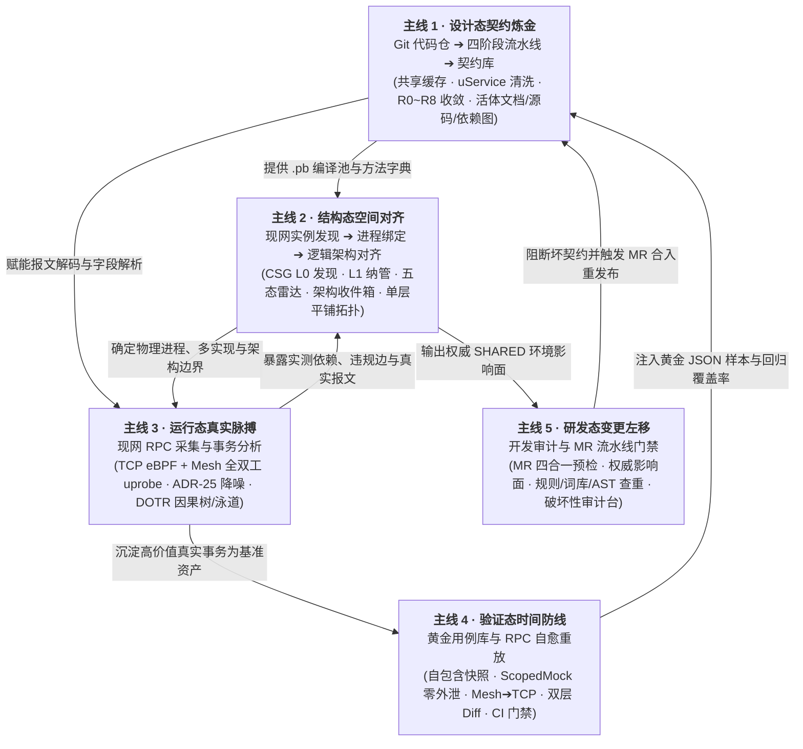

# 活体契约治理：以运行态为活水，构建微服务的五线自愈防线

> **文档编号**：`02-living-contract-philosophy.md`  
> **归属阶段**：阶段一：产品理念与系统哲学（[`docs/01-features/`](./01-feature-matrix.md)）  
> **适用对象**：架构师、微服务研发工程师、测试/质量保障工程师、平台工程与 DevOps 团队  
> **关联基线**：[`README.md`](../../README.md) · [`01-feature-matrix.md`](./01-feature-matrix.md) · [`ADR-24`](../05-adr/24-csg-discovery-process-centric-and-physical-logical-boundary-adr.md) · [`ADR-26`](../05-adr/26-shared-git-cache-and-subsystem-proto-tree-adr.md) · [`ADR-28`](../05-adr/28-uservice-normalization-pg-flattening-and-compile-closure-adr.md) · [`ADR-29`](../05-adr/29-proto-contract-pipeline-closure-and-ia-redesign-adr.md) · [`ADR-30`](../05-adr/30-contract-library-and-three-lines-ia-adr.md)

---

## 1. 破题：为什么静态契约与纸面架构终将腐化

在规模化微服务系统（尤其是经历多年演进、多团队并行、数百个代码仓库协同的工业级 DOPHI `CROS RPC` 集群）中，研发团队几乎都会遭遇四重**“两张皮”困境**：

1. **契约文档与源码实现两张皮**：接口文档散落在 Wiki、Word 或团队口耳相传中；代码仓里存在大量历史遗留的非标 `.proto`（如私有 `uService` DSL、缺少 `syntax` 声明、隐式类型引用、路径层级五花八门、跨仓私自拷贝副本），根本无法直接通过标准编译器收敛成一份全网可信的契约目录。
2. **纸面架构图与现网进程两张皮**：架构设计文档描绘了“子系统 → 功能模块 → 接口依赖”的理想边界，但现网机器上究竟跑着多少操作系统进程、多 PID 同类进程如何分布、纯客户端或 `dophi_mesh://` 进程发起了哪些订阅、是否出现跨层私自直连或僵尸接口，纸面图谱一无所知。
3. **测试回归与真实生产两张皮**：单进程的功能回归往往因为依赖十几个下游微服务而难以独立开展；在测试环境拼凑全链路既昂贵又脆弱，而人工造出的 Mock 数据很难覆盖现网真实的复杂分支与隐蔽边界条件。
4. **规范制定与日常交付两张皮**：等到接口已经上线、甚至线上出现不兼容故障后才回头追查字段删改或类型漂移，代价极高；而如果在同步入库环节粗暴一刀切阻断，又会导致全网契约库无法及时反映代码仓的真实现状。

传统契约工具（Swagger、Postman、静态 Proto 仓库）只管**“设计态的静态文本”**，而传统抓包或链路追踪工具只看**“运行态的孤立报文”**。`code-contract` 的核心使命，就是把静态契约、架构蓝图、现网发现、内核探针与仿真回归贯通起来，**以真实运行态为活水，让契约从“死文档”变成可编译、可对齐、可核验、可重放、可守门的“活体契约”**。

---

## 2. 范式跃迁：从“静态建模前置”到“事实底座 + 契约轴心”

回顾 `code-contract` 的演进历程，系统架构经历了三次关键的思维跃迁：

1. **第一次跃迁（从抓包工具到契约治理）**：确立“流量录制与重放只是零侵入数据面手段，架构防漂移与契约防劣化才是业务目的”。引入三级逻辑架构（子系统 → 功能组 → 功能模块）与双层语义 Diff，让报文不再是一堆十六进制字节，而是可对照架构边界与 Protobuf Schema 的治理依据。
2. **第二次跃迁（从静态建模前置到 `Discovery-First` 现网驱动，[`ADR-24`](../05-adr/24-csg-discovery-process-centric-and-physical-logical-boundary-adr.md)）**：早期假设“必须先手工建完子系统、模块与进程蓝图，才能挂探针、录流量、做重放”，面对数百个现网进程造成了极高的冷启动门槛，甚至催生出 `MOD_*` 占位假模块污染逻辑架构。`ADR-24` 彻底反转范式：**物理事实自动发现、即时可用；逻辑架构按需认领、只做治理不做门槛**。L0 现网实况、L1 物理资产（类型 `L1-T` / 实例 `L1-I`）、L2 逻辑治理三层解耦，使研发零建模即可开录与仿真。
3. **第三次跃迁（从手工导入与入库阻断到完全自封闭 Git 真值源 + 审计解耦，[`ADR-26`](../05-adr/26-shared-git-cache-and-subsystem-proto-tree-adr.md) ~ [`ADR-30`](../05-adr/30-contract-library-and-three-lines-ia-adr.md)）**：废弃手工上传 `.pb` 与在线文本直编 `.proto`，对接 `code-bench` 500+ 代码仓共享宿主机 Git 缓存，通过“缓存采集 → 清洗规整 → 全池收敛仲裁 → 单仓拓扑发布”炼出全网唯一的只读契约库；同时将**破坏性变更审计归口至规范与 MR 门禁台**——允许生效契约库客观反映代码仓现状（不断链、不阻断无关下游），同时以独立的审计事件与 MR 门禁实现可追责、可左移的规范看护。

---

## 3. 五条核心主线与「活体契约飞轮」

围绕微服务契约的完整生命周期，`code-contract` 将全部产品能力凝聚为**五条相互咬合的主线**，共同驱动一个持续正向循环的**「活体契约飞轮」**：

| 主线 | 核心问题 | 关键能力链路 | 对应控制台入口 |
| :--- | :--- | :--- | :--- |
| **主线 1：代码仓 ➔ 契约库** | 散落且不规范的 `.proto` 如何成为全网权威契约？ | 复用宿主机共享 `codes/` 缓存（两层并发锁 + 无工作树直读）→ `rule-normalizer/v2`（`uService` 状态机、去 `/pg` 扁平化、`line_map` 溯源）→ Stage C+ 全池协调（R1~R4 基座收割与 R3 冲突仲裁、纯 Go `protocompile` R7 自愈 & R8 根因隔离）→ 阶段 ④ 拓扑编译发布 → **纯只读契约库**（全注释参考文档、Raw/Clean 源码对比、跨包依赖图） | **契约库与构建** `契约入库流水线` (`/proto-pipeline`) `契约库` (`/proto-docs`) |
| **主线 2：现网发现 ➔ 架构对齐** | 契约到底由谁实现、跑在哪个进程、依赖关系是否合规？ | 宿主机 Agent 纯 Go 双层自动发现（`rpcmon` `CrosTCP`/`CrosMesh` + `csgdlink.Sub`，隔离跨板 LDC、覆盖纯客户端与 `dophi_mesh`）→ L0 进程主轴快照与 Diff → L1 物理资产观测纳管（`Enroll` 默认 `DISARMED`）→ 统一契约目录三级撮合与五态雷达 → 架构收件箱（`1 进程 : N 模块` 认领、`MULTI_IMPL` 拆分、依赖反向合成）→ 单层平铺拓扑数字孪生 | **架构与契约对齐** `现网发现` (`/discovery`) `契约认领与雷达` (`/proto-catalog`) `架构元素` (`/architecture`) `架构拓扑` (`/topology`) |
| **主线 3：现网采集 ➔ 事务分析** | 真实 RPC 调用链路、耗时与参数流转到底发生了什么？ | `pkg/transport` 双驱动零侵入采集（`builtin-tcp` 全出站透明代理与按需入站钩子；`builtin-drt-uprobe` 锚定 `DRT_WriteBulk` + `DRT_ReadNoCheckLen` 全双工采集 `dophi_mesh`）→ `ADR-25` 双源噪音规则与 Agent 源头成对丢弃 → `ExchangeAssembler` 发起序配对与双模分区落盘 → DOTR 因果调用树（先算账后折叠与异常破格）、微秒级阶段甘特瀑布、时序泳道与参数血缘 | **流量核验与回归** `流量采集` (`/record`) `事务分析` (`/debug`) |
| **主线 4：黄金用例 ➔ 重放验证** | 如何在不依赖完整下游环境的前提下高保真回归业务功能？ | 将高价值事务一键固化为**自包含黄金契约套件**（深拷贝二进制报文与闭包，免疫 30 天分区清理与脱敏）→ 跨 Agent 同构脱机重放（`ScopedMock` 局部因果池零外泄接管、`ullSNO`/`aucTraceBuff` 头部自愈、Mesh 录制 ➔ `tcp://` `ucProtocol: 4->1` 跨传输归一化、CSG 三模沙箱）→ 协议头 + Protobuf 双层语义 Diff → CI/CD 质量门禁 | **流量核验与回归** `黄金用例库` (`/golden-suites`) `防劣化回归` (`/replay`) `POST /api/gates/evaluate` |
| **主线 5：开发审计 ➔ MR 门禁** | 如何在研发改契约的第一时间守住规范与兼容性红线？ | 接入 Git MR Webhook（基线 + Patch 虚拟树精确处理增删改名，支持 Fast-Forward 去重与原位评论更新）→ 四合一静态预检（编译、静态命名/注释/分层与词库检查、`Jaccard >= 0.85` AST 重复探测、含 `BASE_LIB` 传递扩散与权威 `SHARED` 现网影响面的破坏性检查）→ 管理员 `Override` 豁免审计 + 非阻断上线破坏性变更审计台 (`OPEN -> ACKNOWLEDGED`) + 定向通知中心 | **开发合规** `规范与 MR 门禁` (`/proto-governance`) |

> **全局度量枢纽**：五条主线的健康状态最终收敛至**治理大盘 (`/dashboard`)**，以“规范性 40 分 + 一致性 30 分 + 回归保障率 30 分 = 100 分”三维健康指数、静态合规扩展卡片与五态雷达，为团队提供单一可观测视图。

---

## 4. 支撑落地的五条硬核工程哲学

理念之所以能工程落地而不流于口号，依赖五条自始至终不可动摇的架构守则：

1. **物理防腐与极简数据面（Agent 九包红线）**：
   控制面 `code-contract-server` 与数据面 `code-contract-agent` 同仓双二进制物理隔离。`cmd/agent` 及底层九个核心包（`pkg/{crosrpc,agentproto,csgdlink,rpcmon,csgmock,ebpf,transport,replay}`）严格保持 `CGO_ENABLED=0` 纯 Go 单二进制——**零数据库驱动、零 `.pb`/`protoregistry` 反射、零外部 C++ 探针、零外部 `.so` 插件、零 `readelf`/`nm` 子进程**。所有内核偏移通过 Go 标准库 `debug/elf` 解析 `.dynsym`，所有 CSG 协议通过手写纯 Go 帧栈完成，既降低了宿主机部署风险，也保证了测试可完全隔离验证。
2. **客观事实与治理裁决解耦**：
   不因治理诉求去扭曲或阻塞客观事实的采集：
   - 在架构对齐侧，现网发现只记录 L1 物理放置事实，绝不强行生成逻辑假模块；
   - 在契约入库侧，仓库已经合入主干的破坏性变更不再卡死契约入库与激活链路（避免契约库失真、拖垮无关下游），而是转为 `contract_breaking_change_events` 非阻断审计事件，交由「规范与 MR 门禁」台集中审阅与确认闭环。
3. **最小侵扰与“五出口”探针卫生**：
   生产与联调机器容不得半点探针泄漏或控制面污染。因此系统严守：`ARMED` 待命期 **0 uprobe 挂载**、发现纳管缺省 **`DISARMED`**（绝不静默改写网络路径）、严禁向真实 CSG 发送 `GET_BIND_ADDR` 推进生产端口游标、重放 `MOCK_MISS` **0 字节外泄**真实下游，并在正常停止、取消、`/purge`、5 分钟失联与退出信号五个出口幂等卸载全部探针与桩服务。
4. **渐进式治理而非一刀切**：
   治理平台最忌讳“上线第一天要求全员填完 1000 张表”。`code-contract` 通过五态雷达（`现网裸奔 / 无主孤儿 / 纸面僵尸 / 认领后消失 / 放置漂移`）、分级裁决（R3 自动消歧 vs 人工权威仲裁；`EXACT` 自动关联 vs `HEURISTIC/FINGERPRINT` 建议确认）与先降噪后排障（`ADR-25` 先算账后折叠 + 异常破格永不掩盖故障），让团队“先看得见全貌、再逐步认领收敛、最后自动化守门”。
5. **公私域严格隔离与排他租约**：
   个人开发者可以自建 `PRIVATE` Agent 与 `PROVISIONAL` 临时发现进行无负担的录制和脱机仿真实验，但所有**权威健康分、五态雷达、逻辑架构图与 MR 现网影响面只采信 `SHARED` 权威环境**，从机制上防止个人实验噪声污染团队 SSOT；同时通过 `Agent Mutex Lease` 保障同一宿主机在同一时刻的内核重放隔离与录制确定性。

---

## 5. 演进审视：面向未来的组织优化思考

基于 [`ADR-30`](../05-adr/30-contract-library-and-three-lines-ia-adr.md)，控制台已将菜单重构为贴合上述主线的 **6 组 14 项**结构（其中将主线 3“流量采集与事务分析”与主线 4“黄金用例与回归重放”合入「流量核验与回归」分组，既保持高频联调工作流连贯，又避免了菜单分组过于碎片化）。随着系统进入深水区，未来可沿以下方向持续演进：

* **顺应工作流因果的界面微调**：在「架构与契约对齐」分组中，随着 `Discovery-First` 成为默认起点，可让`现网发现`承担第一入口角色，再流向`契约认领与雷达`、`架构元素`与`架构拓扑`；在「流量核验与回归」中，先沉淀`黄金用例库`再执行`防劣化回归`也更贴合资产沉淀顺序。
* **“设计态 MR 门禁”与“运行态 CI 门禁”双闸门协同**：主线 5 守住“改 `.proto` 时”的静态/影响面闸门（`/api/webhooks/git-mr`），主线 4 守住“改业务代码时”的真实重放与架构一致性闸门（`/api/gates/evaluate`）。将运行态 CI 门禁的执行流水与评估报告同步透视到控制台，将进一步打通双闸门认知。
* **上线破坏性审计与 MR 审批记录互认**：在 `BreakingChangeEvent` 中关联对应提交的 `MRCheckRun`，显式标注“经 MR 豁免放行”或“绕过 MR 直推主干”，使开发合规追责形成 100% 闭环。
* **黄金用例对契约库与拓扑的反向滋养**：进一步强化黄金用例作为高保真业务样本反哺接口参考文档、并直接量化接口回归覆盖率的链路，让“活体契约飞轮”转得更紧、更稳。
