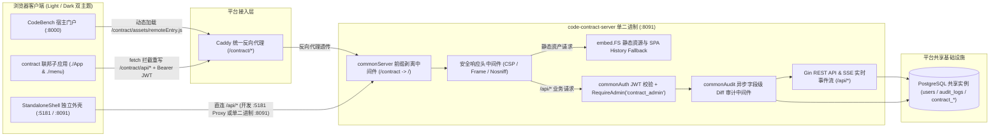
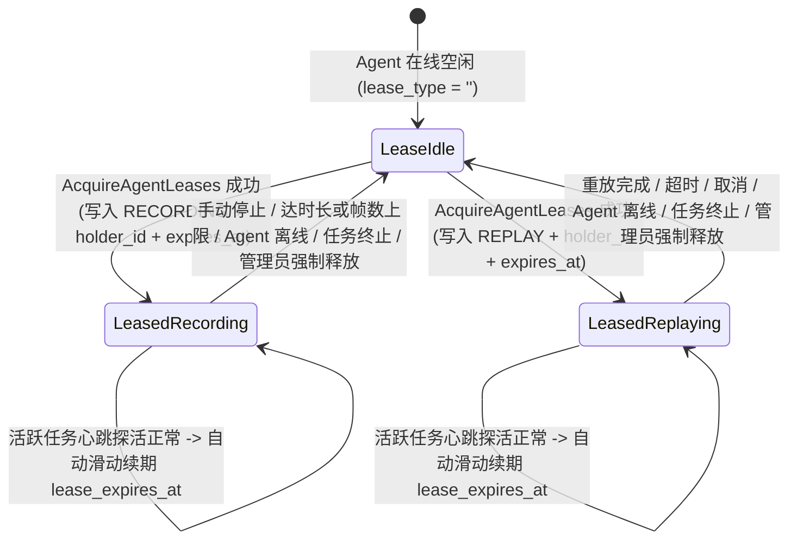
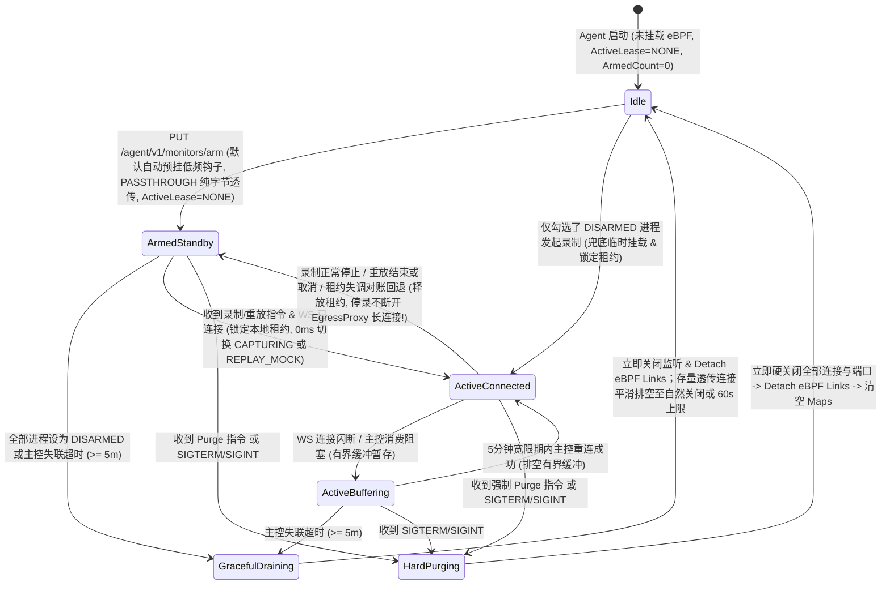
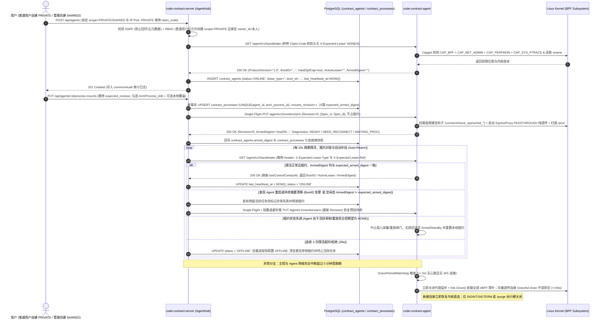
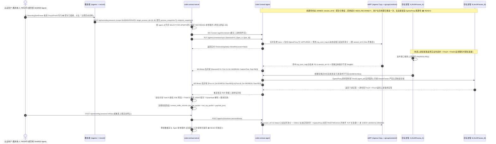
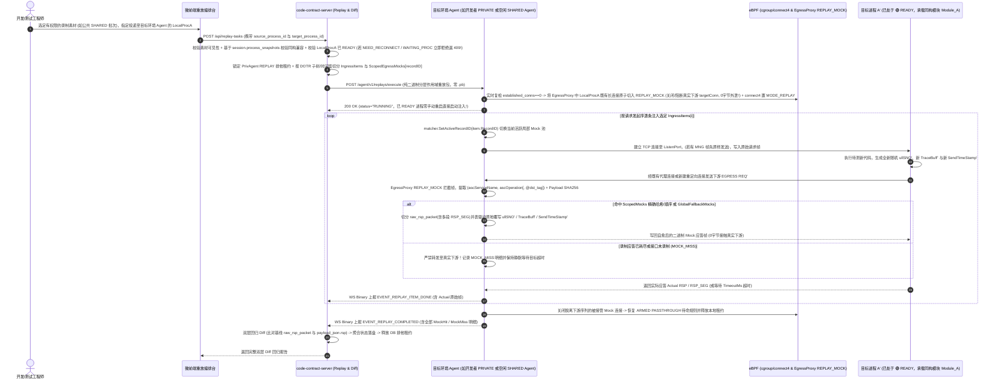
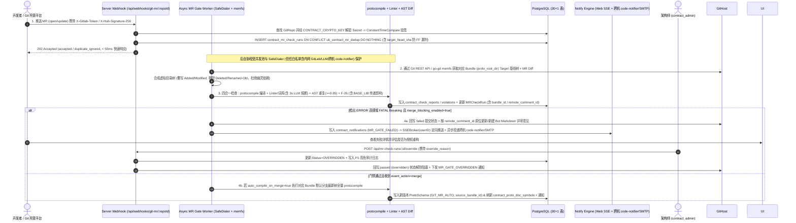
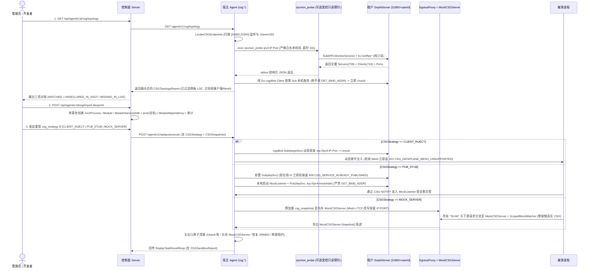

# 架构与活体契约治理 (`code-contract`) 系统总体架构与主从协同设计

- **文档编号**：`01-system-architecture.md`
- **文档版本**：v1.10.0（依据 `ADR-22` v2.0.0 与 `ADR-23` v1.1.0 纳入纯 Go 可插拔传输层 `pkg/transport`、`builtin-drt-uprobe` 内核 uprobe 旁路采集与「`dophi_mesh` 录制 ➔ `tcp://` 仿真重放」跨传输闭环，严守 `cmd/agent` 零 DB / 零 `protoregistry` / 零 CGO 物理防腐红线，维持 `30` 张核心业务表 + `contract_settings` 共 `31` 张表）
- **更新日期**：2026-11-19
- **归属阶段**：阶段二：系统架构与数据模型设计 (`02-design`)
- **状态**：M1~M28 已交付；ADR-22 v2.0.0 & ADR-23 v1.1.0 (M29) SDD 详细设计定稿
- **上位基线**：[`01-feature-matrix.md`](../01-features/01-feature-matrix.md) (v2.24.0)、[`01-cros-rpc-protocol-spec.md`](../07-references/01-cros-rpc-protocol-spec.md) (v1.0.0)、[`02-ebpf-hook-and-dual-subsystem-adr.md`](../05-adr/02-ebpf-hook-and-dual-subsystem-adr.md)、[`03-control-plane-state-recovery-and-lease-reconciliation.md`](../05-adr/03-control-plane-state-recovery-and-lease-reconciliation.md)、[`09-arch-process-ssot-and-ebpf-premount-standby-adr.md`](../05-adr/09-arch-process-ssot-and-ebpf-premount-standby-adr.md) (ADR-09 v1.1.0)、[`11-single-process-bidirectional-capture-and-recording-ux-adr.md`](../05-adr/11-single-process-bidirectional-capture-and-recording-ux-adr.md) (ADR-11 v1.0.0)、[`12-packet-causality-call-tree-and-sequence-ux-adr.md`](../05-adr/12-packet-causality-call-tree-and-sequence-ux-adr.md) (ADR-12 v1.0.0)、[`16-multi-implementation-service-contract-adr.md`](../05-adr/16-multi-implementation-service-contract-adr.md) (ADR-16 v2.0.0)、[`17-topology-single-layer-drilldown-and-layout-ux-adr.md`](../05-adr/17-topology-single-layer-drilldown-and-layout-ux-adr.md) (ADR-17 v1.1.0)、[`18-proto-full-lifecycle-and-git-mr-governance-adr.md`](../05-adr/18-proto-full-lifecycle-and-git-mr-governance-adr.md) (ADR-18 v1.3.0)、[`21-csg-aware-agent-service-discovery-and-replay-mock-adr.md`](../05-adr/21-csg-aware-agent-service-discovery-and-replay-mock-adr.md) (ADR-21 v2.1.0)、[`22-pluggable-transport-driver-and-mesh-capture-adr.md`](../05-adr/22-pluggable-transport-driver-and-mesh-capture-adr.md) (ADR-22 v2.0.0)、[`23-dophi-mesh-uprobe-bypass-capture-adr.md`](../05-adr/23-dophi-mesh-uprobe-bypass-capture-adr.md) (ADR-23 v1.1.0)

### 修订记录

| 版本 | 日期 | 修订说明 |
| :--- | :--- | :--- |
| v1.5.0 | 2026-11-05 | 对齐 ADR-11 / ADR-12 双录、调用树与 `ScopedEgressMocks` 事务闭包重放设计 |
| v1.6.0 | 2026-11-11 | 依据 ADR-16 (v1.0.0 / M20) 同步核心 `contract_*` 业务表总数（扩展至 19 张，新增 `contract_service_contracts`）、录制 `endpoint_snapshots` 固化及 `DownstreamEndpoint.DstTag` 多实现重放 Mock 隔离标签契约 |
| v1.7.0 | 2026-11-13 | 依据 [`ADR-18`](../05-adr/18-proto-full-lifecycle-and-git-mr-governance-adr.md) (v1.1.0, `M22~M25`) 升级架构基线：增设纯 Go `protocompile`、`gitclient`、`protodoc`、`linter`、`notify` 与 `security` 模块，严格恪守 `cmd/agent` 与 `pkg/*` 零 `.pb`/零 DB/零 Git 防腐红线 |
| v1.8.0 | 2026-11-13 | 依据 [`ADR-18`](../05-adr/18-proto-full-lifecycle-and-git-mr-governance-adr.md) (v1.2.0, `M22~M26`) 全面检视修订：1. 核心表收敛为 **`30` 张核心 `contract_*` 业务表 + `contract_settings`（共 `31` 张物理表）**，拆分 `GitRepo (1:N) GitProtoBundle` 支持 Monorepo 多目录包、MR 原位评论去重与 `COALESCE(bundle_id,0)` 防 Fast-Forward 同 SHA 误丢；2. 明确统一主密钥 env **`CONTRACT_CRYPTO_KEY`**；3. `SafeDialer` 在永久阻断云元数据/组播前提下支持 `outbound_trusted_cidrs` 白名单放行同内网 GitLab/LLM 与**跨机部署的 `code-notifier` 邮件服务**（调用 `POST /api/notify/email` 严格校验非空 `markdown_content` 并解析真实收件邮箱）；4. 明确 `handlers/settings.go` 敏感字段脱敏及审计掩码 `***REDACTED***`，并将前端预算精确校准为基于 M21 基线的 **`<= 150KB gzip`（`<= 500KB` 原始文本）增量上限** |
| v1.9.0 | 2026-11-18 | 依据 [`ADR-21`](../05-adr/21-csg-aware-agent-service-discovery-and-replay-mock-adr.md) (v2.1.0, `M28`) 升级系统架构：1. 新增纯 Go 基础包 `pkg/csgdlink`、`pkg/rpcmon`（基于 `pkg/crosrpc` 标准帧与零 `protoregistry` Wire 编解码）、`pkg/csgmock`、`internal/agent/csg` 与可选外置只读 C++ 探针 `scripts/csg/rpcmon_probe.cpp`，并纳入 `cmd/agent/deps_test.go` 物理防腐红线；2. 扩展主从接口 `GET /agent/v1/csg/topology`、`GET /agent/v1/processes/discover`、WS 事件 `0x08 (EVENT_CSG_OBSERVATION)`、`HandshakeResp.CSGEndpoints` 与 `ExecuteReplayReq.CSGStrategy/CSGAddr/CSGSnapshots`；3. 新增 §5.5 CSG 双层自动发现与三模仿真全链路时序及 §6.5 CSG 访问安全守卫与受控探针调用约束 |
| v1.10.0 | 2026-11-19 | 依据 [`ADR-22`](../05-adr/22-pluggable-transport-driver-and-mesh-capture-adr.md) (v2.0.0) 与 [`ADR-23`](../05-adr/23-dophi-mesh-uprobe-bypass-capture-adr.md) (v1.1.0, `M29`) 演进系统架构：1. 新增纯 Go 可插拔传输驱动包 `pkg/transport`（内置 `builtin-tcp` 与基于 `debug/elf` + `cilium/ebpf` 锚定 `libdopra.so:DRT_WriteBulk` 的 `builtin-drt-uprobe`，零 CGO / 零 `.so` 插件 / 零子进程）并纳入 `cmd/agent/deps_test.go` 九包物理防腐红线；2. 扩展 `HandshakeResp.TransportDrivers` 与 56B `EnvelopeHeader` 偏移 `26` `TransportProto (uint8: 1=TCP, 4=MESH)`（零数据库 DDL 迁移）；3. 打通「现网 `dophi_mesh://` (`ucProtocol=4`) 采集 ➔ 测试态 `tcp://` (`ucProtocol=1` 发送副本原地归一化 + `MOCK_SERVER` 放行改写) 仿真重放」全链路闭环，新增 §5.6 时序图与 §6.2 uprobe 探针卫生规范 |

---

## 1. 微前端双模运行拓扑 (Dual-Mode Micro-Frontend Topology)

控制面 `code-contract-server` 遵循 CodeBench 微前端家族统一规范，通过 Go 1.16+ `//go:embed all:frontend/dist` 单二进制托管与 `@originjs/vite-plugin-federation` 模块联邦机制，无缝兼容**宿主门户嵌入**与**独立开发调试**双模运行。



### 1.1 双模运行路由与上下文契约

| 维度 | 门户嵌入模式 (`isEmbedded = true`) | 独立开发调试模式 (`isEmbedded = false`) |
| :--- | :--- | :--- |
| **入口识别** | 宿主传入 `props.isEmbedded = true` 或检测 `window.__POWERED_BY_PORTAL__ === true` | 直接访问 `http://192.168.56.18:5181/contract/` 或 `http://192.168.56.18:8091/` |
| **导航与布局** | 宿主通过 `./menu` 渲染左侧二级导航，子应用仅挂载 `EmbeddedRoutes` 内容区 | 挂载 `StandaloneShell`（内置独立侧边栏、亮/暗主题切换与 `UnifiedLogin` 登录页） |
| **API 路径治理** | `setupFetchInterceptor({ appPrefix: '/contract' })` 自动重写 `/api/*` 为 `/contract/api/*` | 前端直接请求 `/api/*`，Vite Dev Server 代理至 `127.0.0.1:8091` 或由单二进制直接响应 |
| **后端前缀剥离** | `commonServer.Run(Options{ Prefix: "contract" })` 自动剥离 `/contract`，内部统一匹配 `/api/*` | 无需剥离或兼容 `/contract` 访问，共享同一套 `RegisterAPIRoutes` 处理器 |
| **实时推送通道** | 基于 `fetch` + `ReadableStream` 请求 `/contract/api/events`，通过 HTTP Header 携带 `Bearer JWT`（严禁 URL Query 传 Token） | 同样通过 Header 携带 `Bearer JWT` 订阅 `/api/events` SSE 实时流量与任务事件 |

---

## 2. 主从双子系统物理架构与代码分层 (Dual-Subsystem Architecture)

为彻底隔离「控制面元数据治理 / 动态解码」与「宿主机内核态流量采集 / 二进制重放」，系统在单仓库（Monorepo）下拆分为两个物理职责正交的可执行程序：**`code-contract-server`** 与 **`code-contract-agent`**。

### 2.1 双子系统物理职责与防腐边界

| 架构维度 | 控制面主控 (`cmd/server` -> `code-contract-server`) | 数据面代理 (`cmd/agent` -> `code-contract-agent`) |
| :--- | :--- | :--- |
| **部署拓扑与规模** | 集中式无特权部署（对接 CodeBench 网关与共享 PostgreSQL） | 每台受控业务宿主机部署 1 个守护进程（`1 Agent : N 目标进程`） |
| **操作系统特权** | 普通非特权用户运行，**零内核钩子、零业务宿主机 `/proc` 访问** | 需具备 `CAP_BPF` + `CAP_NET_ADMIN`（挂载 eBPF 与读取本机 `/proc`；纯 CSG 发现与 `CLIENT_INJECT`/`PUB_STUB` 仿真可按降级能力运行） |
| **持久化与状态** | 有状态：唯一连接 PostgreSQL（读写 **30 张核心 `contract_*` 业务表**、`contract_settings` 及共享表） | **完全无数据库**：不连任何 DB、不持有数据库凭据，仅维护运行期内存态 |
| **Protobuf 依赖** | 引入 `google.golang.org/protobuf/types/dynamicpb` 动态反序列化、`protocompile` 纯 Go 编译与 AST Diff | **零 `.pb` / `protoregistry` 依赖**：编译依赖图严禁出现 `dynamicpb` / `protoregistry` / `protocompile` / `gorm`（`pkg/rpcmon` 采用纯 Go 手写 Wire 编解码） |
| **协议解析深度** | 调用 `pkg/crosrpc` 解析头（`ucProtocol ∈ [0..7]`）+ 调用 `internal/server/decoder` 解码 Payload；调用 CSG 发现/蓝图对账引擎 | 调用 `pkg/crosrpc` 解析 `24 + usHeadLen` 之前的协议头（Payload 视为不透明字节切片）；通过 `pkg/csgdlink` / `pkg/rpcmon` / `pkg/csgmock` 处理 CSG `dlink` 控制面与 `RPCMonitorService` |
| **录制与重放职责** | 批次协同编排（含 `csg_snapshots`）、落盘归档（`transport_proto = 1 \| 4`）、模块穿透定位、架构一致性验证、双层回归 Diff 报告、CSG 三态对账与一键蓝图导入 | 基于 `pkg/transport.Driver`（`builtin-tcp` Socket eBPF + `EgressProxy`，及 `builtin-drt-uprobe` 锚定 `libdopra.so:DRT_WriteBulk`）执行 TCP/Mesh 旁路采集、CSG 双层自动发现、重放注入与三模仿真测试（含 Mesh 录制帧 ➔ TCP 重放发送期 `ucProtocol: 4->1` 归一化）、二进制 Mock 匹配与头部偏移自愈 |

### 2.2 工程目录分层与包依赖拓扑

```text
code-contract/
├── cmd/
│   ├── server/main.go               # 控制面可执行入口：内嵌 frontend/dist，挂载 Gin、DB、Audit 与调度器
│   └── agent/main.go                # 数据面可执行入口：挂载 IP 白名单、eBPF/transport 驱动注册表、透明代理、CSG 发现与三模仿真器
├── pkg/                             # 主从共享或数据面独立无状态核心库（严禁反向依赖 internal/server 或 models）
│   ├── crosrpc/                     # 共享 CROS RPC 分帧状态机、24B 公共头 (ucProtocol 0..7)、多版本会话头与扩展头解析库
│   ├── agentproto/                  # 主从 HTTP REST DTO 与 WebSocket 56B 二进制信封帧编解码契约（含 TransportProto、TransportDrivers 与 CSG DTO）
│   ├── csgdlink/                    # 纯 Go 标准库 DOPRA dlink (32B 帧头/248B 实例/10类控制消息/2类 NOTIFY) 与流式 Observer (ADR-21)
│   ├── rpcmon/                      # RPCMonitorService 统一模型、pkg/crosrpc 标准帧服务端/客户端与零 protoregistry Wire 编解码及 NativeBackend (ADR-21)
│   ├── csgmock/                     # 内存态 MockCSGServer（内置 rpcmon.Provider，支援全隔离控制面沙箱、Mesh->TCP 改写与五出口清理，ADR-21/22）
│   ├── ebpf/                        # Agent 专属：cilium/ebpf 探针加载（含 Socket eBPF 与 uprobe/DRT_WriteBulk）、BPF Map 热更新、/proc 扫描与自洁控制
│   ├── transport/                   # Agent 专属：纯 Go 可插拔传输驱动抽象 (Driver/Registry)、builtin-tcp 封装与 builtin-drt-uprobe (debug/elf .dynsym + DRT_WriteBulk，ADR-22/23)
│   └── replay/                      # Agent 专属：零 .pb 二进制 Mock 匹配器、请求注入器、ucProtocol (4->1) 发送期归一化与应答头偏移自愈改写器
├── scripts/
│   └── csg/                         # 可选外置只读 C++ 探针源码 (rpcmon_probe.cpp) 与构建脚本 (build-native-probe.sh)
├── internal/
│   ├── agent/
│   │   ├── server/                  # Agent HTTP + WS 服务、IP 白名单、缓冲与生命周期控制
│   │   └── csg/                     # Agent 侧 CSG 多租户定位 (locate.go)、双层发现融合 (discoverer.go) 与三模仿真编排 (sim_controller.go)
│   └── server/                      # Server 专属核心业务引擎
│       ├── security/                # AES-256-GCM (CONTRACT_CRYPTO_KEY)、SafeDialer SSRF 含信任白名单与常量时间验签工具 (M24)
│       ├── hub/                     # Agent 连接池、10s 心跳探活、WebSocket 接收器与按 userID 定向的 SSEBroker 中心
│       ├── recorder/                # 多进程协同录制编排器、发起序 SeqNo + SNO 配对器与异步批量落盘流水线
│       ├── callgraph/               # DOTR 事务调用树组装、跨进程 EGRESS⇔INGRESS 缝合、参数数据流血缘与跨事务实体链引擎
│       ├── decoder/                 # .pb 注册校验、protocompile 纯 Go 编译与统一四级虚拟 Resolver、AST 破坏性变更分析 (含 BASE_LIB 传递) 与 dynamicpb 编解码中心 (M22)
│       ├── protodoc/                # 活体接口参考文档中心：SourceCodeInfo 注释/标签萃取、Enum 字典、黄金/缺省 JSON 与 Markdown 导出 (M23)
│       ├── linter/                  # 静态检查引擎：可配置正则规则、词根切分与缓存、3s 超时可选 LLM 客户端、Jaccard>=0.85 三护栏 AST 重复探测 (M24)
│       ├── gitclient/               # 无状态 Git 仓/1:N Bundle 适配器：REST API / go-git memfs 拉取、MR Diff 虚拟树合成、Webhook 解析与原位评论回写 (M25~M26)
│       ├── notify/                  # 持久化站内通知中心 + SSE 定向推送 + 异步外发通道（跨机 LAN code-notifier /api/notify/email 与可选 SMTP，M26）
│       ├── dashboard/               # 治理大盘聚合引擎（含三维健康指数与 F-24 独立静态合标率指标卡片）
│       ├── topology/                # 三级架构树、layer_level 正反向与成环守卫、静态拓扑推导、报文穿透定位、一致性八分类与 CSG 三态对账/蓝图导入引擎
│       └── diff/                    # 协议头级 + Protobuf 语义字段级双层回归 Diff 断言与重放调度器
├── config/                          # Server 与 Agent 各自的配置结构体、CONTRACT_CRYPTO_KEY/LLM/Notifier 配置注入与安全默认值
├── models/                          # 30 张核心 contract_* + contract_settings 共 31 张 GORM 实体模型、幂等迁移与级联校验辅助函数
├── handlers/                        # Server HTTP/Webhook/SSE 控制器、settings.go 脱敏、参数白名单校验、RBAC 守卫与 commonAudit 接入
└── frontend/                        # React 18 + TypeScript + Vite 5 微前端控制台工程（M22~M26 新增 JS 增量 <= 150KB gzip / <= 500KB raw）
```

> [!IMPORTANT]
> **编译期防腐门禁**：`cmd/agent`、`pkg/crosrpc`、`pkg/agentproto`、`pkg/csgdlink`、`pkg/rpcmon`、`pkg/csgmock`、`pkg/ebpf`、`pkg/transport`、`pkg/replay` 九个包的依赖闭包中严禁引入 `gorm.io/*`、`code-common/backend/gormdb`、`google.golang.org/protobuf/types/dynamicpb`、`google.golang.org/protobuf/reflect/protoregistry`、`github.com/bufbuild/protocompile`、`github.com/go-git/go-git`、CGO 或任何 SQLite 驱动；`cmd/server` 自身亦**严禁**引入任何 SQLite 运行时依赖或通过 `os/exec` 调用外部 `protoc` / `git`。阶段四 CI 单测将通过 `go list -deps ./cmd/agent ./cmd/server` (`cmd/agent/deps_test.go`) 自动化断言上述架构红线。

---

## 3. 多人并发模型：公私域资源共享与 Agent 动态排他租约 (Concurrency & Lease Model)

在团队多人并发研发测试场景下，系统采用 **「公共逻辑架构统一共享 + 物理 Agent 与录制素材公私二元划分 + Agent 动态排他租约 (Mutex Lease)」** 三层协同机制。

### 3.1 公私域资源归属与跨环境复用矩阵

| 资源类别 | 公共级 (`SHARED`) | 个人级 (`PRIVATE`) | 跨环境关联与安全边界 |
| :--- | :--- | :--- | :--- |
| **三级逻辑架构、多实现服务契约 (`ServiceContract`)、物理进程蓝图 (`ArchProcess`) 与 `.pb`** | **全局唯一公共 SSOT**（`contract_admin` 维护，全体只读） | *不设私有架构元素与野生进程* | `1 台 Agent = 1 套独立运行环境`：支持多套团队 `SHARED` 公共测试环境（如 SIT/UAT）与个人 `PRIVATE` 联调环境各自从 `ArchProcess` 树中 `1:1` 勾选挂载进程，继承 `FM` 模块组装并支持本地覆盖端口/启动特征及 `FallbackAgentID` 基线环境兜底 |
| **数据面实例 (`Agent`) 与挂载实例 (`Process`)** | `contract_admin` 登记管理；全团队可见，空闲时（包括已处于 `ARMED` 预挂待命态）任意认证用户可申请排他租约进行录制或重放 | **普通用户可自建、编辑、删除本人的私有 Agent 及挂载配置**；**创建人本人及 `contract_admin` 可见**；普通用户之间严格防横向越权 | 他人普通用户尝试查看、修改、探针开关或租用某用户的 `PRIVATE` Agent 拦截返回 `403 Forbidden`；管理员 (`contract_admin`) 具备全团队可见、审计与故障解锁特权 |
| **录制流量素材 (`RecordingSession`)** | 全团队可见并可作为重放输入资产（支持将合格个人素材发布为 `SHARED`） | **仅录制发起人本人及 `contract_admin` 可见**、管理与用于重放；普通用户之间严格隔离 | 只要用户对某录制素材有访问权（公共素材或本人素材），即可将其投递到任何有权限且**挂载同构架构进程/模块**的进程（含本人 `PRIVATE` Agent 进程，以及当前空闲的团队 `SHARED` 进程）上执行隔离重放 |

### 3.2 Agent 动态排他租约状态机 (`Agent Mutex Lease`) 与 `ARMED` 预挂待命的正交性

由于活跃录制与离线重放分别需要独占会话有界缓冲（64MB）或将宿主机内核 `downstream_rules_map` 切向隔离 `MockServer`，**同一台 Agent 在同一时刻严格限制只能由 1 名用户执行 1 项活跃作业（1 个录制批次 `RECORDING` 或 1 个重放任务 `REPLAY`）**。

> [!NOTE]
> **`ARMED` 预挂载待命不占用排他租约（[`ADR-09`](../05-adr/09-arch-process-ssot-and-ebpf-premount-standby-adr.md)）**：当 Agent 处于空闲状态（`lease_type = ''`）且挂载了 `probe_desired_state = 'ARMED'` 的架构进程时，Agent 内核探针与 `EgressProxy` 以 `session_id = 0`（零分帧、零上报、纯字节透传）常驻待命。待命态**不持有 `Mutex Lease`**，任何有权限的用户随时可对该 Agent 申请 `RECORDING`（毫秒级打开采集闸门）或 `REPLAY` 排他租约。



* **多 Agent 升序原子加锁算法 (`AcquireAgentLeases`)**：
  1. 提取本次录制/重放涉及的全部 `agent_id` 去重并**严格按主键升序排序**（彻底消除并发交叉申请 `Agent_1, Agent_2` 与 `Agent_2, Agent_1` 导致的 PostgreSQL 行锁死锁）；
  2. 在数据库事务内执行 `SELECT * FROM contract_agents WHERE id IN (?) ORDER BY id ASC FOR UPDATE`；
  3. 逐台校验：
     - ① **归属防越权**：若 `scope == 'PRIVATE' && owner_id != currentUser.ID && !currentUser.IsAdmin`，立即回滚并返回 **`403 Forbidden`**；
     - ② **探活健康与能力检查**：若 `status != 'ONLINE'` 或无 eBPF 权限，返回 `400/503`；
     - ③ **租约互斥冲突检查**：若存在未过期的活跃租约（`lease_type != '' && now < lease_expires_at`），回滚事务并返回 **`409 Conflict`**（响应体附带 `lease_holder_name`、`lease_type`、`lease_acquired_at`、`lease_expires_at`）；
     - ④ **租约惰性对账自愈**：若旧租约已超硬性安全期 `lease_expires_at`（默认任务最大时长 + `2 分钟` 缓冲），或主控后台检测到关联 Session/Task 已终止，执行惰性自愈清理后授予新租约。
* **租约滑动续期与对账看门狗**：在活跃录制或重放执行期间，主控与 Agent 的 10s 心跳探活正常成功时，主控自动执行 `UPDATE contract_agents SET lease_expires_at = NOW() + INTERVAL '2 minutes'` 滑动续约，防止长耗时重放或大规模多帧录制任务被误判超时收回。
* **Agent 进程侧双重防御 (`SingleTenantGuard`)**：`cmd/agent` 在内存中同步维护唯一 `activeLease{Type, RefID}`，拒绝任何非当前活跃 `SessionID/TaskID` 的并发下发指令（返回 `409`），从而在物理上保证每台 Agent 任意时刻最多只存在 **1 个 64MB 有界会话缓冲**。

---

## 4. 主从管控通信信道协议规范 (Control & Data Channel Protocol)

主控与 Agent 之间采用 **「HTTP REST 控制下行 + WebSocket 二进制流事件上行」** 双通道协同协议（协议常量定义于 `pkg/agentproto`，首期主协议版本 `ProtocolVersion = "1.0"`）。网络拓扑基于**内网可达物理环境**，由主控主动直连各宿主机 Agent 的监听端口。

### 4.1 连接安全控制与内网准入基线

1. **内网直连拓扑与监听绑定**：
   - 生产环境中受控业务宿主机与主控部署在同一内部数据中心网络，主控直接连接各 Agent 实例；
   - Agent 启动参数支持 `--listen 0.0.0.0:9091`（测试环境强制绑定 `127.0.0.1:<port>`）与 `--allow-ips 127.0.0.1,192.168.0.0/16,10.0.0.0/8`（支持单 IP 与 CIDR 网段解析为 `[]netip.Prefix`）。
   - 进入 Agent 的所有 HTTP 请求及 WebSocket `Upgrade` 握手均直接提取底层 TCP `RemoteAddr` 的真实源 IP（忽略外部可伪造的 `X-Forwarded-For`），未命中白名单立即返回 `403 Forbidden` 并丢弃连接。
2. **主控 SSRF 防御与端点校验 (`AgentEndpointGuard`)**：
   - 主控在纳管或测试连接任何 Agent 时，在应用层严格执行 IP 白名单过滤与 SSRF 阻断：
     - ① 严禁配置为回环地址（`127.0.0.0/8`，本地联调测试环境显式开启 `--dev-allow-loopback` 除外）；
     - ② 严禁指向公有云/私有云元数据地址（如 `169.254.169.254`）及广播/组播段；
     - ③ 校验目标端口在合规端口范围（`1024..65535`）；探测超时统一为 `3s`，握手探测失败时返回通用错误提示，严禁将对端真实原始响应体透出给客户端。
3. **PRIVATE Agent 认领防抢注机制 (`Claim Code Guard`)**：
   - 为防止普通用户在共享网络中恶意探测或将他人已启动的宿主机 Agent 抢注为个人的 `PRIVATE` 资产，Agent 在启动时通过 `crypto/rand` 自动生成一次性 16 字节十六进制安全认领码（`ClaimCode`，打印于 Agent 本地终端日志及受保护的本地文件 `/var/run/code-contract/claim.token`，仅宿主机拥有者可见）；
   - 普通用户在控制台纳管个人 `PRIVATE` Agent 时，除填写 `IP:Port` 外必须填写正确的 `ClaimCode`；主控在向 Agent 发送首次初始化校验时传递该认领码，Agent 内存比对一致后建立绑定关系，杜绝内网盲注与未授权窃听。
4. **WebSocket 流量与帧安全边界**：
   - 主控在升级接收 WebSocket 连接时，设置 `conn.SetReadLimit(int64(MaxFrameBytes) + 56 + 1024)`，防止畸形超大帧引起内存溢出；单 Agent 实例挂载滑动窗口速率限制器。

### 4.2 HTTP REST 控制下行接口契约 (`Server -> Agent`)

| 方法 | Agent 路由路径 | 调用时机与职责 | 核心请求 / 响应载荷 (`pkg/agentproto`) |
| :---: | :--- | :--- | :--- |
| `GET` | `/agent/v1/handshake` | 纳管校验、版本握手与每 10s 周期租约/预挂双向对账 | 请求头携带 `X-Expected-Lease-Type`、`X-Expected-Lease-Ref`；返回 `HandshakeResp`（含 `BootID`、`ActiveLeaseType`、`ActiveRefID`、`ArmedProcessCount`、`ArmedDigest`、**`CSGEndpoints`**、**`TransportDrivers`**） |
| `GET` | `/agent/v1/processes/discover` | 用户/管理员探查宿主机候选业务进程（含 CSG 融合） | 融合 `/proc` + L1 `rpcmon` + L2 `csgdlink.Sub` 返回 `[]DiscoveredProcess{PID, UID, ListenPort, Cmdline, ExeName, CSGDataPlane, CSGServices, CSGSubscriptions}`（覆盖纯客户端与 `dophi_mesh://` 进程，自动过滤跨板 LDC；共享 Agent 仅管理员可查） |
| `GET` | `/agent/v1/csg/topology` | 执行一次实时 CSG 环境全量拓扑发现（`ADR-21`） | 支持 `?csg_addr=` 与 `?enrich_dlink=1`；调用 `rpcmon.BuildReport` + 本机 `csgdlink.Sub` 返回 `CSGTopologyReport{CSGAddr, UserID, DiscoveryMode, ServerNum, ClientNum, LocalServerCount, RemoteLDCServCount, Ports, Servers, Clients}` |
| `PUT` | `/agent/v1/monitors/arm` | **默认自动预挂待命同步**（不锁定排他租约） | 请求 `ArmStandbyReq{Revision, Processes: []ProcessMonitorSpec}`；挂载低频建连钩子（`connect4`/`sock_ops`/`sched_process_*`，不挂 Socket `read/write`、**不挂任何 `DRT_WriteBulk` uprobe**）并启动 `EgressProxy` `PASSTHROUGH` 纯字节透传，返回 `ArmStandbyResp{Revision, ArmedDigest, Diagnostics}`；若 `Revision < lastAppliedRevision` 或当前持有活跃租约返回 `409`；若 `Processes` 为空则关闭监听并平滑排空卸载探针 |
| `GET` | `/agent/v1/monitors/diagnose` | 按需重新扫描已预挂进程的实时 PID 与存量连接 | 返回 `ArmStandbyResp{Revision, ArmedDigest, Diagnostics: []ProcessDiagStatus}` |
| `PUT` | `/agent/v1/monitors/sync` | 持 `RECORDING` 排他租约开启采集闸门（或兜底临时挂载） | 请求 `SyncMonitorReq{SessionID, MaxFrameBytes, MaxBufferBytes, Processes: []ProcessMonitorSpec}`；实时复检 `/proc` 后经 `pkg/transport.Registry` 分流启动采集：`builtin-tcp` 按序开启 `EgressProxy` `CAPTURING` 分帧（同步挂载 `csgdlink.Observer` 上报 `0x08`）、预热 `ing_conn_map` 并挂载入站读写钩子；`builtin-drt-uprobe` 对映射 `libdopra.so` 的目标 PID（含 `ListenPort==0` 纯 `dophi_mesh://` 进程）按需挂载 `DRT_WriteBulk` uprobe；冲突返回 `409` |
| `DELETE` | `/agent/v1/monitors/:sessionId/processes/:processId` | 录制中单独停止某进程的采集（不影响同机其他进程） | 将该进程从活跃录制集移除（若原为 `ARMED` 则不断连回退 `PASSTHROUGH` 待命，同时摘除该 PID 的 `DRT_WriteBulk` uprobe；若为临时挂载则移除规则） |
| `POST` | `/agent/v1/monitors/:sessionId/stop` | 录制批次正常结束或触发上限停止 | 先卸载入站读写钩子与全部 `DRT_WriteBulk` uprobe 链接 -> `200ms` 在途应答排空 -> 将 `EgressProxy` 拨回 `PASSTHROUGH` **不断开底层 TCP 长连接** -> 发送 `EVENT_SESSION_DRAINED` 并释放本地租约；返回 `StopMonitorResp{CapturedFrames, DroppedFrames, BypassedSelfCount}` |
| `POST` | `/agent/v1/replays/execute` | 下发单进程离线隔离 / CSG 多模式仿真重放任务 | 请求 `ExecuteReplayReq{TaskID, ProcessSpec, TimeoutMs, CSGStrategy, CSGAddr, CSGSnapshots, IngressItems, ScopedEgressMocks, GlobalFallbackMocks, MngMocks}`；依据 `CSGStrategy ∈ {PASSTHROUGH, CLIENT_INJECT, PUB_STUB, MOCK_SERVER}` 编排 CSG 策略：`PUB_STUB` 前置 `Sub(svc)` 在线冲突返回 `409 (CSG_SERVICE_ALREADY_PUBLISHED)`；`MOCK_SERVER` 放行 `dophi_mesh://` 快照改写 `tcp://`（不再误报 `422`）并由 `ReplayExecutor`/`HealResponseFrames` 将发包副本 `ucProtocol (4->1)` 归一化；仅 `CLIENT_INJECT` 目标为在线纯 `dophi_mesh://` 且无 TCP 监听时返 `422 (CSG_DATAPLANE_MESH_UNSUPPORTED)`；`WAITING_PROC` 或非免重连模式 `NEED_RECONNECT` 返 `409`；就绪后锁定租约返回 `200 {"status":"RUNNING"}` |
| `GET` | `/agent/v1/replays/:taskId/result` | 幂等轮询或重放完成后拉取任务最终汇总明细 | 返回 `ReplayTaskResultResp{TaskID, Status, TotalRequests, PassedRequests, MockHitCount, MockMissCount, ObservedEgressCalls, CSGSandboxReport, Details}` |
| `POST` | `/agent/v1/replays/:taskId/cancel` | 用户手动中止正在执行的重放任务 | 立即关闭注入连接、执行五出口自洁（`Unpub` 桩服务、关闭 `MockCSGServer`、释放本地 Mock 监听），恢复 `ARMED` 待命下游规则并释放本地租约 |
| `POST` | `/agent/v1/purge` | 主控启动恢复、管理员强制解锁或紧急全卸载 | 幂等停录/停重放，执行全量 `Unpub`、关闭 `MockCSGServer`/代理监听、调用 `transport.Registry.CloseAll()` 与 `link.Close()` 卸载全部 Socket eBPF 与 uprobe 探针，清空 BPF Maps 并置 `ActiveLease=NONE`、`ArmedDigest=""` |

核心管控结构体与心跳响应契约定义：

```go
package agentproto

// TransportDriverCapability Agent 传输驱动元信息与宿主机实时就绪声明 (ADR-22 v2.0)
type TransportDriverCapability struct {
	Name          string   `json:"name"`           // "builtin-tcp" | "builtin-drt-uprobe"
	Version       string   `json:"version"`        // "1.0.0"
	Transports    []string `json:"transports"`     // ["tcp"] | ["dophi_mesh", "mesh"]
	TransportCode uint8    `json:"transport_code"` // 1 (TCP) | 4 (MESH)
	Capabilities  uint32   `json:"capabilities"`   // 位图: 1=Discover | 2=Capture | 4=Inject | 8=Stub
	Available     bool     `json:"available"`      // 宿主机是否满足运行条件（如探测到 libdopra.so 与 CAP_BPF）
	Detail        string   `json:"detail,omitempty"`
}

// HandshakeResp 握手与心跳双向对账数据载荷
type HandshakeResp struct {
	AgentVersion      string                      `json:"agent_version"`               // Agent 构建版本号
	ProtocolVersion   string                      `json:"protocol_version"`            // 主协议版本，如 "1.0"
	BootID            string                      `json:"boot_id"`                     // Agent 实例重启 UUID，随进程生命周期刷新
	StartedAt         time.Time                   `json:"started_at"`                  // 启动时刻
	KernelVersion     string                      `json:"kernel_version"`              // 宿主机内核版本
	HasEbpfCap        bool                        `json:"has_ebpf_cap"`                // 是否具备完整 eBPF 运行权限
	CapDetail         string                      `json:"cap_detail"`                  // 权限详情说明
	ActiveLeaseType   string                      `json:"active_lease_type"`           // 当前内存持有的租约类型: "" | "RECORDING" | "REPLAY"
	ActiveRefID       uint64                      `json:"active_ref_id"`               // 当前内存持有的 SessionID 或 TaskID
	ArmedProcessCount int                         `json:"armed_process_count"`         // 当前处于 ARMED 预挂载待命态的进程数
	ArmedDigest       string                      `json:"armed_digest"`                // 已预挂 ProcessMonitorSpec 集合的规范化 SHA-256 摘要，供主控心跳对账补挂
	CSGEndpoints      []CSGEndpointInfo           `json:"csg_endpoints,omitempty"`     // 自动定位到的本机多租户 CSG 控制面端点列表
	TransportDrivers  []TransportDriverCapability `json:"transport_drivers,omitempty"` // 内置可插拔传输驱动实时能力列表 (ADR-22 v2.0)
	UptimeSec         uint64                      `json:"uptime_sec"`                  // 运行秒数
}

// DownstreamEndpoint 描述目标进程允许访问并需被透明拦截的下游 CROS RPC 地址
type DownstreamEndpoint struct {
	IP     string `json:"ip"`                // IPv4 点分十进制地址，如 "192.168.56.19" 或 "127.0.0.1"
	Port   uint16 `json:"port"`              // 下游监听端口，1..65535
	DstTag string `json:"dst_tag,omitempty"` // 目的标准架构进程编码 (ArchProcess.code)，供多实现契约重放按 service:operation@dst_tag 隔离 Mock (ADR-16)
}

// CSGReplayStrategy CSG 仿真测试策略枚举 (ADR-21)
type CSGReplayStrategy string

const (
	CSGStrategyPassthrough  CSGReplayStrategy = "PASSTHROUGH"   // 默认：不介入 CSG
	CSGStrategyClientInject CSGReplayStrategy = "CLIENT_INJECT" // 模式一：csgdlink.Sub 动态寻址入站注入（免重启）
	CSGStrategyPubStub      CSGReplayStrategy = "PUB_STUB"      // 模式二：前置 Sub==0 校验 + 受控 Pub 注册缺席下游桩
	CSGStrategyMockServer   CSGReplayStrategy = "MOCK_SERVER"   // 模式三：全隔离控制面 MockCSGServer + EgressProxy 沙箱
)

// ProcessMonitorSpec 单进程监控元信息（零 .pb Schema 依赖）
type ProcessMonitorSpec struct {
	ProcessID       uint64               `json:"process_id"`                  // 主控 contract_processes.id
	ListenPort      uint16               `json:"listen_port"`                 // 唯一有效监听端口 (0 表示纯客户端，A-02)
	CmdPattern      string               `json:"cmd_pattern"`                 // /proc/<pid>/cmdline 有效匹配表达式
	CSGServiceNames []string             `json:"csg_service_names,omitempty"` // 关联的 64B 运行期 CSG 服务名列表，供动态寻址与 OBSERVER 匹配
	CSGAddr         string               `json:"csg_addr,omitempty"`          // 可选指定所属租户 CSG 控制面地址 (host:port)
	Downstreams     []DownstreamEndpoint `json:"downstreams"`                 // 录制/待命期用作已声明下游参考集；重放期为静态推导 ∪ 历史 EGRESS 实测 DstAddr 并集
}

// ArmStandbyReq 声明式同步 Agent 预挂载待命规格（不占排他租约，携带单调递增 Revision 防乱序覆盖）
type ArmStandbyReq struct {
	Revision  uint64               `json:"revision"`  // 对应 contract_agents.mounts_revision，Agent 拒绝 Revision < lastAppliedRevision (409)
	Processes []ProcessMonitorSpec `json:"processes"` // 期望处于 ARMED 态的挂载进程集合（为空表示卸载全部待命探针）
}

// ComputeArmedDigest 规范化计算预挂规格摘要：
// 1. 若 specs 为空返回 ""；
// 2. 按 ProcessID 升序排列 Processes，每个 Process 内按 "IP:Port" 字典序升序去重排列 Downstreams；
// 3. 紧凑 JSON 序列化后计算小写十六进制 SHA-256，确保 Server 与 Agent 两端 100% 字节级一致。
func ComputeArmedDigest(specs []ProcessMonitorSpec) string

// ProcessDiagStatus 预挂载待命或活跃采集下的实时定位与存量长连接统一七态就绪诊断结果
type ProcessDiagStatus struct {
	ProcessID        uint64 `json:"process_id"`
	Status           string `json:"status"`            // 统一枚举: "READY" | "NEED_RECONNECT" | "WAITING_PROC" | "MONITORING" | "DISARMED" | "OFFLINE" | "CAP_DENIED" | "ERROR"
	ResolvedPID      uint32 `json:"resolved_pid"`      // 实时定位到的 OS PID（未找到为 0）
	EstablishedConns int    `json:"established_conns"` // 指向已登记下游的绕过 EgressProxy 直连 TCP_ESTABLISHED 连接数 (A-01)
	NeedReconnect    bool   `json:"need_reconnect"`    // EstablishedConns > 0 时为 true，提示在空闲准备期重启或触发重连一次
	Message          string `json:"message"`
}
```

### 4.3 WebSocket 二进制流上行信封协议 (`Agent -> Server`)

主控在活跃录制或重放期间长连 Agent 的 `ws://<agent_endpoint>/agent/v1/stream`。为避免高频采集下 JSON + Base64 编码带来的 CPU 与带宽膨胀，WebSocket 统一使用 `BinaryMessage` 帧传输 **56 字节定长网络大端信封头 (`EnvelopeHeader`) + 变长载荷**。

```text
 0                   1                   2                   3
 0 1 2 3 4 5 6 7 8 9 0 1 2 3 4 5 6 7 8 9 0 1 2 3 4 5 6 7 8 9 0 1
+-+-+-+-+-+-+-+-+-+-+-+-+-+-+-+-+-+-+-+-+-+-+-+-+-+-+-+-+-+-+-+-+
|      Magic (0x4354 "CT")      |  ProtoVer (1) |   EventType   |  0..3
+-+-+-+-+-+-+-+-+-+-+-+-+-+-+-+-+-+-+-+-+-+-+-+-+-+-+-+-+-+-+-+-+
|                 SessionOrTaskID (uint64, BE)                  |  4..11
|                                                               |
+-+-+-+-+-+-+-+-+-+-+-+-+-+-+-+-+-+-+-+-+-+-+-+-+-+-+-+-+-+-+-+-+
|                    ProcessID (uint64, BE)                     |  12..19
|                                                               |
+-+-+-+-+-+-+-+-+-+-+-+-+-+-+-+-+-+-+-+-+-+-+-+-+-+-+-+-+-+-+-+-+
|                   CapturedPID (uint32, BE)                    |  20..23
+-+-+-+-+-+-+-+-+-+-+-+-+-+-+-+-+-+-+-+-+-+-+-+-+-+-+-+-+-+-+-+-+
|   Direction   |     Flags     |TransportProto |  Reserved (0) |  24..27
+-+-+-+-+-+-+-+-+-+-+-+-+-+-+-+-+-+-+-+-+-+-+-+-+-+-+-+-+-+-+-+-+
|                  CapturedAtNs (int64, BE)                     |  28..35
|                                                               |
+-+-+-+-+-+-+-+-+-+-+-+-+-+-+-+-+-+-+-+-+-+-+-+-+-+-+-+-+-+-+-+-+
|                     SrcIPv4 (4 Bytes)                         |  36..39
+-+-+-+-+-+-+-+-+-+-+-+-+-+-+-+-+-+-+-+-+-+-+-+-+-+-+-+-+-+-+-+-+
|                     DstIPv4 (4 Bytes)                         |  40..43
+-+-+-+-+-+-+-+-+-+-+-+-+-+-+-+-+-+-+-+-+-+-+-+-+-+-+-+-+-+-+-+-+
|       SrcPort (uint16, BE)    |       DstPort (uint16, BE)    |  44..47
+-+-+-+-+-+-+-+-+-+-+-+-+-+-+-+-+-+-+-+-+-+-+-+-+-+-+-+-+-+-+-+-+
|                    ConnSeq (uint32, BE)                       |  48..51
+-+-+-+-+-+-+-+-+-+-+-+-+-+-+-+-+-+-+-+-+-+-+-+-+-+-+-+-+-+-+-+-+
|                   PayloadLen (uint32, BE)                     |  52..55
+-+-+-+-+-+-+-+-+-+-+-+-+-+-+-+-+-+-+-+-+-+-+-+-+-+-+-+-+-+-+-+-+
|             Payload Bytes (Raw CROS RPC Frame / JSON)         |  56..56+N
+-+-+-+-+-+-+-+-+-+-+-+-+-+-+-+-+-+-+-+-+-+-+-+-+-+-+-+-+-+-+-+-+
```

* **偏移 `26..27` 传输协议标记（`ADR-22 v2.0 D3`，56B 定长零破坏演进）**：
  * 偏移 `26` **`TransportProto (uint8)`**：标明载荷所属底层传输协议编码（与 `crosrpc.CommHead.TransportProto` 同源：`0 = 未指定/兼容旧发送端`、`1 = TCP`、`4 = MESH (dophi_mesh)`）；主控 `ExchangeAssembler` 优先采用 `env.TransportProto`，为 `0` 时自动回退 `comm.TransportProto`（仍为 `0` 时缺省 `1`），直接写入既有数据库列 `contract_traffic_records.transport_proto`，**零 DDL 迁移**；
  * 偏移 `27` **`Reserved (uint8)`**：恒为 `0`。

* **`Flags` 位掩码字段规范**：
  * `bit0 (0x01) = IS_TRUNCATED`：单帧超过 `MaxFrameBytes`（默认 4MB）发生物理截断，不可作为重放资产；
  * `bit1 (0x02) = REF_KIND`：标识关联资产类型（`0 = RECORDING_SESSION`，`1 = REPLAY_TASK`），彻底消除主键空间冲突导致串包；
  * `bit2 (0x04) = HAS_GAP`：底层内核 ringbuf 发生丢包或字节断流，提示用户态分帧器重新同步；
  * `bit3..7`：预留为 0。

* **`EventType` 枚举与租约校验守卫**：
  * 主控 `AgentHub` 收到任意 WebSocket 二进制帧后，核对信封偏移 `4..11` 的 `SessionOrTaskID` 及 `Flags.REF_KIND` 是否与该 Agent 当前持有的排他租约一致；过期或悬空会话的残帧直接丢弃；
  * `0x01 (EVENT_TRAFFIC_FRAME)`：采集到的单条完整（或截断）CROS RPC 原始帧；`SessionOrTaskID` 必须等于当前活跃录制 `session_id`（严禁为 `0`）；**`Direction` 恒定表达相对于目标进程的业务调用方向（[`ADR-11`](../05-adr/11-single-process-bidirectional-capture-and-recording-ux-adr.md)）：`1 = INGRESS`（入站监听连接上的 `REQ` 与 `RSP/RSP_SEG` 均为 `1`）、`2 = EGRESS`（出站代理连接上的 `REQ` 与 `RSP/RSP_SEG` 均为 `2`）**，消息是请求或应答仅由载荷 24B 公共头 `ucMsgType` 判定；
  * `0x02 (EVENT_PROCESS_LIFECYCLE)`：目标进程生命周期事件（如 `PROCESS_RESTARTED` 新旧 PID 切换、`PROCESS_EXITED`）；
  * `0x03 (EVENT_SESSION_STATS)`：每 2s 周期上报会话采集计数、当前缓冲水位与累计背压丢帧数 `dropped_frames`；
  * `0x04 (EVENT_REPLAY_ITEM_DONE)`：重放单条请求完成事件，携带实际捕获的 `RSP` / `RSP_SEG` 原始字节流或超时/连接错误状态；
  * `0x05 (EVENT_REPLAY_COMPLETED)`：重放任务汇总完成事件，携带完整 `MockHit` / `MockMiss` 明细列表；
  * `0x06 (EVENT_CONN_CLOSED)`：被监控连接正常或异常关闭事件，携带 `ConnKey`，驱动慢轨配对器立即刷出挂起的单向请求；
  * `0x07 (EVENT_SESSION_DRAINED)`：会话停止指令后所有内存积压帧已全部发送完毕的终结信号，主控收到后方可标记批次定稿并释放租约；
  * `0x08 (EVENT_CSG_OBSERVATION)`（`ADR-21` 新增）：录制期由 `EgressProxy` 上挂载的 `csgdlink.Observer` 旁路解码 `"DLNK"` 控制面报文产生的 JSON 事件载荷（包含 `SUB` / `SUB_ACK` / `PUB` / `UNPUB` / `NOTIFY` 解析出的服务名与 `248B InstanceAddr` 实例清单），由控制面去重合并写入 `contract_recording_sessions.csg_snapshots`。

### 4.4 预挂载待命、背压缓冲、Single-Flight 对账补挂与平滑排空自洁



1. **有界会话字节预算缓冲 (`BoundedSessionBuffer`)**：
   - Agent 仅在活跃录制批次（`session_id > 0`）期间分配独立的有界环形字节队列，容量上限默认 `64MB`（`--max-session-buffer-bytes=67108864`）；`ARMED` 待命态（`session_id == 0`）不分配会话缓冲且不挂载全局 `read/write` 钩子，常驻内存恒定、全机读写零损耗。
   - 当 WebSocket 发送阻塞或闪断导致当前会话已驻留字节数 `usedBytes + frameLen > maxBytes` 时，采集协程执行 **非阻塞丢弃新帧 (`Drop-Newest`)**，原子递增 `session.droppedFrames.Add(1)`，绝不阻塞业务系统调用，也绝不突破 Agent 内存红线。
2. **主控指数退避自动重连**：
   - `AgentHub` 检测到 WebSocket 断开后立即启动重连循环（退避间隔 `500ms -> 1s -> 2s -> 5s` 封顶），重连成功后立即消费缓冲中积压的信封帧并同步最新 `dropped_frames`。
3. **心跳双向租约与 Single-Flight 预挂对账看门狗 (`DualLeaseAndArmReconcileWatchdog`)**：
   - 主控在每 10s 发起的探活心跳中带上主控数据库记录的期望租约状态（`X-Expected-Lease-Type` 与 `X-Expected-Lease-Ref`）；
   - Agent 收到后比对本地内存 `activeLease` 并返回 `ArmedDigest`：
     - **孤儿租约无损回退**：若主控下发期望租约为 `NONE` 但 Agent 处于活跃 `RECORDING`/`REPLAY` 状态，Agent **立即中止孤儿采集/重放闸门并回退至 `ArmedStandby`（若 `ArmedProcessCount == 0` 则转入平滑排空卸载探针）**，释放本地租约的同时避免误杀正常待命业务长连接；
     - **Single-Flight 版本化自动补挂 (`Auto-Rearm`) 与指数退避**：
       - `AgentHub` 为每台 Agent 维护独立的内存互斥锁 `rearmMu[agentID]`，且每次挂载/覆盖/探针开关变更均单调递增 `contract_agents.mounts_revision` 与重算 `expected_armed_digest`；
       - 当空闲在线 Agent 返回的 `BootID` 变化或 `ArmedDigest != expected_armed_digest` 时，`AgentHub` 在 `rearmMu[agentID]` 保护下读取最新 `mounts_revision` 发起 `PUT /agent/v1/monitors/arm`（彻底消除用户手动改挂载与 10s 心跳并发推送导致的旧配置覆盖竞态）；
       - 若因宿主机缺 `CAP_BPF` 等持久性错误导致补挂失败，主控自动将该 Agent 关联进程快照标为 `CAP_DENIED` / `ERROR` 并启动**指数退避（`10s -> 30s -> 60s -> 300s` 封顶）**，直到挂载配置版本变更或用户在 UI 手动点击重新挂载才立即重置退避，防止每 10s 无意义风暴重试。
4. **主控单实例部署假设与启动恢复序列 (`ServerRecoveryPipeline`)**：
   - 本系统控制面采用**单实例部署**（保证内存 Hub、分片 Worker 与 SSE 广播池的权威一致性；多实例需另行接入集中式分布式锁）；
   - 主控进程启动时，在数据库事务内扫描处于 `RECORDING`、`STOPPING` 或 `REPLAYING` 状态的历史残留任务：
     - 将关联任务统一置为 `FAILED(SERVER_RESTART)` 终态，并清空所有 Agent 表上的排他租约列；
     - 并发向在线 Agent 执行租约清理与 `PUT /agent/v1/monitors/arm` 对账同步，使各受控机器平滑收敛回期望的 `ARMED` 待命（或 `DISARMED` 空闲）基线态。

---

## 5. 三大核心业务全链路时序图 (End-to-End Sequence Diagrams)

### 5.1 场景一：公私域 Agent 纳管、架构进程 `1:1` 自动预挂、心跳补挂与失联自洁时序



### 5.2 场景二：预挂就绪零重启协同录制、停录不断连回退与双模落盘全链路时序



### 5.3 场景三：跨 Agent 同构进程零外泄隔离重放与双层 Diff 全链路时序



### 5.4 场景四：Git 无状态同步、MR 四合一静态门禁、`Approve with Override` 与跨机通知时序 (`ADR-18` / M25~M26)



### 5.5 场景五：CSG 现网双层自动发现、架构蓝图一键导入与三模仿真测试全链路时序 (`ADR-21` / M28)



### 5.6 场景六：纯 Go 可插拔传输驱动、`dophi_mesh` 内核 uprobe 零侵入采集与「Mesh 录制 ➔ `tcp://` 仿真重放」全链路时序 (`ADR-22 v2.0` & `ADR-23 v1.1` / M29)

```mermaid
sequenceDiagram
    actor User as 开发者 / 管理员
    participant Srv as 控制面 Server
    participant Ag as Agent (pkg/transport.Registry)
    participant Kern as Linux 内核 (uprobe/DRT_WriteBulk)
    participant MeshA as 业务进程 A (Client, dophi_mesh)
    participant MeshB as 业务进程 B (Server, ListenPort=0)
    participant Replay as ReplayExecutor + MockCSGServer

    User->>Srv: 1. 启动协同录制 (含纯 Mesh 进程 B / A)
    Srv->>Ag: PUT /agent/v1/monitors/sync (SessionID, Targets)
    Ag->>Ag: builtin-tcp 开启 Socket eBPF/EgressProxy;<br/>builtin-drt-uprobe 扫描 /proc/<pid>/maps 用 debug/elf 解析 libdopra.so .dynsym (DRT_WriteBulk)
    Ag->>Kern: 按目标 PID 挂载匿名 perf_event bpf_link (uprobe/DRT_WriteBulk，零 tracefs 污染)

    MeshA->>MeshB: 2. MESH_Send(REQ) -> DRT_WriteBulk(handle, 2, [40B 环头, CROS ucProtocol=4])
    Kern-->>Ag: bpf_probe_read_user 单次拷贝入 drt_ringbuf (含 \x00 全帧)
    MeshB->>MeshA: MESH_Send(RSP) -> DRT_WriteBulk(handle, 2, [40B 环头, CROS ucProtocol=4])
    Kern-->>Ag: bpf_probe_read_user 单次拷贝入 drt_ringbuf
    Ag->>Ag: DRTUprobeDriver 剥离偏移 + 按 ADR-11 归一化 Direction(1/2) & 4元组 + 封装 56B EnvelopeHeader(offset 26 = 4)
    Ag->>Srv: WS Binary Frame (TransportProto=4, CROS Frame ucProtocol=4)
    Srv->>Srv: ValidateCommHead(0..7) 放行 -> ExchangeAssembler 配对落盘 transport_proto=4 + .pb 解码 + 因果树

    User->>Srv: 3. 停录 POST /api/recording-sessions/:id/stop
    Srv->>Ag: POST /agent/v1/monitors/:sessionId/stop
    Ag->>Kern: 立即 link.Close() 卸载全部 DRT_WriteBulk uprobe (负控 0 事件，平时待命 0% 损耗)

    User->>Srv: 4. 发起跨传输仿真重放 (csg_strategy=MOCK_SERVER / PUB_STUB)
    Srv->>Ag: POST /agent/v1/replays/execute (Mesh 录制原始帧 + csg_snapshots)
    Ag->>Replay: MockCSGServer 启用 EnableMeshToTCPRewrite(true) (放行 Trans[4]=1 订阅，返回 tcp:// 地址，不报 422)
    Replay->>MeshB: ReplayExecutor 发送副本原地归一化 ucProtocol (4 -> 1 TCP) 经 tcp:// 注入
    MeshB->>Replay: 下游出站经 tcp:// 连入 EgressProxy/MockListener -> HealResponseFrames 原地归一化 ucProtocol (4 -> 1) 自愈回包
    Ag->>Ag: 五出口原子清理 (卸载探针/桩/MockCSGServer)
    Ag-->>Srv: 回传实际应答 + CSGSandboxReport (含 MeshRewrites) -> 双层 Diff 100% PASS
```

---

## 6. 系统级安全架构与验证计划基线 (Security Guardrails & Verification Plan)

依据工作区安全编码红线，阶段二架构冻结以下强制安全防护契约，并纳入阶段四自动化验收计划：

1. **认证、授权与会话安全**：
   - 控制面所有非公开 `/api/*` 接口（含 `/api/events` SSE 流）强制经 `commonAuth.AuthMiddleware` 校验 `HS256` JWT（显式拒绝 `none` 算法、强制校验 `exp` 过期时间）；`JWT_SECRET` 通过环境变量或密钥管理系统注入，严禁源码硬编码回退字面量（生产集群接入 KMS 标记见 `config/config.go` `TODO(security)`）。
   - 严禁在 URL Query 参数中传递 JWT 或任何凭据；前端登出时清空内存认证上下文并触发页面级重载跳转。
   - 独立密码登录（调试模式）复用平台 `bcrypt` 加盐哈希存储，预留 MFA 与泄露密码库检测扩展位（`// TODO(security): 企业生产门户统一走 OAuth2/OIDC + MFA 强认证`）。
   - **公私域防横向越权（Anti-IDOR）**：所有涉及 `PRIVATE` Agent、名下进程及 `PRIVATE` 录制素材的查询、修改、SSE 订阅与重放接口，普通用户之间强制在数据访问层校验 `owner_id == currentUser.ID`（未匹配返回 `403 Forbidden`）；管理员（`contract_admin`）被授予全团队运维查看、审计、租约异常解锁与安全审查特权，严禁仅靠前端隐藏入口。
2. **输入校验、编译沙箱与出站 SSRF/凭据零信任**：
   - `.pb` 描述集上传与 `POST /api/proto-schemas/compile` / Git `protocompile` Compilation Bundle 统一强制通过流式 `http.MaxBytesReader` / 解压边界校验 `<= 16MB` 体积上限；编译 100% 运行于纯 Go `github.com/bufbuild/protocompile` 内存虚拟文件解析器中（**全仓严禁 `os/exec` 调用外部 `protoc` 或 `git` 命令行**），所有 `.proto` 相对路径与 `proto_include_dirs` 经 `path.Clean` 强制消毒，拒绝 `..` 路径穿越与绝对路径；二进制 `FileDescriptorSet` 直接存入 PostgreSQL `bytea` 字段，不落地宿主机可执行文件系统，下载响应强制附加 `Content-Disposition: attachment`、`X-Content-Type-Options: nosniff` 与 `Cache-Control: no-store`（病毒扫描外部网关集成留存 `// TODO(security): 接入企业制品防病毒扫描服务`）。
   - **Git 凭据 / 敏感集成配置加密与脱敏**：`contract_git_repos` 的 `credentials_encrypted`、`webhook_secret_encrypted` 及 `contract_settings` 的 `llm_api_key_enc`、`smtp_password_enc`、`code_notifier_token_enc` 统一使用主密钥 **AES-256-GCM**（通过 **`CONTRACT_CRYPTO_KEY`** 环境变量或 KMS 注入；`// TODO(security): 生产环境接入 KMS`，严禁生产模式静默无密钥回退）加密持久化；改造 `handlers/settings.go` 与 `git_handler.go`，API 响应结构体统一标注 `json:"-"` 并过滤全部 `*_enc` / `*_sha256` 内部键，仅透出 `has_credentials`、`has_webhook_secret`、`llm_key_configured` 等布尔标记，且严禁向 `commonAudit` 写入未脱敏的敏感配置字段级 Diff；Webhook 回调签名为常量时间比对 (`subtle.ConstantTimeCompare`) 并受 `uk_contract_mr_dedup` (`git_repo_id, COALESCE(bundle_id, 0), event_phase, head_commit_sha, target_head_sha`) 唯一约束保护，兼顾 Fast-Forward/Rebase 同 SHA 合并门禁与重放幂等性。
   - **出站请求 `SafeDialer` SSRF 防护、信任内网白名单与 3s 熔断超时**：所有由主控主动发起的出站 HTTP/Git 请求（Git REST API / `go-git memfs` 拉取、MR 状态回写、可选外部 LLM 词根建议、**部署在同内网另一台主机上的 `code-notifier` 邮件投递** / SMTP）统一经 `internal/server/security.SafeDialer`：
     1. **永久硬阻断（不可豁免）**：云元数据与链路本地地址（`169.254.0.0/16`、`fe80::/10`、`100.100.100.200/32`、`metadata.google.internal`）、多播段与未指定地址（`0.0.0.0/8`）；
     2. **默认拦截 + 管理员信任白名单放行 (`outbound_trusted_cidrs`)**：默认拒绝回环（`127.0.0.0/8`、`::1`）、RFC1918 私网与 RFC4193 ULA，同时显式允许管理员在 `contract_settings.outbound_trusted_cidrs` 配置受信任内网 CIDR 或精确主机（放行企业内网 GitLab/CodeHub、内网 LLM 网关及跨机部署的 `code-notifier`），单测沙箱可通过显式构建期或隔离开关放行受控 `127.0.0.1` mock server；
     3. **Dial/Control DNS 重绑定复检与重定向守卫**：通过 `net.Dialer{Control: ...}` 在 TCP 实际建连前再次校验解析后的最终 IP（防止域名通过 DNS 重绑定跳入元数据 IP 或未授权内网段），并禁止跨信任边界自动跳转；
     4. **强制硬超时与安全降级**：LLM 固定 `<= 3s`、Git API `<= 30s`、`code-notifier` `<= 5s`，任何外部依赖离线或返回 `4xx/5xx` 均安全降级（记录 `TIMEOUT_FALLBACK` 或 `email_status='FAILED'`），严禁阻塞核心研发与 MR 门禁主路径。
   - **宿主机进程探查、CSG 控制面与 DRT Uprobe 安全守卫 (`ADR-21` / `ADR-22 v2.0` / `ADR-23 v1.1`)**：
     1. Agent 进程探查、连接诊断与 `libdopra.so` 符号解析 100% 通过 Go 标准库只读解析 `/proc/<pid>/*` 与 `debug/elf` 完成（严禁调用外部 `readelf`/`nm`、严禁引入 CGO 或外部 `.so` 传输插件）；针对依赖 DOPRA SDK 私有动态库链的真机 `RPCMonitorService` 全量查询，仅允许调用管理员预置在受控白名单路径（如 `/usr/local/bin/rpcmon_probe` 或 `--csg-probe-bin`，经文件存在性/非符号链接/权限位与属主校验）的只读探针 `rpcmon_probe`，入参严格按正则校验为 `^ipv4:[0-9.]+:[0-9]{1,5}$`，**严禁拼接执行任意 Shell 字符串或调用外部 `protoc` / `git` 命令**；
     2. **真实 CSG 只读/零游标污染红线**：自动发现期只允许 `REGISTER / CLIENT_ID / SUB / UNSUB / UNREGISTER` 并在取回实例后立即 `UNSUB` 断连；**严禁在任何模式下向真实 CSG 发送 `GET_BIND_ADDR (7)` 或 `FREE_BIND_ADDR (8)`**（防止推进 `usNextPortNum`）；`PUB_STUB` 必须满足前置 `Sub==0` 门禁并在重放完成、手动取消、`/purge`、失联 5 分钟、`SIGINT/SIGTERM` 五出口幂等 `Unpub` 清理零残留；
     3. **`builtin-drt-uprobe` 探针卫生与只读红线 (`ADR-23 D5`)**：① `ARMED` 待命期 **0 uprobe 挂载**，仅在 `StartCapture` 活跃录制期间按目标 `PID` 动态挂载 `libdopra.so:DRT_WriteBulk`；② 通过 `cilium/ebpf` 匿名 `perf_event_open(pid)` `bpf_link` 挂载（零 `/sys/kernel/tracing/uprobe_events` 全局污染，同机非监控进程连内核陷页都不触发）；③ 永不修改寄存器或用户态共享内存环（重放统一收敛 `tcp://`）；④ 五出口调用 `transport.Registry.CloseAll()` 幂等卸载并经负控验收确保停录后 0 事件；
     4. **`Agent` 物理防腐红线 (`cmd/agent/deps_test.go`)**：强制纳入 `./pkg/csgdlink`、`./pkg/rpcmon`、`./pkg/csgmock`、`./pkg/transport`（共九包），严禁依赖 `gorm.io`、`pgx`、`dynamicpb`、`protoregistry`、`protocompile`、`go-git`、`sqlite`、CGO 或 `internal/server`。
   - 数据库交互 100% 使用 GORM 参数化预编译查询，排序字段与状态枚举执行严格白名单校验，SQL 原始错误严禁透出至客户端响应。
3. **浏览器安全响应头与前端防 XSS**：
   - 保留并在 `cmd/server/main.go` 演进全局安全响应头：`Content-Security-Policy`（注：当前 `cmd/server/main.go` 已放行 `img-src`/`connect-src` 的 `blob:`，供 `/topology` 与 `/schemas?tab=graph` 纯客户端程序化矢量 SVG / 离屏 Canvas PNG 导出使用；Vite 微前端兼容期间保留 `style-src 'unsafe-inline'`，`script-src` 严禁启用 `unsafe-inline` 或 `unsafe-eval`）、`X-Content-Type-Options: nosniff`、`X-Frame-Options: SAMEORIGIN`、`Permissions-Policy: camera=(), microphone=(), geolocation=()`，敏感 API 响应附加 `Cache-Control: no-store`；注：由于 `code-common/backend/server` 默认全局挂载 `Access-Control-Allow-Origin: *`，独立部署模式应通过 `commonServer.Options.CustomMiddlewares` 在门户路由前置覆盖严格受信任 CORS 域名白名单并挂载 API 速率限制器（`// TODO(security): 按生产门户域名收敛 CORS 白名单并收紧生产 CSP`）。
   - 来自网络报文、`Git` 仓库提交信息或 `.proto` 源文件注释（`LeadingComments` / `@deprecated` / `@owner` / `Markdown` 预览）的全部外部文本均视为不可信外部输入，前端（含活体参考文档、只读代码浏览器、Commit Diff、SVG 时序泳道图与树形表格）100% 依赖 React JSX 原生文本转义，严禁使用 `dangerouslySetInnerHTML`、`innerHTML` 或原生 `alert()` / `confirm()`；控制面调用树组装与参数血缘扫描强制实施有界递归与节点上限（`max_depth <= 16`、单事务返回子节点 `<= 200`、JSON 血缘递归 `<= 6` 层且标量上限 `<= 500`；`.proto` 参考文档嵌套展开同样受 `max_depth <= 12` 环路防护），防止恶意循环 `FatherSpanID` 或自引用 Proto Message 引发 CPU/内存耗尽（DoS）。
4. **测试绑定红线**：
   - 所有单元与集成测试中拉起的临时 `Server`、Mock `Agent`、模拟业务 TCP 服务及测试数据库均**强制仅监听 `127.0.0.1`**，严禁绑定 `0.0.0.0`；测试结束在 `t.Cleanup` 中确保端口与 eBPF 探针 100% 释放。
