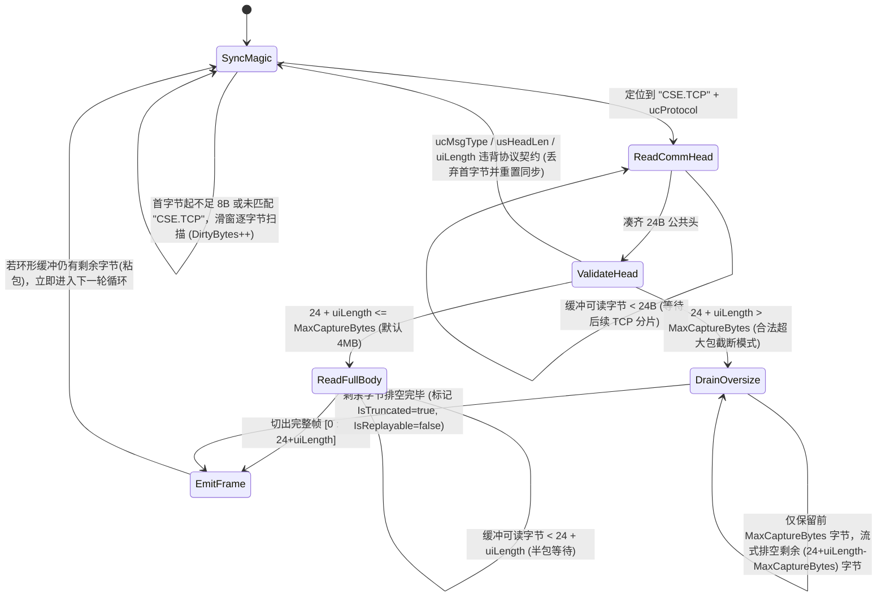
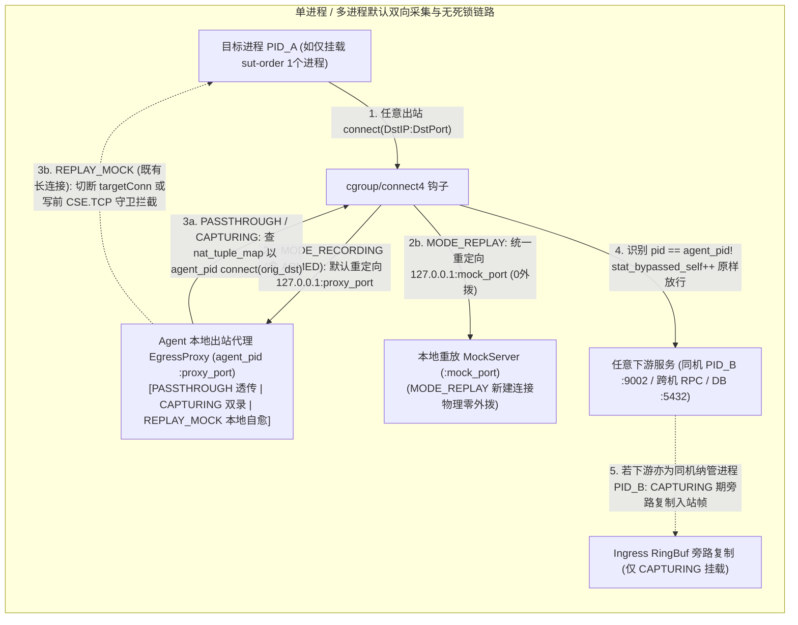
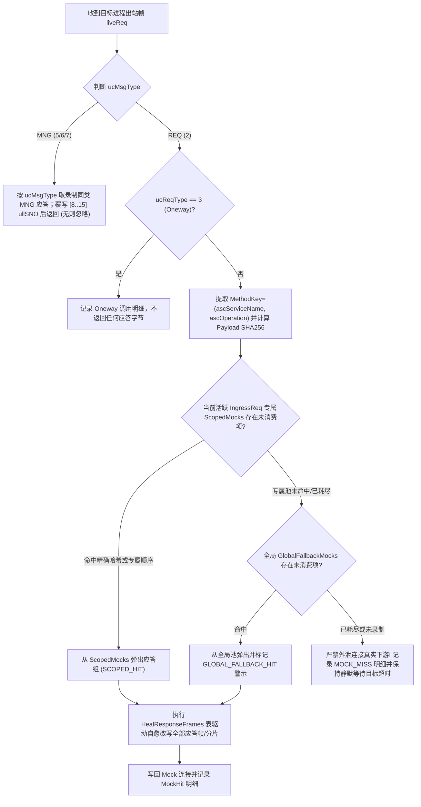

# 架构与活体契约治理 (`code-contract`) 数据面引擎与 CROS RPC 协议栈设计

- **文档编号**：`02-data-plane-and-cros-rpc-engine.md`
- **文档版本**：v1.8.0
- **更新日期**：2026-11-23
- **归属阶段**：阶段二：系统架构与数据模型设计 (`02-design`)
- **状态**：M1~M29 已全部交付
- **上位基线**：[`01-feature-matrix.md`](../01-features/01-feature-matrix.md) (v2.25.0)、[`01-cros-rpc-protocol-spec.md`](../07-references/01-cros-rpc-protocol-spec.md) (v1.0.0)、[`01-system-architecture.md`](./01-system-architecture.md) (v1.11.0)、[`09-arch-process-ssot-and-ebpf-premount-standby-adr.md`](../05-adr/09-arch-process-ssot-and-ebpf-premount-standby-adr.md) (ADR-09 v1.1.0)、[`11-single-process-bidirectional-capture-and-recording-ux-adr.md`](../05-adr/11-single-process-bidirectional-capture-and-recording-ux-adr.md) (ADR-11 v1.0.0)、[`12-packet-causality-call-tree-and-sequence-ux-adr.md`](../05-adr/12-packet-causality-call-tree-and-sequence-ux-adr.md) (ADR-12 v1.0.0)、[`21-csg-aware-agent-service-discovery-and-replay-mock-adr.md`](../05-adr/21-csg-aware-agent-service-discovery-and-replay-mock-adr.md) (ADR-21 v2.2.0)、[`22-pluggable-transport-driver-and-mesh-capture-adr.md`](../05-adr/22-pluggable-transport-driver-and-mesh-capture-adr.md) (ADR-22 v2.0.0)、[`23-dophi-mesh-uprobe-bypass-capture-adr.md`](../05-adr/23-dophi-mesh-uprobe-bypass-capture-adr.md) (ADR-23 v1.1.0)

### 修订记录

| 版本 | 日期 | 修订说明 |
| :--- | :--- | :--- |
| v1.5.0 | 2026-11-04 | 依据 ADR-11 / ADR-12 对齐全出站透明代理、`StreamFramer` SIMD 紧缩、首字节定戳与 `ScopedMockMatcher` 因果池设计 |
| v1.6.0 | 2026-11-18 | **依据 ADR-21 (v2.1.0 / M28) 增补 CSG 控制面协议栈、双层自动发现与三模仿真测试引擎设计**：新增 §4（`pkg/csgdlink` 32B 帧头/248B 实例/`Observer` 与 `pkg/rpcmon` 基于 `pkg/crosrpc` 标准帧及零 `protoregistry` Wire 编解码）、§5（`internal/agent/csg/discoverer.go` 多租户定位、L1/L2/L3 融合与跨板 LDC 隔离）及 §6（`pkg/csgmock.MockCSGServer` 与 `SimulationController` `CLIENT_INJECT`/`PUB_STUB`/`MOCK_SERVER` 状态机及五出口清理） |
| v1.7.0 | 2026-11-19 | **依据 ADR-22 (v2.0.0) 与 ADR-23 (v1.1.0 / M29) 增补纯 Go 可插拔传输驱动与 `dophi_mesh` 采集 ➔ TCP 重放跨传输闭环设计**：1. 更新 §1.1 `ValidateCommHead` 放宽 `ucProtocol ∈ [0..7]`（含 `TransportMesh=4`）同时保持 §1.2 TCP `StreamFramer` 默认 `<= 1` 防伪帧隔离；2. 更新 §3.1/§3.3 `ReplayExecutor` 与 `HealSingleResponseFrame` 发送副本 `ucProtocol (4 -> 1)` 原地归一化；3. 更新 §6 `MockCSGServer` / `SimController` `MOCK_SERVER` 模式放行 `dophi_mesh://` 改写 `tcp://`（取消 `422` 误阻断）；4. 新增 **§7 纯 Go 可插拔传输驱动层 (`pkg/transport`) 与 `builtin-drt-uprobe` 内核 uprobe 采集引擎**（`debug/elf` `.dynsym` 解析、`uprobe/DRT_WriteBulk` + `drt_ringbuf`、方向/四元组相关性归一化与五出口探针卫生） |
| v1.8.0 | 2026-11-23 | **依据 ADR-21 (v2.2.0) 增补 §5.2 纯 Go `CrosMeshBackend`（4 次 128B HELLO + 40B 数据头 + CROS `ucProtocol=4`）并彻底移除外部 C++ 探针 `rpcmon_probe`**：`pkg/rpcmon` 统一支持纯 Go `CrosTCP` 与纯 Go `CrosMesh` 双后端直连现网 `RPCMonitorService` |

---

## 1. 共享协议栈 `pkg/crosrpc` 设计（零 `.pb` 依赖）

`pkg/crosrpc` 为控制面（`cmd/server`）与数据面（`cmd/agent`）共用的底层纯 Go 协议解析库，严格遵循 DOPHI `cros_rpccore.ph` 网络大端序与 `#pragma pack(4)` 内存布局规范，**不引入任何 Protobuf 描述集或反射库**。

### 1.1 常量契约与 24B 公共头 (`RPC_COMM_HEAD_S`) 校验规则

```go
package crosrpc

const (
	MagicPrefix          = "CSE.TCP"               // 7B 固定魔术字 (0x43 0x53 0x45 0x2E 0x54 0x43 0x50)
	CommHeadLen          = 24                      // sizeof(RPC_COMM_HEAD_S)
	ExtendCommHeadLen    = 4                       // sizeof(RPC_EXTEND_COMM_HEAD_S)
	ServiceNameMaxLen    = 64                      // RPC_SERVICE_NAME_LEN
	OperationMaxLen      = 64                      // RPC_OPERATION_LEN
	ProcNameMaxLen       = 64                      // RPC_PROC_NAME_LEN
	TraceBuffLen         = 16                      // RPC_MSG_TRACE_BYTE_NUM
	MaxPayloadLen        = 32*1024*1024 - 4096     // RPC_PAYLOAD_MAX_LEN = 33,550,336 Bytes
	MaxExtendHeadType    = 63                      // RPC_EXTEND_HEAD_TYPE_BUTT

	TransportDefault     = uint8(0)                // RPC_TRANSPORT_DEFAULT
	TransportTCP         = uint8(1)                // RPC_TRANSPORT_TCP (builtin-tcp 底座)
	TransportDMS         = uint8(2)                // RPC_TRANSPORT_DMS
	TransportUC          = uint8(3)                // RPC_TRANSPORT_UC
	TransportMesh        = uint8(4)                // RPC_TRANSPORT_MESH (dophi_mesh / builtin-drt-uprobe 底座, ADR-22/23)
	TransportDomain      = uint8(5)                // RPC_TRANSPORT_DOMAIN
	TransportFRPC        = uint8(6)                // RPC_TRANSPORT_FRPC
	TransportCustomize   = uint8(7)                // RPC_TRANSPORT_CUSTOMIZE (合法枚举上界)

	MsgTypeReq           = uint8(2)                // RPC_MSG_TYPE_REQ
	MsgTypeRsp           = uint8(3)                // RPC_MSG_TYPE_RSP
	MsgTypeRspSeg        = uint8(4)                // RPC_MSG_TYPE_RSP_SEG
	MsgTypeMng           = uint8(5)                // RPC_MSG_TYPE_MNG
	MsgTypeMngReq        = uint8(6)                // RPC_MSG_TYPE_MNG_REQ
	MsgTypeUUIDReq       = uint8(7)                // RPC_MSG_TYPE_UUID_REQ
	MsgTypeButt          = uint8(15)               // RPC_MSG_TYPE_MNG_BUTT 合法上界(不含)

	ReqTypeSync          = uint8(1)                // 同步请求
	ReqTypeAsync         = uint8(2)                // 异步请求
	ReqTypeOneway        = uint8(3)                // 单向通知 (不期待应答)

	ExtTypeTraceKey      = uint8(0)                // RPC_EXTEND_HEAD_TYPE_TRACE_KEY
	ExtTypeTimeStamp     = uint8(1)                // RPC_EXTEND_HEAD_TYPE_TIME_STAMP
)
```

公共消息头线性偏移（Wire Offset `0..23`）合法性判定谓词 `ValidateCommHead(h CommHead)` 必须同时满足：
1. **魔术字与传输协议匹配（`ADR-22 v2.0 D2` 演进）**：`bytes.Equal(raw[0:7], []byte("CSE.TCP"))` 且 **`h.TransportProto <= TransportCustomize (7)`**，全面放行 `ucProtocol = 4 (TransportMesh)` 等合法 CROS 传输协议枚举，使 `ParsePacket`、`SplitFrames`、`ExchangeAssembler`、`Anatomy`、`Decoder`、`Diff` 与 `ScopedMockMatcher` 100% 传输无关；同时提供 `TransportProtoName(proto uint8) string` 辅助映射；
2. **消息类型合法**：`2 <= h.MsgType && h.MsgType < 15`；
3. **最小会话头下界**：
   - `MsgType == 2 (REQ)`：`h.HeadLen >= 160`（`RPC_REQ_HEAD_V1_S` 最小长度）；
   - `MsgType == 3, 4 (RSP/RSP_SEG)`：`h.HeadLen >= 156`（`RPC_RSP_HEAD_V1_S` 最小长度）；
   - `MsgType == 5, 6, 7 (MNG)`：`h.HeadLen >= 88`（`RPC_MNG_HEAD_S` 定长 88B）；
4. **总长度与防溢出上界**：`uint32(h.HeadLen) <= h.Length` 且 `h.Length <= MaxPayloadLen + uint32(h.HeadLen)`。

### 1.2 流式分帧与滑动重同步状态机 (`StreamFramer`)

TCP 流式采集（尤其是连接中途介入或异常断包）会面临**前序脏字节、半包（Fragmentation）、粘包（Coalescing）与超采集阈值大包**四类场景。`StreamFramer` 为每条单向字节流（`(ConnKey, Direction)`）独立维护如下状态机：



* **帧首字节到达定戳契约 (`FirstByteCapturedAtNs`, [`ADR-12`](../05-adr/12-packet-causality-call-tree-and-sequence-ux-adr.md))**：
  当大报文跨越多个 TCP 分片（`ReadFullBody` 多次半包等待）时，若以末字节凑齐时刻作为采集时间戳，可能导致父 `INGRESS REQ` 因分片较长而在纳秒时间戳上晚于子 `EGRESS REQ`。因此 `StreamFramer` 提供带时间戳输入入口 `WriteAt(chunk []byte, arrivalNs int64) []StampedFrame`（`Write` 保留兼容测试入口）：在 `SyncMagic -> ReadCommHead` 定位到帧首字节瞬间锁存 `frameStartNs = arrivalNs`（粘包场景下后续紧邻帧继承当前分片 `arrivalNs`），`EmitFrame` 输出 `StampedFrame{Raw, CapturedAtNs: frameStartNs, IsTruncated}`，严格捍卫单机单调时钟下的因果不等式 `Parent.ReqNs <= Child.ReqNs <= Child.RspNs <= Parent.RspNs`。

> [!TIP]
> **合法超大包流式排空 (`DrainOversize`) 与中途挂载双重重同步防伪造机制**：
> 1. 当 `uiLength` 符合 CROS RPC 规范（`<= 32MB`）但超过单帧落盘阈值（默认 `4MB`）时，绝不能直接清空缓冲重扫魔术字。`DrainOversize` 精确按 `remainingToDiscard` 计数丢弃尾部字节，保证内存峰值不超过 `4MB` 的同时，使下一条报文完美对齐偏移 `0`；
> 2. **TCP 无边界流防伪帧隔离（`ADR-22 v2.0 D2`）**：当在既有活跃 TCP 长连接中途开启录制闸门（`PASSTHROUGH -> CAPTURING`）或透传 PostgreSQL/HTTP 等非 CROS TCP 连接时，首片到达字节可能位于半包尾部或业务二进制载荷偶现 `"CSE.TCP"` 字面量。尽管 `ValidateCommHead` 已放宽至 `ucProtocol ∈ [0..7]` 以支持离散的 `dophi_mesh` 帧，**面向无边界 TCP 字节流的 `StreamFramer` 滑窗对齐守卫默认继续严格限定 `f.buf[7] <= TransportTCP (1)`**（随后再执行 `ValidateCommHead` 全套协议头不变量核验：`MsgType ∈ [2, 14]`、各消息类型最小 `HeadLen` 下界以及 `HeadLen <= Length <= MaxPayloadLen + HeadLen`），若任一谓词不满足则滑窗前进 1 字节继续重同步，确保既有 TCP 采集 0 假阳性伪帧且 0 退化。

### 1.3 多版本会话头（`#pragma pack(4)`）与扩展头长度驱动解析器

自 CROS RPC 2023.2 规范起，接收端采用**头长度驱动解析**代替硬编码版本号分支。解析器以 `frame[24 : 24+commHead.HeadLen]` 作为头部总切片：

#### 1.3.1 请求会话头 `RPC_REQ_HEAD_S` 精确字节布局（相对于偏移 `24`）

| 会话头内偏移 | 线上绝对偏移 | 长度 | 字段名 | C 类型 / 字节序 | 引入版本与累计结构体长度 |
| :---: | :---: | :---: | :--- | :--- | :--- |
| `0..1` | `24..25` | 2B | `usMsgStructVer` | `UINT16` (BE) | V00/V01 |
| `2..3` | `26..27` | 2B | `usReqHeadLen` | `UINT16` (BE) | V00/V01（指示本 Req 会话头实际字节数） |
| `4..7` | `28..31` | 4B | `uiDst2ndAddrId` | `UINT32` (BE) | V00/V01 |
| `8..71` | `32..95` | 64B | `ascServiceName` | `CHAR[64]` (`\0` 结尾) | V00/V01（格式 `{package}.{serviceName}`） |
| `72..135` | `96..159` | 64B | `ascOperation` | `CHAR[64]` (`\0` 结尾) | V00/V01（与 Protobuf Method 名相等） |
| `136` | `160` | 1B | `ucReqType` | `UINT8` | V00/V01（`1=Sync, 2=Async, 3=Oneway`） |
| `137` | `161` | 1B | `ucSubjectType` | `UINT8` | V00/V01 |
| `138..139` | `162..163` | 2B | `usRpcVer` | `UINT16` (BE) | V00/V01 |
| `140..143` | `164..167` | 4B | `uiSessionId` | `UINT32` (BE) | V00/V01 |
| **`144..159`** | **`168..183`** | **16B** | **`aucTraceBuff`** | `UCHAR[16]` | **V00/V01 终点 (`sizeof = 160B`)** |
| `160..167` | `184..191` | 8B | `ullIdempotentSeq` | `UINT64` (BE) | **V02 终点 (`sizeof = 168B`)** |
| `168..231` | `192..255` | 64B | `unSubjectName` | `CHAR[64]` / `UINT64` | **V03 终点 (`sizeof = 232B`)** |
| `232..239` | `256..263` | 8B | `ullClientUuid` | `UINT64` (BE) | V04 |
| `240..241` | `264..265` | 2B | `usUuidTimeoutS` | `UINT16` (BE) | V04 |
| `242..243` | `266..267` | 2B | `ucReserved[2]` | `UINT8[2]` | **V04 终点 (`sizeof = 244B`，4B 对齐无填充)** |
| `244..247` | `268..271` | 4B | `uiTimeOutSecondLimit` | `UINT32` (BE) | V05 |
| **`248..255`** | **`272..279`** | **8B** | **`ullSendTimeStamp`** | `UINT64` (BE) | **V05 终点 (`sizeof = 256B`)** |

#### 1.3.2 应答会话头 `RPC_RSP_HEAD_S` 表驱动布局规范（相对于会话头起始偏移）

为彻底消除解析端与重放自愈端因硬编码偏移导致的逻辑分歧，`pkg/crosrpc` 提供**权威表驱动布局结构体 (`RspLayout`)**：

| 会话头长度 (`usRspHeadLen`) | 结构体版本 | `aucTraceBuff` 范围 | `ullClientSendTime` 范围 | `ullServerRecvTime` / `ullServerSendTime` 范围 | `ascServiceName` 范围 | `ascOperation` 范围 | `ullStatusCode` / `usRspMsgNo` 范围 |
| :---: | :---: | :---: | :---: | :---: | :---: | :---: | :---: |
| **`156 B`** | **V01 (兼容降级包)** | `[8..24]` | *无* | *无* | `[24..88]` (64B) | `[88..152]` (64B) | `usRspMsgNo`: `[152..154]` |
| **`164 B`** | **V02 (服务实例过渡包)** | `[8..24]` | *无* | *无* | `[32..96]` (64B) | `[96..160]` (64B) | `usRspMsgNo`: `[160..162]` |
| **`188 B`** | **V03 (定位性增强包)** | `[8..24]` | `[32..40]` (8B BE) | `Recv: [40..48]`, `Send: [48..56]` (各 8B BE) | `[56..120]` (64B) | `[120..184]` (64B) | `usRspMsgNo`: `[184..186]` |
| **`200 B`** | **V04 (现代标准结构)** | `[8..24]` | `[32..40]` (8B BE) | `Recv: [40..48]`, `Send: [48..56]` (各 8B BE) | `[56..120]` (64B) | `[120..184]` (64B) | `ullStatusCode`: `[184..192]`, `usRspMsgNo`: `[192..194]` |

`pkg/crosrpc` 统一导出 `LookupRspLayout(headLen int) (*RspLayout, error)`。若遇到未注册的非标长度，显式报错 `ErrUnknownRspLayout`，严禁使用盲目模糊推断。

#### 1.3.3 管理会话头 `RPC_MNG_HEAD_S`（`ucMsgType = 5/6/7`，定长 `88B`）

相对于偏移 `24`：`usRole` (`0..1`)、`usType` (`2..3`)、`bRspResult` (`4..7`, 4B `BOOL`)、`acProcName[64]` (`8..71`)、`uiProcRet` (`72..75`)、`bSvrAuthorize` (`76..79`, 4B `BOOL`)、`ucEnCryption` (`80`)、`ucEnIntegrity` (`81`)、`ucCipherSuite` (`82`)、`aucReserved[5]` (`83..87`)。

#### 1.3.4 扩展头链式解析器 (`24 + sessionHeadLen .. 24 + commHead.HeadLen`)

当 `commHead.HeadLen > sessionHeadLen` 时，对剩余头部切片循环读取：
1. 读取 4B `RPC_EXTEND_COMM_HEAD_S`：`extLen = BigEndian.Uint16(b[0:2])`，`extType = b[2]`；
2. 边界校验：`4 + int(extLen) <= len(remaining)` 且 `extType < 63` 且 `extLen % 8 == 0`（8 字节对齐约束）；若越界则终止扩展头解析并标记扩展头告警，不影响 Payload 起始偏移 `24 + commHead.HeadLen`；
3. 按 `extType` 提取已知扩展头（未知 `extType` 保留原始 Hex 前向兼容跳过）：
   - `extType == 0 (TRACE_KEY, extLen >= 32)`：大端读取 `TraceID = b[4:12]`、`SpanID = b[12:20]`、`FatherSpanID = b[20:28]`、`RecordSwitch = b[28]`；
   - `extType == 1 (TIME_STAMP, extLen >= 8)`：大端读取 `ServerEnqueueTime = b[4:12]`（回归 Diff 固定豁免）。

### 1.4 `pkg/crosrpc` 核心导出数据结构

```go
package crosrpc

// RspLayout 表驱动应答会话头字段区间
type RspLayout struct {
	Version              string
	HeadLen              int
	TraceBuffOffset      int
	TraceBuffLen         int
	ClientSendTimeOffset int // 0 表示当前版本无此字段 (V03/V04 为 32)
	ServerRecvTimeOffset int // 0 表示当前版本无此字段 (V03/V04 为 40, 8B UINT64 BE)
	ServerSendTimeOffset int // 0 表示当前版本无此字段 (V03/V04 为 48, 8B UINT64 BE)
	ServiceNameOffset    int
	OperationOffset      int
	StatusCode64Offset   int // 0 表示当前版本仅有 32 位状态码
	RspMsgNoOffset       int
}

// LookupRspLayout 依据会话头实际字节数检索权威字段偏移映射
func LookupRspLayout(headLen int) (*RspLayout, error)

// ParsedPacket 表示单帧 CROS RPC 协议头完整解析结果（零 Payload 反序列化开销）
type ParsedPacket struct {
	Comm          CommHead       `json:"comm"`
	Req           *ReqHead       `json:"req,omitempty"`
	Rsp           *RspHead       `json:"rsp,omitempty"`
	Mng           *MngHead       `json:"mng,omitempty"`
	ExtendHeads   []ExtendHead   `json:"extend_heads,omitempty"`
	Trace         *TraceKeyExt   `json:"trace,omitempty"`
	ServerEnqueue *uint64        `json:"server_enqueue_time,omitempty"`
	PayloadOffset int            `json:"payload_offset"` // 恒等于 24 + int(Comm.HeadLen)
	PayloadLen    int            `json:"payload_len"`    // 实际保留帧中的 Payload 字节长度
	IsTruncated   bool           `json:"is_truncated"`
}

// SplitFrames 按 CROS RPC 24B 公共头 ("CSE.TCP" + 24 + uiLength) 无损切分连续拼接的多段帧切片
func SplitFrames(concatenated []byte) ([][]byte, error)
```

* **`StreamFramer` SIMD 滑窗扫描与原地缓冲紧缩（[`ADR-11`](../05-adr/11-single-process-bidirectional-capture-and-recording-ux-adr.md)）**：
  在全出站透明代理模式下，`StreamFramer` 可能旁路扫描完全不含 CROS RPC 报文的非目标 TCP 流（如 PostgreSQL/MySQL/Redis/HTTP）。`Write` 状态机采用 `bytes.Index(f.buf, magicPrefixBytes)` SIMD 加速定位 `"CSE.TCP"`：若未命中，仅保留末尾最多 `6` 字节潜在前缀片段并调用 `copy(f.buf, tail); f.buf = f.buf[:len(tail)]` 原地紧缩（当底层 `cap(f.buf) > 8192` 且 `len(f.buf) <= 6` 时重新收敛回 `8KB` 切片，彻底杜绝 `f.buf = f.buf[1:]` 逐字节递进导致的底层数组钉死与 CPU 空转）。

---

## 2. Agent 嵌入式 `cilium/ebpf` 采集引擎 (`pkg/ebpf`)

Agent 在进程内通过 `github.com/cilium/ebpf` 加载预编译的 CO-RE BPF 字节码（`bpf2go` 生成），单套探针同时服务宿主机上全部被纳管的目标业务进程（`1 Agent : N Processes`）。目标环境为现代 Linux 内核（Ubuntu/SUSE 等主流发行版，Linux Kernel `>= 5.8`，支持 `BPF_MAP_TYPE_RINGBUF`、`cgroup v2` 与 `bpf_link`）。

### 2.1 内核钩子分级按需挂载矩阵与 BPF Maps 设计

（钩子选型权衡详见 [`docs/05-adr/02-ebpf-hook-and-dual-subsystem-adr.md`](../05-adr/02-ebpf-hook-and-dual-subsystem-adr.md) 与 [`ADR-09`](../05-adr/09-arch-process-ssot-and-ebpf-premount-standby-adr.md)）

> [!IMPORTANT]
> **待命态与采集态内核钩子物理分离（全机待命零 `read/write` 系统调用损耗）**：
> - **`ARMED` 预挂待命期（常驻低频建连钩子）**：仅挂载 `cgroup/connect4`、`cgroup/sock_ops` 与 `tracepoint/sched/sched_process_{exec,fork,exit}`，**完全不挂载全局 `sys_enter/exit_read/write/recv*/send*` 系统调用跟踪点**，确保宿主机上所有进程（含待命目标进程与同机其他高吞吐服务）在日常待命期享受 **100% 零读写 syscall 追踪损耗**；
> - **`CAPTURING` 活跃录制期（按需动态挂载入站钩子）**：因为入站旁路复制无需在建连前拦截握手，Agent 仅在开启录制（`StartCapture`）时才动态 `Attach` 入站 `sys_exit_accept4` / `sys_exit_accept`、`sys_enter_close` 与 `sys_enter/exit_{read,write,recvfrom,sendto}`，并在停止录制（`StopCapture`）瞬间立即 `Detach`。

| BPF Map 名称 | Map 类型 | Key 结构 | Value 结构 | 容量上限 | 核心用途與字节序契约 (`ADR-11`) |
| :--- | :--- | :--- | :--- | :---: | :--- |
| `agent_cfg_map` | `ARRAY` | `uint32 (0)` | `struct agent_cfg { uint32 agent_pid; __be16 proxy_port; __be16 mock_port; }` | `1` | 存储 Agent 自身 PID（自环豁免）与本地代理/Mock 监听端口（端口统一以 `htons(port)` 网络字节序 `__be16` 存储，可直接赋值给 `ctx->user_port`） |
| `target_pids_map` | `HASH` | `uint32 pid` | `struct target_proc { uint64 session_id; uint64 process_id; uint16 listen_port; uint8 mode; }` | `1024` | `O(1)` 判定目标进程与模式：`session_id == 0` 为 `ARMED` 待命，`session_id > 0` 为 `CAPTURING` 录制，`mode == MODE_REPLAY` 为离线重放；`listen_port` 为主机序 `uint16` |
| `active_rw_args_map` | `HASH` | `uint64 tgid_pid` | `struct rw_args { void *buf; int32 fd; uint8 is_read; }` | `16384` | 仅在 `CAPTURING` 期间使用：暂存目标进程入站 Socket `sys_enter_*` 缓冲区指针与 FD |
| `ing_conn_map` | `LRU_HASH` | `struct pid_fd { uint32 pid; int32 fd; }` | `struct conn_tuple { __be32 src_ip; __be32 dst_ip; uint16 src_port; uint16 dst_port; uint32 conn_seq; uint64 stream_off_rx; uint64 stream_off_tx; }` | `65536` | **严格白名单**：仅记录目标进程监听端口 `listen_port` 上的入站 TCP Socket FD 四元组与流内累计偏移（`SyncMonitors` 开录时通过 `/proc/<pid>/fd` 预热存量已建立入站连接，严禁非监听 Socket FD 混入） |
| `downstream_rules_map` | `HASH` | `struct ds_key { uint64 process_id; __be32 dst_ip; __be16 dst_port; uint16 pad; }` | `struct ds_target { __be16 redirect_port; uint8 is_replay; uint8 pad; }` | `4096` | 记录已声明下游参考集（`dst_ip` 为 `__be32` 内存四字节序 `ipv4ToBPFBe32`，`dst_port` 为 `htons(port)` 网络字节序 `__be16`），供录制期判定未声明连接观测事件 |
| `cookie_orig_dst_map` | `LRU_HASH` | `uint64 sock_cookie` | `struct orig_dst { uint64 process_id; uint32 pid; __be32 orig_ip; __be16 orig_port; uint16 pad; }` | `65536` | `connect4` 阶段暂存 Socket Cookie 对应的原始下游目的地址（`orig_ip`/`orig_port` 保持内核网络字节序 `__be32`/`__be16`） |
| `nat_tuple_map` | `LRU_HASH` | `struct client_addr { __be32 ip; uint16 port; uint16 pad; }` | `struct orig_dst` | `65536` | `sock_ops` 握手完成时按客户端地址（`ip` 为 `skops->local_ip4` `__be32`，`port` 为主机序 `uint16(skops->local_port)`）归档，供用户态 `EgressProxy` `Accept` 反查并通过 `bpfBe32ToIPv4` / `ntohs` 还原 |
| `ing_ringbuf` | `RINGBUF` | - | 变长 `struct ing_data_event`（含 `rw_dir: 1=RX_READ, 2=TX_WRITE` 与 `stream_off` 累计偏移，单分片最大 32KB） | `16 MB` | `CAPTURING` 期间内核向用户态零拷贝异步投递入站收发字节流 |
| `connect_observe_ringbuf` | `RINGBUF` | - | `struct conn_observe_event { uint64 process_id; uint32 pid; __be32 dst_ip; __be16 dst_port; }` | `1 MB` | `CAPTURING` 期间投递目标进程发起的未命中 `downstream_rules_map` 的出站连接观测事件（支撑 `VIOLATION` 检测） |
| `lifecycle_ringbuf` | `RINGBUF` | - | `struct proc_lifecycle_event { uint32 pid; uint32 ppid; uint8 kind; }` | `256 KB` | 投递 `sched_process_exec` / `exit` 生命周期事件，驱动用户态即时匹配命令行与清理死 PID |
| `ebpf_stats_map` | `PERCPU_ARRAY` | `uint32 stat_idx` | `uint64 counter` | `8` | 统计 `stat_bypassed_self`、`stat_ringbuf_drops`、`stat_redirected` |

### 2.2 入站被动旁路复制机制 (`INGRESS Passive Copy`) 与监听 Socket 严格白名单

入站采集**完全不经过用户态代理**，对业务 TCP 链路零修改、零附加网络跳数，并严格遵循「按需动态挂载 + 监听端口 Socket FD 白名单」两道防线：

1. **严禁任意 `fd > 2` 惰性污染，仅追踪 `listen_port` 入站 TCP 连接**：
   - **架构铁律**：BPF `handle_rw_enter` **严禁**对未在 `ing_conn_map` 中登记的任意 `fd > 2` 惰性创建默认连接条目（否则会把目标进程的本地磁盘日志文件、配置文件、管道、`eventfd` 以及出站客户端 Socket 全部误当作入站流量打入 `ing_ringbuf` 造成严重污染与丢包）；
   - **开录瞬间存量入站连接预热**：执行 `StartCapture`（`PUT /agent/v1/monitors/sync`）瞬间，Agent 在用户态扫描目标进程 `/proc/<pid>/fd` 与 `/proc/<pid>/net/tcp`，**仅将已处于 `TCP_ESTABLISHED` 且本地端口严格等于 `target_proc.listen_port`（`> 0`）的入站服务端 `(pid, fd) -> conn_tuple`** 预写入 `ing_conn_map`，确保既有上游长连接无需重连即可立即捕获；
   - **录制期增量入站连接与关闭清理**：在 `CAPTURING` 期间动态挂载 `tracepoint/syscalls/sys_exit_accept4`、`sys_exit_accept`（以及可选 `kretprobe/inet_csk_accept` 补齐四元组）与 `tracepoint/syscalls/sys_enter_close`；新 `accept` 返回的 `ret_fd >= 0` 写入 `ing_conn_map`，`close(fd)` 时精确从 `ing_conn_map` 移除 `(pid, fd)` 并上报 `EVENT_CONN_CLOSED`。
2. **按需动态挂载读写钩子与精确旁路复制**：
   - 仅当存在活跃录制会话（`session_id > 0`）时，Agent 才挂载 `sys_enter/exit_read`、`sys_enter/exit_recvfrom`（`INGRESS REQ`）与 `sys_enter/exit_write`、`sys_enter/exit_sendto`（`INGRESS RSP`）；停止录制（`StopCapture`）时立即 `Close()` 卸载上述读写 `bpf_link`，使待命期保持 **0 读写钩子挂载**；
   - **进入钩子 (`sys_enter_*`)**：校验 `tp = bpf_map_lookup_elem(&target_pids_map, &pid)` 非空且 `tp->session_id > 0`，并进一步查表确认 `(pid, fd)` **已存在于 `ing_conn_map`** 后，才将缓冲区指针写入 `active_rw_args_map[tgid_pid]`；
   - **退出钩子 (`sys_exit_*`)**：从 `active_rw_args_map` 取出暂存参数并清理条目；若返回值 `ret_bytes > 0`，提取流内累计偏移 `stream_off`（原子加 `ret_bytes`），按最大 `32KB` 块调用 `bpf_probe_read_user` 拷贝数据并写入 `ing_ringbuf`。
3. **丢包感知、读写半流隔离与恒定 `DirectionIngress` 信封封装 (`Gap-Aware StreamFramer`, [`ADR-11`](../05-adr/11-single-process-bidirectional-capture-and-recording-ux-adr.md))**：
   - `struct ing_data_event` 明确包含 `uint8 rw_dir`（`1 = RX_READ` 上游请求流、`2 = TX_WRITE` 本地应答流）、`uint64 stream_off` 与 `uint32 data_len`；
   - 用户态 `ebpf.IngressReader` 按 `(pid, conn_seq, rw_dir)` 严格隔离收发两个方向的 `StreamFramer` 与 `expected_off`，但在输出 `agentproto.EnvelopeHeader` 时**统一设置 `Direction = agentproto.DirectionIngress (1)`**（将四元组固定为 `Src = 远端客户端, Dst = 本机监听端口`），确保入站 `REQ` 与入站 `RSP / RSP_SEG` 在慢轨 `ExchangeAssembler` 中落入同一分片键并按 `ullSNO` 准确配对；
   - 中途开启 `CAPTURING` 的首片数据或底层 RingBuf 满导致断流时，分帧器自动依靠 `"CSE.TCP"` + `ValidateCommHead` 对齐下一完整帧边界；发生中途断流（`HAS_GAP`）的连接当前未完成往返记录落盘标记 `is_replayable = false`。

### 2.3 目标 PID 默认全出站透明重定向与 `EgressProxy` 三态热切换引擎 (`PASSTHROUGH | CAPTURING | REPLAY_MOCK`, [`ADR-11`](../05-adr/11-single-process-bidirectional-capture-and-recording-ux-adr.md))



1. **内核态默认目标 PID 出站重定向与重放零外泄算法（BPF C 核心逻辑）**：
   ```c
   SEC("cgroup/connect4")
   int cros_connect4(struct bpf_sock_addr *ctx) {
       if (ctx->family != AF_INET || (ctx->protocol != IPPROTO_TCP && ctx->protocol != 0))
           return 1;
       __u32 pid = bpf_get_current_pid_tgid() >> 32;
       struct agent_cfg *cfg = bpf_map_lookup_elem(&agent_cfg_map, &zero);
       if (!cfg) return 1;

       // 核心红线 1：Agent 自身进程发起的一切出站连接直接放行，杜绝同机代理回源死锁
       if (pid == cfg->agent_pid) {
           incr_stat(STAT_BYPASSED_SELF);
           return 1;
       }
       struct target_proc *tp = bpf_map_lookup_elem(&target_pids_map, &pid);
       if (!tp) return 1; // 非纳管目标进程，100% 原样放行 (Non-Goal 6)

       // 核心红线 2：豁免指向本地代理/Mock 端口及进程自身监听端口的回环自连，防极端自环
       if (ctx->user_ip4 == bpf_htonl(0x7f000001)) {
           if (ctx->user_port == cfg->proxy_port || ctx->user_port == cfg->mock_port)
               return 1;
           if (tp->listen_port > 0 && ctx->user_port == bpf_htons(tp->listen_port))
               return 1;
       }

       // 活跃录制期：若未命中已声明 downstream_rules_map，异步投递未声明连接观测事件 (支撑 F-05 VIOLATION)
       if (tp->mode == MODE_RECORDING && tp->session_id != 0) {
           struct ds_key key = { .process_id = tp->process_id, .dst_ip = ctx->user_ip4, .dst_port = ctx->user_port };
           struct ds_target *dst = bpf_map_lookup_elem(&downstream_rules_map, &key);
           if (!dst) {
               key.dst_ip = bpf_htonl(0x7f000001);
               dst = bpf_map_lookup_elem(&downstream_rules_map, &key);
           }
           if (!dst) {
               struct conn_observe_event obs = {
                   .process_id = tp->process_id, .pid = pid,
                   .dst_ip = ctx->user_ip4, .dst_port = ctx->user_port,
               };
               bpf_ringbuf_output(&connect_observe_ringbuf, &obs, sizeof(obs), 0);
           }
       }

       __u64 cookie = bpf_get_socket_cookie(ctx);
       struct orig_dst od = {
           .process_id = tp->process_id, .pid = pid,
           .orig_ip = ctx->user_ip4, .orig_port = ctx->user_port,
       };
       bpf_map_update_elem(&cookie_orig_dst_map, &cookie, &od, BPF_ANY);

       // 重放模式导向物理零外拨的本地 MockServer；待命/录制模式默认全量导向透明 EgressProxy
       __be16 target_port = (tp->mode == MODE_REPLAY) ? cfg->mock_port : cfg->proxy_port;
       if (target_port == 0) return (tp->mode == MODE_REPLAY) ? 0 : 1;

       ctx->user_ip4 = bpf_htonl(0x7f000001);
       ctx->user_port = target_port;
       incr_stat(STAT_REDIRECTED);
       return 1;
   }
   ```
2. **`EgressProxy` 三态闸门热切换、会话 ID 注入与方向不变量（`PASSTHROUGH | CAPTURING | REPLAY_MOCK`，[`ADR-09`](../05-adr/09-arch-process-ssot-and-ebpf-premount-standby-adr.md) & [`ADR-11`](../05-adr/11-single-process-bidirectional-capture-and-recording-ux-adr.md)）**：
   - **状态一 `PASSTHROUGH`（`ARMED` 待命期 & 停录无损回退）**：
     - 目标进程新建的任意下游 TCP 连接接入 `EgressProxy` 后，代理通过 `nat_tuple_map` 反查 `orig_dst` 建立 `targetConn` 并登记于 `activeConns[connID]`；
     - 处于 `PASSTHROUGH` 时，双向转发协程直接执行高吞吐纯字节块搬运（零 `StreamFramer` 分配、零头部解析、零 WebSocket 信封构造，对 MySQL/PostgreSQL/Redis/HTTP 完全透明），**停止录制后不关闭 `clientConn` 与 `targetConn`，继续无缝转发业务数据**。
   - **状态二 `CAPTURING`（有序闸门 0ms 零重启开录、会话归属注入与 `DirectionEgress` 恒定不变量）**：
     - **有序开录序列 (`StartCapture(sessionID)`)**：① 先将 `EgressProxy.activeSessionID` 原子置为 `sessionID` 并将所选 `process_id` 切换为 `CAPTURING`（动态挂载 SIMD `StreamFramer`） ➔ ② 通过 `/proc/<pid>/fd` 预热存量入站 `TCP_ESTABLISHED` FD 至 `ing_conn_map`、动态 `Attach` 入站读写钩子并将 `target_pids_map[pid].session_id` 置为 `sessionID` ➔ ③ 扫描该进程自有 FD 中启动前残留的未代理直连出站 `IP:Port` 补报初始连接观测事件；
     - **出站信封不变量**：`Client -> Target`（出站 `REQ`）与 `Target -> Client`（出站 `RSP / RSP_SEG`）切出的全部 CROS RPC 帧，统一填充 **`SessionOrTaskID = activeSessionID`（非零）、`Direction = agentproto.DirectionEgress (2)`、`Src = clientIP:clientPort`、`Dst = origDstIP:origDstPort`**，保证出站往返在慢轨 `ExchangeAssembler` 中 100% 聚合为同一行 `EGRESS` 记录；非 CROS RPC 连接因不含 `"CSE.TCP"` 魔术字而仅原样透传、零伪帧上报；
     - **有序停录序列 (`StopCapture`)**：① 先将 `target_pids_map[pid].session_id` 拨回 `0` 并 `Detach` 入站读写钩子 ➔ ② 维持 `EgressProxy` `200ms` 极短在途应答排空窗（使停录前刚发出的在途 `EGRESS REQ` 能收齐对应 `RSP`） ➔ ③ 将 `EgressProxy` 原子拨回 `PASSTHROUGH`、清零 `activeSessionID` 并卸下 `StreamFramer` 归还预算池（**底层 TCP 长连接全程保持不断开**） ➔ ④ 刷空有界缓冲并发送 `EVENT_SESSION_DRAINED`。
   - **状态三 `REPLAY_MOCK`（既有代理长连接零重启接管 + 写前 `"CSE.TCP"` 守卫，真实下游 100% 零外泄）**：
     - **重放启动前置硬门禁**：重放前基于 `/proc/<pid>/fd` 自有 Socket Inode 实时核验目标进程：若进程未运行（`WAITING_PROC`）或存在指向重放 Mock 端点集（`CompileProcessDownstreams ∪ 历史 EGRESS DstAddr`）的未代理直连长连接（`NEED_RECONNECT`, `established_conns > 0`），**立即拒绝启动重放并返回 `409 Conflict`**；
     - **零外泄本地 Mock 接管与写前魔术字守卫**：当目标进程已处于 `🟢 READY` 时无需重启进程——① `EgressProxy` 中目的地址命中 Mock 端点集的既有长连接立即关闭/物理阻断 `targetConn` 切入 `REPLAY_MOCK`，直接由本地 `ScopedMockMatcher` + `HealResponseFrames` 应答；② 同进程其余未命中 Mock 端点集的既有代理连接（如测试环境常驻 DB 连接）启用**写前 `"CSE.TCP"` 魔术字守卫**：客户端上行字节块在写入 `targetConn` 前若检出 `"CSE.TCP"` 合法公共头，立即切断 `targetConn` 转入 `REPLAY_MOCK` 交由 `ScopedMockMatcher` 记录 `MOCK_MISS`（确保代码突变新增调用闲置 RPC 连接时同样 0 字节外泄，同时不中断测试库 SQL 访问）；③ `target_pids_map[pid].mode` 置为 `MODE_REPLAY`，新建连接统一由内核导向物理零外拨的本地 `MockServer`；
     - **重放终态干净恢复**：重放完成或取消时，主动关闭在重放期已脱离真实下游状态机的被接管连接，将规则恢复为 `ARMED` `PASSTHROUGH` 并释放本地租约。
3. **原始目的地址还原、进程自有 Socket Inode 诊断与同机 INGRESS 对端反查**：
   - 客户端建立连接时，在 `BPF_SOCK_OPS_ACTIVE_ESTABLISHED_CB` 取出 `orig_dst` 写入 `nat_tuple_map[{local_ip, local_port}]`；
   - **基于 `/proc/<pid>/fd` 自有 Inode 的存量连接精准诊断 (`ProcScanner.DiagnoseEstablishedConns`)**：由于 Linux `/proc/<pid>/net/tcp` 返回整个网络命名空间的全部 Socket，扫描器强制先读取 `/proc/<pid>/fd` 收集目标 `pid` 亲身持有的 `socket:[inode]` 集合，排除 `local_port == listen_port` 的入站连接以及 `rem_addr == 127.0.0.1:proxy_port` 的已代理连接后，精准统计绕过 `EgressProxy` 的直连出站 `TCP_ESTABLISHED` 连接（根治同机 `agent_pid` 回源连接造成的假阳性 `NEED_RECONNECT`）；
   - **同机跨进程入站反查机制**：当目标进程 `B` 收到入站连接时，其客户端 IP 为本机 IP（或 `127.0.0.1`）；Agent 用户态读取宿主机 `/proc/net/tcp`，凭对端客户端临时端口查询对应 Socket inode 反查所属进程 PID（若对端为本地 `EgressProxy` 回源端口，则从 `EgressProxy` 活跃连接映射表直接还原上游发起进程 `A.ID`），精确绑定 `SrcProcessID = A.ID`。

### 2.4 进程生命周期追踪、平滑排空 (`Graceful Drain`) 与内存预算

1. **进程启动/派生/退出闭环追踪 (`sched_process_fork / exec / exit`)**：
   - **`sched_process_fork`（内核态零竞态继承）**：若父进程 `parent_pid` 已存在于 `target_pids_map`，BPF 钩子在内核态同步将 `child_pid` 以相同 `target_proc` 配置写入 `target_pids_map`，确保多进程派生（fork worker）的首条连接 0 漏网；
   - **`sched_process_exec`（事件驱动即时匹配 + 诚实对账）**：新进程执行 `execve` 时通过 `lifecycle_ringbuf` 唤醒用户态高优先级协程，即时读取 `/proc/<pid>/cmdline` 匹配已预挂进程的 `(EffectiveListenPort, EffectiveCmdPattern)` 并写入 `target_pids_map`；2s 间隔的 `ProcWatcher` 持续执行全量 `/proc` 对账，若某进程在微秒级用户态匹配窗口内抢先建立了极少数直连连接，`ProcWatcher` 如实将其状态置为 `🟡 NEED_RECONNECT`（`established_conns > 0`），绝不产生虚假的 `🟢 READY` 误导；
   - **`sched_process_exit`（防 PID 回绕污染）**：目标进程退出时内核态立即从 `target_pids_map` 删除该 `pid` 并通知用户态刷新为 `🔵 WAITING_PROC`，彻底消除 Linux PID 回绕复用后误拦截无关系统进程的风险。
2. **完整特权集、手动暂停 (`DISARMED`) 与 5 分钟失联平滑排空 (`Graceful Drain`)**：
   - Agent 启动时校验 Effective Capability 集合必须同时包含：**`CAP_BPF`、`CAP_NET_ADMIN`、`CAP_PERFMON` 与 `CAP_SYS_PTRACE`**（用于只读解析宿主机目标进程 `/proc/<pid>/fd`）；
   - **`DISARMED` 与 5 分钟心跳失联的平滑排空（不闪断在途业务）**：
     - 当用户在空闲期将某进程或整机置为 `DISARMED`，或主控与 Agent 网络失联达到 **5 分钟宽限期**（`GracePeriodWatchdog`）时，Agent **立即从 BPF Map 移除规则 / 调用 `link.Close()` 卸载全部 `bpf_link` 并关闭 `EgressProxy` 监听端口 `listener.Close()`**，使此后一切新建 TCP 连接 100% 恢复内核原生直连；
     - 对于此时仍在 `EgressProxy` 上传输业务数据的存量连接，转入 **`Draining` 平滑排空态**：停止一切统计与采集，继续维持纯字节透传直至连接自然关闭或达到最大排空时限（`--drain-timeout=60s`），避免管控面网络抖动直接掐断测试环境正在运行的业务长连接；
   - **进程退出与紧急清场硬关闭**：当 Agent 收到操作系统 `SIGINT/SIGTERM` 退出信号或收到主控 `POST /agent/v1/purge` 强制清场指令时，立即硬关闭全部代理/Mock 连接并卸载全部 `bpf_link`；严禁将任何 BPF Map 或 Program pin 到 `bpffs`，确保即使 Agent 进程崩溃/OOM 内核亦自动回收全部探针 FD。
3. **Framer 全局内存预算池 (`GlobalFramerBudgetPool`)**：
   - Agent 单机所有活跃采集连接的 `StreamFramer` 共享一个最大为 `64MB` 的内存预算池（`PASSTHROUGH` 待命透传连接不占用此池）；
   - 当遇到上千条长连接且并发分帧时，若全局使用量超过上限，按照 LRU 策略淘汰长时间无数据传输连接的分帧缓存，绝不突破 Agent 物理内存红线。

---

## 3. 零 `.pb` 纯二进制 Mock 匹配与自愈引擎 (`pkg/replay`)

在离线重放模式下，下游真实 CROS RPC 服务已关闭或网络隔离（A-06）。Agent 在本地独立完成**入站请求注入**与**出站下游二进制 Mock 自愈应答**，全流程无需知道 Payload 内部任何业务字段含义，天然支持将公共（`SHARED`）或个人（`PRIVATE`）录制素材投递到任意承载相同公共架构模块的目标进程（含开发者本人 `PRIVATE` Agent 上的本地测试进程）执行重放。

### 3.1 重放执行拓扑、前置就绪门禁与请求注入器 (`ReplayExecutor`)

1. **前置就绪硬门禁、既有代理连接零外泄接管与 Fail-Closed 闭环**：
   - **直连零容忍门禁 (`409 Conflict`)**：重放启动前实时核验目标进程：若进程未启动（`WAITING_PROC`）或存在任何绕过 `EgressProxy` 的预挂前直连长连接（`NEED_RECONNECT`, `established_conns > 0`），立即拒绝启动并返回 `409 Conflict`，杜绝未受控直连导致重放请求打穿真实下游；
   - **既有 `EgressProxy` 连接原地切入 `REPLAY_MOCK` + 新建连接本地 Mock 闭环（[`ADR-11`](../05-adr/11-single-process-bidirectional-capture-and-recording-ux-adr.md)）**：目标进程处于 `🟢 READY` 时无需手动重启！主控取「目标进程自身推导/登记的下游端点集合」与「源录制批次观测到的全部 `EGRESS` 原始 `dst_addr`（`IP:Port`）集合」的**并集**下发 Agent；Agent 一方面将 `EgressProxy` 中命中该并集的既有长连接原子切入 `REPLAY_MOCK`（立即关闭/物理阻断 `targetConn`，0 字节发往真实下游，直接由本地 `ScopedMockMatcher` 应答），并对同进程其余既有代理连接启用写前 `"CSE.TCP"` 魔术字守卫（检出 CROS RPC 帧即切断 `targetConn` 转入 `ScopedMockMatcher`），另一方面将 `target_pids_map[pid].mode` 置为 `MODE_REPLAY`，使目标进程一切新建出站连接统一由内核 `connect4` 重定向至物理零外拨的本地 `MockServer`（既保证 100% 零外泄，又能在 `SC-08` 多调未录制下游时精确提取服务与方法名记录 `MOCK_MISS`）；
   - **Mock 资产合格性门禁**：主控下发前严格剔除 `is_truncated == true`（超限截断帧）与 `exchange_type == 'REQ_ONLY'`（录制期挂起未等到应答帧）的记录，确保下发的下游 Mock 均为协议合规且分片完整的二进制数据。
2. **连接注入、按 `RecordID` 切换局部 Mock 池与多连接会话还原 (`ADR-12`)**：
   - Agent 注入器通过 `/proc/net/tcp` 探知目标进程绑定的实际监听地址（如特定网卡 IP 或 `127.0.0.1`）及 `ListenPort` 建立 TCP 注入连接（注入协程 `pid == agent_pid`，不受重定向影响）；
   - 若录制会话中存在前置 `MNG` 管理消息帧（A-08），注入器按原连接时序先发送入站 MNG 帧（发送副本经 `NormalizeFrameTransportForTCP` 归一化）；
   - 按 `ExecuteReplayReq.IngressItems` 顺序逐条执行注入（若旧调用方仅传入平铺 `IngressRequests` 则自动包装为虚拟递增 `RecordID` 保持 100% 向后兼容）：**每发送一条 `IngressItem` 前，立即调用 `matcher.SetActiveRecordID(item.RecordID)` 将局部 Mock 匹配焦点切换至当前入口请求的因果闭包，并对待发副本执行 `NormalizeFrameTransportForTCP(item.RawReq)`（若录制自 `dophi_mesh` 即 `buf[7] == 4`，仅在发送副本中原地改写为 `1 (TransportTCP)`，绝不修改原始录制切片）**，随后写入 TCP 连接并在 `StreamFramer` 中等待相同 `ullSNO` 的应答帧（若收到 `ucMsgType == 4 (RSP_SEG)` 则持续收集各分片直至收到终结帧，单请求最长等待 `TimeoutMs` 默认 `30s`）。

### 3.2 分层作用域与双级无 Schema 二进制 Mock 匹配算法 (`ScopedMockMatcher`)

为杜绝单批次多请求因全局顺序兜底导致的“张冠李戴”（例如第 10 次请求因为带时间戳无法精确哈希命中，却意外弹出了第 1 次请求录制的旧应答），`pkg/agentproto` 与 `pkg/replay` 端到端打通**「`RecordID` 因果闭包局部优先 + 全局顺序兜底」**的分层匹配契约（零 DB、零 `.pb` 依赖）：

```go
package agentproto

// ReplayIngressItem 单条待重放入站请求及其不透明记录标识（供 Agent 切换 ScopedMocks 作用域）
type ReplayIngressItem struct {
	RecordID uint64 `json:"record_id"` // 对应主控 contract_traffic_records.id
	RawReq   []byte `json:"raw_req"`   // 原始入站 CROS RPC 请求帧
}

// MockRuleDownstream 下游出站 Mock 规则（成对请求与应答，纯二进制切片，零 .pb 依赖）
type MockRuleDownstream struct {
	ReqPacket  []byte   `json:"req_packet"`  // 录制时的出站请求帧（用于提取 Service/Operation 并计算 ReqPayload SHA256 精确匹配）
	RspPackets [][]byte `json:"rsp_packets"` // 录制时的出站应答帧组（可含拼接 RSP_SEG+RSP，用于自愈并回包）
}

// ExecuteReplayReq 主控向 Agent 下发的离线隔离重放执行载荷（纯二进制切片，零 .pb 依赖）
type ExecuteReplayReq struct {
	TaskID              uint64                          `json:"task_id"`
	ProcessSpec         ProcessMonitorSpec              `json:"process_spec"`
	TimeoutMs           int                             `json:"timeout_ms"`
	IngressItems        []ReplayIngressItem             `json:"ingress_items,omitempty"`         // 按发起序排列的待注入请求列表 (M13 主路径)
	ScopedEgressMocks   map[uint64][]MockRuleDownstream `json:"scoped_egress_mocks,omitempty"`   // key = RecordID -> 专属下游成对 Mock 规则列表
	GlobalFallbackMocks []MockRuleDownstream            `json:"global_fallback_mocks,omitempty"` // 未归属孤儿下游 Mock 规则兜底池
	IngressRequests     [][]byte                        `json:"ingress_requests,omitempty"`      // 兼容旧平铺注入列表
	EgressMocks         [][]byte                        `json:"egress_mocks,omitempty"`          // 兼容旧平铺下游 Mock 池
	MngMocks            [][]byte                        `json:"mng_mocks,omitempty"`
}
```

1. **局部作用域索引与切分**：
   - 主控 `diff.ReplayScheduler` 在下发重放包时，优先依据 DOTR `TraceID` 与 `SpanID / FatherSpanID` 因果子树（无 `TraceID` 时回退录制期请求往返时间窗口 `[req_ns - 500μs, rsp_ns + 500μs]`），将每条选定入站请求所触发的合格下游出站请求与应答帧成对提取为 `MockRuleDownstream`，按发起序划归至 `ScopedEgressMocks[record_id]`；
   - Agent 初始化 `ScopedMockMatcher` 时逐个解析 `rule.ReqPacket` 提取服务与方法名并计算 `ReqPayload` 的 SHA256，将 `rule.RspPackets` 注册至每个局部池内部的 `ExactMap[MethodKey + ReqPayloadSHA256] -> []MockRspFrames`，同时以 `MethodKey` 挂入 `SeqQueue[MethodKey] -> []MockRspFrames` 兜底；
   - 同时将批次内未被认领的合格下游成对规则注册至全局兜底池 `GlobalFallbackMocks`。



### 3.3 基于 `RspLayout` 表驱动的原地二进制自愈覆写 (`HealResponseFrames`)

DOPHI CROS RPC 客户端在收到应答帧时，会严格核对公共头序列号 `ullSNO`、会话头回显的 `aucTraceBuff`、发送时间戳 `ullClientSendTime` 以及服务方法名。`pkg/replay` 严禁使用松散的手工偏移硬编码，必须统一调用 `pkg/crosrpc.LookupRspLayout` 表驱动检索并覆写：

```go
package replay

import (
	"encoding/binary"
	"errors"

	"code-contract/pkg/crosrpc"
)

var (
	ErrFrameTooShort = errors.New("crosrpc frame length below minimum header")
)

// NormalizeFrameTransportForTCP 针对经 TCP 重放发送的 CROS 帧副本执行跨传输协议归一化 (ADR-22 v2.0 D5):
// 若原始录制帧的 ucProtocol (偏移 7) 为非 TCP (如 4 = TransportMesh)，在返回副本中原地改写为 1 (TransportTCP)，
// 原始录制资产切片始终保持不可变。
func NormalizeFrameTransportForTCP(frame []byte) []byte {
	if len(frame) < crosrpc.CommHeadLen {
		return frame
	}
	if frame[7] <= crosrpc.TransportTCP {
		return frame
	}
	cp := make([]byte, len(frame))
	copy(cp, frame)
	cp[7] = crosrpc.TransportTCP
	return cp
}

// HealSingleResponseFrame 基于当前实时下游请求帧 liveReq，对单帧录制应答帧 mockRsp 执行表驱动原地头部自愈覆写
func HealSingleResponseFrame(liveReq []byte, mockRsp []byte) ([]byte, error) {
	if len(liveReq) < crosrpc.CommHeadLen || len(mockRsp) < crosrpc.CommHeadLen {
		return nil, ErrFrameTooShort
	}
	healed := make([]byte, len(mockRsp))
	copy(healed, mockRsp)

	// 0. 跨传输归一化 (ADR-22 v2.0 D5): 录制自 dophi_mesh (4) 的应答经 TCP Mock 回包时将副本 ucProtocol 归一化为 TCP (1)
	if healed[7] > crosrpc.TransportTCP {
		healed[7] = crosrpc.TransportTCP
	}

	// 1. 覆写公共头偏移 8..15 的 8B 大端请求序列号 ullSNO
	copy(healed[8:16], liveReq[8:16])

	// 读取双方会话头实际长度 (偏移 26..27: usReqHeadLen / usRspHeadLen, 大端)
	reqSessionLen := int(binary.BigEndian.Uint16(liveReq[26:28]))
	rspSessionLen := int(binary.BigEndian.Uint16(healed[26:28]))
	if reqSessionLen > len(liveReq)-crosrpc.CommHeadLen {
		reqSessionLen = len(liveReq) - crosrpc.CommHeadLen
	}
	if rspSessionLen > len(healed)-crosrpc.CommHeadLen {
		rspSessionLen = len(healed) - crosrpc.CommHeadLen
	}

	reqSession := liveReq[crosrpc.CommHeadLen : crosrpc.CommHeadLen+reqSessionLen]
	rspSession := healed[crosrpc.CommHeadLen : crosrpc.CommHeadLen+rspSessionLen]

	// 2. 依据 usRspHeadLen 检索权威字段偏移布局表 (V1~V4)
	layout, err := crosrpc.LookupRspLayout(rspSessionLen)
	if err != nil {
		return nil, err
	}

	// 3. 覆写 Trace 缓冲回显: RPC_RSP_HEAD_S[layout.TraceBuffOffset] <- RPC_REQ_HEAD_S[144..160] (aucTraceBuff[16])
	if reqSessionLen >= 160 && layout.TraceBuffOffset+layout.TraceBuffLen <= rspSessionLen {
		copy(rspSession[layout.TraceBuffOffset:layout.TraceBuffOffset+layout.TraceBuffLen], reqSession[144:160])
	}

	// 4. 覆写客户端发送时间戳回显 (V3+ 应答头):
	//    若实时请求为 V5+ (reqSessionLen >= 256)，回填 RPC_REQ_HEAD_S[248..256] 的 ullSendTimeStamp；
	//    若实时请求低于 V5 无发送时间戳，则清零该 8B
	if layout.ClientSendTimeOffset > 0 && layout.ClientSendTimeOffset+8 <= rspSessionLen {
		if reqSessionLen >= 256 {
			copy(rspSession[layout.ClientSendTimeOffset:layout.ClientSendTimeOffset+8], reqSession[248:256])
		} else {
			clear(rspSession[layout.ClientSendTimeOffset : layout.ClientSendTimeOffset+8])
		}
	}

	// 5. 校验并同步服务名与方法名回显
	if reqSessionLen >= 136 && layout.ServiceNameOffset+64 <= rspSessionLen && layout.OperationOffset+64 <= rspSessionLen {
		copy(rspSession[layout.ServiceNameOffset:layout.ServiceNameOffset+64], reqSession[8:72])
		copy(rspSession[layout.OperationOffset:layout.OperationOffset+64], reqSession[72:136])
	}

	return healed, nil
}
```

* **多段分片应答 (`RSP_SEG`) 连续切片自愈保障**：当一次下游调用录制有 $K$ 个响应片段（如 `RSP_SEG #0`, `RSP_SEG #1`, `RSP #2`）时，`HealResponseFrames` 按 `usRspMsgNo` 录制原序遍历全部 $K$ 个片段，逐片调用 `HealSingleResponseFrame(liveReq, seg_k)` 后依次写入 Mock Socket，确保分片流在客户端侧无缝重组。

---

## 4. CSG 控制面协议栈与旁路观测引擎 (`pkg/csgdlink`)

依据 [`ADR-21`](../05-adr/21-csg-aware-agent-service-discovery-and-replay-mock-adr.md) 规范，新增纯 Go 标准库包 `pkg/csgdlink`（**零第三方依赖、零 CGO、零 DB**），负责 DOPRA `dlink` / CSG 控制面双向编解码、只读发现/受控桩注册客户端，以及 `EgressProxy` 旁路控制面观测。

### 4.1 dlink 32B 帧头与控制面子类型契约 (`protocol.go` / `instance.go`)

1. **TCP 控制面与保活机制**：CSG 控制面端口按租户编码为 `31800 + userId`（明文 TCP，无 TLS/鉴权握手），由内核 `SO_KEEPALIVE` 保活；客户端断链触发服务端 `csgServerLinkFaultProc → csgClientForceDownline` 自动清理其 `PUB` 实例、`SUB` 订阅与申请端口。
2. **32 字节大端帧头 `DDM_DLINK_MSG_HEAD_S`** (`Frame`)：
   - `0..3`: `uiMagic = 0x444C4E4B` (`"DLNK"`)；
   - `4..5`: `usType` (`0=REQUEST`, `1=REPLY`, `2=NOTIFY`, `3=FAULT`)；
   - `6..7`: `usMsgHeadLen = 32`；
   - `8..9`: `usSize`（消息体字节长，上限 `32000`）；
   - `10..11`: `usSubType`；
   - `12..15`: `uiCorrID`（`NOTIFY` 固定 `0xFFFFFFFF`）；
   - `16..19`: `uiLinkID`（CSG `serviceID = 0x0A`，客户端固定置 `0x020A0000`，由 `(uiLinkID >> 16) & 0xFF == 0x0A` 识别）；
   - `20..23`: `uiReserved = 0`；
   - `24..31`: `ullTimeStamp` (UINT64 BE)。
3. **10 类请求/应答 + 2 类异步 `NOTIFY` 子类型**：
   - dlink 系统消息：`REGISTER (0xFF00 -> 0xFF01, 8B/8B)`、`UNREGISTER (0xFF02 -> 0xFF03, 8B/8B)`；
   - CSG 控制消息：`CLIENT_ID (1 -> 1001, 8B/16B)`、`PUB_SERVICE (2 -> 1002, 256B/8B)`、`SUB_SERVICE (3 -> 1003, 80B/16B+N×248B, N≤128)`、`UNPUB_SERVICE (4 -> 1004, 248B/8B)`、`UNSUB_SERVICE (5 -> 1005, 72B/8B)`、`SESSION_ID_GET (6 -> 1006, 80B/8B)`、`GET_BIND_ADDR (7 -> 1007, 8B/128B)`、`FREE_BIND_ADDR (8 -> 1008, 8B/8B)`；
   - dlink `NOTIFY (usType=2)`：`PUB_UPDATE (usSubType=1, 224B CSG_SVC_CHANGE_MSG_S)`、`SUBER_QUIT (usSubType=2, 8B CSG_SUBER_QUIT_MSG_S)`。
4. **248B 服务实例结构 `CSG_SERVICE_INST_INFO_S` (`Instance`) 与 8 项收口加固**：
   - `0..7`: `ullClientId`；`8..15`: `ullVersion`（高 32 位含 `ucFromLdcFlag`）；`16..19`: `uiProcId`；`20..23`: `uiOsNodeId`；`24..55`: `acService32byteName[32]`；`56..183`: `acSvcInstAddr[128]`（URI 如 `tcp://ipv4:10.29.92.80:18500` 或 `dophi_mesh://ipv4:...`）；`184..247`: `acServiceName[64]`（64B 运行期服务名）。
   - **`CString` 截断安全**：统一在首个 `\x00` 字节截断（`bytes.IndexByte(b, 0)`），杜绝 C 栈残留污染。
   - **7 字节传输数组 `aucSubTransType[7]`**：`SUB` 请求偏移 `72..78` 按枚举下标置 `1`（`0=DEFAULT, 1=TCP, 2=DMS, 3=UC, 4=MESH, 5=DOMAIN, 6=BUTT`，同源对齐 `CROS RPC_COMM_HEAD_S.ucProtocol`）。
   - **Mesh 重写 helper (`RewriteMeshAddrToTCP` / `ParseInstAddr`)**：保持原 `IP:PORT` 不变仅将 `dophi_mesh://` 前缀替换为 `tcp://`，确保 `ADR-16` 按目的 `IP:Port` 索引的 `@dst_tag` 多实现隔离继续有效。

### 4.2 协议对齐正交分流、客户端会话与 `Observer` 旁路 (`client.go` / `observer.go`)

1. **`EgressProxy` 与 `"DLNK"` / `"CSE.TCP"` 完全正交分流**：
   - `pkg/crosrpc.StreamFramer` 严格要求前 7 字节 `"CSE.TCP"` 且 `ucProtocol <= 1`，因此透传 `EgressProxy` 的 `"DLNK"`（`0x444C4E4B`）控制面字节流会被 `StreamFramer` 天然跳过（零伪帧）。
   - `csgdlink.IsDlinkPrefix` 仅在前 4 字节匹配 `"DLNK"` 且 `IsCSGLinkID` 匹配时触发 `csgdlink.Observer` 旁路读取；二者互不干扰。
2. **`csgdlink.Client` 只读/受控原语**：
   - 提供 `Dial`、`Close`、`Register`、`Unregister`、`ClientID`、`Pub`、`Unpub`、`Sub`、`Unsub`；
   - `ClientID` 写入 `os.Getpid()` 以便 `RPCMonitorService` 准确关联进程；`roundTrip` 自动识别异步 `NOTIFY` 帧触发可选 `OnNotify` 回调后继续等待匹配 `uiCorrID` 的 `REPLY`；
   - 发现阶段 `Sub` 拿到实例后立即 `Unsub` ➔ `Unregister` ➔ `Close`；**禁止调用 `GET_BIND_ADDR` / `FREE_BIND_ADDR` 推进真实 CSG 端口游标**。
3. **录制期控制面旁路 `Observer`**：
   - 在 `MODE_CAPTURE` 录制期对识别到 `"DLNK"` 的连接旁路解码 `SUB` / `SUB_ACK` / `PUB` / `UNPUB` / `NOTIFY(PUB_UPDATE)`，生成结构化摘要并发送 `EventCSGObservation (0x08)` WebSocket 二进制信封帧至主控。

---

## 5. CSG 监控契约与统一 CROS RPC 传输层 (`pkg/rpcmon`)

### 5.1 监控模型、纯 Go Hand-Coded Protobuf Wire 编解码与 `deps_test.go` 红线

1. **统一监控模型 (`model.go`)**：
   - 对齐 `RPCMonitorServiceMsg.proto` 定义 `PortUsage` (`ipAddr`, `uiPortUsed`, `uiPortTotal`)、`ServerEntry` (`procName`, `pid`, `serverName`, `serverAddr`)、`ClientEntry` (`procName`, `pid`, `clientAddr`, `serverName`)、`Snapshot`、`Report`；
   - 定义双端共享抽象 `Provider interface { Snapshot() Snapshot }` 与 `Backend interface { FetchSnapshot(ctx) (Snapshot, error); Close() error }`，以及 `BuildReport(ctx, b, op)`（支持 `all | port-info | server-num | server-detail | client-num | client-detail`）。
2. **手写纯 Go Wire 编解码器 (`wire.go`) 守住零 `protoregistry` 红线**：
   - 标准 `protoc-gen-go` 会引入 `google.golang.org/protobuf/runtime/protoimpl` 并传递依赖 `protoregistry`，直接违反 `cmd/agent/deps_test.go` 硬禁令；
   - 因此 `pkg/rpcmon/wire.go` 仅用 Go 标准库实现 varint / length-delimited / fixed64 Wire 原语及 `EncodePortInfoResponse`、`DecodePortInfoResponse`、`EncodeServerDetailResponse`、`DecodeServerDetailResponse`、`EncodeClientDetailResponse`、`DecodeClientDetailResponse`、`EncodeUInt32Type` 与 `VoidTypePayload ([]byte{0x08, 0x00})`，做到 **零 `google.golang.org/protobuf` 运行时依赖**。

### 5.2 基于 `pkg/crosrpc` 的纯 Go 双传输监控通道（`CrosTCP` & `CrosMesh`）

> **架构收敛声明**：彻底淘汰 `@csg-ver` 原型期的 `internal/rpcmon/transport.go` 12B 私有 `"RMON"` 帧以及外置 C++ 探针 `rpcmon_probe`。`pkg/rpcmon` 与 `@pkg-crosrpc` 完全统一，100% 纯 Go 直连！

1. **标准 `CrosTCP` 服务端/客户端 (`cros_transport.go` / `server.go`)**：
   - `pkg/rpcmon.Server` (`Serve`/`ServeConn`) 与 `NewCrosTCP(addr, timeout)`（支持自动归一化 `tcp://ipv4:` 前缀）**100% 使用 [`pkg/crosrpc`](#1-共享协议栈-pkgcrosrpc-设计零-pb-依赖) 标准二进制帧**（`24B RPC_COMM_HEAD_S "CSE.TCP"\x01` + `256B V05 RPC_REQ_HEAD_S` / `200B V04 RPC_RSP_HEAD_S` + Wire Payload）；
   - 按 `ascServiceName = "RPCMonitorService-RPCMonitorService"` 与 `ascOperation ∈ {GetRpcPortInfo, GetRpcServerNumInfo, GetRpcServerDetailInfo, GetRpcClientNumInfo, GetRpcClientDetailInfo}` 分发（通过 `BuildCrosReqFrame` / `BuildCrosRspFrame` 构造，并直接兼容 `pkg/ebpf` 与 `pkg/replay` 采集/自愈通路）。
2. **纯 Go `CrosMesh` 服务端/客户端 (`mesh_protocol.go` / `mesh_transport.go` / `server.go`)**：
   - 针对现网 `DophiServer` 仅以 `dophi_mesh://ipv4:<ip>:<port>` 发布 `RPCMonitorService-RPCMonitorService` 的场景，`NewCrosMesh(addr, timeout)` 与 `Server.ServeMesh` / `ServeMeshConn` 在纯 Go 标准库中实现完整的 `dophi_mesh` TCP 传输栈：
     - **四次 128B HELLO 握手 (`MESH_SEC_HELLO_MSG_INFO_S`)**：大端 `Magic = 0xEFBC`、`MsgLen = 128`、`Role (0=Client, 1=Server)`、`Type = 1 (SEC)`、`Name[96]`（首个 `\x00` 截断防栈残留污染，客户端默认 `[P:CodeContractAgent:0]`）；显式校验 `SecOpt == 0`，若现网开启 `SSP/SECLINK` 加密则立即返回明确诊断错误；
     - **40B 数据头 (`MESH_MSG_DATA_HEAD_S`) + CROS `ucProtocol=4` 帧**：大端 `Magic = 0x2019AAAA`、`MsgNum = 0xFFFFFFFF`、`HeadSize = 40`、`MessageSize`（受 `DefaultMaxCaptureBytes` 防 OOM 保护，显式拦截 `0x2019BBBB` 批量帧与加密数据头），内层承载标准 CROS RPC `V05 Req` / `V04 Rsp`（`TransportProto = 4`、`IsPacked = 1`）；
     - **单连接复用与自动分流**：单个握手后的 TCP 连接顺序复用完成全部 5 个 `GetRpc*` 查询并校验 `ullSNO`；`DiscoverAndFuse` 经 `csgdlink.ResolveServiceInstances` 解析出监控端点后自动分流 `CROSTCP_RPCMON` 与 `CROSMESH_RPCMON`（当同时存在 `tcp://` 与 `dophi_mesh://` 且 TCP 失败时自动回退 Mesh），**彻底消除外部 C++ 探针子进程 `rpcmon_probe` 与 CGO 依赖**。

---

## 6. 内存态 CSG 控制面沙箱 (`pkg/csgmock`) 与三模仿真数据面接入

1. **内存态 `MockCSGServer` (`pkg/csgmock/mockserver.go`)**：
   - 依赖约束：仅依赖 `pkg/csgdlink`、`pkg/rpcmon` 与 Go 标准库，**严禁依赖 `pkg/ebpf` 与数据库包**；
   - 实现完整 10 类 dlink/CSG 控制面消息 + 断链自动清理 `sessions`/`reg`（对齐 `csgServerLinkFaultProc`）+ 原生实现 `rpcmon.Provider`；
   - `StartMonitor(addr)` 在开启 `pkg/crosrpc` 标准 `rpcmon.Server` 监听的同时自动向 `reg` 写入 `"RPCMonitorService-RPCMonitorService"` -> `"tcp://ipv4:" + monAddr`，实现与真机 `DophiServer` 100% 同构的自注册与 `SUB` 寻址；
   - **双通路接入**：支持通过 `ServeConn(conn)` 由 `EgressProxy` 在 `REPLAY_MOCK` 下对 `[31800, 31900]`/`"DLNK"` 连接进行进程内透明接管，亦支持独立 `-addr/-monitor` 端口供容器/无特权降级使用。
2. **快照预载、`Mesh->TCP` 无缝改写放行与 PID 后缀归一化 (`Config`, `ADR-22 v2.0 D5`)**：
   - 初始化预载 `Preload []csgdlink.Instance`（源自录制 `csg_snapshots` 或发现快照）；
   - **Mesh➔TCP 重放全放行策略（依据 ADR-22 现网实证 F4：Mock 阶段全部业务进程均支持 `tcp://`，只需 CSG 返回 `tcp://` 地址）**：
     - 处理 `SUB` 时，开启 `EnableMeshToTCPRewrite(true)` 后，先精确匹配 `req.Name`，未命中时按正则 `^(.+-\d+)-(\d+)$` 查 `normIndex` 并在返回实例中回显请求的 `Name64`（通过客户端 `strcmp`）；
     - 凡快照地址为 `dophi_mesh://ipv4:IP:PORT` 时，自动重写为 `tcp://ipv4:IP:PORT`（**保留原 `IP:PORT` 对齐 `@dst_tag`**）并递增 `meshRewrites` 计数；
     - `transMatches` 在 `rewriteMeshTCP == true` 时同时放行客户端 `Trans[1]==1` 与 `Trans[4]==1`（包括纯 `dophi_mesh` 订阅命中已改写或本地桩 `tcp://` 地址）；
     - **`SimController` 取消 `MOCK_SERVER` 模式下 `meshOnlySubHook` 将 `errCode` 置为 `422 CSG_DATAPLANE_MESH_UNSUPPORTED` 的旧阻断限制**，改为仅在 `CSGSandboxReport` 中忠实记录 `MeshRewrites` 与观测到的纯 Mesh 订阅服务列表供审计追溯；
   - `PUB`/`UNPUB` 仅在沙箱内存 `reg` 增删并累计 `pubSwallowed`（绝不外泄真实 CSG）；`GET_BIND_ADDR` 仅固定分配 `cfg.FixedBindPort`（若端口冲突返错）。
3. **三模仿真测试数据面配合规则 (`CLIENT_INJECT` / `PUB_STUB` / `MOCK_SERVER`)**：
   - **`CLIENT_INJECT`**：`ReplayExecutor` 注入前经只读 `csgdlink.Sub` 解析被测服务在线 `tcp://ipv4:ip:port` 后拨号发送经 `NormalizeFrameTransportForTCP` 归一化的 `MngMocks` 与 `IngressItems`（若现网目标仅发布纯 `dophi_mesh://` 且无 TCP 监听端口，仍返回 `422 CSG_DATAPLANE_MESH_UNSUPPORTED` 提示切至 `MOCK_SERVER`），无静态 `ListenPort` 依赖；
   - **`PUB_STUB`**：Agent 逐一对下游服务执行前置 `Sub(svc)` 门禁（任意在线返回 `409 CSG_SERVICE_ALREADY_PUBLISHED`），全部缺席时启动本地 TCP `MockListener` 并执行 `Pub(svc, "tcp://ipv4:"+mockAddr)`，下游请求直达 `ScopedMockMatcher` 执行分层匹配、`ucProtocol (4->1)` 归一化与 `ullSNO` 自愈（严禁 `GET_BIND_ADDR`）；
   - **`MOCK_SERVER`**：`EgressProxy` 分流 `"DLNK"` 控制面至 `MockCSGServer`（自动将 `dophi_mesh://` 改写为 `tcp://` 返回），数据面由 `ScopedMockMatcher` 拦截自愈（自动将 `ucProtocol: 4 -> 1` 归一化）；重放结束与异常取消/超时/进程退出时执行 **5 出口原子自洁**，将 `MockCSGServer.Snapshot()` 导出至 `ReplayTaskResultResp.CSGSandboxReport`。

---

## 7. 纯 Go 可插拔传输驱动层 (`pkg/transport`) 与 `builtin-drt-uprobe` 采集引擎 (`ADR-22 v2.0` & `ADR-23 v1.1` / M29)

依据 [`ADR-22` (v2.0.0)](../05-adr/22-pluggable-transport-driver-and-mesh-capture-adr.md) 与 [`ADR-23` (v1.1.0)](../05-adr/23-dophi-mesh-uprobe-bypass-capture-adr.md) 现网实证与否决结论（`libdophimesh.so` 钩子仅限本进程内生效无法跨进程旁路监听 P2P Mesh 流量，已永久否决 `plugin_transport.so` / CGO / 外部子进程宿主方案；Mock 阶段全部进程支持 `tcp://`，无需共享内存环写注入/桩），数据面 Agent 采用 **100% 纯 Go (`CGO_ENABLED=0`) 单二进制可插拔传输驱动架构**。

### 7.1 纯 Go `pkg/transport` 驱动抽象、注册表与 `builtin-tcp` 封装 (`driver.go` / `registry.go` / `tcp_driver.go`)

```go
package transport

import (
	"context"

	"code-contract/pkg/agentproto"
)

// Capability 传输驱动能力位图
type Capability uint32

const (
	CapDiscover Capability = 1 << iota // 1<<0: 传输层端点辅助发现
	CapCapture                         // 1<<1: 只读旁路采集
	CapInject                          // 1<<2: 主动注入 CROS 请求帧 (TCP)
	CapStub                            // 1<<3: 下游 Mock 桩替身 (TCP)
)

// DriverInfo 驱动元信息与能力声明（直接映射 HandshakeResp.TransportDrivers）
type DriverInfo struct {
	Name          string     `json:"name"`           // "builtin-tcp" | "builtin-drt-uprobe"
	Version       string     `json:"version"`        // "1.0.0"
	Transports    []string   `json:"transports"`     // ["tcp"] | ["dophi_mesh", "mesh"]
	TransportCode uint8      `json:"transport_code"` // 1 (TCP) | 4 (MESH)
	Capabilities  Capability `json:"capabilities"`
	Available     bool       `json:"available"`      // 宿主机是否满足运行条件（如 CAP_BPF 与 libdopra.so）
	Detail        string     `json:"detail,omitempty"`
}

// TargetProcess 单个被监控目标进程的运行时解析信息
type TargetProcess struct {
	ProcessID  uint64                        `json:"process_id"`
	PID        uint32                        `json:"pid"`
	ListenPort uint16                        `json:"listen_port"` // 纯 Mesh 或纯客户端进程为 0
	CmdPattern string                        `json:"cmd_pattern"`
	Spec       agentproto.ProcessMonitorSpec `json:"spec"`
}

// CaptureSpec 开启旁路采集的下推过滤规格
type CaptureSpec struct {
	SessionID      uint64
	MaxFrameBytes  int
	MaxBufferBytes int
	Targets        []TargetProcess
}

// FrameSink 采集帧统一回调（直接产出 56B EnvelopeHeader + CROS 原始帧推入 BoundedSessionBuffer）
type FrameSink func(envelopeBytes []byte)

// Driver 底层传输驱动统一接口（builtin-tcp 与 builtin-drt-uprobe 共同实现）
type Driver interface {
	Info() DriverInfo
	StartCapture(ctx context.Context, spec CaptureSpec) error
	StopCapture(ctx context.Context, sessionID uint64) error
	Close() error // 五出口幂等清理
}
```

1. **`Registry` 统一编排与五出口生命周期**：
   - `AgentServer` 启动时向 `transport.Registry` 注册内置 `builtin-tcp`（封装既有 `pkg/ebpf.Manager` + `EgressProxy`，声明 `CapDiscover | CapCapture | CapInject | CapStub`、`TransportCode = 1`）与 `builtin-drt-uprobe`（声明 `CapCapture`、`TransportCode = 4`）；
   - `GET /agent/v1/handshake` 调用 `Registry.Capabilities()` 动态填充 `HandshakeResp.TransportDrivers`（实时报告两类驱动在当前宿主机的可用性及诊断信息）；
   - `PUT /agent/v1/monitors/sync` 在按 `/proc` 定位到各目标进程 `PID` 后（含 `ListenPort == 0` 的纯 `dophi_mesh://` 进程，按 `CmdPattern` 与 CSG 发现 PID 定位），统一分发至 `Registry.StartCapture(ctx, spec)`：
     - `builtin-tcp` 接管 TCP 入站读写钩子预热与 `EgressProxy` `CAPTURING` 闸门；
     - `builtin-drt-uprobe` 扫描各目标 PID 的 `/proc/<pid>/maps`，凡映射了 `libdopra.so` 的目标进程均按需挂载 `DRT_WriteBulk` uprobe（同一目标进程若同时存在 TCP 与 Mesh 流量，两个驱动天然正交并行采集，绝不互相干扰）；
   - `POST /agent/v1/monitors/:sessionId/stop`、`DELETE .../processes/:processId`、`/agent/v1/purge`、5 分钟心跳失联看门狗及 `SIGINT/SIGTERM` 五大出口统一调用 `Registry.StopCapture` / `Registry.CloseAll()` 保证全部驱动幂等卸载；
   - **编译期防腐红线**：`./pkg/transport` 纳入 `cmd/agent/deps_test.go` 九包守卫，严格保证 `CGO_ENABLED=0`、零 DB、零 `dynamicpb` / `protoregistry` / `protocompile`。

### 7.2 ELF `.dynsym` 动态符号解析器 (`pkg/transport/drt_symbols.go`)

1. **进程映射定位 (`/proc/<pid>/maps` 纯 Go 解析)**：
   - 给定目标 `PID`（及可选测试根目录 `procRoot`），逐行扫描 `/proc/<pid>/maps` 中具 `r-xp`（可执行）权限且路径名匹配 `libdopra.so`（含带版本后缀 `libdopra.so.*` 或实验室私有副本路径）的映射行；
   - 去重提取宿主文件系统绝对路径（支持同机多版本/私有副本按 `(inode, path)` 独立缓存解析结果，避免不同测试副本互相污染）。
2. **标准库 `debug/elf` 偏移提取（零外部 `readelf`、strip 容错）**：
   - 使用 Go 标准库 `debug/elf.Open(soPath)` 读取 `.dynsym`（回退 `.symtab`），查找以下导出符号：
     - **`DRT_WriteBulk`**（必须命中，写侧唯一热点，实证偏移如 `0x218d00`）；
     - **`DRT_ReadLen`** / **`DRT_ReadNoCheckLen`**（可选命中，供单进程录制且对端未纳管时按需开启读侧 `uprobe + uretprobe`）；
   - 文件偏移换算公式（兼容 PIE / 共享库不同 `PT_LOAD` 基址）：遍历 `ef.Progs` 找到包含 `sym.Value` 的 `PT_LOAD` 可执行段（`prog.Vaddr <= sym.Value < prog.Vaddr + prog.Memsz`），计算 **`fileOffset = sym.Value - prog.Vaddr + prog.Off`**，确保传递给 `cilium/ebpf` `link.OpenExecutable(soPath).Uprobe(..., &link.UprobeOptions{Offset: fileOffset, PID: int(pid)})` 100% 精准命中。

### 7.3 `uprobe/DRT_WriteBulk` 内核采集路径与 `drt_ringbuf` (`pkg/ebpf/bpf/cros_probe.c` 增量)

基于 [`ADR-23`](../05-adr/23-dophi-mesh-uprobe-bypass-capture-adr.md) 五项现网硬事实（`MESH_Send` 恒为 2-entry `DRT_MSG_S` bulk = `[40B 环头][二进制 CROS 载荷]`，x86_64 System V ABI：`RDI=handle, RSI=uiMsgNum, RDX=astMsg[]`），在 `pkg/ebpf/bpf/cros_probe.c` 中增量引入：

```c
// DRT_MSG_S 16B 结构体布局 (drt_client.h:117, 实证对齐)
struct drt_msg_entry {
    __u64 pc_msg;      // +0: char* 缓冲区指针
    __u32 ui_msg_len;  // +8: 消息字节长度
    __u32 ui_reserved; // +12: 对齐保留
};

#define DRT_RING_HDR_MAX   40
#define DRT_PAYLOAD_MAX    32768 // 单事件最大二进制拷贝 32KB (与 ing_ringbuf 对齐，防 verifier 栈/内存溢出)

struct drt_uprobe_event {
    __u64 session_id;
    __u64 process_id;
    __u64 timestamp_ns;
    __u64 drt_handle;
    __u32 pid;
    __u32 ring_hdr_len;
    __u32 payload_orig_len; // 原始业务载荷长度 (若 > DRT_PAYLOAD_MAX 标记截断)
    __u32 payload_cap_len;  // 实际拷贝入 RingBuf 字节数
    __u8  direction_hint;   // 0=WRITE_BULK (由用户态结合 ucMsgType 与关联表归一化), 1=READ_RET
    __u8  truncated;        // 1=超单次事件上限截断
    __u16 reserved;
    __u8  ring_hdr[DRT_RING_HDR_MAX]; // astMsg[0] 40B 环管理头
    __u8  payload[DRT_PAYLOAD_MAX];   // astMsg[1] 完整二进制 CROS 帧 (含 \x00 不截断)
};

// 独立 16MB RingBuf (BPF_MAP_TYPE_RINGBUF)，单次 bpf_probe_read_user 直达用户态 mmap
struct {
    __uint(type, BPF_MAP_TYPE_RINGBUF);
    __uint(max_entries, 16 * 1024 * 1024);
} drt_ringbuf SEC(".maps");
```

1. **快路径过滤与单次二进制拷贝**：
   - 入口先查 `target_pids_map[pid]`：若未纳管或 `tp->session_id == 0`，`< 50ns` 直接返回 `0`；
   - 读取 `PT_REGS_PARM1/2/3(ctx)`；校验 `msg_num >= 2 && ast_ptr != 0`；
   - `bpf_probe_read_user(&entries, sizeof(entries), (void *)ast_ptr)` 一次取回 `astMsg[0..1]`（32B）；
   - 使用 `bpf_ringbuf_reserve(&drt_ringbuf, ...)` 直接在环形缓冲原地申请记录空间，分别 `bpf_probe_read_user` 拷贝 `entries[0]`（最多 40B 环管理头）与 `entries[1]`（完整二进制 CROS 帧，含 `\x00` 字节绝不截断），`bpf_ringbuf_submit` 提交；若 RingBuf 瞬时满载则递增 `stat_ringbuf_drops` 绝不阻塞业务进程；
2. **可选读侧 `DRT_ReadLen / DRT_ReadNoCheckLen` 按需补全 (`ADR-23 D3`)**：
   - 默认仅挂写侧 `uprobe/DRT_WriteBulk`（规避 `uretprobe` 栈帧陷页开销）；
   - 当会话仅勾选单个进程且其对端进程不在本机 `target_pids_map` 监控集时，按需附加 `uprobe/DRT_ReadLen`（在 per-tid BPF Hash Map 暂存输出缓冲区指针）+ `uretprobe/DRT_ReadLen`（函数返回且读出字节数 `> 0` 时拷贝已填充载荷入 `drt_ringbuf`，标记 `direction_hint = 1`）。

### 7.4 D7 偏移校准、双向交换相关性归一化与探针卫生 (`pkg/transport/drt_uprobe_driver.go`)

1. **D7 载荷偏移校准 (`PayloadOffset`)**：
   - 支持显式配置 `--drt-payload-offset`（默认 `-1` 自动探测，或由现网 D7 `:x64` 门禁实测固化为固定常量 `0` 或 $N$）；
   - 消费 `drt_ringbuf` 事件时，在 `payload[0 : min(len, 64)]` 内按配置偏移或 `bytes.Index(..., "CSE.TCP")` 定位标准 CROS 帧起点并调用 `crosrpc.ParsePacket` 验证（合法 `ucProtocol == 4 (TransportMesh)` 或 `0`）；非 CROS 内部心跳/管理噪声帧静默丢弃。
2. **双向交换相关性投影与 `ADR-11` 方向不变量（确保主控 `ExchangeAssembler` 100% 聚合单行往返）**：
   - `ExchangeAssembler` 依据 `(SessionID, ProcessID, Direction, ConnKey, ullSNO)` 将一条 `REQ` 与对应 `RSP/RSP_SEG` 聚合成单行 `TrafficRecord`。而在 `dophi_mesh` 写侧单点捕获下，`REQ` 由调用方进程 $A$ 写入 `DRT_WriteBulk`，`RSP` 由应答方进程 $B$ 写入 `DRT_WriteBulk`；
   - 因此 `DRTUprobeDriver` 维护一个有界内存关联表 `inflightReqs`（按 `(ullSNO, ServiceName)` 或环头通道字段索引，带 30s TTL 与 10,000 条容量上限），执行如下确定性投影：
     - **当监控进程 $A$ 写入 `ucMsgType == 2 (REQ)`**：
       1. 对调用方 $A$（`proc_A`）：封装并投递 **`Direction = DirectionEgress (2)`**、`(Src = Endpoint(A), Dst = Endpoint(B), ConnSeq = chanID, TransportProto = 4)` 的 `REQ` 信封，并在 `inflightReqs[(sno, svcName)]` 记下 `{CallerProc: proc_A, CallerPID: pid_A, ServerProc: proc_B, ConnTuple, ChanSeq}`；
       2. 若目标服务 `ReqHead.ServiceName`（或 40B 环头目标 PID）归属同机监控中的服务端进程 $B$（`proc_B`）：同步以恒定四元组 `(Src = Endpoint(A), Dst = Endpoint(B), ConnSeq = chanID)` 为 $B$ 投递 **`Direction = DirectionIngress (1)`** 的 `REQ` 信封；
     - **当监控进程 $B$ 写入 `ucMsgType ∈ {3, 4} (RSP / RSP_SEG)`**：
       1. 检索 `inflightReqs[(sno, svcName)]` 还原恒定四元组 `(Src = Endpoint(A), Dst = Endpoint(B), ConnSeq = chanID)`（未命中则按当前 `B` 与 `DRT_HANDLE` 合成稳定虚拟端点 `127.0.0.1:0` + `ConnSeq = hash(handle)`）；
       2. 对服务端 $B$（`proc_B`）：投递 **`Direction = DirectionIngress (1)`** 的 `RSP` 信封（与先前的 `INGRESS REQ` 在主控精确配对）；
       3. 若调用方 $A$（`proc_A`）也在本次监控集内：同步以相同四元组与 `ConnSeq` 为 $A$ 投递 **`Direction = DirectionEgress (2)`** 的 `RSP` 信封（与先前的 `EGRESS REQ` 在主控精确配对）；收到终结 `ucMsgType == 3 (RSP)` 后回收 `inflightReqs` 条目；
     - **单进程读侧补全 (`direction_hint == 1`)**：若仅监控单进程且开启了读侧 `uretprobe`，读到的 `REQ` 直接标 `DirectionIngress (1)`、读到的 `RSP` 直接标 `DirectionEgress (2)`，与该进程自身写侧的 `RSP (INGRESS)` / `REQ (EGRESS)` 共享同一 `(ConnTuple, ConnSeq)` 完成配对；
   - 所有产出的 56B `EnvelopeHeader` 均在偏移 `26` 写入 `TransportProto = crosrpc.TransportMesh (4)`，经同一 `BoundedSessionBuffer`（64MB）与 `/agent/v1/stream` 推送至主控。
3. **探针卫生三原则与五出口负控闭环 (`ADR-23 D5`)**：
   - ① **`ARMED` 待命期 0 uprobe 挂载**：`ArmStandby` 仅预挂 TCP 低频钩子，绝不挂载任何 `DRT_WriteBulk` uprobe，平时业务零陷页损耗；
   - ② **PID 级匿名 `bpf_link` 零 tracefs 污染**：通过 `link.UprobeOptions{Offset, PID}` 使用内核匿名 `perf_event_open(pid)` FD 挂载，不修改 `/sys/kernel/tracing/uprobe_events`，宿主机其他非监控进程不触发 uprobe 陷页；
   - ③ **五出口幂等清理与负控门禁**：停录 (`StopCapture`)、单进程移除、取消、`/purge`、5m Watchdog 失联与 `SIGINT/SIGTERM` 均幂等 `Close()` 全部 uprobe `link.Link` 与 `drt_ringbuf` Reader，单测强制执行摘针后负控断言（再发流量事件数恒为 `0`）。
