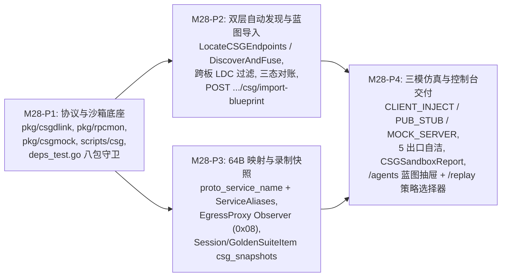

# M28 作战卡：CSG 现网服务/依赖自动发现与多模式仿真测试闭环

> **文档版本**: v1.0.0  
> **更新日期**: `2026-11-18`  
> **所属阶段**: 阶段四（TDD 实施路线与工程作战卡）  
> **上位基线**: [`ADR-21` (v2.1.0)](../05-adr/21-csg-aware-agent-service-discovery-and-replay-mock-adr.md) · [`01-feature-matrix.md`](../01-features/01-feature-matrix.md) (`F-11`~`F-13`, `F-15.5`, `F-27`, `F-33`, `F-34`, `SC-17`) · [`01-system-architecture.md`](../02-design/01-system-architecture.md) · [`02-data-plane-and-cros-rpc-engine.md`](../02-design/02-data-plane-and-cros-rpc-engine.md) (§4~§6) · [`03-architecture-elements-and-topology.md`](../02-design/03-architecture-elements-and-topology.md) (§2.1, §3.4) · [`04-control-plane-and-web-console.md`](../02-design/04-control-plane-and-web-console.md) (§1.2, §1.3, §2.1, §4.11) · [`05-database-schema.md`](../02-design/05-database-schema.md) · [`01-http-api-contract.md`](../03-api/01-http-api-contract.md)  
> **前置依赖**: `M27`（Proto 四工作台信息架构已交付）  
> **交付状态**: ✅ 已交付（`M28-P1`~`M28-P4` 全阶段、前端透视/仿真控制台及 `SC-17` 闭环均已实现并通过全量回归验证，**零新增数据库表**，维持 `30` 核心业务表 + `contract_settings` = `31` 表）

---

## 1. Milestone 核心目标与原则

基于在现网 `10.29.92.80:31806` 通过 `@csg-ver` 验证的 DOPRA `dlink` 控制面协议、`RPCMonitorService` 全量可观测性原语与三模仿真原型，在 `code-contract` 中以纯生产级架构落地 **CSG 自动发现 + 多模式仿真测试闭环**：

1. **彻底淘汰 `@csg-ver` 原型私有帧，统一协议栈与零 `protoregistry` 红线**：
   - 将 `@csg-ver` 的 `hello` (4B) 与 `RMON` (12B `0x524D4F4E`) 临时协议彻底收敛至 [`pkg/crosrpc`](../../pkg/crosrpc/) 标准帧（`24B RPC_COMM_HEAD_S "CSE.TCP"\x01` + `256B V05` Req / `200B V04` Rsp）；
   - `pkg/rpcmon` 对 `RPCMonitorServiceMsg.proto` 采用纯 Go 标准库手写 Wire 编解码，确保 `cmd/agent` 保持 **零 CGO、零 DB、零 `dynamicpb` / `protoregistry` / `protocompile`**（100% 通过 `cmd/agent/deps_test.go`）。
2. **双层协同自动发现与一键蓝图冷启动 (`Pillar I`)**：
   - 废除高 QPS 种子名盲猜轮询，建立 **「L1 `rpcmon` 全量目录 (`Ports` + `Servers` + `Clients`) + L2 按需纯 Go `csgdlink.Sub` 端口富化 + L3 本机 `/proc` 融合与跨板 LDC 隔离」** 流水线；
   - 100% 覆盖无 TCP 监听纯客户端进程与 `dophi_mesh://` 进程；通过 `GET /api/agents/:id/csg/topology` 三态对账（`MATCHED`/`UNDECLARED_IN_SSOT`/`MISSING_IN_LIVE`）与 `POST /api/agents/:id/csg/import-blueprint` 一键生成架构蓝图。
3. **64B 运行期服务名无痛映射 `.pb` 与录制期控制面快照**：
   - `ModuleService`（修订 `A-07`）支持 `-`（`^[A-Za-z0-9._-]{1,63}$`）以原样保存 `<ClassName[:31]>-<svrName[:31]>` 64B CSG/CROS 名，可选 `proto_service_name` 注入 `CompiledRegistry.ServiceAliases` 并支持 `^(.+-\d+)-(\d+)$` 实例 PID 归一化；
   - 录制期通过 `csgdlink.Observer` 旁路采集 `"DLNK"` 上报 `0x08 (EVENT_CSG_OBSERVATION)` 写入 `contract_recording_sessions.csg_snapshots`。
4. **三模渐进式仿真闭环 (`Pillar II`) 与真实 CSG 安全铁律**：
   - 围绕 `csg_strategy ∈ {PASSTHROUGH, CLIENT_INJECT, PUB_STUB, MOCK_SERVER}` 提供渐进式仿真，严守 **绝不向真实 CSG 发送 `GET_BIND_ADDR (7)` / `FREE_BIND_ADDR (8)`**、`PUB_STUB` 前置 `Sub==0` 门禁（在线冲突返 `409 CSG_SERVICE_ALREADY_PUBLISHED`）、纯 Mesh 返 `422 CSG_DATAPLANE_MESH_UNSUPPORTED`、以及五出口原子自洁零残留铁律。

---

## 2. 分阶段实施路线图 (M28-P1 ~ M28-P4)



| 子阶段 | 核心范围 | 前置依赖 | 核心质量门禁 |
| :--- | :--- | :--- | :--- |
| **`M28-P1`** | `pkg/csgdlink`、`pkg/rpcmon`（标准 `pkg/crosrpc` + 手写 Wire）、`pkg/csgmock`、`scripts/csg`、`deps_test.go` | 无 | `go test -race ./pkg/{csgdlink,rpcmon,csgmock}/...` + `@csg-ver/scripts/e2e.sh` 等价 Go 闭环 + `deps_test.go` 全绿 |
| **`M28-P2`** | `internal/agent/csg/locate.go` & `discoverer.go`、Agent `/discover` & `/csg/topology`、Server 三态对账 & `import-blueprint` | `M28-P1` | `709 Server / 724 Client` 真机同构跨板 LDC 夹具全绿 + `testdb` `import-blueprint` RBAC/幂等/审计全绿 |
| **`M28-P3`** | `models` 轻量加列（0 新表）、`decoder.Registry.Reload()` `ServiceAliases` + PID 归一化、`csgdlink.Observer` (`0x08`) | `M28-P1` | `64B` 名解码与 Diff 100% 命中 + 混跑 `"DLNK"` 录制零 `StreamFramer` 报错 + `csg_snapshots` 落盘单测全绿 |
| **`M28-P4`** | `internal/agent/csg/sim_controller.go`（三模策略 + 五出口清理）、`diff.ReplayScheduler` / `F-27`、`frontend` UI 与 Vitest | `M28-P2`, `M28-P3` | 三模 E2E 单测全绿 + 前端 Vitest / Token 扫描全绿 + `SC-17` & `make test && make lint && make build` 零警告 |

---

## 3. 全栈交付物清单 (Deliverables Inventory)

| 分层 | 目标文件路径 | 职责与核心约束 |
| :--- | :--- | :--- |
| **Agent 协议/沙箱包** | `pkg/csgdlink/{protocol,instance,client,observer}.go`<br>`pkg/csgdlink/csgdlink_test.go` | 纯 Go 标准库：32B `DDM_DLINK_MSG_HEAD_S`、248B `CSG_SERVICE_INST_INFO_S`（`CString` 首个 `\x00` 截断）、10 类控制消息 + 2 类 `NOTIFY`、`Client`（`OnNotify` 回调 + `Sub` 立即 `Unsub`）、`RewriteMeshAddrToTCP` 与旁路 `Observer` |
| **Agent 监控通信包** | `pkg/rpcmon/{model,wire,cros_transport,native,server,report}.go`<br>`pkg/rpcmon/rpcmon_test.go` | 统一 `Snapshot` / `Provider` / `Backend`；纯 Go 手写 Wire 编解码 `RPCMonitorServiceMsg.proto`；基于 `pkg/crosrpc` 标准帧实现 `CrosTCPBackend` 与 `Server`（零 `RMON` 帧）；`NativeBackend`（受控白名单路径 + `^ipv4:[0-9.]+:[0-9]{1,5}$` 参数调用 `rpcmon_probe` 解析 JSON） |
| **Agent 控制面沙箱** | `pkg/csgmock/mockserver.go`<br>`pkg/csgmock/mockserver_test.go` | 内存态 `MockCSGServer`：预载 `Preload`、`SUB` 按 `^(.+-\d+)-(\d+)$` 模板匹配与 `RewriteMeshToTCP`（保留原 `IP:PORT`）、`Mesh-only SUB` 触发 `OnMeshOnlySub`、`PUB`/`UNPUB` 吞吐、`GET_BIND_ADDR` 固定端口、`ServeConn` 进程内分流、`defer` 断链清理与 `Snapshot() rpcmon.Snapshot`（禁依 `pkg/ebpf`） |
| **真机只读探针资产** | `scripts/csg/rpcmon_probe.cpp`<br>`scripts/csg/build-native-probe.sh` | 从 `@csg-ver/native/` 迁入的 ~170 行只读 C++ 探针源码与编译脚本；独立编译产出，不静态链接进 Go 二进制 |
| **Agent 核心发现与仿真** | `internal/agent/csg/{locate,discoverer,sim_controller}.go`<br>`internal/agent/csg/*_test.go`<br>`internal/agent/server/http_server.go`<br>`pkg/agentproto/protocol.go`<br>`pkg/replay/executor.go`<br>`cmd/agent/deps_test.go` | 多租户 `[31800, 31900]` 定位、`DiscoverAndFuse` 跨板 LDC 过滤、`/agent/v1/csg/topology`、增强 `/discover`/`/handshake`/`/monitors/sync`/`/replays/execute`/`/replays/:taskId/result`；三模仿真编排 + 五出口清理；`deps_test.go` 纳入 `./pkg/csgdlink`、`./pkg/rpcmon`、`./pkg/csgmock` |
| **Server 数据模型与解码** | `models/{db,arch,recording,replay,golden_suite}.go`<br>`internal/server/decoder/registry.go`<br>`internal/server/hub/agent_client.go`<br>`internal/server/topology/csg_reconcile.go`<br>`internal/server/recorder/orchestrator.go`<br>`internal/server/diff/scheduler.go` | 0 新表：4 张既有表轻量加列迁移与约束；`Reload()` 将 `ProtoServiceName` 注入 `ServiceAliases` 并归一化 PID 后缀；消费 `0x08 EVENT_CSG_OBSERVATION` 更新 `csg_snapshots`；三态对账与 `import-blueprint` 单事务构建；`ReplayScheduler` / `F-27` 透传 `csg_strategy` 与审计 `csg_sandbox_report` |
| **Server API 控制器** | `handlers/{arch,agent,recording,replay,golden_suite,gate}_handler.go`<br>`handlers/csg_discovery_handler.go`<br>`handlers/routes.go`<br>`handlers/*_test.go` | `GET /api/agents/:id/csg/topology`（`ScopeReadGuard`）、`POST /api/agents/:id/csg/import-blueprint`（`AdminOnly` + `commonAudit`）、`ModuleService` 可选 `proto_service_name`、`ReplayTask`/`GoldenSuite`/`GateEvaluate` 扩展及 `409 CSG_SERVICE_ALREADY_PUBLISHED` / `422 CSG_DATAPLANE_MESH_UNSUPPORTED` 映射 |
| **微前端控制台** | `frontend/src/types/{agent,replay,topology}.ts`<br>`frontend/src/services/{agent,replay}Service.ts`<br>`frontend/src/pages/AgentsWorkbenchPage/*`<br>`frontend/src/pages/ReplayWorkbenchPage/*`<br>`frontend/src/__tests__/*` | `/agents` CSG 拓扑概览、三态对账表格与 `CSGBlueprintImportDrawer` 蓝图导入抽屉；`/replay` 与 `/golden-suites` 四档 `csg_strategy` 分段选择器及 `CSGSandboxReport` 轨迹视图；100% `--color-*` 语义 Token、零 `any` |

---

## 4. 分阶段详细技术设计规范

### 4.1 M28-P1：协议栈、CrosTCP 监控传输与 `MockCSGServer`

1. **`pkg/csgdlink` 收口规范**：
   - `DecodeHead` / `ReadFrame` / `WriteFrame` 严格编解码 32B 大端 `DDM_DLINK_MSG_HEAD_S`（`uiMagic = 0x444C4E4B`，`usMsgHeadLen = 32`，`uiCorrID`，`uiLinkID = 0x020A0000`）；
   - `ParseInstance` / `EncodeInstance` 处理 248B `CSG_SERVICE_INST_INFO_S`，`CString(b []byte)` 强制在首个 `\x00` 截断；
   - `Client.roundTrip` 识别 `Frame.Type == MsgTypeNotify (2)` 后触发可选 `OnNotify` 回调并继续等待匹配的 `MsgTypeReply (1)`；`Client.ClientID` 偏移 `0..3` 写入真实 `uint32(os.Getpid())`；
   - `RewriteMeshAddrToTCP` 仅替换 `"dophi_mesh://"` 前缀为 `"tcp://"`，完整保留原始 `ipv4:<ip>:<port>`；`Observer` 仅从首包匹配 `"DLNK"` 的连接旁路提取控制面摘要（绝不向原连接回写字节）。
2. **`pkg/rpcmon` 与 `pkg/crosrpc` 对齐规范**：
   - **彻底废除 12B 私有 `"RMON"` 帧**：`CrosTCPBackend` 与 `Server` 直接使用 `crosrpc.StreamFramer` 解析请求、使用 `BuildCrosReqPacket` / `BuildCrosRspPacket` 构造 `24B "CSE.TCP"\x01` + `V05 Req` (`256B`) / `V04 Rsp` (`200B`) 帧，依据 `ascServiceName = "RPCMonitorService-RPCMonitorService"` 与 5 个标准 `OpGetRpc*` 分发；
   - **纯 Go Wire 编解码**：按 `RPCMonitorServiceMsg.proto` 字段编号手写 `Encode*/Decode*` 函数，严禁导入 `google.golang.org/protobuf` 运行时；
   - **`NativeBackend` 安全调用守卫**：执行 `rpcmon_probe` 前核验可执行路径位于白名单且非符号链接，参数严格正则校验 `^ipv4:[0-9.]+:[0-9]{1,5}$`，丢弃 DOPRA stdout 环境初始化杂音，从首个 `{` 起反序列化 JSON。
3. **`pkg/csgmock.MockCSGServer` 规范**：
   - 支持全量 10 类消息 + `NOTIFY`；`ServeConn` `defer` 按连接会话 `clientID` 清理发布的 `reg` 实例（对齐 `csgServerLinkFaultProc`）；
   - `StartMonitor(addr)` 启动标准 `rpcmon.Server` 后自动向 `reg` 注册 `"RPCMonitorService-RPCMonitorService"` -> `"tcp://ipv4:" + monAddr`；
   - `SUB` 匹配顺序：`exact(req.Name)` $\rightarrow$ `normIndex[pidSuffixBase(req.Name)]`（命中时将 `inst.Name64` 回显为 `req.Name`）。

### 4.2 M28-P2：双层自动发现融合与一键蓝图导入

1. **`LocateCSGEndpoints` 多租户发现优先级（严禁跨网盲扫）**：
   - 优先级 1：CLI `--csg-addr` 或环境变量 `CONTRACT_AGENT_CSG_ADDR`（逗号分隔）；
   - 优先级 2：扫描宿主机 `/proc/net/tcp` 监听端口 $\in [31800, 31900]$ 且进程名匹配 `DophiServer` / `csg_server` 的套接字，提取 `(ip, port, userId = port - 31800, pid, ownerUID)`（`0.0.0.0` 优先替换为已建立业务连接本地 IP）；
   - 优先级 3：扫描纳管业务进程对端端口 $\in [31800, 31900]$ 的 `TCP_ESTABLISHED` 连接。
2. **`DiscoverAndFuse` 确定性融合**：
   - 读取本机网卡 IPv4 集合 `localIPs`（含 `127.0.0.1`），凡 `serverAddr` / `clientAddr` 非空且不属于 `localIPs` 的实例标记 `IsRemoteLDC = true` 并隔离；
   - 仅对本机服务的 `serverName` 集合按需 `csgdlink.Client.Sub` $\rightarrow$ `Unsub` 富化完整 `InstanceAddr`、`Transport`、`Port`、`OsNodeID`、`Version`；
   - 补齐不在 `ScanListenProcesses()` 内的本机 `Servers[].Pid` 与 `Clients[].Pid`（覆盖纯客户端 `listen_port = 0` 与 `dophi_mesh://` 进程，过滤瞬态 `rpcmon_probe` 自身订阅）。
3. **控制面三态对账与蓝图导入**：
   - `GET /api/agents/:id/csg/topology` 输出 `CSGTopologyReconcileDTO`（`MATCHED` / `UNDECLARED_IN_SSOT` / `MISSING_IN_LIVE`）；
   - `POST /api/agents/:id/csg/import-blueprint` 校验 `RequireAdmin`，事务内幂等创建 `ArchProcess`、`Module`、`ModuleService`（基于生效 `.pb` 后缀匹配推荐 `proto_service_name`）与 `ModuleDependency`（复用 `AssertLayerDependencyValid` 与 `AssertNoCyclicDependency` 守卫），并写入 `contract_arch:import_csg_blueprint` 审计。

### 4.3 M28-P3：64B 服务名别名映射与录制期控制面快照

1. **修订 `A-07` 与 `.pb` 别名解码**：
   - `contract_module_services.service_name` 允许 `-`（`^[A-Za-z0-9._-]{1,63}$`）；新增 `proto_service_name VARCHAR(128) NOT NULL DEFAULT ''`（非空校验 `^[A-Za-z0-9._]{1,128}$`）；
   - `decoder.Registry.Reload()` 将 `proto_service_name != "" && proto_service_name != service_name` 写入既有 `CompiledRegistry.ServiceAliases`；查找服务时若直查未中，追加按 `^(.+-\d+)-(\d+)$` 剥离运行期 PID 后缀的回退匹配。
2. **录制期双路捕获 `csg_snapshots`**：
   - 开录前若环境存在 `CSGEndpoints`，抓取初始 CSG 实例列表写入 `contract_recording_sessions.csg_snapshots`；
   - 录制期间 `EgressProxy` 对 `"DLNK"` 连接挂载只读 `csgdlink.Observer`，经 WebSocket 信封 `EventCSGObservation (0x08)` 回传 `SUB_ACK` / `PUB` 解析出的下游实例，由 `hub` 幂等去重合并入 `csg_snapshots`（严禁触发 `StreamFramer` 伪帧报错）。

### 4.4 M28-P4：三模仿真控制器、五出口清理与前端控制台

1. **三模策略编排 (`internal/agent/csg/sim_controller.go`)**：
   - **`PASSTHROUGH`**：沿用既有 `ListenPort` 直拨 + `REPLAY_MOCK`；
   - **`CLIENT_INJECT`**：前置经 `csgdlink.Client.Sub(svcName)` 解析在线实例（`tcp://` 优先本机 PID/IP，立刻 `Unsub`），若仅存在 `dophi_mesh://` 实例返回 `422 CSG_DATAPLANE_MESH_UNSUPPORTED`；按解析 `IP:Port` 注入请求（允许 `ListenPort == 0`）；
   - **`PUB_STUB`**：收集全部 Mock 目标下游服务名逐一 `Sub(svc)`，若任一服务实例数 `> 0` 立即终止并返回 `409 CSG_SERVICE_ALREADY_PUBLISHED`；否则绑定本地 `MockListener` 并执行 `Pub(svc, "tcp://ipv4:"+mockAddr)`，**严禁调用 `GET_BIND_ADDR`**；
   - **`MOCK_SERVER`**：启动进程内 `MockCSGServer`（预载 `ExecuteReplayReq.CSGSnapshots`，开启 `RewriteMeshToTCP`，绑定 `FixedBindPort`），配置 `EgressProxy` 将 `[31800, 31900]`/`"DLNK"` 建连分流至 `mockCSG.ServeConn`，同时支持独立 `-addr/-monitor` 沙箱口；结束时导出 `MockCSGServer.Snapshot()` 为 `CSGSandboxReport`。
2. **五出口原子自洁 (`Cleanup()`)**：
   - 在 **① 正常完成、② `/replays/:taskId/cancel`、③ `/purge`、④ 主控失联 5m 宽限超时、⑤ `SIGINT/SIGTERM`** 五个出口，幂等执行：`Unpub` 全部注册桩 $\rightarrow$ `Unregister` & `Close` dlink 连接 $\rightarrow$ 关闭 `MockCSGServer` 与本地 `MockListener` $\rightarrow$ 清除 `EgressProxy` `"DLNK"` 分流钩子 $\rightarrow$ 恢复 `ARMED` 并释放租约。
3. **前端控制台演进 (`/agents` & `/replay` / `/golden-suites`)**：
   - `/agents` 新增 `[🧭 探测 CSG 现网拓扑]` 概览与三态对账双视图、`CSGBlueprintImportDrawer`（仅 `contract_admin` 可见，支持勾选进程/服务/依赖与选择 `.pb` 别名 `proto_service_name`）；
   - `/replay` 与 `/golden-suites` 新增四档 `csg_strategy` 分段选择器、可选 `csg_addr` 输入与 `CSGSandboxReport` 沙箱轨迹透视；严格遵守亮暗双模 `--color-*` Token、标准 5 页滑动窗口 URL 分页与零 `any` 红线。

---

## 5. TDD 测试先行验证矩阵 (Test-First Matrix)

| 阶段 | 测试文件 | 核心测试用例与必须验证的断言 |
| :--- | :--- | :--- |
| **`M28-P1`** | `pkg/csgdlink/csgdlink_test.go` | `TestDlinkFrameAndInstanceCodec`（32B BE 头/248B 实例/`CString` 首 `\x00` 截断）、`TestDlinkClient_NotifyInterleavedInRoundTrip`（`NOTIFY` 不打断 `REPLY` 配对）、`TestDlinkObserver_NonIntrusiveSubAckCapture` |
| **`M28-P1`** | `pkg/rpcmon/rpcmon_test.go` | `TestWireCodec_PortServerClientRoundtrip_ZeroProtoregistry`、`TestCrosTCPBackend_StandardCrosFrameOverLoopback`（100% 验证 `"CSE.TCP"\x01` + `V05`/`V04` + 5 Op 分发，零 `"RMON"` 帧）、`TestNativeBackend_ArgAllowlistAndJsonPrefixSkip`（非法 `csg_addr` 不触发进程执行；前置 DOPRA 日志跳过） |
| **`M28-P1`** | `pkg/csgmock/mockserver_test.go` | `TestMockCSGServer_E2E_PubSubCrosRPC_AndRpcmonAll`（**1:1 复刻 `@csg-ver/scripts/e2e.sh` 闭环**：启动 `MockCSGServer` + 模拟 `PUB` 服务 + 模拟 `SUB`+CROS RPC 客户端 + `rpcmon.BuildReport("all")` 断言 `ServerNum=1, ClientNum=1, Ports=1`）、`TestMockCSGServer_PidSuffixMatchAndMeshRewritePreservesAddr`、`TestMockCSGServer_CleanOnConnDrop_AndZeroRealLeak` |
| **`M28-P1`** | `cmd/agent/deps_test.go` | `TestAgentDependencies_NoGormNoDynamicPBNoServer`（将 `./pkg/csgdlink`、`./pkg/rpcmon`、`./pkg/csgmock` 纳入检查清单，断言零 `gorm`/`pgx`/`dynamicpb`/`protoregistry`/`protocompile`/`go-git`/`sqlite`） |
| **`M28-P2`** | `internal/agent/csg/discoverer_test.go` | `TestLocateCSGEndpoints_MultiTenantPriority`、`TestDiscoverAndFuse_709Servers724Clients_RemoteLDCFiltered`（构造 265 本机 + 442 跨板 `10.1.126.150` + 724 订阅真机同构夹具，断言跨板 100% 隔离、纯客户端与 `dophi_mesh://` 进程精确补齐、剔除 `rpcmon_probe` 自身订阅） |
| **`M28-P2`** | `internal/server/topology/csg_reconcile_test.go`<br>`handlers/csg_discovery_handler_test.go` | `TestReconcileLiveCSGWithSSOT_ThreeStates`、`TestCSGImportBlueprint_IdempotentAdminOnlyLayerGuardAndAudit`（`testdb` 隔离验证：普通用户 `403`、普通用户查他人 `PRIVATE` `/csg/topology` `403`、管理员一键导入生成 `ArchProcess`/`Module`/`ModuleService`/`ModuleDependency` 与 `commonAudit` 记录） |
| **`M28-P3`** | `internal/server/decoder/registry_test.go`<br>`internal/server/recorder/recorder_test.go` | `TestDecoderRegistry_64BServiceAliasesAndPidSuffixNormalization`（`RPCMonitorService-RPCMonitorService` ➔ `swp.rpc.RPCMonitorService` 与 `SSP...-1-52341` 解码 + Diff 命中）、`TestRecordingSession_CSGObserver0x08_NoStreamFramerFalseFrame` |
| **`M28-P4`** | `internal/agent/csg/sim_controller_test.go`<br>`handlers/recording_replay_test.go`<br>`handlers/gate_evaluate_test.go` | `TestSimController_ClientInject_DynamicPortNoRestart`、`TestSimController_ClientInject_PureMeshReturns422`、`TestSimController_PubStub_ConflictReturns409_AbsenceZeroBindAddrAnd5ExitCleanup`（验证全程 zero `GET_BIND_ADDR` 与五出口取消/`/purge` 后 CSG 0 残留）、`TestSimController_MockServer_ZeroLeakAndSandboxReport`、`TestGateEvaluate_MockServerSandbox_SubAuditAndZeroLeak`、`TestSC17_EndToEnd_DiscoveryBlueprintDecodeAndThreeModeSimulation` |
| **`M28-P4`** | `frontend/src/__tests__/CSGDiscoveryAndReplayStrategy.test.tsx` | `testAgentsWorkbench_CSGTopologyReconcileAndImportDrawer_RBAC`、`testReplayWorkbench_FourStrategySelectorAndSandboxReport_ThemeTokens`（零 `any`、100% `--color-*` Token） |

---

## 6. 自动化准出验证门禁 (Exit Gate)

```bash
# 1. Agent 物理防腐门禁（零 protoregistry / dynamicpb / DB / CGO）
go test -v ./cmd/agent -run TestAgentDependencies_NoGormNoDynamicPBNoServer

# 2. CSG 协议栈、监控与仿真并发竞态测试
go test -race ./pkg/csgdlink/... ./pkg/rpcmon/... ./pkg/csgmock/... ./internal/agent/csg/...

# 3. 全量前后端构建、单元测试与隔离数据库验收
TEST_DB_DSN="host=127.0.0.1 port=5432 user=postgres password=<PWD> dbname=postgres sslmode=disable" \
  make test && make lint && make build && make clean
```

- **验收完成标志**：`make test`（含 `testdb` 物理隔离库全套 Go 单测 + Vitest 全绿）、`make lint`（`tsc --noEmit` + `eslint` 零警告）、`make build && make clean` 全通过，无残留后台端口或未清理进程/桩实例。
