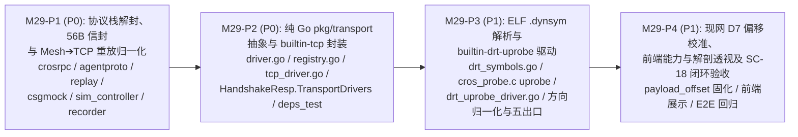

# M29 作战卡：纯 Go 可插拔传输驱动 (`pkg/transport`) 与「`dophi_mesh` 内核 uprobe 采集 ➔ `tcp://` 仿真重放」跨传输闭环

> **文档版本**: v1.0.0  
> **更新日期**: `2026-11-19`  
> **所属阶段**: 阶段三/四（TDD 实施路线与工程作战卡）  
> **上位基线**: [`ADR-22` (v2.0.0)](../05-adr/22-pluggable-transport-driver-and-mesh-capture-adr.md) · [`ADR-23` (v1.1.0)](../05-adr/23-dophi-mesh-uprobe-bypass-capture-adr.md) · [`01-feature-matrix.md`](../01-features/01-feature-matrix.md) (`F-09`, `F-10`, `F-12`, `F-13`, `F-35`, `SC-18`) · [`01-system-architecture.md`](../02-design/01-system-architecture.md) (v1.10.0) · [`02-data-plane-and-cros-rpc-engine.md`](../02-design/02-data-plane-and-cros-rpc-engine.md) (v1.7.0, §1, §3, §6, §7) · [`04-control-plane-and-web-console.md`](../02-design/04-control-plane-and-web-console.md) (v1.14.0, §1.2, §1.3, §4.3) · [`05-database-schema.md`](../02-design/05-database-schema.md) (v1.10.1, 零 DDL 迁移) · [`01-http-api-contract.md`](../03-api/01-http-api-contract.md) (v1.10.0)  
> **前置依赖**: `M28`（CSG 现网双层自动发现与三模仿真测试闭环已交付）  
> **交付状态**: ✅ 已交付（`M29-P1`~`M29-P4` 全阶段、纯 Go `pkg/transport`、`builtin-drt-uprobe` 采集驱动及 `SC-18` 跨传输闭环均已实现并通过全量回归验证，**零新增数据库表 / 零 DDL 迁移**，维持 `30` 核心业务表 + `contract_settings` = `31` 表）

---

## 1. Milestone 核心目标与架构铁律

依据 [`ADR-22` (v2.0.0)](../05-adr/22-pluggable-transport-driver-and-mesh-capture-adr.md) 与 [`ADR-23` (v1.1.0)](../05-adr/23-dophi-mesh-uprobe-bypass-capture-adr.md) 确立的四项现网硬事实，在 `code-contract` 中落地 **「采集多底座纯 Go 可插拔，语义与重放全栈收敛 `tcp://`」** 终局极简架构：

1. **彻底守住 100% 纯 Go (`CGO_ENABLED=0`) 单二进制与九包物理防腐红线**：
   - **已永久否决 `plugin_transport.so` / `libdophimesh.so` 钩子与外部子进程方案**（实证 `libdophimesh.so` 钩子仅在本进程内生效，面对 P2P 网状 Mesh 拓扑 Agent 无法旁路监听他进程）；
   - 新建纯 Go 包 `pkg/transport` 并纳入 `cmd/agent/deps_test.go` 九包守卫，严格禁止引入 CGO、`gorm`、`pgx`、`dynamicpb`、`protoregistry`、`protocompile`、`go-git` 或任何外部 `readelf`/`nm` 子进程调用。
2. **协议栈解封、TCP 防伪帧隔离与 56B 信封零 DDL 演进**：
   - `pkg/crosrpc.ValidateCommHead` 放宽 `h.TransportProto <= TransportCustomize (7)`，全面放行 `ucProtocol = 4 (TransportMesh)`；同时保持无边界 TCP `StreamFramer` 滑窗对齐默认 `f.buf[7] <= TransportTCP (1)`，确保既有 TCP 采集 0 假阳性伪帧退化；
   - 56B `EnvelopeHeader` 保持定长不变，将偏移 `26..27` 拆分为偏移 `26` `TransportProto (uint8: 0/1=TCP, 4=MESH)` 与偏移 `27` `Reserved (uint8: 0)`；主控 `ExchangeAssembler` 复用既有表列 `contract_traffic_records.transport_proto`（**零数据库 DDL 迁移**），`Anatomy` 映射 `4 -> "RPC_TRANSPORT_MESH"`。
3. **打通「现网 `dophi_mesh://` (`ucProtocol=4`) 采集 ➔ 测试态 `tcp://` (`ucProtocol=1`) 无缝仿真重放」全闭环**：
   - 数据面：`ReplayExecutor`（入站注入与前置 MNG）与 `HealSingleResponseFrame` / `MatchMng`（出站 Mock 自愈回包）经 `NormalizeFrameTransportForTCP` 在**发送副本**中原地将 `frame[7]` 从 `4 (MESH)` 归一化为 `1 (TCP)`（原始录制资产不可变）；
   - 控制面：`MockCSGServer` 保持 `EnableMeshToTCPRewrite(true)` 并在 `transMatches` 中放行 `Trans[4]=1` 订阅命中改写/本地桩 `tcp://` 地址；`SimController` **取消 `MOCK_SERVER` 模式 `meshOnlySubHook` 判 `422 CSG_DATAPLANE_MESH_UNSUPPORTED` 的旧限制**（仅记录 `MeshRewrites` 统计与提示），`CLIENT_INJECT` 目标在线纯 Mesh 无 TCP 监听时仍精确返回 `422`。
4. **`builtin-drt-uprobe` 唯一正式 Mesh 采集通道与五出口探针卫生**：
   - 使用 Go 标准库 `debug/elf` 解析目标进程 `/proc/<pid>/maps` 映射的 `libdopra.so` `.dynsym` 提取 `DRT_WriteBulk`（及可选 `DRT_ReadLen`/`DRT_ReadNoCheckLen`）精确文件偏移；
   - 在 `pkg/ebpf/bpf/cros_probe.c` 增量实现 `SEC("uprobe/DRT_WriteBulk")` 与 `drt_ringbuf`（单次 `bpf_probe_read_user` 拷贝 `[40B 环头][完整含 \x00 二进制 CROS 帧]`）；
   - 严守 **`ARMED` 待命期 0 uprobe 挂载**、按目标 `PID` 匿名 `perf_event_open` 挂载（零 tracefs 全局污染）、`ADR-11` 方向/四元组相关性归一化，以及五出口（停录、取消、`/purge`、5m Watchdog、`SIGINT/SIGTERM`）幂等卸载与摘针负控 `0` 事件验收。

---

## 2. 分阶段实施路线图 (M29-P1 ~ M29-P4)



| 子阶段 | 优先级 | 核心交付范围 | 前置依赖 | 核心质量门禁 |
| :--- | :---: | :--- | :---: | :--- |
| **`M29-P1`** | **P0** | `pkg/crosrpc`、`pkg/agentproto`、`pkg/replay`、`pkg/csgmock`、`internal/agent/csg`、`internal/server/recorder` | 无 | `go test -race ./pkg/{crosrpc,agentproto,replay,csgmock}/... ./internal/agent/csg/... ./internal/server/recorder/... ./internal/server/diff/...` 全绿（含 `ucProtocol=4` 录制帧 ➔ `MOCK_SERVER` TCP 重放 100% `PASS`） |
| **`M29-P2`** | **P0** | `pkg/transport`（`driver.go`, `registry.go`, `tcp_driver.go`）、`internal/agent/server` 接入 `Registry`、`HandshakeResp.TransportDrivers`、`cmd/agent/deps_test.go` 九包守卫 | `M29-P1` | 现有全量 TCP / eBPF / Replay / AgentServer 单测 100% 零回归 + `deps_test.go` 零 CGO / 零 DB / 零 `protoregistry` 通过 |
| **`M29-P3`** | **P1** | `pkg/transport/drt_symbols.go`、`pkg/ebpf/bpf/cros_probe.c`（`uprobe/DRT_WriteBulk` + `drt_ringbuf` + `bpf2go` 重生成）、`pkg/transport/drt_uprobe_driver.go`、纯 Mesh `ListenPort=0` 挂载路由 | `M29-P2` | 夹具 `.so` `.dynsym` 解析 100% 命中 + 双向相关性投影单测全绿 + `//go:build linux && ebpf` 双进程 200 次 `DRT_WriteBulk` 往返 100% 捕获并在主控聚合 `transport_proto=4` + 摘针负控 0 事件 |
| **`M29-P4`** | **P1** | D7 现网 `:x64` 首 24B 偏移核验与固化、前端 `/agents` `transport_drivers` 能力徽标 & `/debug` 解剖 `MESH (dophi_mesh)` 标签、`SC-18` 全链路验收 | `M29-P3` | `TEST_DB_DSN=... make test && make lint && make build && make clean` 全通过零警告 + D7 现网首帧校准记录 |

---

## 3. 文件级交付物清单

| 阶段 | 路径 | 变更类型 | 核心职责 |
| :--- | :--- | :---: | :--- |
| **`M29-P1`** | `pkg/crosrpc/comm_head.go` & `constants.go` | 修改 | `ValidateCommHead` 放宽至 `<= TransportCustomize (7)`；导出 `TransportProtoName(uint8) string`；`StreamFramer` 保持默认 `<= 1` |
| **`M29-P1`** | `pkg/agentproto/envelope.go` & `protocol.go` | 修改 | 56B `EnvelopeHeader` 偏移 `26` 启用为 `TransportProto uint8`（偏移 `27` `Reserved uint8`）；`HandshakeResp` 新增 `TransportDrivers []TransportDriverCapability` |
| **`M29-P1`** | `pkg/replay/healer.go`, `executor.go`, `matcher.go` | 修改 | 新增 `NormalizeFrameTransportForTCP`；在入站注入、前置 MNG、Mock 应答自愈与 `MatchMng` 发送副本中将 `ucProtocol (4->1)` 归一化（原切片不变） |
| **`M29-P1`** | `pkg/csgmock/mockserver.go` & `internal/agent/csg/sim_controller.go` | 修改 | `transMatches` 在 `rewriteMeshTCP==true` 时放行 `Trans[4]=1` 命中改写/桩 `tcp://` 地址；`SimController` `MOCK_SERVER` 取消 `meshOnlySubHook` 判 `422`，改为记录 `CSGSandboxReport` 统计与提示 |
| **`M29-P1`** | `internal/server/recorder/assembler.go` & `anatomy.go` | 修改 | `resolveTransportProto(env.TransportProto, comm.TransportProto)` 落盘 `contract_traffic_records.transport_proto`；`anatomy.go` 映射 `4 -> "RPC_TRANSPORT_MESH"` 与 `"\"CSE.TCP\" + MESH(4)"` |
| **`M29-P2`** | `pkg/transport/driver.go` | 新增 | 纯 Go `Capability`、`DriverInfo`、`TargetProcess`、`CaptureSpec`、`FrameSink`、`Driver` 核心契约 |
| **`M29-P2`** | `pkg/transport/registry.go` | 新增 | `Registry` 驱动注册表、能力汇总、`StartCapture`/`StopCapture` 分发与五出口幂等 `CloseAll()` |
| **`M29-P2`** | `pkg/transport/tcp_driver.go` | 新增 | `builtin-tcp` 无损封装 `pkg/ebpf.Manager` + `EgressProxy` |
| **`M29-P2`** | `internal/agent/server/http_server.go` & `cmd/agent/main.go` | 修改 | 挂载 `transport.Registry`，在 `/handshake` 上报 `TransportDrivers`，在 `/monitors/sync`、`/stop`、`/purge`、Watchdog 与信号退出统一协同清理 |
| **`M29-P2`** | `cmd/agent/deps_test.go` | 修改 | 将 `./pkg/transport` 纳入物理防腐守卫（共九包），断言零 CGO / 零 DB / 零 `protoregistry` / 零 `dynamicpb` |
| **`M29-P3`** | `pkg/transport/drt_symbols.go` | 新增 | 纯 Go `/proc/<pid>/maps` 扫描 + `debug/elf` `.dynsym` 解析（`PT_LOAD` 换算 `DRT_WriteBulk` / `DRT_ReadLen` / `DRT_ReadNoCheckLen` 精确文件偏移） |
| **`M29-P3`** | `pkg/ebpf/bpf/cros_probe.c` & `pkg/ebpf/cros_probe_bpf{el,eb}.{go,o}` | 修改 | 新增 `drt_msg_entry`、`drt_uprobe_event`、`drt_ringbuf` (16MB) 与 `SEC("uprobe/DRT_WriteBulk")`（及可选读侧 `uprobe/uretprobe`）并重生成 `bpf2go` 产物 |
| **`M29-P3`** | `pkg/transport/drt_uprobe_driver.go` | 新增 | `builtin-drt-uprobe` 实现 `Driver`（PID 级匿名 `bpf_link`、`ARMED` 期 0 uprobe、D7 偏移提取、双向 `inflightReqs` 相关性归一化、56B `TransportProto=4` 信封输出与五出口清理） |
| **`M29-P4`** | `frontend/src/types/{agent,traffic}.ts` & `/agents`, `/debug` 组件 | 修改 | 展示 `HandshakeResp.transport_drivers` 驱动就绪胶囊与 `/debug` 报文 `MESH (dophi_mesh)` 传输标识（100% `--color-*` Token、零 `any`） |
| **`M29-P4`** | `docs/06-ops/01-verification-and-deployment-guide.md` | 修改 | 沉淀现网 D7 `:x64` 首 24B 核验操作清单与 `SC-18` 验收记录 |

---

## 4. 分阶段详细任务拆解

### M29-P1：协议栈解封、56B 信封与 Mesh➔TCP 重放归一化 (P0)

1. **`pkg/crosrpc` 协议解封与 TCP 滑窗隔离**：
   - 修改 `pkg/crosrpc/comm_head.go`：`ValidateCommHead` 将 `h.TransportProto > 1` 放宽为 `h.TransportProto > TransportCustomize`（即允许 `0..7`，放行 `TransportMesh = 4`）；
   - 新增 `TransportProtoName(proto uint8) string` 与 `TransportProtoShortLabel(proto uint8) string`（如 `1 -> "RPC_TRANSPORT_TCP" / "TCP(1)"`，`4 -> "RPC_TRANSPORT_MESH" / "MESH(4)"`）；
   - 核验 `pkg/crosrpc/framer.go` 第 158 行 `StreamFramer.WriteAt` 滑窗对齐守卫继续保持默认 `f.buf[7] <= TransportTCP (1)`，补充单测验证非 CROS TCP 流偶现 `"CSE.TCP\x04"` 不产生伪帧。
2. **`pkg/agentproto` 56B `EnvelopeHeader` 与 `HandshakeResp` 扩展**：
   - 修改 `pkg/agentproto/envelope.go`：保持总长 56B 不变，将 `Reserved uint16` 拆为偏移 `26` 的 `TransportProto uint8` 与偏移 `27` 的 `Reserved uint8`；`Marshal`/`UnmarshalEnvelope` 按单字节读写 `buf[26]` 与 `buf[27]`，向后兼容旧发送端写入 `0`；
   - 修改 `pkg/agentproto/protocol.go`：定义 `TransportDriverCapability` 并在 `HandshakeResp` 中增补 `TransportDrivers []TransportDriverCapability`。
3. **`pkg/replay` 发送期 `ucProtocol (4 -> 1)` 不可变归一化**：
   - 在 `pkg/replay/healer.go` 新增 `NormalizeFrameTransportForTCP(frame []byte) []byte`（仅当 `len(frame) >= 24 && frame[7] > crosrpc.TransportTCP` 时分配副本并改写 `cp[7] = crosrpc.TransportTCP`）；
   - 在 `HealSingleResponseFrame` 的 `healed` 副本初始化后执行 `if healed[7] > crosrpc.TransportTCP { healed[7] = crosrpc.TransportTCP }`；
   - 在 `pkg/replay/matcher.go` `MatchMng` 返回副本与 `pkg/replay/executor.go` 发送前置 `MNG` 与 `IngressItem.RawReq` 前统一调用 `NormalizeFrameTransportForTCP`。
4. **`pkg/csgmock` & `internal/agent/csg` `MOCK_SERVER` 放行策略**：
   - 在 `pkg/csgmock/mockserver.go` 中扩展 `transMatches(origAddr, effectiveAddr string, trans [7]byte, rewriteMeshTCP bool)`：当 `rewriteMeshTCP == true` 且 `csgdlink.IsTCPAddr(effectiveAddr)` 时，放行 `trans[4] != 0` 的纯 Mesh 订阅匹配已改写或本地桩 `tcp://` 地址；
   - 在 `internal/agent/csg/sim_controller.go` `prepareMockServerLocked` 中，保留 `mock.EnableMeshToTCPRewrite(true)`，**移除 `meshOnlySubHook` 中将 `c.errCode = ErrCodeDataPlaneMeshUnsupported` 判错的赋值**，改为仅将 `serviceName` 记录到 `c.meshOnlySvcs` 并在 `CSGSandboxReport` 输出改写计数与提示；保留 `prepareClientInjectLocked` 针对现网无 TCP 监听纯 Mesh 服务的 `422 CSG_DATAPLANE_MESH_UNSUPPORTED` 拦截。
5. **主控 `ExchangeAssembler` & `Anatomy` 传输协议透传**：
   - 在 `internal/server/recorder/assembler.go` 增加 `resolveTransportProto(envProto, commProto uint8) uint8` 并写入 `models.TrafficRecord.TransportProto`（零 DDL 迁移）；
   - 在 `internal/server/recorder/anatomy.go` 中替换硬编码 `"RPC_TRANSPORT_TCP"` 与 `"\"CSE.TCP\" + TCP(1)"`，改调 `crosrpc.TransportProtoName` 与 `TransportProtoShortLabel` 动态呈现 `MESH (dophi_mesh)`。

### M29-P2：纯 Go `pkg/transport` 抽象与 `builtin-tcp` 封装 (P0)

1. **定义纯 Go 传输驱动契约 (`pkg/transport/driver.go` & `registry.go`)**：
   - 实现 `Capability`、`DriverInfo`、`TargetProcess`、`CaptureSpec`、`FrameSink`、`Driver` 接口；
   - 实现线程安全 `Registry`：`Register(Driver)`、`Capabilities() []agentproto.TransportDriverCapability`、`StartCapture(ctx, spec)`（按驱动能力与目标进程特征分流，单驱动非致命不可用时记录诊断而不拖垮可用驱动）、`StopCapture(ctx, sessionID)`、`RemoveTarget(sessionID, processID)` 与幂等 `CloseAll()`。
2. **无损封装 `builtin-tcp` (`pkg/transport/tcp_driver.go`)**：
   - 将现有 `pkg/ebpf.Manager` + `EgressProxy` 封装为 `TCPDriver`，声明 `Name: "builtin-tcp"`, `Transports: ["tcp"]`, `TransportCode: 1`, `Capabilities: CapDiscover | CapCapture | CapInject | CapStub`；
   - 确保 `TCPDriver` 与既有 `ArmStandby`、`SyncMonitors`、`StopCapture`、`SetReplayMock`、`PurgeAllMonitors` 行为 100% 零回归。
3. **接入 `AgentServer` 与九包防腐守卫**：
   - `internal/agent/server/http_server.go` 持有 `*transport.Registry`，在 `handleHandshake` 填充 `HandshakeResp.TransportDrivers`，在 `handleSyncMonitors` / `handleRemoveProcessMonitor` / `handleStopMonitor` / `PurgeAll` / Watchdog 5m 超时 / `Shutdown` 五大出口协同调用 `Registry`；
   - 更新 `cmd/agent/deps_test.go` 将 `./pkg/transport` 纳入扫描清单（共九包），同时断言无 CGO 依赖。

### M29-P3：ELF `.dynsym` 解析、`uprobe/DRT_WriteBulk` 与 `builtin-drt-uprobe` 驱动 (P1)

1. **纯 Go `debug/elf` 符号解析器 (`pkg/transport/drt_symbols.go`)**：
   - 实现 `FindMappedLibraryPath(procRoot string, pid uint32, libPrefix string) (string, error)`：扫描 `/proc/<pid>/maps` 定位可执行映射段（`r-xp`）中匹配的 `libdopra.so` 路径（兼容版本后缀与实验室私有副本）；
   - 实现 `ResolveDRTSymbolOffsets(soPath string) (*DRTSymbolOffsets, error)`：基于 `debug/elf` 解析 `.dynsym`（回退 `.symtab`），通过 `PT_LOAD` 段基址换算输出 `DRT_WriteBulk`（必选）、`DRT_ReadLen` / `DRT_ReadNoCheckLen`（可选）的精确 ELF 文件偏移；对 strip 后 `.so` 与缺失符号给出明确结构化错误。
2. **内核 eBPF Uprobe 增量 (`pkg/ebpf/bpf/cros_probe.c`)**：
   - 增量定义 `struct drt_msg_entry`（16B）、`struct drt_uprobe_event` 与 16MB `drt_ringbuf`；
   - 实现 `SEC("uprobe/DRT_WriteBulk") int cros_drt_write_bulk(struct pt_regs *ctx)`：O(1) `target_pids_map` 过滤 (`< 50ns`) -> 读 `RDI/RSI/RDX` -> `bpf_probe_read_user` 一次读 `entries[0..1]` -> `bpf_ringbuf_reserve` 单次二进制拷贝 `40B` 环头 + 至多 `32KB` 完整含 `\x00` 载荷 -> `bpf_ringbuf_submit`；
   - 按需实现 `SEC("uprobe/DRT_ReadLen")` + `SEC("uretprobe/DRT_ReadLen")`（配合 per-tid BPF Hash Map 暂存缓冲区指针）支撑单进程无对端录制回退；
   - 执行 `go generate ./pkg/ebpf/...` 更新 `cros_probe_bpfel.{go,o}` / `cros_probe_bpfeb.{go,o}` 并验证内核 BPF verifier 通过。
3. **`builtin-drt-uprobe` 驱动实现 (`pkg/transport/drt_uprobe_driver.go`)**：
   - **纯 Mesh 进程定位兼容**：当 `TargetProcess.ListenPort == 0` 且映射 `libdopra.so` 时，直接按 `PID` 纳管挂载 `DRT_WriteBulk` uprobe；
   - **`ARMED` 期 0 损耗与 PID 级隔离**：仅在 `StartCapture` 时为各目标 `PID` 调用 `link.OpenExecutable(soPath).Uprobe("DRT_WriteBulk", prog, &link.UprobeOptions{Offset: off, PID: int(pid)})`（匿名 `perf_event_open` FD，零 tracefs 污染），`StopCapture` / `RemoveTarget` / `Close` 立即 `link.Close()` 并关闭 `drt_ringbuf` Reader；
   - **D7 载荷偏移提取与 `ADR-11` 双向相关性归一化**：支持 `--drt-payload-offset` 配置或首 64B `"CSE.TCP"` 自动锚定；维护有界 `inflightReqs`（30s TTL / 10,000 上限）将客户端写入 `REQ` 与服务端写入 `RSP/RSP_SEG` 投影到恒定 `(ProcessID, DirectionIngress/Egress, ConnTuple, ConnSeq)` 并写入 56B `EnvelopeHeader`（偏移 `26` `TransportProto = 4`）推送至 `FrameSink`。

### M29-P4：现网 D7 偏移核验、前端轻量能力透视与 `SC-18` 全链路闭环 (P1)

1. **现网 D7 首 24B `:x64` 偏移核验与固化**：
   - 在具备现网 `dophi_mesh` 业务进程的宿主机运行 [`ADR-23` 附录 A.2](../05-adr/23-dophi-mesh-uprobe-bypass-capture-adr.md#a2-现网-d7-门禁二进制-cros-帧首-24b--40b-环头-hex-探查配方防-x00-截断) 配方，确认 `astMsg[1]` 中 `"CSE.TCP"` 起始偏移 `payload_offset`（`0` 或固定子头 $N$）以及 `astMsg[0]` 40B 环头通道标识字段偏移，将核验值固化为 `DRTUprobeDriver` 默认配置并记录至 `docs/06-ops/01-verification-and-deployment-guide.md`。
2. **前端轻量透视适配 (`/agents` & `/debug`)**：
   - `frontend/src/types/agent.ts` 补齐 `TransportDriverCapability` 接口并在 `/agents` 右栏头部展示宿主机传输驱动状态胶囊（如 `TCP ✓` / `dophi_mesh (uprobe) ✓` 或不可用原因提示）；
   - `/debug` 流量列表与报文解剖抽屉依据 `transport_proto === 4` 展示 `MESH (dophi_mesh)` 语义徽标（100% `--color-*` Token、零 `any`、亮暗双模适配）。
3. **`SC-18` 端到端闭环验收与全量回归**：
   - 编写并执行 `SC-18` 集成测试，验证「`builtin-drt-uprobe` 采集 `ucProtocol=4` ➔ 主控落盘 `transport_proto=4` + `.pb` 解码 + 因果树 + 四段解剖 ➔ `MOCK_SERVER` (`tcp://`) 跨传输重放 `ucProtocol (4->1)` 归一化 ➔ 双层 Diff 100% `PASS` ➔ 五出口卸载零残留」。

---

## 5. TDD 测试先行验证矩阵 (Test-First Matrix)

| 阶段 | 测试文件 | 核心测试用例与必须验证的断言 |
| :--- | :--- | :--- |
| **`M29-P1`** | `pkg/crosrpc/crosrpc_test.go`<br>`pkg/crosrpc/framer_test.go` | `TestValidateCommHead_AllowsTransport0To7_RejectsAbove7`（`ucProtocol=4 (TransportMesh)` 合法，`8` 返回 `ErrInvalidTransport`）、`TestParsePacket_AndSplitFrames_MeshProtocol4`、`TestStreamFramer_DefaultRejectsMeshProto4FalsePositive`（确保 TCP 无边界滑窗仍默认拒绝 `>1` 伪帧） |
| **`M29-P1`** | `pkg/agentproto/envelope_test.go`<br>`pkg/agentproto/protocol_test.go` | `TestEnvelopeHeader_Offset26TransportProto_56BytesBackwardCompat`（验证 `TransportProto=4` 序列化至 `buf[26]`、`buf[27]==0`、总长恒 `56B`，旧 `0` 值反序列化兼容）、`TestHandshakeResp_TransportDriversJSONRoundtrip` |
| **`M29-P1`** | `pkg/replay/replay_test.go`<br>`pkg/replay/matcher_test.go` | `TestNormalizeFrameTransportForTCP_MeshToTCP_ImmutableOriginal`（`4 -> 1` 且原切片 `orig[7]` 保持 `4`）、`TestHealResponseFrames_NormalizesMeshProtoToTCP`、`TestReplayExecutor_MeshRecordedAssetReplayedOverTCP_Pass` |
| **`M29-P1`** | `pkg/csgmock/mockserver_test.go`<br>`internal/agent/csg/sim_controller_test.go` | `TestMockCSGServer_MeshOnlySub_ReceivesRewrittenTCPAndStubInstance`、`TestSimController_MockServer_AllowsMeshToTCPRewriteWithout422`（断言 `ErrorCode == ""` 且 `MeshRewrites > 0`）、`TestSimController_ClientInject_PureMeshStillReturns422` |
| **`M29-P1`** | `internal/server/recorder/assembler_test.go`<br>`internal/server/recorder/recorder_test.go` | `TestExchangeAssembler_PersistsTransportProto4Mesh_ZeroDDL`（`testdb` 隔离库验证落盘 `transport_proto = 4` 及 `.pb` 解码）、`TestPacketAnatomy_MapsTransportProto4ToMesh`（输出 `"RPC_TRANSPORT_MESH"` 与 `"\"CSE.TCP\" + MESH(4)"`）、`TestDiffEngine_CrossTransportMeshExpectedVsTCPActual_Pass` |
| **`M29-P2`** | `pkg/transport/registry_test.go`<br>`internal/agent/server/server_test.go`<br>`cmd/agent/deps_test.go` | `TestRegistry_MultiDriverDispatch_AndFiveExitIdempotentClose`、`TestTCPDriver_ZeroRegressionWrapping`、`TestAgentServer_HandshakeReportsTransportDrivers`、`TestAgentDependencies_NoGormNoDynamicPBNoServer`（断言 `./pkg/transport` 零 CGO / 零 DB / 零 `protoregistry` / 零 `dynamicpb`） |
| **`M29-P3`** | `pkg/transport/drt_symbols_test.go` | `TestFindMappedLibraryPath_MatchesVersionedAndPrivateCopy`（基于模拟 `/proc/<pid>/maps` 夹具）、`TestResolveDRTSymbolOffsets_DynamicELFFixture`（使用临时编译的共享库夹具断言 `debug/elf` 100% 命中 `DRT_WriteBulk` 文件偏移且 strip 后仍准确） |
| **`M29-P3`** | `pkg/transport/drt_uprobe_driver_test.go` | `TestDRTUprobeDriver_PayloadOffsetAutoAndFixed_AndCorrelatesBidirectionalExchange`（无特权纯 Go 单测：注入 200 次模拟 `drt_uprobe_event` 验证 `REQ`/`RSP` 按 `ADR-11` 归一化为恒定 `INGRESS`/`EGRESS` 四元组与 `EnvelopeHeader.TransportProto=4`）、`TestDRTUprobeDriver_ArmedZeroAttach_AndFiveExitCleanup` |
| **`M29-P3`** | `pkg/transport/drt_uprobe_linux_test.go`<br>(`//go:build linux && ebpf`) | `TestDRTUprobe_LiveDualProcess200Roundtrips_AndNegativeControlZeroEvents`（特权 runner 隔离测试，无 `CAP_BPF` 自动 `t.Skip`：对私有副本夹具 `.so` 挂载 `DRT_WriteBulk` uprobe，双进程发 200 次含 `\x00` 二进制 CROS 帧往返，断言 `200/200` 完整捕获无截断，摘针后复跑断言负控 `0` 事件） |
| **`M29-P4`** | `handlers/recording_replay_test.go`<br>`frontend/src/__tests__/TransportDriverAndMeshAnatomy.test.tsx` | `TestSC18_EndToEnd_MeshCaptureToMOCKServerTCPReplay_ZeroLeak`（`testdb` 隔离全链路验收）、`testAgentsTransportDriversBadges_AndDebugMeshProtocolLabel_ThemeTokens`（零 `any`、100% `--color-*` Token） |

---

## 6. 自动化准出验证门禁 (Exit Gate)

```bash
# 1. 九包 Agent 物理防腐门禁（含 pkg/transport 零 CGO / 零 protoregistry / 零 DB）
CGO_ENABLED=0 go test -v ./cmd/agent -run TestAgentDependencies_NoGormNoDynamicPBNoServer

# 2. 协议栈、跨传输重放归一化、可插拔传输驱动与 CSG 沙箱并发竞态测试
go test -race ./pkg/crosrpc/... ./pkg/agentproto/... ./pkg/replay/... ./pkg/csgmock/... ./pkg/transport/... ./internal/agent/csg/...

# 3. 特权环境 eBPF uprobe 实测与摘针负控验证（无 CAP_BPF 环境自动 Skip）
go test -v -tags=ebpf ./pkg/transport/... ./pkg/ebpf/...

# 4. 全量前后端构建、隔离数据库单元测试、静态检查与产物清理
TEST_DB_DSN="host=127.0.0.1 port=5432 user=postgres password=<PWD> dbname=postgres sslmode=disable" \
  make test && make lint && make build && make clean
```

- **验收完成标志**：`CGO_ENABLED=0` 构建单二进制成功，`make test`（含 `testdb` 隔离库与 `SC-18` 全绿）、`make lint`（`tsc --noEmit` + `eslint` 零警告）、`make build && make clean` 全通过，无残留后台端口或内核 uprobe/eBPF 探针。
