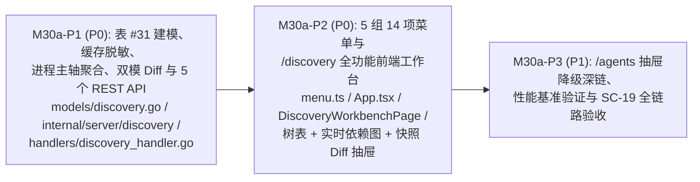

# M30a 作战卡：只读破冰 —— `/discovery` 进程主轴工作台与快照双模 Diff

> **文档版本**: v1.0.0  
> **更新日期**: `2026-11-25`  
> **所属阶段**: 阶段三/四（TDD 实施路线与工程作战卡）  
> **上位基线**: [`ADR-24` (v1.1.0)](../05-adr/24-csg-discovery-process-centric-and-physical-logical-boundary-adr.md) · [`01-feature-matrix.md`](../01-features/01-feature-matrix.md) (v2.26.0, `F-15`, `F-36`, `SC-19`) · [`01-system-architecture.md`](../02-design/01-system-architecture.md) (v1.12.0) · [`04-control-plane-and-web-console.md`](../02-design/04-control-plane-and-web-console.md) (v1.15.0, §1.10, §4.1, §4.12) · [`05-database-schema.md`](../02-design/05-database-schema.md) (v1.11.0, 表 #31 `contract_discovery_snapshots`) · [`01-http-api-contract.md`](../03-api/01-http-api-contract.md) (v1.11.0, §2.10)  
> **前置依赖**: `M29`（已交付；本阶段纯只读增强，不受 `discovery.v2_enabled` 开关控制，**不改动任何 `cmd/agent` 或 `pkg/*` 代码**）  
> **交付状态**: 📋 待实施

---

## 1. Milestone 核心目标与架构铁律

遵循 [`ADR-24` (v1.1.0)](../05-adr/24-csg-discovery-process-centric-and-physical-logical-boundary-adr.md)「先只读破冰、再解耦纳管」的分期策略，M30a 零侵入存量物理/逻辑表结构，交付以**操作系统进程为主轴**的全新一级工作台 **`现网发现` (`/discovery`)** 与快照时间线/跨环境 Diff 闭环：

1. **控制台 IA 升维至 5 组 14 项，确立 `/discovery` 单一权威发现入口**：
   - 在 `frontend/src/menu.ts` 「架构数字孪生」分组首位插入 `现网发现` (`/discovery`)；
   - 原 `/agents` 右栏「CSG 现网发现与蓝图对账」抽屉保留轻量入口与摘要，点击跳转 `/discovery?agent_id=:id`（零破坏现有 `/agents` 挂载与预挂主流程）。
2. **进程主轴视角 + 零抓包实时依赖图 + 离线回退**：
   - 聚合 `Agent` 返回的 `CSGTopologyReport` + `/proc` 观测为**进程主轴视图**：同进程多 PID 自动折叠（展示多实例徽章 `2 PIDs · 12345, 12398`）、纯客户端进程（`提供服务数 = 0`）一等公民展示、本机可操作进程与跨板 LDC 远端节点（只读）页签分离；
   - 控制面按 `(agent_id, csg_addr)` 维护 `singleflight.Group` + **5 秒 TTL 实时缓存**（手动刷新每用户每 Agent 限 1 次 / 3 秒）；Agent 离线时自动回退最近持久化快照并标注 `stale = true` 与采集时间。
3. **快照持久化、脱敏、去重与双模 Diff（新增表 #31 `contract_discovery_snapshots`）**：
   - 快照落库前执行 `Redactor` 脱敏（`cmdline` / 环境变量中的 `password`、`passwd`、`token`、`secret`、`api_key`、`key=` 掩码为 `***`）；
   - `content_hash` 剔除 PID、动态端口数值与时间戳，以 `规范化进程键 + StripCSGPIDSuffix(service_name)` 计算 SHA-256，防止仅因进程重启导致重复 `AUTO` 快照刷屏；
   - 按 `(agent_id, csg_addr)` 维护 FIFO 留存上限 `50`（跳过置顶 `is_pinned = true` 快照，置顶上限 `20`），严格继承 Agent `SHARED/PRIVATE` 可见性（`ScopeReadGuard` Anti-IDOR）。

---

## 2. 分阶段实施路线图 (M30a-P1 ~ M30a-P3)



| 子阶段 | 优先级 | 核心交付范围 | 前置依赖 | 核心质量门禁 |
| :--- | :---: | :--- | :---: | :--- |
| **`M30a-P1`** | **P0** | `models/discovery.go`（表 #31）、`models/db.go` 注册、`internal/server/discovery/{redactor,live_cache,snapshot_diff}.go`、`handlers/discovery_handler.go` + `routes.go` | 无 | `testdb.SetupIsolatedDB(t)` 迁移 + 聚合/脱敏/去重/FIFO/Diff/Anti-IDOR 单测全绿（`-race`） |
| **`M30a-P2`** | **P0** | `frontend/src/menu.ts`（5 组 14 项）、`App.tsx`、`/discovery` 进程主轴树表 + 零抓包实时依赖图 + 快照时间线/Diff 抽屉 | `M30a-P1` | `MenuAndLegacyRoutes` + `DiscoveryWorkbench` Vitest 全绿 + `--color-*` Token 与零 `any` 门禁通过 |
| **`M30a-P3`** | **P1** | `/agents` 抽屉降级为摘要与 `/discovery?agent_id=:id` 深链、`SC-19` 端到端测试与 P95 压测验证 | `M30a-P2` | `GET /api/discovery/live` 未命中 ≤ 2s / 命中 ≤ 200ms + `make test && make lint && make build && make clean` 全绿 |

---

## 3. 文件级交付物清单

| 阶段 | 路径 | 变更类型 | 核心职责 |
| :--- | :--- | :---: | :--- |
| **`M30a-P1`** | `models/discovery.go` & `models/db.go` | 新增 / 修改 | 定义 `DiscoverySnapshot`（#31 `contract_discovery_snapshots`）并注册至 `SetupWithDB` 与 `BusinessTableNames()`（首位，无下游依赖）；幂等注入 `discovery.snapshot_retention_count` / `discovery.snapshot_pin_limit` 默认配置 |
| **`M30a-P1`** | `internal/server/discovery/redactor.go` | 新增 | `RedactionVersion = 1`：`cmdline` 与环境变量敏感键值对掩码为 `***` |
| **`M30a-P1`** | `internal/server/discovery/live_cache.go` | 新增 | `(agent_id, csg_addr)` `singleflight` + 5s TTL 缓存、手动刷新 3s 限流、Agent 离线最近快照回退、进程主轴聚合（多 PID 折叠、纯客户端、跨板 LDC、既有 SSOT/撮合徽章填充） |
| **`M30a-P1`** | `internal/server/discovery/snapshot_diff.go` | 新增 | `content_hash` 规范化计算与连续去重、置顶上限 `20` 与 FIFO `50` 滚动裁剪、时间轴与跨环境双模 Diff（`ADDED/REMOVED_PROCESS`、`ADDED/REMOVED_SERVICE`、`TRANSPORT_CHANGED`、`ADDED/REMOVED_SUBSCRIPTION`、`PROVIDER_KIND_CHANGED`） |
| **`M30a-P1`** | `handlers/discovery_handler.go` & `handlers/routes.go` | 新增 / 修改 | 实现 `GET /api/discovery/live`、`GET/POST /api/discovery/snapshots`、`PATCH/DELETE /api/discovery/snapshots/:id`、`GET /api/discovery/snapshots/diff`，接入 `ScopeReadGuard` 与 `P2` `commonAudit` |
| **`M30a-P2`** | `frontend/src/menu.ts` & `frontend/src/App.tsx` | 修改 | 菜单升级为 5 组 14 项，注册 `/discovery` 路由 |
| **`M30a-P2`** | `frontend/src/api/discovery.ts` & `frontend/src/types/discovery.ts` | 新增 | 强类型 API 客户端与 DTO 定义（零 `any`） |
| **`M30a-P2`** | `frontend/src/pages/DiscoveryWorkbenchPage/*` | 新增 | `DiscoveryWorkbenchPage.tsx`、`DiscoveryTopBar.tsx`、`DiscoveryProcessTreeTable.tsx`、`DiscoveryLiveDepGraph.tsx`、`DiscoverySnapshotDiffDrawer.tsx`、`DiscoveryWorkbench.css`（100% `--color-*` Token） |
| **`M30a-P3`** | `frontend/src/pages/AgentManagementPage/AgentManagementPage.tsx` & `CSGBlueprintImportDrawer.tsx` | 修改 | 抽屉降级为轻量入口与 `/discovery?agent_id=:id` 深链跳转 |
| **`M30a-P3`** | `handlers/discovery_handler_test.go` & `frontend/src/__tests__/DiscoveryWorkbench.test.tsx` | 新增 | `SC-19` 后端与前端端到端回归套件 |

---

## 4. 分阶段详细任务拆解

### M30a-P1：快照模型、脱敏缓存、进程主轴聚合与双模 Diff 接口 (P0)

1. **`DiscoverySnapshot` 模型与索引 (`models/discovery.go` & `models/db.go`)**：
   - 按 [`05-database-schema.md` §3.9](../02-design/05-database-schema.md) 建表 `contract_discovery_snapshots`，建立 `idx_contract_disc_snap_agent_time (agent_id, csg_addr, created_at DESC)`、`idx_contract_disc_snap_hash (agent_id, csg_addr, content_hash)` 与 `chk_contract_disc_snap_trigger`；
   - `BusinessTableNames()` 首位加入 `DiscoverySnapshot{}.TableName()`；`seedDefaultSettings` 幂等注入 `discovery.snapshot_retention_count = "50"` 与 `discovery.snapshot_pin_limit = "20"`。
2. **敏感信息脱敏与规范化内容哈希 (`redactor.go` & `snapshot_diff.go`)**：
   - `RedactCmdline(raw string) string`：识别 `--password=xxx`、`--passwd xxx`、`-ptoken=...`、`secret=...`、`api_key=...`、`key=...` 等敏感参数并将值替换为 `***`；
   - `ComputeSnapshotContentHash(report, groups)`：提取每组进程规范化键（`exeBase + entryToken` 或 `StripProcPIDSuffix(procName)`）与旗下 `StripCSGPIDSuffix(service_name)` / `transport` / 订阅服务集合，**彻底剔除 `PID`、动态 `IP:Port` 端口数字与 `CapturedAt` 时间戳**后排序计算 SHA-256。
3. **实时探测缓存、离线回退与进程主轴聚合 (`live_cache.go`)**：
   - `GetLiveDiscovery(ctx, agentID, csgAddr, refresh, userID, isAdmin)`：先执行 `ScopeReadGuard`（`PRIVATE` 对非 owner 非管理员直接返 `403`）；当 `refresh == true` 校验 per-user-per-agent `3s` 速率限制；非强制刷新命中 5s TTL 缓存直接返回；否则经 `singleflight.Group` 调 `HubManager.FetchAgentCSGTopology` 融合 `/proc` 进程；
   - 若 Agent 离线或请求超时，查询同 `(agent_id, csg_addr)` 最近一条 `contract_discovery_snapshots` 返回，置 `stale = true` 与 `captured_at`；无任何历史快照时返回 `503`；
   - **进程主轴聚合**：将 `Servers` + `Clients` + `DiscoveredProcesses` 按 `规范化进程键` 折叠为 `DiscoveryProcessGroupDTO`（汇总 `pids[]`、`observed_role ∈ {SERVER, CLIENT_ONLY, DUAL}`、`observed_transports[]`、`services[]`、`subscriptions[]`、本机 vs `is_remote_ldc` 标记，以及对比既有 `contract_processes` / `contract_module_services` 的只读徽章）。
4. **快照 CRUD 与双模 Diff 接口 (`handlers/discovery_handler.go`)**：
   - `POST /api/discovery/snapshots`：落盘前调用 `RedactCmdline`，写入 `MANUAL` 快照（`AUTO` 若同 `(agent_id, csg_addr)` 最新快照 `content_hash` 相等则跳过），随后按非置顶 FIFO 裁剪超出 `retention_count (50)` 的旧记录；
   - `PATCH /api/discovery/snapshots/:id` / `DELETE /api/discovery/snapshots/:id`：检验 `ScopeReadGuard`；`SHARED` 环境仅创建人或管理员可置顶/删除；`is_pinned` 达上限 `20` 返 `400`；禁止直接删除 `is_pinned == true` 的快照（返 `409`）；写 `P2` 审计；
   - `GET /api/discovery/snapshots/diff`：校验左右两侧（`left_snapshot_id` 与 `right_snapshot_id` 或 `live_agent_id`）均满足 `ScopeReadGuard`，输出 `ADDED_PROCESS`、`REMOVED_PROCESS`、`ADDED_SERVICE`、`REMOVED_SERVICE`、`TRANSPORT_CHANGED`、`ADDED_SUBSCRIPTION`、`REMOVED_SUBSCRIPTION`、`PROVIDER_KIND_CHANGED` 明细与摘要计数。

### M30a-P2：菜单 5 组 14 项升级与 `/discovery` 前端工作台 (P0)

1. **导航菜单与路由注册**：
   - 更新 `frontend/src/menu.ts`：在「架构数字孪生」首位新增 `{ path: '/discovery', label: '现网发现', icon: '...' }`，更新注释为「5 组 14 项」，更新既有 `MenuAndLegacyRoutes.test.tsx` 断言；
   - 更新 `frontend/src/App.tsx` 注册 `/discovery` 指向 `DiscoveryWorkbenchPage`。
2. **`/discovery` 页面三区联动实现**：
   - **顶栏 (`DiscoveryTopBar`)**：受 `ScopeReadGuard` 过滤的 `Agent` 下拉框（`PRIVATE` 标“私有 · 仅本人可见”）、单行 `csg_addr` 选择器、离线 `stale` 横幅（“离线 · 采集于 HH:mm”）、`PROC_ONLY` 降级诊断提示、`[刷新]`、`[保存快照]`、`[快照对比]` 与 `[进程树表 | 实时依赖图]` 视图切换；
   - **模式 A (`DiscoveryProcessTreeTable`)**：一级行渲染进程名、多 PID 折叠徽章（如 `2 PIDs · 12345, 12398`）、观测角色胶囊（`SERVER / CLIENT_ONLY / DUAL`，纯客户端行完整保留）、传输制式胶囊、发布/待认领/订阅计数与纳管态徽章；二级展开展示发布服务与订阅明细；提供「本机进程」与「跨板 LDC 远端节点（只读）」页签切换；搜索框支持按服务名/进程名自动展开命中父行；
   - **模式 B (`DiscoveryLiveDepGraph`)**：复用轻量 SVG/ReactFlow 呈现 `订阅进程 ➔ 服务名 ➔ 发布进程`，点击节点高亮 1-Hop 上下游；
   - **快照与 Diff 抽屉 (`DiscoverySnapshotDiffDrawer`)**：使用 `@code/common` `<Drawer>` 展示快照时间线（支持标签、置顶/取消置顶、删除），支持选任意两条快照或“快照 vs 实时”输出同环境时间轴 Diff 与跨环境 Diff。

### M30a-P3：`/agents` 抽屉降级深链与 `SC-19` 全链路验收 (P1)

1. 更新 `/agents` 右栏 CSG 入口：保留轻量状态摘要与 `[🧭 在现网发现中查看 →]` 深链按钮跳 `/discovery?agent_id=:id`（兼容既有挂载和探针测试不回归）；
2. 完成 `SC-19` 端到端集成测试及 500 进程 / 2000 服务规模模拟夹具下 `GET /api/discovery/live` 性能基准断言（未命中 ≤ 2s / 命中 ≤ 200ms）。

---

## 5. TDD 测试先行验证矩阵 (Test-First Matrix)

| 阶段 | 测试文件 | 核心测试用例与必须验证的断言 |
| :--- | :--- | :--- |
| **`M30a-P1`** | `internal/server/discovery/redactor_test.go` | `TestRedactCmdline_MasksPasswordTokenSecretKeyValues`（验证 `--password=abc`、`token=xyz`、`--secret s1` 等全部脱敏为 `***`，普通业务参数保留） |
| **`M30a-P1`** | `internal/server/discovery/live_cache_test.go` | `TestAggregateProcessCentric_MultiPIDFold_PureClient_AndRemoteLDCSeparation`（多 PID 折叠为 1 个一级行、纯客户端 `0` 服务入树、`IsRemoteLDC=true` 入远端页签）、`TestLiveDiscovery_SingleflightTTLCache_RefreshRateLimit_AndOfflineFallbackSnapshot`（并发合并仅 1 次 Agent RPC、5s 命中缓存、离线回退 `stale=true`） |
| **`M30a-P1`** | `internal/server/discovery/snapshot_diff_test.go` | `TestSnapshot_ContentHashStableAcrossPIDAndDynamicPortChanges`（PID 与动态端口变动时 `content_hash` 恒等）、`TestSnapshot_FIFORetentionSkipsPinned_AndEnforcesPinLimit20`（`testdb.SetupIsolatedDB(t)`：写 55 条非置顶保留最新 50 条且跳过置顶；第 21 条置顶返 `400`）、`TestSnapshotDiff_AllDiffCategories_TimelineAndCrossEnv`（全 8 类 Diff 项精确识别且忽略跨环境 IP/端口） |
| **`M30a-P1`** | `handlers/discovery_handler_test.go` | `TestDiscoveryAPI_PrivateAgentLiveAndSnapshot_AntiIDOR403`（普通用户访问他人 `PRIVATE` 实时探测、快照列表、置顶/删除或跨环境 Diff 均返 `403`，`contract_admin` 与本人 `200`）、`TestDiscoveryAPI_SharedSnapshotPinDeletePermission_AndAuditP2` |
| **`M30a-P2`** | `frontend/src/__tests__/MenuAndLegacyRoutes.test.tsx`<br>`frontend/src/__tests__/DiscoveryWorkbench.test.tsx` | `testMenuStructure_FiveGroupsFourteenItems_DiscoveryFirstInArchTwin`（断言 5 组 14 项含 `/discovery`）、`testDiscoveryWorkbench_ProcessTree_PureClient_LDC_LiveGraph_AndSnapshotDiffDrawer`（100% `--color-*` Token、零 `any`、搜索自动展开命中父行） |
| **`M30a-P3`** | `handlers/discovery_handler_test.go` | `TestSC19_DiscoveryLiveCache_OfflineFallback_RedactedSnapshot_AndDualModeDiff`（含 500 进程 / 2000 服务响应耗时基线断言） |

---

## 6. 自动化准出验证门禁 (Exit Gate)

```bash
# 1. 现网发现后端引擎与隔离数据库单测（含并发竞态检测）
TEST_DB_DSN="host=127.0.0.1 port=5432 user=postgres password=<PWD> dbname=postgres sslmode=disable" \
  go test -race -v ./internal/server/discovery/... ./handlers/... -run 'TestDiscovery|TestSC19|TestSnapshot|TestLive|TestRedact'

# 2. 全量构建、前后端单测与静态检查（含 MenuAndLegacyRoutes 与主题/弹层门禁）
TEST_DB_DSN="host=127.0.0.1 port=5432 user=postgres password=<PWD> dbname=postgres sslmode=disable" \
  make test && make lint && make build && make clean
```

- **验收完成标志**：`make test`（含 `SC-19` 与 M30a 必测用例全绿）、`make lint`（`tsc --noEmit` + `eslint` + `check-overlay-guard` 零警告）、`make build && make clean` 全通过；`cmd/agent` 与 `pkg/*` 零改动且端口无残留。
