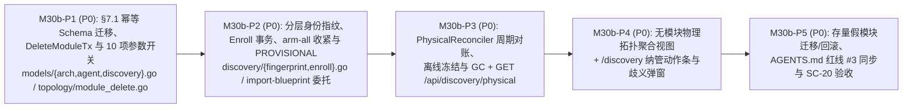

# M30b 作战卡：物理/逻辑双态解耦 —— Schema、观测纳管、`PhysicalReconciler` 与存量迁移

> **文档版本**: v1.0.0  
> **更新日期**: `2026-11-25`  
> **所属阶段**: 阶段三/四（TDD 实施路线与工程作战卡）  
> **上位基线**: [`ADR-24` (v1.1.0)](../05-adr/24-csg-discovery-process-centric-and-physical-logical-boundary-adr.md) · [`01-feature-matrix.md`](../01-features/01-feature-matrix.md) (v2.26.0, `F-02`, `F-33`, `F-37`, `SC-20`) · [`01-system-architecture.md`](../02-design/01-system-architecture.md) (v1.12.0) · [`03-architecture-elements-and-topology.md`](../02-design/03-architecture-elements-and-topology.md) (v1.11.0, §7.1~§7.5) · [`04-control-plane-and-web-console.md`](../02-design/04-control-plane-and-web-console.md) (v1.15.0, §1.10, §4.12) · [`05-database-schema.md`](../02-design/05-database-schema.md) (v1.11.0, 36 核心表 + `contract_settings`) · [`01-http-api-contract.md`](../03-api/01-http-api-contract.md) (v1.11.0, §2.4, §2.10)  
> **前置依赖**: `M30a`（已交付且全绿）  
> **交付状态**: ✅ 已交付

---

## 1. Milestone 核心目标与架构铁律

依据 [`ADR-24` (v1.1.0)](../05-adr/24-csg-discovery-process-centric-and-physical-logical-boundary-adr.md) 完成平台核心资产的**物理/逻辑彻底解耦**，实现「**0 个逻辑模块即可纳管物理资产并绘制真实物理连线、跨环境互不覆盖、`PROVISIONAL/SHARED` 严密隔离、存量假模块安全清零**」：

1. **L1 双粒度 Schema 演进（表总数从 31 核心表演进至 `36` 核心表 + `contract_settings` = `37` 表）**：
   - **L1-T 物理类型**（`ArchProcess` + `ModuleService` 双态身份 `module_id NULL`）与 **L1-I 物理实例**（`Process` + #32 `contract_service_placements` + #33 `contract_process_dependencies`）严格分离；**严禁在 `ModuleService` 增加单值 `arch_process_id`**；
   - 保持 `ADR-16` `uk_contract_mod_svc_name_excl` 不变；`contract_module_services.module_id` 外键从 `CASCADE` 改为 `RESTRICT` 并由服务层 `DeleteModuleTx` 按不变量 I6 / I7 显式迁移；
   - 同步新增 #34 `contract_dependency_decisions`、#35 `contract_attribution_jobs`、#36 `contract_mig_backups`（为 M30b 迁移与 M32 治理解耦建表）。
2. **纳管 ≠ 布防（`Enroll` / `Arm` 严格分离）**：
   - 普通认证用户通过 `POST /api/discovery/enroll`（`ScopeEnrollGuard`）自助纳管进程时，仅创建 `enroll_source = 'DISCOVERY'`、`probe_desired_state = 'DISARMED'` 的挂载实例，**绝不改变 `ExpectedArmedDigest`、绝不下发 `/agent/v1/monitors/arm`、绝不覆盖任何人工设置**；
   - `POST /api/agents/:id/probes/arm-all` 新增 `include_discovered`（缺省 `false`），缺省跳过发现纳管挂载，防止整机误布防。
3. **来源与可见性隔离（`PROVISIONAL` vs `CONFIRMED`）**：
   - `PRIVATE` 环境新发现的 `ArchProcess` 置 `lifecycle = 'PROVISIONAL'` 且编码 `prv<agent_id>-<norm>`，仅 `origin_agent_id` 的 owner 与 `contract_admin` 可见；在 `SHARED` 环境纳管或由管理员调用 `/promote` 后提升为 `CONFIRMED`；
   - 物理拓扑缺省视图仅聚合权威 `SHARED` 环境观测。
4. **生命周期自动对账、存量假模块迁移与特性开关**：
   - `PhysicalReconciler` 周期刷新已纳管实例（`ACTIVE ➔ STALE ➔ RETIRED`，Agent 离线冻结衰减，30 天未认领/孤立 `PROVISIONAL` 受限 GC，**已认领服务永不 GC**）；
   - `MigrateCSGPlaceholderModules` 一次性幂等清理存量 `CSG_DISCOVERED` / `MOD_*` 假模块（支持 `dry_run`、阻断清单、`contract_mig_backups` 备份回滚与 `MIGRATION` 流量改写）；
   - 通过 `discovery.v2_enabled`（默认 `false`）灰度开关控制所有新写路径与旧 `import-blueprint` 委托（M30b 实施时同步按 ADR-24 §9.3 修订 `AGENTS.md` 红线 #3）。

---

## 2. 分阶段实施路线图 (M30b-P1 ~ M30b-P5)



| 子阶段 | 优先级 | 核心交付范围 | 前置依赖 | 核心质量门禁 |
| :--- | :---: | :--- | :---: | :--- |
| **`M30b-P1`** | **P0** | 5 张新表 + 3 表增量列 + CHECK I1 + FK `RESTRICT` + `DeleteModuleTx` + 10 项 `discovery.*` 参数 | `M30a` | `testdb` 36+1 表迁移幂等通过 + CHECK I1 违例拦截 + `DeleteModule` 3 条路径（回退/合并/`409`）单测全绿 |
| **`M30b-P2`** | **P0** | `fingerprint.go`（P1~P3）、`enroll.go`（`ScopeEnrollGuard`/`DISARMED`）、`arm-all` `include_discovered`、`/promote`、`import-blueprint` 委托 | `M30b-P1` | `Enroll` 幂等/多宿主/跨环境/零覆盖/不改 Digest/`arm-all` 跳过/批量上限/歧义/低置信/`PROVISIONAL` 隔离全绿 |
| **`M30b-P3`** | **P0** | `reconciler.go`（周期刷新、衰减、离线冻结、GC）、`GET /api/discovery/physical` | `M30b-P2` | 衰减流转（3次或24h `STALE`、7d `RETIRED`、重现恢复）、离线冻结与 GC 不删已认领服务单测全绿 |
| **`M30b-P4`** | **P0** | `graph_topology.go` 物理聚合视图（`env_agent_id`、`REMOTE_LDC`/`OFFLINE` 虚节点、>150 折叠、500/2000 护栏）与前端 `/discovery` 纳管动作条 + 歧义弹窗 + `/topology` 环境选择 | `M30b-P3` | 0 个 `Module` 时物理拓扑完整渲染连线 + 首屏 500 节点 / 2000 边 ≤ 3s + 前端 Vitest 全绿 |
| **`M30b-P5`** | **P0** | `migration.go`（`MigrateCSGPlaceholderModules` dry-run/执行/回滚）+ `/admin/settings` 开关与迁移面板 + 修订 `AGENTS.md` 红线 #3 + `SC-20` 验收 | `M30b-P4` | 迁移 dry-run/执行/幂等/回滚单测全绿 + 逻辑架构 `CSG_DISCOVERED`/`MOD_*` 非阻断项为 0 + `SC-20` 全绿 |

---

## 3. 文件级交付物清单

| 阶段 | 路径 | 变更类型 | 核心职责 |
| :--- | :--- | :---: | :--- |
| **`M30b-P1`** | `models/arch.go`、`models/agent.go`、`models/discovery.go`、`models/recording.go`、`models/db.go` | 修改 | 增补 `ArchProcess`/`Process`/`ModuleService`/`TrafficRecord` 增量列，新增 `ServicePlacement`、 `ProcessDependency`、`DependencyDecision`、`AttributionJob`、`MigBackup`，按 §7.1 顺序幂等建表/建约束/建索引并注册 `BusinessTableNames()`；注入 10 项 `discovery.*` 参数 |
| **`M30b-P1`** | `internal/server/topology/tree.go` (或 `module_delete.go`) | 修改 / 新增 | 实现 `DeleteModuleTx`（I6 依赖守卫 `409` + I7 回退/合并 + 删除无放置手工服务） |
| **`M30b-P2`** | `internal/server/discovery/fingerprint.go` & `enroll.go` | 新增 | 实现三阶身份解析与单事务幂等 `Enroll`、`ScopeEnrollGuard`（可见性 + 50 批量 + 限流） |
| **`M30b-P2`** | `handlers/discovery_handler.go`、`handlers/agent_handler.go`、`handlers/csg_discovery_handler.go`、`handlers/arch_process_handler.go`、`handlers/routes.go` | 修改 | 注册 `POST /api/discovery/enroll`、`POST /api/admin/arch-processes/:id/promote`；修改 `ArmAllProbes` 增加 `include_discovered`；改造 `ImportAgentCSGBlueprint` 委托 `Enroll`（当 `discovery.v2_enabled == true`） |
| **`M30b-P3`** | `internal/server/discovery/reconciler.go`、`cmd/server/main.go`、`handlers/discovery_handler.go` | 新增 / 修改 | 启动 `PhysicalReconciler` 后台巡检与每日 GC 协程；暴露 `GET /api/discovery/physical` |
| **`M30b-P4`** | `internal/server/topology/graph_topology.go` & `handlers/arch_handler.go` | 修改 | `BuildTopologyGraph` 支持 `discovery.v2_enabled` 下从 `ServicePlacement`/`ProcessDependency` 聚合物理拓扑与 `env_agent_id` 参数；实施 500 节点 / 2000 边护栏 |
| **`M30b-P4`** | `frontend/src/pages/DiscoveryWorkbenchPage/*` & `frontend/src/pages/TopologyWorkbenchPage/*` & `frontend/src/components/ArchCanvas/*` | 修改 | `/discovery` 底部批处理条、`Enroll` 分组选择弹窗、`IdentityDisambiguationModal` 歧义/低置信确认弹窗；`/topology` 物理视角 `env_agent_id` 切换与 `>150` 自动按组折叠提示 |
| **`M30b-P5`** | `internal/server/discovery/migration.go`、`handlers/discovery_handler.go`、`frontend/src/pages/AdminSettingsPage.tsx`、`AGENTS.md` | 新增 / 修改 | `MigrateCSGPlaceholderModules` 迁移与回滚引擎、`/api/admin/migrations/csg-placeholder-modules` 接口、`/admin/settings` 发现参数与迁移干跑 UI、同步修订 `AGENTS.md` 红线 #3 |

---

## 4. 分阶段详细任务拆解

### M30b-P1：Schema 幂等演进、`DeleteModuleTx` 与特性开关 (P0)

1. 按 [`05-database-schema.md` §1.3 & §3.9](../02-design/05-database-schema.md) 完成全量模型定义与迁移 DDL：
   - 先更新既有表：`contract_arch_processes`（6 列 + CHECK + `idx_contract_arch_proc_fp` + `origin_agent_id` FK）、`contract_processes`（5 列 + CHECK）、`contract_module_services`（`module_id DROP NOT NULL`、FK 改 `RESTRICT`、5 列 + 3 CHECK + `idx_contract_mod_svc_unclaimed`）；
   - 新建 5 张表：`contract_service_placements`、`contract_process_dependencies`、`contract_dependency_decisions`、`contract_attribution_jobs`、`contract_mig_backups`；
   - 为 `contract_traffic_records` 母表添加 `src_arch_process_id BIGINT NULL`、`dst_arch_process_id BIGINT NULL`；
   - `BusinessTableNames()` 按外键依赖拓扑倒序补齐全部 6 张新表（确保 `resetdb` 无外键冲突）。
2. 在 `DeleteModule` 控制器中切入 `DeleteModuleTx`：加锁 ➔ I6 校验 `contract_module_dependencies.service_id`（有引用返 `409 DEPENDENCY_REFERENCED`）➔ I7 回退或合并放置服务 ➔ 删除纯手工无放置服务 ➔ 删除模块 ➔ `P1` 审计。
3. 写入 10 项 `discovery.*` 默认 `ModuleSetting`（`discovery.v2_enabled = "false"`）。

### M30b-P2：身份指纹、`Enroll` 纳管、`arm-all` 收紧与 `PROVISIONAL` 提升 (P0)

1. 实现 `fingerprint.go`：P1 `CmdPattern`（子串或 `re:` RE2）➔ P2 `sha256("v1|" + exeBase + "|" + entryToken + "|" + stableArgs)`（不含任何服务名，排除敏感参数与动态值）➔ P3 `StripProcPIDSuffix(procName)`（低置信）；
2. 实现 `enroll.go` 与 `POST /api/discovery/enroll`：
   - `ScopeEnrollGuard` 校验 `discovery.v2_enabled == true`（否则 `404`）、`ScopeReadGuard`、`SHARED` 环境单次 ≤ `enroll_batch_limit_shared`（超限 `422 ENROLL_BATCH_LIMIT`）及每用户每 Agent 速率限制；
   - 单事务锁定 Agent 行，按 [`03-architecture-elements-and-topology.md` §7.3](../02-design/03-architecture-elements-and-topology.md) 执行 `ArchProcess` / `Process`（`DISARMED` 且不改 `ExpectedArmedDigest`）/ `ModuleService`（尊重 `uk_contract_mod_svc_name_excl` 与 `MULTI_IMPL`）/ `ServicePlacement`（`agent_id`/`arch_process_id` 强制派生）/ `ProcessDependency` Upsert，返回逐进程结果与歧义候选；
   - `POST /api/admin/arch-processes/:id/promote`（`AdminOnly`）将 `PROVISIONAL` 提升为 `CONFIRMED`（若标准编码空闲可同步规范化编码）并写 `P1` 审计；
3. 更新 `ArmAllProbes`：请求体解析可选 `include_discovered`（默认 `false`），默认跳过 `enroll_source = 'DISCOVERY'` 挂载；
4. 更新 `ImportAgentCSGBlueprint`：当 `discovery.v2_enabled == true` 时委托 `Enroll` 执行，忽略 `subsystem_id`/`group_id`，响应附 `deprecated: true`，维持 `AdminOnly` 守卫，**绝不创建 `CSG_DISCOVERED` / `MOD_*`**。

### M30b-P3：`PhysicalReconciler` 生命周期对账、衰减与受限 GC (P0)

1. `PhysicalReconciler` 周期（`reconcile_interval_sec`，默认 `600s` + 随机抖动）遍历 `ONLINE` 且含 `DISCOVERY` 挂载的 Agent，共享 `live_cache.go` singleflight 探测，哈希变动时写 `SCHEDULED` 快照；
2. 仅刷新已纳管实例观测字段与放置/订阅边，**绝不自动纳管新进程**；落实 `ACTIVE ➔ STALE`（`miss_count >= 3` 或 `24h`）➔ `RETIRED`（`7d`）、重现即恢复 `ACTIVE`、**Agent 离线或探测失败完全冻结衰减**；
3. 每日 GC：仅删除放置全部 `RETIRED` 满 `30d` 且无依赖/黄金用例/`diff_ignore_paths` 引用的**未认领**身份（**已认领服务永不 GC**），以及无挂载满 `30d` 的 `PROVISIONAL` 进程；
4. 实现 `GET /api/discovery/physical`：返回经 `ScopeReadGuard`（及 `PROVISIONAL` V2 可见性规则）过滤的进程挂载、服务放置、订阅边及聚合视图。

### M30b-P4：无逻辑模块物理拓扑与 `/discovery` 纳管交互 (P0)

1. 在 `graph_topology.go` 中当 `discovery.v2_enabled == true` 时，物理视图 `PHYSICAL` 切换为基于 `ServicePlacement` + `ProcessDependency` 聚合输出 `ArchProcessGroup -> ArchProcess -> (已认领 Module)`（0 个 `Module` 时照常画进程连线）、`REMOTE_LDC` / `OFFLINE` 虚拟节点，实施 `500` 节点 / `2000` 边护栏；
2. 前端 `/discovery` 新增底部批处理行动条 `[纳管到物理蓝图]`（选择 `ArchProcessGroup`，新建分组入口仅管理员可见；`SHARED` 批量二次确认；返回 `AMBIGUOUS` / `LOW_CONFIDENCE` 时弹窗逐个确认后重提交）；`/topology` 物理视角接入 `env_agent_id` 环境选择器与 `>150` 进程按组默认折叠提示。

### M30b-P5：存量假模块迁移、回滚与 `SC-20` 验收 (P0)

1. 实现 `MigrateCSGPlaceholderModules` 与 `POST /api/admin/migrations/csg-placeholder-modules`（`AdminOnly`，支持 `action: "dry_run" | "execute" | "rollback"`）：覆盖识别条件、5 类阻断清单、写 `contract_mig_backups`、置 `module_id = NULL, source = 'MIGRATED'`、生成 `STALE` 放置、删空假模块/功能组、创建 `MIGRATION` 流量改写任务、以及按备份回滚未再认领的服务；
2. 前端 `/admin/settings` 新增发现治理参数配置区、`discovery.v2_enabled` 开关与假模块迁移 Dry-Run 报告/执行/回滚面板；
3. 依据 [`ADR-24` §9.3](../05-adr/24-csg-discovery-process-centric-and-physical-logical-boundary-adr.md#93-与工程架构红线agentsmd的一致性核验) 同步修订仓内 `AGENTS.md` 红线 #3，完成 `SC-20` 全链路测试验收。

---

## 5. TDD 测试先行验证矩阵 (Test-First Matrix)

| 阶段 | 测试文件 | 核心测试用例与必须验证的断言 |
| :--- | :--- | :--- |
| **`M30b-P1`** | `models/discovery_m30b_test.go`<br>`internal/server/topology/module_delete_test.go` | `TestM30bSchema_CheckI1_UnclaimedInvariants_AndPlacementDerivation`（未认领带 `contract_id` 触发 CHECK 报错；FK `RESTRICT` 阻断裸删 Module）、`TestDeleteModuleTx_DepReferenced409_RollbackUnclaimed_AndMergeMultiImpl`（三条路径全部 `testdb.SetupIsolatedDB(t)` 通过） |
| **`M30b-P2`** | `internal/server/discovery/fingerprint_test.go`<br>`internal/server/discovery/enroll_test.go`<br>`handlers/discovery_m30b_test.go` | `TestFingerprint_IgnoresServiceNamesSecretsAndDynamicArgs_SupportsVersions`、`TestEnroll_Idempotent_MultiHost1Identity2Placements_CrossEnvIsolated_AndMultiImplMatch`、`TestEnroll_NeverOverwritesManualFields_DisarmedNoDigestChange_AndArmAllSkipsDiscovered`、`TestEnroll_SharedBatchLimit422_Ambiguous422_LowConfidence422`、`TestVisibility_PrivateProvisionalHiddenFromOthersAndGlobal_SharedAutoPromotes`、`TestImportBlueprint_DelegatesToEnroll_NoFakeModule` |
| **`M30b-P3`** | `internal/server/discovery/reconciler_test.go` | `TestPhysicalReconciler_DecayStaleRetired_OfflineFreeze_AndGCNeverDeletesClaimed`（模拟 3 次/`24h` 转 `STALE`、7 天转 `RETIRED`、重现回弹 `ACTIVE`、Agent `OFFLINE` 冻结计数、GC 清理 30d 未认领但保留已认领及有 `diff_ignore_paths`/黄金用例引用的服务） |
| **`M30b-P4`** | `internal/server/topology/graph_topology_test.go`<br>`frontend/src/__tests__/DiscoveryEnrollAndPhysicalTopo.test.tsx` | `TestBuildTopologyGraph_PhysicalV2_ZeroModulesDrawsProcessEdges_ExcludesPrivate_AndScaleGuard`、`testDiscoveryEnrollBar_AmbiguityModal_AndPhysicalTopologyEnvSwitch` |
| **`M30b-P5`** | `internal/server/discovery/migration_test.go`<br>`handlers/discovery_m30b_test.go` | `TestMigrateCSGPlaceholders_DryRun_BlockedList_Execute_Idempotent_AndRollback`、`TestSC20_PhysicalLogicalDecoupling_ZeroFakeModules_ZeroModuleTopology` |

---

## 6. 自动化准出验证门禁 (Exit Gate)

```bash
# 1. M30b Schema、指纹、Enroll、对账、物理拓扑与迁移隔离库竞态测试
TEST_DB_DSN="host=127.0.0.1 port=5432 user=postgres password=<PWD> dbname=postgres sslmode=disable" \
  go test -race -v ./models/... ./internal/server/discovery/... ./internal/server/topology/... ./handlers/... \
  -run 'TestM30b|TestDeleteModuleTx|TestFingerprint|TestEnroll|TestVisibility|TestImportBlueprint|TestPhysicalReconciler|TestBuildTopologyGraph_PhysicalV2|TestMigrateCSG|TestSC20'

# 2. 全量构建、前后端全量回归与静态检查
TEST_DB_DSN="host=127.0.0.1 port=5432 user=postgres password=<PWD> dbname=postgres sslmode=disable" \
  make test && make lint && make build && make clean
```

- **验收完成标志**：普通研发自助 `Enroll` 50 进程 P95 ≤ 3s 且 Agent `ExpectedArmedDigest` 零变动；执行 `MigrateCSGPlaceholderModules` 后非阻断 `CSG_DISCOVERED`/`MOD_*` 假模块为 `0`；0 个 `Module` 时物理拓扑完整渲染连线；`SC-20` 与 `make test && make lint && make build` 全绿。
