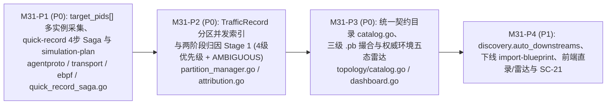

# M31 作战卡：倍增层 —— 一键直录 Saga、两阶段归因与统一契约目录五态雷达

> **文档版本**: v1.0.0  
> **更新日期**: `2026-11-25`  
> **所属阶段**: 阶段三/四（TDD 实施路线与工程作战卡）  
> **上位基线**: [`ADR-24` (v1.1.0)](../05-adr/24-csg-discovery-process-centric-and-physical-logical-boundary-adr.md) · [`01-feature-matrix.md`](../01-features/01-feature-matrix.md) (v2.26.0, `F-38`, `SC-21`) · [`02-data-plane-and-cros-rpc-engine.md`](../02-design/02-data-plane-and-cros-rpc-engine.md) (v1.9.0, §7.5) · [`03-architecture-elements-and-topology.md`](../02-design/03-architecture-elements-and-topology.md) (v1.11.0, §7.6~§7.7) · [`04-control-plane-and-web-console.md`](../02-design/04-control-plane-and-web-console.md) (v1.15.0, §1.10, §4.12) · [`05-database-schema.md`](../02-design/05-database-schema.md) (v1.11.0) · [`01-http-api-contract.md`](../03-api/01-http-api-contract.md) (v1.11.0, §2.10, §3)  
> **前置依赖**: `M30b`（已交付且全绿；本阶段按 `ADR-24` 新增 `ProcessMonitorSpec.TargetPIDs []uint32` 向后兼容扩展，严格保持 `cmd/agent` 九包物理防腐红线）  
> **交付状态**: 📋 待实施

---

## 1. Milestone 核心目标与架构铁律

打通「**从 `/discovery` 零逻辑建模一键直录与仿真 ➔ 物理进程级全链归因 + `.pb` 解码 ➔ 统一契约目录与五态健康雷达**」的倍增闭环，让研发无需等待逻辑架构师建模即可获得完整物理调用链、结构化业务报文与契约健康视图：

1. **多实例 `target_pids[]` 采集扩展与九包物理防腐**：
   - `pkg/agentproto.ProcessMonitorSpec` 新增向后兼容字段 `TargetPIDs []uint32 \`json:"target_pids,omitempty"\``；
   - `pkg/transport`（`builtin-tcp` 与 `builtin-drt-uprobe`）协同覆盖同一进程的多 PID 实例采集并在五出口原子卸载（旧版 Agent 忽略 `TargetPIDs` 时回退主 `ResolvedPID` 并在诊断提示）；
   - `cmd/agent/deps_test.go` 九包零 DB / 零 `.pb` / 零 CGO / 零外部探针子进程红线零放宽。
2. **发现即录制 Saga 与发现驱动仿真编排**：
   - `POST /api/discovery/quick-record` 按 **4 步 Saga**（① 独立事务 `Enroll` ➔ ② 抢占租约 ➔ ③ 创建 `RecordingSession` 携带 `target_pids[]` ➔ ④ 下发 Agent 租约期临时布防）执行，带幂等键 `request_id` 与逐级失败补偿，并对未常驻布防 TCP 进程如实提示 `NEED_RECONNECT` 出向覆盖度；
   - `POST /api/discovery/simulation-plan` 读取目标进程订阅在线状态与传输制式自动预填 `CLIENT_INJECT` / `PUB_STUB` / `MOCK_SERVER` 策略，直达 `/replay`；
   - 控制面按 `discovery.auto_downstreams`（缺省 `false`）将已常驻布防进程的 `ACTIVE` TCP 订阅边自动并入 `connect4` 下游集合（跳过 `dophi_mesh://`）。
3. **两阶段渐进归因 Stage 1 与分区零锁表并发索引**：
   - 通过可中断续跑的并发建索引步骤，在 `contract_traffic_records` 母表以 `ON ONLY` 登记 `idx_contract_tr_src_arch` / `idx_contract_tr_dst_arch` 并逐子分区执行 `CREATE INDEX CONCURRENTLY` + `ATTACH PARTITION`；
   - `OfflineBatchAttribution` Stage 1 严格按 4 级对端优先级（① 会话 `CSGSnapshots` ➔ ② 放置 `endpoints` ➔ ③ 权威环境唯一 `ACTIVE` 放置 ➔ ④ 标为 `AMBIGUOUS` 候选集）完成物理进程归因，绝不强行猜绑。
4. **统一契约目录、三级 `.pb` 撮合与五态雷达（仅统计权威 `SHARED` 环境）**：
   - 合并 [`claimable_service.go`](../../internal/server/topology/claimable_service.go) 与 [`csg_reconcile.go`](../../internal/server/topology/csg_reconcile.go) 为统一目录服务 `catalog.go`；
   - 三级撮合（`EXACT` 自动写 `proto_service_name`；`HEURISTIC` 与 `FINGERPRINT`（方法覆盖率 `>= 80%` 且唯一）仅写 `proto_suggested_name` 待人工确认）；
   - 五态健康雷达（`SHADOW_LIVE` / `UNCLAIMED_ORPHAN` / `PHANTOM_PROTO` / `VANISHED_CLAIMED` / `PLACEMENT_DRIFT`）接入 `/dashboard` 与 `/proto-docs`；
   - **正式删除 `POST /api/agents/:id/csg/import-blueprint` 旧路由与前端入口**（满足 14 天零调用条件后下线）。

---

## 2. 分阶段实施路线图 (M31-P1 ~ M31-P4)



| 子阶段 | 优先级 | 核心交付范围 | 前置依赖 | 核心质量门禁 |
| :--- | :---: | :--- | :---: | :--- |
| **`M31-P1`** | **P0** | `pkg/agentproto` `TargetPIDs`、`pkg/transport`/`pkg/ebpf` 多 PID 采集、`quick_record_saga.go`、`sim_planner.go` | `M30b` | `cmd/agent/deps_test.go` 九包防腐通过 + Saga 各步补偿/幂等与 `target_pids[]` 单测全绿（`-race`） |
| **`M31-P2`** | **P0** | `TrafficRecord.{src,dst}_arch_process_id` 逐分区 `CONCURRENTLY` 索引脚本、`attribution.go` Stage 1 四级解析与 `.pb` 解码 | `M31-P1` | 分区索引存在性校验 + Stage 1 多宿主 `AMBIGUOUS` 不强归因单测全绿 |
| **`M31-P3`** | **P0** | `internal/server/topology/catalog.go`、`/api/catalog/*` 接口（三级撮合/建议确认/五态雷达）、`/api/dashboard/overview` 接入雷达 | `M31-P2` | 仅 `EXACT` 自动写 `proto_service_name` + 五态雷达严格排除 `PRIVATE` 环境单测全绿 |
| **`M31-P4`** | **P1** | `discovery.auto_downstreams` 联动、下线 `import-blueprint`、前端 `/discovery` 直录/仿真联动 + `/dashboard` 五态雷达卡片 + `/proto-docs` 统一目录 + `SC-21` | `M31-P3` | `SC-21` 全链路端到端全绿 + `make test && make lint && make build && make clean` 零警告 |

---

## 3. 文件级交付物清单

| 阶段 | 路径 | 变更类型 | 核心职责 |
| :--- | :--- | :---: | :--- |
| **`M31-P1`** | `pkg/agentproto/protocol.go` & `pkg/transport/driver.go` | 修改 | `ProcessMonitorSpec` 新增 `TargetPIDs []uint32`；`TargetProcess` 新增 `PIDs []uint32` |
| **`M31-P1`** | `pkg/ebpf/manager.go`、`pkg/transport/tcp_driver.go`、`pkg/transport/drt_uprobe_driver.go` | 修改 | 协同处理多 PID 注册、uprobe PID 级多 `bpf_link` 挂载及五出口全量卸载 |
| **`M31-P1`** | `internal/server/discovery/quick_record_saga.go` & `sim_planner.go` | 新增 | 实现 `ExecuteQuickRecordSaga`（独立 Enroll ➔ 抢租约 ➔ 建会话 ➔ 下发同步，失败补偿，`request_id` 幂等）与 `BuildSimulationPlan` |
| **`M31-P1`** | `handlers/discovery_handler.go` & `handlers/routes.go` | 修改 | 新增 `POST /api/discovery/quick-record`、`POST /api/discovery/simulation-plan` |
| **`M31-P2`** | `models/partition_manager.go` | 修改 | 幂等执行 `ON ONLY` 母表索引注册 + 循环扫描子分区 `CREATE INDEX CONCURRENTLY` + `ATTACH PARTITION` |
| **`M31-P2`** | `internal/server/topology/attribution.go` | 修改 | 落实 Stage 1 物理进程归因 4 级优先级、`AMBIGUOUS` 候选写入 `headers_json.meta` 与 `.pb` 解码 |
| **`M31-P3`** | `internal/server/topology/catalog.go`（合并取代 `claimable_service.go` / `csg_reconcile.go`） | 新增 / 重构 | 统一契约服务目录、三级 `.pb` 自动撮合（`EXACT`/`HEURISTIC`/`FINGERPRINT`）、人工确认权限与权威环境五态雷达计算 |
| **`M31-P3`** | `handlers/catalog_handler.go`、`handlers/dashboard_handler.go`、`handlers/routes.go` | 新增 / 修改 | 新增 `GET /api/catalog/services`、`POST /api/catalog/correlate`、`POST /api/catalog/services/:id/confirm-proto`；`/api/dashboard/overview` 附加 `five_state_radar` |
| **`M31-P4`** | `internal/server/hub/manager.go`（下游规格编译）、`handlers/csg_discovery_handler.go` & `routes.go` | 修改 | 实现 `discovery.auto_downstreams` TCP 订阅边自动并入常驻下游；删除废弃 `import-blueprint` 路由与前端入口 |
| **`M31-P4`** | `frontend/src/pages/{DiscoveryWorkbenchPage,DashboardWorkbenchPage,ProtoSchemaWorkbenchPage}/*` | 修改 | `/discovery` `[一键立即录制]` 与 `[编排仿真任务]` 联动、`/dashboard` `FiveStateRadarCard`、`/proto-docs` 统一目录展示与建议确认交互 |

---

## 4. 分阶段详细任务拆解

### M31-P1：`target_pids[]` 多实例采集、`quick-record` Saga 与仿真推荐 (P0)

1. 在 `pkg/agentproto.ProcessMonitorSpec` 增加 `TargetPIDs []uint32`，并在 `pkg/transport`/`pkg/ebpf` 中统一处理多 PID（`PIDs` 为空回退 `[ResolvedPID]`；旧 Agent 忽略字段不崩溃并在诊断信息提示）；验证 `cmd/agent/deps_test.go` 零新增违规依赖；
2. 实现 `quick_record_saga.go`（当 `discovery.v2_enabled == false` 返 `404`）：
   - 按 `(user_id, request_id)` 查幂等缓存/会话标记，命中直接返回既定会话与覆盖度告警；
   - Step 1 调用 `Enroll`（独立事务提交，遇 `422` 终止）；Step 2 `AcquireAgentLeases`（遇租约冲突返 `409 LEASE_CONFLICT`）；Step 3 按 `Process.observed_transports` 匹配采集模式并携带 `target_pids[] = observed_pids` 创建 `RecordingSession`；Step 4 下发 Agent 启动同步，失败则更新会话 `FAILED` 并释放租约；写 `P2` 审计；
3. 实现 `sim_planner.go`：`POST /api/discovery/simulation-plan` 检查被测进程同环境订阅边状态——纯 `dophi_mesh://` 或存在同名在线冲突推荐 `MOCK_SERVER`、全部缺席下游推荐 `PUB_STUB`、目标动态端口直拨推荐 `CLIENT_INJECT`，返回预填重放表单 DTO。

### M31-P2：`TrafficRecord` 分区并发建索引与 Stage 1 归因 (P0)

1. 更新 `models/partition_manager.go`：母表新建 `idx_contract_tr_src_arch ON ONLY` 与 `idx_contract_tr_dst_arch ON ONLY`，迁移协程遍历当前全部子分区检查 `pg_indexes`，缺失则独立非事务连接执行 `CREATE INDEX CONCURRENTLY` 并执行 `ALTER INDEX ... ATTACH PARTITION`；
2. 更新 `internal/server/topology/attribution.go` Stage 1：本地端写 `src/dst_arch_process_id`；对端严格执行「① 会话 `CSGSnapshots` ➔ ② 同/已知环境 `ServicePlacement.endpoints` ➔ ③ 权威环境唯一 `ACTIVE` 放置 ➔ ④ 标为 `AMBIGUOUS` 不猜绑」；多宿主且无断点匹配时保持可空并在解剖抽屉透出候选进程列表。

### M31-P3：统一契约目录、三级 `.pb` 撮合与五态健康雷达 (P0)

1. 合并 `claimable_service.go` 与 `csg_reconcile.go` 构建 `catalog.go`，迁移既有调用点并保持无损单测；
2. 实现三级撮合 `CorrelateCatalogServices`：
   - `EXACT`（全名匹配 `ProtoOperation.ServiceName`）直接写入 `proto_service_name` 并触发 `decoder.Registry.Reload()`；
   - `HEURISTIC`（`<Class>-<Svr>` 拆分唯一命中）与 `FINGERPRINT`（录制 `Operation` 集合覆盖激活 `.pb` 方法 `>= 80%` 且唯一）仅写入 `proto_suggested_name`；
   - `POST /api/catalog/services/:id/confirm-proto` 校验权限（未认领由可见用户 `P2`、已认领由管理员或模块/子系统负责人 `P1`）；
3. 实现五态雷达聚合：严格限定 `Agent.scope == 'SHARED'` 与 `ArchProcess.lifecycle == 'CONFIRMED'`，分别计算 `SHADOW_LIVE`、`UNCLAIMED_ORPHAN`、`PHANTOM_PROTO`、`VANISHED_CLAIMED`、`PLACEMENT_DRIFT` 计数与列表，挂载至 `GET /api/catalog/services` 与 `GET /api/dashboard/overview`。

### M31-P4：`auto_downstreams` 联动、清理旧路由、前端闭环与 `SC-21` (P1)

1. 在 `internal/server/hub/manager.go` 编译常驻进程 `Downstreams` 时，若 `discovery.auto_downstreams == "true"` 且进程 `probe_desired_state == "ARMED"`，并入同环境 `ACTIVE` TCP 订阅边的 `resolved_endpoint`；
2. 下线删除 `POST /api/agents/:id/csg/import-blueprint` 路由及旧前端导入抽屉死入口；
3. 前端落地 `/discovery` `[一键立即录制]` / `[编排仿真任务]`（带 `NEED_RECONNECT` 提示跳 `/record` / `/replay`）、`/dashboard` 五态雷达卡片（不改动原 `40+30+30` 健康分公式）及 `/proto-docs` 统一契约目录确认交互；完成 `SC-21` 全链路验收。

---

## 5. TDD 测试先行验证矩阵 (Test-First Matrix)

| 阶段 | 测试文件 | 核心测试用例与必须验证的断言 |
| :--- | :--- | :--- |
| **`M31-P1`** | `cmd/agent/deps_test.go`<br>`pkg/transport/drt_uprobe_driver_test.go`<br>`internal/server/discovery/quick_record_test.go` | `TestAgentDependencies_NoGormNoDynamicPBNoServer`（九包通过）、`TestMultiPIDCapture_TCPAndUprobe_FiveExitCleanup`（多 PID 全挂载与全卸载）、`TestQuickRecordSaga_StepFailureCompensation_IdempotencyKey_AndNeedReconnectWarning`、`TestSimulationPlan_RecommendsStrategyBySubState` |
| **`M31-P2`** | `models/partition_manager_test.go`<br>`internal/server/topology/attribution_test.go` | `TestTrafficRecord_ArchProcessPartitionIndexesAttachedConcurrently`（`testdb` 验证母表与子分区索引全部就位）、`TestStage1Attribution_FourTierPriority_AndAmbiguousNeverGuesses` |
| **`M31-P3`** | `internal/server/topology/catalog_test.go`<br>`handlers/catalog_handler_test.go` | `TestCatalogCorrelate_ExactAuto_HeuristicAndFingerprintSuggestOnly`、`TestConfirmProto_RBAC_UnclaimedVsClaimed`、`TestFiveStateRadar_AuthoritySharedOnly_ExcludesPrivate` |
| **`M31-P4`** | `handlers/discovery_m31_test.go`<br>`frontend/src/__tests__/CatalogRadarAndQuickRecord.test.tsx` | `TestAutoDownstreams_MergesActiveTCPEdges_SkipsMesh`、`TestSC21_ZeroModelingQuickRecord_Stage1Attribution_Correlate_AndRadar`、`testDiscoveryQuickRecord_FiveStateRadarCard_AndCatalogConfirm` |

---

## 6. 自动化准出验证门禁 (Exit Gate)

```bash
# 1. Agent 九包防腐与数据面多 PID 并发测试
CGO_ENABLED=0 go test -race -v ./cmd/agent ./pkg/agentproto/... ./pkg/transport/... ./pkg/ebpf/...

# 2. M31 直录 Saga、分区并发索引、Stage 1 归因、目录撮合与五态雷达测试
TEST_DB_DSN="host=127.0.0.1 port=5432 user=postgres password=<PWD> dbname=postgres sslmode=disable" \
  go test -race -v ./models/... ./internal/server/discovery/... ./internal/server/topology/... ./handlers/... \
  -run 'TestMultiPID|TestQuickRecord|TestSimulationPlan|TestTrafficRecord_ArchProcess|TestStage1Attribution|TestCatalog|TestConfirmProto|TestFiveStateRadar|TestAutoDownstreams|TestSC21'

# 3. 全量构建、前后端全量回归与静态检查
TEST_DB_DSN="host=127.0.0.1 port=5432 user=postgres password=<PWD> dbname=postgres sslmode=disable" \
  make test && make lint && make build && make clean
```

- **验收完成标志**：从 0 个逻辑模块系统启动，在 `/discovery` 选中多实例进程一次点击完成录制（含 `target_pids[]`）、Stage 1 物理归因、`.pb` 自动解码；多宿主不误归因；`/dashboard` 与 `/proto-docs` 精确呈现权威环境五态雷达；`make test && make lint && make build` 全绿。
