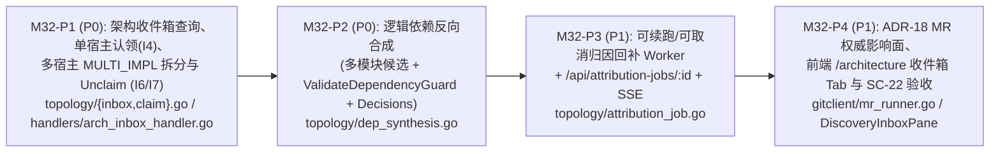

# M32 作战卡：护城河层 —— 架构收件箱、依赖反向审批、归因回补与 MR 权威影响面

> **文档版本**: v1.0.0  
> **更新日期**: `2026-11-25`  
> **所属阶段**: 阶段三/四（TDD 实施路线与工程作战卡）  
> **上位基线**: [`ADR-24` (v1.1.0)](../05-adr/24-csg-discovery-process-centric-and-physical-logical-boundary-adr.md) · [`01-feature-matrix.md`](../01-features/01-feature-matrix.md) (v2.26.0, `F-39`, `SC-22`) · [`03-architecture-elements-and-topology.md`](../02-design/03-architecture-elements-and-topology.md) (v1.11.0, §7.1, §7.6, §7.7) · [`04-control-plane-and-web-console.md`](../02-design/04-control-plane-and-web-console.md) (v1.15.0, §4.12, §5) · [`05-database-schema.md`](../02-design/05-database-schema.md) (v1.11.0, 表 #34 `contract_dependency_decisions` & 表 #35 `contract_attribution_jobs`) · [`01-http-api-contract.md`](../03-api/01-http-api-contract.md) (v1.11.0, §2.7, §2.10)  
> **前置依赖**: `M31`（已交付且全绿）  
> **交付状态**: 📋 待实施

---

## 1. Milestone 核心目标与架构铁律

在 L0/L1 物理流水线彻底跑通的基础上，构建**自底向上的渐进式 L2 逻辑架构治理护城河**，消除「1 进程 : N 模块」拆分返工，打通物理事实到逻辑契约、历史流量归因与研发 MR 门禁的终局闭环：

1. **架构收件箱 (`/architecture` Discovery Inbox) 与负责人权责下放**：
   - 按 `CONFIRMED` 状态的 `ArchProcess` 分组列出待认领服务、多宿主候选、`PLACEMENT_DRIFT` 放置漂移与反向依赖建议（**仅统计权威 `SHARED` 环境**）；
   - **单宿主认领 (`POST /api/arch/services/claim`)**：支持在同一标准进程下勾选多个服务分别认领进不同 `Module`（实现 `1 进程 : N 模块` 无返工拆分）；权限放开至 **`Module.owner` / `Subsystem.owner` / `contract_admin`**（`ModuleOwnerOrAdminGuard`），严格执行不变量 **I4**（权威环境 `ACTIVE` 放置须同属 `ArchProcess P` 且 `M.arch_process_id ∈ {NULL, P}`，不满足返 `422 CLAIM_PLACEMENT_MISMATCH`）；
   - **多宿主裁决**：同服务在权威环境有 `>= 2` 个不同 `ArchProcess` 的 `ACTIVE` 放置时，支持引导合并冗余进程，或由 `contract_admin` 调用 `POST /api/arch/services/split-multi-impl` 拆分为 `ServiceContract` + 多个 `MULTI_IMPL` 实现行并迁移放置；
   - **取消认领 (`Unclaim`)**：执行不变量 **I6**（存在 `ModuleDependency.service_id` 引用返 `409 DEPENDENCY_REFERENCED`）与 **I7**（合并或清空回退为 `MIGRATED`）。
2. **逻辑依赖反向合成审批**：
   - 基于权威环境类型级 `ProcessDependency`（`consumer_arch_process_id, service_id`）聚合建议；当消费方进程承载多个业务模块时，优先以 Stage 2 实测来源模块推荐，否则列出全部候选模块供管理员选定；
   - 批准时经 `ValidateDependencyGuard`（`layer_level` 层级校验 + BFS/DFS 成环拦截）创建 `ModuleDependency`；标记 `IGNORED` 或 `VIOLATION` 持久化至表 #34 `contract_dependency_decisions`，不再重复提示。
3. **可续跑、可取消的历史归因回补任务 (`contract_attribution_jobs`)**：
   - 认领完成后自动创建 `REATTRIBUTE` 作业，由限速后台 Worker 按 `RecordingSession` 游标分批回补 `src_module_id / dst_module_id`（命中 `idx_contract_tr_session_svc`）；支持进度查询、取消（`POST /api/attribution-jobs/:id/cancel`）、服务重启中断续跑与 SSE `attribution_job.updated` 实时推送。
4. **`ADR-18` MR 门禁权威环境现网影响面**：
   - `mr_runner.go` 在 `breaking.go` 检出变更时，附加查询目标服务在权威 `SHARED` 环境的 `ACTIVE` 放置与订阅边，在 Git MR 评审评论中精确输出“该服务当前在 X 个环境由 N 个物理进程发布、被 M 个消费方进程订阅”；`PRIVATE` 环境绝不计入与披露。

---

## 2. 分阶段实施路线图 (M32-P1 ~ M32-P4)



| 子阶段 | 优先级 | 核心交付范围 | 前置依赖 | 核心质量门禁 |
| :--- | :---: | :--- | :---: | :--- |
| **`M32-P1`** | **P0** | `GET /api/arch/inbox`、`POST /api/arch/services/claim`（`ModuleOwnerOrAdminGuard` + I4）、`split-multi-impl`、`unclaim`（I6/I7） | `M31` | 负责人 RBAC（自己模块 200 / 他人 403 / 普通用户 403）+ I4 `422` + I6 `409` + 多宿主拆分迁移单测全绿 |
| **`M32-P2`** | **P0** | `dep_synthesis.go`（多模块消费方候选 + `ValidateDependencyGuard` + `contract_dependency_decisions`）、`POST /api/arch/dependency-suggestions/decide` | `M32-P1` | 多模块消费方输出全部候选 + 批准成环/越层 `409` + 裁决抑制重复建议单测全绿 |
| **`M32-P3`** | **P1** | `attribution_job.go` Worker（游标分批、限速、取消、断点续跑）、`GET/POST /api/attribution-jobs/:id(/cancel)` + SSE `attribution_job.updated` | `M32-P2` | 分批回补 `src/dst_module_id` + 取消与重启续跑（`-race`）全绿 |
| **`M32-P4`** | **P1** | `mr_runner.go` 权威环境影响面（排除 `PRIVATE`）、前端 `/architecture?tree=inbox` `DiscoveryInboxPane`、通知与 `SC-22` 验收 | `M32-P3` | MR 影响面精确统计 `SHARED` 且零泄露 `PRIVATE` + 前端 Vitest 全绿 + `SC-22` 与 `make test && make lint && make build` 全绿 |

---

## 3. 文件级交付物清单

| 阶段 | 路径 | 变更类型 | 核心职责 |
| :--- | :--- | :---: | :--- |
| **`M32-P1`** | `internal/server/topology/inbox.go` & `claim.go` | 新增 | 收件箱聚合（未认领/多宿主/`PLACEMENT_DRIFT`/依赖建议）、单宿主批量认领（I4）、`MULTI_IMPL` 拆分与 `Unclaim`（I6/I7）事务引擎 |
| **`M32-P1`** | `handlers/arch_inbox_handler.go` & `handlers/routes.go` | 新增 / 修改 | 注册 `GET /api/arch/inbox`、`POST /api/arch/services/{claim,split-multi-impl,unclaim}` 并挂载 `ModuleOwnerOrAdminGuard` / `requireAdmin` 与 `P1` 审计 |
| **`M32-P2`** | `internal/server/topology/dep_synthesis.go` & `handlers/arch_inbox_handler.go` | 新增 / 修改 | 反向合成逻辑依赖建议（含 Stage 2 推荐源模块与多模块候选）、`POST /api/arch/dependency-suggestions/decide` 与 `contract_dependency_decisions` 抑制过滤 |
| **`M32-P3`** | `internal/server/topology/attribution_job.go`、`handlers/attribution_job_handler.go`、`internal/server/hub/sse_broker.go` | 新增 / 修改 | `REATTRIBUTE` 异步 Worker（按 `cursor_session_id` 分批限速、幂等续跑、响应取消）、进度/取消接口与 SSE `attribution_job.updated` |
| **`M32-P4`** | `internal/server/gitclient/mr_runner.go` | 修改 | Breaking Change 评审评论注入权威 `SHARED` 环境发布/订阅影响面摘要（严格 `WHERE a.scope = 'SHARED'`） |
| **`M32-P4`** | `frontend/src/pages/ArchitectureWorkbenchPage/DiscoveryInboxPane.tsx` & `frontend/src/api/arch.ts` | 新增 / 修改 | `/architecture` 左树/顶部增加「架构收件箱 (`?tree=inbox`)」工作面板：单宿主批量认领、多宿主拆分弹窗、放置漂移提示、依赖反向审批与归因回补进度条 |

---

## 4. 分阶段详细任务拆解

### M32-P1：架构收件箱、单宿主认领与多宿主 `MULTI_IMPL` 拆分 (P0)

1. **`GET /api/arch/inbox`（仅聚合权威 `SHARED` 环境观测）**：
   - 按 `CONFIRMED` `ArchProcess` 分组汇总：① 未认领单宿主服务；② 多宿主未认领服务（权威环境 `>= 2` 个不同 `ArchProcess` 的 `ACTIVE` 放置，附候选进程与放置详情）；③ `PLACEMENT_DRIFT` 已认领但存在跨进程放置服务；④ 反向合成逻辑依赖建议。
2. **`POST /api/arch/services/claim`（`ModuleOwnerOrAdminGuard`）**：
   - 校验操作者对每个目标 `Module` 均具备 `contract_admin` 或 `Module.owner_id` / `Subsystem.owner_id` 权限（越权返 `403`）；
   - 单事务内按 I4 校验所有待认领服务在权威 `SHARED` 环境的 `ACTIVE` 放置必须同属同一 `ArchProcess P` 且 `M.arch_process_id ∈ {NULL, P}`（不满足返 `422 CLAIM_PLACEMENT_MISMATCH`）；若 `M.arch_process_id == NULL` 则同事务回填为 `P`；
   - 更新 `ModuleService`（`module_id`, `claimed_at`, `claimed_by`），提交后自动入队 `REATTRIBUTE` 归因任务并写 `P1` 审计。
3. **`POST /api/arch/services/split-multi-impl`（`AdminOnly`）**：
   - 单事务校验各 `arch_process_id` 对应目标 `Module` 满足 `A-09`（两两不同 `ArchProcess`）及 `CONTRACT_LIB` 定义方约束；新建或复用 `ServiceContract`，生成 `N` 条实现行（`is_custom_service_name = false`）并将原未认领身份下的 `ServicePlacement` 按 `arch_process_id` 迁移至对应实现行，删除原未认领身份行，入队 `REATTRIBUTE` 任务并写 `P1` 审计。
4. **`POST /api/arch/services/unclaim`（`ModuleOwnerOrAdminGuard`）**：
   - 执行 [`03-architecture-elements-and-topology.md` §7.1](../02-design/03-architecture-elements-and-topology.md) I6 校验（被 `ModuleDependency.service_id` 引用返 `409 DEPENDENCY_REFERENCED`）与 I7 回退/合并，写 `P1` 审计。

### M32-P2：逻辑依赖反向合成与裁决持久化 (P0)

1. `SynthesizeDependencySuggestions(db)`：聚合权威环境非 `RETIRED` `ProcessDependency`，筛选「`service.module_id IS NOT NULL` 且消费方 `consumer_arch_process` 下存在至少 1 个业务模块」的边；排除已有 `ModuleDependency` 或已有 `contract_dependency_decisions` 的组合；若消费方进程挂载 `N > 1` 个模块，检索 `contract_traffic_records` 最近 Stage 2 归因给出 `recommended_consumer_module_id` 并返回全部 `candidate_consumer_modules[]`；
2. `POST /api/arch/dependency-suggestions/decide`（`AdminOnly`）：
   - `APPROVE`：校验选定的 `consumer_module_id` 属于消费方 `ArchProcess`，调用现有 `ValidateDependencyGuard`（`layer_level` + 成环校验，违规返 `409`）创建 `ModuleDependency`；
   - `IGNORE` / `VIOLATION`：Upsert `contract_dependency_decisions`，写 `P1` 审计。

### M32-P3：可续跑归因回补 Worker 与进度监控 (P1)

1. `AttributionJobWorker`：启动时将上次遗留的 `RUNNING` 作业恢复为可续跑状态并从 `cursor_session_id` 继续；每批扫描 1 个 `RecordingSession` 命中 `idx_contract_tr_session_svc` 的记录执行 Stage 2 `src/dst_module_id` 回补，每批间隔可控休眠防止压垮 DB IO，更新 `processed / cursor_session_id` 并推送 SSE `attribution_job.updated`；
2. 实现 `GET /api/attribution-jobs/:id` 与 `POST /api/attribution-jobs/:id/cancel`（创建人或管理员可取消，置 `CANCELLED` 并在下一批次断点安全退出）。

### M32-P4：`ADR-18` MR 权威影响面、前端收件箱与 `SC-22` 验收 (P1)

1. 改造 `internal/server/gitclient/mr_runner.go`：在破坏性变更评论区块追加「现网影响面（权威 `SHARED` 环境）」统计（按受影响 `.pb` Service 匹配 `ModuleService.proto_service_name` / `service_name` 查询 `ACTIVE` `ServicePlacement` 环境/进程数与 `ProcessDependency` 订阅进程数），严格跳过 `PRIVATE` Agent 数据；
2. 前端 `/architecture` 接入「架构收件箱 (`?tree=inbox`)」面板（未读角标显示待处理数、按 `ArchProcess` 分组、多选不同模块批量认领、多宿主拆分 Modal、多模块消费方下拉审批、后台归因进度条），遵循 `--color-*` 语义 Token、`<Drawer>`/`<Modal>` 与零 `any` 规范；
3. 完成 `SC-22` 端到端集成测试并执行全仓门禁验收。

---

## 5. TDD 测试先行验证矩阵 (Test-First Matrix)

| 阶段 | 测试文件 | 核心测试用例与必须验证的断言 |
| :--- | :--- | :--- |
| **`M32-P1`** | `internal/server/topology/inbox_claim_test.go`<br>`handlers/arch_inbox_handler_test.go` | `TestClaimServices_RBAC_ModuleOwnerSucceeds_OtherOwner403_NormalUser403`、`TestClaimServices_InvariantI4_PlacementMismatch422_BackfillsModuleProc`、`TestSplitMultiImpl_MigratesPlacementsAndDeletesUnclaimedIdentity`、`TestUnclaim_InvariantI6_DepReferenced409_AndI7Merge` |
| **`M32-P2`** | `internal/server/topology/dep_synthesis_test.go` | `TestDepSynthesis_MultiModuleConsumerReturnsCandidates_AndStage2Prefill`、`TestDepSynthesis_DecideApproveRunsLayerAndCycleGuard_IgnoreSuppressesNextQuery` |
| **`M32-P3`** | `internal/server/topology/attribution_job_test.go`<br>`handlers/attribution_job_handler_test.go` | `TestAttributionJob_BatchCursor_Cancel_ResumeAfterRestart_AndSSE`（`testdb.SetupIsolatedDB(t)` + `-race`） |
| **`M32-P4`** | `internal/server/gitclient/mr_impact_test.go`<br>`handlers/arch_inbox_handler_test.go`<br>`frontend/src/pages/ArchitectureWorkbenchPage/__tests__/DiscoveryInboxPane.test.tsx` | `TestMRGate_LiveImpactExcludesPrivateEnvironments`、`TestSC22_DiscoveryInbox_1ProcNModules_DepSynthesis_Backfill_AndMRImpact`、`testDiscoveryInboxPane_ClaimSplitDecideAndProgress` |

---

## 6. 自动化准出验证门禁 (Exit Gate)

```bash
# 1. M32 架构收件箱、认领/拆分/取消认领、依赖合成、归因回补与 MR 影响面测试
TEST_DB_DSN="host=127.0.0.1 port=5432 user=postgres password=<PWD> dbname=postgres sslmode=disable" \
  go test -race -v ./internal/server/topology/... ./internal/server/gitclient/... ./handlers/... \
  -run 'TestClaimServices|TestSplitMultiImpl|TestUnclaim|TestDepSynthesis|TestAttributionJob|TestMRGate_LiveImpact|TestSC22'

# 2. 全量构建、前后端全量回归与静态检查（含主题 Token / 弹层 / 零 any 门禁）
TEST_DB_DSN="host=127.0.0.1 port=5432 user=postgres password=<PWD> dbname=postgres sslmode=disable" \
  make test && make lint && make build && make clean
```

- **验收完成标志**：`1 进程 : N 模块` 无假模块零返工拆分；部门/模块负责人可自助完成本人模块认领与回补；逻辑依赖可从现网事实经层级/环路守卫审批合成；MR 评论精确输出权威 `SHARED` 环境影响面且零泄露 `PRIVATE`；`SC-22` 与 `make test && make lint && make build` 全绿。
