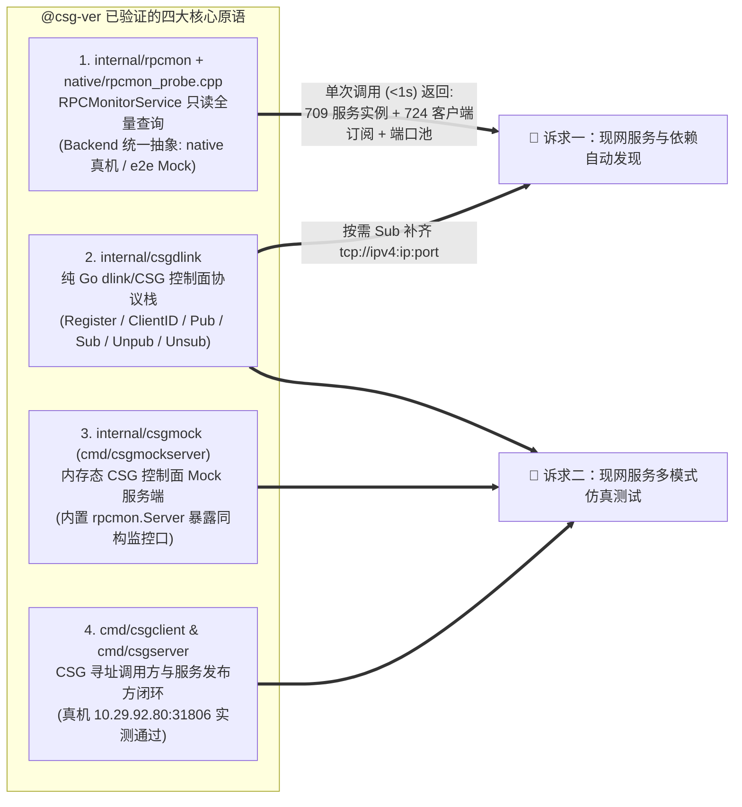
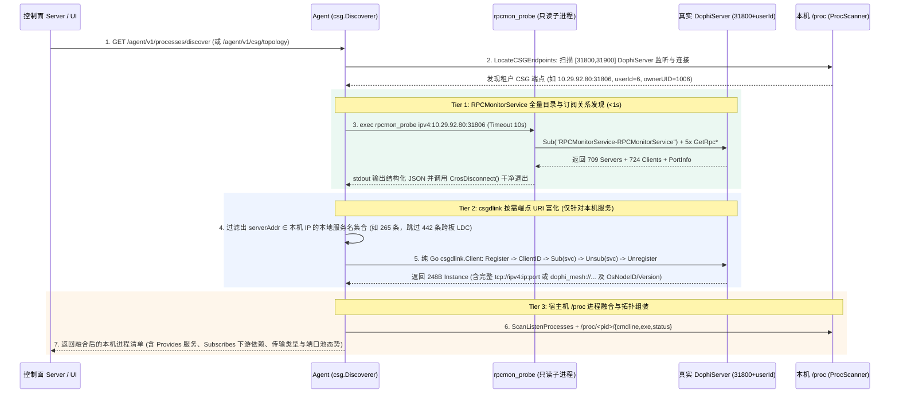
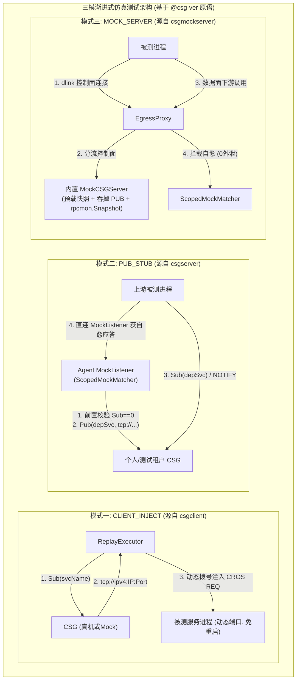

# ADR-21：基于 `@csg-ver` 现网实证的 CSG 服务与依赖拓扑自动发现及多模式仿真测试架构

- **文档编号**：`21-csg-aware-agent-service-discovery-and-replay-mock-adr.md`
- **文档版本**：v2.1.0（基于 [`csg-ver`](../../../csg-ver/) 现网真机验证重构，并与 [`01-cros-rpc-protocol-spec.md`](../07-references/01-cros-rpc-protocol-spec.md) / `pkg/crosrpc` 100% 协议对齐）
- **日期**：2026-11-18
- **状态**：✅ 已采纳 (Accepted — v2.1.0)
- **验证基线**：[`csg-ver/`](../../../csg-ver/)（含 [`docs/protocol.md`](../../../csg-ver/docs/protocol.md)、[`docs/rpcmonitor.md`](../../../csg-ver/docs/rpcmonitor.md)、`internal/{csgdlink,rpcmon,csgmock,server}`、`native/rpcmon_probe.cpp`、`cmd/{rpcmonitor,csgmockserver,csgserver,csgclient}`，已在本地 E2E 与现网 `10.29.92.80:31806` 实测闭环）
- **关联特性**：`F-02`（物理进程蓝图与模块服务契约）、`F-05`（实测调用拓扑还原与一致性验证）、`F-08`（进程树选择与就绪诊断）、`F-09` / `F-11`（Agent 采集与出站透明代理）、`F-12`（同构重放编排）、`F-13`（Agent 零 `.pb` 二进制 Mock 匹配与自愈）、`F-23`（主动发包调试）、`F-33`（CSG 现网服务与依赖双层自动发现及蓝图导入）、`F-34`（CSG 三模渐进式仿真测试架构）
- **关联设计**：[`01-cros-rpc-protocol-spec.md`](../07-references/01-cros-rpc-protocol-spec.md)、[`01-system-architecture.md`](../02-design/01-system-architecture.md)、[`02-data-plane-and-cros-rpc-engine.md`](../02-design/02-data-plane-and-cros-rpc-engine.md)、[`03-architecture-elements-and-topology.md`](../02-design/03-architecture-elements-and-topology.md)、[`04-control-plane-and-web-console.md`](../02-design/04-control-plane-and-web-console.md)、[`05-database-schema.md`](../02-design/05-database-schema.md)
- **关联任务卡**：[`29-m28-csg-service-discovery-and-multi-mode-simulation.md`](../04-tasks/29-m28-csg-service-discovery-and-multi-mode-simulation.md)
- **关联 ADR**：[`ADR-02`](./02-ebpf-hook-and-dual-subsystem-adr.md)、[`ADR-09`](./09-arch-process-ssot-and-ebpf-premount-standby-adr.md)、[`ADR-11`](./11-single-process-bidirectional-capture-and-recording-ux-adr.md)、[`ADR-16`](./16-multi-implementation-service-contract-adr.md)

### 修订记录

| 版本 | 日期 | 修订说明 |
| :--- | :--- | :--- |
| v1.0.0 ~ v1.9.0 | 2026-11-16 ~ 11-17 | 早期探索稿：基于“CSG 无法枚举服务与订阅者”的前置假设设计了种子轮询与单一 eBPF 重启劫持方案，历经 9 轮局部补丁后结构碎片化 |
| v2.0.0 | 2026-11-18 | **基于 `@csg-ver` 现网验证推倒重构**：回归「**现网服务自动发现**」与「**现网服务仿真测试**」两大原始诉求，确立「`RPCMonitorService` 全量拓扑枚举 + `csgdlink.Sub` 精确端点富化」双层自动发现引擎，以及「`CLIENT_INJECT` + `PUB_STUB` + `MOCK_SERVER`」三模渐进式仿真测试架构 |
| **v2.1.0** | **2026-11-18** | **与 `01-cros-rpc-protocol-spec.md` (`pkg/crosrpc`) 全面协议对齐核验**：1. 新增 §3.6「控制面 `dlink` 与数据面 `CROS RPC` 双平面协议关系及字段级对齐矩阵」；2. **彻底清除 `@csg-ver` 中的两处临时演示协议**（剔除 `internal/hello` 的 4B 长度前缀帧与 `internal/rpcmon/transport.go` 的 12B `"RMON"` `0x524D4F4E` 私有帧），将 `pkg/rpcmon` 的 TCP 服务端/客户端统一建立在 **`pkg/crosrpc` 标准帧（`24B RPC_COMM_HEAD_S "CSE.TCP"\x01` + `256B V05 RPC_REQ_HEAD_S` / `200B V04 RPC_RSP_HEAD_S` + Protobuf Payload，按 `ascServiceName = "RPCMonitorService-RPCMonitorService"` 与 `ascOperation = "GetRpc*"` 分发）** 之上；3. `MockCSGServer.StartMonitor` 自动将 `RPCMonitorService-RPCMonitorService` 注册进自身 CSG 实例表，实现「`csgdlink.Sub` 发现地址 ➔ `pkg/crosrpc` 标准报文调用」的 100% 真实协议闭环。**评审通过，正式进入 SDD 详细设计、API 契约冻结与 M28 任务拆解阶段。** |

---

## 1. 原始诉求、v1 反思与 `@csg-ver` 现网突破

### 1.1 回归原始诉求：我们究竟要解决什么问题？

将 `code-contract` 投放到真实的 DOPRA / CROS RPC 现网与研发环境（以 `DophiServer` / CSG 作为服务注册与控制面中心）时，我们的核心诉求只有两件事：

1. **诉求一：现网服务与依赖拓扑的自动发现（Auto-Discovery）**
   - 当 Agent 部署到一台运行着数十个业务进程、数百个 CROS RPC 服务的现网或联调主机时，**不需要人工预先知道任何服务名、不需要手动录入几百条进程与接口契约、也不需要等待开启 eBPF 抓包或重启业务进程**，就能一键自动回答三个核心问题：
     - **有哪些服务（What & Where）**：当前 CSG 上注册了哪些服务？分别属于本机还是跨板远端节点？具体的传输协议与监听地址（`tcp://ipv4:ip:port` 或 `dophi_mesh://...`）是什么？
     - **谁提供服务（Who Provides）**：每个服务实例分别由宿主机上的哪个操作系统进程（`procName`、`pid`）发布？
     - **谁调用谁（Who Subscribes to Whom）**：哪些客户端进程（`procName`、`pid`、`clientAddr`）订阅了哪些下游服务？如何据此直接还原出「**进程 A ➔ 订阅服务 S ➔ 进程 B**」的全景依赖拓扑并自动与 `code-contract` 的架构 SSOT 对账或一键导入？
2. **诉求二：现网服务的高保真、低门槛仿真测试（Simulation Testing）**
   - 面对动态端口分配（进程每次启动从 CSG 拿到不同端口）与复杂的上下游依赖，测试与开发人员需要灵活的仿真手段：
     - **主动寻址被测服务（作为客户端调用）**：重放器（`ReplayExecutor`）或在线调试器无需写死静态端口，能够像真实业务客户端一样向 CSG 查询目标服务的实时 `tcp://ipv4:ip:port` 并注入录制请求；
     - **桩服务替身（作为服务端被调用）**：当联调环境中某个下游服务未启动时，Agent 能直接将该下游的 `ScopedMockMatcher` 注册到 CSG，让上游被测进程自然发现并调用 Mock 桩；
     - **全隔离沙箱回放（控制面 + 数据面双重隔离）**：当同名真实下游已在线（受 `NO_DUPLICATED_SERVICE` 约束）或处于无 CSG 的离线/CI 环境时，Agent 能用内置 `MockCSGServer` 隔离被测进程的 CSG 控制面，配合 `EgressProxy` 实现 0 字节外泄、0 注册表反向污染的闭环回归测试。

### 1.2 为什么旧版 ADR-21 (v1.x) 令人不满意？

复盘 v1.0 ~ v1.9 的演进过程，其核心问题不在于字节偏移细节，而在于**顶层架构选型偏离了上述两大原始诉求**：

| 维度 | 旧版 ADR-21 (v1.x) 的设计缺陷 | 造成的后果 |
| :--- | :--- | :--- |
| **1. 服务发现范式错误** | 固守“CSG 无法枚举服务与订阅关系”的假设，把主动发现建立在「人工预置种子名 (`--csg-seed-names`) + 20 QPS 循环发送 `SUB/UNSUB`」之上，把 `RPCMonitorService` 边缘化为“非阻塞待核验项” | **根本不是真正的自动发现**：未知服务名完全看不见；820 个服务轮询一圈需 41 秒且频繁触发跨板 LDC 同步；**永远无法在不抓包的情况下获知客户端订阅关系（谁依赖谁）** |
| **2. 仿真测试模式单一且极重** | 一刀切否决了 CSG 客户端寻址与桩服务发布（`PUB`），规定唯一重放路径为「eBPF `connect4` 劫持 + 强制重启被测进程 + `cros_sched_exec` 内核态竞态捕获」 | 哪怕只是对一个已在线服务做入站回归注入（动态端口），或者在个人开发栈里替补一个未启动的下游服务，也被迫走最复杂的内核态拦截与进程重启流程 |
| **3. 真机与 Mock 监控割裂** | `MockCSGServer` 仅作为封闭的帧应答器，没有与真实 `DophiServer` 统一的监控查询接口 | 仿真期间无法以统一方式检视沙箱内的服务注册表、客户端订阅表与端口池状态 |
| **4. 文档结构碎片化** | 9 轮审查补丁堆叠（2205 行），充斥着历史勘误表（§0）、半推翻假设（H-1~H-6）与 25 个开放问题台账（§14） | 核心架构意图被考古式修补记录淹没，难以指导工程干净落地 |

### 1.3 `@csg-ver` 在现网验证通过的核心成果

为彻底打通现网自动发现与仿真测试，我们在 [`csg-ver/`](../../../csg-ver/) 中用 Go（配合最小 C++ SDK 只读探针）构建了端到端验证仓，并在现网研发机 **`10.29.92.80:31806`（`DophiServer`）** 及本地 Mock 环境完成了全链路实证：



**`@csg-ver` 现网实证确立的四大架构基石**：

1. **`RPCMonitorService` 是现网全量服务与订阅拓扑的权威入口（【真机已验证】）**：
   - `DophiServer` 原生发布 `RPCMonitorService-RPCMonitorService`（定义于 `swp/platform/rpc/rpcf/pg/RPCMonitorService.proto`，后端调用 `CSG_ServerPubNumGet/PubInfoGet`、`CSG_ServerSubNumGet/SubInfoGet`、`CSG_ServerIpNumGet/PortUsageGet`）。
   - 通过 `@csg-ver/native/rpcmon_probe.cpp`（链接宿主机 `~/SW` SDK，严格只读）在 `10.29.92.80:31806` 实测，单次执行即完整返回：
     - **`serverNum = 709`（`servers[]`）**：每条含 `{ procName, pid, serverName, serverAddr }`；
     - **`clientNum = 724`（`clients[]`）**：每条含 `{ procName, pid, clientAddr, serverName }`（连探针进程 `rpcmon_probe` 自身订阅 `RPCMonitorService-RPCMonitorService` 亦实时在列，形成自证闭环）；
     - **`portInfo[]`**：本机 `10.29.92.80` 端口池占用 `81 / 1200`，跨板 LDC 远端节点 `10.1.126.150` 端口池占用 `101 / 1200`。
2. **`RPCMonitorService` 与 `csgdlink.Sub` 天然互补（【真机已验证】）**：
   - 真机实测发现（见 [`csg-ver/docs/rpcmonitor.md` §6](../../../csg-ver/docs/rpcmonitor.md)）：`RPCMonitorService.GetRpcServerDetailInfo` 返回的 `serverAddr` 在真机上**通常只有节点 IP（如 `"10.29.92.80"` 或 `"10.1.126.150"`）**，不含传输协议前缀（`tcp://` / `dophi_mesh://`）与具体端口号；
   - 而通过纯 Go `csgdlink.Client.Sub(serverName)` 访问 TCP `10.29.92.80:31806` 返回的 248B `CSG_SERVICE_INST_INFO_S` 中，`Addr`（`acSvcInstAddr[128]`）完整携带 **`tcp://ipv4:127.0.0.1:18500`** 或 **`dophi_mesh://ipv4:10.29.92.80:2002`**。
   - **结论**：**「`rpcmon` 负责全量目录与订阅拓扑发现 + `csgdlink.Sub` 负责目标服务精确端点 URI 解析」** 是唯一既无需盲猜种子名、又能拿到精确 `IP:Port` 的完整方案。
3. **纯 Go 控制面客户端在真机与 Mock 均无需鉴权即可完成 `PUB/SUB` 闭环（【真机已验证】）**：
   - 真机现网未启用 dlink 鉴权与 SSP 加密，控制面为明文 TCP。
   - 在 `10.29.92.80:31806` 上，`csgserver`（直接绑定本地指定端口 `127.0.0.1:18500`，执行 `REGISTER → CLIENT_ID → PUB`，**不调用 `GET_BIND_ADDR` 不改变端口池游标**）与 `csgclient`（执行 `REGISTER → CLIENT_ID → SUB` 拿到 `tcp://ipv4:127.0.0.1:18500` 后直连 TCP 数据面完成 RPC 往返，退出前 `UNPUB`）全流程真机验证通过且无任何残留。
4. **真机与 Mock 共享 `rpcmon.Backend` 可观测性契约（【E2E 已验证】）**：
   - `csgmockserver -addr 127.0.0.1:32806 -monitor 127.0.0.1:32900` 在内存 `MockCSGServer` 上同时维护服务实例表 `reg` 与客户端会话订阅表 `sessions`，通过 `Snapshot() rpcmon.Snapshot` 对外提供与真机完全一致的 5 个 `RPCMonitorService` 查询接口。

---

## 2. 核心架构决策矩阵 (Decisions)

基于 `@csg-ver` 的实证结论，本 ADR 做出以下 8 项核心架构决策：

| 编号 | 决策领域 | 选定方案 (v2.0) | 依据与核心收益 |
| :--- | :--- | :--- | :--- |
| **D1** | **包结构与物理防腐** | 将 `@csg-ver` 提炼沉淀为 `code-contract` 的三个纯 Go 基础包：<br>1. `pkg/csgdlink`：dlink 帧与 CSG 消息编解码、客户端连接会话；<br>2. `pkg/rpcmon`：`RPCMonitorService` 统一数据模型、`Backend` 接口（`NativeBackend` + `E2EBackend`）与轻量 Protobuf Wire 编解码（**零 `protoregistry` 依赖**）；<br>3. `pkg/csgmock`：内存态 `MockCSGServer`（实现 `rpcmon.Provider`）；<br>配合可选额外部署的 C++ 只读探针源码 `scripts/csg/rpcmon_probe.cpp` | 保持 `cmd/agent` 纯 Go 零 CGO、零 DB、零 `dynamicpb`/`protoregistry` 物理防腐红线（通过 `cmd/agent/deps_test.go`），同时让 Agent 与 Server 共享同一套 CSG 协议与监控模型 |
| **D2** | **现网自动发现机制** | 采用 **「L1 全量拓扑快照 (`rpcmon`) + L2 按需端点富化 (`csgdlink.Sub`) + L3 本机 `/proc` 融合」双层协同发现架构**，彻底废除 v1 的“种子池 20 QPS 轮询”模式：<br>- **L1**：通过 `rpcmon.Backend` 一次性获取全量 `Servers`（700+）、`Clients`（700+）与 `Ports`；<br>- **L2**：针对真机 `Servers[].ServerAddr` 仅含 IP 的特征，仅对本机进程发布的服务或待测目标服务按需调用 `csgdlink.Client.Sub(svcName)`（随后立即 `Unsub`）解析完整 `tcp://ipv4:ip:port` / `dophi_mesh://...`；<br>- **降级兜底**：未安装 `rpcmon_probe` 的环境自动回退为「SSOT 已知服务名 `csgdlink.Sub` + `EgressProxy` dlink 旁路被动观测」 | 1 秒内拿到全机服务清单与**完整客户端订阅关系（谁调谁）**，无需猜测种子名、无需等待业务流量触发，也将对真实 CSG 的 `SUB/UNSUB` 次数从每分钟 800+ 次降低一个数量级 |
| **D3** | **多租户 CSG 寻址与跨板 LDC 隔离** | 1. **多租户寻址**：按「一部署用户（OS 租户）一套 `DophiServer` 栈（`port = 31800 + userId`）」建模，支持显式 `--csg-addr`、从纳管进程已建立 TCP 连接识别 `[31800, 31900]` 对端、或扫描本机 `DophiServer` 监听端口并按 `OwnerUID` 归属；<br>2. **跨板 LDC 隔离**：依据 `Ports`、`Servers[].ServerAddr`、`Clients[].ClientAddr` 与本机网卡 IPv4 集合比对，显式标记跨板 LDC 远端实例（如 `10.1.126.150`），仅对本机 IP 实例执行 `pid == proc.PID` 宿主机进程绑定 | 适配单机并发多租户栈（如 `10.29.92.80` 上 `31802~31811` 5 套栈），并杜绝跨板 LDC 同步实例（占比可达 60%+）与本机 PID 发生碰撞误判 |
| **D4** | **架构 SSOT 自动对账与一键蓝图导入** | 基于自动发现产出的「本机进程 `(procName, pid)` + 提供服务 `Servers` + 订阅依赖 `Clients`」，在控制面直接与 `ArchProcess` / `Module` / `ModuleService (PROVIDE)` / `ModuleDependency (DEPEND)` 执行三态对账（`MATCHED` / `UNDECLARED_IN_SSOT` / `MISSING_IN_LIVE`），并提供管理员确认的 **「一键从现网 CSG 生成/同步架构蓝图」** 接口 | 彻底解决存量大型系统接入 `code-contract` 的冷启动建模难题：无需先抓包即可构建初始物理进程蓝图、模块供给契约与模块间调用依赖 |
| **D5** | **服务名同一性与 `.pb` 解码映射** | 1. 确认 CSG `acServiceName[64]` 与 CROS RPC `ascServiceName[64]` 为**同一个 64B 运行期字符串**（`<ClassName[:31]>-<svrName[:31]>` 或 `<svrName>`）；<br>2. 演进 `A-07`：`ModuleService.service_name` 登记运行期实际 64B 服务名（如 `RPCMonitorService-RPCMonitorService`），`contract_module_services` 新增可选列 `proto_service_name`（如 `swp.rpc.RPCMonitorService`）注入 `decoder.Registry.ServiceAliases`；<br>3. 对带运行期 PID 后缀的服务名（如 `SSPMonitorService-SSPMonitorService-1-52341`）支持 `^(.+-\d+)-(\d+)$` 模板归一化 | 既保持运行期采集、发现、重放 100% 使用线网真实 64B 名称，又让 `.pb` 动态解码与字段级 Diff（`F-14`）无缝命中 Protobuf 描述集 |
| **D6** | **三模渐进式仿真测试架构** | 摒弃 v1 单一僵化的重放模式，基于 `@csg-ver` 原语提供三种可按场景组合的 CSG 仿真策略（外加默认 `PASSTHROUGH`）：<br>1. **`CLIENT_INJECT`（寻址调用仿真，源自 `csgclient`）**：`ReplayExecutor` 注入入站请求前通过 `csgdlink.Sub(svcName)` 动态解析被测服务当前 `tcp://ipv4:ip:port`，免除静态端口绑定与被测进程重启；<br>2. **`PUB_STUB`（受控桩服务注册，源自 `csgserver`）**：在个人租户栈或测试环境中，若前置 `Sub(svcName)` 确认目标下游服务当前**未在线（实例数 = 0）**，Agent 启动本地 Mock 监听并通过 `Pub(svcName, "tcp://ipv4:"+mockAddr)`（严禁调 `GET_BIND_ADDR`）注册替身，测试结束自动 `Unpub`；<br>3. **`MOCK_SERVER`（全隔离控制面沙箱，源自 `csgmockserver`）**：当同名下游已在线或处于无真实 CSG 的环境时，通过 `EgressProxy`（或独立监听端口）将 CSG 控制面导向内置 `MockCSGServer`（回放快照、吞掉 `PUB`、固定分配端口），配合数据面 `ScopedMockMatcher` 实现 100% 脱机沙箱仿真 | 用最轻量的手段解决最常见的测试诉求：单服务入站回归用 `CLIENT_INJECT`（零重启）；缺席下游联调用 `PUB_STUB`（零 eBPF 重启竞态）；全隔离回归与 CI 门禁用 `MOCK_SERVER` |
| **D7** | **真机与沙箱统一监控口 (`rpcmon.Provider`)** | `pkg/csgmock.MockCSGServer` 原生实现 `rpcmon.Provider`（`Snapshot() rpcmon.Snapshot`）并支持挂载 `rpcmon.Server`；在 `MOCK_SERVER` 仿真结束时，自动导出沙箱内的 `Servers`（被测进程发布的实例）与 `Clients`（被测进程订阅的下游服务）写入重放报告 | 使真机环境与 Mock 沙箱拥有完全同构的可观测性，且在重放门禁（`F-27`）中不仅能审计实测 RPC 调用，还能审计被测进程的控制面订阅（`SUB`）合规性 |
| **D8** | **传输协议边界与显式诊断** | 自动发现（`rpcmon` + `csgdlink.Sub`）全量支持 `tcp://` 与 `dophi_mesh://`；数据面仿真与报文注入仅针对 `tcp://`（支持对 `tcp://` 订阅方将快照中的 `dophi_mesh://ipv4:IP:PORT` 重写为 `tcp://ipv4:IP:PORT` 以保留 `dst_tag`），遇纯 `dophi_mesh://` 订阅（`Trans[1]==0 && Trans[4]==1`）立即返回 `CSG_DATAPLANE_MESH_UNSUPPORTED` 明确诊断 | 边界清晰诚实：不强行向纯 `dophi_mesh://` 客户端返回会被其 `csgSvcInstInfoAddLocal` 丢弃的 `tcp://` 地址，杜绝静默失败 |

---

## 3. CSG 控制面协议与 `RPCMonitorService` 规范基线

> 本节汇总经 DOPRA DDM / SWP 源码核对及 `@csg-ver` 在真机 `10.29.92.80:31806` 实测确认的协议规范。标注约定：**【源码】** 为 DOPRA/SWP 源码直接证实；**【真机已验证】** 为 `@csg-ver` 在 `10.29.92.80:31806` 实测通过。

### 3.1 dlink 传输层与 32B 帧头 (`DDM_DLINK_MSG_HEAD_S`)

- **TCP 控制面端点**：`host:port`，其中 `port = 31800 + userId`（`RpcCfgParser::GetCsgServerPort()`）。`userId` 为部署配置的产品用户 ID（`ullUserId`），一个部署 OS 租户对应一套 `DophiServer` 栈（如 `10.29.92.80` 上并发运行 `31802/31805/31806/31810/31811` 共 5 套租户栈）。真机控制面为明文 TCP，无鉴权握手【真机已验证】。
- **保活与断链回收**：无应用层心跳帧，由内核 TCP `SO_KEEPALIVE`（`idle=2s, intvl=1s, cnt=3`）保活；连接断开时服务端 `csgServerLinkFaultProc → csgClientForceDownline` 自动清理该连接关联的全部 `PUB` 实例、`SUB` 订阅与申请的端口【源码】【真机已验证】。
- **32 字节大端帧头（`ddm_dlink.ph`）**【源码】【真机已验证】：

| 偏移 | 长度 | 字段名 | 类型 (网络大端 BE) | 说明 |
| :---: | :---: | :--- | :--- | :--- |
| `0..3` | 4B | `uiMagic` | `UINT32` | 固定魔术字 `0x444C4E4B`（ASCII `"DLNK"`） |
| `4..5` | 2B | `usType` | `UINT16` | `0 = REQUEST`，`1 = REPLY`，`2 = NOTIFY`，`3 = FAULT` |
| `6..7` | 2B | `usMsgHeadLen` | `UINT16` | 帧头长度，固定 `32` |
| `8..9` | 2B | `usSize` | `UINT16` | 消息体字节长度（不含 32B 帧头），上限 `DDM_DLINK_MAX_MSG_BUFF = 32000` |
| `10..11` | 2B | `usSubType` | `UINT16` | 消息子类型（见 §3.2） |
| `12..15` | 4B | `uiCorrID` | `UINT32` | 请求-应答配对 ID（`REPLY` 原样回显；`NOTIFY` 固定为 `0xFFFFFFFF`） |
| `16..19` | 4B | `uiLinkID` | `UINT32` | `(prio<<24) \| (serviceID<<16) \| bitmapIndex`；CSG `serviceID = 0x0A`，客户端发 `0x020A0000` 真机接受【真机已验证】，服务端按 `(uiLinkID >> 16) & 0xFF == 0x0A` 识别并原样回显 |
| `20..23` | 4B | `uiReserved` | `UINT32` | 对齐保留，置 `0` |
| `24..31` | 8B | `ullTimeStamp` | `UINT64` | 发送/处理纳秒时间戳 |

### 3.2 控制面消息子类型与结构体布局 (`csg_comm.ph`)

#### 3.2.1 消息子类型总表

| 类别 | 请求/通知名称 | 请求 `usSubType` | 应答 `usSubType` | 请求体长度 | 应答体长度 | `@csg-ver` 验证状态 |
| :--- | :--- | :---: | :---: | :---: | :---: | :--- |
| **dlink 系统消息** | `REGISTER` | `0xFF00` | `0xFF01` | 8B | 8B | 【真机已验证】 |
| | `UNREGISTER` | `0xFF02` | `0xFF03` | 8B | 8B | 【源码】 |
| **CSG 控制消息** | `CLIENT_ID` | `1` | `1001` | 8B | 16B | 【真机已验证】 |
| | `PUB_SERVICE` | `2` | `1002` | 256B | 8B (`CSG_COMM_ACK_MSG_S`) | 【真机已验证】 |
| | `SUB_SERVICE` | `3` | `1003` | 80B | `16B + N × 248B` (`N ≤ 128`) | 【真机已验证】 |
| | `UNPUB_SERVICE` | `4` | `1004` | 248B | 8B (`CSG_COMM_ACK_MSG_S`) | 【真机已验证】 |
| | `UNSUB_SERVICE` | `5` | `1005` | 72B | 8B (`CSG_COMM_ACK_MSG_S`) | 【真机已验证】 |
| | `SESSION_ID_GET` | `6` | `1006` | 80B | 8B (`CSG_SESSION_ID_ACK_MSG_S`) | 【源码】 |
| | `GET_BIND_ADDR` | `7` | `1007` | 8B | 128B (`CSG_GET_BIND_ADDR_ACK_MSG_S`) | 【源码】 |
| | `FREE_BIND_ADDR` | `8` | `1008` | 8B | 8B (`CSG_FREE_BIND_ADDR_ACK_MSG_S`) | 【源码】 |
| **dlink NOTIFY (2)** | `PUB_UPDATE` | `1` | — | 224B (`CSG_SVC_CHANGE_MSG_S`) | — | 【源码】 |
| | `SUBER_QUIT` | `2` | — | 8B (`CSG_SUBER_QUIT_MSG_S`) | — | 【源码】 |

#### 3.2.2 核心消息体字节级定义

1. **`REGISTER` (`0xFF00` / `0xFF01`，8B)** 与 **`UNREGISTER` (`0xFF02` / `0xFF03`，8B)**：
   - `REGISTER` 请求：`0..3: uiUUID = 0xFFFFFFFF`，`4..7: uiPid = pid`；应答：`0..3: uiRet (0=OK)`，`4..7: uiUUID`。
   - `UNREGISTER` 请求：`0..3: uiUUID`，`4..7: uiReserved = 0`；应答：`0..3: uiRet (0=OK)`，`4..7: uiReserved`。
2. **`CLIENT_ID` (`1` / `1001`)**：
   - 请求（8B）：`0..3: uiRealProcId (pid)`，`4..7: uiReserved = 0`。
   - 应答（16B `CSG_CLIENT_ID_ACK_MSG_S`）：`0..3: uiRst (0=OK)`，`4..7: uiReserved`，`8..15: ullClientId (UINT64 BE)`。
3. **服务实例结构 `CSG_SERVICE_INST_INFO_S`（248B，用于 `PUB` / `UNPUB` / `SUB_ACK`）**【源码】【真机已验证】：
   ```text
   偏移     长度   字段名                类型         说明
   0..7     8B     ullClientId           UINT64 BE    发布方 ClientID
   8..15    8B     ullVersion            UINT64 BE    低 32 位版本，高 32 位含 ucFromLdcFlag
   16..19   4B     uiProcId              UINT32 BE    发布进程 OS PID (getpid())
   20..23   4B     uiOsNodeId            UINT32 BE    板号 / 节点 ID
   24..55   32B    acService32byteName   CHAR[32]     LDC 老版本兼容截断名（前 56B 为 LDC 冻结区）
   56..183  128B   acSvcInstAddr         CHAR[128]    实例地址 URI（如 "tcp://ipv4:127.0.0.1:18500"）
   184..247 64B    acServiceName         CHAR[64]     64B 运行期服务名（如 "HelloService-HelloService"）
   ```
   - **`PUB` 请求（256B）**：前 `248B` 为 `CSG_SERVICE_INST_INFO_S` + 偏移 `248` 的 `1B ucPubScope` + `7B` 保留；应答为 `8B`（`0..3: uiRst`，`4..7: uiReserved`）。
   - **`UNPUB` 请求（248B）**：即 `CSG_SERVICE_INST_INFO_S`；应答为 `8B`。
4. **`SUB` (`3` / `1003`) 与 `UNSUB` (`5` / `1005`)**【源码】【真机已验证】：
   - `SUB` 请求（80B `CSG_SUB_SVC_MSG_S`）：
     - `0..7`：`ullClientId` (`UINT64 BE`)
     - `8..71`：`acSubName[64]`（目标服务名，`CHAR[64]`）
     - `72..78`：`aucSubTransType[7]`（**按枚举值下标置 `1` 的 7 字节数组，非位掩码**！下标定义：`0=DEFAULT, 1=TCP, 2=DMS, 3=UC, 4=MESH, 5=DOMAIN, 6=BUTT`）
     - `79`：`ucReserved` (`1B`)
   - `SUB` 应答（`16B + N × 248B`，`CSG_SUB_SVC_ACK_MSG_S`）：
     - `0..3: uiSvcInstCount (N)`，`4..7: uiRst (0=OK)`，`8..11: uiSubLen (N × 248)`，`12..15: uiReserved`；后跟 `N` 个 `248B` 实例（未命中任何服务时返回 `uiSvcInstCount = 0, uiRst = 0` 的 16B 正常应答）。
   - `UNSUB` 请求（72B `CSG_UNSUB_SVC_MSG_S`）：`0..7: ullClientId`，`8..71: acSvcName[64]`（兼容 248B 实例格式提取 `184..248`）。
5. **`SESSION_ID_GET` (`6` / `1006`)、`GET_BIND_ADDR` (`7` / `1007`)、`FREE_BIND_ADDR` (`8` / `1008`) 与 `NOTIFY`**【源码】：
   - `SESSION_ID_GET`：请求 80B（同 `SUB`）；应答 8B `{uiSessionId(4B, 初始 100 自增，小端主机呈主机序), uiRst(4B, 0)}`。
   - `GET_BIND_ADDR`：请求 8B 全零；应答 128B `CSG_GET_BIND_ADDR_ACK_MSG_S`（`0..3: uiRst BE`，`8..11: enProtocol BE`，`16..17: usPort BE`，`18: ucFamily=0`，`24..27: uiIpv4` 因源码 `inet_pton` 后再次 `VOS_HTONL` 在小端机呈小端字节序）。
   - `FREE_BIND_ADDR`：请求 8B（`0..1: usPort BE`）；应答 8B（`0..3: uiRst=0`）。
   - `NOTIFY PUB_UPDATE (usType=2, usSubType=1)`：224B `CSG_SVC_CHANGE_MSG_S`（`0..3: uiIsPub 1/0`，`8..15: ullClientId`，`16..23: ullVersion`，`24..27: uiOsNodeId`，`28..31: uiProcId`，`32..95: acServiceName[64]`，`96..223: acSvcInstAddr[128]`）。
   - `NOTIFY SUBER_QUIT (usType=2, usSubType=2)`：8B `CSG_SUBER_QUIT_MSG_S`（`0..7: ullClientId BE`）。

### 3.3 服务名规则与实例地址格式

- **运行期 64B 服务名生成规则**（`CrosService.cpp:76` / `CrosServiceStub.cpp:38`）【源码】【真机已验证】：
  - 开启 CSG 时，C++ 框架按 `append(clsName, 0, 31).append("-").append(svrName, 0, 31)` 拼接（两段各截断至 31 字符，总长最长 63 字符 + `\0`），例如 `HelloService-HelloService`、`RPCMonitorService-RPCMonitorService`、`SMCLService-CSC`、`EquipmentDataCollectTrafficServ-EquipmentDataCollectTrafficServ`；
  - 部分实例级服务会附加实例号与启动期 OS PID 后缀，如 `SSPMonitorService-SSPMonitorService-1-52341`；
  - 类名为空时直接使用 `svrName`（如 `DophiServer`、`RDS`）；
  - **关键恒等式**：该 64B 字符串同时写入 CSG `acServiceName[64]` 与 CROS RPC 数据面请求/应答头 `ascServiceName[64]`（`RPC_SEND_REQ_HEAD_COPY`），**控制面服务名与数据面报文头 `ascServiceName` 100% 字节级一致**。
- **实例地址 URI 格式**（`cros_rpcaddrmgnt.c`、`csgs_client_mgnt.c:588`）【源码】【真机已验证】：
  - TCP 数据面：`tcp://ipv4:<ip>:<port>[:<svr_inst_id>]`（对应 `aucSubTransType[1] = 1`）；
  - Mesh 数据面：`dophi_mesh://ipv4:<ip>:<port>`（对应 `aucSubTransType[4] = 1`）。

### 3.4 `RPCMonitorService` 契约与真机行为特征 (`@csg-ver` 实证)

`DophiServer` 通过 `swp/platform/rpc/rpcf/src/dophiServer/RPCMonitorServiceImpl.cpp` 暴露 `RPCMonitorService-RPCMonitorService`，其原始 IDL（[`csg-ver/proto/sw/rpc/`](../../../csg-ver/proto/sw/rpc/)）包含 5 个只读方法：

```protobuf
// 消息定义：sw/rpc/RPCMonitorServiceMsg.proto (syntax = "proto2", package swp.rpc)
message RpcPortInfo {
    required string ipAddr      = 1; // 点分十进制 IP，如 "10.29.92.80"、"10.1.126.150"
    required uint32 uiPortUsed  = 2; // 已使用端口数
    required uint32 uiPortTotal = 3; // 总端口数（真机实测为 1200）
}
message GetRpcPortInfoResponse {
    repeated RpcPortInfo infos  = 1;
    required sfixed64 timeStamp = 2;
}

message RpcServerDetailInfo {
    required string procName   = 1; // 服务发布进程名（如 "DophiServer"、"csgserver"）
    required uint32 pid        = 2; // 服务发布进程 OS PID
    required string serverName = 3; // 64B 运行期服务名（如 "RPCMonitorService-RPCMonitorService"）
    required string serverAddr = 4; // 服务地址（⚠️ 真机上通常仅返回节点 IP，如 "10.29.92.80"）
}
message GetRpcServerDetailInfoResponse {
    repeated RpcServerDetailInfo infos = 1;
    required sfixed64 timeStamp        = 2;
}

message RpcClientDetailInfo {
    required string procName   = 1; // 订阅方客户端进程名
    required uint32 pid        = 2; // 订阅方客户端 OS PID
    required string clientAddr = 3; // 订阅方客户端节点 IP
    required string serverName = 4; // 被订阅的目标服务名
}
message GetRpcClientDetailInfoResponse {
    repeated RpcClientDetailInfo infos = 1;
    required sfixed64 timeStamp        = 2;
}
```

> [!IMPORTANT]
> **`@csg-ver` 揭示的三项关键工程事实（见 [`csg-ver/docs/rpcmonitor.md`](../../../csg-ver/docs/rpcmonitor.md)）**：
> 1. **`uService` 私有语法与消息解耦**：`RPCMonitorService.proto` 中的 `uService RPCMonitorService { interface ... }` 是 DOPRA SIMPO 私有语法，不参与标准 `protoc` 编译；真正承载线上数据结构的是标准 `proto2` 的 `RPCMonitorServiceMsg.proto` 与 `BasicTypeMsg.proto`。
> 2. **真机 `serverAddr` 仅含 IP，需 `csgdlink.Sub` 补齐端口**：真机 `GetRpcServerDetailInfo` 返回的 `serverAddr` 通常只有节点 IP（如 `"10.29.92.80"` 或跨板 `"10.1.126.150"`），而非完整 `tcp://ipv4:ip:port`。这正是我们需要 **「`rpcmon` 全量拉取目录 + `csgdlink.Sub` 按需解析 `acSvcInstAddr` 端口」** 双层协同的根本原因。
> 3. **为什么采用独立 `rpcmon_probe` 子进程而非在 Agent 内嵌 CGO**：真机上 `DophiServer` 发布的 `RPCMonitorService-RPCMonitorService` 走 DOPRA SDK 内部传输（依赖 `libcroscppapi.so`、`libdophimesh.so`、`libSSPAFplat.so` 等十余个专有动态库及 `PlatformInit(false)` 运行时）。`@csg-ver` 将其封装为独立的 ~170 行只读 C++ 探针 `rpcmon_probe`，由 Go 侧 `rpcmon.NativeBackend` 通过 `exec.CommandContext` 按需拉起并解析其 stdout JSON（自动跳过 shell 环境初始化前缀日志直到首个 `{`）。这样既 **100% 跑通了真机全量枚举**，又让 `code-contract-agent` 保持 **100% 纯 Go 单二进制（零 CGO、零专有 `.so` 强耦合、探针退出即彻底释放 CSG 连接与内存）**！

### 3.5 从 `@csg-ver` 原型升级至 `code-contract` 生产包的 8 项完备性收口

对照 [`csg-ver/docs/protocol.md` §1/§9](../../../csg-ver/docs/protocol.md) 与 [`csg-ver/docs/rpcmonitor.md` §2](../../../csg-ver/docs/rpcmonitor.md)，将 `csg-ver` 迁入 `code-contract/pkg/` 时一次性收口以下 8 项细节（特别是**将 `@csg-ver` 演示数据面协议统一替换为 `code-contract` 已实现的真实 `pkg/crosrpc` 协议**）：

| # | `@csg-ver` 原型简化点 | `code-contract` 生产级实现收口方式 |
| :---: | :--- | :--- |
| 1 | **数据面临时使用 `hello`（4B 长度前缀）与 `RMON`（12B `0x524D4F4E` 帧，`opcode=1..5`）** | **全面统一为真实 CROS RPC 协议 (`pkg/crosrpc`)**：`@csg-ver` 因独立建仓未引入 `pkg/crosrpc` 才临时自定义了 `hello` 与 `RMON` 帧；合入 `code-contract` 后，无论是业务服务仿真（`CLIENT_INJECT`/`PUB_STUB`）还是 `pkg/rpcmon` 的 TCP 监控查询，**数据面 100% 采用 [`01-cros-rpc-protocol-spec.md`](../07-references/01-cros-rpc-protocol-spec.md) 标准帧（`24B RPC_COMM_HEAD_S "CSE.TCP"\x01` + `256B V05 RPC_REQ_HEAD_S` / `200B V04 RPC_RSP_HEAD_S` + Protobuf Payload，按 `ascServiceName = "RPCMonitorService-RPCMonitorService"` 与 `ascOperation = "GetRpc*"` 分发）**，彻底废弃 `hello` 与 `RMON` 私有帧 |
| 2 | `MockCSGServer.StartMonitor` 仅开启独立端口，未注册进 CSG 表 | `MockCSGServer.StartMonitor(addr)` 启动标准 `pkg/crosrpc` 监听的同时，自动将 `"RPCMonitorService-RPCMonitorService"` $\rightarrow$ `"tcp://ipv4:" + monAddr` 写入自身 CSG 实例表 `reg`，使客户端先经 `csgdlink.Sub("RPCMonitorService-RPCMonitorService")` 寻址、再发 CROS RPC 请求，与真机 `DophiServer` 100% 同构 |
| 3 | `MockCSGServer` 的 `SUB_ACK.uiSubLen` 填 `0` | 填 `uint32(len(matched) * csgdlink.ServiceInstLen)`（与真机 `csgSubCreateAckMsg` 一致）；客户端解析继续以 `uiSvcInstCount` 为准兼容两者 |
| 4 | `csgdlink.Client.roundTrip` 遇到异步 `NOTIFY` 帧会报 `unexpected subtype` | 在 `roundTrip` 循环中识别 `got.Type == MsgTypeNotify`，调用可选回调 `OnNotify` 后继续等待 `got.Type == MsgTypeReply && got.CorrID == corrID` |
| 5 | `CString` 使用 `strings.TrimRight(string(b), "\x00")` | 改为在首个 `\x00` 处截断（`bytes.IndexByte(b, 0)`），防止 C 结构体 `\0` 之后未清零的栈内存残留污染字符串 |
| 6 | `CLIENT_ID` 请求未填 `uiRealProcId`；通用 ACK 写 4B | `ClientID` 请求偏移 `0..3` 写入 `uint32(pid)`（使 `RPCMonitorService` 准确显示客户端 PID）；`PUB_ACK`/`UNPUB_ACK`/`UNSUB_ACK` 统一返回标准 8B `CSG_COMM_ACK_MSG_S` |
| 7 | `MockCSGServer` 未处理 `0xFF02`、`6`、`7`、`8` 子类型，断链未清 `reg` | 补齐 `UNREGISTER (0xFF02)`、`SESSION_ID_GET (6)`、`GET_BIND_ADDR (7, 128B full)`、`FREE_BIND_ADDR (8)`；在 `ServeConn` 的 `defer` 中按断开会话的 `clientID` 自动清理其发布的 `reg` 条目（对齐真机 `csgServerLinkFaultProc`） |
| 8 | `internal/rpcmon/pb` 依赖 `google.golang.org/protobuf`（传递引入 `protoregistry`） | `pkg/rpcmon` 对 `RPCMonitorServiceMsg.proto` 的 3 个简单响应结构采用纯 Go 标准库实现 Protobuf Wire 编解码（见 §9.2），使 `cmd/agent` **零 `protoregistry` 依赖**，100% 通过 `cmd/agent/deps_test.go` |

### 3.6 控制面 `dlink` 与数据面 `CROS RPC` (`01-cros-rpc-protocol-spec.md`) 协议对齐矩阵

为确保本 ADR 与此前冻结并实现的 [`01-cros-rpc-protocol-spec.md`](../07-references/01-cros-rpc-protocol-spec.md) 及 [`pkg/crosrpc`](../../pkg/crosrpc/) 完全自洽，明确双平面协议职责与跨层字段映射如下：

1. **双平面正交分工（同一业务进程的两条通信链路）**：
   - **控制面链路（DOPRA `dlink` 协议，`pkg/csgdlink`）**：魔术字 `0x444C4E4B`（`"DLNK"`），定长 `32B` 帧头 `DDM_DLINK_MSG_HEAD_S`；仅用于业务进程与 CSG（`DophiServer` 端口 `31800+userId`）之间的注册、订阅与端口申请。
   - **数据面链路（DOPHI `CROS RPC` 协议，`pkg/crosrpc`）**：魔术字 `"CSE.TCP"` + `1B ucProtocol`，定长 `24B` 公共头 `RPC_COMM_HEAD_S` + 会话头（`RPC_REQ_HEAD_S` V01 `160B` ~ V05 `256B`、`RPC_RSP_HEAD_S` V01 `156B` ~ V04 `200B`、`RPC_MNG_HEAD_S` `88B`）+ `0..N` 扩展头 + Protobuf Payload；用于客户端拿到 `SUB_ACK` 返回的 `tcp://ipv4:<ip>:<port>` 后发起的实际 RPC 调用（**含对 `RPCMonitorService-RPCMonitorService` 的调用**）。
   - **`EgressProxy` 分流无冲突保证**：`pkg/crosrpc.StreamFramer` 严格校验 `"CSE.TCP"` + `ucProtocol <= 1` + `ValidateCommHead`，因此透传 `EgressProxy` 的 `"DLNK"` 控制面报文在 `StreamFramer` 中天然被视为非 CROS 流跳过（零伪帧）；而 `csgdlink.Observer` 仅解析首包匹配 `"DLNK"` 的连接，二者完全正交。

2. **跨协议核心字段逐项对齐表**：

| `01-cros-rpc-protocol-spec.md` / `pkg/crosrpc` 字段 | CROS RPC 偏移与定义 | CSG (`pkg/csgdlink` / `pkg/rpcmon`) 对应字段 | 对齐核验结论 |
| :--- | :--- | :--- | :--- |
| **`RPC_COMM_HEAD_S.ucProtocol`**<br>(`RPC_TRANSPORT_TYPE_E`, `pkg/crosrpc/constants.go:32-39`) | 公共头偏移 `7` (`uint8`)：<br>`0=DEFAULT, 1=TCP, 2=DMS, 3=UC, 4=MESH, 5=DOMAIN, 6=FRPC, 7=CUSTOMIZE` | - `SUB` 请求偏移 `72..78` `aucSubTransType[7]` 下标 `0..5`；<br>- `GET_BIND_ADDR_ACK` 偏移 `8..11` `enProtocol` | ✅ **完全一致**：枚举值 `0..5`（`1=TCP`, `4=MESH`, `5=DOMAIN`）在两套头文件中同源定义 |
| **`RPC_REQ/RSP_HEAD_S.ascServiceName[64]`**<br>(`pkg/crosrpc/session_head.go:37, 183`) | Req 会话头偏移 `8..71`（整包 `32..95`）；Rsp V03/V04 偏移 `56..119`，`CHAR[64]` | - `CSG_SERVICE_INST_INFO_S.acServiceName[64]`（偏移 `184..247`）；<br>- `SUB.acSubName[64]`（偏移 `8..71`）；<br>- `RpcServerDetailInfo.serverName` / `RpcClientDetailInfo.serverName` | ✅ **线上字节 100% 同一**：均由 `CrosService::serviceName` 填充。<br>⚠️ **同步修正 `A-07`**：CSG 场景下该 64B 字符串按 `<ClassName[:31]>-<svrName[:31]>` 拼接（含 `-`、无 `.proto` `package`），故由 `ModuleService.service_name` 存线网 64B 名，新增 `proto_service_name` 映射 `.pb` 的 `{package}.{serviceName}` |
| **`RPC_REQ/RSP_HEAD_S.ascOperation[64]`**<br>(`pkg/crosrpc/session_head.go:38, 184`) | Req 会话头偏移 `72..135`（整包 `96..159`）；Rsp V03/V04 偏移 `120..183`，`CHAR[64]` | `RPCMonitorService.proto` (`uService`) 及业务 `.proto` 中的 `interface` / `rpc` 方法名（如 `"GetRpcServerDetailInfo"`） | ✅ **完全一致**：方法名字符串直接相等 |
| **`RPC_REQ_HEAD_S.uiSessionId`**<br>(`01-cros-rpc-protocol-spec.md` §6.1, `session_head.go:42`) | Req 会话头偏移 `140..143`（整包 `164..167`，`UINT32`） | CSG 控制面 `SESSION_ID_GET (usSubType=6 -> 1006)` 应答 `CSG_SESSION_ID_ACK_MSG_S.uiSessionId` | ✅ **完全一致**：CROS 请求头中的 FRPC 会话 ID 即由 CSG 子类型 `6` 分配 |
| **`RPC_RSP_HEAD_S.uiSvrInstId` & `RPC_REQ_HEAD_S.uiDst2ndAddrId`**<br>(`01-cros-rpc-protocol-spec.md` §6.1/§6.2) | Req 会话头偏移 `4..7`；Rsp V02+ 偏移 `24..27` (`UINT32`) | CSG 实例地址 `tcp://ipv4:<ip>:<port>[:<svr_inst_id>]` 的可选尾段 `<svr_inst_id>` | ✅ **完全一致**：对应实例级二级寻址与实例 ID |
| **`RPC_MNG_HEAD_S.acProcName[64]`**<br>(`01-cros-rpc-protocol-spec.md` §6.3, `session_head.go:235`) | MNG 会话头（`ucMsgType=5/6/7`）偏移 `8..71`（整包 `32..95`，`CHAR[64]`） | `RPCMonitorService` 的 `RpcServerDetailInfo.procName` / `RpcClientDetailInfo.procName` | ✅ **完全一致**：数据面建连握手上报的 `acProcName` 与控制面 `RPCMonitorService` 汇报的 `procName` 同为该业务进程名 |

---

## 4. Pillar I：现网服务与依赖拓扑自动发现设计 (Auto-Discovery)

### 4.1 双层协同自动发现流水线



### 4.2 多租户 CSG 端点自动定位 (`LocateCSGEndpoints`)

单台研发或测试宿主机可能同时运行多个 OS 租户的 `DophiServer` 栈（如 `10.29.92.80` 上 `userId = 2, 5, 6, 10, 11` 对应端口 `31802, 31805, 31806, 31810, 31811`）。Agent 按以下优先级定位 CSG 控制面端点（严禁跨网盲扫）：

1. **显式指定（最高优先级）**：`--csg-addr=10.29.92.80:31806`（支持逗号分隔多地址）或环境变量 `CONTRACT_AGENT_CSG_ADDR`；
2. **本机 `DophiServer` 监听表枚举**：通过 `ProcScanner` 扫描本机 `/proc/net/tcp` 中端口落入 `[31800, 31900]` 且进程名匹配 `DophiServer` / `csg_server` 的全部监听套接字，提取 `(listenIP, port, userId = port - 31800, dophiPID, ownerUID)`；若监听 IP 为 `0.0.0.0`，优先取已建立连接的目标本机业务网 IP（避免误取管理网不可达 IP）；
3. **纳管进程存量连接反推**：通过 `ScanProcessEstablishedSockets` 提取目标业务进程对端端口在 `[31800, 31900]` 的远端地址。

### 4.3 本机进程融合与跨板 LDC 过滤算法 (`DiscoverAndFuse`)

拿到 `rpcmon.Snapshot`（`Ports`、`Servers`、`Clients`）与按需富化的 `csgdlink.Instance` 后，Agent 执行确定性融合：

1. **跨板 LDC 实例识别与隔离**：
   - 真机 `10.29.92.80:31806` 的 709 条服务记录中，有 442 条 `serverAddr` 为远端板 IP `10.1.126.150`（且携带远端板 PID `> 1e6`）。
   - 融合器首先读取本机所有网卡 IPv4 地址集合 `localIPs`（含 `127.0.0.1`）：凡 `serverAddr`（或 `clientAddr`）非空且不属于 `localIPs` 的条目，一律标记 `IsRemoteLDC = true`，**仅保留在全局 CSG 拓扑快照中展示，绝不与本机 `/proc/<pid>` 做 PID 或端口匹配**。
2. **本机进程全覆盖（含无 TCP 监听的纯客户端与 `dophi_mesh://` 进程）**：
   - 传统 `ProcScanner.ScanListenProcesses()` 只能扫到有 `TCP_LISTEN` 的进程；而纯客户端进程（如 `csgclient`）或纯 `dophi_mesh://` 进程没有 `AF_INET TCP_LISTEN` 套接字。
   - 融合器遍历所有 `IsRemoteLDC == false` 的 `Servers[].Pid` 与 `Clients[].Pid`：若某 `pid` 未出现在 `ScanListenProcesses()` 结果中，直接读取 `/proc/<pid>/{cmdline,exe,status}` 补齐一条 `DiscoveredProcess`（`ListenPort = 0` 或填入 `tcp://` 实例端口），从而实现**对纯客户端进程与 `dophi_mesh://` 进程的 100% 自动发现**！
3. **进程级 `Provides`（提供服务）与 `Subscribes`（订阅依赖）双向挂载**：
   - **`Provides`**：将 `Servers` 中 `pid == proc.PID`（本机）的条目挂入 `proc.CSGServices`，并合并 L2 `csgdlink.Sub` 查到的完整 `InstanceAddr`（如 `tcp://ipv4:10.29.92.80:18500`）、`Transport`（`tcp` | `mesh`）与 `Port`；
   - **`Subscribes`**：将 `Clients` 中 `pid == proc.PID`（本机，且排除 `procName == "rpcmon_probe"` 自身瞬态探针）的条目挂入 `proc.CSGSubscriptions`，并自动关联该 `serverName` 在 `Servers` 中的提供方进程列表（`ProviderProcs`）。

### 4.4 控制面架构 SSOT 自动对账与「一键导入架构蓝图」

依托 `DiscoverAndFuse` 上报的完整供给与订阅关系，`code-contract-server` 在**未开启任何流量录制**的情况下即可完成：

1. **三层实时对账（`/agents` 与 `/architecture`）**：
   - **进程对账**：本机发现的 CSG 业务进程 `(procName, cmdline, listenPort)` $\leftrightarrow$ 已登记的 `ArchProcess`；
   - **服务供给对账 (`PROVIDE`)**：进程实际在 CSG 发布的 `serverName` $\leftrightarrow$ 该 `ArchProcess` 承载模块声明的 `ModuleService.service_name`；
   - **服务依赖对账 (`DEPEND`)**：进程实际在 CSG 订阅的 `serverName`（来自 `GetRpcClientDetailInfo`）$\leftrightarrow$ 该 `ArchProcess` 承载模块声明的 `ModuleDependency`（输出 `MATCHED` / `CSG_SUB_UNDECLARED` 未报备订阅 / `SSOT_ONLY` 仅静态声明）。
2. **一键生成/同步架构蓝图草稿（`POST /api/agents/:id/csg/import-blueprint`，需 `contract_admin`）**：
   - 管理员在 `/agents` 页面点击 **【✨ 从现网 CSG 发现结果导入架构蓝图】**，可勾选发现到的进程与服务，由服务端在单事务内幂等创建或补齐：
     - 标准物理进程 `ArchProcess`（以 `procName` 为默认编码/名称）及默认归属功能模块 `Module`；
     - 模块对外服务供给 `ModuleService`（填入 64B `service_name`，并按 `<ClassName>-<svrName>` 的左段前缀自动推荐候选 `.pb` 的 `proto_service_name`）；
     - 模块间服务依赖 `ModuleDependency`（根据 `Clients` 订阅关系自动连接消费方 `Module` ➔ 提供方 `ModuleService` 或多实现 `ServiceContract`），并完整记录操作审计日志。

---

## 5. Pillar II：现网服务多模式仿真测试设计 (Simulation Testing)

### 5.1 三大仿真测试模式全景矩阵

围绕 `@csg-ver` 验证通过的 `csgclient`、`csgserver`、`csgmockserver` 三种原语，我们将 `code-contract` 的重放与仿真测试升级为由浅入深的**三种可选 CSG 策略**（加上默认不介入 CSG 的 `PASSTHROUGH`）：

| 仿真策略 (`csg_strategy`) | 对应 `@csg-ver` 原语 | 核心机制 | 适用场景 | 是否需重启被测进程 | 对真实 CSG 影响 |
| :--- | :--- | :--- | :--- | :---: | :--- |
| **`PASSTHROUGH`**<br>*(默认)* | — | 维持现状：直接按 `ProcessSpec.ListenPort` 注入，出站靠 `EgressProxy` 按已知 `Downstreams` 拦截 | 静态固定端口、无 CSG 依赖或已完成预挂就绪的常规服务 | 否（已 `READY` 时） | 零交互 |
| **`CLIENT_INJECT`**<br>*(模式一：寻址调用仿真)* | `cmd/csgclient`<br>(`csgdlink.Client.Sub`) | Agent 作为 CSG 客户端，重放/调试发包前向 CSG 发送 `SUB(serviceName)` 动态获取被测服务当前 `tcp://ipv4:ip:port`，再拨号注入 CROS RPC 请求 | **被测服务使用 CSG 动态端口**，仅需向其注入入口请求（无下游或下游已由 `EgressProxy` 拦截） | **否（零重启）** | 纯只读（`SUB` 后立即 `UNSUB`） |
| **`PUB_STUB`**<br>*(模式二：下游桩注册仿真)* | `cmd/csgserver`<br>(`csgdlink.Client.Pub`) | Agent 为未启动的下游服务开启本地 Mock 监听端口，前置 `SUB` 确认无同名实例在线后，向当前租户 CSG 发送 `PUB(svcName, "tcp://ipv4:"+mockAddr)`，将流量引入本地 `ScopedMockMatcher`；结束立即 `UNPUB` | **个人开发租户栈（独立 `31800+userId`）或联调环境中某下游进程未启动/缺席**，希望上游自然发现并调用 Mock 桩 | **否**（支持 `NOTIFY` 动态感知或首次订阅） | 受控写（**前置 `Sub==0` 门禁 + 严禁 `GET_BIND_ADDR` + 5 出口 `UNPUB` 零残留**） |
| **`MOCK_SERVER`**<br>*(模式三：全隔离控制面沙箱)* | `cmd/csgmockserver`<br>(`MockCSGServer` + `rpcmon.Server`) | `EgressProxy`（或独立端口）将连向 CSG 的控制面连接分流至 Agent 内置 `MockCSGServer`：按快照应答 `SUB`、本地吞掉 `PUB`、固定/受控分配 `GET_BIND_ADDR`；数据面由 `ScopedMockMatcher` 全接管 | **同名真实下游已在线（防冲突/防反向污染）**，或 **无真实 CSG 的离线环境 / CI 门禁** | 是（若进程已缓存旧订阅表 `g_stCsgLocalSubSvcTbl`） | **100% 零接触真实 CSG** |



### 5.2 模式一：`CLIENT_INJECT` — 动态寻址入站注入（消除静态 `ListenPort` 漂移）

在现有 `pkg/replay/executor.go:146` 中，`ReplayExecutor` 硬编码连接 `127.0.0.1:{ProcessSpec.ListenPort}`。在 CSG 环境下，微服务重启后通过 `GET_BIND_ADDR` 拿到的端口会发生变化，且可能绑定在业务网卡 IP（如 `10.29.92.80:18500`）而非 `127.0.0.1`。

**`CLIENT_INJECT` 演进设计（复刻 `@csg-ver/cmd/csgclient`）**：
1. **服务名提取**：从 `ExecuteReplayReq.IngressItems` 的首条 CROS RPC 请求头 `ascServiceName`（或 `ProcessSpec.CSGServiceNames`）提取目标 64B 服务名 `svcName`；
2. **实时 CSG 寻址**：通过 `csgdlink.Dial(csgAddr)` $\rightarrow$ `Register` $\rightarrow$ `ClientID` $\rightarrow$ `Sub(svcName)`（随后 `Unsub` + `Unregister`）获取当前在线的 `[]csgdlink.Instance`；
3. **最优实例选址**：
   - 优先选择 ` strings.HasPrefix(inst.Addr, "tcp://")` 且 `inst.ProcID == targetResolvedPID`（或 `host ∈ localIPs`）的实例，提取 `host:port`；
   - 若目标服务仅发布了 `dophi_mesh://` 实例且无 `tcp://` 监听，立即终止并返回诊断码 `CSG_DATAPLANE_MESH_UNSUPPORTED`；
4. **动态拨号注入**：`ReplayExecutor` 直接拨号解析出的 `host:port` 发送前置 `MngMocks` 与 `IngressItems`，完成响应采集与双层回归 Diff。全程**无需重启被测服务，也无需强制固定其监听端口**。

### 5.3 模式二：`PUB_STUB` — 受控下游桩服务注册（复刻 `@csg-ver/cmd/csgserver`）

在多租户开发机（如每位开发者拥有独立 `31800+userId` 的 `DophiServer` 栈）或联调环境中，经常出现“被测进程 A 在运行，但其依赖的下游服务 B 并未启动”的场景。此时无需使用重型控制面劫持，直接采用 `@csg-ver` 在真机验证通过的 `csgserver` 模式：

1. **前置零冲突安全门禁 (`Pre-flight Sub Guard`)**：
   - Agent 收集本次重放 `ScopedEgressMocks` / `GlobalFallbackMocks` 中涉及的所有下游服务名 $\{S_1, S_2, \dots, S_k\}$；
   - 先以只读方式对目标 CSG 逐一调用 `Sub(S_i)`：若发现任意 $S_i$ 当前已有在线实例（`len(instances) > 0`），**立即拒绝 `PUB_STUB`** 并返回 `409 Conflict (CSG_SERVICE_ALREADY_PUBLISHED)`，提示该服务已有真实提供方在线，避免触发 `NO_DUPLICATED_SERVICE` 或影响同栈其他调用方，引导用户改用 `MOCK_SERVER` 模式。
2. **零端口池污染发布 (`Direct Local Port Pub`)**：
   - 对确认缺席的每个下游服务 $S_i$，Agent 在本机业务 IP（或 `127.0.0.1`）上创建临时 TCP Listener `ln, _ := net.Listen("tcp", bindIP+":0")`，挂载 `ScopedMockMatcher`；
   - **严格遵循 `@csg-ver/internal/server/service.go` 规范**：**绝不调用 `GET_BIND_ADDR`**（从而 100% 不触碰真实 CSG 的端口池与 `usNextPortNum` 游标），直接拼装 `instAddr = fmt.Sprintf("tcp://ipv4:%s:%d", bindIP, mockPort)` 调用 `client.Pub(S_i, instAddr, timeout)`；
   - 真实 CSG 收到 `PUB` 后更新注册表并向已订阅 $S_i$ 的被测进程推送 `NOTIFY (PUB_UPDATE)`，被测进程随即向 `bindIP:mockPort` 发起 TCP 连接，由 `ScopedMockMatcher` 完成请求匹配与响应头自愈！
3. **五出口原子注销与断链兜底**：
   - 在重放正常完成、手动取消、`/purge`、主控失联满 5 分钟、`SIGINT/SIGTERM` 五个出口，统一执行 `client.Unpub(S_i, instAddr)` $\rightarrow$ `client.Unregister()` $\rightarrow$ `client.Close()`；
   - 即使 Agent 遭遇 `SIGKILL` 或断电，真实 CSG 的 `csgServerLinkFaultProc` 也会在 TCP 断开瞬间自动清除该连接发布的全部桩实例【真机已验证】。

### 5.4 模式三：`MOCK_SERVER` — 全隔离控制面与数据面沙箱（复刻 `@csg-ver/cmd/csgmockserver`）

当环境内已有真实同名服务在线、或处于完全没有 `DophiServer` 的容器/CI 环境时，启用 `MOCK_SERVER` 模式：

1. **预装载快照与动态注册兼容 (`pkg/csgmock`)**：
   - `MockCSGServer` 初始化时，将录制会话固化的 `csg_snapshots`（或发现快照）载入内存注册表 `reg`；
   - 对 `SUB (3)` 请求：
     - 校验 `req.Trans` 数组：若仅置位 `MESH (req.Trans[4]==1 && req.Trans[1]==0)`，记录 `MeshOnlySub` 并触发快速失败诊断 `CSG_DATAPLANE_MESH_UNSUPPORTED`；
     - 若支持 `TCP (req.Trans[1]==1)`：按「精确服务名匹配 $\rightarrow$ `^(.+-\d+)-(\d+)$` 尾部 PID 模板匹配（并将返回实例的 `Name64` 回显为请求的 `req.Name` 以通过客户端 `strcmp`）」查找实例；若快照中的实例地址为历史录制的 `dophi_mesh://ipv4:IP:PORT`，自动重写前缀为 `tcp://ipv4:IP:PORT`（**保留原始 `IP:PORT` 不变，从而 100% 兼容 `ADR-16` 基于原始目的 `IP:Port` 映射的 `@dst_tag` 多实现隔离！**）；
   - 对 `PUB (2)` / `UNPUB (4)`：仅在 `MockCSGServer` 内存 `reg` 表中增删，**绝不转发至真实 CSG**（彻底消除被测进程重启后向生产/共享注册中心反向注册污染）；
   - 对 `GET_BIND_ADDR (7)`：返回 128B full 应答，默认固定分配 `ProcessSpec.ListenPort`（若检测到端口已被其他非目标进程监听则返回 `uiRst != 0, usPort = 0` 报错，严禁静默换端口）。
2. **双接入通道（eBPF 透明分流 + 独立端口直连）**：
   - **通道 A（`EgressProxy` 透明分流）**：在 `REPLAY_MOCK` 态下，当 `EgressProxy` 发现被测进程新建连接的目的地址属于本机/配置 CSG 端口集合（`[31800, 31900]`）或首包匹配 `"DLNK"` 魔术字时，直接调用 `mockCSG.ServeConn(clientConn)` 进程内接管；
   - **通道 B（独立监听端口，同 `csgmockserver -addr -monitor`）**：支持显式监听本地端口（如 `127.0.0.1:32806` 及监控口 `127.0.0.1:32900`），供支持 `-csg` 参数的测试程序、无特权降级模式（`F-22`）或 CI 端到端测试脚本直接连接。
3. **内置 `rpcmon.Provider` 沙箱可观测性**：
   - 继承 `@csg-ver/internal/csgmock/mockserver.go:261` 的 `Snapshot() rpcmon.Snapshot` 设计，重放结束时直接导出被测进程在沙箱内的 `Servers`（发布了什么服务）与 `Clients`（订阅了什么服务），随 `ReplayTaskResultResp` 回传控制面，用于 `F-27` 门禁校验与调试透视。

---

## 6. 模块设计、API 契约与数据模型演进

### 6.1 代码包映射与职责边界（源自 `@csg-ver`）

| `code-contract` 目标路径 | 对应 `@csg-ver` 原型路径 | 核心职责 | 依赖约束 (`deps_test.go`) |
| :--- | :--- | :--- | :--- |
| `pkg/csgdlink/`<br>(`protocol.go`, `instance.go`, `client.go`, `observer.go`) | `internal/csgdlink/` | dlink 32B 帧头、248B 实例与 10 类控制面消息/2 类 `NOTIFY` 编解码；纯 Go `Client`（支持只读发现与受控 `Pub`/`Unpub`）；旁路流式 `Observer` | **纯 Go 标准库**（零第三方依赖） |
| `pkg/rpcmon/`<br>(`model.go`, `wire.go`, `cros_transport.go`, `native.go`, `server.go`, `report.go`) | `internal/rpcmon/` + `proto/sw/rpc/` | `Snapshot` / `ServerEntry` / `ClientEntry` / `PortUsage` 模型；`Backend` 接口；`NativeBackend`（调用 `rpcmon_probe` 解析 JSON）与 `CrosTCPBackend`（基于 `pkg/crosrpc` 标准 `"CSE.TCP"` 帧 + 手写极简 Protobuf Wire 编解码，淘汰 `@csg-ver` 的临时 `RMON` 帧） | 仅依赖 `pkg/crosrpc`、`pkg/csgdlink` 与标准库（不引入 `protoc-gen-go` 生成的 `protoregistry`，确保 `cmd/agent` 100% 合规） |
| `pkg/csgmock/`<br>(`mockserver.go`) | `internal/csgmock/mockserver.go` | 内存态 `MockCSGServer`（支持预载快照、动态 `PUB/SUB/GET_BIND_ADDR`、`ServeConn` 进程内接入与独立监听、实现 `rpcmon.Provider`） | 仅依赖 `pkg/csgdlink`、`pkg/rpcmon` 与标准库；**严禁依赖 `pkg/ebpf`** |
| `scripts/csg/`<br>(`rpcmon_probe.cpp`, `build-native-probe.sh`) | `native/rpcmon_probe.cpp` + `scripts/build-native-probe.sh` | 真机只读 C++ 探针源码与一键编译脚本（在装有 `~/SW` SDK 的目标机编译产出 `rpcmon_probe` 二进制供 Agent 调用） | 独立辅助二进制，不与 Go 二进制静态链接 |
| `internal/agent/csg/`<br>(`discoverer.go`, `sim_controller.go`, `locate.go`) | `cmd/rpcmonitor` + `cmd/csgclient` + `cmd/csgserver` | Agent 侧双层自动发现融合器（`rpcmon` + `csgdlink.Sub` + `ProcScanner`）与三模仿真测试编排器（`CLIENT_INJECT` / `PUB_STUB` / `MOCK_SERVER`） | 位于 `internal/agent/`，可组合 `pkg/{csgdlink,rpcmon,csgmock,ebpf,replay,agentproto}` |

### 6.2 `pkg/agentproto` 与 HTTP API 契约扩展

#### 6.2.1 `pkg/agentproto` 增量结构体

```go
// CSGPortUsage 对应 RpcPortInfo：节点 IP 的 RPC 端口池占用态势
type CSGPortUsage struct {
	IPAddr     string `json:"ip_addr"`
	PortUsed   uint32 `json:"port_used"`
	PortTotal  uint32 `json:"port_total"`
	IsLocalIP  bool   `json:"is_local_ip"`
}

// CSGServiceInfo 进程在 CSG 上发布的服务实例明细（融合 rpcmon.ServerEntry + csgdlink.Instance）
type CSGServiceInfo struct {
	ServiceName  string `json:"service_name"`            // 64B 运行期服务名，如 "HelloService-HelloService"
	ServerAddr   string `json:"server_addr"`             // rpcmon 原始地址（如 "10.29.92.80"）
	InstanceAddr string `json:"instance_addr,omitempty"` // csgdlink.Sub 富化后的完整 URI（如 "tcp://ipv4:10.29.92.80:18500"）
	Transport    string `json:"transport,omitempty"`     // "tcp" | "mesh" | "unknown"
	Port         uint16 `json:"port,omitempty"`          // 解析出的监听端口
	ProcName     string `json:"proc_name,omitempty"`
	ProcID       uint32 `json:"proc_id"`
	OsNodeID     uint32 `json:"os_node_id,omitempty"`
	Version      uint64 `json:"version,omitempty"`
	CSGAddr      string `json:"csg_addr,omitempty"`      // 所属租户 CSG 地址，如 "10.29.92.80:31806"
	UserID       int    `json:"user_id,omitempty"`       // 租户 userId (port - 31800)
	Source       string `json:"source"`                  // "RPCMON+DLINK" | "RPCMON_ONLY" | "DLINK_SUB" | "OBSERVED_PUB"
}

// CSGSubscription 进程在 CSG 上订阅的下游服务关系（直接源自 rpcmon.ClientEntry 或被动观测）
type CSGSubscription struct {
	ServiceName   string   `json:"service_name"`             // 被订阅的目标 64B 服务名
	ClientAddr    string   `json:"client_addr,omitempty"`    // 订阅方 IP
	Instances     []string `json:"instances,omitempty"`      // 解析到的目标实例地址列表
	ProviderProcs []string `json:"provider_procs,omitempty"` // 提供该服务的进程名列表（由 Servers 表自动关联）
	Source        string   `json:"source"`                   // "RPCMON" | "OBSERVED_SUB"
}

// DiscoveredProcess 扩展字段（全部 omitempty，100% 向后兼容）
type DiscoveredProcess struct {
	PID              uint32            `json:"pid"`
	UID              uint32            `json:"uid,omitempty"`
	ListenPort       uint16            `json:"listen_port"`
	Cmdline          string            `json:"cmdline"`
	ExeName          string            `json:"exe_name"`
	CSGDataPlane     string            `json:"csg_dataplane,omitempty"`     // "TCP" | "MESH" | ""
	CSGServices      []CSGServiceInfo  `json:"csg_services,omitempty"`      // 该进程发布的 CSG 服务 (PROVIDE)
	CSGSubscriptions []CSGSubscription `json:"csg_subscriptions,omitempty"` // 该进程订阅的 CSG 服务 (DEPEND)
}

// CSGTopologyReport 对应 @csg-ver rpcmonitor 的完整环境快照报告
type CSGTopologyReport struct {
	CSGAddr            string           `json:"csg_addr"`
	UserID             int              `json:"user_id"`
	DiscoveryMode      string           `json:"discovery_mode"` // "RPCMON_NATIVE" | "RPCMON_MOCK" | "DLINK_FALLBACK"
	Timestamp          int64            `json:"timestamp"`
	ServerNum          uint32           `json:"server_num"`
	ClientNum          uint32           `json:"client_num"`
	LocalServerCount   int              `json:"local_server_count"`
	RemoteLDCServCount int              `json:"remote_ldc_server_count"`
	Ports              []CSGPortUsage   `json:"ports,omitempty"`
	Servers            []CSGServiceInfo `json:"servers,omitempty"`
	Clients            []struct {
		ProcName    string `json:"proc_name"`
		PID         uint32 `json:"pid"`
		ClientAddr  string `json:"client_addr"`
		ServiceName string `json:"service_name"`
		IsRemoteLDC bool   `json:"is_remote_ldc,omitempty"`
	} `json:"clients,omitempty"`
}

// CSGReplayStrategy 仿真测试策略枚举
type CSGReplayStrategy string

const (
	CSGStrategyPassthrough  CSGReplayStrategy = "PASSTHROUGH"   // 默认：不介入 CSG
	CSGStrategyClientInject CSGReplayStrategy = "CLIENT_INJECT" // 模式一：csgclient 动态寻址入站注入
	CSGStrategyPubStub      CSGReplayStrategy = "PUB_STUB"      // 模式二：csgserver 受控注册缺席下游桩
	CSGStrategyMockServer   CSGReplayStrategy = "MOCK_SERVER"   // 模式三：csgmockserver 全隔离控制面沙箱
)
```

#### 6.2.2 Agent 与 Server 新增/增强接口

| 层级 | 方法与路由 | 权限守卫 | 功能说明 |
| :--- | :--- | :--- | :--- |
| **Agent** | `GET /agent/v1/processes/discover` | IP 白名单 | 增强现有接口：融合 `rpcmon` + `csgdlink.Sub` + `ProcScanner`，返回本机进程的 `csg_services`（提供服务）、`csg_subscriptions`（订阅服务）及 `csg_summary` |
| **Agent** | `GET /agent/v1/csg/topology` | IP 白名单 | 执行一次实时 `rpcmon.BuildReport`（支持 `?csg_addr=` 与 `?enrich_dlink=1`），返回完整的 `CSGTopologyReport`（含 `ports`、`servers`、`clients`） |
| **Server** | `GET /api/agents/:id/csg/topology` | `AuthMiddleware`（遵循 Agent `SHARED`/`PRIVATE` 可见性） | 拉取指定环境 Agent 的 CSG 全量服务与订阅拓扑，并与当前架构 SSOT 比对输出三态差异（`MATCHED` / `UNDECLARED_IN_SSOT` / `MISSING_IN_LIVE`） |
| **Server** | `POST /api/agents/:id/csg/import-blueprint` | `RequireAdmin("contract_admin")` + 审计 Diff | 将现网 CSG 自动发现的本机进程、发布服务（`PROVIDE`）与订阅关系（`DEPEND`）一键批量导入/同步为 `ArchProcess`、`Module`、`ModuleService` 与 `ModuleDependency` |

### 6.3 数据库模型最小演进 (`models/`)

遵循最小侵入原则，**不新增任何数据库表**（维持现有 `30` 张核心业务表 + `contract_settings` 基线），仅在 3 张既有表上增补轻量字段：

1. **`contract_module_services`（支持 64B 运行期名 ⇄ `.pb` 契约名绑定，演进 `A-07`）**：
   - 新增列 `proto_service_name varchar(128) NOT NULL DEFAULT ''`：
     - 当 `service_name` 登记为 CSG 运行期 64B 名称（如 `RPCMonitorService-RPCMonitorService`、`CMReadService-CMReadService`）时，`proto_service_name` 保存其对应的 `.pb` `{package}.{serviceName}`（如 `swp.rpc.RPCMonitorService`、`cmread.CMReadService`）；
     - 为空时默认回退等于 `service_name`（100% 兼容存量点分命名数据）；
     - `internal/server/decoder/registry.go` 在 `Reload()` 时将 `proto_service_name != "" && proto_service_name != service_name` 统一注入已有的 `CompiledRegistry.ServiceAliases` 字典，无需改动解码主流程即可透明完成 Protobuf 解码、字典树展示与回归 Diff！
2. **`contract_recording_sessions`（固化录制期 CSG 控制面快照）**：
   - 新增列 `csg_snapshots jsonb NOT NULL DEFAULT '[]'`（类型 `[]CSGResolution{ServiceName, Instances[]}`）：记录录制开始时的 `rpcmon/csgdlink` 服务地址快照与录制期间 `EgressProxy` 被动观测到的 `EventCSGObservation (0x08)`，供 `MOCK_SERVER` 重放直接装载。
3. **`contract_replay_tasks`（记录仿真测试策略与控制面轨迹）**：
   - 新增列 `csg_strategy varchar(24) NOT NULL DEFAULT 'PASSTHROUGH'`（取值 `PASSTHROUGH | CLIENT_INJECT | PUB_STUB | MOCK_SERVER`）。

---

## 7. 物理防腐、安全红线与探针卫生

1. **Agent 零 `protoregistry` / 零 DB 物理防腐（`cmd/agent/deps_test.go`）**：
   - `cmd/agent/deps_test.go` 明确禁止 `cmd/agent` 依赖 `gorm.io`、`pgx`、`dynamicpb`、`protoregistry`、`protocompile`。
   - 注意标准 `protoc-gen-go` 生成的 `.pb.go` 会引入 `google.golang.org/protobuf/runtime/protoimpl` 并传递引入 `protoregistry`。因此 `pkg/rpcmon` 中对 `RPCMonitorServiceMsg.proto` 三个简单响应结构的二进制序列化/反序列化采用 ~50 行纯 Go 标准库 Wire 编解码实现（见 §9.2），并在 `cmd/agent/deps_test.go` 的检查列表中显式加入 `./pkg/csgdlink`、`./pkg/rpcmon`、`./pkg/csgmock`。
2. **真实 CSG 访问安全守卫**：
   - **自动发现期（100% 纯只读）**：无论是 `rpcmon_probe` 还是 `csgdlink.Client.Sub`，只允许发送 `REGISTER (0xFF00)`、`CLIENT_ID (1)`、`SUB (3)`、`UNSUB (5)`、`UNREGISTER (0xFF02)`；每次 `SUB` 拿到实例后立即 `UNSUB`，探针/会话结束立即 `UNREGISTER` 并关闭连接。
   - **仿真测试期（分级受控）**：
     - **严禁在任何模式下向真实 CSG 发送 `GET_BIND_ADDR (7)` 或 `FREE_BIND_ADDR (8)`**（防止推进生产端口池游标 `usNextPortNum`）；
     - `PUB_STUB` 模式仅允许在满足「前置 `Sub(svcName)` 返回实例数为 `0`」且用户显式指定 `csg_strategy = PUB_STUB` 时向目标租户 CSG 发送 `PUB (2)` / `UNPUB (4)`。
3. **凭据与命令执行安全**：
   - Agent 在本机执行 `rpcmon_probe` 时，仅允许调用管理员预置在受控路径（如 `/usr/local/bin/rpcmon_probe` 或 `--csg-probe-bin`）且通过文件属主/权限校验的可执行文件，参数仅传入格式校验通过的 `ipv4:<ip>:<port>`，严禁拼接任意 Shell 字符串。
4. **五出口自洁与零残留铁律（红线 4）**：
   - 在重放完成、手动取消、`/purge`、主控失联超过 5 分钟、收到 `SIGINT/SIGTERM` 五个出口，必须幂等清理：关闭 `MockCSGServer`、撤销 `PUB_STUB` 注册的桩服务（`Unpub` + `Unregister` + `Close`）、清除 `EgressProxy` 的 CSG 分流钩子，确保宿主机与 CSG 注册中心零残留。

---

## 8. 分阶段 TDD 实施路线图 (Implementation Roadmap — 拟 M28)

| 阶段 | 核心交付内容 | 先行 TDD 验收门禁 |
| :--- | :--- | :--- |
| **P1：协议底座、监控模型与 Mock 引擎 (`pkg/csgdlink`, `pkg/rpcmon`, `pkg/csgmock`)** | 1. 迁入并加固 `@csg-ver/internal/csgdlink` 至 `pkg/csgdlink`（含 §3.5 全部 7 项完备性收口与流式 `Observer`）；<br>2. 迁入 `@csg-ver/internal/rpcmon` 至 `pkg/rpcmon`（含 `Snapshot`/`Report`、纯 Go Wire 编解码、`E2EBackend` 与 `NativeBackend`）；<br>3. 迁入并扩展 `@csg-ver/internal/csgmock` 至 `pkg/csgmock`（支持 10 类消息、快照预载、`RewriteMeshToTCP`、PID 后缀模板匹配与 `rpcmon.Provider`）；<br>4. 归档 `scripts/csg/rpcmon_probe.cpp` 与 `build-native-probe.sh` | 1. `go test -race ./pkg/csgdlink/... ./pkg/rpcmon/... ./pkg/csgmock/...` 100% 通过 + Fuzz 测试零崩溃；<br>2. 复刻 `@csg-ver/scripts/e2e.sh` 的 Go 集成单测：`MockCSGServer` + 模拟 `csgserver` (`PUB`) + 模拟 `csgclient` (`SUB` + RPC) + `rpcmon` (`op=all` 断言 `serverNum=1, clientNum=1, ports=1`) 全闭环通过；<br>3. `cmd/agent/deps_test.go` 纳入新三包并 100% 通过 |
| **P2：现网双层自动发现与架构蓝图一键导入** | 1. 实现 `internal/agent/csg/discoverer.go`（`LocateCSGEndpoints` 多租户发现 + L1 `rpcmon` 全量快照 + L2 `csgdlink.Sub` 本机端点富化 + L3 `ProcScanner` 融合与跨板 LDC 过滤）；<br>2. 增强 `GET /agent/v1/processes/discover` 并新增 `GET /agent/v1/csg/topology`；<br>3. 实现控制面 `GET /api/agents/:id/csg/topology` 三态对账与 `POST /api/agents/:id/csg/import-blueprint` 一键生成架构蓝图草稿 | 1. 构造含 709 条服务（265 本机 + 442 远端 `10.1.126.150`）与 724 条订阅的真机同构夹具，验证跨板 LDC 100% 隔离、纯客户端与 `mesh` 进程准确补齐、`Provides` 与 `Subscribes` 双向关联无误；<br>2. 控制面 `testdb` 单测：一键导入自动生成 `ArchProcess`、`Module`、`ModuleService` 与 `ModuleDependency` 并记录审计 Diff |
| **P3：运行期 64B 服务名映射与录制期控制面快照** | 1. `models.ModuleService` 新增 `proto_service_name`，扩展 `decoder.Registry.Reload()` 将其注入 `ServiceAliases`；<br>2. `EgressProxy` 在录制期挂载 `csgdlink.Observer` 旁路采集 `EventCSGObservation (0x08)` 并连同初始发现快照持久化至 `contract_recording_sessions.csg_snapshots` | 1. 使用 `RPCMonitorService-RPCMonitorService` / `CMReadService-CMReadService` 等 64B 运行期名关联 `.pb` `{package}.{service}`，验证报文动态解码与字段级 Diff 100% 命中；<br>2. 录制会话停止后 `csg_snapshots` 准确包含被测进程订阅的实例列表 |
| **P4：三模仿真测试闭环 (`CLIENT_INJECT`, `PUB_STUB`, `MOCK_SERVER`) 与前端集成** | 1. 实现 `internal/agent/csg/sim_controller.go`：<br>   - `CLIENT_INJECT`：`ReplayExecutor` 通过 `csgdlink.Sub` 动态寻址注入；<br>   - `PUB_STUB`：前置 `Sub==0` 校验 + 本地端口 `Pub` 注册 `ScopedMockMatcher` + 五出口 `Unpub`；<br>   - `MOCK_SERVER`：`EgressProxy` 控制面分流至内置 `MockCSGServer` + 结束后导出 `MockCSGServer.Snapshot()` 订阅轨迹；<br>2. 前端 `/agents`（CSG 拓扑透视与一键导入蓝图抽屉）与 `/replay`（四档 CSG 仿真策略选择器）升级 | 1. 三种仿真模式各自独立的端到端单测全绿：<br>   - `CLIENT_INJECT` 动态端口服务免重启重放 `PASS`；<br>   - `PUB_STUB` 在目标服务在线时返回 `409 CSG_SERVICE_ALREADY_PUBLISHED`，缺席时注册桩服务重放 `PASS` 且退出后 CSG 0 残留；<br>   - `MOCK_SERVER` 拦截 `PUB/SUB` 零外泄重放 `PASS` 并输出沙箱 `Clients` 订阅报告；<br>2. 前端 Vitest 单测与 `make test && make lint && make build` 零警告通过 |

---

## 9. 附录：经验证的核心生产级参考实现（演进自 `@csg-ver`）

> 以下 `pkg/csgdlink`、`pkg/rpcmon`、`pkg/csgmock` 与端到端闭环单测已在隔离沙箱中通过 `gofmt`、`go vet`、`go test -race` 及 `go list -deps` 零外部依赖校验（100% 仅依赖 Go 标准库，天然满足 `cmd/agent/deps_test.go` 红线）。

### 9.1 `pkg/csgdlink/csgdlink.go` — 生产级加固协议与客户端（收口 `@csg-ver/docs/protocol.md` §9）

```go
package csgdlink

import (
	"bytes"
	"encoding/binary"
	"errors"
	"fmt"
	"io"
	"net"
	"os"
	"strconv"
	"strings"
	"sync/atomic"
	"time"
)

const (
	DlinkMagic   uint32 = 0x444C4E4B // "DLNK"
	DlinkHeadLen        = 32
	DlinkMaxBody        = 32000
	MaxSubInsts         = (DlinkMaxBody - 16) / ServiceInstLen // 128

	MsgTypeRequest uint16 = 0
	MsgTypeReply   uint16 = 1
	MsgTypeNotify  uint16 = 2
	MsgTypeFault   uint16 = 3

	SubTypeRegister      uint16 = 0xFF00
	SubTypeRegisterAck   uint16 = 0xFF01
	SubTypeUnregister    uint16 = 0xFF02
	SubTypeUnregisterAck uint16 = 0xFF03

	SubTypeClientID       uint16 = 1
	SubTypePub            uint16 = 2
	SubTypeSub            uint16 = 3
	SubTypeUnpub          uint16 = 4
	SubTypeUnsub          uint16 = 5
	SubTypeSessionIDGet   uint16 = 6
	SubTypeGetBindAddr    uint16 = 7
	SubTypeFreeBindAddr   uint16 = 8
	SubTypeClientIDAck    uint16 = 1001
	SubTypePubAck         uint16 = 1002
	SubTypeSubAck         uint16 = 1003
	SubTypeUnpubAck       uint16 = 1004
	SubTypeUnsubAck       uint16 = 1005
	SubTypeSessionIDAck   uint16 = 1006
	SubTypeGetBindAddrAck uint16 = 1007
	SubTypeFreeBindAck    uint16 = 1008

	NotifyPubUpdate uint16 = 1 // 224B CSG_SVC_CHANGE_MSG_S
	NotifySuberQuit uint16 = 2 // 8B   CSG_SUBER_QUIT_MSG_S

	ServiceNameLen   = 64
	ServiceName32Len = 32
	ServiceAddrLen   = 128
	ServiceInstLen   = 248
	PubPayloadLen    = 256
	SubPayloadLen    = 80
	UnsubPayloadLen  = 72
	BindAddrAckLen   = 128
	SvcChangeLen     = 224

	DefaultLinkID uint32 = 0x020A0000
	CSGServiceID  uint32 = 0x0A
	InvalidCorrID uint32 = 0xFFFFFFFF

	TransDefault = 0
	TransTCP     = 1
	TransDMS     = 2
	TransUC      = 3
	TransMesh    = 4
	TransDomain  = 5
	TransButt    = 6
)

var (
	ErrShortFrame = errors.New("csgdlink: short frame")
	ErrBadMagic   = errors.New("csgdlink: bad magic")
	ErrBodyTooBig = errors.New("csgdlink: frame body exceeds 32000")
)

type Frame struct {
	Magic     uint32
	Type      uint16
	HeadLen   uint16
	Size      uint16
	SubType   uint16
	CorrID    uint32
	LinkID    uint32
	Reserved  uint32
	TimeStamp uint64
}

func IsDlinkPrefix(b []byte) bool {
	return len(b) >= 4 && binary.BigEndian.Uint32(b[0:4]) == DlinkMagic
}

func IsCSGLinkID(linkID uint32) bool {
	return ((linkID >> 16) & 0xFF) == CSGServiceID
}

func DecodeHead(b []byte) (Frame, error) {
	if len(b) < DlinkHeadLen {
		return Frame{}, ErrShortFrame
	}
	f := Frame{
		Magic:     binary.BigEndian.Uint32(b[0:4]),
		Type:      binary.BigEndian.Uint16(b[4:6]),
		HeadLen:   binary.BigEndian.Uint16(b[6:8]),
		Size:      binary.BigEndian.Uint16(b[8:10]),
		SubType:   binary.BigEndian.Uint16(b[10:12]),
		CorrID:    binary.BigEndian.Uint32(b[12:16]),
		LinkID:    binary.BigEndian.Uint32(b[16:20]),
		Reserved:  binary.BigEndian.Uint32(b[20:24]),
		TimeStamp: binary.BigEndian.Uint64(b[24:32]),
	}
	if f.Magic != DlinkMagic {
		return Frame{}, ErrBadMagic
	}
	if int(f.Size) > DlinkMaxBody {
		return Frame{}, ErrBodyTooBig
	}
	return f, nil
}

func ReadFrame(r io.Reader) (Frame, []byte, error) {
	head := make([]byte, DlinkHeadLen)
	if _, err := io.ReadFull(r, head); err != nil {
		return Frame{}, nil, err
	}
	f, err := DecodeHead(head)
	if err != nil {
		return Frame{}, nil, err
	}
	if f.Size == 0 {
		return f, nil, nil
	}
	body := make([]byte, f.Size)
	if _, err := io.ReadFull(r, body); err != nil {
		return Frame{}, nil, err
	}
	return f, body, nil
}

func WriteFrame(w io.Writer, f Frame, body []byte) error {
	if len(body) > DlinkMaxBody {
		return ErrBodyTooBig
	}
	f.Magic = DlinkMagic
	f.HeadLen = DlinkHeadLen
	f.Size = uint16(len(body))
	if f.LinkID == 0 {
		f.LinkID = DefaultLinkID
	}
	if f.TimeStamp == 0 {
		f.TimeStamp = uint64(time.Now().UnixNano())
	}
	buf := make([]byte, DlinkHeadLen+len(body))
	binary.BigEndian.PutUint32(buf[0:4], f.Magic)
	binary.BigEndian.PutUint16(buf[4:6], f.Type)
	binary.BigEndian.PutUint16(buf[6:8], f.HeadLen)
	binary.BigEndian.PutUint16(buf[8:10], f.Size)
	binary.BigEndian.PutUint16(buf[10:12], f.SubType)
	binary.BigEndian.PutUint32(buf[12:16], f.CorrID)
	binary.BigEndian.PutUint32(buf[16:20], f.LinkID)
	binary.BigEndian.PutUint32(buf[20:24], f.Reserved)
	binary.BigEndian.PutUint64(buf[24:32], f.TimeStamp)
	copy(buf[DlinkHeadLen:], body)
	_, err := w.Write(buf)
	return err
}

// CString 在首个 NUL 字节处截断，防止 C 结构体未清零残余内存污染字符串
func CString(b []byte) string {
	if i := bytes.IndexByte(b, 0); i >= 0 {
		return string(b[:i])
	}
	return string(b)
}

func PaddedString(s string, n int) []byte {
	b := make([]byte, n)
	if len(s) >= n {
		s = s[:n-1]
	}
	copy(b, s)
	return b
}

// Instance 对应 248B CSG_SERVICE_INST_INFO_S
type Instance struct {
	ClientID uint64
	Version  uint64
	ProcID   uint32
	OsNodeID uint32
	Name32   string
	Addr     string
	Name64   string
}

func ParseInstance(b []byte) (Instance, error) {
	if len(b) < ServiceInstLen {
		return Instance{}, fmt.Errorf("csgdlink: short service instance %d", len(b))
	}
	return Instance{
		ClientID: binary.BigEndian.Uint64(b[0:8]),
		Version:  binary.BigEndian.Uint64(b[8:16]),
		ProcID:   binary.BigEndian.Uint32(b[16:20]),
		OsNodeID: binary.BigEndian.Uint32(b[20:24]),
		Name32:   CString(b[24:56]),
		Addr:     CString(b[56:184]),
		Name64:   CString(b[184:248]),
	}, nil
}

func EncodeInstance(inst Instance) []byte {
	b := make([]byte, ServiceInstLen)
	binary.BigEndian.PutUint64(b[0:8], inst.ClientID)
	binary.BigEndian.PutUint64(b[8:16], inst.Version)
	binary.BigEndian.PutUint32(b[16:20], inst.ProcID)
	binary.BigEndian.PutUint32(b[20:24], inst.OsNodeID)
	copy(b[24:56], PaddedString(inst.Name32, ServiceName32Len))
	copy(b[56:184], PaddedString(inst.Addr, ServiceAddrLen))
	copy(b[184:248], PaddedString(inst.Name64, ServiceNameLen))
	return b
}

type SubRequest struct {
	ClientID uint64
	Name     string
	Trans    [7]byte
}

func EncodeSubRequest(req SubRequest) []byte {
	b := make([]byte, SubPayloadLen)
	binary.BigEndian.PutUint64(b[0:8], req.ClientID)
	copy(b[8:72], PaddedString(req.Name, ServiceNameLen))
	copy(b[72:79], req.Trans[:])
	return b
}

func DecodeSubRequest(b []byte) (SubRequest, error) {
	if len(b) < SubPayloadLen {
		return SubRequest{}, fmt.Errorf("csgdlink: short SUB payload %d", len(b))
	}
	var req SubRequest
	req.ClientID = binary.BigEndian.Uint64(b[0:8])
	req.Name = CString(b[8:72])
	copy(req.Trans[:], b[72:79])
	return req, nil
}

type PubRequest struct {
	Instance Instance
	Scope    byte
}

func EncodePubRequest(req PubRequest) []byte {
	b := make([]byte, PubPayloadLen)
	copy(b[:ServiceInstLen], EncodeInstance(req.Instance))
	b[ServiceInstLen] = req.Scope
	return b
}

func DecodePubRequest(b []byte) (PubRequest, error) {
	inst, err := ParseInstance(b)
	if err != nil {
		return PubRequest{}, err
	}
	var scope byte
	if len(b) > ServiceInstLen {
		scope = b[ServiceInstLen]
	}
	return PubRequest{Instance: inst, Scope: scope}, nil
}

// TransMaskForAddr 返回 7 字节下标数组 (0=DEFAULT,1=TCP,2=DMS,3=UC,4=MESH,5=DOMAIN,6=BUTT)
func TransMaskForAddr(addr string) [7]byte {
	var mask [7]byte
	switch {
	case strings.HasPrefix(addr, "dophi_mesh://"):
		mask[TransMesh] = 1
	case strings.HasPrefix(addr, "dms://"):
		mask[TransDMS] = 1
	case strings.HasPrefix(addr, "dpuc://"):
		mask[TransUC] = 1
	case strings.HasPrefix(addr, "domain://"):
		mask[TransDomain] = 1
	default:
		mask[TransTCP] = 1
	}
	return mask
}

func MergeTransMask(dst *[7]byte, src [7]byte) {
	for i := range dst {
		dst[i] |= src[i]
	}
}

func ParseInstAddr(uri string) (transport, host string, port uint16, ok bool) {
	switch {
	case strings.HasPrefix(uri, "tcp://"):
		transport = "tcp"
		uri = strings.TrimPrefix(uri, "tcp://")
	case strings.HasPrefix(uri, "dophi_mesh://"):
		transport = "mesh"
		uri = strings.TrimPrefix(uri, "dophi_mesh://")
	default:
		return "", "", 0, false
	}
	uri = strings.TrimPrefix(uri, "ipv4:")
	parts := strings.Split(uri, ":")
	if len(parts) < 2 {
		return "", "", 0, false
	}
	p, err := strconv.ParseUint(parts[1], 10, 16)
	if err != nil || p == 0 {
		return "", "", 0, false
	}
	return transport, parts[0], uint16(p), true
}

func RewriteMeshAddrToTCP(uri string) string {
	if strings.HasPrefix(uri, "dophi_mesh://") {
		return "tcp://" + strings.TrimPrefix(uri, "dophi_mesh://")
	}
	return uri
}

func EncodeBindAddrAck(rst uint32, protocol uint32, ip net.IP, port uint16, littleEndianHost bool) []byte {
	b := make([]byte, BindAddrAckLen)
	binary.BigEndian.PutUint32(b[0:4], rst)
	binary.BigEndian.PutUint32(b[8:12], protocol)
	binary.BigEndian.PutUint16(b[16:18], port)
	b[18] = 0
	if v4 := ip.To4(); v4 != nil {
		if littleEndianHost {
			b[24], b[25], b[26], b[27] = v4[3], v4[2], v4[1], v4[0]
		} else {
			copy(b[24:28], v4)
		}
	}
	return b
}

type Client struct {
	conn     net.Conn
	pid      uint32
	uuid     uint32
	clientID uint64
	corrID   uint32
	OnNotify func(subType uint16, body []byte)
}

func Dial(addr string, timeout time.Duration) (*Client, error) {
	conn, err := net.DialTimeout("tcp", addr, timeout)
	if err != nil {
		return nil, err
	}
	return &Client{conn: conn, pid: uint32(os.Getpid())}, nil
}

func (c *Client) Close() error {
	if c.conn == nil {
		return nil
	}
	_ = c.Unregister(500 * time.Millisecond)
	return c.conn.Close()
}

func (c *Client) Register(timeout time.Duration) (uint32, error) {
	payload := make([]byte, 8)
	binary.BigEndian.PutUint32(payload[0:4], 0xFFFFFFFF)
	binary.BigEndian.PutUint32(payload[4:8], c.pid)
	_, body, err := c.roundTrip(SubTypeRegister, payload, SubTypeRegisterAck, timeout)
	if err != nil {
		return 0, err
	}
	if len(body) < 8 {
		return 0, fmt.Errorf("csgdlink: short REGISTER_ACK %d", len(body))
	}
	if ret := binary.BigEndian.Uint32(body[0:4]); ret != 0 {
		return 0, fmt.Errorf("csgdlink: REGISTER ret=%d", ret)
	}
	c.uuid = binary.BigEndian.Uint32(body[4:8])
	return c.uuid, nil
}

func (c *Client) Unregister(timeout time.Duration) error {
	if c.uuid == 0 {
		return nil
	}
	payload := make([]byte, 8)
	binary.BigEndian.PutUint32(payload[0:4], c.uuid)
	_, _, err := c.roundTrip(SubTypeUnregister, payload, SubTypeUnregisterAck, timeout)
	c.uuid = 0
	return err
}

func (c *Client) ClientID(timeout time.Duration) (uint64, error) {
	payload := make([]byte, 8)
	binary.BigEndian.PutUint32(payload[0:4], c.pid)
	_, body, err := c.roundTrip(SubTypeClientID, payload, SubTypeClientIDAck, timeout)
	if err != nil {
		return 0, err
	}
	if len(body) < 16 {
		return 0, fmt.Errorf("csgdlink: short CLIENT_ID_ACK %d", len(body))
	}
	if rst := binary.BigEndian.Uint32(body[0:4]); rst != 0 {
		return 0, fmt.Errorf("csgdlink: CLIENT_ID rst=%d", rst)
	}
	c.clientID = binary.BigEndian.Uint64(body[8:16])
	return c.clientID, nil
}

func (c *Client) Pub(svcName, addr string, timeout time.Duration) error {
	payload := EncodePubRequest(PubRequest{
		Instance: Instance{
			ClientID: c.clientID,
			ProcID:   c.pid,
			Addr:     addr,
			Name64:   svcName,
		},
	})
	_, body, err := c.roundTrip(SubTypePub, payload, SubTypePubAck, timeout)
	if err != nil {
		return err
	}
	if len(body) < 4 {
		return fmt.Errorf("csgdlink: short PUB_ACK %d", len(body))
	}
	if rst := binary.BigEndian.Uint32(body[0:4]); rst != 0 {
		return fmt.Errorf("csgdlink: PUB rst=%d", rst)
	}
	return nil
}

func (c *Client) Unpub(svcName, addr string, timeout time.Duration) error {
	payload := EncodeInstance(Instance{
		ClientID: c.clientID,
		ProcID:   c.pid,
		Addr:     addr,
		Name64:   svcName,
	})
	_, body, err := c.roundTrip(SubTypeUnpub, payload, SubTypeUnpubAck, timeout)
	if err != nil {
		return err
	}
	if len(body) < 4 {
		return fmt.Errorf("csgdlink: short UNPUB_ACK %d", len(body))
	}
	if rst := binary.BigEndian.Uint32(body[0:4]); rst != 0 {
		return fmt.Errorf("csgdlink: UNPUB rst=%d", rst)
	}
	return nil
}

func (c *Client) Sub(svcName string, timeout time.Duration) ([]Instance, error) {
	req := SubRequest{
		ClientID: c.clientID,
		Name:     svcName,
		Trans:    TransMaskForAddr("tcp://"),
	}
	MergeTransMask(&req.Trans, TransMaskForAddr("dophi_mesh://"))
	_, body, err := c.roundTrip(SubTypeSub, EncodeSubRequest(req), SubTypeSubAck, timeout)
	if err != nil {
		return nil, err
	}
	if len(body) < 16 {
		return nil, fmt.Errorf("csgdlink: short SUB_ACK %d", len(body))
	}
	count := binary.BigEndian.Uint32(body[0:4])
	rst := binary.BigEndian.Uint32(body[4:8])
	if rst != 0 {
		return nil, fmt.Errorf("csgdlink: SUB rst=%d", rst)
	}
	if count > MaxSubInsts {
		return nil, fmt.Errorf("csgdlink: SUB count %d > %d", count, MaxSubInsts)
	}
	instances := make([]Instance, 0, int(count))
	off := 16
	for i := uint32(0); i < count; i++ {
		if off+ServiceInstLen > len(body) {
			return nil, fmt.Errorf("csgdlink: short SUB_ACK instance %d", i)
		}
		inst, err := ParseInstance(body[off : off+ServiceInstLen])
		if err != nil {
			return nil, err
		}
		instances = append(instances, inst)
		off += ServiceInstLen
	}
	return instances, nil
}

func (c *Client) Unsub(svcName string, timeout time.Duration) error {
	payload := make([]byte, UnsubPayloadLen)
	binary.BigEndian.PutUint64(payload[0:8], c.clientID)
	copy(payload[8:72], PaddedString(svcName, ServiceNameLen))
	_, body, err := c.roundTrip(SubTypeUnsub, payload, SubTypeUnsubAck, timeout)
	if err != nil {
		return err
	}
	if len(body) < 4 {
		return fmt.Errorf("csgdlink: short UNSUB_ACK %d", len(body))
	}
	if rst := binary.BigEndian.Uint32(body[0:4]); rst != 0 {
		return fmt.Errorf("csgdlink: UNSUB rst=%d", rst)
	}
	return nil
}

func (c *Client) roundTrip(subType uint16, payload []byte, wantAck uint16, timeout time.Duration) (Frame, []byte, error) {
	corrID := atomic.AddUint32(&c.corrID, 1)
	req := Frame{
		Magic:   DlinkMagic,
		Type:    MsgTypeRequest,
		SubType: subType,
		CorrID:  corrID,
		LinkID:  DefaultLinkID,
	}
	if err := c.conn.SetDeadline(time.Now().Add(timeout)); err != nil {
		return Frame{}, nil, err
	}
	if err := WriteFrame(c.conn, req, payload); err != nil {
		return Frame{}, nil, err
	}
	for {
		got, body, err := ReadFrame(c.conn)
		if err != nil {
			return Frame{}, nil, err
		}
		if got.Type == MsgTypeNotify {
			if c.OnNotify != nil {
				c.OnNotify(got.SubType, body)
			}
			continue
		}
		if got.Type == MsgTypeFault {
			return Frame{}, nil, fmt.Errorf("csgdlink: fault frame subtype=0x%04X", got.SubType)
		}
		if got.Type != MsgTypeReply || got.CorrID != corrID {
			continue
		}
		if got.SubType != wantAck {
			return Frame{}, nil, fmt.Errorf("csgdlink: unexpected subtype 0x%04X, want 0x%04X", got.SubType, wantAck)
		}
		return got, body, nil
	}
}
```

### 9.2 `pkg/rpcmon/rpcmon.go` — 基于 `pkg/crosrpc` 标准帧与零 `protoregistry` 依赖的统一监控实现

```go
package rpcmon

import (
	"bytes"
	"context"
	"encoding/binary"
	"encoding/json"
	"errors"
	"fmt"
	"net"
	"os"
	"os/exec"
	"sync/atomic"
	"time"

	"code-contract/pkg/crosrpc"
)

const (
	// ServiceName 为 DophiServer 在 CSG 中发布的 64B 运行期服务名 (CrosService.cpp:76)
	ServiceName = "RPCMonitorService-RPCMonitorService"

	OpGetRpcPortInfo         = "GetRpcPortInfo"
	OpGetRpcServerNumInfo    = "GetRpcServerNumInfo"
	OpGetRpcServerDetailInfo = "GetRpcServerDetailInfo"
	OpGetRpcClientNumInfo    = "GetRpcClientNumInfo"
	OpGetRpcClientDetailInfo = "GetRpcClientDetailInfo"
)

// VoidTypePayload 对应 swp.pg.VoidType { required bool value = 1; } 的 2 字节 Protobuf Wire 编码
var VoidTypePayload = []byte{0x08, 0x00}

type PortUsage struct {
	IPAddr string `json:"ipAddr"`
	Used   uint32 `json:"uiPortUsed"`
	Total  uint32 `json:"uiPortTotal"`
}

type ServerEntry struct {
	ProcName   string `json:"procName"`
	Pid        uint32 `json:"pid"`
	ServerName string `json:"serverName"`
	ServerAddr string `json:"serverAddr"`
}

type ClientEntry struct {
	ProcName   string `json:"procName"`
	Pid        uint32 `json:"pid"`
	ClientAddr string `json:"clientAddr"`
	ServerName string `json:"serverName"`
}

type Snapshot struct {
	Timestamp int64         `json:"timestamp"`
	Ports     []PortUsage   `json:"portInfo"`
	Servers   []ServerEntry `json:"servers"`
	Clients   []ClientEntry `json:"clients"`
}

type Provider interface {
	Snapshot() Snapshot
}

type Report struct {
	Query     string        `json:"query"`
	Timestamp int64         `json:"timestamp"`
	ServerNum uint32        `json:"serverNum"`
	ClientNum uint32        `json:"clientNum"`
	Ports     []PortUsage   `json:"ports,omitempty"`
	Servers   []ServerEntry `json:"servers,omitempty"`
	Clients   []ClientEntry `json:"clients,omitempty"`
}

func (r *Report) JSON() ([]byte, error) {
	return json.MarshalIndent(r, "", "  ")
}

type Backend interface {
	FetchSnapshot(ctx context.Context) (Snapshot, error)
	Close() error
}

func BuildReport(ctx context.Context, b Backend, op string) (*Report, error) {
	if op == "" {
		op = "all"
	}
	switch op {
	case "all", "port-info", "server-num", "server-detail", "client-num", "client-detail":
	default:
		return nil, fmt.Errorf("rpcmon: unknown op %q", op)
	}
	snap, err := b.FetchSnapshot(ctx)
	if err != nil {
		return nil, err
	}
	ts := snap.Timestamp
	if ts == 0 {
		ts = time.Now().Unix()
	}
	rep := &Report{Query: op, Timestamp: ts}
	if op == "all" || op == "port-info" {
		rep.Ports = snap.Ports
	}
	if op == "all" || op == "server-num" || op == "server-detail" {
		rep.ServerNum = uint32(len(snap.Servers))
	}
	if op == "all" || op == "server-detail" {
		rep.Servers = snap.Servers
	}
	if op == "all" || op == "client-num" || op == "client-detail" {
		rep.ClientNum = uint32(len(snap.Clients))
	}
	if op == "all" || op == "client-detail" {
		rep.Clients = snap.Clients
	}
	return rep, nil
}

// --- 1. 标准 CROS RPC 报文封装 (100% 遵循 01-cros-rpc-protocol-spec.md 与 pkg/crosrpc) ---

// BuildCrosReqPacket 构造标准 CROS RPC V05 请求报文 (24B RPC_COMM_HEAD_S + 256B RPC_REQ_HEAD_S + Payload)
func BuildCrosReqPacket(sno uint64, serviceName, operation string, payload []byte) []byte {
	const reqHeadLen = 256 // V05 RPC_REQ_HEAD_S
	comm := crosrpc.CommHead{
		TransportProto: crosrpc.TransportTCP,
		SNO:            sno,
		Length:         uint32(reqHeadLen + len(payload)),
		HeadLen:        reqHeadLen,
		MsgType:        crosrpc.MsgTypeReq,
		IsPacked:       1,
	}
	copy(comm.Magic[:], []byte(crosrpc.MagicPrefix))

	pkt := make([]byte, crosrpc.CommHeadLen+reqHeadLen+len(payload))
	copy(pkt[:crosrpc.CommHeadLen], comm.Marshal())

	sh := pkt[crosrpc.CommHeadLen : crosrpc.CommHeadLen+reqHeadLen]
	binary.BigEndian.PutUint16(sh[0:2], 5) // usMsgStructVer = V05
	binary.BigEndian.PutUint16(sh[2:4], reqHeadLen)
	copy(sh[8:72], []byte(serviceName))
	copy(sh[72:136], []byte(operation))
	sh[136] = crosrpc.ReqTypeSync
	binary.BigEndian.PutUint64(sh[248:256], uint64(time.Now().UnixNano()))

	copy(pkt[crosrpc.CommHeadLen+reqHeadLen:], payload)
	return pkt
}

// BuildCrosRspPacket 构造标准 CROS RPC V04 应答报文 (24B RPC_COMM_HEAD_S + 200B RPC_RSP_HEAD_S + Payload)
func BuildCrosRspPacket(req *crosrpc.ParsedPacket, statusCode uint64, payload []byte) []byte {
	const rspHeadLen = 200 // V04 RPC_RSP_HEAD_S
	comm := crosrpc.CommHead{
		TransportProto: crosrpc.TransportTCP,
		SNO:            req.Comm.SNO,
		Length:         uint32(rspHeadLen + len(payload)),
		HeadLen:        rspHeadLen,
		MsgType:        crosrpc.MsgTypeRsp,
		IsPacked:       1,
	}
	copy(comm.Magic[:], []byte(crosrpc.MagicPrefix))

	pkt := make([]byte, crosrpc.CommHeadLen+rspHeadLen+len(payload))
	copy(pkt[:crosrpc.CommHeadLen], comm.Marshal())

	sh := pkt[crosrpc.CommHeadLen : crosrpc.CommHeadLen+rspHeadLen]
	binary.BigEndian.PutUint16(sh[0:2], 4) // usMsgStructVer = V04
	binary.BigEndian.PutUint16(sh[2:4], rspHeadLen)
	binary.BigEndian.PutUint32(sh[4:8], uint32(statusCode))
	if req.Req != nil {
		copy(sh[8:24], req.Req.TraceBuff[:])
		if req.Req.SendTimeStamp != nil {
			binary.BigEndian.PutUint64(sh[32:40], *req.Req.SendTimeStamp)
		}
		copy(sh[56:120], []byte(req.Req.ServiceName))
		copy(sh[120:184], []byte(req.Req.Operation))
	}
	nowNs := uint64(time.Now().UnixNano())
	binary.BigEndian.PutUint64(sh[40:48], nowNs)
	binary.BigEndian.PutUint64(sh[48:56], nowNs)
	binary.BigEndian.PutUint64(sh[184:192], statusCode)
	binary.BigEndian.PutUint16(sh[192:194], 1)

	copy(pkt[crosrpc.CommHeadLen+rspHeadLen:], payload)
	return pkt
}

// --- 2. 纯 Go 零依赖 Protobuf Wire 编解码 (完全兼容 RPCMonitorServiceMsg.proto & BasicTypeMsg.proto) ---

func appendVarint(b []byte, v uint64) []byte {
	var buf [binary.MaxVarintLen64]byte
	n := binary.PutUvarint(buf[:], v)
	return append(b, buf[:n]...)
}

func appendTag(b []byte, fieldNum uint32, wireType uint8) []byte {
	return appendVarint(b, uint64(fieldNum<<3|uint32(wireType)))
}

func appendBytesField(b []byte, fieldNum uint32, data []byte) []byte {
	b = appendTag(b, fieldNum, 2)
	b = appendVarint(b, uint64(len(data)))
	return append(b, data...)
}

func appendStringField(b []byte, fieldNum uint32, s string) []byte {
	return appendBytesField(b, fieldNum, []byte(s))
}

func appendUint32Field(b []byte, fieldNum uint32, v uint32) []byte {
	b = appendTag(b, fieldNum, 0)
	return appendVarint(b, uint64(v))
}

func appendSfixed64Field(b []byte, fieldNum uint32, v int64) []byte {
	b = appendTag(b, fieldNum, 1)
	var buf [8]byte
	binary.LittleEndian.PutUint64(buf[:], uint64(v))
	return append(b, buf[:]...)
}

func EncodeUInt32Type(val uint32) []byte {
	return appendUint32Field(nil, 1, val)
}

func EncodePortInfoResponse(ports []PortUsage, ts int64) []byte {
	var b []byte
	for _, p := range ports {
		var item []byte
		item = appendStringField(item, 1, p.IPAddr)
		item = appendUint32Field(item, 2, p.Used)
		item = appendUint32Field(item, 3, p.Total)
		b = appendBytesField(b, 1, item)
	}
	b = appendSfixed64Field(b, 2, ts)
	return b
}

func DecodePortInfoResponse(b []byte) ([]PortUsage, int64, error) {
	var ports []PortUsage
	var ts int64
	err := walkProtoFields(b, func(fieldNum uint32, wireType uint8, val uint64, raw []byte) error {
		switch {
		case fieldNum == 1 && wireType == 2:
			var p PortUsage
			if err := walkProtoFields(raw, func(fn uint32, wt uint8, v uint64, r []byte) error {
				switch {
				case fn == 1 && wt == 2:
					p.IPAddr = string(r)
				case fn == 2 && wt == 0:
					p.Used = uint32(v)
				case fn == 3 && wt == 0:
					p.Total = uint32(v)
				}
				return nil
			}); err != nil {
				return err
			}
			ports = append(ports, p)
		case fieldNum == 2 && wireType == 1:
			ts = int64(val)
		}
		return nil
	})
	return ports, ts, err
}

func EncodeServerDetailResponse(servers []ServerEntry, ts int64) []byte {
	var b []byte
	for _, s := range servers {
		var item []byte
		item = appendStringField(item, 1, s.ProcName)
		item = appendUint32Field(item, 2, s.Pid)
		item = appendStringField(item, 3, s.ServerName)
		item = appendStringField(item, 4, s.ServerAddr)
		b = appendBytesField(b, 1, item)
	}
	b = appendSfixed64Field(b, 2, ts)
	return b
}

func DecodeServerDetailResponse(b []byte) ([]ServerEntry, int64, error) {
	var servers []ServerEntry
	var ts int64
	err := walkProtoFields(b, func(fieldNum uint32, wireType uint8, val uint64, raw []byte) error {
		switch {
		case fieldNum == 1 && wireType == 2:
			var s ServerEntry
			if err := walkProtoFields(raw, func(fn uint32, wt uint8, v uint64, r []byte) error {
				switch {
				case fn == 1 && wt == 2:
					s.ProcName = string(r)
				case fn == 2 && wt == 0:
					s.Pid = uint32(v)
				case fn == 3 && wt == 2:
					s.ServerName = string(r)
				case fn == 4 && wt == 2:
					s.ServerAddr = string(r)
				}
				return nil
			}); err != nil {
				return err
			}
			servers = append(servers, s)
		case fieldNum == 2 && wireType == 1:
			ts = int64(val)
		}
		return nil
	})
	return servers, ts, err
}

func EncodeClientDetailResponse(clients []ClientEntry, ts int64) []byte {
	var b []byte
	for _, c := range clients {
		var item []byte
		item = appendStringField(item, 1, c.ProcName)
		item = appendUint32Field(item, 2, c.Pid)
		item = appendStringField(item, 3, c.ClientAddr)
		item = appendStringField(item, 4, c.ServerName)
		b = appendBytesField(b, 1, item)
	}
	b = appendSfixed64Field(b, 2, ts)
	return b
}

func DecodeClientDetailResponse(b []byte) ([]ClientEntry, int64, error) {
	var clients []ClientEntry
	var ts int64
	err := walkProtoFields(b, func(fieldNum uint32, wireType uint8, val uint64, raw []byte) error {
		switch {
		case fieldNum == 1 && wireType == 2:
			var c ClientEntry
			if err := walkProtoFields(raw, func(fn uint32, wt uint8, v uint64, r []byte) error {
				switch {
				case fn == 1 && wt == 2:
					c.ProcName = string(r)
				case fn == 2 && wt == 0:
					c.Pid = uint32(v)
				case fn == 3 && wt == 2:
					c.ClientAddr = string(r)
				case fn == 4 && wt == 2:
					c.ServerName = string(r)
				}
				return nil
			}); err != nil {
				return err
			}
			clients = append(clients, c)
		case fieldNum == 2 && wireType == 1:
			ts = int64(val)
		}
		return nil
	})
	return clients, ts, err
}

func walkProtoFields(b []byte, fn func(fieldNum uint32, wireType uint8, val uint64, raw []byte) error) error {
	for len(b) > 0 {
		tag, n := binary.Uvarint(b)
		if n <= 0 {
			return errors.New("rpcmon: invalid protobuf tag varint")
		}
		b = b[n:]
		fieldNum := uint32(tag >> 3)
		wireType := uint8(tag & 0x07)
		switch wireType {
		case 0:
			v, m := binary.Uvarint(b)
			if m <= 0 {
				return errors.New("rpcmon: invalid protobuf varint value")
			}
			b = b[m:]
			if err := fn(fieldNum, wireType, v, nil); err != nil {
				return err
			}
		case 1:
			if len(b) < 8 {
				return errors.New("rpcmon: short protobuf 64-bit field")
			}
			v := binary.LittleEndian.Uint64(b[:8])
			b = b[8:]
			if err := fn(fieldNum, wireType, v, nil); err != nil {
				return err
			}
		case 2:
			l, m := binary.Uvarint(b)
			if m <= 0 || uint64(len(b)-m) < l {
				return errors.New("rpcmon: invalid protobuf length-delimited field")
			}
			b = b[m:]
			raw := b[:l]
			b = b[l:]
			if err := fn(fieldNum, wireType, l, raw); err != nil {
				return err
			}
		case 5:
			if len(b) < 4 {
				return errors.New("rpcmon: short protobuf 32-bit field")
			}
			v := uint64(binary.LittleEndian.Uint32(b[:4]))
			b = b[4:]
			if err := fn(fieldNum, wireType, v, nil); err != nil {
				return err
			}
		default:
			return fmt.Errorf("rpcmon: unsupported protobuf wire type %d", wireType)
		}
	}
	return nil
}

// --- 3. CROS RPC TCP Server & Client Backend (使用 pkg/crosrpc.StreamFramer & ParsePacket) ---

type Server struct {
	provider Provider
}

func NewServer(p Provider) *Server {
	return &Server{provider: p}
}

func (s *Server) Serve(ln net.Listener) error {
	for {
		conn, err := ln.Accept()
		if err != nil {
			return err
		}
		go s.handleConn(conn)
	}
}

func (s *Server) handleConn(conn net.Conn) {
	defer conn.Close()
	framer := crosrpc.NewStreamFramer(crosrpc.DefaultMaxCaptureBytes)
	buf := make([]byte, 32768)
	for {
		n, err := conn.Read(buf)
		if n > 0 {
			frames, fErr := framer.Feed(buf[:n])
			if fErr != nil {
				return
			}
			for _, f := range frames {
				parsed, pErr := crosrpc.ParsePacket(f.Data)
				if pErr != nil || parsed.Req == nil {
					continue
				}
				snap := s.provider.Snapshot()
				ts := snap.Timestamp
				if ts == 0 {
					ts = time.Now().Unix()
				}
				var payload []byte
				statusCode := uint64(0)
				switch parsed.Req.Operation {
				case OpGetRpcPortInfo:
					payload = EncodePortInfoResponse(snap.Ports, ts)
				case OpGetRpcServerNumInfo:
					payload = EncodeUInt32Type(uint32(len(snap.Servers)))
				case OpGetRpcServerDetailInfo:
					payload = EncodeServerDetailResponse(snap.Servers, ts)
				case OpGetRpcClientNumInfo:
					payload = EncodeUInt32Type(uint32(len(snap.Clients)))
				case OpGetRpcClientDetailInfo:
					payload = EncodeClientDetailResponse(snap.Clients, ts)
				default:
					statusCode = 1
				}
				rspPkt := BuildCrosRspPacket(parsed, statusCode, payload)
				if _, wErr := conn.Write(rspPkt); wErr != nil {
					return
				}
			}
		}
		if err != nil {
			return
		}
	}
}

type crosTCPBackend struct {
	addr    string
	timeout time.Duration
	snoGen  uint64
}

func NewCrosTCP(addr string, timeout time.Duration) Backend {
	if timeout <= 0 {
		timeout = 5 * time.Second
	}
	return &crosTCPBackend{addr: addr, timeout: timeout}
}

func (b *crosTCPBackend) Close() error { return nil }

func (b *crosTCPBackend) call(ctx context.Context, operation string) ([]byte, error) {
	d := net.Dialer{Timeout: b.timeout}
	conn, err := d.DialContext(ctx, "tcp", b.addr)
	if err != nil {
		return nil, err
	}
	defer conn.Close()
	_ = conn.SetDeadline(time.Now().Add(b.timeout))

	sno := atomic.AddUint64(&b.snoGen, 1)
	reqPkt := BuildCrosReqPacket(sno, ServiceName, operation, VoidTypePayload)
	if _, err := conn.Write(reqPkt); err != nil {
		return nil, err
	}

	framer := crosrpc.NewStreamFramer(crosrpc.DefaultMaxCaptureBytes)
	buf := make([]byte, 32768)
	for {
		n, err := conn.Read(buf)
		if n > 0 {
			frames, fErr := framer.Feed(buf[:n])
			if fErr != nil {
				return nil, fErr
			}
			for _, f := range frames {
				parsed, pErr := crosrpc.ParsePacket(f.Data)
				if pErr != nil || parsed.Rsp == nil {
					continue
				}
				if parsed.Comm.SNO != sno {
					continue
				}
				if parsed.Rsp.StatusCode != 0 {
					return nil, fmt.Errorf("rpcmon: %s status=%d", operation, parsed.Rsp.StatusCode)
				}
				return f.Data[parsed.PayloadOffset:], nil
			}
		}
		if err != nil {
			return nil, err
		}
	}
}

func (b *crosTCPBackend) FetchSnapshot(ctx context.Context) (Snapshot, error) {
	portBytes, err := b.call(ctx, OpGetRpcPortInfo)
	if err != nil {
		return Snapshot{}, err
	}
	ports, ts, err := DecodePortInfoResponse(portBytes)
	if err != nil {
		return Snapshot{}, err
	}
	svrBytes, err := b.call(ctx, OpGetRpcServerDetailInfo)
	if err != nil {
		return Snapshot{}, err
	}
	servers, ts2, err := DecodeServerDetailResponse(svrBytes)
	if err != nil {
		return Snapshot{}, err
	}
	if ts2 > 0 {
		ts = ts2
	}
	cliBytes, err := b.call(ctx, OpGetRpcClientDetailInfo)
	if err != nil {
		return Snapshot{}, err
	}
	clients, _, err := DecodeClientDetailResponse(cliBytes)
	if err != nil {
		return Snapshot{}, err
	}
	return Snapshot{
		Timestamp: ts,
		Ports:     ports,
		Servers:   servers,
		Clients:   clients,
	}, nil
}

type NativeConfig struct {
	ProbeBin string
	CSGAddr  string
	Timeout  time.Duration
}

type nativeBackend struct {
	cfg NativeConfig
}

func NewNative(cfg NativeConfig) Backend {
	if cfg.Timeout <= 0 {
		cfg.Timeout = 15 * time.Second
	}
	return &nativeBackend{cfg: cfg}
}

func (b *nativeBackend) Close() error { return nil }

func (b *nativeBackend) FetchSnapshot(ctx context.Context) (Snapshot, error) {
	cctx, cancel := context.WithTimeout(ctx, b.cfg.Timeout)
	defer cancel()
	var args []string
	if b.cfg.CSGAddr != "" {
		args = append(args, b.cfg.CSGAddr)
	}
	cmd := exec.CommandContext(cctx, b.cfg.ProbeBin, args...)
	var stdout, stderr bytes.Buffer
	cmd.Stdout = &stdout
	cmd.Stderr = &stderr
	if err := cmd.Run(); err != nil {
		return Snapshot{}, fmt.Errorf("rpcmon: native probe failed: %w (stderr: %s)", err, stderr.String())
	}
	raw := stdout.Bytes()
	if i := bytes.IndexByte(raw, '{'); i > 0 {
		raw = raw[i:]
	}
	var snap Snapshot
	if err := json.Unmarshal(raw, &snap); err != nil {
		return Snapshot{}, fmt.Errorf("rpcmon: invalid probe json: %w", err)
	}
	return snap, nil
}
```

### 9.3 `pkg/csgmock/mockserver.go` — 集成 `rpcmon.Provider` 与三模仿真支持的 `MockCSGServer`

```go
package csgmock

import (
	"encoding/binary"
	"fmt"
	"net"
	"os"
	"regexp"
	"sort"
	"strconv"
	"strings"
	"sync"
	"sync/atomic"
	"time"

	"code-contract/pkg/csgdlink"
	"code-contract/pkg/rpcmon"
)

const MockPortPoolTotal = 49151 - 32768 + 1

var pidSuffixRe = regexp.MustCompile(`^(.+-\d+)-(\d+)$`)

type Config struct {
	Addr             string
	FixedBindPort    uint16
	ServerIP         string
	RewriteMeshToTCP bool
	Preload          []csgdlink.Instance
	OnMeshOnlySub    func(pid uint32, svcName string)
}

type MockCSGServer struct {
	cfg            Config
	uuid           uint32
	clientID       uint64
	sessionIDGen   uint32
	reg            map[string]csgdlink.Instance
	normIndex      map[string][]string
	sessions       map[string]*mockSession
	regLock        sync.RWMutex
	ln             net.Listener
	monLn          net.Listener
	stop           chan struct{}
	done           chan struct{}
	meshOnlySubCnt uint32
	subMissCnt     uint32
	pubSwallowed   uint32
}

type mockSession struct {
	conn     net.Conn
	uuid     uint32
	clientID uint64
	pid      uint32
	subs     map[string]struct{}
}

func NewMockCSGServer(addr string) *MockCSGServer {
	return NewWithConfig(Config{
		Addr:             addr,
		ServerIP:         "127.0.0.1",
		RewriteMeshToTCP: true,
	})
}

func NewWithConfig(cfg Config) *MockCSGServer {
	if cfg.ServerIP == "" {
		cfg.ServerIP = "127.0.0.1"
	}
	m := &MockCSGServer{
		cfg:          cfg,
		sessionIDGen: 99,
		reg:          make(map[string]csgdlink.Instance),
		normIndex:    make(map[string][]string),
		sessions:     make(map[string]*mockSession),
		stop:         make(chan struct{}),
		done:         make(chan struct{}),
	}
	for _, inst := range cfg.Preload {
		m.putInstanceLocked(inst)
	}
	return m
}

func stripPIDSuffix(name string) (string, bool) {
	sub := pidSuffixRe.FindStringSubmatch(name)
	if len(sub) == 3 {
		return sub[1], true
	}
	return "", false
}

func (m *MockCSGServer) putInstanceLocked(inst csgdlink.Instance) {
	key := inst.Name64 + "|" + inst.Addr
	m.reg[key] = inst
	if prefix, ok := stripPIDSuffix(inst.Name64); ok {
		m.normIndex[prefix] = append(m.normIndex[prefix], key)
	}
}

func (m *MockCSGServer) Start() error {
	ln, err := net.Listen("tcp", m.cfg.Addr)
	if err != nil {
		return err
	}
	m.ln = ln
	go m.acceptLoop()
	return nil
}

func (m *MockCSGServer) ListenAddr() string {
	if m.ln == nil {
		return m.cfg.Addr
	}
	return m.ln.Addr().String()
}

// StartMonitor 启动基于标准 pkg/crosrpc 的 RPCMonitorService 监听，并自动注册进自身 CSG 实例表
func (m *MockCSGServer) StartMonitor(addr string) (string, error) {
	ln, err := net.Listen("tcp", addr)
	if err != nil {
		return "", err
	}
	m.monLn = ln
	monAddr := ln.Addr().String()
	m.regLock.Lock()
	m.putInstanceLocked(csgdlink.Instance{
		ProcID: uint32(os.Getpid()),
		Addr:   "tcp://ipv4:" + monAddr,
		Name64: rpcmon.ServiceName,
	})
	m.regLock.Unlock()
	go func() {
		_ = rpcmon.NewServer(m).Serve(ln)
	}()
	return monAddr, nil
}

func (m *MockCSGServer) Close() error {
	select {
	case <-m.stop:
	default:
		close(m.stop)
	}
	if m.monLn != nil {
		_ = m.monLn.Close()
	}
	if m.ln != nil {
		return m.ln.Close()
	}
	return nil
}

func (m *MockCSGServer) acceptLoop() {
	defer close(m.done)
	for {
		conn, err := m.ln.Accept()
		if err != nil {
			return
		}
		go m.ServeConn(conn)
	}
}

func (m *MockCSGServer) ServeConn(conn net.Conn) {
	key := m.addrKey(conn)
	defer func() {
		m.regLock.Lock()
		if sess := m.sessions[key]; sess != nil && sess.clientID != 0 {
			for k, inst := range m.reg {
				if inst.ClientID == sess.clientID {
					delete(m.reg, k)
				}
			}
		}
		delete(m.sessions, key)
		m.regLock.Unlock()
		_ = conn.Close()
	}()
	for {
		f, body, err := csgdlink.ReadFrame(conn)
		if err != nil {
			return
		}
		if err := m.dispatch(conn, f, body); err != nil {
			return
		}
	}
}

func (m *MockCSGServer) dispatch(conn net.Conn, f csgdlink.Frame, body []byte) error {
	switch f.SubType {
	case csgdlink.SubTypeRegister:
		return m.handleRegister(conn, f, body)
	case csgdlink.SubTypeUnregister:
		return m.reply(conn, f, csgdlink.SubTypeUnregisterAck, make([]byte, 8))
	case csgdlink.SubTypeClientID:
		return m.handleClientID(conn, f, body)
	case csgdlink.SubTypePub:
		return m.handlePub(conn, f, body)
	case csgdlink.SubTypeSub:
		return m.handleSub(conn, f, body)
	case csgdlink.SubTypeUnpub:
		return m.handleUnpub(conn, f, body)
	case csgdlink.SubTypeUnsub:
		return m.handleUnsub(conn, f, body)
	case csgdlink.SubTypeSessionIDGet:
		sid := atomic.AddUint32(&m.sessionIDGen, 1)
		ack := make([]byte, 8)
		binary.LittleEndian.PutUint32(ack[0:4], sid)
		return m.reply(conn, f, csgdlink.SubTypeSessionIDAck, ack)
	case csgdlink.SubTypeGetBindAddr:
		port := m.cfg.FixedBindPort
		if port == 0 {
			port = 32768
		}
		ack := csgdlink.EncodeBindAddrAck(0, csgdlink.TransMesh, net.ParseIP(m.cfg.ServerIP), port, true)
		return m.reply(conn, f, csgdlink.SubTypeGetBindAddrAck, ack)
	case csgdlink.SubTypeFreeBindAddr:
		return m.reply(conn, f, csgdlink.SubTypeFreeBindAck, make([]byte, 8))
	default:
		return nil
	}
}

func (m *MockCSGServer) handleRegister(conn net.Conn, f csgdlink.Frame, body []byte) error {
	if len(body) < 8 {
		return fmt.Errorf("csgmock: short REGISTER %d", len(body))
	}
	uuid := atomic.AddUint32(&m.uuid, 1)
	pid := binary.BigEndian.Uint32(body[4:8])
	m.regLock.Lock()
	m.sessions[m.addrKey(conn)] = &mockSession{
		conn: conn,
		uuid: uuid,
		pid:  pid,
		subs: make(map[string]struct{}),
	}
	m.regLock.Unlock()
	ack := make([]byte, 8)
	binary.BigEndian.PutUint32(ack[4:8], uuid)
	return m.reply(conn, f, csgdlink.SubTypeRegisterAck, ack)
}

func (m *MockCSGServer) handleClientID(conn net.Conn, f csgdlink.Frame, body []byte) error {
	if len(body) < 8 {
		return fmt.Errorf("csgmock: short CLIENT_ID %d", len(body))
	}
	cid := atomic.AddUint64(&m.clientID, 1)
	realPID := binary.BigEndian.Uint32(body[0:4])
	m.regLock.Lock()
	sess := m.sessions[m.addrKey(conn)]
	if sess == nil {
		sess = &mockSession{conn: conn, subs: make(map[string]struct{})}
		m.sessions[m.addrKey(conn)] = sess
	}
	sess.clientID = cid
	if realPID > 0 && sess.pid == 0 {
		sess.pid = realPID
	}
	m.regLock.Unlock()
	ack := make([]byte, 16)
	binary.BigEndian.PutUint64(ack[8:16], cid)
	return m.reply(conn, f, csgdlink.SubTypeClientIDAck, ack)
}

func (m *MockCSGServer) handlePub(conn net.Conn, f csgdlink.Frame, body []byte) error {
	req, err := csgdlink.DecodePubRequest(body)
	if err != nil {
		return err
	}
	atomic.AddUint32(&m.pubSwallowed, 1)
	m.regLock.Lock()
	if sess := m.sessions[m.addrKey(conn)]; sess != nil {
		if req.Instance.ClientID == 0 {
			req.Instance.ClientID = sess.clientID
		}
		if req.Instance.ProcID == 0 {
			req.Instance.ProcID = sess.pid
		}
	}
	m.putInstanceLocked(req.Instance)
	m.regLock.Unlock()
	return m.reply(conn, f, csgdlink.SubTypePubAck, make([]byte, 8))
}

func (m *MockCSGServer) handleSub(conn net.Conn, f csgdlink.Frame, body []byte) error {
	req, err := csgdlink.DecodeSubRequest(body)
	if err != nil {
		return err
	}
	m.regLock.Lock()
	var sessPID uint32
	if sess := m.sessions[m.addrKey(conn)]; sess != nil {
		sess.subs[req.Name] = struct{}{}
		sessPID = sess.pid
	}
	m.regLock.Unlock()

	if req.Trans[csgdlink.TransTCP] == 0 && req.Trans[csgdlink.TransMesh] != 0 {
		atomic.AddUint32(&m.meshOnlySubCnt, 1)
		if m.cfg.OnMeshOnlySub != nil {
			m.cfg.OnMeshOnlySub(sessPID, req.Name)
		}
		return m.reply(conn, f, csgdlink.SubTypeSubAck, make([]byte, 16))
	}

	m.regLock.RLock()
	var matched []csgdlink.Instance
	for _, inst := range m.reg {
		if inst.Name64 == req.Name {
			matched = append(matched, inst)
		}
	}
	if len(matched) == 0 {
		if prefix, ok := stripPIDSuffix(req.Name); ok {
			for _, k := range m.normIndex[prefix] {
				if inst, exists := m.reg[k]; exists {
					cp := inst
					cp.Name64 = req.Name
					matched = append(matched, cp)
				}
			}
		}
	}
	m.regLock.RUnlock()

	if len(matched) == 0 {
		atomic.AddUint32(&m.subMissCnt, 1)
	}
	if len(matched) > csgdlink.MaxSubInsts {
		matched = matched[:csgdlink.MaxSubInsts]
	}

	subLen := uint32(len(matched) * csgdlink.ServiceInstLen)
	payload := make([]byte, 16, 16+int(subLen))
	binary.BigEndian.PutUint32(payload[0:4], uint32(len(matched)))
	binary.BigEndian.PutUint32(payload[4:8], 0)
	binary.BigEndian.PutUint32(payload[8:12], subLen)
	for _, inst := range matched {
		if m.cfg.RewriteMeshToTCP && req.Trans[csgdlink.TransTCP] != 0 {
			inst.Addr = csgdlink.RewriteMeshAddrToTCP(inst.Addr)
		}
		payload = append(payload, csgdlink.EncodeInstance(inst)...)
	}
	return m.reply(conn, f, csgdlink.SubTypeSubAck, payload)
}

func (m *MockCSGServer) handleUnpub(conn net.Conn, f csgdlink.Frame, body []byte) error {
	inst, err := csgdlink.ParseInstance(body)
	if err != nil {
		return err
	}
	m.regLock.Lock()
	delete(m.reg, inst.Name64+"|"+inst.Addr)
	m.regLock.Unlock()
	return m.reply(conn, f, csgdlink.SubTypeUnpubAck, make([]byte, 8))
}

func (m *MockCSGServer) handleUnsub(conn net.Conn, f csgdlink.Frame, body []byte) error {
	var name string
	if len(body) >= csgdlink.ServiceInstLen {
		name = csgdlink.CString(body[184:248])
	} else if len(body) >= 72 {
		name = csgdlink.CString(body[8:72])
	}
	m.regLock.Lock()
	if sess := m.sessions[m.addrKey(conn)]; sess != nil && name != "" {
		delete(sess.subs, name)
	}
	m.regLock.Unlock()
	return m.reply(conn, f, csgdlink.SubTypeUnsubAck, make([]byte, 8))
}

func (m *MockCSGServer) reply(conn net.Conn, req csgdlink.Frame, ack uint16, payload []byte) error {
	return csgdlink.WriteFrame(conn, csgdlink.Frame{
		Magic:   csgdlink.DlinkMagic,
		Type:    csgdlink.MsgTypeReply,
		SubType: ack,
		CorrID:  req.CorrID,
		LinkID:  req.LinkID,
	}, payload)
}

func (m *MockCSGServer) addrKey(conn net.Conn) string {
	if conn.RemoteAddr() == nil {
		return fmt.Sprintf("%p", conn)
	}
	return conn.RemoteAddr().String()
}

func (m *MockCSGServer) Snapshot() rpcmon.Snapshot {
	m.regLock.RLock()
	defer m.regLock.RUnlock()

	snap := rpcmon.Snapshot{Timestamp: time.Now().Unix()}
	ports := make(map[string]map[uint16]struct{})
	for _, inst := range m.reg {
		snap.Servers = append(snap.Servers, rpcmon.ServerEntry{
			ProcName:   procName(inst.ProcID),
			Pid:        inst.ProcID,
			ServerName: inst.Name64,
			ServerAddr: inst.Addr,
		})
		if _, host, port, ok := csgdlink.ParseInstAddr(inst.Addr); ok {
			if ports[host] == nil {
				ports[host] = make(map[uint16]struct{})
			}
			ports[host][port] = struct{}{}
		}
	}
	for host, set := range ports {
		snap.Ports = append(snap.Ports, rpcmon.PortUsage{
			IPAddr: host,
			Used:   uint32(len(set)),
			Total:  MockPortPoolTotal,
		})
	}
	for key, sess := range m.sessions {
		host, _, _ := net.SplitHostPort(key)
		var subs []string
		for s := range sess.subs {
			subs = append(subs, s)
		}
		sort.Strings(subs)
		for _, s := range subs {
			snap.Clients = append(snap.Clients, rpcmon.ClientEntry{
				ProcName:   procName(sess.pid),
				Pid:        sess.pid,
				ClientAddr: host,
				ServerName: s,
			})
		}
	}
	sort.Slice(snap.Servers, func(i, j int) bool {
		return snap.Servers[i].ServerName < snap.Servers[j].ServerName
	})
	return snap
}

func procName(pid uint32) string {
	if pid == 0 {
		return "unknown"
	}
	b, err := os.ReadFile("/proc/" + strconv.FormatUint(uint64(pid), 10) + "/comm")
	if err != nil {
		return "unknown"
	}
	return strings.TrimSpace(string(b))
}
```

---

## 10. 非目标边界 (Non-Goals)

1. **不在 Agent 进程内静态链接或通过 CGO 加载 DOPRA 专有 `.so`**：真机 `RPCMonitorService` 查询统一通过受控外部只读子进程 `rpcmon_probe` 完成，保持 `code-contract-agent` 100% 纯 Go 单二进制与物理防腐红线。
2. **不向真实 CSG 发送 `GET_BIND_ADDR` 或 `FREE_BIND_ADDR`**：无论在自动发现还是 `PUB_STUB` 仿真模式下，严禁申请或释放真实 CSG 端口池中的端口，避免推进生产端口游标 `usNextPortNum`。
3. **不在真实服务已在线时强行向同一真实 CSG 执行同名 `PUB_STUB`**：当 `Sub(svcName)` 返回实例数 `> 0` 时必须拒绝 `PUB_STUB` 并切换为 `MOCK_SERVER` 沙箱模式，杜绝污染同租户其他调用方。
4. **不在本 ADR 内拦截 `dophi_mesh://` 共享内存/UDX 数据面报文**：自动发现支持全量发现 `dophi_mesh://` 服务与订阅关系，但数据面录制与注入仍遵循 `Non-Goal 1` 聚焦 `tcp://`（纯 `dophi_mesh://` 被测进程在仿真时显式报 `CSG_DATAPLANE_MESH_UNSUPPORTED`）。
5. **不越过管理员审批自动覆写全局架构 SSOT**：现网 CSG 自动发现结果默认展示对账差异，写入 `ArchProcess` / `Module` / `ModuleService` / `ModuleDependency` 必须经管理员点击「一键导入」并记录审计日志。
