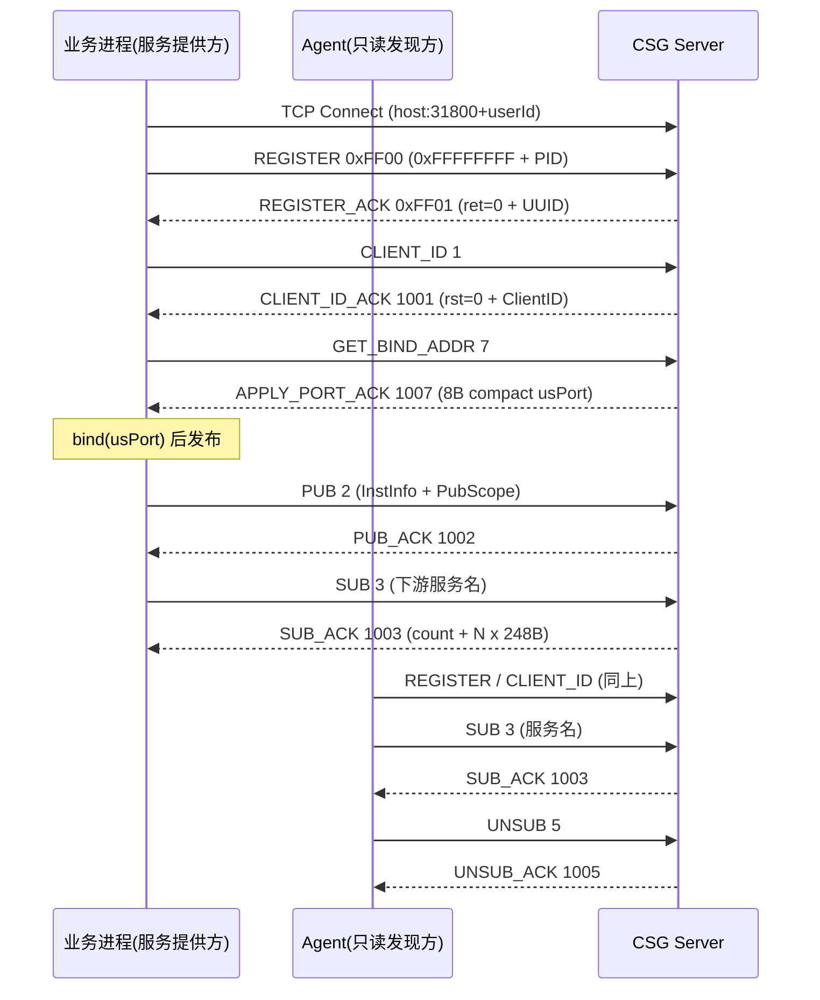
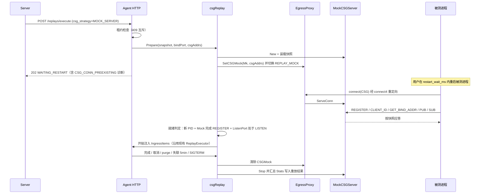

# ADR-21：CSG 感知型 Agent 服务发现与重放期 CSG 控制面 Mock 设计

- **文档编号**：`21-csg-aware-agent-service-discovery-and-replay-mock-adr.md`
- **文档版本**：v1.1.0
- **日期**：2026-11-16
- **状态**：📋 提议中 (Proposed — 架构检视已修订；须先澄清 [§14 开放问题](#14-开放问题期望补充的信息) 中标记为 🔴 阻塞级的条目，才能进入评审)
- **关联特性**：`F-02`（物理进程蓝图与模块服务契约）、`F-05`（实测调用拓扑还原与一致性验证）、`F-08`（进程树选择与存量连接诊断）、`F-09` / `F-11`（Agent 采集与出站透明代理）、`F-12`（重放编排与零外泄门禁）、`F-13`（Agent 零 `.pb` Mock 匹配）
- **关联设计**：[`02-data-plane-and-cros-rpc-engine.md`](../02-design/02-data-plane-and-cros-rpc-engine.md)、[`03-architecture-elements-and-topology.md`](../02-design/03-architecture-elements-and-topology.md)、[`05-database-schema.md`](../02-design/05-database-schema.md)、[`06-agent-observability-and-self-healing-design.md`](../02-design/06-agent-observability-and-self-healing-design.md)
- **关联 ADR**：[`ADR-02`](./02-ebpf-hook-and-dual-subsystem-adr.md)（eBPF 钩子与零 `.pb` Mock）、[`ADR-03`](./03-control-plane-state-recovery-and-lease-reconciliation.md)（租约对账与孤儿探针防御）、[`ADR-09`](./09-arch-process-ssot-and-ebpf-premount-standby-adr.md)（进程 SSOT 与预挂载待命）、[`ADR-11`](./11-single-process-bidirectional-capture-and-recording-ux-adr.md)（单进程全出站透明代理）、[`ADR-16`](./16-multi-implementation-service-contract-adr.md)（多实现服务契约与 `dst_tag` 隔离）
- **演进关系**：本 ADR 不修订任何既有关键假设（`A-01` ~ `A-09`）。若 [`Q-B2`](#143-业务语义q-b) 确认 ADR-16 中的“调度中心 X”即 CSG，则本 ADR 将部分演进 [`Non-Goal 11`](../01-features/01-feature-matrix.md) 第 ③④ 条（届时须同步修订 ADR-16 §9）。
- **协议规范**：§4 为自包含协议参考；§13.2 为参考实现，已在隔离沙箱中通过 `gofmt` / `go vet` / `go test -race`（含 NOTIFY 穿插与 CorrID 配对用例）。

### 修订记录

| 版本 | 日期 | 修订说明 |
| :--- | :--- | :--- |
| v1.0.0 | 2026-11-16 | 初稿：CSG 协议逆向规范、`CSGDiscoveryMgr` 服务发现、`MockCSGServer` / `MockServiceRegistrar` 重放期 Mock、四阶段实施路径与参考实现 |
| v1.1.0 | 2026-11-16 | **架构检视修订**（逐条对照见 §0）：1. 依据现网代码（ADR-11 全出站重定向 + `CSE.TCP` 写前守卫）更正痛点 3，重述真实问题为「控制面依赖、注册表反向污染、动态端口漂移、录制资产缺失控制面上下文」；2. 更正 CSG 能力边界（无服务枚举、无订阅关系查询）；3. Agent 访问真实 CSG 收敛为**只读白名单**，禁止 `GET_BIND_ADDR` 探测；4. `REGISTER` 策略降级为否决备选；5. `MOCK_SERVER` 改为「EgressProxy 原始目的分流 + 录制期 `SUB_ACK` 快照回放 + 保留原始实例地址」，废弃环境变量 / `/etc/hosts` 注入；6. 重放编排上移 `internal/agent/server`，拆出 `pkg/csgproto`；7. 新增 Server 侧持久化 / 上报 / SSOT 对账设计（§7）；8. 补齐物理防腐门禁、安全约束与测试策略；9. 重写并验证参考实现；10. 新增 §14 开放问题清单 |

---

## 0. v1.1.0 检视修订要点（相对 v1.0.0）

| # | v1.0.0 原表述 | 检视发现 | v1.1.0 修订 |
| :--- | :--- | :--- | :--- |
| 1 | 痛点 3：“CSG 返回真实下游地址，重放零外泄被破坏” | 与现网实现不符：`cros_connect4` 对纳管 PID 的**全部** IPv4 TCP 出站重定向到 `EgressProxy`（ADR-11），`REPLAY_MOCK` 下凡命中 Mock 端点**或**载荷含 `CSE.TCP` 魔术字的出站写入均被 Matcher 接管并物理切断真实下游，零外泄与 CSG 返回什么地址无关 | §1.2 重述为 P1~P4 四类真实问题；零外泄继续由现有数据面保证 |
| 2 | “CSG `Sub` 能回答：该服务的下游依赖是谁 / 当前注册中心有哪些服务” | CSG 协议没有“枚举全部服务”与“查询订阅者”操作；`SUB` 只能按**已知服务名**查询实例 | §1.3 更正能力边界；下游依赖只能通过**被动观测业务进程自身的 `SUB`** 获得 |
| 3 | Agent 连续 `GET_BIND_ADDR` 探测端口范围；阶段一“连接真实 CSG 申请端口” | 每次调用都会占用生产端口池并推进 `usNextPortNum` 游标，改变后续真实服务拿到的端口，属于对生产注册中心的写操作 | D5：运行期禁止 `PUB` / `UNPUB` / `GET_BIND_ADDR` / `FREE_BIND_ADDR`，仅保留只读白名单 |
| 4 | `REGISTER` 策略：向真实 CSG `PUB` Mock 实例，TTL 兜底 | ① 线上已配置 `NO_DUPLICATED_SERVICE`，同名 `PUB` 会被拒；② 多实例时业务选址不确定；③ 共享注册中心中**其他真实调用方**可能选中 Mock 实例，导致真实流量拿到 Mock 应答，危害大于外泄；④ 协议中没有 TTL 字段，Agent 崩溃后是否残留取决于服务端断链清理行为（未知） | 降级为否决备选（§11），列入 Non-Goal |
| 5 | `MOCK_SERVER`：`SUB_ACK` 返回 `127.0.0.1:{mockPort}`，靠环境变量 / `/etc/hosts` 注入重定向 | ① 改写下游地址会破坏 ADR-16 中按原始目的 `IP:Port` 映射的 `dst_tag`；② 修改业务进程环境 / 宿主机 hosts 违反零侵入；③ §4.11 已证明 `CSG_SvrInit` 地址参数被忽略，客户端寻址机制未知，注入未必生效；④ 现网全出站重定向已能拦截 CSG 连接，无需新增 eBPF 改造 | D6：`EgressProxy` 在 `REPLAY_MOCK` 下按原始目的分流到进程内 `MockCSGServer`；`SUB_ACK` 默认回放**录制期原始实例地址** |
| 6 | `ReplayCSGController` 位于 `pkg/csgmock` 并直接配置 `EgressProxy` | 导致 `pkg/csgmock → pkg/ebpf` 反向耦合，`pkg` 层出现编排逻辑 | D8：编排上移 `internal/agent/server`；`pkg/csgmock` 只做协议仿真 |
| 7 | 目标 ②“上报 Server、自动生成 `ProcessMonitorSpec`” | 全文只有 Agent 侧 API，缺少 Server 持久化、录制快照、SSOT 对账与权限设计；“自动生成”与 ADR-09 SSOT 原则冲突 | 新增 §7；只生成**建议**，写回 SSOT 需人工确认 |
| 8 | “新增包必须通过 `deps_test.go`” | `deps_test.go` 通过**显式包清单**执行 `go list -deps`，新包不加入清单就不会被检查；禁止依赖清单也与现网不一致（缺 `go-git` / `protocompile` / `sqlite`） | §8 明确修改清单，并同步 `AGENTS.md` 红线 1 |
| 9 | §12 参考实现 | 未按 `CorrID` 配对，也未处理 `NOTIFY` 帧；`cstr` 未截断首个 `\0`；未校验 `SubLen`；`SetReadDeadline` 错误被忽略；`Pub` 中 `ProcID` 硬编码 `os.Getpid()`；`Export` 注释与实现不符；import 未 gofmt；§12.4 用 `net.IP(body[24:28])` 时忽略了字节序疑点 | §13.2 重写为只读客户端并本地验证 |
| 10 | §4.1 “CSG `ServiceName` 与 `ascServiceName` 是同一逻辑标识” | 线上样本（`X-X`、`X-module`、`X-X-{instance}-{pid}`）与 `A-07` 规定的点分 Protobuf 全名不兼容 | 降级为待验证假设 H-1，并给出名称归一与映射规则（§5.1） |
| 11 | 实施路径第一阶段以“连接真实 CSG”为验收标准 | CI 无真实 CSG，不符合 TDD；需要 golden 字节夹具 | §9：`MockCSGServer` 兼作测试替身，配合抓包夹具；真实环境只作集成验收 |
| 12 | 文档格式 | §3.3 表格断行，§3.4 标题有前导空格无法渲染；§3.1 把 `GET_BIND_ADDR` 写成所有客户端的必经步骤 | 已修复；按角色拆分时序（§4.13） |

---

## 1. 背景与问题陈述 (Context & Problem Statement)

### 1.1 现状（以 `main` 分支代码为准）

**控制面声明**：Server 通过 `POST /agent/v1/monitors/arm`（ADR-09 预挂载）或 `POST /agent/v1/monitors/sync` 下发：

```text
ProcessMonitorSpec = { ProcessID, ListenPort, CmdPattern, Downstreams[{IP, Port, DstTag}] }
```

`ProcScanner` 通过 `/proc/net/tcp` 与 `/proc/[pid]/fd` 只能拿到 `PID`、`ListenPort`、`Cmdline`、`ExeName`。

**数据面事实**（`pkg/ebpf/bpf/cros_probe.c`、`pkg/ebpf/egress_proxy.go`）：

| 阶段 | 纳管 PID 的出站连接 | dlink（CSG 控制面）字节 | CROS RPC 字节 |
| :--- | :--- | :--- | :--- |
| `connect()` 时刻 | `cros_connect4` 将**全部** IPv4 TCP 出站改写到 `127.0.0.1:{proxy_port}`；豁免 Agent 自身 PID、目的端口等于自身监听端口、目的为代理端口三类 | — | — |
| 待命 / 录制 (`PASSTHROUGH` / `CAPTURING`) | `EgressProxy` 拨号真实目的并双向中继 | 透传，不解析 | 透传；`CAPTURING` 下分帧入信封流 |
| 重放 (`REPLAY_MOCK`) | 同上 | **透传到真实 CSG** | 命中 Mock 端点或载荷含 `CSE.TCP` → 切断真实下游，由 `ScopedMockMatcher` 应答；`MOCK_MISS` 时保持静默 |

> [!NOTE]
> `cgroup/connect4` 只作用于**挂载之后新建**的连接。业务进程启动时与 CSG 建立的长连接如果早于挂载，就不经过 `EgressProxy`。这与 `A-01`（录制 / 重放前可接受重启）的前提一致。

### 1.2 问题陈述

| # | 问题 | 现象与影响 |
| :--- | :--- | :--- |
| **P1** | **CSG 动态端口导致静态登记漂移** | 微服务启动时通过 `GET_BIND_ADDR` 从 CSG 顺序分配监听端口（§4.11），进程重启后端口大概率变化，`ArchProcess.listen_port` 与 `Downstreams[].Port` 因此失效：① `FindPIDByPortAndCmd` 定位失败，返回 `WAITING_PROC`；② `Downstreams → dst_tag` 映射失效，ADR-16 多实现 Mock 隔离退化为按服务名兜底，存在串用风险；③ `DiagnoseEstablishedConns` 按旧端口计算，存量连接漏判 |
| **P2** | **服务名与进程的归属不可见** | `ProcScanner` 无法回答“PID 1234 / 端口 16001 在 CSG 中发布了哪个服务”；架构 SSOT 中的 `ModuleService.service_name`（ADR-16 v2 运行期发布名）与实际运行进程只能靠人工对账 |
| **P3** | **重放期控制面依赖真实 CSG** | 重放时 dlink 透传真实 CSG：① 跨环境重放（如 SIT 素材投递到 `PRIVATE` 环境）时目标环境可能没有 CSG，或注册内容与录制期不同，业务进程启动或寻址失败；② 重启后的被测进程会把自身 `PUB` 到共享注册中心，同环境其他真实调用方可能把流量打到下游已被 Mock 的被测进程，造成**反向污染**；③ 重放期解析出的下游地址与录制期不同，`dst_tag` 归因偏差 |
| **P4** | **录制资产缺少控制面上下文** | 录制会话只保存 CROS RPC 帧，不记录业务进程当时通过 CSG 解析到的“服务名 → 实例地址”，重放时无法复现寻址结果 |

> [!IMPORTANT]
> **对 v1.0.0 痛点 3 的更正**：只要业务进程对下游的连接是挂载后新建的，零外泄就已经由「全出站重定向 + `CSE.TCP` 写前守卫」保证，与 CSG 返回真实地址还是 Mock 地址无关。本 ADR **不**依赖改写下游地址来实现零外泄。

### 1.3 CSG 能力边界（更正）

| 问题 | `ProcScanner` | CSG 主动 `SUB` | 被动观测业务进程 dlink |
| :--- | :--- | :--- | :--- |
| PID 1234 在 CSG 中发布了什么服务？ | ❌ | ⚠️ 需先知道服务名，再按 `ProcID` / 端口反查（H-2） | ✅ 观测其 `PUB` 请求即可精确获得 |
| 某服务当前有哪些实例 / 地址？ | ❌ | ✅ | ✅（仅限该进程查询过的服务） |
| 该进程依赖哪些下游服务？ | ❌ | ❌ 协议没有订阅者查询 | ✅ 观测其 `SUB` 请求 |
| 注册中心里共有哪些服务？ | ❌ | ❌ 协议没有枚举操作 | ⚠️ 只能看到被观测进程涉及的服务 |
| 实例的 `ProcID` / `OsNodeID`？ | ❌ | ✅ | ✅ |

### 1.4 目标与优先级

| 目标 | 描述 | 优先级 |
| :--- | :--- | :--- |
| **G1 服务⇄进程关联** | Agent 把 CSG 中的服务实例与本机 `ProcScanner` 结果关联，在 `/agents` 与 `ArchProcess` 挂载视图中展示服务名 | P0 |
| **G2 录制期控制面快照** | 被动解析业务进程的 `SUB` / `SUB_ACK` / `PUB`，随录制会话固化“服务名 → 实例”快照（解决 P4，为 G3 提供数据） | P0 |
| **G3 重放期 CSG Mock** | 重放时由 Agent 进程内的 `MockCSGServer` 接管被测进程的 CSG 连接，按快照应答 `SUB`，吞掉 `PUB`，不访问真实 CSG（解决 P3） | P1 |
| **G4 动态端点解析** | 允许 `ArchProcess` 以 CSG 服务名声明自身与下游，Agent 在挂载 / 重放时解析出当前 `IP:Port`（解决 P1） | P1 |
| ~~G5 Mock 服务注册~~ | ~~向真实 CSG `PUB` Mock 实例~~ | **否决**（§11.1） |

---

## 2. 决策矩阵 (Decisions)

| # | 决策点 | 选定方案 | 相对 v1.0.0 | 理由 |
| :--- | :--- | :--- | :--- | :--- |
| **D1** | 协议层落位 | 新增 `pkg/csgproto`（纯编解码 + 只读客户端，无状态），供 `pkg/csgdiscovery` 与 `pkg/csgmock` 共用 | 拆分 | 避免 `csgmock → csgdiscovery` 的业务耦合；编解码可单独 Fuzz |
| **D2** | CSG Server 地址 | ① `--csg-addr` / `CONTRACT_AGENT_CSG_ADDR` 显式配置（推荐）；② 观测纳管进程已建立的 dlink 连接对端；③ 本机 LISTEN 表 `[31800, 31900)` 过滤后握手确认。**禁止**对远端地址盲扫 | 收紧 | 盲扫会向未知服务发送二进制握手；双网卡问题由 ② 天然规避 |
| **D3** | 服务名来源 | 取并集：① 被动观测 `SUB` / `PUB`（主）；② Server 下发的 SSOT 运行期发布名；③ 预置清单（兜底）。CROS `ascServiceName` 反推须待 H-1 验证后启用 | 调整 | `SUB` 必须提供服务名；SSOT 名称在冷启动阶段即可用 |
| **D4** | 拓扑关联 | `ProcID == PID` 强匹配（H-2 前提）> 本机 IP + 端口弱匹配 > 被动观测 `PUB` 精确绑定（最高）；只保留内存 TTL 缓存，不落 Agent 磁盘 | 补充 | 观测到的 `PUB` 自带进程身份，可信度最高 |
| **D5** | Agent 访问真实 CSG 的边界 | **只读白名单**：`REGISTER` / `CLIENT_ID` / `SUB` / `UNSUB`；每轮 `SUB` 后立即 `UNSUB`；单长连接、令牌桶限速（默认 20 QPS）、指数退避重连（1s → 60s）。运行期代码路径**禁止** `PUB` / `UNPUB` / `GET_BIND_ADDR` / `FREE_BIND_ADDR`（由单测与 `csgproto.Client` 不导出写方法双重保证） | 新增 | 避免改动生产注册中心状态与端口游标 |
| **D6** | 重放期 CSG 处置 | 新增 `csg_strategy ∈ {PASSTHROUGH(默认), MOCK_SERVER}`。`MOCK_SERVER`：`EgressProxy` 在 `REPLAY_MOCK` 下把**原始目的 ∈ CSG 地址集合**（或在地址未知时首包为 `DLNK` 魔术字）的**新建**连接交给进程内 `MockCSGServer.ServeConn`；`SUB_ACK` 按录制期快照回放**原始实例地址**；`PUB` / `UNPUB` 在本地吞掉并记录 | 重做 | 复用现有全出站重定向，零 eBPF 改动、零侵入；保留原地址可同时保住 `dst_tag` 映射与 `CSE.TCP` 守卫 |
| **D7** | `MOCK_SERVER` 生效时机 | 两阶段重放：Agent 先进入 `REPLAY_MOCK` 并启动 Mock，返回 `WAITING_RESTART`；被测进程在窗口内重启、经 Mock 完成 `REGISTER` 且监听端口就绪后，再开始注入。挂载前已建立的 dlink 连接继续透传，并给出诊断 `CSG_CONN_PREEXISTING` | 新增 | `connect4` 只作用于新建连接；对 dlink 会话做热切换的语义未知（Q-P7） |
| **D8** | 重放编排位置 | `internal/agent/server/csg_replay.go`：在 `handleExecuteReplay` 中执行 `Prepare`，并在重放完成、取消、`purge`、主控失联超过 5 分钟、`SIGTERM` 五个出口执行 `Teardown` | 上移 | 遵守分层；与租约、探针卫生（红线 4）统一收口 |
| **D9** | 上报与持久化 | 拉取：Server 调用增强后的 `GET /agent/v1/processes/discover`；推送：新增信封事件 `EventCSGObservation = 0x08`，由 Server 合并写入 `contract_recording_sessions.csg_snapshots`（`jsonb`） | 新增 | 沿用 ADR-16 `endpoint_snapshots` 的“录制期快照固化”模式，不新增表 |
| **D10** | SSOT 回写 | Agent 侧发现结果只作为**建议**，在 `/agents` 与 `ArchProcess` 详情页展示差异；写回 `ModuleService` / `ArchProcess` 须由用户确认（管理接口需 `contract_admin`） | 修正 | 与 ADR-09 SSOT 原则一致 |

---

## 3. 关键假设（待确认）

| 编号 | 假设 | 若不成立的影响 | 关联问题 |
| :--- | :--- | :--- | :--- |
| **H-1** | CSG `ServiceName` 能通过确定性规则映射到 `ModuleService.service_name` 或 CROS `ascServiceName` | D3-③、§5.1 名称对账需改为人工维护映射表 | Q-B1 |
| **H-2** | `Instance.ProcID` 是发布进程在 **Agent 所见 PID 命名空间**中的 OS PID | D4 强匹配失效，只能退化为端口弱匹配或观测 `PUB` | Q-E2 |
| **H-3** | 业务进程经 **IPv4 TCP** 访问 CSG（而非 UDS `/dev/shm/ltusr/ddm/...`） | D6 无法拦截，G2 / G3 不可行，需另立方案 | Q-E3 |
| **H-4** | 单台 Agent 主机只对应 1 个 CSG Server（唯一 `userId`），且 CSG 与业务进程同机或同板 | D2 需要支持多地址，并按进程归属选择 CSG | Q-E1 |
| **H-5** | 服务端应答 `usType = REPLY` 且原样回显 `uiCorrID` | 客户端配对逻辑需退化为按应答子类型顺序匹配 | Q-P1 |

---

## 4. CSG 控制面协议规范 (Protocol Specification)

> 以下规范基于 DDM 协议逆向验证，本节**自包含**，实施时无需查阅外部源码。标注 ⚠️ 的条目尚未经抓包校准，详见 §4.15 与 §14。

### 4.1 传输层

- **协议**：TCP 长连接，大端序（网络字节序）。
- **CSG Server 地址**：`host:port`，其中 `port = 31800 + userId`（`RpcCfgParser::GetCsgServerPort()`）。⚠️ `userId` 的含义见 Q-E1。
- **端口池**：源码默认 `[32768, 49151]`；线上由 `CSG_SvrCfgSet` 覆盖（实测 16000 / 17200 起，见 §4.11）。
- **连接生命周期（按角色）**：
  - **服务提供方（业务进程）**：`Connect` → `REGISTER` → `CLIENT_ID` → `GET_BIND_ADDR` → `bind()` → `PUB` →（`SUB` / `UNSUB`）* → `UNPUB` → `Close`
  - **只读发现方（Agent）**：`Connect` → `REGISTER` → `CLIENT_ID` →（`SUB` → `UNSUB`）* → `Close`

> [!WARNING]
> **双网卡环境**：CSG Server 监听在**业务网 IP** 上，而非管理网。例如某环境管理网 `eth0` 上 CSG 端口不可达，业务网 `eth9` 上 `<业务网IP>:31805`（userId=5）正常监听。优先采用 D2-②（观测业务进程已建立的连接对端），避免遍历网卡盲探。

### 4.2 dlink 帧头 (`DDM_DLINK_HEAD_S`，32 字节)

所有 CSG 控制面消息都封装在 dlink 帧内。

```text
偏移   长度   字段           类型       说明
0      4      uiMagic        UINT32     0x444C4E4B ("DLNK" ASCII)
4      2      usType         UINT16     0=REQ, 1=REPLY, 2=NOTIFY, 3=FAULT
6      2      usMsgHeadLen   UINT16     头长度，固定 32
8      2      usSize         UINT16     消息体大小（不含本头）
10     2      usSubType      UINT16     子类型（见 §4.3）
12     4      uiCorrID       UINT32     关联 ID（请求-应答配对）
16     4      uiLinkID       UINT32     链路 ID，固定 0x020A0000
                                        (prio=LOW(2)<<24 | serviceID=CSG(10)<<16 | index=0)
20     4      uiReserved     UINT32     保留，8 字节对齐填充
24     8      ullTimeStamp   UINT64     时间戳（实现中置零可用）
```

**编解码规则**：

- 请求帧 `usType = 0`，应答帧 `usType = 1`；`uiCorrID` 在单连接内单调递增。⚠️ 服务端是否回显见 H-5。
- `usSize` 为载荷字节数（不含 32B 头），最大 65535。参考实现的缓冲上限为 `32000`，⚠️ 大应答是否分帧见 Q-P3。
- **解码校验**（防御畸形帧）：`uiMagic == 0x444C4E4B`、`usMsgHeadLen == 32`、`usSize ≤ DlinkMaxBody`，任一不满足即断开连接。
- **`NOTIFY` 帧**：客户端在等待应答期间可能收到服务端推送，必须跳过或回调，不能当作应答。⚠️ 推送时机与载荷见 Q-P4。

### 4.3 消息子类型 (`usSubType`)

| 子类型值 | 请求常量 | 应答值 | 应答常量 | 含义 | Agent 运行期 |
| :--- | :--- | :--- | :--- | :--- | :--- |
| `0xFF00` | `dlinkTypeRegister` | `0xFF01` | `dlinkTypeRegisterAck` | dlink 层注册握手 | ✅ 允许 |
| `0xFF02` | `dlinkTypeUnregister` | `0xFF03` | `dlinkTypeUnregisterAck` | dlink 层注销（⚠️ 载荷未定义，Q-P1） | — 首期直接关闭 TCP |
| `1` | `csgMsgClientID` | `1001` | `csgMsgClientIDAck` | CSG 客户端 ID 分配 | ✅ 允许 |
| `2` | `csgMsgPubService` | `1002` | `csgMsgPubServiceAck` | 发布服务实例 | ⛔ 禁止 |
| `3` | `csgMsgSubService` | `1003` | `csgMsgSubServiceAck` | 订阅 / 发现服务 | ✅ 允许 |
| `4` | `csgMsgUnpubService` | `1004` | `csgMsgUnpubServiceAck` | 取消发布 | ⛔ 禁止 |
| `5` | `csgMsgUnsubService` | `1005` | `csgMsgUnsubServiceAck` | 取消订阅 | ✅ 允许 |
| `6` | `csgMsgSessionIdGet` | `1006` | `csgMsgSessionIdAck` | Frpc Session ID 请求 | ⛔ 不使用（⚠️ Mock 处理见 Q-P8） |
| `7` | `csgMsgGetBindAddr` | `1007` | `csgMsgApplyPortAck` | 申请绑定地址（端口分配） | ⛔ 禁止（仅 Mock 服务端实现） |
| `8` | `csgMsgFreeBindAddr` | `1008` | `csgMsgFreePortAck` | 释放绑定地址（端口回收） | ⛔ 禁止（仅 Mock 服务端实现） |

### 4.4 REGISTER 握手 (`usSubType = 0xFF00`)

**请求体**（8 字节）：

```text
偏移  长度  字段        类型      说明
0     4     UUID        UINT32    0xFFFFFFFF（申请新 UUID）
4     4     ProcID      UINT32    调用方进程 PID
```

**应答体**（≥ 8 字节）：

```text
偏移  长度  字段    类型      说明
0     4     Ret     UINT32    返回码，0 = 成功
4     4     UUID    UINT32    CSG 分配的会话 UUID
```

> 失败时 `Ret != 0`，`UUID` 无意义。⚠️ 服务端是否校验 `ProcID` 存活、Agent 以自身 PID 注册是否有可见副作用，见 Q-P10。

### 4.5 CLIENT_ID 分配 (`usSubType = 1`)

**请求体**（8 字节）：

```text
偏移  长度  字段         类型      说明
0     4     RealProcID   UINT32    可置 0（参考实现置 0）
4     4     Reserved     UINT32    固定 0
```

**应答体**（≥ 16 字节）：

```text
偏移  长度  字段       类型      说明
0     4     Rst        UINT32    返回码，0 = 成功
4     4     Reserved   UINT32    保留
8     8     ClientID   UINT64    CSG 分配的全局唯一客户端 ID
```

> `ClientID` 是后续 `PUB` / `SUB` / `UNPUB` / `UNSUB` 的身份凭证。

### 4.6 SUB — 服务发现 (`usSubType = 3`)

**请求体**（`CSG_SUB_SVC_MSG_S`，80 字节）：

```text
偏移  长度  字段           类型        说明
0     8     ClientID       UINT64      §4.5 获取的 ClientID
8     64    SubName        CHAR[64]    目标服务名，\0 填充
72    7     SubTransType   UCHAR[7]    传输类型位掩码（见下表）
79    1     Reserved       UCHAR       保留
```

**`SubTransType` 位掩码**：

```text
索引  名称      说明
0     DEFAULT   默认
1     TCP       TCP 传输（tcp:// 前缀的实例地址）
2     DMS       DMS 传输
3     UC        UC 传输
4     MESH      Mesh 传输（dophi_mesh:// 前缀）
5     DOMAIN    Unix Domain
6     BUTT      上界哨兵（不用）
```

> **关键约束**：必须按实例地址类型把对应索引置为 `1`，否则 CSG 返回 0 个实例。实践中同时置 `TCP(1)` 和 `MESH(4)` 可覆盖大多数场景（可配置覆盖）。

**应答体**（`CSG_SUB_SVC_ACK_MSG_S` + N × `CSG_SERVICE_INST_INFO_S`）：

```text
偏移  长度  字段           类型      说明
─── ACK 头 (16 字节) ───
0     4     SvcInstCount   UINT32    返回的实例数量
4     4     Rst            UINT32    返回码，0 = 成功
8     4     SubLen         UINT32    后续实例数据总字节长度（须 == SvcInstCount × 248）
12    4     Reserved       UINT32    保留
─── 实例数组 (N × 248 字节) ───
每个实例为 CSG_SERVICE_INST_INFO_S（248 字节，见 §4.9）
```

> 解析时必须校验 `SubLen == SvcInstCount × 248` 且 `SubLen ≤ usSize − 16`，否则视为畸形帧。

### 4.7 PUB — 服务发布 (`usSubType = 2`)

**请求体**（256 字节 = 248B `CSG_SERVICE_INST_INFO_S` + 1B `PubScope` + 7B 保留）：

```text
偏移  长度  字段           类型        说明
─── CSG_SERVICE_INST_INFO_S (248 字节，见 §4.9) ───
0     8     ClientID       UINT64      §4.5 获取的 ClientID
8     8     Version        UINT64      服务版本（可置 0）
16    4     ProcID         UINT32      发布进程 PID
20    4     OsNodeID       UINT32      节点 ID（可置 0）
24    32    Name32         CHAR[32]    服务短名（可置空）
56    128   SvcInstAddr    CHAR[128]   实例地址，如 "tcp://ipv4:127.0.0.1:18500"
184   64    ServiceName    CHAR[64]    服务全名，如 "HelloService-HelloService"
─── 扩展字段 (8 字节) ───
248   1     PubScope       UCHAR       发布范围（0 = board-local 默认）
249   7     Reserved       UCHAR[7]    保留
```

**应答体**（8 字节 `CSG_COMM_ACK_MSG_S`）：

```text
偏移  长度  字段      类型    说明
0     4     Rst       UINT32  返回码，0 = 成功
4     4     Reserved  UINT32  保留
```

> 若服务端配置了 `NO_DUPLICATED_SERVICE`（§4.11 步骤 3），同板重复发布同名服务会被拒绝。被动观测到的 `PUB` 是“进程 ⇄ 服务”最可信的绑定证据（D4）。

### 4.8 UNPUB — 取消发布 (`usSubType = 4`)

**请求体**（248 字节 = `CSG_SERVICE_INST_INFO_S`）：与 §4.7 前 248 字节相同，不含尾部 8B 扩展字段；`ClientID`、`ProcID`、`SvcInstAddr`、`ServiceName` 必须与 `PUB` 时一致。

**应答体**：8 字节 `CSG_COMM_ACK_MSG_S`（同 §4.7）。

### 4.9 `CSG_SERVICE_INST_INFO_S`（248 字节冻结结构）

```text
偏移   长度   字段               类型        说明
0      8      ClientID           UINT64      CSG 分配的客户端 ID
8      8      Version            UINT64      服务版本
16     4      ProcID             UINT32      发布进程的 OS PID（⚠️ 命名空间见 H-2）
20     4      OsNodeID           UINT32      操作系统节点 ID
24     32     Service32byteName  CHAR[32]    服务短名（\0 结尾）
56     128    SvcInstAddr        CHAR[128]   实例地址（\0 结尾）
184    64     ServiceName        CHAR[64]    服务全名（\0 结尾）
```

> 字符串字段一律**截断到首个 `\0`**，不能只 TrimRight，因为 `\0` 之后可能残留未清零的内存字节。

**实例地址格式**：

| 前缀 | 示例 | 对应 `SubTransType` 位 | 数据面可拦截性 |
| :--- | :--- | :--- | :--- |
| `tcp://ipv4:` | `tcp://ipv4:127.0.0.1:18500` | TCP（索引 1） | ✅ IPv4 TCP |
| `dophi_mesh://` | `dophi_mesh://node1:18500` | MESH（索引 4） | ⚠️ 取决于 mesh 主机名解析与数据面传输（Q-P5） |
| `unix://` | `unix:///var/run/sock` | DOMAIN（索引 5） | ❌ 超出红线 2（仅 IPv4 TCP） |

**服务名格式**（线上实测采样）：

| 格式 | 样例 |
| :--- | :--- |
| 点分 Protobuf 全名 | `pkg.HelloService` |
| `{serviceName}-{serviceName}` | `CMReadService-CMReadService` |
| 纯服务名 | `Broker`、`DophiServer`、`Keeper` |
| `{serviceName}-{module}` | `SMCLService-CSC`、`WRPGetServiceA-WRP_GET_LR` |
| `{serviceName}-{serviceName}-{instance}-{pid}` | `SSPMonitorService-SSPMonitorService-2-76060` |

> 这些格式与 CROS `ascServiceName` 的关系**尚未验证**（H-1），详见 §5.1。

### 4.10 UNSUB — 取消订阅 (`usSubType = 5`)

**请求体**（`CSG_UNSUB_SVC_MSG_S`，72 字节）：

```text
偏移  长度  字段       类型        说明
0     8     ClientID   UINT64      §4.5 获取的 ClientID
8     64    SvcName    CHAR[64]    取消订阅的服务名，\0 填充
```

> UNSUB 请求体为 72 字节（`ClientID + SvcName`），**不含** SUB 的 `SubTransType[7]` 字段。

**应答体**：8 字节 `CSG_COMM_ACK_MSG_S`（`Rst` + `Reserved`）。

### 4.11 GET_BIND_ADDR — 端口申请 (`usSubType = 7`)

> [!CAUTION]
> 本节用于 **`MockCSGServer` 仿真**与**被动观测解析**。Agent 运行期**不得**向真实 CSG 发送 `GET_BIND_ADDR`：每次调用都会占用端口池，并推进服务端游标 `usNextPortNum`，进而改变后续真实服务分配到的端口（D5）。

**请求体**（8 字节 `CSG_GET_BIND_ADDR_MSG_S`）：

```text
偏移  长度  字段         类型       说明
0     8     aucReserved  UINT8[8]   全零保留字段（8 字节对齐）
```

**应答体 — 源码规范**（128 字节 `CSG_GET_BIND_ADDR_ACK_MSG_S`）：

```text
偏移  长度  字段              类型             端序    说明
0     4     uiRst             UINT32           BE      返回码，0 = 成功
4     4     aucReserved       UINT8[4]         —       保留
8     4     enProtocol        UINT32           BE      通信协议类型（RPC_TRANSPORT_TYPE_E）
12    4     uiReserved        UINT32           —       保留
16    112   unBindAddr        RPC_BIND_ADDR_U  —       绑定地址（union，最大 112B）
```

`enProtocol` 取值（`RPC_TRANSPORT_TYPE_E`）：

| 值 | 常量 | 说明 |
| :--- | :--- | :--- |
| 0 | `RPC_TRANSPORT_DEFAULT` | 默认 |
| 1 | `RPC_TRANSPORT_TCP` | TCP |
| 2 | `RPC_TRANSPORT_DMS` | DMS |
| 3 | `RPC_TRANSPORT_UC` | UC |
| 4 | `RPC_TRANSPORT_MESH` | MESH（CSG 服务端当前只支持此类型） |
| 5 | `RPC_TRANSPORT_DOMAIN` | Domain |
| 6 | `RPC_TRANSPORT_FRPC` | FRPC |
| 7 | `RPC_TRANSPORT_CUSTOMIZE` | 自定义 |

当 `enProtocol = 4`（MESH）时，`unBindAddr` 按 `RPC_MESH_ADDR_S`（72 字节）解析：

```text
偏移  长度  字段          类型       端序   说明
16    2     usPort        UINT16     BE     CSG 分配的端口号
18    1     ucFamily      UINT8      —      地址族（RPC_SOCK_FAMILY_E）
19    5     aucReserved   UINT8[5]   —      保留
24    64    unAddr        union      —      地址（union，最大 64B）
```

`unAddr` 按 `ucFamily` 选择 union 成员：

| `ucFamily` | 常量 | 长度 | 字段 | 类型 | 端序 |
| :--- | :--- | :--- | :--- | :--- | :--- |
| 0 | `RPC_SOCK_FAMILY_AFNET` | 4 | `uiIpv4` | UINT32 | ⚠️ 见下方字节序疑点 |
| 1 | `RPC_SOCK_FAMILY_AFNET6` | 16 | `aucIpv6` | UINT8[16] | 原始字节 |
| 4 | `RPC_SOCK_FAMILY_XMESH` | 64 | `acXmesh` | CHAR[64] | 原始字节 |

`RPC_SOCK_FAMILY_E`：`0=AFNET(IPv4)`、`1=AFNET6(IPv6)`、`2=DOMAIN`、`4=XMESH`。

**`RPC_BIND_ADDR_U` union 成员尺寸**（用于计算 `CROS_BIND_ADDR_S = 120B`）：

| 成员 | 类型 | 尺寸 |
| :--- | :--- | :--- |
| `stDmsCfg` | `RPC_DMS_ADDR_S` | 4B |
| `stUcCfg` | `RPC_UC_ADDR_S` | 8B |
| `stMeshCfg` | `RPC_MESH_ADDR_S` | 72B |
| `stTcpCfg` | `RPC_TCP_ADDR_S` | 24B |
| `stDomainCfg` | `RPC_DOMAIN_ADDR_S` | 112B（最大成员） |
| `stCustomizeCfg` | `RPC_CUSTOMIZE_ADDR_S` | 24B |

> `RPC_DOMAIN_ADDR_S = 2B(usSvrInstId) + 2B(reserved) + 108B(acAddr)`，`RPC_DOMAIN_ADDR_LEN = 108`；
> `CROS_BIND_ADDR_S = 4B(enProtocol) + 4B(uiReserved) + 112B(unBindAddr) = 120B`；
> `CSG_GET_BIND_ADDR_ACK_MSG_S = 4B(uiRst) + 4B(reserved) + 120B(stCrosBindAddr) = 128B`。

**服务端端口分配逻辑**（`csgServerAssignPort`）：

```text
1. 从 usNextPortNum 开始，在 [usBeginPort, usEndPort] 范围内顺序递增
2. 默认范围 [32768, 49151]（CSG_SERVER_PORT_MIN / CSG_SERVER_PORT_MAX）
3. 对每个候选端口执行 csgServerCheckPort(usPort)：
   a. socket(AF_INET, SOCK_STREAM) + bind() 检查 TCP 端口可用性
   b. TCP bind 成功后，再用抽象 Unix Domain Socket bind 检查占用
   c. 均可用时调用 csgServerDealPortInsert 插入 HASH 表
      (key = usPort % CSG_ADDR_HASH_LEN，CSG_ADDR_HASH_LEN = 32)
4. usNextPortNum++，越界后回绕到 usBeginPort
5. 遍历一圈（usNextPortNum == usCurPortNum）仍无可用端口时返回 VOS_ERR
```

**服务端响应构造**（`csgServerGetBindAddrProc`）：

```text
1. 调用 csgServerAssignPort(pstDlink, &usPort) 分配端口；失败则 uiRet = VOS_ERR
2. enProtocol = pstSvrInfo->ucProtocol（服务端配置的协议类型）
3. 若 enProtocol == RPC_TRANSPORT_MESH：
     stMeshCfg.ucFamily = RPC_SOCK_FAMILY_AFNET (0)
     stMeshCfg.usPort   = HTONS(usPort)
     stMeshCfg.uiIpv4   = HTONL(pstSvrInfo->uiIpv4Addr)   // uiIpv4Addr 已由 inet_pton 存为网络序
   否则 uiRet = VOS_ERR（当前仅支持 MESH）
4. pstAckMsg->uiRst = HTONL(uiRet)
5. 发送 sizeof(CSG_GET_BIND_ADDR_ACK_MSG_S) = 128 字节应答
```

> [!WARNING]
> **`uiIpv4` 字节序疑点**：`uiIpv4Addr` 由 `inet_pton` 写入，已经是网络序；服务端又执行一次 `HTONL`。在小端主机上，线上字节相对点分顺序是**反转**的（例如 `10.0.1.20` 在线上为 `14 01 00 0a`）。C 客户端随后执行 `NTOHL`，恰好还原，因此 C 侧往返正确。Go 实现若直接 `net.IP(body[24:28])`，会得到反转地址。由于线上目前返回的是 compact 格式，此疑点暂不影响主路径，但 full 模式解析与 Mock 构造前必须以抓包校准（Q-P2）。

**客户端解析逻辑**（`csgClientGetBindAddrRequest`）：

```text
1. 发送 GET_BIND_ADDR 请求（8B 全零），同步等待应答（DDM_DlinkRequestSync）
2. uiRst = NTOHL(ack.uiRst)；非 0 则报错返回
3. enProtocol = NTOHL(ack.stCrosBindAddr.enProtocol)；非 MESH 则报错返回
4. 解析 stMeshCfg：ucFamily 单字节；AFNET(0) → uiIpv4 = NTOHL(src.uiIpv4)；
   AFNET6(1) → memcpy(aucIpv6)；usPort = NTOHS(src.usPort)
```

**生产环境实测差异（两台环境验证）**：

| 环境 | CSG 地址 | 传输 | 应答格式 | 端口起始 | ACK subtype | 协议规范度 |
| :--- | :--- | :--- | :--- | :--- | :--- | :--- |
| 环境 A | `<业务网IP>:31805`（userId=5） | TCP | 8B compact | 16000 | 1007 ✅ | 标准 |
| 环境 B | `<业务网IP>:31806`（userId=6） | TCP | 8B compact | 17200 | 1007 ✅ | 标准 |

- 两个环境的 `REGISTER` / `CLIENT_ID` 应答子类型均符合源码规范，但 `GET_BIND_ADDR` 应答都是 **8 字节 compact 格式**。源码中 `csgServerGetBindAddrProc` 始终发送 128 字节，没有配置项能改变应答长度，说明线上二进制与手头源码版本不同。
- 端口起始值的差异（16000 / 17200 / 源码 32768）属于预期行为：由上层应用通过 `CSG_SvrCfgSet(SET_SERVICE_ADDR_RANGE)` 注入（见下文配置链）。

**compact 8B 应答格式**：

```text
偏移  长度  字段      类型       端序   说明
0     2     usPort    UINT16     BE     CSG 分配的端口号
2     6     reserved  UINT8[6]   —      全零
```

**兼容解析规则**（被动观测与测试共用）：

- `usSize ≥ 128`：按完整结构解析，从 `stMeshCfg` 提取端口和 IP；
- `usSize == 8`：前 2 字节为端口（BE），IP 由 CSG 连接对端地址推导；⚠️ compact 模式如何表达失败（无 `uiRst` 字段），见 Q-P6；
- 其他长度，或 full 模式 `uiRst != 0`：视为错误。

> **UDS 旁路**：部分环境同时存在 Unix Domain Socket 通道（如 `/dev/shm/ltusr/ddm/dlink_default_domain`），但该通道的 ACK 子类型回显请求值（非标准 ACK 值），`GET_BIND_ADDR` 端口不递增，疑似定制版 / 精简版 dlink 实现。Agent 的主动连接**只使用 TCP**。⚠️ 业务进程实际使用哪条通道决定 H-3 是否成立（Q-E3）。

#### 4.11.1 端口范围与服务地址的配置链（`CSG_SvrCfgSet` → `CSG_SvrInit`）

端口分配范围**不是**源码硬编码，而是由上层应用在 `CSG_SvrInit()` 之前通过 `CSG_SvrCfgSet()` 注入。以应用层 `CSGSetting::SetConfig()` 为例：

**步骤 1 — 设置通信协议**（`CSG_SVR_CFG_CMD_SET_PROTOCOL = 0`）：

```cpp
VOS_UINT8 ucProtocol = static_cast<VOS_UINT8>(RPC_TRANSPORT_MESH); // 4
CSG_SvrCfgSet(CSG_SVR_CFG_CMD_SET_PROTOCOL, &ucProtocol, sizeof(ucProtocol));
```

设置 `g_stCsgServerInfo.ucProtocol = 4`。`csgServerGetBindAddrProc` 只接受 MESH，否则返回 `VOS_ERR`。

**步骤 2 — 设置端口范围与服务 IP**（`CSG_SVR_CFG_CMD_SET_SERVICE_ADDR_RANGE = 1`）：

```cpp
CSG_SVR_SERVICE_ADDR_RANGE_S stCfg;
stCfg.pcIpv4Addr  = "<业务网IP>";    // 服务发现通信 IP（点分十进制字符串）
stCfg.usBeginPort = 16000;           // 端口范围起始（含）
stCfg.usEndPort   = 32000;           // 端口范围结束（含）
CSG_SvrCfgSet(CSG_SVR_CFG_CMD_SET_SERVICE_ADDR_RANGE, &stCfg, sizeof(stCfg));
```

`csgSetServiceAddrRange()` 依次执行：`inet_pton(AF_INET, pcIpv4Addr, &g_stCsgServerInfo.uiIpv4Addr)`（网络序，即应答中的 `stMeshCfg.uiIpv4` 来源）、`usBeginPort = usBeginPort`、`usNextPortNum = usBeginPort`（**重置分配游标**）、`usEndPort = usEndPort`。

> 未调用此配置项时使用静态默认值：`usBeginPort = 32768`、`usEndPort = 49151`、`usNextPortNum = 32768`。线上环境 A（16000）与环境 B（17200）都覆盖了默认值。

**步骤 3 — 禁止重复发布**（`CSG_SVR_CFG_CMD_NO_DUPLICATED_SERVICE = 2`）：

```cpp
VOS_BOOL bNoDuplicated = VOS_TRUE;
CSG_SvrCfgSet(CSG_SVR_CFG_CMD_NO_DUPLICATED_SERVICE, &bNoDuplicated, sizeof(VOS_BOOL));
```

设置 `g_stCsgServerInfo.ucNoDuplicated = 1`，`PUB` 时检查同板是否已发布同名服务。

**步骤 4 — 初始化服务端**：

```cpp
CSG_SvrInit("ipv4:<业务网IP>:31805", &attr);
```

> [!NOTE]
> **`CSG_SvrInit` 的地址参数被忽略**：函数体内显式丢弃第一个参数（`(VOS_VOID)pcCsgSvrAddr;`），始终以硬编码常量 `CSG_SERVER_DEFAULT_BIND_ADDR = "csg_server"` 调用 `csgDlinkServerInit()`。实际 TCP 监听端口（31800+userId）由 DDM / dlink 基础设施按 `"csg_server"` 域名解析决定，不归 CSG 配置 API 管理。**推论**：客户端同样很可能经 DDM 名称解析寻址 CSG，而不是读取某个环境变量，这正是 v1.1.0 放弃“环境变量 / hosts 注入”的原因之一（Q-E3）。

**配置 API 约束**：`CSG_SvrCfgSet()` 必须在 `CSG_SvrInit()` 之前调用（`ucCsgSvrModInitFlag == VOS_TRUE` 时返回 `VOS_ERRNO_INVAL`），且不允许重复设置同一配置项。

**`CSG_SVR_CFG_CMD_E` 枚举**：

| 值 | 常量 | 配置项类型 | 说明 |
| :--- | :--- | :--- | :--- |
| 0 | `CSG_SVR_CFG_CMD_SET_PROTOCOL` | `VOS_UINT8` | 通信协议类型 |
| 1 | `CSG_SVR_CFG_CMD_SET_SERVICE_ADDR_RANGE` | `CSG_SVR_SERVICE_ADDR_RANGE_S` | 服务发现 IP + 端口范围 |
| 2 | `CSG_SVR_CFG_CMD_NO_DUPLICATED_SERVICE` | `VOS_BOOL` | 禁止同板重复发布同名服务 |

**`CSG_SVR_SERVICE_ADDR_RANGE_S`**（进程内结构，不上线路）：

```text
偏移  长度  字段         类型             说明
0     8     pcIpv4Addr   const VOS_CHAR*  服务发现通信 IP（字符串指针，64 位下 8B）
8     2     usBeginPort  VOS_UINT16       端口范围起始（含）
10    2     usEndPort    VOS_UINT16       端口范围结束（含）
```

**`CSG_SVR_INFO_S` 关键字段**：

| 字段 | 类型 | 设置来源 | `GET_BIND_ADDR` 中的用途 |
| :--- | :--- | :--- | :--- |
| `ucProtocol` | UINT8 | `SET_PROTOCOL` | 应答 `enProtocol`；非 MESH 则报错 |
| `usBeginPort` | UINT16 | `SET_SERVICE_ADDR_RANGE` / 默认 32768 | 端口分配下界 |
| `usEndPort` | UINT16 | `SET_SERVICE_ADDR_RANGE` / 默认 49151 | 端口分配上界 |
| `usNextPortNum` | UINT16 | `SET_SERVICE_ADDR_RANGE` 重置为 `usBeginPort` | 当前待分配端口游标 |
| `uiIpv4Addr` | UINT32 | `SET_SERVICE_ADDR_RANGE`（`inet_pton`） | 应答中返回的 IP（网络序） |
| `ucNoDuplicated` | UINT8 | `NO_DUPLICATED_SERVICE` | `PUB` 时检查同名服务 |

**对本设计的影响**：

- `MockCSGServer` 把 `PortMin` / `PortMax` / `ServerIP` / `NoDuplicated` / `BindAddrMode` 作为配置项，对应真实 CSG 的配置链；重放场景默认使用 `FixedBindPort`（§6.7）。
- 环境端口范围**只能从被动观测中推断**（观测业务进程 `GET_BIND_ADDR` 应答），**不得**主动探测。

### 4.12 FREE_BIND_ADDR — 端口释放 (`usSubType = 8`)

**请求体**（8 字节 `CSG_FREE_BIND_ADDR_MSG_S`）：

```text
偏移  长度  字段         类型       端序   说明
0     2     usPort       UINT16     BE     需释放的端口号（HTONS 编码）
2     6     aucReserved  UINT8[6]   —      保留（8 字节对齐）
```

**应答体**（8 字节 `CSG_FREE_BIND_ADDR_ACK_MSG_S`）：

```text
偏移  长度  字段         类型       端序   说明
0     4     uiRst        UINT32     BE     返回码，0 = 成功
4     4     aucReserved  UINT8[4]   —      保留
```

**服务端逻辑**（`csgServerFreeBindAddrProc`）：`NTOHS` 还原端口 → `csgServerFreePort` 从 HASH 表查找并删除 → **始终**返回 `VOS_OK`（端口不存在也不报错）→ 发送 8 字节应答。

### 4.13 协议交互时序



### 4.14 dlink 帧编解码伪代码

```text
// 编码帧头（Mock 服务端构造 REPLY / NOTIFY 时 msgType 取 1 / 2）
function encodeHead(msgType, subType, size, corrID) -> 32 bytes:
    b[0..3]   = 0x444C4E4B            // "DLNK"
    b[4..5]   = msgType (BE)
    b[6..7]   = 0x0020                // usMsgHeadLen = 32
    b[8..9]   = size (BE)
    b[10..11] = subType (BE)
    b[12..15] = corrID (BE)
    b[16..19] = 0x020A0000            // uiLinkID
    b[20..31] = 0                     // Reserved + TimeStamp

// 读取一帧
function readFrame(conn) -> (head, body):
    hb = readFull(conn, 32)
    h  = decodeHead(hb)
    assert h.Magic == 0x444C4E4B && h.HeadLen == 32 && h.Size <= DlinkMaxBody
    body = (h.Size == 0) ? nil : readFull(conn, h.Size)
    return (h, body)

// 请求-应答（客户端）
function roundTrip(sub, wantAck, payload):
    corr = ++corrID; write(encodeHead(REQ, sub, len(payload), corr) + payload)
    loop:
        (h, body) = readFrame(conn)
        if h.Type == NOTIFY: onNotify(h, body); continue
        if h.Type == FAULT:  return error
        if h.CorrID != corr: continue          // 迟到的旧应答
        if h.SubType != wantAck: return error
        return body
```

### 4.15 待校准项汇总

| 项 | 当前处理 | 关联问题 |
| :--- | :--- | :--- |
| 服务端是否回显 `uiCorrID`、应答 `usType` 是否为 REPLY | 参考实现严格配对；若不回显需降级 | Q-P1 |
| `UNREGISTER` 载荷格式 | 首期不发送，直接关闭 TCP | Q-P1 |
| full 模式 `uiIpv4` 线上字节序 | 解析前须抓包校准 | Q-P2 |
| 大实例数 `SUB_ACK` 是否分帧 | 参考实现按单帧处理，超过上限即报错 | Q-P3 |
| `SUB` 之后的 `NOTIFY` 推送与心跳 / 空闲超时 | 参考实现跳过 `NOTIFY` 并回调；`SUB` 后立即 `UNSUB` | Q-P4 |
| `dophi_mesh://` 地址语法与数据面传输 | 首期按 `host:port` 解析；非 IPv4 的结果不参与端口匹配 | Q-P5 |
| compact 应答如何表达失败 | 视 `usPort == 0` 为失败（待确认） | Q-P6 |
| CSG 断链时是否自动清理该连接发布的实例 | 影响 D7 热切换与 §11.1 残留风险 | Q-P7 |

---

## 5. CSG 与 CROS RPC / 架构 SSOT 的交叉锚点

### 5.1 服务名（假设 H-1，待验证）

v1.0.0 认为 CSG `ServiceName[64]` 与 CROS `ascServiceName[64]` 是同一逻辑标识。但线上样本的五种格式与 `A-07`（`ascServiceName = {package}.{serviceName}`）不兼容，因此 v1.1.0 将其降级为**待验证假设**，并定义以下**按优先级的匹配规则**（实现在 Server 侧，Agent 只上报原始名称）：

| 优先级 | 规则 | 示例 |
| :--- | :--- | :--- |
| 1 | 与 `ModuleService.service_name`（ADR-16 v2 运行期发布名）精确相等 | `DH_SyncService` ⇄ `DH_SyncService` |
| 2 | 与 `ascServiceName` / `.pb` 点分全名精确相等 | `pkg.HelloService` |
| 3 | 规则归一后相等：剥离 `-{数字}-{数字}` 实例后缀；`X-X` 折叠为 `X`；去掉 `package.` 前缀后比较短名 | `SSPMonitorService-SSPMonitorService-2-76060` → `SSPMonitorService` |
| 4 | 人工映射表（`ModuleService` 扩展 `csg_service_names[]`，由用户在 SSOT 中维护） | `SMCLService-CSC` ⇄ `pkg.SMCLService` |
| — | 均未命中 | 标记 `CSG_UNMAPPED`，只展示不归因 |

> 规则 3 是否成立、需要哪些归一步骤，以 Q-B1 提供的对照样本为准；未得到样本前只启用规则 1、2、4。

### 5.2 ProcID 关联（假设 H-2）

`Instance.ProcID` 与 `DiscoveredProcess.PID` 直接比较，**前提是两者处于同一 PID 命名空间**。Agent 以 `--proc-root` 读取宿主机 procfs，若业务进程运行在独立 PID 命名空间的容器中，`ProcID` 将是容器内 PID，强匹配会误判。此时降级为端口弱匹配，或使用被动观测到的 `PUB`（经 `EgressProxy` NAT 表可得到真实宿主机 PID）。

### 5.3 端口关联

服务启动时通过 `GET_BIND_ADDR` 申请监听端口，`bind()` 后以 `PUB` 发布，`Instance.Addr` 携带该端口。Agent 的关联方式：

- 解析 `SUB_ACK` 中的 `Instance.Addr`，与本机 `DiscoveredProcess.ListenPort` 比较（仅当实例 IP 属于本机网卡地址集合）；
- 被动观测业务进程 `GET_BIND_ADDR` 应答与后续 `PUB`，直接得到“进程 → 端口 → 服务名”；
- ⛔ **不**主动发送 `GET_BIND_ADDR` 探测分配行为（D5）。

---

## 6. Agent 侧模块设计 (Module Design)

### 6.1 包与文件清单

| 路径 | 职责 | 依赖约束 |
| :--- | :--- | :--- |
| `pkg/csgproto/` | `proto.go`（帧头 / 常量 / 校验）、`inst.go`（实例与载荷编解码、地址解析、`GET_BIND_ADDR` 兼容解析）、`client.go`（只读客户端）、`observer.go`（被动观测流式解析器） | 仅标准库；零 `gorm` / `pgx` / `dynamicpb` / `protoregistry` / `models` / `internal/server` |
| `pkg/csgdiscovery/` | `manager.go`（`Manager`：名称集合、刷新循环、TTL 缓存、退避重连、降级）、`merge.go`（`MergeWithProcs`）、`locate.go`（CSG 地址发现） | 依赖 `pkg/csgproto`、`pkg/agentproto` |
| `pkg/csgmock/` | `server.go`（`MockCSGServer`：`ServeConn` + 测试用独立监听）、`snapshot.go`（快照索引） | 依赖 `pkg/csgproto`、`pkg/agentproto`；**禁止**依赖 `pkg/ebpf` |
| `internal/agent/server/csg_replay.go` | 重放期 CSG 编排（`Prepare` / `AwaitRestart` / `Teardown`） | 可依赖上述三包与 `pkg/ebpf` |
| `pkg/ebpf/egress_proxy.go` | `REPLAY_MOCK` 下 CSG 连接分流钩子；`PASSTHROUGH` / `CAPTURING` 下 dlink 旁路观测钩子 | 依赖 `pkg/csgproto`（仅观测器接口） |

### 6.2 `pkg/csgproto` — 编解码与只读客户端

- 公开 API：`EncodeHead` / `DecodeHead` / `ReadFrame` / `IsDlinkPrefix`、`ParseInstance` / `EncodeInstance`、`EncodeSubReq` / `DecodeSubReq`、`ParseSubAck` / `EncodeSubAck`、`ParseInstAddr`、`ParseBindAddrAck`、`Dial(ClientConfig) (*Client, error)`、`(*Client).Sub` / `Unsub` / `Close`。
- **`Client` 不提供** `Pub` / `Unpub` / `GetBindAddr` / `FreeBindAddr` 方法；`MockCSGServer` 构造对应**应答**时使用独立的编码函数。
- `ClientConfig.ProcID` 由调用方传入（Agent 自身 PID），不在库内硬编码 `os.Getpid()`。
- 必须提供 `FuzzDecodeHead` / `FuzzParseSubAck`，覆盖畸形帧不 panic、不超额分配内存。

### 6.3 `pkg/csgdiscovery` — 只读发现管理器

```go
// pkg/csgdiscovery/manager.go
type Config struct {
    CSGAddrs        []string      // 显式配置或自动发现得到的 CSG 地址（H-4 不成立时可多个）
    RefreshInterval time.Duration // 默认 30s
    EntryTTL        time.Duration // 缓存条目过期时间，默认 3 × RefreshInterval
    MaxQPS          int           // SUB 令牌桶，默认 20
    TransMask       [7]byte       // 默认 TCP + MESH
    SeedNames       []string      // 预置清单（兜底）
}

type ServiceInstance struct {
    ServiceName  string
    InstanceAddr string // 原始地址
    Transport    string // tcp | mesh | domain | unknown
    Host         string
    Port         uint16
    ProcID       uint32
    OsNodeID     uint32
    ClientID     uint64
    Version      uint64
    Source       string // ACTIVE_SUB | OBSERVED_SUB | OBSERVED_PUB
    ObservedAt   time.Time
}

type Manager struct { /* cfg, client, names(set), cache, mu, stopCh, status */ }

func New(cfg Config) *Manager
func (m *Manager) Start(ctx context.Context)                   // 后台循环；连接失败只记录状态，不阻塞 Agent 启动
func (m *Manager) AddNames(source string, names ...string)     // 来源：SSOT 下发 / 被动观测 / 预置
func (m *Manager) Ingest(obs agentproto.CSGObservation)        // 被动观测结果入缓存
func (m *Manager) Snapshot() map[string][]ServiceInstance
func (m *Manager) Status() agentproto.CSGStatus
func (m *Manager) MergeWithProcs(procs []agentproto.DiscoveredProcess) []agentproto.DiscoveredProcess
func (m *Manager) Stop()
```

**刷新循环**：每轮对名称集合逐个执行 `SUB → UNSUB`（受令牌桶约束）；整体失败时按指数退避（1s → 60s）重连；连续失败超过 3 轮则 `Status.Degraded = true`，`/processes/discover` 退化为纯 `ProcScanner` 结果（不报错）。

**`MergeWithProcs` 算法**：

```text
输入: procs（ProcScanner），insts（缓存中未过期的实例），localIPs（net.Interfaces 全部 IPv4 + 127.0.0.1）
for each proc in procs:
    matches = {}
    for each inst in insts:
        level = NONE
        if inst.Source == OBSERVED_PUB && inst.ObservedPID == proc.PID:   level = EXACT
        elif inst.ProcID == proc.PID:                                    level = STRONG   // H-2 前提
        elif inst.Transport == tcp && inst.Host ∈ localIPs && inst.Port == proc.ListenPort:
                                                                         level = WEAK
        if level != NONE: matches[inst.ServiceName] = max(matches[...], level)   // 按服务名去重取最高级
    proc.CSGServices = sortByLevelDesc(matches)
    proc.CSGSubscriptions = 被动观测到的该 PID 的 SUB 名称及解析结果（无观测则为空，不做推测）
```

### 6.4 CSG 地址发现（`locate.go`）

| 顺序 | 策略 | 说明 |
| :--- | :--- | :--- |
| 1 | 显式配置 | `--csg-addr=host:port[,host:port]` 或 `CONTRACT_AGENT_CSG_ADDR`（生产推荐） |
| 2 | 观测已建立连接 | 扫描纳管进程 `/proc/[pid]/net/tcp` 中 `ESTABLISHED` 且远端端口 ∈ `[31800, 31900)` 的连接，对候选远端执行一次 `REGISTER` 握手确认 |
| 3 | 本机 LISTEN 表 | 本机 `LISTEN` 端口 ∈ `[31800, 31900)` 且属于进程特征 `csg_server` / `DDMService` 的候选，同样握手确认 |
| ⛔ | 远端 / 全网卡盲扫 | 禁止 |

> v1.0.0 的“扫描 `/proc/[pid]/environ` 查找 `CSG_SERVER_ADDR` / `DDM_HOST`”因环境变量名未经证实而暂不纳入，见 Q-E3。

### 6.5 被动观测（`EgressProxy` dlink 旁路解析）

**触发条件**：`PASSTHROUGH` 或 `CAPTURING` 模式下，中继连接的首个客户端数据块满足 `csgproto.IsDlinkPrefix`。

**处理方式**：中继字节**原样转发、绝不修改**；同时把两个方向的字节复制到一个 `csgproto.Observer`（流式、有界缓冲 64 KiB，超限即放弃该连接的观测），由它解析：

| 观测帧 | 提取信息 |
| :--- | :--- |
| `REGISTER`（C→S） | 请求中的 `ProcID`，与 NAT 表中真实 PID 对照（用于验证 H-2） |
| `GET_BIND_ADDR_ACK`（S→C） | 分配端口 → 推断环境端口范围 |
| `PUB`（C→S）+ `PUB_ACK` | **进程 ⇄ 服务名 ⇄ 实例地址**精确绑定（`OBSERVED_PUB`） |
| `SUB`（C→S，`corr → name`）+ `SUB_ACK`（S→C，`corr → instances`） | 该进程的下游依赖及解析结果（`OBSERVED_SUB`） |

**输出**：`agentproto.CSGObservation`，同时 ① 写入本地 `csgdiscovery.Manager`；② 若处于 `CAPTURING` 且有活跃会话，封装为信封事件 `EventCSGObservation (0x08)` 推送 Server（JSON 载荷，单条 ≤ 4 KiB）。

**限制**：只覆盖挂载**之后**新建的 CSG 连接（`A-01` 重启前提）；`/agents` 页面需提示“重启进程后才能观测 CSG 寻址”。

### 6.6 Agent HTTP API 与 `agentproto` 扩展

#### 6.6.1 增强 `GET /agent/v1/processes/discover`（向后兼容，新增字段均 `omitempty`）

```json
{
  "items": [{
    "pid": 1234,
    "listen_port": 16001,
    "cmdline": "...",
    "exe_name": "...",
    "csg_services": [{
      "service_name": "HelloService-HelloService",
      "instance_addr": "tcp://ipv4:10.0.1.10:16001",
      "proc_id": 1234,
      "os_node_id": 100,
      "version": 1,
      "match_level": "EXACT",
      "source": "OBSERVED_PUB"
    }],
    "csg_subscriptions": [{
      "service_name": "OrderService-OrderService",
      "instances": ["tcp://ipv4:10.0.1.20:16003"],
      "observed_at": "2026-11-16T10:00:00Z"
    }]
  }],
  "csg": {
    "addrs": ["10.0.1.10:31806"],
    "connected": true,
    "degraded": false,
    "last_refresh_at": "2026-11-16T10:00:00Z"
  }
}
```

> v1.0.0 的 `csg_downstreams` 更名为 `csg_subscriptions`，**只**包含被动观测到的真实 `SUB`，不再根据“本节点其他进程注册的服务”推测下游。

#### 6.6.2 新增 `GET /agent/v1/csg/status`

沿用现有 Agent HTTP 鉴权（`allow-ips` 白名单 + 认领码）；只返回摘要，不返回完整实例清单。

```json
{
  "addrs": ["10.0.1.10:31806"],
  "connected": true,
  "degraded": false,
  "client_id": 1234567890,
  "uuid": 42,
  "name_count": 37,
  "cached_instances": 52,
  "last_refresh_at": "2026-11-16T10:00:00Z",
  "last_error": "",
  "observed_conns": 3
}
```

#### 6.6.3 `agentproto` 扩展

```go
// DiscoveredProcess 新增字段（omitempty，旧主控忽略即可）
type DiscoveredProcess struct {
    PID              uint32             `json:"pid"`
    ListenPort       uint16             `json:"listen_port"`
    Cmdline          string             `json:"cmdline"`
    ExeName          string             `json:"exe_name"`
    CSGServices      []CSGServiceInfo   `json:"csg_services,omitempty"`
    CSGSubscriptions []CSGSubscription  `json:"csg_subscriptions,omitempty"`
}

type CSGServiceInfo struct {
    ServiceName  string `json:"service_name"`
    InstanceAddr string `json:"instance_addr"`
    ProcID       uint32 `json:"proc_id"`
    OsNodeID     uint32 `json:"os_node_id"`
    Version      uint64 `json:"version"`
    MatchLevel   string `json:"match_level"` // EXACT | STRONG | WEAK
    Source       string `json:"source"`      // OBSERVED_PUB | ACTIVE_SUB | OBSERVED_SUB
}

type CSGSubscription struct {
    ServiceName string    `json:"service_name"`
    Instances   []string  `json:"instances"`
    ObservedAt  time.Time `json:"observed_at"`
}

// CSGObservation 被动观测事件（EventCSGObservation = 0x08 的 JSON 载荷，同时用于 Manager.Ingest）
type CSGObservation struct {
    ProcessID   uint64   `json:"process_id"` // 主控 contract_processes.id（NAT 表）
    PID         uint32   `json:"pid"`
    Kind        string   `json:"kind"`       // PUB | SUB | BIND_ADDR
    ServiceName string   `json:"service_name,omitempty"`
    Instances   []string `json:"instances,omitempty"`
    BindPort    uint16   `json:"bind_port,omitempty"`
    CSGAddr     string   `json:"csg_addr"`
    ObservedAt  int64    `json:"observed_at_ns"`
}

// CSGResolution 录制期快照条目（重放下发与持久化共用）
type CSGResolution struct {
    ServiceName string   `json:"service_name"`
    Instances   []string `json:"instances"` // 录制期 SUB_ACK 原始 SvcInstAddr
}

// ProcessMonitorSpec / DownstreamEndpoint 扩展（G4，P5 阶段实施）
//   ProcessMonitorSpec.CSGServiceNames []string `json:"csg_service_names,omitempty"` // 用于解析自身监听端口
//   DownstreamEndpoint.ServiceName     string   `json:"service_name,omitempty"`      // 用 CSG 服务名声明下游，Agent 解析为当前 IP:Port
//   ComputeArmedDigest：仅在字段非空时追加，保持既有摘要不变（ADR-09 对账兼容）

type CSGReplayStrategy string

const (
    CSGStrategyPassthrough CSGReplayStrategy = "PASSTHROUGH" // 默认：维持现状，dlink 透传真实 CSG
    CSGStrategyMockServer  CSGReplayStrategy = "MOCK_SERVER"
)

// ExecuteReplayReq 新增字段（现有字段不变）
type ExecuteReplayReq struct {
    // ... 现有字段 ...
    CSGStrategy   CSGReplayStrategy `json:"csg_strategy,omitempty"`    // 空值等价于 PASSTHROUGH
    CSGSnapshot   []CSGResolution   `json:"csg_snapshot,omitempty"`    // 来源：录制会话 csg_snapshots
    CSGMissPolicy string            `json:"csg_miss_policy,omitempty"` // EMPTY(默认) | FAULT（Q-F2）
    CSGBindPort   uint16            `json:"csg_bind_port,omitempty"`   // Mock GET_BIND_ADDR 固定返回值，默认 ProcessSpec.ListenPort
    CSGAddrs      []string          `json:"csg_addrs,omitempty"`       // 需分流的原始 CSG 目的地址；为空时用 Agent 本地发现结果
    RestartWaitMs int               `json:"restart_wait_ms,omitempty"` // MOCK_SERVER 等待被测进程重启的窗口，默认 120000
}
```

`ProtocolVersion` 保持 `"1.0"`：新增字段全部可选；旧 Agent 收到 `csg_strategy=MOCK_SERVER` 会忽略，因此 Server 必须先通过握手中的 `agent_version` 判断能力，不满足时拒绝下发并提示升级。

### 6.7 `pkg/csgmock` — `MockCSGServer`

```go
type Config struct {
    Snapshot      []agentproto.CSGResolution // 服务名 → 实例地址
    MissPolicy    string                     // EMPTY | FAULT
    FixedBindPort uint16                     // >0 时 GET_BIND_ADDR 固定返回该端口（重放默认）
    PortMin       uint16                     // FixedBindPort == 0 时顺序分配（测试 / 仿真）
    PortMax       uint16
    BindAddrMode  string                     // "compact"(默认，与线上一致) | "full"
    ServerIP      string                     // full 模式填入 stMeshCfg.uiIpv4
    NoDuplicated  bool                       // 仿真 NO_DUPLICATED_SERVICE
}

type Server struct { /* cfg, snapshot index, sessions, portTable, counters */ }

func New(cfg Config) *Server
func (s *Server) ServeConn(ctx context.Context, conn net.Conn, origPID uint32) // EgressProxy 分流入口
func (s *Server) ListenAndServe(ctx context.Context, addr string) (string, error) // 仅测试 / 本地调试，强制 127.0.0.1
func (s *Server) Stats() Stats      // RegisterCount / SubHit / SubMiss / PubSwallowed / ByPID
func (s *Server) RegisteredPIDs() []uint32
```

**消息处理**（应答一律回显请求 `CorrID`，`usType = REPLY`）：

| 请求 | 处理 |
| :--- | :--- |
| `REGISTER` | `ret=0`，`UUID` 自增；记录 `origPID` 已完成握手（D7 就绪信号之一） |
| `CLIENT_ID` | `rst=0`，`ClientID` 自增 |
| `SUB` | 按快照查找：命中则返回快照实例（原始地址、`ServiceName` 原样）；未命中按 `MissPolicy` 返回 0 实例或 `FAULT`；**不**校验 `ClientID` / `SubTransType` |
| `UNSUB` | `rst=0` |
| `PUB` | 本地记录后返回 `rst=0`，**不**向任何真实注册中心转发（解决 P3②）；`NoDuplicated` 下同名重复返回非 0 |
| `UNPUB` | 删除本地记录，`rst=0` |
| `GET_BIND_ADDR` | `FixedBindPort > 0` 时固定返回该端口（保持 `A-02` 与 `FindPIDByPortAndCmd` 稳定，Q-F3）；否则在 `[PortMin, PortMax]` 顺序分配并回绕；按 `BindAddrMode` 编码 |
| `FREE_BIND_ADDR` | 释放端口，始终 `rst=0` |
| `SESSION_ID_GET` 及未知子类型 | 记录告警并返回 `FAULT`（⚠️ 是否会阻塞业务启动见 Q-P8） |

**零外泄约束**：`MockCSGServer` 内部不得发起任何出站连接；单测通过 `net.Dial` 打桩断言。

### 6.8 重放期编排（`internal/agent/server/csg_replay.go`）

#### 6.8.1 `EgressProxy` 分流钩子

在 `handleConnection` 中查到 NAT 原始目的后、拨号真实目标之前插入：

```text
if mode == REPLAY_MOCK && csgMock != nil:
    if origDst ∈ csgAddrs:                         // 主路径：零延迟
        csgMock.ServeConn(clientConn, pid); return
    if len(csgAddrs) == 0:                         // 兜底：CSG 地址未知时首包嗅探
        peek ≤ 4B（超时 200ms）；若为 DLNK → csgMock.ServeConn(prefixedConn, pid); return
// 其余保持现有逻辑（Mock 端点 / CSE.TCP 守卫 / 透传）
```

> 首包嗅探只在 `REPLAY_MOCK` 且 CSG 地址未知时启用，并且只为“服务端先发言”的非 CROS 协议增加最多 200ms 的建连延迟。

#### 6.8.2 两阶段时序



#### 6.8.3 规则

- `PASSTHROUGH`（默认）完全维持现状，不引入任何新行为。
- `MOCK_SERVER` 下，`handleExecuteReplay` 中“进程必须已运行”的 `WAITING_PROC` 前置拦截改为在就绪等待阶段判定；`NEED_RECONNECT` 诊断额外统计“指向 CSG 地址、且未经代理的存量连接”。
- 就绪等待超时：释放租约、执行 `Teardown`，任务状态为 `ERROR`，`error_message = RESTART_TIMEOUT`。
- `Teardown` 必须幂等，并在五个出口统一调用（完成、取消、`purge`、主控失联超过 5 分钟、`SIGTERM`）；`Stats` 写入 `ReplayTaskResultResp.Details`，后续可扩展为结构化字段（如 `csg_sub_miss`）。
- 恢复 `PASSTHROUGH` 后，被测进程仍保持指向 Mock 的 CSG 会话已被关闭；用户需再次重启进程以重新接入真实 CSG，页面须明确提示。

---

## 7. Server 侧设计 (Control Plane)

> 本节为决策级设计；字段与接口细节在 M28 作战卡中冻结，并同步 `02-design/05-database-schema.md` 与 `03-api/01-http-api-contract.md`。

### 7.1 数据流

| 流 | 机制 | 落点 |
| :--- | :--- | :--- |
| 实时发现 | Server（`internal/server/hub`）调用 `GET /agent/v1/processes/discover`（现有拉取路径） | 内存 / 前端直出，不落库 |
| 录制期观测 | 信封事件 `EventCSGObservation (0x08)` → recorder 按 `(process_id, service_name)` 去重合并 | `contract_recording_sessions.csg_snapshots jsonb NOT NULL DEFAULT '[]'`（`[]CSGSnapshotItem{process_id, service_name, instances[], bind_port, observed_at}`） |
| 重放下发 | Server 根据源录制会话的 `csg_snapshots` 组装 `ExecuteReplayReq.CSGSnapshot`；`csg_strategy` 由重放任务创建者选择 | `contract_replay_tasks` 新增 `csg_strategy varchar(16) NOT NULL DEFAULT 'PASSTHROUGH'` |

### 7.2 SSOT 对账（G1 / G4）

- `/agents` 进程列表与 `ArchProcess` 挂载详情展示 `csg_services`，并按 §5.1 规则与 SSOT 中的 `ModuleService.service_name` 对账，输出 `MATCHED` / `CSG_UNMAPPED` / `SSOT_MISSING` 三态差异。
- “一键采纳”生成的 `ArchProcess` / `ModuleService` 变更必须走现有管理接口（`commonAuth.RequireAdmin("contract_admin")`）并写审计 Diff；**不允许** Agent 结果自动覆盖 SSOT。
- G4（`DownstreamEndpoint.ServiceName` / `ProcessMonitorSpec.CSGServiceNames`）在 SSOT 中以“可选的 CSG 服务名”字段维护，Agent 负责运行期解析，Server 不缓存解析出的 `IP:Port`。

### 7.3 公私域与租约

- CSG 观测数据属于 Agent 运行环境信息，可见性跟随 Agent 的 `SHARED` / `PRIVATE` 域（`PRIVATE` 仅 `owner_id` 可见，越权返回 `403`）。
- `MOCK_SERVER` 全程处于 REPLAY 排他租约之内，不新增租约类型；`WAITING_RESTART` 期间心跳上报 `active_lease_type = REPLAY`。

---

## 8. 物理防腐与安全 (Boundary & Security Compliance)

1. **`cmd/agent/deps_test.go`**：`go list -deps` 包清单追加 `./pkg/csgproto ./pkg/csgdiscovery ./pkg/csgmock`；禁止关键字沿用现网完整清单（`gorm.io`、`pgx`、`dynamicpb`、`protoregistry`、`code-contract/internal/server`、`code-contract/models`、`go-git`、`go-billy`、`protocompile`、`sqlite`）。
2. **`AGENTS.md` 红线 1** 同步扩展为 `pkg/{crosrpc,agentproto,ebpf,replay,csgproto,csgdiscovery,csgmock}`；新增一句“Agent 对真实 CSG 仅允许只读操作（D5）”。
3. **主控不直连 CSG**：所有 CSG 交互都在 Agent 侧完成，主控继续以非特权运行。
4. **Agent 自身连接**：`cros_connect4` 已豁免 `agent_pid`，Agent 访问真实 CSG 不会被自身代理拦截。
5. **只读守护**：单测断言 `csgproto.Client` 方法集不含写操作；`csgdiscovery` 集成测试用 `MockCSGServer` 统计，断言运行期收到的子类型 ⊆ `{0xFF00, 1, 3, 5}`。
6. **资源上限**：观测器每连接缓冲 ≤ 64 KiB；`csg_snapshots` 单会话 ≤ 1 MiB（超限截断并标记）；`MockCSGServer` 会话数 ≤ 64。
7. **探针卫生**（红线 4）：主控失联超过 5 分钟或收到退出信号时，除卸载 eBPF 外，还必须停止 `MockCSGServer`、清除 `EgressProxy` 的 CSG 分流钩子、关闭只读客户端连接。

---

## 9. 实施路径 (Implementation Roadmap，拟 M28)

| 阶段 | 内容 | 验收标准 |
| :--- | :--- | :--- |
| **P1 协议层与测试替身** | `pkg/csgproto` 全量编解码 + 只读客户端；`pkg/csgmock` 最小可用（REGISTER / CLIENT_ID / SUB / UNSUB / GET_BIND_ADDR / FREE_BIND_ADDR / PUB / UNPUB）；以 Q-P9 抓包生成 golden 字节夹具 | 编解码与客户端单测 + Fuzz；golden 夹具逐字节一致；`deps_test` 覆盖新包；`make test` 全绿 |
| **P2 只读发现** | `pkg/csgdiscovery`、`--csg-addr`、地址发现策略 1~3、`/processes/discover` 增强、`/csg/status` | 基于 `MockCSGServer` 的集成测试：只读子类型断言、退避降级、`MergeWithProcs` 四级匹配与去重；真实环境 A/B 手工验收 `SUB` 成功 |
| **P3 被动观测与录制快照** | `csgproto.Observer`、`EgressProxy` 旁路钩子、`EventCSGObservation`、Server `csg_snapshots` 列与合并逻辑、前端展示 | 中继字节零修改（逐字节比对）；观测器畸形输入不 panic；`testdb` 迁移与合并单测；端到端：重启被测进程后录制会话含快照 |
| **P4 重放 `MOCK_SERVER`** | `csg_replay.go` 两阶段编排、`EgressProxy` 分流、`ExecuteReplayReq` 扩展、`contract_replay_tasks.csg_strategy`、能力探测与前端开关 | 单测：五个出口 `Teardown` 幂等、超时释放租约、Mock 零出站；端到端：无 CSG 的 `PRIVATE` 环境用 SIT 素材重放 `PASS` |
| **P5 SSOT 对账与动态端点（G4）** | §5.1 名称匹配、差异三态、一键采纳、`DownstreamEndpoint.ServiceName` 解析与 `ComputeArmedDigest` 兼容 | 前端 Vitest；摘要兼容性单测（字段为空时摘要不变）；`SC-xx` 新验收场景 |

> 每个阶段均须满足 `make test && make lint && make build && make clean` 零警告。接受本 ADR 后，同步修订 `01-features/01-feature-matrix.md`（新增特性条目与 `SC` 场景）、`02-design/02` / `05` / `06`、`03-api/01`、`04-tasks/01-roadmap.md` 及 M28 作战卡。

---

## 10. 风险与缓解 (Risks & Mitigations)

| 风险 | 影响 | 缓解 |
| :--- | :--- | :--- |
| 业务进程经 UDS 访问 CSG（H-3 不成立） | G2 / G3 不可行 | P1 前通过 Q-E3 确认；若不成立，G3 另立 ADR，评估 UDS 劫持方案 |
| 服务名映射不确定（H-1） | SSOT 对账误配 | 只启用精确规则与人工映射；规则 3 以样本验证后开启 |
| PID 命名空间差异（H-2） | 强匹配误判 | 观测 `PUB`（NAT 真实 PID）优先；探测到容器化时禁用 STRONG |
| Agent 主动连接对生产 CSG 的副作用 | 占用会话 / ClientID，出现在运维视图 | D5 只读白名单 + 限速；默认关闭主动发现（未配置 `--csg-addr` 且自动发现未命中时不连接）；Q-P10 |
| 协议版本差异（compact / full、CorrID 行为） | 解析失败 | 严格校验 + golden 夹具；未知格式只记录不崩溃 |
| 大实例数 `SUB_ACK` 分帧 | 解析失败 | Q-P3；首期超限即报错并降级 |
| `MOCK_SERVER` 需要重启被测进程 | 操作成本 | 两阶段 + 明确诊断；默认策略仍为 `PASSTHROUGH` |
| 快照未覆盖重放期新出现的 `SUB` | 业务寻址失败 | `MissPolicy` 可选；重放结果展示 `sub_miss` 名单，引导补录 |
| 被测进程 `SESSION_ID_GET` 等未仿真消息 | 启动阻塞 | Q-P8；Mock 返回 `FAULT` 并告警 |
| 恢复 `PASSTHROUGH` 后被测进程脱离真实 CSG | 共享环境中该服务不可发现 | 结果页提示重启；文档化 |
| full 模式 `uiIpv4` 字节序 | 地址反转 | Q-P2 抓包校准后再启用 full 解析 / 构造 |

---

## 11. 备选方案与否决理由 (Alternatives Considered)

### 11.1 `REGISTER`：向真实 CSG `PUB` Mock 实例（v1.0.0 决策 7，否决）

1. 线上已开启 `NO_DUPLICATED_SERVICE`，同名 `PUB` 直接被拒；
2. 即使允许多实例，业务进程的选址策略不可控，可能仍选中真实实例；
3. **反向危害**：共享环境中其他真实调用方也可能选中 Mock 实例，导致真实业务流量拿到 Mock 应答，危害大于外泄；
4. 协议没有 TTL 字段，“TTL 超时兜底”无法实现；Agent 崩溃后是否残留取决于服务端断链清理行为（Q-P7）；
5. 现网全出站重定向已能保证零外泄，该策略的收益只剩“跨节点”场景，与 `A-03`（单 Agent 即单环境）不符。

若确有不可重启进程或跨节点诉求，请在 Q-F4 中说明场景，另立 ADR。

### 11.2 环境变量 / `/etc/hosts` 注入重定向 CSG 地址（否决）

违反零侵入；客户端经 DDM `"csg_server"` 名称解析寻址的可能性大，注入未必生效；`/etc/hosts` 是宿主机全局状态，会影响非纳管进程。

### 11.3 Mock 返回 `127.0.0.1:{mockPort}` 并为每个下游分配 Mock 端口（否决）

会破坏按原始目的 `IP:Port` 映射的 `dst_tag`（ADR-16），增加端口管理复杂度；而回放原始地址已能由全出站重定向与 `CSE.TCP` 守卫兜底。

### 11.4 eBPF 篡改 dlink 报文 / 新增 CSG 专用 `connect4` 规则（否决）

现有 `connect4` 已对纳管 PID 全量生效，无需新增规则；内核态改写变长应答复杂度高，且不符合 ADR-02 的用户态 Mock 原则。

### 11.5 Agent 主动 `GET_BIND_ADDR` 探测端口范围（否决）

属于写操作，会改变生产端口游标；改为被动观测推断。

---

## 12. 非目标 (Non-Goals)

1. **不实现 CSG Server 完整功能**：`MockCSGServer` 只仿真 §6.7 列出的消息应答，不实现负载均衡、健康检查、心跳、LDC 分级数据库同步等高级特性。
2. **不替代 CROS RPC 数据面 Mock**：数据面应答仍由 `ScopedMockMatcher` + `Healer` 处理。
3. **不做 CSG 协议多版本自动协商**：只兼容 compact / full 两种 `GET_BIND_ADDR` 应答。
4. **不向任何真实 CSG 执行写操作**（`PUB` / `UNPUB` / `GET_BIND_ADDR` / `FREE_BIND_ADDR`），包括否决的 `REGISTER` 策略。
5. **不支持 UDS、IPv6 及非 IPv4 TCP 的 CSG 通道或实例地址拦截**（红线 2）。
6. **不热切换已建立的 dlink 会话**：`MOCK_SERVER` 只接管新建连接。
7. **不修改 CSG Server 行为**，也不修改业务进程配置或宿主机全局文件。
8. **不自动改写架构 SSOT**：发现结果只作为建议。

---

## 13. 附录 (Appendix)

### 13.1 协议常量速查表

```go
// dlink 帧
DlinkMagic   = 0x444C4E4B // "DLNK"
DlinkHeadLen = 32
DlinkMaxBody = 32000      // 参考实现上限，待 Q-P3 确认
LinkIDCSG    = 0x020A0000 // prio=LOW(2)<<24 | serviceID=CSG(10)<<16

// usType
MsgTypeReq = 0; MsgTypeReply = 1; MsgTypeNotify = 2; MsgTypeFault = 3

// dlink 子类型
SubRegister = 0xFF00; SubRegisterAck = 0xFF01; SubUnregister = 0xFF02; SubUnregisterAck = 0xFF03

// CSG 子类型（请求 / 应答）
SubClientID = 1     / SubClientIDAck = 1001
SubPub = 2          / SubPubAck = 1002
SubSub = 3          / SubSubAck = 1003
SubUnpub = 4        / SubUnpubAck = 1004
SubUnsub = 5        / SubUnsubAck = 1005
SubSessionIDGet = 6 / SubSessionIDAck = 1006
SubGetBindAddr = 7  / SubGetBindAddrAck = 1007 // csgMsgApplyPortAck
SubFreeBindAddr = 8 / SubFreeBindAddrAck = 1008 // csgMsgFreePortAck

// 传输协议 (RPC_TRANSPORT_TYPE_E)
DEFAULT=0 TCP=1 DMS=2 UC=3 MESH=4(服务端当前仅支持) DOMAIN=5 FRPC=6 CUSTOMIZE=7

// 地址族 (RPC_SOCK_FAMILY_E)
AFNET=0(IPv4) AFNET6=1 DOMAIN=2 XMESH=4

// 结构体尺寸
ServiceNameLen = 64; InstAddrLen = 128
InstInfoSize = 248   // CSG_SERVICE_INST_INFO_S
PubMsgSize = 256     // 248 + 1B PubScope + 7B reserved
SubMsgSize = 80; UnsubMsgSize = 72; SubAckHeadSize = 16; CommAckSize = 8
GetBindAddrMsgSize = 8; GetBindAddrAckFull = 128; GetBindAddrAckCompact = 8
FreeBindAddrMsgSize = 8; FreeBindAddrAckSize = 8
CrosBindAddrSize = 120 // 4+4+112
RpcBindAddrUSize = 112 // union, max = RPC_DOMAIN_ADDR_S
RpcMeshAddrSize = 72   // 2+1+5+64
RpcTcpAddrSize = 24    // 2+2+1+3+16
RpcDomainAddrSize = 112 // 2+2+108
CsgAddrHashLen = 32
Ipv6Len = 16; RpcXmeshAddrLen = 64; RpcDomainAddrLen = 108; CrosCustomizeProtoLen = 16

// CSG 服务端配置 API
CSG_SVR_CFG_CMD_SET_PROTOCOL = 0
CSG_SVR_CFG_CMD_SET_SERVICE_ADDR_RANGE = 1
CSG_SVR_CFG_CMD_NO_DUPLICATED_SERVICE = 2
CSG_SVR_CFG_CMD_BUTT = 3
CSG_SERVER_DEFAULT_BIND_ADDR = "csg_server"
CSG_SERVER_PORT_MIN = 32768; CSG_SERVER_PORT_MAX = 49151 // 静态默认，线上被覆盖

// SubTransType 索引: [0]=DEFAULT [1]=TCP [2]=DMS [3]=UC [4]=MESH [5]=DOMAIN [6]=BUTT
```

### 13.2 参考实现（`pkg/csgproto`）

> 以下代码已在隔离沙箱（Go 1.26）中通过 `gofmt -l`（无输出）、`go vet` 与 `go test -race`。测试覆盖：握手、`SUB` 期间穿插 `NOTIFY` 与陈旧 `CorrID` 应答、`UNSUB`、未知服务返回 0 实例、`SubLen` 不一致、C 字符串截断、`GET_BIND_ADDR` compact / full / 异常长度。相对 v1.0.0 §12 的主要变化：只读方法集、`CorrID` 精确配对、`NOTIFY` / `FAULT` 处理、帧头校验、`SubLen` 一致性校验、首 `\0` 截断、`ProcID` 外部注入、`SetDeadline` 错误检查。

#### 13.2.1 `proto.go`

```go
// Package csgproto implements the CSG control-plane wire codec (dlink framing)
// and a minimal read-only client. Pure encoding/binary, zero ORM / zero .pb.
package csgproto

import (
	"encoding/binary"
	"errors"
	"fmt"
)

// ---------- DDM dlink wire constants ----------
const (
	DlinkMagic   = 0x444C4E4B // "DLNK"
	DlinkHeadLen = 32
	// DlinkMaxBody 单帧载荷上限（参考实现 dlinkMaxBuff=32000，待 Q-P3 确认真实上限）
	DlinkMaxBody = 32000

	MsgTypeReq    = 0
	MsgTypeReply  = 1
	MsgTypeNotify = 2
	MsgTypeFault  = 3

	LinkIDCSG = 0x020A0000 // prio=LOW(2)<<24 | serviceID=CSG(10)<<16 | index=0
)

// usSubType
const (
	SubRegister      = 0xFF00
	SubRegisterAck   = 0xFF01
	SubUnregister    = 0xFF02
	SubUnregisterAck = 0xFF03

	SubClientID     = 1
	SubPub          = 2
	SubSub          = 3
	SubUnpub        = 4
	SubUnsub        = 5
	SubSessionIDGet = 6
	SubGetBindAddr  = 7
	SubFreeBindAddr = 8

	SubClientIDAck     = 1001
	SubPubAck          = 1002
	SubSubAck          = 1003
	SubUnpubAck        = 1004
	SubUnsubAck        = 1005
	SubSessionIDAck    = 1006
	SubGetBindAddrAck  = 1007
	SubFreeBindAddrAck = 1008
)

// Payload sizes
const (
	ServiceNameLen   = 64
	InstAddrLen      = 128
	InstInfoSize     = 248 // CSG_SERVICE_INST_INFO_S
	PubMsgSize       = 256 // 248 + 1B PubScope + 7B reserved
	SubMsgSize       = 80  // 8B ClientID + 64B SubName + 7B SubTransType + 1B reserved
	UnsubMsgSize     = 72  // 8B ClientID + 64B SvcName
	SubAckHeadSize   = 16
	CommAckSize      = 8
	BindAddrFullSize = 128
	BindAddrCompact  = 8
)

// SubTransType 位掩码索引
const (
	TransDefault = 0
	TransTCP     = 1
	TransDMS     = 2
	TransUC      = 3
	TransMesh    = 4
	TransDomain  = 5
)

// DefaultTransMask 默认同时置位 TCP 与 MESH
var DefaultTransMask = [7]byte{0, 1, 0, 0, 1, 0, 0}

var (
	ErrShortBody   = errors.New("csgproto: short body")
	ErrBadMagic    = errors.New("csgproto: bad dlink magic")
	ErrBadHeadLen  = errors.New("csgproto: unexpected dlink head length")
	ErrBodyTooLong = errors.New("csgproto: dlink body exceeds limit")
)

// Head is the 32-byte DDM_DLINK_HEAD_S (big-endian).
type Head struct {
	Magic     uint32
	Type      uint16
	HeadLen   uint16
	Size      uint16
	SubType   uint16
	CorrID    uint32
	LinkID    uint32
	Reserved  uint32
	TimeStamp uint64
}

// EncodeHead encodes a dlink head. msgType 允许 Mock 服务端构造 REPLY/NOTIFY。
func EncodeHead(msgType, sub, size uint16, corr uint32) []byte {
	b := make([]byte, DlinkHeadLen)
	binary.BigEndian.PutUint32(b[0:], DlinkMagic)
	binary.BigEndian.PutUint16(b[4:], msgType)
	binary.BigEndian.PutUint16(b[6:], DlinkHeadLen)
	binary.BigEndian.PutUint16(b[8:], size)
	binary.BigEndian.PutUint16(b[10:], sub)
	binary.BigEndian.PutUint32(b[12:], corr)
	binary.BigEndian.PutUint32(b[16:], LinkIDCSG)
	return b
}

// DecodeHead decodes and validates a dlink head.
func DecodeHead(b []byte) (Head, error) {
	if len(b) < DlinkHeadLen {
		return Head{}, fmt.Errorf("csgproto: short head %d", len(b))
	}
	h := Head{
		Magic:     binary.BigEndian.Uint32(b[0:]),
		Type:      binary.BigEndian.Uint16(b[4:]),
		HeadLen:   binary.BigEndian.Uint16(b[6:]),
		Size:      binary.BigEndian.Uint16(b[8:]),
		SubType:   binary.BigEndian.Uint16(b[10:]),
		CorrID:    binary.BigEndian.Uint32(b[12:]),
		LinkID:    binary.BigEndian.Uint32(b[16:]),
		Reserved:  binary.BigEndian.Uint32(b[20:]),
		TimeStamp: binary.BigEndian.Uint64(b[24:]),
	}
	if h.Magic != DlinkMagic {
		return h, ErrBadMagic
	}
	if h.HeadLen != DlinkHeadLen {
		return h, ErrBadHeadLen
	}
	if h.Size > DlinkMaxBody {
		return h, ErrBodyTooLong
	}
	return h, nil
}

// IsDlinkPrefix 判断首包是否为 dlink 帧（供 EgressProxy 协议嗅探）。
func IsDlinkPrefix(b []byte) bool {
	return len(b) >= 4 && binary.BigEndian.Uint32(b) == DlinkMagic
}

// PutCString 以 \0 填充写入定长字符数组；超长时截断并保证末字节为 \0。
func PutCString(dst []byte, s string) {
	n := copy(dst, s)
	if n == len(dst) && n > 0 {
		dst[n-1] = 0
		n--
	}
	for i := n; i < len(dst); i++ {
		dst[i] = 0
	}
}

// CString 读取以首个 \0 结尾的 C 字符串（忽略 \0 之后的残留字节）。
func CString(b []byte) string {
	for i, c := range b {
		if c == 0 {
			return string(b[:i])
		}
	}
	return string(b)
}
```

#### 13.2.2 `inst.go`

```go
package csgproto

import (
	"encoding/binary"
	"fmt"
	"net"
	"strconv"
	"strings"
)

// Instance is the parsed CSG_SERVICE_INST_INFO_S (248 bytes).
type Instance struct {
	ClientID    uint64
	Version     uint64
	ProcID      uint32
	OsNodeID    uint32
	Name32      string // Service32byteName
	Addr        string // SvcInstAddr, e.g. "tcp://ipv4:127.0.0.1:18500"
	ServiceName string // ServiceName[64]
}

// ParseInstance decodes one 248-byte instance chunk.
func ParseInstance(b []byte) (Instance, error) {
	if len(b) < InstInfoSize {
		return Instance{}, ErrShortBody
	}
	return Instance{
		ClientID:    binary.BigEndian.Uint64(b[0:]),
		Version:     binary.BigEndian.Uint64(b[8:]),
		ProcID:      binary.BigEndian.Uint32(b[16:]),
		OsNodeID:    binary.BigEndian.Uint32(b[20:]),
		Name32:      CString(b[24:56]),
		Addr:        CString(b[56:184]),
		ServiceName: CString(b[184:248]),
	}, nil
}

// EncodeInstance encodes an instance into 248 bytes (Mock 服务端 / PUB 使用)。
func EncodeInstance(inst Instance) []byte {
	b := make([]byte, InstInfoSize)
	binary.BigEndian.PutUint64(b[0:], inst.ClientID)
	binary.BigEndian.PutUint64(b[8:], inst.Version)
	binary.BigEndian.PutUint32(b[16:], inst.ProcID)
	binary.BigEndian.PutUint32(b[20:], inst.OsNodeID)
	PutCString(b[24:56], inst.Name32)
	PutCString(b[56:184], inst.Addr)
	PutCString(b[184:248], inst.ServiceName)
	return b
}

// EncodeSubReq builds the 80-byte CSG_SUB_SVC_MSG_S.
func EncodeSubReq(clientID uint64, svcName string, mask [7]byte) []byte {
	b := make([]byte, SubMsgSize)
	binary.BigEndian.PutUint64(b[0:], clientID)
	PutCString(b[8:72], svcName)
	copy(b[72:79], mask[:])
	return b
}

// DecodeSubReq parses the 80-byte SUB request (Mock 服务端 / 被动观测使用)。
func DecodeSubReq(b []byte) (clientID uint64, svcName string, mask [7]byte, err error) {
	if len(b) < SubMsgSize {
		return 0, "", mask, ErrShortBody
	}
	copy(mask[:], b[72:79])
	return binary.BigEndian.Uint64(b[0:]), CString(b[8:72]), mask, nil
}

// ParseSubAck parses SUB_ACK: 16B head + N*248B instances, with consistency checks.
func ParseSubAck(body []byte) ([]Instance, error) {
	if len(body) < SubAckHeadSize {
		return nil, ErrShortBody
	}
	count := binary.BigEndian.Uint32(body[0:])
	rst := binary.BigEndian.Uint32(body[4:])
	subLen := binary.BigEndian.Uint32(body[8:])
	if rst != 0 {
		return nil, fmt.Errorf("csgproto: sub rst=%d", rst)
	}
	if uint64(count)*InstInfoSize != uint64(subLen) {
		return nil, fmt.Errorf("csgproto: sub count=%d inconsistent with subLen=%d", count, subLen)
	}
	if uint64(len(body)-SubAckHeadSize) < uint64(subLen) {
		return nil, ErrShortBody
	}
	insts := make([]Instance, 0, count)
	for off := SubAckHeadSize; off < SubAckHeadSize+int(subLen); off += InstInfoSize {
		inst, err := ParseInstance(body[off : off+InstInfoSize])
		if err != nil {
			return nil, err
		}
		insts = append(insts, inst)
	}
	return insts, nil
}

// EncodeSubAck builds a SUB_ACK body (Mock 服务端使用)。
func EncodeSubAck(insts []Instance) []byte {
	b := make([]byte, SubAckHeadSize, SubAckHeadSize+len(insts)*InstInfoSize)
	binary.BigEndian.PutUint32(b[0:], uint32(len(insts)))
	binary.BigEndian.PutUint32(b[8:], uint32(len(insts)*InstInfoSize))
	for _, inst := range insts {
		b = append(b, EncodeInstance(inst)...)
	}
	return b
}

// InstAddr is a parsed SvcInstAddr.
type InstAddr struct {
	Transport string // "tcp" | "mesh" | "domain" | "unknown"
	Host      string // IPv4 / 主机名 / socket 路径
	Port      uint16
}

// ParseInstAddr parses "tcp://ipv4:1.2.3.4:18500", "dophi_mesh://node1:18500", "unix:///path".
func ParseInstAddr(s string) (InstAddr, error) {
	switch {
	case strings.HasPrefix(s, "tcp://ipv4:"):
		host, port, err := splitHostPort(strings.TrimPrefix(s, "tcp://ipv4:"))
		return InstAddr{Transport: "tcp", Host: host, Port: port}, err
	case strings.HasPrefix(s, "dophi_mesh://"):
		// 待 Q-P5 确认 mesh 地址的完整语法（主机名/IP/端口是否必备）
		host, port, err := splitHostPort(strings.TrimPrefix(s, "dophi_mesh://"))
		return InstAddr{Transport: "mesh", Host: host, Port: port}, err
	case strings.HasPrefix(s, "unix://"):
		return InstAddr{Transport: "domain", Host: strings.TrimPrefix(s, "unix://")}, nil
	default:
		return InstAddr{Transport: "unknown", Host: s}, fmt.Errorf("csgproto: unsupported inst addr %q", s)
	}
}

func splitHostPort(hp string) (string, uint16, error) {
	host, ps, err := net.SplitHostPort(hp)
	if err != nil {
		return "", 0, err
	}
	p, err := strconv.ParseUint(ps, 10, 16)
	if err != nil {
		return "", 0, err
	}
	return host, uint16(p), nil
}

// BindAddr is the decoded GET_BIND_ADDR ACK.
type BindAddr struct {
	Port    uint16
	IPv4    net.IP // full 模式才有；compact 模式为 nil，由调用方用 CSG 连接对端 IP 推导
	Compact bool
}

// ParseBindAddrAck parses both the 128B source-spec format and the 8B compact format.
// 注意：full 模式 uiIpv4 的线上字节序存在疑点（服务端对已是网络序的值再次 HTONL），
// 此处按"线上字节即网络序"解析，须以真实抓包校准（见 Q-P2）。
func ParseBindAddrAck(body []byte) (BindAddr, error) {
	switch {
	case len(body) >= BindAddrFullSize:
		if rst := binary.BigEndian.Uint32(body[0:]); rst != 0 {
			return BindAddr{}, fmt.Errorf("csgproto: get_bind_addr rst=%d", rst)
		}
		if proto := binary.BigEndian.Uint32(body[8:]); proto != 4 { // RPC_TRANSPORT_MESH
			return BindAddr{}, fmt.Errorf("csgproto: unsupported bind protocol %d", proto)
		}
		ba := BindAddr{Port: binary.BigEndian.Uint16(body[16:])}
		if body[18] == 0 { // RPC_SOCK_FAMILY_AFNET
			ba.IPv4 = net.IPv4(body[24], body[25], body[26], body[27]).To4()
		}
		return ba, nil
	case len(body) == BindAddrCompact:
		return BindAddr{Port: binary.BigEndian.Uint16(body[0:]), Compact: true}, nil
	default:
		return BindAddr{}, fmt.Errorf("csgproto: unexpected get_bind_addr ack size %d", len(body))
	}
}
```

#### 13.2.3 `client.go`

```go
package csgproto

import (
	"encoding/binary"
	"fmt"
	"io"
	"net"
	"sync"
	"time"
)

// ClientConfig 只读发现客户端配置。
type ClientConfig struct {
	Addr           string        // CSG Server host:port
	DialTimeout    time.Duration // 默认 5s
	RequestTimeout time.Duration // 单次请求-应答超时，默认 5s
	ProcID         uint32        // REGISTER 携带的 ProcID，默认 Agent 自身 PID（由调用方传入）
	// OnNotify 收到 NOTIFY 帧（SUB 之后服务端可能推送实例变更）时回调；可为 nil。
	OnNotify func(h Head, body []byte)
}

// Client 是 CSG 控制面只读客户端：仅暴露 REGISTER / CLIENT_ID / SUB / UNSUB / Close。
// 运行期严禁调用 PUB / UNPUB / GET_BIND_ADDR / FREE_BIND_ADDR（见 ADR-21 D5）。
// 同一 Client 串行收发（mu 保护），按 (REPLY, AckSubType, CorrID) 精确配对，跳过 NOTIFY。
type Client struct {
	cfg      ClientConfig
	conn     net.Conn
	mu       sync.Mutex
	corrID   uint32
	uuid     uint32
	clientID uint64
}

// Dial 建立 TCP 连接并完成 REGISTER + CLIENT_ID 握手。
func Dial(cfg ClientConfig) (*Client, error) {
	if cfg.DialTimeout <= 0 {
		cfg.DialTimeout = 5 * time.Second
	}
	if cfg.RequestTimeout <= 0 {
		cfg.RequestTimeout = 5 * time.Second
	}
	conn, err := net.DialTimeout("tcp", cfg.Addr, cfg.DialTimeout)
	if err != nil {
		return nil, err
	}
	c := &Client{cfg: cfg, conn: conn}
	if err := c.register(); err != nil {
		_ = conn.Close()
		return nil, err
	}
	if err := c.allocClientID(); err != nil {
		_ = conn.Close()
		return nil, err
	}
	return c, nil
}

// UUID / ClientID 供 /agent/v1/csg/status 展示。
func (c *Client) UUID() uint32     { return c.uuid }
func (c *Client) ClientID() uint64 { return c.clientID }

// Close 关闭连接。UNREGISTER (0xFF02) 载荷格式尚未在 §4 定义（见 Q-P1），首期直接关闭 TCP。
func (c *Client) Close() error {
	c.mu.Lock()
	defer c.mu.Unlock()
	if c.conn == nil {
		return nil
	}
	err := c.conn.Close()
	c.conn = nil
	return err
}

func (c *Client) register() error {
	payload := make([]byte, 8)
	binary.BigEndian.PutUint32(payload[0:], 0xFFFFFFFF)
	binary.BigEndian.PutUint32(payload[4:], c.cfg.ProcID)
	body, err := c.roundTrip(SubRegister, SubRegisterAck, payload)
	if err != nil {
		return err
	}
	if len(body) < 8 {
		return ErrShortBody
	}
	if ret := binary.BigEndian.Uint32(body[0:]); ret != 0 {
		return fmt.Errorf("csgproto: register ret=%d", ret)
	}
	c.uuid = binary.BigEndian.Uint32(body[4:])
	return nil
}

func (c *Client) allocClientID() error {
	body, err := c.roundTrip(SubClientID, SubClientIDAck, make([]byte, 8))
	if err != nil {
		return err
	}
	if len(body) < 16 {
		return ErrShortBody
	}
	if rst := binary.BigEndian.Uint32(body[0:]); rst != 0 {
		return fmt.Errorf("csgproto: client_id rst=%d", rst)
	}
	c.clientID = binary.BigEndian.Uint64(body[8:])
	return nil
}

// Sub 查询服务实例列表；mask 为零值时使用 DefaultTransMask。
func (c *Client) Sub(svcName string, mask [7]byte) ([]Instance, error) {
	if mask == ([7]byte{}) {
		mask = DefaultTransMask
	}
	body, err := c.roundTrip(SubSub, SubSubAck, EncodeSubReq(c.clientID, svcName, mask))
	if err != nil {
		return nil, err
	}
	return ParseSubAck(body)
}

// Unsub 取消订阅（72B，无 SubTransType）。每次 Sub 之后应调用，避免服务端持续推送 NOTIFY。
func (c *Client) Unsub(svcName string) error {
	payload := make([]byte, UnsubMsgSize)
	binary.BigEndian.PutUint64(payload[0:], c.clientID)
	PutCString(payload[8:72], svcName)
	body, err := c.roundTrip(SubUnsub, SubUnsubAck, payload)
	if err != nil {
		return err
	}
	if len(body) < 4 {
		return ErrShortBody
	}
	if rst := binary.BigEndian.Uint32(body[0:]); rst != 0 {
		return fmt.Errorf("csgproto: unsub rst=%d", rst)
	}
	return nil
}

func (c *Client) roundTrip(sub, wantAck uint16, payload []byte) ([]byte, error) {
	c.mu.Lock()
	defer c.mu.Unlock()
	if c.conn == nil {
		return nil, net.ErrClosed
	}
	_, body, err := c.roundTripLocked(sub, wantAck, payload)
	return body, err
}

func (c *Client) roundTripLocked(sub, wantAck uint16, payload []byte) (Head, []byte, error) {
	c.corrID++
	corr := c.corrID
	deadline := time.Now().Add(c.cfg.RequestTimeout)
	if err := c.conn.SetDeadline(deadline); err != nil {
		return Head{}, nil, err
	}
	msg := append(EncodeHead(MsgTypeReq, sub, uint16(len(payload)), corr), payload...)
	if _, err := c.conn.Write(msg); err != nil {
		return Head{}, nil, err
	}
	for {
		h, body, err := ReadFrame(c.conn)
		if err != nil {
			return Head{}, nil, err
		}
		switch {
		case h.Type == MsgTypeNotify:
			if c.cfg.OnNotify != nil {
				c.cfg.OnNotify(h, body)
			}
			continue
		case h.Type == MsgTypeFault:
			return h, nil, fmt.Errorf("csgproto: fault frame sub=%d corr=%d", h.SubType, h.CorrID)
		case h.CorrID != corr:
			continue // 迟到的旧应答，丢弃（待 Q-P1 确认服务端是否回显 CorrID）
		case h.SubType != wantAck:
			return h, nil, fmt.Errorf("csgproto: unexpected ack subtype %d, want %d", h.SubType, wantAck)
		default:
			return h, body, nil
		}
	}
}

// ReadFrame 读取一个完整 dlink 帧（32B 头 + 载荷），客户端与 Mock 服务端共用。
func ReadFrame(r io.Reader) (Head, []byte, error) {
	hb := make([]byte, DlinkHeadLen)
	if _, err := io.ReadFull(r, hb); err != nil {
		return Head{}, nil, err
	}
	h, err := DecodeHead(hb)
	if err != nil {
		return h, nil, err
	}
	if h.Size == 0 {
		return h, nil, nil
	}
	body := make([]byte, h.Size)
	if _, err := io.ReadFull(r, body); err != nil {
		return h, nil, err
	}
	return h, body, nil
}
```

#### 13.2.4 `csgproto_test.go`

```go
package csgproto

import (
	"encoding/binary"
	"net"
	"testing"
	"time"
)

func fakeCSG(t *testing.T, routes map[string][]Instance) string {
	t.Helper()
	ln, err := net.Listen("tcp", "127.0.0.1:0")
	if err != nil {
		t.Fatal(err)
	}
	t.Cleanup(func() { _ = ln.Close() })
	go func() {
		conn, err := ln.Accept()
		if err != nil {
			return
		}
		defer conn.Close()
		for {
			h, body, err := ReadFrame(conn)
			if err != nil {
				return
			}
			reply := func(sub uint16, b []byte) {
				_, _ = conn.Write(append(EncodeHead(MsgTypeReply, sub, uint16(len(b)), h.CorrID), b...))
			}
			switch h.SubType {
			case SubRegister:
				b := make([]byte, 8)
				binary.BigEndian.PutUint32(b[4:], 42)
				reply(SubRegisterAck, b)
			case SubClientID:
				b := make([]byte, 16)
				binary.BigEndian.PutUint64(b[8:], 0xABCDEF)
				reply(SubClientIDAck, b)
			case SubSub:
				_, name, mask, _ := DecodeSubReq(body)
				if mask != DefaultTransMask {
					t.Errorf("unexpected mask %v", mask)
				}
				_, _ = conn.Write(EncodeHead(MsgTypeNotify, SubSubAck, 0, 0))
				_, _ = conn.Write(EncodeHead(MsgTypeReply, SubSubAck, 0, h.CorrID-1))
				reply(SubSubAck, EncodeSubAck(routes[name]))
			case SubUnsub:
				reply(SubUnsubAck, make([]byte, 8))
			}
		}
	}()
	return ln.Addr().String()
}

func TestClientSubWithNotifyAndStaleReply(t *testing.T) {
	want := Instance{ProcID: 1234, Addr: "tcp://ipv4:10.0.1.20:16001", ServiceName: "pkg.HelloService"}
	addr := fakeCSG(t, map[string][]Instance{"pkg.HelloService": {want}})
	notified := 0
	c, err := Dial(ClientConfig{Addr: addr, ProcID: 1, RequestTimeout: 2 * time.Second,
		OnNotify: func(Head, []byte) { notified++ }})
	if err != nil {
		t.Fatal(err)
	}
	defer c.Close()
	if c.UUID() != 42 || c.ClientID() != 0xABCDEF {
		t.Fatalf("handshake mismatch uuid=%d cid=%x", c.UUID(), c.ClientID())
	}
	insts, err := c.Sub("pkg.HelloService", [7]byte{})
	if err != nil {
		t.Fatal(err)
	}
	if len(insts) != 1 || insts[0] != want {
		t.Fatalf("got %+v", insts)
	}
	if notified != 1 {
		t.Fatalf("notify count %d", notified)
	}
	if err := c.Unsub("pkg.HelloService"); err != nil {
		t.Fatal(err)
	}
	empty, err := c.Sub("missing", [7]byte{})
	if err != nil || len(empty) != 0 {
		t.Fatalf("missing svc: %v %v", empty, err)
	}
}

func TestParseInstAddrAndBindAck(t *testing.T) {
	a, err := ParseInstAddr("tcp://ipv4:127.0.0.1:18500")
	if err != nil || a.Transport != "tcp" || a.Host != "127.0.0.1" || a.Port != 18500 {
		t.Fatalf("%+v %v", a, err)
	}
	compact := make([]byte, 8)
	binary.BigEndian.PutUint16(compact, 16000)
	ba, err := ParseBindAddrAck(compact)
	if err != nil || ba.Port != 16000 || !ba.Compact {
		t.Fatalf("%+v %v", ba, err)
	}
	full := make([]byte, 128)
	binary.BigEndian.PutUint32(full[8:], 4)
	binary.BigEndian.PutUint16(full[16:], 17200)
	copy(full[24:28], []byte{10, 0, 1, 20})
	ba, err = ParseBindAddrAck(full)
	if err != nil || ba.Port != 17200 || ba.IPv4.String() != "10.0.1.20" {
		t.Fatalf("%+v %v", ba, err)
	}
	if _, err := ParseBindAddrAck(make([]byte, 12)); err == nil {
		t.Fatal("expect error for odd size")
	}
}

func TestCStringStopsAtFirstNUL(t *testing.T) {
	b := []byte("abc\x00garbage")
	if CString(b) != "abc" {
		t.Fatal(CString(b))
	}
	dst := make([]byte, 4)
	PutCString(dst, "abcdef")
	if CString(dst) != "abc" {
		t.Fatal(CString(dst))
	}
}

func TestSubAckInconsistentLen(t *testing.T) {
	b := EncodeSubAck([]Instance{{ServiceName: "x"}})
	binary.BigEndian.PutUint32(b[0:], 2)
	if _, err := ParseSubAck(b); err == nil {
		t.Fatal("expect inconsistency error")
	}
}
```

---

## 14. 开放问题（期望补充的信息）

> 标记说明：🔴 **阻塞级**（决定关键假设或核心机制是否成立，进入评审前必须确认）；🟡 **设计澄清**（影响 P2~P5 细节，可在进入对应阶段前补充）。

### 14.1 协议规范（`Q-P`）

| 编号 | 级别 | 问题与期望补充信息 |
| :--- | :--- | :--- |
| **Q-P1** | 🔴 | **应答配对与 `UNREGISTER`**：① 真实 CSG Server 的应答是否始终满足 `usType == 1 (REPLY)` 且原样回显请求的 `uiCorrID`？② `UNREGISTER (0xFF02)` 与 `UNREGISTER_ACK (0xFF03)` 的请求 / 应答载荷字节布局是什么？客户端直接关闭 TCP 而未发 `UNREGISTER` 时，服务端是否正确回收会话？ |
| **Q-P2** | 🟡 | **full 模式 `uiIpv4` 字节序**：源码中 `uiIpv4Addr` 由 `inet_pton` 存为网络序，而 `csgServerGetBindAddrProc` 又执行了一次 `HTONL`（小端下会反转字节）。是否有返回 128B full 格式的环境或抓包，确认 `body[24:28]` 在线上的真实字节序？ |
| **Q-P3** | 🟡 | **单帧上限与分帧**：`usSize` 为 `UINT16`，参考实现 `dlinkMaxBuff = 32000`。当某服务实例数较多（如 `N > 120`）时，CSG 是单帧返回、分多帧返回，还是在服务端侧限制最大实例数？ |
| **Q-P4** | 🔴 | **`NOTIFY` 推送与心跳**：① 客户端完成 `SUB` 后，当目标服务有新实例 `PUB` / `UNPUB` 时，CSG Server 是否会在同一 TCP 连接上主动推送 `usType = 2 (NOTIFY)` 帧？其 `usSubType` 与载荷格式是否与 `SUB_ACK` 相同？业务进程重放时是否依赖该推送才开始调用下游？② dlink 连接是否存在空闲超时或应用层 keepalive 帧（若 Agent 只读客户端空闲 30s，会被服务端断开吗）？ |
| **Q-P5** | 🔴 | **`dophi_mesh://` 实例地址与数据面传输**：① 线上 `SUB_ACK` 返回的 `SvcInstAddr` 以 `tcp://ipv4:` 为主还是 `dophi_mesh://` 为主？请提供 3~5 条真实 `SvcInstAddr` 样本。② 当地址为 `dophi_mesh://node1:18500` 时，`node1` 如何解析为 IPv4？业务进程在数据面发起连接时，底层走的仍是普通 IPv4 TCP `connect()`（从而能被现有 `cros_connect4` 拦截）吗？ |
| **Q-P6** | 🟡 | **compact 8B `GET_BIND_ADDR` 失败表达**：8B compact 格式只有 `2B usPort + 6B reserved`，没有 `uiRst` 字段。当端口池耗尽或分配失败时，线上 CSG 返回 `usPort = 0`、返回 `FAULT` 帧，还是回退为 128B 错误帧？ |
| **Q-P7** | 🟡 | **断链清理语义**：当某个业务进程与 CSG 的 TCP 连接断开（但未显式发 `UNPUB` / `FREE_BIND_ADDR`）时，CSG Server 是否自动清理该连接发布的实例并回收端口？这决定了 D7 是否必须重启进程。 |
| **Q-P8** | 🔴 | **`SESSION_ID_GET (usSubType = 6)` 与其他子类型**：被测业务进程在启动或首次 RPC 调用前，是否会向 CSG 发送 `SESSION_ID_GET (6)` 或其他未在 §4 列出的子类型？若会，`MockCSGServer` 返回 `FAULT` 会不会导致业务进程初始化失败？如需要仿真，请补充 `6 / 1006` 的请求与应答字节布局。 |
| **Q-P9** | 🟡 | **真实抓包 Hex 样本（黄金夹具）**：能否提供环境 A 或 B 上一次完整交互（`REGISTER` → `CLIENT_ID` → `GET_BIND_ADDR` → `PUB` → `SUB` → `UNSUB`）的请求与应答原始十六进制字节流，用作 `pkg/csgproto` 的回归夹具？ |
| **Q-P10** | 🔴 | **Agent 主动连接对生产 CSG 的影响**：Agent 以自身 PID 定期 `REGISTER` + `CLIENT_ID` + `SUB` + `UNSUB` 时，会在 CSG 服务端留下什么状态（例如 `ClientID` 单调递增是否有限、运维工具是否会看到一个未发布任何服务的客户端并告警）？ |

### 14.2 运行环境与拓扑（`Q-E`）

| 编号 | 级别 | 问题与期望补充信息 |
| :--- | :--- | :--- |
| **Q-E1** | 🔴 | **`userId` 与单机多 CSG（H-4）**：`port = 31800 + userId` 中的 `userId` 具体指什么（Linux UID 尾号、环境槽位号、单板号）？一台宿主机（一个 Agent）上是否可能同时运行多个 `userId` 的 CSG Server 与多套业务进程？ |
| **Q-E2** | 🔴 | **部署形态与 PID 命名空间（H-2）**：Agent 与业务进程、CSG Server 是否部署在同一宿主机、同一 PID 命名空间与网络命名空间？若存在容器化部署，`Instance.ProcID` 填的是容器内 PID 还是宿主机 PID？ |
| **Q-E3** | 🔴 | **业务进程连接 CSG 的真实通道与寻址方式（H-3）**：① 在目标环境中，业务进程连接 CSG 走的是 **TCP `31800+userId`** 还是 **UDS `/dev/shm/ltusr/ddm/dlink_default_domain`**？（可在业务机执行 `ss -tlpn \| grep 318` 与 `ls -l /proc/<业务PID>/fd` 确认）。若走 UDS，现有 `cgroup/connect4` 不会触发，D6 需重新设计。② 业务进程中的 DDM 客户端库具体通过什么机制解析 `"csg_server"` 的 IP 和端口（环境变量、配置文件、共享内存，还是本机固定端口计算）？ |

### 14.3 业务语义（`Q-B`）

| 编号 | 级别 | 问题与期望补充信息 |
| :--- | :--- | :--- |
| **Q-B1** | 🔴 | **CSG `ServiceName`、CROS `ascServiceName` 与 SSOT `ModuleService.service_name` 的真实对照（H-1）**：请提供 5~10 组真实业务的对照样本：`{Proto package.Service, CROS 请求头 ascServiceName, CSG SUB/PUB ServiceName, CSG Name32, ADR-16 ModuleService.service_name}`。特别是 `CMReadService-CMReadService`、`SMCLService-CSC`、`SSPMonitorService-SSPMonitorService-2-76060` 这三类格式下，CROS 数据面请求头里的 `ascServiceName` 究竟填的是哪一个字符串？ |
| **Q-B2** | 🟡 | **CSG 与 ADR-16“调度中心 X”的关系**：ADR-16 中的“调度中心 X”是否就是 CSG，还是运行在 CROS RPC 之上的另一层业务调度进程？若是同一组件，多实现契约的 `impl_key` 在 CSG `ServiceName` 或 `Name32` 中是如何体现的？是否需要同步修订 ADR-16 的 Non-Goal 3 / 5？ |
| **Q-B3** | 🟡 | **录制期未知服务名冷启动**：在尚未做过任何录制、也未观测到 `SUB` 的冷启动阶段，除架构 SSOT 已登记的 `ModuleService.service_name` 外，是否有固定的平台内置服务名清单需要预置？ |

### 14.4 重放与功能边界（`Q-F`）

| 编号 | 级别 | 问题与期望补充信息 |
| :--- | :--- | :--- |
| **Q-F1** | 🔴 | **重放期被测进程是否可重启（D7）**：业务进程是在启动时一次性 `SUB` 并永久缓存下游地址，还是每次 RPC 调用前都会重新 `SUB`？在重放场景下，要求“Agent 先就绪 `MOCK_SERVER`，再由用户或脚本重启被测进程”是否可接受（与 `A-01` 一致）？ |
| **Q-F2** | 🟡 | **`SUB` 未命中快照时的期望行为**：重放时若被测进程 `SUB` 了一个录制期未出现过的服务名，`MockCSGServer` 应当返回 `SvcInstCount = 0, Rst = 0`（默认 `EMPTY`），还是返回非零 `Rst` / `FAULT` 帧？ |
| **Q-F3** | 🟡 | **`GET_BIND_ADDR` 固定返回端口的可行性**：`MOCK_SERVER` 默认让 `GET_BIND_ADDR` 固定返回 `ProcessSpec.ListenPort`，以保证重启后监听端口不变。业务进程对此是否有额外校验（例如要求端口必须落在某个区间，或重启前旧端口处于 `TIME_WAIT` 导致 `bind()` 失败且未设 `SO_REUSEADDR`）？ |
| **Q-F4** | 🟡 | **对否决 `REGISTER` 策略（§11.1）的确认**：v1.1.0 因 `NO_DUPLICATED_SERVICE` 冲突、反向污染真实调用方以及现网已具备全出站零外泄拦截，否决了“向真实 CSG `PUB` Mock 实例”的方案。是否存在某类必须使用 `REGISTER` 才能覆盖的目标场景？若有，请说明该场景的网络拓扑与进程部署关系。 |
