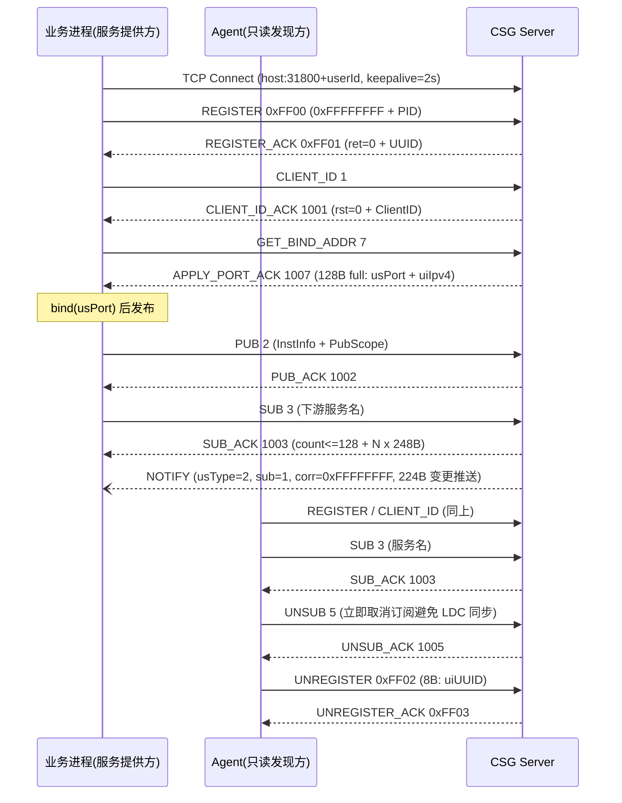
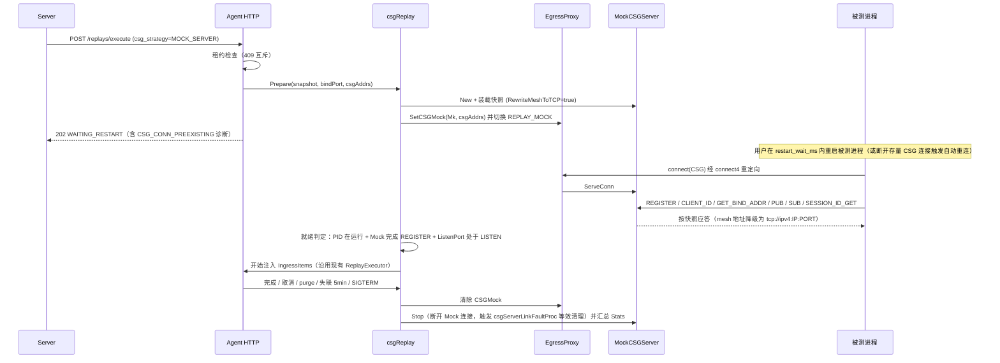

# ADR-21：CSG 感知型 Agent 服务发现与重放期 CSG 控制面 Mock 设计

- **文档编号**：`21-csg-aware-agent-service-discovery-and-replay-mock-adr.md`
- **文档版本**：v1.3.0
- **日期**：2026-11-16
- **状态**：📋 提议中 (Proposed — 已合入源码级反馈 `Q-P1`~`Q-P10` 及运行环境/寻址反馈 `Q-E1`/`Q-E2`/`Q-E3`；待澄清 [§14 开放问题](#14-开放问题与源码澄清台账) 中剩余 🔴 阻塞项及现场 PID 通道实证 `Q-E3b` 后进入正式评审)
- **关联特性**：`F-02`（物理进程蓝图与模块服务契约）、`F-05`（实测调用拓扑还原与一致性验证）、`F-08`（进程树选择与存量连接诊断）、`F-09` / `F-11`（Agent 采集与出站透明代理）、`F-12`（重放编排与零外泄门禁）、`F-13`（Agent 零 `.pb` Mock 匹配）
- **关联设计**：[`02-data-plane-and-cros-rpc-engine.md`](../02-design/02-data-plane-and-cros-rpc-engine.md)、[`03-architecture-elements-and-topology.md`](../02-design/03-architecture-elements-and-topology.md)、[`05-database-schema.md`](../02-design/05-database-schema.md)、[`06-agent-observability-and-self-healing-design.md`](../02-design/06-agent-observability-and-self-healing-design.md)
- **关联 ADR**：[`ADR-02`](./02-ebpf-hook-and-dual-subsystem-adr.md)（eBPF 钩子与零 `.pb` Mock）、[`ADR-03`](./03-control-plane-state-recovery-and-lease-reconciliation.md)（租约对账与孤儿探针防御）、[`ADR-09`](./09-arch-process-ssot-and-ebpf-premount-standby-adr.md)（进程 SSOT 与预挂载待命）、[`ADR-11`](./11-single-process-bidirectional-capture-and-recording-ux-adr.md)（单进程全出站透明代理）、[`ADR-16`](./16-multi-implementation-service-contract-adr.md)（多实现服务契约与 `dst_tag` 隔离）
- **演进关系**：本 ADR 不修订任何既有关键假设（`A-01` ~ `A-09`）。若 [`Q-B2`](#143-业务语义q-b) 确认 ADR-16 中的“调度中心 X”即 CSG，则本 ADR 将部分演进 [`Non-Goal 11`](../01-features/01-feature-matrix.md) 第 ③④ 条（届时须同步修订 ADR-16 §9）。
- **协议规范**：§4 为自包含协议参考（已与 DOPRA DDM 源码逐行对齐）；§13.2 为参考实现，已在隔离沙箱中通过 `gofmt` / `go vet` / `go test -race`（含 224B `NOTIFY` 穿插、`CorrID` 配对、`UNREGISTER` 与 `dophi_mesh://` 地址解析用例）。

### 修订记录

| 版本 | 日期 | 修订说明 |
| :--- | :--- | :--- |
| v1.0.0 | 2026-11-16 | 初稿：CSG 协议逆向规范、`CSGDiscoveryMgr` 服务发现、`MockCSGServer` / `MockServiceRegistrar` 重放期 Mock、四阶段实施路径与参考实现 |
| v1.1.0 | 2026-11-16 | **架构检视修订**（逐条对照见 §0）：1. 依据现网代码（ADR-11 全出站重定向 + `CSE.TCP` 写前守卫）更正痛点 3，重述真实问题为「控制面依赖、注册表反向污染、动态端口漂移、录制资产缺失控制面上下文」；2. 更正 CSG 能力边界（无服务枚举、无订阅关系查询）；3. Agent 访问真实 CSG 收敛为**只读白名单**，禁止 `GET_BIND_ADDR` 探测；4. `REGISTER` 策略降级为否决备选；5. `MOCK_SERVER` 改为「EgressProxy 原始目的分流 + 录制期 `SUB_ACK` 快照回放 + 保留原始实例地址」，废弃环境变量 / `/etc/hosts` 注入；6. 重放编排上移 `internal/agent/server`，拆出 `pkg/csgproto`；7. 新增 Server 侧持久化 / 上报 / SSOT 对账设计（§7）；8. 补齐物理防腐门禁、安全约束与测试策略；9. 重写并验证参考实现；10. 新增 §14 开放问题清单 |
| v1.2.0 | 2026-11-16 | **合入 DOPRA DDM 源码核实结论（闭环 `Q-P1` ~ `Q-P10`）**：1. 补齐 `UNREGISTER (0xFF02/0xFF03, 8B)`、`SESSION_ID_GET (6/1006, 80B/8B)`、`NOTIFY (usType=2, usSubType=1, CSG_SVC_CHANGE_MSG_S 224B)` 完整字节规范（§4.4.1、§4.13、§4.14）；2. 固化单帧上限 `DDM_DLINK_MAX_MSG_BUFF = 32000`（单次 `SUB_ACK` 最多 128 个实例，无分帧）、TCP keepalive 心跳参数（`idle=2s, intvl=1s, cnt=3`，无应用层 PING/PONG）与断链自动清理链 `csgServerLinkFaultProc → csgClientForceDownline`；3. 澄清 `GET_BIND_ADDR_ACK` 服务端源码恒发 128B full 格式（失败 `uiRst=VOS_ERR, usPort=0`），以及 `uiIpv4` 因 `inet_pton + VOS_HTONL` 双重转换在小端主机上呈小端序、`SESSION_ID_ACK.uiSessionId` 未调 `VOS_HTONL` 呈主机序两处源码级字节序特征；4. 针对 `Q-P5` 揭示的 **`dophi_mesh://` 数据面走 `MESH_Connect`（共享内存 IPC）无法被 `cros_connect4` 拦截**的关键风险，新增 §5.4 专项分析与 `MockCSGServer` 协议降级改写策略（`RewriteMeshToTCP`：将 `dophi_mesh://ipv4:IP:PORT` 改写为 `tcp://ipv4:IP:PORT`，保留原 `IP:Port` 以兼容 `dst_tag`），并派生成果确认项 `Q-P5b`；5. 同步更新 §13.2 参考实现与单测 |
| v1.3.0 | 2026-11-16 | **合入运行环境与控制面寻址反馈（闭环 `Q-E1`/`Q-E2`，深度剖析 `Q-E3` 并派生 `Q-E3b`）**：1. 确认 **`H-4`**：`userId` 为部署配置产品用户 ID（`ullUserId`，与 Linux UID、`OsNodeID` 无关），现网为单宿主机单栈单 `DophiServer` 形态（`10.29.109.146:31805` 服务同机 40+ 业务进程），§6.4 `locate.go` 增补 `DophiServer` 进程特征匹配、`[31800, 31900]` 端口区间及 `user_id` 提取；2. 确认 **`H-2`**：现网为单机裸机无容器部署，`Instance.ProcID` 即发布进程 OS PID（`getpid()`），与 `ProcScanner` 同命名空间直接匹配；§6.3 `MergeWithProcs` 增加本机 IP 归属守卫以防跨板 LDC 实例 PID 碰撞，§10/§12 显式列入容器化 PID/NetNS 跨命名空间风险与 Non-Goal；3. 剖析 **`Q-E3`**：证实 `"csg_server"` 为 DDM 域套接字路径（`{DDM_CTRL_FILE_PATH}/csg_server`，非 DNS/环境变量/共享内存），且 `CSG_ClientInit`/`CSG_SvrInit` 丢弃地址参数（坐实 §11.2 否决理由）；但现网 `10.29.109.146` 不存在 `csg_server`，而由 `DophiServer` 同时持有 `31805` TCP 与 `dlink_default_domain`/`mesh_server` UDS；4. 精确界定 `H-3` 影响边界（**G1 主动 TCP 只读发现不依赖业务进程走 TCP，仍完全可行**；仅 G2/G3 依赖拦截通道），将 D6 演进为「**`/proc/<pid>/fd` + `net/tcp` + `net/unix` 通道探测 + TCP 主路径 + UDS 快速失败诊断 `CSG_CHANNEL_UDS_UNSUPPORTED`**」，并在 §11.6 明确**否决宿主机全局接管 UDS**（防冲击同机 40+ 非纳管进程及非 CSG DDM 流量），指明若现场核验 `Q-E3b` 证实业务 PID 走 UDS 则需另立 ADR 评估单进程 mount-ns 单套接字 bind + dlink 复用代理或 uprobe 方案 |

---

## 0. v1.1.0 检视修订要点（相对 v1.0.0）

| # | v1.0.0 原表述 | 检视发现 | v1.1.0 修订 |
| :--- | :--- | :--- | :--- |
| 1 | 痛点 3：“CSG 返回真实下游地址，重放零外泄被破坏” | 与现网实现不符：`cros_connect4` 对纳管 PID 的**全部** IPv4 TCP 出站重定向到 `EgressProxy`（ADR-11），`REPLAY_MOCK` 下凡命中 Mock 端点**或**载荷含 `CSE.TCP` 魔术字的出站写入均被 Matcher 接管并物理切断真实下游，零外泄与 CSG 返回什么地址无关 | §1.2 重述为 P1~P4 四类真实问题；零外泄继续由现有数据面保证 |
| 2 | “CSG `Sub` 能回答：该服务的下游依赖是谁 / 当前注册中心有哪些服务” | CSG 协议没有“枚举全部服务”与“查询订阅者”操作；`SUB` 只能按**已知服务名**查询实例 | §1.3 更正能力边界；下游依赖只能通过**被动观测业务进程自身的 `SUB`** 获得 |
| 3 | Agent 连续 `GET_BIND_ADDR` 探测端口范围；阶段一“连接真实 CSG 申请端口” | 每次调用都会占用生产端口池并推进 `usNextPortNum` 游标，改变后续真实服务拿到的端口，属于对生产注册中心的写操作 | D5：运行期禁止 `PUB` / `UNPUB` / `GET_BIND_ADDR` / `FREE_BIND_ADDR`，仅保留只读白名单 |
| 4 | `REGISTER` 策略：向真实 CSG `PUB` Mock 实例，TTL 兜底 | ① 线上已配置 `NO_DUPLICATED_SERVICE`，同名 `PUB` 会被拒；② 多实例时业务选址不确定；③ 共享注册中心中**其他真实调用方**可能选中 Mock 实例，导致真实流量拿到 Mock 应答，危害大于外泄；④ 协议中没有 TTL 字段，Agent 崩溃后是否残留取决于服务端断链清理行为（未知） | 降级为否决备选（§11），列入 Non-Goal |
| 5 | `MOCK_SERVER`：`SUB_ACK` 返回 `127.0.0.1:{mockPort}`，靠环境变量 / `/etc/hosts` 注入重定向 | ① 改写下游地址会破坏 ADR-16 中按原始目的 `IP:Port` 映射的 `dst_tag`；② 修改业务进程环境 / 宿主机 hosts 违反零侵入；③ §4.11 已证明 `CSG_SvrInit` 地址参数被忽略，客户端寻址机制未知，注入未必生效；④ 现网全出站重定向已能拦截 CSG 连接，无需新增 eBPF 改造 | D6：`EgressProxy` 在 `REPLAY_MOCK` 下按原始目的分流到进程内 `MockCSGServer`；`SUB_ACK` 默认回放**录制期原始实例地址** |
| 6 | `ReplayCSGController` 位于 `pkg/csgmock` 并直接配置 `EgressProxy` | 导致 `pkg/csgmock → pkg/ebpf` 反向耦合，`pkg` 层出现编排逻辑 | D8：编排上移 `internal/agent/server`；`pkg/csgmock` 只做协议仿真 |
| 7 | 目标 ②“上报 Server、自动生成 `ProcessMonitorSpec`” | 全文只有 Agent 侧 API，缺少 Server 持久化、录制快照、SSOT 对账与权限设计；“自动生成”与 ADR-09 SSOT 原则冲突 | 新增 §7；只生成**建议**，写回 SSOT 需人工确认 |
| 8 | “新增包必须通过 `deps_test.go`” | `deps_test.go` 通过**显式包清单**执行 `go list -deps`，新包不加入清单就不会被检查；禁止依赖清单也与现网不一致（缺 `go-git` / `protocompile` / `sqlite`） | §8 明确修改清单，并同步 `AGENTS.md` 红线 1 |
| 9 | §12 参考实现 | 未按 `CorrID` 配对，也未处理 `NOTIFY` 帧；`cstr` 未截断首个 `\0`；未校验 `SubLen`；`SetReadDeadline` 错误被忽略；`Pub` 中 `ProcID` 硬编码 `os.Getpid()`；`Export` 注释与实现不符；import 未 gofmt；§12.4 用 `net.IP(body[24:28])` 时忽略了字节序疑点 | §13.2 重写为只读客户端并本地验证 |
| 10 | §4.1 “CSG `ServiceName` 与 `ascServiceName` 是同一逻辑标识” | 线上样本（`X-X`、`X-module`、`X-X-{instance}-{pid}`）与 `A-07` 规定的点分 Protobuf 全名不兼容 | 降级为待验证假设 H-1，并给出名称归一与映射规则（§5.1） |
| 11 | 实施路径第一阶段以“连接真实 CSG”为验收标准 | CI 无真实 CSG，不符合 TDD；需要 golden 字节夹具 | §9：`MockCSGServer` 兼作测试替身，配合抓包夹具；真实环境只作集成验收 |
| 12 | 文档格式 | §3.3 表格断行，§3.4 标题有前导空格无法渲染；§3.1 把 `GET_BIND_ADDR` 写成所有客户端的必经步骤 | 已修复；按角色拆分时序（§4.13） |

---

## 1. 背景与问题陈述 (Context & Problem Statement)

### 1.1 现状（以 `main` 分支代码为准）

**控制面声明**：Server 通过 `POST /agent/v1/monitors/arm`（ADR-09 预挂载）或 `POST /agent/v1/monitors/sync` 下发：

```text
ProcessMonitorSpec = { ProcessID, ListenPort, CmdPattern, Downstreams[{IP, Port, DstTag}] }
```

`ProcScanner` 通过 `/proc/net/tcp` 与 `/proc/[pid]/fd` 只能拿到 `PID`、`ListenPort`、`Cmdline`、`ExeName`。

**数据面事实**（`pkg/ebpf/bpf/cros_probe.c`、`pkg/ebpf/egress_proxy.go`）：

| 阶段 | 纳管 PID 的出站连接 | dlink（CSG 控制面）字节 | CROS RPC 字节 |
| :--- | :--- | :--- | :--- |
| `connect()` 时刻 | `cros_connect4` 将**全部** IPv4 TCP 出站改写到 `127.0.0.1:{proxy_port}`；豁免 Agent 自身 PID、目的端口等于自身监听端口、目的为代理端口三类 | — | — |
| 待命 / 录制 (`PASSTHROUGH` / `CAPTURING`) | `EgressProxy` 拨号真实目的并双向中继 | 透传，不解析 | 透传；`CAPTURING` 下分帧入信封流 |
| 重放 (`REPLAY_MOCK`) | 同上 | **透传到真实 CSG** | 命中 Mock 端点或载荷含 `CSE.TCP` → 切断真实下游，由 `ScopedMockMatcher` 应答；`MOCK_MISS` 时保持静默 |

> [!NOTE]
> `cgroup/connect4` 仅过滤 `AF_INET`（`cros_probe.c:201`），且只作用于**挂载之后新建**的 TCP 连接：`AF_UNIX` 域套接字连接与早于挂载建立的 CSG 长连接均不会进入 `EgressProxy`。这与 `A-01`（录制 / 重放前可接受重启）的前提一致；若目标业务进程通过 `AF_UNIX` 访问 CSG，则属于 `H-3` 覆盖边界之外（见 §3 与 D6）。

### 1.2 问题陈述

| # | 问题 | 现象与影响 |
| :--- | :--- | :--- |
| **P1** | **CSG 动态端口导致静态登记漂移** | 微服务启动时通过 `GET_BIND_ADDR` 从 CSG 顺序分配监听端口（§4.11），进程重启后端口大概率变化，`ArchProcess.listen_port` 与 `Downstreams[].Port` 因此失效：① `FindPIDByPortAndCmd` 定位失败，返回 `WAITING_PROC`；② `Downstreams → dst_tag` 映射失效，ADR-16 多实现 Mock 隔离退化为按服务名兜底，存在串用风险；③ `DiagnoseEstablishedConns` 按旧端口计算，存量连接漏判 |
| **P2** | **服务名与进程的归属不可见** | `ProcScanner` 无法回答“PID 1234 / 端口 16001 在 CSG 中发布了哪个服务”；架构 SSOT 中的 `ModuleService.service_name`（ADR-16 v2 运行期发布名）与实际运行进程只能靠人工对账 |
| **P3** | **重放期控制面依赖真实 CSG** | 重放时 dlink 透传真实 CSG：① 跨环境重放（如 SIT 素材投递到 `PRIVATE` 环境）时目标环境可能没有 CSG，或注册内容与录制期不同，业务进程启动或寻址失败；② 重启后的被测进程会把自身 `PUB` 到共享注册中心，同环境其他真实调用方可能把流量打到下游已被 Mock 的被测进程，造成**反向污染**；③ 重放期解析出的下游地址与录制期不同，`dst_tag` 归因偏差 |
| **P4** | **录制资产缺少控制面上下文** | 录制会话只保存 CROS RPC 帧，不记录业务进程当时通过 CSG 解析到的“服务名 → 实例地址”，重放时无法复现寻址结果 |

> [!IMPORTANT]
> **对 v1.0.0 痛点 3 的更正**：只要业务进程对下游的连接是挂载后新建的，零外泄就已经由「全出站重定向 + `CSE.TCP` 写前守卫」保证，与 CSG 返回真实地址还是 Mock 地址无关。本 ADR **不**依赖改写下游地址来实现零外泄。

### 1.3 CSG 能力边界（更正）

| 问题 | `ProcScanner` | CSG 主动 `SUB` | 被动观测业务进程 dlink |
| :--- | :--- | :--- | :--- |
| PID 1234 在 CSG 中发布了什么服务？ | ❌ | ⚠️ 需先知道服务名，再按 `ProcID` / 端口反查（H-2） | ✅ 观测其 `PUB` 请求即可精确获得 |
| 某服务当前有哪些实例 / 地址？ | ❌ | ✅ | ✅（仅限该进程查询过的服务） |
| 该进程依赖哪些下游服务？ | ❌ | ❌ 协议没有订阅者查询 | ✅ 观测其 `SUB` 请求 |
| 注册中心里共有哪些服务？ | ❌ | ❌ 协议没有枚举操作 | ⚠️ 只能看到被观测进程涉及的服务 |
| 实例的 `ProcID` / `OsNodeID`？ | ❌ | ✅ | ✅ |

### 1.4 目标与优先级

| 目标 | 描述 | 优先级 |
| :--- | :--- | :--- |
| **G1 服务⇄进程关联** | Agent 通过 TCP `31800+userId` 只读访问本机/同板 CSG（`DophiServer`），将实例与本机 `ProcScanner` 结果按 `ProcID`/端口关联并在 `/agents` 与 `ArchProcess` 挂载视图展示（不依赖业务进程自身是否走 TCP 连 CSG） | P0 |
| **G2 录制期控制面快照** | 被动解析业务进程的 `SUB` / `SUB_ACK` / `PUB`，随录制会话固化“服务名 → 实例”快照（解决 P4，为 G3 提供数据） | P0 |
| **G3 重放期 CSG Mock** | 重放时由 Agent 进程内的 `MockCSGServer` 接管被测进程的 CSG 连接，按快照应答 `SUB`，吞掉 `PUB`，不访问真实 CSG（解决 P3） | P1 |
| **G4 动态端点解析** | 允许 `ArchProcess` 以 CSG 服务名声明自身与下游，Agent 在挂载 / 重放时解析出当前 `IP:Port`（解决 P1） | P1 |
| ~~G5 Mock 服务注册~~ | ~~向真实 CSG `PUB` Mock 实例~~ | **否决**（§11.1） |

---

## 2. 决策矩阵 (Decisions)

| # | 决策点 | 选定方案 | 相对 v1.0.0 | 理由 |
| :--- | :--- | :--- | :--- | :--- |
| **D1** | 协议层落位 | 新增 `pkg/csgproto`（纯编解码 + 只读客户端，无状态），供 `pkg/csgdiscovery` 与 `pkg/csgmock` 共用 | 拆分 | 避免 `csgmock → csgdiscovery` 的业务耦合；编解码可单独 Fuzz |
| **D2** | CSG Server 地址 | 按「单宿主机默认 0 或 1 个控制面端点（保留多端点切片扩展余量）」建模：① `--csg-addr` / `CONTRACT_AGENT_CSG_ADDR` 显式配置（推荐）；② 观测纳管进程 `ScanProcessEstablishedSockets` 对端 ∈ `[31800, 31900]`；③ 本机 LISTEN 表 `[31800, 31900]` 匹配 `DophiServer` / `csg_server` / `DDMService` 后握手确认，并记录命中 `userId = port - 31800`；只读探查本地 DDM UDS 路径存在性用于诊断。**禁止**对远端地址盲扫 | 收紧 + v1.3 修正 | 实测确认宿主机由 `DophiServer` 监听 `31800+userId` 服务单机单栈（Q-E1）；优先观测存量连接天然规避双网卡问题 |
| **D3** | 服务名来源 | 取并集：① 被动观测 `SUB` / `PUB`（主）；② Server 下发的 SSOT 运行期发布名；③ 预置清单（兜底）。CROS `ascServiceName` 反推须待 H-1 验证后启用 | 调整 | `SUB` 必须提供服务名；SSOT 名称在冷启动阶段即可用 |
| **D4** | 拓扑关联 | 被动观测 `PUB` 精确绑定（最高）> `ProcID == PID` 强匹配（已确认 H-2，叠加非本机 IP 守卫防 LDC 跨板碰撞）> 本机 IP + 端口弱匹配；只保留内存 TTL 缓存，不落 Agent 磁盘 | 补充 + v1.3 守卫 | 裸机同命名空间下 `ProcID == getpid()`（Q-E2）；加本机 IP 守卫避免跨板同步实例撞 PID |
| **D5** | Agent 访问真实 CSG 的边界 | **只读白名单**：`REGISTER` / `CLIENT_ID` / `SUB` / `UNSUB` / `UNREGISTER`；每轮 `SUB` 后立即 `UNSUB`，退出时发 `UNREGISTER`；单长连接（内核 TCP keepalive 2s 保活）、令牌桶限速（默认 20 QPS）、指数退避重连（1s → 60s）。运行期代码路径**禁止** `PUB` / `UNPUB` / `GET_BIND_ADDR` / `FREE_BIND_ADDR` | 新增 | 避免改动生产注册中心状态与端口游标；立即 `UNSUB` 避免 LDC 分级数据库残留订阅 |
| **D6** | 重放期 CSG 处置 | 新增 `csg_strategy ∈ {PASSTHROUGH(默认), MOCK_SERVER}`，实施「**通道探测 + TCP 主路径 + UDS 快速失败**」：① 启动/重启后经 `/proc/<pid>/fd` ∩ `net/{tcp,unix}` 探测目标 PID 真实控制面通道；② TCP 通道：`EgressProxy` 在 `REPLAY_MOCK` 下按原始目的∈CSG 集合（或首包 `DLNK` 嗅探）将新建连接交给进程内 `MockCSGServer.ServeConn`，`SUB_ACK` 回放录制期快照并默认开启 `RewriteMeshToTCP`（§5.4），本地吞掉 `PUB`/`UNPUB` 并支持 `SESSION_ID_GET (6)`；③ 若探得业务 PID 仅走 `AF_UNIX`（`dlink_default_domain` / `mesh_server` / `csg_server`），v1 **禁止**宿主机全局接管 UDS（§11.6），直接快速失败报诊断 `CSG_CHANNEL_UDS_UNSUPPORTED`（不傻等超时或静默外泄真实 CSG） | 重做 + v1.3 通道守卫 | `connect4` 仅钩取 `AF_INET`（`cros_probe.c:201`）；宿主机直接覆盖 UDS 会冲击同机 40+ 非纳管进程及非 CSG DDM 流量；若 `Q-E3b` 证实业务走 UDS 则另立 ADR 评估单进程隔离方案 |
| **D7** | `MOCK_SERVER` 生效时机 | 两阶段重放：Agent 先进入 `REPLAY_MOCK` 并启动 Mock，返回 `WAITING_RESTART`；被测进程在窗口内重启（或断链重连）、经 Mock 完成 `REGISTER` 且监听端口就绪后，再开始注入。结束时 `MockCSGServer` 断开连接并模拟 `csgServerLinkFaultProc` 自动清理；挂载前已建立的 dlink 连接给出诊断 `CSG_CONN_PREEXISTING` | 新增 | `connect4` 只作用于新建连接；源码已确认断链即触发服务端完整自动清理（Q-P7） |
| **D8** | 重放编排位置 | `internal/agent/server/csg_replay.go`：在 `handleExecuteReplay` 中执行 `Prepare`，并在重放完成、取消、`purge`、主控失联超过 5 分钟、`SIGTERM` 五个出口执行 `Teardown` | 上移 | 遵守分层；与租约、探针卫生（红线 4）统一收口 |
| **D9** | 上报与持久化 | 拉取：Server 调用增强后的 `GET /agent/v1/processes/discover`；推送：新增信封事件 `EventCSGObservation = 0x08`，由 Server 合并写入 `contract_recording_sessions.csg_snapshots`（`jsonb`） | 新增 | 沿用 ADR-16 `endpoint_snapshots` 的“录制期快照固化”模式，不新增表 |
| **D10** | SSOT 回写 | Agent 侧发现结果只作为**建议**，在 `/agents` 与 `ArchProcess` 详情页展示差异；写回 `ModuleService` / `ArchProcess` 须由用户确认（管理接口需 `contract_admin`） | 修正 | 与 ADR-09 SSOT 原则一致 |

---

## 3. 关键假设（状态追踪）

| 编号 | 状态 | 假设 | 若不成立的影响 | 关联问题 |
| :--- | :--- | :--- | :--- | :--- |
| **H-1** | ⏳ 待确认 | CSG `ServiceName` 能通过确定性规则映射到 `ModuleService.service_name` 或 CROS `ascServiceName` | D3-③、§5.1 名称对账需改为人工维护映射表 | Q-B1 |
| **H-2** | ✅ **已确认** | 现网为单机裸机部署，无容器嵌套命名空间；`Instance.ProcID` 即发布进程通过 `getpid()` 填入的宿主机 OS PID（`csg_client.c:116, 1596`），与 `ProcScanner` 同命名空间可直接匹配 | （若未来容器化，需在 §10/§12 列为独立约束：`NSpid` 与 netns 映射） | Q-E2（已闭环） |
| **H-3** | ⏳ 待现场 PID 实证 | 目标业务进程经 **IPv4 TCP (`31800+userId`)** 访问 CSG，而非仅经 UDS（`dlink_default_domain` / `mesh_server` / `csg_server`） | **G1 主动 TCP 只读发现仍可用**（`DophiServer` 监听 `31800+userId`）；但 `cros_connect4` 无法拦截 `AF_UNIX`，基于 `EgressProxy` 的 G2 被动观测与 G3 `MOCK_SERVER` 将触发 `CSG_CHANNEL_UDS_UNSUPPORTED` 并需另立 ADR 评估单进程 UDS/uprobe 方案 | Q-E3 / Q-E3b |
| **H-4** | ✅ **已确认（当前单机单栈）** | 一台宿主机对应 1 个 `userId`、1 套 `DophiServer`/DDM 栈、1 个 CSG 控制面端口（`port = 31800 + userId`，`userId` 为部署配置产品用户 ID `ullUserId`） | （当前未见单机多 `userId` 共存；`Config.CSGAddrs` 仍保留切片以兼容未来多栈扩展） | Q-E1（已闭环） |
| **H-5** | ✅ **已确认** | 服务端应答恒为 `usType = REPLY (1)` 且原样回显 `uiCorrID`（`ddm_dlink_msg.c:667-712`） | — | Q-P1（已闭环） |
| **H-6** | ⏳ 待确认 | 当 `SUB_ACK` 返回 `tcp://ipv4:IP:PORT`（或由 `MockCSGServer` 将 `dophi_mesh://ipv4:IP:PORT` 改写为 `tcp://ipv4:IP:PORT`）时，CROS RPC 客户端会使用标准 TCP `connect()` 发起数据面连接 | 若客户端强制校验 `dophi_mesh://` 前缀且走共享内存 `MESH_Connect`，则需补充 uprobe 或配置级协议切换 | Q-P5b |

---

## 4. CSG 控制面协议规范 (Protocol Specification)

> 以下规范基于 DOPRA DDM 源码（`ddm_dlink_msg.c`、`ddm_dlink_ip.c`、`csg_server.c`、`csgs_dlink_adapt.c`、`csgs_data_adapt.c`、`cros_rpcaddrmgnt.c`）与线上实测校准确立，本节**自包含**，实施时无需查阅外部源码。

### 4.1 传输层与连接保活 / 断链回收

- **协议与双通道现状（Q-E3 已确认源码与主机部署差异）**：
  - **TCP 控制面端点**：`host:port`，其中 `port = 31800 + userId`（`RpcCfgParser::GetCsgServerPort()`）；`userId` 为 DDM/RPC 部署配置中的产品用户 ID（`ullUserId`，`ddm_auth.c:1241`），与 Linux UID、单板号 `OsNodeID`（默认 0）无关。现网单宿主机通常仅运行 1 个 `userId`、1 套 `DophiServer`/DDM 栈（如 `10.29.109.146` 上由 `DophiServer` 监听 `:31805`，同机 40+ 业务进程接入同一栈）。TCP 传输除两处源码特例（§4.11 `uiIpv4` 双重 `VOS_HTONL`、§4.13 `uiSessionId` 主机序）外均为大端序（网络字节序）。
  - **C 栈默认 UDS 通道与 `"csg_server"` 解析**：`CSG_ClientInit` / `CSG_SvrInit`（`csg_client.c:1481-1494`、`csg_server.c:456-459`）均通过 `(VOS_VOID)pcCsgSvrAddr;` 丢弃首参，硬编码绑定 `"csg_server"`（`DDM_LINK_BASE_FAMILY_DOMAIN`），由 `DDM_GetDomainSockPathCfg`（`ddm_cfg.c:745`）拼接为 `{DDM_CTRL_FILE_PATH}/csg_server`（默认 `/var/run/`，现网覆写为 `/dev/shm/ltusr/ddm/`，读自 `DDM_CFG_FILE_DIR` 下的 DDM JSON 配置，**非** DNS / 环境变量 / 共享内存）。但实测 `10.29.109.146` 上**不存在** `csg_server` 套接字，而是由 `DophiServer` 持有 `dlink_default_domain`、`ddm_sub_monitor`、`mesh_server` UDS 套接字与 `:31805` TCP 端口；业务 PID 实际走 TCP 还是 UDS 待 `Q-E3b` 现场核验。
- **端口池**：源码默认 `[32768, 49151]`；线上由 `CSG_SvrCfgSet` 覆盖（实测 16000 / 17200 起，见 §4.11）。
- **心跳保活**（`DDM_DlinkSetKeepAlive`，`ddm_dlink_ip.c:135-155`）：**无应用层 PING/PONG 帧**，完全由内核 TCP `SO_KEEPALIVE` 维持（`TCP_KEEPIDLE = 2s`、`TCP_KEEPINTVL = 1s`、`TCP_KEEPCNT = 3`）。Agent 只读长连接空闲 30s 不会被服务端断开。
- **断链自动回收**（`csgServerLinkFaultProc`，`csg_server.c:266-293` → `csgClientForceDownline`，`csgs_data_adapt.c:991-1045`）：TCP 断链时服务端自动清理该连接的全部 `SUB` 订阅、全部 `PUB` 实例（触发 `csgSvcChangeNotify` 与 `CSG_LDC_UNPUB`）、回收该连接申请的所有端口并销毁客户端节点。
- **连接生命周期（按角色）**：
  - **服务提供方（业务进程）**：`Connect` → `REGISTER` → `CLIENT_ID` → `GET_BIND_ADDR` → `bind()` → `PUB` →（`SUB` / `UNSUB` / `SESSION_ID_GET`）* → `UNPUB` → `UNREGISTER` → `Close`
  - **只读发现方（Agent）**：`Connect` → `REGISTER` → `CLIENT_ID` →（`SUB` → `UNSUB`）* → `UNREGISTER` → `Close`

> [!WARNING]
> **双网卡环境**：CSG Server 监听在**业务网 IP** 上，而非管理网。例如某环境管理网 `eth0` 上 CSG 端口不可达，业务网 `eth9` 上 `<业务网IP>:31805`（userId=5）正常监听。优先采用 D2-②（观测业务进程已建立的连接对端），避免遍历网卡盲探。

### 4.2 dlink 帧头 (`DDM_DLINK_HEAD_S`，32 字节)

所有 CSG 控制面消息都封装在 dlink 帧内。

```text
偏移   长度   字段           类型       说明
0      4      uiMagic        UINT32     0x444C4E4B ("DLNK" ASCII)
4      2      usType         UINT16     0=REQ, 1=REPLY, 2=NOTIFY, 3=FAULT
6      2      usMsgHeadLen   UINT16     头长度，固定 32
8      2      usSize         UINT16     消息体大小（不含本头，上限 DDM_DLINK_MAX_MSG_BUFF = 32000）
10     2      usSubType      UINT16     子类型（见 §4.3）
12     4      uiCorrID       UINT32     关联 ID（REQ/REPLY 严格配对；NOTIFY 固定为 0xFFFFFFFF）
16     4      uiLinkID       UINT32     链路 ID，固定 0x020A0000
                                        (prio=LOW(2)<<24 | serviceID=CSG(10)<<16 | index=0)
20     4      uiReserved     UINT32     保留，8 字节对齐填充
24     8      ullTimeStamp   UINT64     时间戳（实现中置零可用）
```

**编解码规则**（已由 `ddm_dlink_msg.c:667-712` 与 `ddm_dlink.ph:33` 确认）：

- 请求帧 `usType = 0 (REQ)`，应答帧恒为 `usType = 1 (REPLY)` 且原样回显请求 `uiCorrID` 与 `uiLinkID`。
- `usSize` 为载荷字节数（不含 32B 头），服务端分配上限为 `DDM_DLINK_MAX_MSG_BUFF = 32000`（无多帧分页协议）。
- **解码校验**（防御畸形帧）：`uiMagic == 0x444C4E4B`、`usMsgHeadLen == 32`、`usSize ≤ 32000`，任一不满足即断开连接。
- **`NOTIFY` 帧**：`usType = 2 (NOTIFY)`，`uiCorrID = 0xFFFFFFFF`（`DDM_DLINK_INVALID_CORRID`），`usSubType = 1`（`CSG_NOTIFY_MSG_PUB_UPDATE`），载荷为 224B `CSG_SVC_CHANGE_MSG_S`（见 §4.14）。客户端在等待 `REPLY` 期间收到 `NOTIFY` 必须跳过或异步回调，不得当作应答。

### 4.3 消息子类型 (`usSubType`)

| `usType` | 子类型值 | 请求/通知常量 | 应答值 | 应答常量 | 含义 | Agent 运行期 |
| :--- | :--- | :--- | :--- | :--- | :--- | :--- |
| `REQ/REPLY` | `0xFF00` | `dlinkTypeRegister` | `0xFF01` | `dlinkTypeRegisterAck` | dlink 层注册握手 | ✅ 允许 |
| `REQ/REPLY` | `0xFF02` | `dlinkTypeUnregister` | `0xFF03` | `dlinkTypeUnregisterAck` | dlink 层注销（8B `uiUUID`） | ✅ 允许（`Close` 时发送） |
| `REQ/REPLY` | `1` | `csgMsgClientID` | `1001` | `csgMsgClientIDAck` | CSG 客户端 ID 分配 | ✅ 允许 |
| `REQ/REPLY` | `2` | `csgMsgPubService` | `1002` | `csgMsgPubServiceAck` | 发布服务实例 | ⛔ 禁止（仅 Mock 服务端处理） |
| `REQ/REPLY` | `3` | `csgMsgSubService` | `1003` | `csgMsgSubServiceAck` | 订阅 / 发现服务 | ✅ 允许 |
| `REQ/REPLY` | `4` | `csgMsgUnpubService` | `1004` | `csgMsgUnpubServiceAck` | 取消发布 | ⛔ 禁止（仅 Mock 服务端处理） |
| `REQ/REPLY` | `5` | `csgMsgUnsubService` | `1005` | `csgMsgUnsubServiceAck` | 取消订阅 | ✅ 允许 |
| `REQ/REPLY` | `6` | `csgMsgSessionIdGet` | `1006` | `csgMsgSessionIdAck` | Frpc Session ID 请求 | ⛔ 不主动发（**Mock 服务端必须处理**） |
| `REQ/REPLY` | `7` | `csgMsgGetBindAddr` | `1007` | `csgMsgApplyPortAck` | 申请绑定地址（端口分配） | ⛔ 禁止（仅 Mock 服务端处理） |
| `REQ/REPLY` | `8` | `csgMsgFreeBindAddr` | `1008` | `csgMsgFreePortAck` | 释放绑定地址（端口回收） | ⛔ 禁止（仅 Mock 服务端处理） |
| `NOTIFY(2)` | `1` | `CSG_NOTIFY_MSG_PUB_UPDATE` | — | — | 服务实例上下线推送（224B） | ✅ 客户端接收解析 |

### 4.4 REGISTER 握手 (`usSubType = 0xFF00`) 与 UNREGISTER 注销 (`usSubType = 0xFF02`)

**REGISTER 请求体**（8 字节）：

```text
偏移  长度  字段        类型      说明
0     4     UUID        UINT32    0xFFFFFFFF（申请新 UUID）
4     4     ProcID      UINT32    调用方进程 PID
```

**REGISTER 应答体**（8 字节）：

```text
偏移  长度  字段    类型      说明
0     4     Ret     UINT32    返回码，0 = 成功
4     4     UUID    UINT32    CSG 分配的会话 UUID
```

**UNREGISTER 请求体**（8 字节 `DDM_DLINK_UNREGISTER_MSG_S`，`ddm_dlink.ph:352-360`）：

```text
偏移  长度  字段        类型      说明
0     4     uiUUID      UINT32    REGISTER 时分配的会话 UUID（BE）
4     4     uiReserved  UINT32    保留（置 0）
```

**UNREGISTER 应答体**（8 字节 `DDM_DLINK_UNREGISTER_ACK_MSG_S`）：

```text
偏移  长度  字段        类型      说明
0     4     uiRet       UINT32    返回码（BE），0 = 成功
4     4     uiReserved  UINT32    保留
```

> Agent 正常退出时先发 `UNREGISTER` 再关连接；若进程崩溃直接断链，服务端 `csgServerLinkFaultProc` 仍会完整回收状态（Q-P1③）。

### 4.5 CLIENT_ID 分配 (`usSubType = 1`)

**请求体**（8 字节）：

```text
偏移  长度  字段         类型      说明
0     4     RealProcID   UINT32    可置 0（参考实现置 0）
4     4     Reserved     UINT32    固定 0
```

**应答体**（16 字节）：

```text
偏移  长度  字段       类型      说明
0     4     Rst        UINT32    返回码，0 = 成功
4     4     Reserved   UINT32    保留
8     8     ClientID   UINT64    CSG 分配的全局唯一客户端 ID（ullClientIdSeed 单调递增，无上限）
```

> `ClientID` 是后续 `PUB` / `SUB` / `UNPUB` / `UNSUB` / `SESSION_ID_GET` 的身份凭证。

### 4.6 SUB — 服务发现 (`usSubType = 3`)

**请求体**（`CSG_SUB_SVC_MSG_S`，80 字节）：

```text
偏移  长度  字段           类型        说明
0     8     ClientID       UINT64      §4.5 获取的 ClientID
8     64    SubName        CHAR[64]    目标服务名，\0 填充
72    7     SubTransType   UCHAR[7]    传输类型位掩码（见下表）
79    1     Reserved       UCHAR       保留
```

**`SubTransType` 位掩码**：

```text
索引  名称      说明
0     DEFAULT   默认
1     TCP       TCP 传输（tcp:// 前缀的实例地址）
2     DMS       DMS 传输
3     UC        UC 传输
4     MESH      Mesh 传输（dophi_mesh:// 前缀）
5     DOMAIN    Unix Domain
6     BUTT      上界哨兵（不用）
```

> **关键约束**：服务端 `csgSvcInstAddrTansTypeParse`（`csgs_client_mgnt.c:588-599`）按实例地址中是否包含 `"tcp"` 或 `"dophi_mesh"` 子串匹配对应掩码位；未置位则返回 0 个实例。默认同时置 `TCP(1)` 和 `MESH(4)`。

**应答体**（`CSG_SUB_SVC_ACK_MSG_S` + N × `CSG_SERVICE_INST_INFO_S`）：

```text
偏移  长度  字段           类型      说明
─── ACK 头 (16 字节) ───
0     4     SvcInstCount   UINT32    返回的实例数量（单帧最多 128 个）
4     4     Rst            UINT32    返回码，0 = 成功
8     4     SubLen         UINT32    后续实例数据总字节长度（须 == SvcInstCount × 248）
12    4     Reserved       UINT32    保留
─── 实例数组 (N × 248 字节) ───
每个实例为 CSG_SERVICE_INST_INFO_S（248 字节，见 §4.9）
```

> **单帧上限**（Q-P3）：受 `DDM_DLINK_MAX_MSG_BUFF = 32000` 约束，单次 `SUB_ACK` 最多携带 `(32000 - 16) / 248 = 128` 个实例（`csgServiceSubProc` 填满缓冲区即停止，无分帧协议）。解析时必须校验 `SvcInstCount ≤ 128`、`SubLen == SvcInstCount × 248` 且 `SubLen ≤ usSize − 16`。

### 4.7 PUB — 服务发布 (`usSubType = 2`)

**请求体**（256 字节 = 248B `CSG_SERVICE_INST_INFO_S` + 1B `PubScope` + 7B 保留）：

```text
偏移  长度  字段           类型        说明
─── CSG_SERVICE_INST_INFO_S (248 字节，见 §4.9) ───
0     8     ClientID       UINT64      §4.5 获取的 ClientID
8     8     Version        UINT64      服务版本（可置 0）
16    4     ProcID         UINT32      发布进程 PID
20    4     OsNodeID       UINT32      节点 ID（可置 0）
24    32    Name32         CHAR[32]    服务短名（可置空）
56    128   SvcInstAddr    CHAR[128]   实例地址，如 "dophi_mesh://ipv4:10.29.92.80:2002"
184   64    ServiceName    CHAR[64]    服务全名，如 "HelloService-HelloService"
─── 扩展字段 (8 字节) ───
248   1     PubScope       UCHAR       发布范围（0 = board-local 默认）
249   7     Reserved       UCHAR[7]    保留
```

**应答体**（8 字节 `CSG_COMM_ACK_MSG_S`）：

```text
偏移  长度  字段      类型    说明
0     4     Rst       UINT32  返回码，0 = 成功
4     4     Reserved  UINT32  保留
```

> 若服务端配置了 `NO_DUPLICATED_SERVICE`（§4.11 步骤 3），同板重复发布同名服务会被拒绝。被动观测到的 `PUB` 是“进程 ⇄ 服务”最可信的绑定证据（D4）。

### 4.8 UNPUB — 取消发布 (`usSubType = 4`)

**请求体**（248 字节 = `CSG_SERVICE_INST_INFO_S`）：与 §4.7 前 248 字节相同，不含尾部 8B 扩展字段；`ClientID`、`ProcID`、`SvcInstAddr`、`ServiceName` 必须与 `PUB` 时一致。

**应答体**：8 字节 `CSG_COMM_ACK_MSG_S`（同 §4.7）。

### 4.9 `CSG_SERVICE_INST_INFO_S`（248 字节冻结结构）

```text
偏移   长度   字段               类型        说明
0      8      ClientID           UINT64      CSG 分配的客户端 ID
8      8      Version            UINT64      服务版本
16     4      ProcID             UINT32      发布进程的 OS PID（⚠️ 命名空间见 H-2）
20     4      OsNodeID           UINT32      操作系统节点 ID
24     32     Service32byteName  CHAR[32]    服务短名（\0 结尾）
56     128    SvcInstAddr        CHAR[128]   实例地址（\0 结尾）
184    64     ServiceName        CHAR[64]    服务全名（\0 结尾）
```

> 字符串字段一律**截断到首个 `\0`**，不能只 TrimRight，因为 `\0` 之后可能残留未清零的内存字节。

**实例地址格式**（`cros_rpcaddrmgnt.c:33, 331, 577`，Q-P5 已确认）：

| 传输类型 | 服务端发布格式 (`SvcInstAddr`) | 客户端连接格式 | 对应 `SubTransType` 位 | 数据面传输与可拦截性 |
| :--- | :--- | :--- | :--- | :--- |
| **MESH**（线上默认） | `dophi_mesh://ipv4:IP:PORT`<br>（如 `dophi_mesh://ipv4:10.29.92.80:2002`） | `dophi_mesh://peer:ipv4:ip:port[:local:ipv4:ip:port]` | MESH（索引 4） | ⚠️ 调 `MESH_Connect`（`mesh_sock.c:295`，共享内存 IPC），**不经过内核 TCP `connect()`**；重放期需经 `MockCSGServer` 改写为 `tcp://` 或补充钩子（见 §5.4） |
| **TCP** | `tcp://ipv4:IP:PORT[:svr_inst_id]`<br>（如 `tcp://ipv4:127.0.0.1:18500:1`） | `tcp://peer:ipv4:ip:port:svr_inst_id[:local:...]` | TCP（索引 1） | ✅ 标准 IPv4 TCP `connect()`，直接被 `cros_connect4` 拦截 |
| **DOMAIN** | `unix:///var/run/sock` | — | DOMAIN（索引 5） | ❌ 超出红线 2（仅 IPv4 TCP） |

**服务名格式**（线上实测采样）：

| 格式 | 样例 |
| :--- | :--- |
| 点分 Protobuf 全名 | `pkg.HelloService` |
| `{serviceName}-{serviceName}` | `CMReadService-CMReadService` |
| 纯服务名 | `Broker`、`DophiServer`、`Keeper` |
| `{serviceName}-{module}` | `SMCLService-CSC`、`WRPGetServiceA-WRP_GET_LR` |
| `{serviceName}-{serviceName}-{instance}-{pid}` | `SSPMonitorService-SSPMonitorService-2-76060` |

> 这些格式与 CROS `ascServiceName` 的关系**尚未验证**（H-1），详见 §5.1。

### 4.10 UNSUB — 取消订阅 (`usSubType = 5`)

**请求体**（`CSG_UNSUB_SVC_MSG_S`，72 字节）：

```text
偏移  长度  字段       类型        说明
0     8     ClientID   UINT64      §4.5 获取的 ClientID
8     64    SvcName    CHAR[64]    取消订阅的服务名，\0 填充
```

> UNSUB 请求体为 72 字节（`ClientID + SvcName`），**不含** SUB 的 `SubTransType[7]` 字段。Agent 只读发现循环中每次 `SUB` 后必须立即 `UNSUB`，防止服务端将订阅关系写入 LDC 分级数据库进行跨板同步（Q-P10）。

**应答体**：8 字节 `CSG_COMM_ACK_MSG_S`（`Rst` + `Reserved`）。

### 4.11 GET_BIND_ADDR — 端口申请 (`usSubType = 7`)

> [!CAUTION]
> 本节用于 **`MockCSGServer` 仿真**与**被动观测解析**。Agent 运行期**不得**向真实 CSG 发送 `GET_BIND_ADDR`：每次调用都会占用端口池，并推进服务端游标 `usNextPortNum`，进而改变后续真实服务分配到的端口（D5）。

**请求体**（8 字节 `CSG_GET_BIND_ADDR_MSG_S`）：

```text
偏移  长度  字段         类型       说明
0     8     aucReserved  UINT8[8]   全零保留字段（8 字节对齐）
```

**应答体 — 源码规范**（128 字节 `CSG_GET_BIND_ADDR_ACK_MSG_S`，`csgs_dlink_adapt.c:538-582`）：

```text
偏移  长度  字段              类型             端序    说明
0     4     uiRst             UINT32           BE      返回码，0 = 成功；端口池耗尽时为 VOS_HTONL(VOS_ERR)
4     4     aucReserved       UINT8[4]         —       保留
8     4     enProtocol        UINT32           BE      通信协议类型（RPC_TRANSPORT_TYPE_E）
12    4     uiReserved        UINT32           —       保留
16    112   unBindAddr        RPC_BIND_ADDR_U  —       绑定地址（union，最大 112B）
```

`enProtocol` 取值（`RPC_TRANSPORT_TYPE_E`）：`0=DEFAULT`、`1=TCP`、`2=DMS`、`3=UC`、`4=MESH（CSG 服务端当前只支持此类型）`、`5=DOMAIN`、`6=FRPC`、`7=CUSTOMIZE`。

当 `enProtocol = 4`（MESH）时，`unBindAddr` 按 `RPC_MESH_ADDR_S`（72 字节）解析：

```text
偏移  长度  字段          类型       端序   说明
16    2     usPort        UINT16     BE     CSG 分配的端口号（失败时为 0）
18    1     ucFamily      UINT8      —      地址族（RPC_SOCK_FAMILY_E: 0=AFNET, 1=AFNET6, 2=DOMAIN, 4=XMESH）
19    5     aucReserved   UINT8[5]   —      保留
24    64    unAddr        union      —      地址（union，最大 64B）
```

`unAddr` 按 `ucFamily` 选择 union 成员：

| `ucFamily` | 常量 | 长度 | 字段 | 类型 | 线上字节序 |
| :--- | :--- | :--- | :--- | :--- | :--- |
| 0 | `RPC_SOCK_FAMILY_AFNET` | 4 | `uiIpv4` | UINT32 | **小端主机上为小端序**（源码双重转换，见下） |
| 1 | `RPC_SOCK_FAMILY_AFNET6` | 16 | `aucIpv6` | UINT8[16] | 原始字节 |
| 4 | `RPC_SOCK_FAMILY_XMESH` | 64 | `acXmesh` | CHAR[64] | 原始字节 |

**`RPC_BIND_ADDR_U` union 成员尺寸**（`CROS_BIND_ADDR_S = 120B`）：`stDmsCfg=4B`、`stUcCfg=8B`、`stMeshCfg=72B`、`stTcpCfg=24B`、`stDomainCfg=112B（最大）`、`stCustomizeCfg=24B`。

**服务端端口分配与响应构造**（`csgServerAssignPort` / `csgServerGetBindAddrProc`）：

```text
1. 在 [usBeginPort, usEndPort]（默认 [32768, 49151]）内从 usNextPortNum 顺序递增，
   对每个候选端口依次检查 TCP SOCK_STREAM bind() 与抽象 Unix Domain Socket bind() 可用性，
   可用则插入 HASH 表（CSG_ADDR_HASH_LEN = 32）并推进游标；遍历一圈无可用端口则返回 VOS_ERR（usPort=0）
2. 无论成功或失败，始终分配并发送 sizeof(CSG_GET_BIND_ADDR_ACK_MSG_S) = 128 字节应答：
   - stMeshCfg.ucFamily = RPC_SOCK_FAMILY_AFNET (0)
   - stMeshCfg.usPort   = VOS_HTONS(usPort)
   - stMeshCfg.uiIpv4   = VOS_HTONL(pstSvrInfo->uiIpv4Addr)   // ⚠️ 双重转换！
   - pstAckMsg->uiRst   = VOS_HTONL(uiRet)
```

> [!IMPORTANT]
> **`uiIpv4` 双重字节序转换（Q-P2 源码已确认）**：
> - 存储阶段（`csg_server.c:748`）：`inet_pton(AF_INET, pstCfg->pcIpv4Addr, &g_stCsgServerInfo.uiIpv4Addr)` 已将 IP 存为**网络序**（例如 `10.29.92.80` 内存字节为 `0A 1D 5C 50`）。
> - 应答填充阶段（`csgs_dlink_adapt.c:570`）：`pstMeshCfg->unAddr.uiIpv4 = VOS_HTONL(pstSvrInfo->uiIpv4Addr)` 对已是网络序的值再次执行 `VOS_HTONL`，在小端平台上翻转为**小端字节序 `50 5C 1D 0A`** 发送上线路；C 客户端再执行 `NTOHL` 恰好还原。
> - **Go 实现规则**：解析小端 CSG Server 的 128B 应答时，`body[24:28]` 必须按反转字节 `net.IPv4(body[27], body[26], body[25], body[24])` 解读（或与连接对端 IP 自动比对校准）；`MockCSGServer` 在小端环境构造 128B 应答时同样须按小端序写入 `body[24:28]`。

**关于 128B full 与 8B compact 格式（Q-P6 源码核实）**：

- DOPRA 源码 `csgServerGetBindAddrProc` **在所有分支下均固定返回 128B full 格式**（`CSG_FREE_BIND_ADDR_ACK_MSG_S` 才是 8B）。
- 早期在环境 A（`userId=5`，起始端口 16000）与环境 B（`userId=6`，起始端口 17200）观测到的 8B 应答来自特定构建版本；`ParseBindAddrAck` 优先按 `usSize >= 128` 解析，保留 `usSize == 8` 作为前向/后向兼容分支，`MockCSGServer` 默认采用与源码一致的 `"full"`（128B）模式，支持配置切换 `"compact"`。

#### 4.11.1 端口范围与服务地址的配置链（`CSG_SvrCfgSet` → `CSG_SvrInit`）

端口分配范围由上层应用在 `CSG_SvrInit()` 之前通过 `CSG_SvrCfgSet()` 注入：

1. **设置通信协议**（`CSG_SVR_CFG_CMD_SET_PROTOCOL = 0`）：注入 `RPC_TRANSPORT_MESH (4)`。
2. **设置端口范围与服务 IP**（`CSG_SVR_CFG_CMD_SET_SERVICE_ADDR_RANGE = 1`）：注入 `CSG_SVR_SERVICE_ADDR_RANGE_S{pcIpv4Addr, usBeginPort, usEndPort}`，重置 `usNextPortNum = usBeginPort`。
3. **设置禁止重复发布**（`CSG_SVR_CFG_CMD_NO_DUPLICATED_SERVICE = 2`）：注入 `VOS_TRUE`，开启同板同名服务 `PUB` 唯一性检查。
4. **初始化服务端**：`CSG_SvrInit(pcCsgSvrAddr, &attr)`（首参在函数内被 `(VOS_VOID)pcCsgSvrAddr;` 丢弃，固定使用 `"csg_server"` 初始化 dlink）。

### 4.12 FREE_BIND_ADDR — 端口释放 (`usSubType = 8`)

**请求体**（8 字节 `CSG_FREE_BIND_ADDR_MSG_S`）：`0..2: usPort (BE)`、`2..8: aucReserved`。

**应答体**（8 字节 `CSG_FREE_BIND_ADDR_ACK_MSG_S`）：`0..4: uiRst (BE, 恒为 0)`、`4..8: aucReserved`。

### 4.13 SESSION_ID_GET — Frpc 会话 ID 申请 (`usSubType = 6`，Q-P8 新增)

**请求体**（80 字节 `CSG_SESSION_ID_GET_MSG_S`，`csg_comm.ph:230-236`，与 `SUB` 同构）：

```text
偏移  长度  字段              类型       说明
0     8     ullClientId       UINT64     ClientID（BE）
8     64    acSubName         CHAR[64]   服务名（\0 填充）
72    7     aucSubTransType   UINT8[7]   传输类型位掩码
79    1     ucReserved        UINT8      保留
```

**应答体**（8 字节 `CSG_SESSION_ID_ACK_MSG_S`，`usSubType = 1006`，`csg_comm.ph:238-241`）：

```text
偏移  长度  字段          类型      说明
0     4     uiSessionId   UINT32    服务端全局单调递增 ID（初始值 100；⚠️ 源码直接赋值未调 VOS_HTONL，小端主机上为小端序）
4     4     uiRst         UINT32    返回码，0 = 成功（VOS_OK=0）
```

> **对 `MockCSGServer` 的约束**：子类型 `6` 位于 `csgServerMsgProc` 正式分发表中（`csg_server.c:306-352`）。若 `MockCSGServer` 不响应或返回 `FAULT`，使用 Frpc 的业务进程将初始化失败。因此 `MockCSGServer` 必须处理子类型 `6`，返回从 `100` 起自增的 `uiSessionId` 与 `uiRst = 0`。

### 4.14 NOTIFY — 服务实例变更异步推送 (`usType = 2, usSubType = 1`，Q-P4 新增)

当有服务实例 `PUB` 上线或 `UNPUB`（含断链强制下线）时，CSG Server 通过 `csgSvcChangeNotify`（`csgs_data_adapt.c:823`）→ `DDM_DlinkNotify`（`ddm_dlink.c:1277-1294`）在同一 TCP 连接上向已订阅该服务的客户端主动推送：

- **帧头特征**：`usType = 2 (MsgTypeNotify)`、`usSubType = 1 (CSG_NOTIFY_MSG_PUB_UPDATE)`、`uiCorrID = 0xFFFFFFFF (DDM_DLINK_INVALID_CORRID)`、`usSize = 224`。
- **载荷布局**（224 字节 `CSG_SVC_CHANGE_MSG_S`，`csg_comm.ph:108-118`）：

```text
偏移  长度   字段             类型       端序   说明
0     4      uiIsPub          UINT32     BE     1 = PUB 上线，0 = UNPUB 下线
4     4      aucReserved      UINT8[4]   —      保留
8     8      ullClientId      UINT64     BE     发布方 ClientID
16    8      ullVersion       UINT64     BE     服务版本
24    4      uiOsNodeId       UINT32     BE     操作系统节点 ID（⚠️ 注意：在 uiProcId 之前！）
28    4      uiProcId         UINT32     BE     发布进程 OS PID
32    64     acServiceName    CHAR[64]   —      服务全名（\0 结尾）
96    128    acSvcInstAddr    CHAR[128]  —      实例地址（\0 结尾）
```

> [!NOTE]
> **与 `SUB_ACK` 的结构差异**：`CSG_SVC_CHANGE_MSG_S`（224B）不含 32 字节短名 `Service32byteName`，且偏移 24 为 `uiOsNodeId`、偏移 28 为 `uiProcId`（与 248B `CSG_SERVICE_INST_INFO_S` 中偏移 16 `ProcID`、偏移 20 `OsNodeID` 的顺序相反）。客户端首次 `SUB` 已拿到全量实例列表，重放期 `MockCSGServer` 无需主动推送 `NOTIFY` 即可让业务进程正常调用下游，但支持按需构造推送。

### 4.15 协议交互时序



### 4.16 dlink 帧编解码伪代码

```text
// 编码帧头（Mock 服务端构造 REPLY / NOTIFY 时 msgType 取 1 / 2）
function encodeHead(msgType, subType, size, corrID) -> 32 bytes:
    b[0..3]   = 0x444C4E4B            // "DLNK"
    b[4..5]   = msgType (BE)
    b[6..7]   = 0x0020                // usMsgHeadLen = 32
    b[8..9]   = size (BE)
    b[10..11] = subType (BE)
    b[12..15] = corrID (BE)
    b[16..19] = 0x020A0000            // uiLinkID
    b[20..31] = 0                     // Reserved + TimeStamp

// 读取一帧
function readFrame(conn) -> (head, body):
    hb = readFull(conn, 32)
    h  = decodeHead(hb)
    assert h.Magic == 0x444C4E4B && h.HeadLen == 32 && h.Size <= 32000
    body = (h.Size == 0) ? nil : readFull(conn, h.Size)
    return (h, body)

// 请求-应答（客户端）
function roundTrip(sub, wantAck, payload):
    corr = ++corrID; write(encodeHead(REQ, sub, len(payload), corr) + payload)
    loop:
        (h, body) = readFrame(conn)
        if h.Type == NOTIFY: onNotify(parseSvcChangeNotify(body)); continue
        if h.Type == FAULT:  return error
        if h.Type != REPLY || h.CorrID != corr: continue
        if h.SubType != wantAck: return error
        return body
```

---

## 5. CSG 与 CROS RPC / 架构 SSOT 的交叉锚点

### 5.1 服务名（假设 H-1，待验证）

v1.0.0 认为 CSG `ServiceName[64]` 与 CROS `ascServiceName[64]` 是同一逻辑标识。但线上样本的五种格式与 `A-07`（`ascServiceName = {package}.{serviceName}`）不兼容，因此将其列为**待验证假设 H-1**，并定义以下**按优先级的匹配规则**（实现在 Server 侧，Agent 只上报原始名称）：

| 优先级 | 规则 | 示例 |
| :--- | :--- | :--- |
| 1 | 与 `ModuleService.service_name`（ADR-16 v2 运行期发布名）精确相等 | `DH_SyncService` ⇄ `DH_SyncService` |
| 2 | 与 `ascServiceName` / `.pb` 点分全名精确相等 | `pkg.HelloService` |
| 3 | 规则归一后相等：剥离 `-{数字}-{数字}` 实例后缀；`X-X` 折叠为 `X`；去掉 `package.` 前缀后比较短名 | `SSPMonitorService-SSPMonitorService-2-76060` → `SSPMonitorService` |
| 4 | 人工映射表（`ModuleService` 扩展 `csg_service_names[]`，由用户在 SSOT 中维护） | `SMCLService-CSC` ⇄ `pkg.SMCLService` |
| — | 均未命中 | 标记 `CSG_UNMAPPED`，只展示不归因 |

> 规则 3 是否成立、需要哪些归一步骤，以 Q-B1 提供的对照样本为准；未得到样本前只启用规则 1、2、4。

### 5.2 ProcID 关联（`H-2` 已确认）

现网实测为**单机裸机无容器部署**（`process_report.md` 显示 `10.29.109.146` 全部 1896 个进程运行在宿主机，无 docker/containerd/kubelet 与嵌套命名空间）。源码 `csg_client.c:116, 1596-1597` 确认发布时回填 `uiSysProcId = (VOS_UINT32)getpid()`，因此同宿主机裸机下 `Instance.ProcID` 与 Agent `ProcScanner` 扫到的 `/proc/[pid]` 处于同一 PID 命名空间，可直接精确比较。

- **跨板碰撞守卫**：由于 CSG 支持 LDC 跨板同步，若 `SUB_ACK` 返回的实例携带远端节点 IP（`inst.Transport ∈ {tcp, mesh}` 且非空 `inst.Host ∉ localIPs ∪ {"0.0.0.0"}`），即使 `inst.ProcID` 碰巧等于本机某个 `proc.PID`，也不得授予 `STRONG` 匹配。
- **后续容器化边界**：若未来引入容器化部署，容器内 `getpid()` 与 eBPF `bpf_get_current_pid_tgid() >> 32`（`cros_probe.c:211`）所属 PID 命名空间分离，且 `cros_connect4` 重定向至 `127.0.0.1`（`cros_probe.c:275`）受限于独立网络命名空间，需在独立 ADR 中通过 `/proc/<hostpid>/status` `NSpid` 与 netns 代理解决（列为 §12 Non-Goal 9）。

### 5.3 端口关联

服务启动时通过 `GET_BIND_ADDR` 申请监听端口，`bind()` 后以 `PUB` 发布，`Instance.Addr` 携带该端口。Agent 的关联方式：

- 解析 `SUB_ACK` 中的 `Instance.Addr`（兼容 `dophi_mesh://ipv4:IP:PORT` 与 `tcp://ipv4:IP:PORT[:svr_inst_id]`），与本机 `DiscoveredProcess.ListenPort` 比较（仅当实例 IP 属于本机网卡地址集合）；
- 被动观测业务进程 `GET_BIND_ADDR` 应答与后续 `PUB`，直接得到“进程 → 端口 → 服务名”；
- ⛔ **不**主动发送 `GET_BIND_ADDR` 探测分配行为（D5）。

### 5.4 `dophi_mesh://` 共享内存数据面与内核 eBPF 拦截的矛盾及化解方案（Q-P5 新增）

根据 DOPRA 源码核实（`cros_rpcaddrmgnt.c:33, 331`、`mesh_sock.c:295, 414`、`cros_rpcmesh.c:1342`）：

1. **矛盾根因**：线上 CSG Server 默认配置 `ucProtocol = RPC_TRANSPORT_MESH (4)`，发布的实例地址以 `dophi_mesh://ipv4:IP:PORT` 为主。当客户端按 `dophi_mesh://` 发起数据面连接时，调用的是 `MESH_Connect(iWorkFd, &stAddr)`，内部经 `g_stMeshShmComAdaptHook` 走**共享内存 IPC**，**不经过内核 `AF_INET` TCP 协议栈**，因此现有的 `cgroup/connect4` (`cros_connect4`) 无法拦截同机共享内存通道。
2. **重放期化解方案 — 控制面协议降级改写（`RewriteMeshToTCP`）**：
   - `MockCSGServer` 提供 `RewriteMeshToTCP` 选项（默认开启）：在构造 `SUB_ACK`（及 `NOTIFY`）时，调用 `csgproto.RewriteMeshAddrToTCP` 将快照中的 `dophi_mesh://ipv4:IP:PORT` 改写为 `tcp://ipv4:IP:PORT`。
   - **双重收益**：① 引导 CROS RPC 客户端切回标准 TCP 传输层发起内核 `connect(IP:PORT)`，从而 100% 落入现有 `cros_connect4` ➔ `EgressProxy` ➔ `ScopedMockMatcher` 零外泄拦截链路；② **原始 `IP:PORT` 保持不变**，ADR-16 多实现契约依赖的 `Downstreams → dst_tag` 映射完全不受影响。
   - **前置确认项（`Q-P5b`）**：需在 CROS RPC 客户端源码中核实，当业务进程发起 `SUB` 时 `SubTransType` 掩码是否允许接收 `tcp://ipv4:` 实例，以及 `g_stMeshTransAdaptHook` 在跨节点或共享内存不可用时是否本身就回退到内核 TCP。
3. **录制期处理策略**：
   - 若测试环境中业务进程已走 TCP（或通过 `CSG_SVR_CFG_CMD_SET_PROTOCOL = RPC_TRANSPORT_TCP` / `EgressProxy` 控制面改写切至 TCP），现有 eBPF 数据面可直接录制；
   - 若目标环境必须在录制期原位采集 `MESH_Connect` 共享内存流量，则属于数据面采集介质扩展，需另立 ADR 通过 uprobe 挂载 `MESH_Connect` / `MESH_Send` / `MESH_Recv` 实现（超出本 ADR 控制面范围，见 §12 Non-Goal 5）。

---

## 6. Agent 侧模块设计 (Module Design)

### 6.1 包与文件清单

| 路径 | 职责 | 依赖约束 |
| :--- | :--- | :--- |
| `pkg/csgproto/` | `proto.go`（帧头 / 常量 / 校验）、`inst.go`（实例与载荷编解码、地址解析、`GET_BIND_ADDR` 兼容解析）、`client.go`（只读客户端）、`observer.go`（被动观测流式解析器） | 仅标准库；零 `gorm` / `pgx` / `dynamicpb` / `protoregistry` / `models` / `internal/server` |
| `pkg/csgdiscovery/` | `manager.go`（`Manager`：名称集合、刷新循环、TTL 缓存、退避重连、降级）、`merge.go`（`MergeWithProcs`）、`locate.go`（CSG 地址发现） | 依赖 `pkg/csgproto`、`pkg/agentproto` |
| `pkg/csgmock/` | `server.go`（`MockCSGServer`：`ServeConn` + 测试用独立监听）、`snapshot.go`（快照索引） | 依赖 `pkg/csgproto`、`pkg/agentproto`；**禁止**依赖 `pkg/ebpf` |
| `internal/agent/server/csg_replay.go` | 重放期 CSG 编排（`Prepare` / `AwaitRestart` / `Teardown`） | 可依赖上述三包与 `pkg/ebpf` |
| `pkg/ebpf/egress_proxy.go` | `REPLAY_MOCK` 下 CSG 连接分流钩子；`PASSTHROUGH` / `CAPTURING` 下 dlink 旁路观测钩子 | 依赖 `pkg/csgproto`（仅观测器接口） |

### 6.2 `pkg/csgproto` — 编解码与只读客户端

- 公开 API：`EncodeHead` / `DecodeHead` / `ReadFrame` / `IsDlinkPrefix`、`ParseInstance` / `EncodeInstance`、`ParseSvcChangeNotify` / `EncodeSvcChangeNotify`（224B `NOTIFY`）、`EncodeSubReq` / `DecodeSubReq`、`ParseSubAck` / `EncodeSubAck`、`EncodeSessionIDAck`、`ParseInstAddr` / `RewriteMeshAddrToTCP`、`ParseBindAddrAck`、`Dial(ClientConfig) (*Client, error)`、`(*Client).Sub` / `Unsub` / `Close`（内部发送 `UNREGISTER 0xFF02`）。
- **`Client` 不提供** `Pub` / `Unpub` / `GetBindAddr` / `FreeBindAddr` 方法；`MockCSGServer` 构造对应**应答**时使用独立的编码函数。
- `ClientConfig.ProcID` 由调用方传入（Agent 自身 PID），不在库内硬编码 `os.Getpid()`。
- 必须提供 `FuzzDecodeHead` / `FuzzParseSubAck` / `FuzzParseSvcChangeNotify`，覆盖畸形帧不 panic、不超额分配内存。

### 6.3 `pkg/csgdiscovery` — 只读发现管理器

```go
// pkg/csgdiscovery/manager.go
type Config struct {
    CSGAddrs        []string      // 显式配置或自动发现得到的 CSG 地址（默认 0~1 个，保留多栈扩展余量）
    RefreshInterval time.Duration // 默认 30s
    EntryTTL        time.Duration // 缓存条目过期时间，默认 3 × RefreshInterval
    MaxQPS          int           // SUB 令牌桶，默认 20
    TransMask       [7]byte       // 默认 TCP + MESH
    SeedNames       []string      // 预置清单（兜底）
}

type ServiceInstance struct {
    ServiceName  string
    InstanceAddr string // 原始地址
    Transport    string // tcp | mesh | domain | unknown
    Host         string
    Port         uint16
    ProcID       uint32
    OsNodeID     uint32
    ClientID     uint64
    Version      uint64
    Source       string // ACTIVE_SUB | OBSERVED_SUB | OBSERVED_PUB
    ObservedAt   time.Time
}

type Manager struct { /* cfg, client, names(set), cache, mu, stopCh, status */ }

func New(cfg Config) *Manager
func (m *Manager) Start(ctx context.Context)                   // 后台循环；连接失败只记录状态，不阻塞 Agent 启动
func (m *Manager) AddNames(source string, names ...string)     // 来源：SSOT 下发 / 被动观测 / 预置
func (m *Manager) Ingest(obs agentproto.CSGObservation)        // 被动观测结果入缓存
func (m *Manager) Snapshot() map[string][]ServiceInstance
func (m *Manager) Status() agentproto.CSGStatus
func (m *Manager) MergeWithProcs(procs []agentproto.DiscoveredProcess) []agentproto.DiscoveredProcess
func (m *Manager) Stop()
```

**刷新循环**：复用单一长连接（由内核 TCP keepalive `idle=2s, intvl=1s, cnt=3` 维持活性），每轮对名称集合逐个执行 `SUB → UNSUB`（受令牌桶约束，立即 `UNSUB` 避免 LDC 数据库同步订阅记录）；整体失败时按指数退避（1s → 60s）重连；连续失败超过 3 轮则 `Status.Degraded = true`，`/processes/discover` 退化为纯 `ProcScanner` 结果（不报错）。

**`MergeWithProcs` 算法**：

```text
输入: procs（ProcScanner），insts（缓存中未过期的实例），localIPs（net.Interfaces 全部 IPv4 + 127.0.0.1）
for each proc in procs:
    matches = {}
    for each inst in insts:
        isRemoteIP = (inst.Transport ∈ {tcp, mesh}) && inst.Host != "" && inst.Host != "0.0.0.0" && inst.Host ∉ localIPs
        if isRemoteIP:
            continue // 跨板/远端实例不参与本机 PID 强/弱匹配，防 LDC 同步引起跨主机 PID 碰撞
        level = NONE
        if inst.Source == OBSERVED_PUB && inst.ObservedPID == proc.PID:   level = EXACT
        elif inst.ProcID == proc.PID:                                    level = STRONG   // H-2 已确认（裸机同 NS）
        elif inst.Transport ∈ {tcp, mesh} && inst.Port == proc.ListenPort:
                                                                         level = WEAK     // mesh 同样绑定 TCP 监听端口（csgServerCheckPort）
        if level != NONE: matches[inst.ServiceName] = max(matches[...], level)            // 按服务名去重取最高级
    proc.CSGServices = sortByLevelDesc(matches)
    proc.CSGSubscriptions = 被动观测到的该 PID 的 SUB 名称及解析结果（无观测则为空，不做推测）
```

### 6.4 CSG 地址发现与通道探测（`locate.go`）

| 顺序 | 策略 | 说明 |
| :--- | :--- | :--- |
| 1 | 显式配置 | `--csg-addr=host:port[,host:port]` 或 `CONTRACT_AGENT_CSG_ADDR`（生产推荐） |
| 2 | 观测已建立连接 | 通过 `ProcScanner.ScanProcessEstablishedSockets`（`/proc/<pid>/fd` ∩ `/proc/<pid>/net/tcp`）提取纳管进程远端端口 ∈ `[31800, 31900]` 的对端，执行一次 `REGISTER` + `UNREGISTER` 握手确认并记录 `userId = port - 31800` |
| 3 | 本机 LISTEN 表 | 本机 `LISTEN` 端口 ∈ `[31800, 31900]` 且进程特征匹配 `DophiServer` / `csg_server` / `DDMService`（现网实测为 `DophiServer`，Q-E1）的候选，同样握手确认并记录 `userId` |
| 4 | 控制面通道只读探查 | 通过 `/proc/<pid>/fd` ∩ `/proc/<pid>/net/{tcp,unix}` 判定目标 PID 连向 CSG 的通道形态（`TCP_318XX` / `UDS_DDM` / `DUAL` / `NONE`），并只读探测 `/dev/shm/ltusr/ddm/` 与 `/var/run/` 下 `csg_server` / `dlink_default_domain` / `mesh_server` 套接字存在性用于诊断展示 |
| ⛔ | 远端 / 全网卡盲扫 | 禁止 |

> `Q-E3` 已证实 `"csg_server"` 由 DDM JSON 配置项 `DDM_CTRL_FILE_PATH` 解析（非环境变量或 DNS），且 `CSG_ClientInit` 会丢弃传入地址，因此不采用 `/proc/[pid]/environ` 猜测环境变量的方案。现网每台宿主机默认按「0 或 1 个有效 CSG 控制面端点」运行（单 `userId`），`Config.CSGAddrs` 保留切片仅作前向兼容。

### 6.5 被动观测（`EgressProxy` dlink 旁路解析）

**触发条件**：`PASSTHROUGH` 或 `CAPTURING` 模式下，中继连接的首个客户端数据块满足 `csgproto.IsDlinkPrefix`。

**处理方式**：中继字节**原样转发、绝不修改**；同时把两个方向的字节复制到一个 `csgproto.Observer`（流式、有界缓冲 64 KiB，超限即放弃该连接的观测），由它解析：

| 观测帧 | 提取信息 |
| :--- | :--- |
| `REGISTER`（C→S） | 请求中的 `ProcID`，与 NAT 表中真实 PID 对照（辅助交叉核验宿主 PID 一致性，已确认 `H-2`） |
| `GET_BIND_ADDR_ACK`（S→C，128B full / 8B compact） | 分配端口与小端 `uiIpv4` → 推断环境端口范围与通信 IP |
| `PUB`（C→S）+ `PUB_ACK` | **进程 ⇄ 服务名 ⇄ 实例地址**精确绑定（`OBSERVED_PUB`） |
| `SUB`（C→S，`corr → name`）+ `SUB_ACK`（S→C，`corr → instances`） | 该进程的下游依赖及解析结果（`OBSERVED_SUB`） |
| `NOTIFY`（S→C，`usType=2, sub=1`，224B `CSG_SVC_CHANGE_MSG_S`） | 实例动态上下线增量更新 |

**输出**：`agentproto.CSGObservation`，同时 ① 写入本地 `csgdiscovery.Manager`；② 若处于 `CAPTURING` 且有活跃会话，封装为信封事件 `EventCSGObservation (0x08)` 推送 Server（JSON 载荷，单条 ≤ 4 KiB）。

**限制**：只覆盖挂载**之后**新建的 CSG 连接（`A-01` 重启前提）；`/agents` 页面需提示“重启进程后才能观测 CSG 寻址”。

### 6.6 Agent HTTP API 与 `agentproto` 扩展

#### 6.6.1 增强 `GET /agent/v1/processes/discover`（向后兼容，新增字段均 `omitempty`）

```json
{
  "items": [{
    "pid": 1234,
    "listen_port": 16001,
    "cmdline": "...",
    "exe_name": "...",
    "csg_channel": "TCP_318XX",
    "csg_services": [{
      "service_name": "HelloService-HelloService",
      "instance_addr": "dophi_mesh://ipv4:10.29.92.80:16001",
      "proc_id": 1234,
      "os_node_id": 100,
      "version": 1,
      "match_level": "EXACT",
      "source": "OBSERVED_PUB"
    }],
    "csg_subscriptions": [{
      "service_name": "OrderService-OrderService",
      "instances": ["dophi_mesh://ipv4:10.29.92.80:16003"],
      "observed_at": "2026-11-16T10:00:00Z"
    }]
  }],
  "csg": {
    "addrs": ["10.29.92.80:31806"],
    "user_ids": [6],
    "detected_channel": "TCP_318XX",
    "connected": true,
    "degraded": false,
    "last_refresh_at": "2026-11-16T10:00:00Z"
  }
}
```

> v1.0.0 的 `csg_downstreams` 更名为 `csg_subscriptions`，**只**包含被动观测到的真实 `SUB`，不再根据“本节点其他进程注册的服务”推测下游。

#### 6.6.2 新增 `GET /agent/v1/csg/status`

沿用现有 Agent HTTP 鉴权（`allow-ips` 白名单 + 认领码）；只返回摘要，不返回完整实例清单。

```json
{
  "addrs": ["10.29.92.80:31806"],
  "user_ids": [6],
  "detected_channel": "TCP_318XX",
  "uds_endpoints": ["/dev/shm/ltusr/ddm/dlink_default_domain", "/dev/shm/ltusr/ddm/mesh_server"],
  "connected": true,
  "degraded": false,
  "client_id": 1234567890,
  "uuid": 42,
  "name_count": 37,
  "cached_instances": 52,
  "last_refresh_at": "2026-11-16T10:00:00Z",
  "last_error": "",
  "observed_conns": 3
}
```

#### 6.6.3 `agentproto` 扩展

```go
// DiscoveredProcess 新增字段（omitempty，旧主控忽略即可）
type DiscoveredProcess struct {
    PID              uint32             `json:"pid"`
    ListenPort       uint16             `json:"listen_port"`
    Cmdline          string             `json:"cmdline"`
    ExeName          string             `json:"exe_name"`
    CSGChannel       string             `json:"csg_channel,omitempty"` // TCP_318XX | UDS_DDM | DUAL | UNKNOWN
    CSGServices      []CSGServiceInfo   `json:"csg_services,omitempty"`
    CSGSubscriptions []CSGSubscription  `json:"csg_subscriptions,omitempty"`
}

type CSGServiceInfo struct {
    ServiceName  string `json:"service_name"`
    InstanceAddr string `json:"instance_addr"`
    ProcID       uint32 `json:"proc_id"`
    OsNodeID     uint32 `json:"os_node_id"`
    Version      uint64 `json:"version"`
    MatchLevel   string `json:"match_level"` // EXACT | STRONG | WEAK
    Source       string `json:"source"`      // OBSERVED_PUB | ACTIVE_SUB | OBSERVED_SUB
}

type CSGSubscription struct {
    ServiceName string    `json:"service_name"`
    Instances   []string  `json:"instances"`
    ObservedAt  time.Time `json:"observed_at"`
}

// CSGStatus 摘要状态（供 /processes/discover 与 /csg/status 共用）
type CSGStatus struct {
    Addrs           []string  `json:"addrs"`
    UserIDs         []int     `json:"user_ids,omitempty"`
    DetectedChannel string    `json:"detected_channel,omitempty"` // TCP_318XX | UDS_DDM | DUAL | UNKNOWN
    UDSEndpoints    []string  `json:"uds_endpoints,omitempty"`
    Connected       bool      `json:"connected"`
    Degraded        bool      `json:"degraded"`
    ClientID        uint64    `json:"client_id,omitempty"`
    UUID            uint32    `json:"uuid,omitempty"`
    NameCount       int       `json:"name_count,omitempty"`
    CachedInstances int       `json:"cached_instances,omitempty"`
    LastRefreshAt   time.Time `json:"last_refresh_at,omitempty"`
    LastError       string    `json:"last_error,omitempty"`
    ObservedConns   int       `json:"observed_conns,omitempty"`
}

// CSGObservation 被动观测事件（EventCSGObservation = 0x08 的 JSON 载荷，同时用于 Manager.Ingest）
type CSGObservation struct {
    ProcessID   uint64   `json:"process_id"` // 主控 contract_processes.id（NAT 表）
    PID         uint32   `json:"pid"`
    Kind        string   `json:"kind"`       // PUB | SUB | BIND_ADDR | NOTIFY
    ServiceName string   `json:"service_name,omitempty"`
    Instances   []string `json:"instances,omitempty"`
    BindPort    uint16   `json:"bind_port,omitempty"`
    CSGAddr     string   `json:"csg_addr"`
    ObservedAt  int64    `json:"observed_at_ns"`
}

// CSGResolution 录制期快照条目（重放下发与持久化共用）
type CSGResolution struct {
    ServiceName string   `json:"service_name"`
    Instances   []string `json:"instances"` // 录制期 SUB_ACK 原始 SvcInstAddr
}

// ProcessMonitorSpec / DownstreamEndpoint 扩展（G4，P5 阶段实施）
//   ProcessMonitorSpec.CSGServiceNames []string `json:"csg_service_names,omitempty"` // 用于解析自身监听端口
//   DownstreamEndpoint.ServiceName     string   `json:"service_name,omitempty"`      // 用 CSG 服务名声明下游，Agent 解析为当前 IP:Port
//   ComputeArmedDigest：仅在字段非空时追加，保持既有摘要不变（ADR-09 对账兼容）

type CSGReplayStrategy string

const (
    CSGStrategyPassthrough CSGReplayStrategy = "PASSTHROUGH" // 默认：维持现状，dlink 透传真实 CSG
    CSGStrategyMockServer  CSGReplayStrategy = "MOCK_SERVER"
)

// ExecuteReplayReq 新增字段（现有字段不变）
type ExecuteReplayReq struct {
    // ... 现有字段 ...
    CSGStrategy      CSGReplayStrategy `json:"csg_strategy,omitempty"`        // 空值等价于 PASSTHROUGH
    CSGSnapshot      []CSGResolution   `json:"csg_snapshot,omitempty"`        // 来源：录制会话 csg_snapshots
    CSGMissPolicy    string            `json:"csg_miss_policy,omitempty"`     // EMPTY(默认) | FAULT（Q-F2）
    CSGRewriteToTCP  *bool             `json:"csg_rewrite_to_tcp,omitempty"`  // nil 或 true 时将 dophi_mesh:// 改写为 tcp://（§5.4）
    CSGBindPort      uint16            `json:"csg_bind_port,omitempty"`       // Mock GET_BIND_ADDR 固定返回值，默认 ProcessSpec.ListenPort
    CSGAddrs         []string          `json:"csg_addrs,omitempty"`           // 需分流的原始 CSG 目的地址；为空时用 Agent 本地发现结果
    RestartWaitMs    int               `json:"restart_wait_ms,omitempty"`     // MOCK_SERVER 等待被测进程重启/重连的窗口，默认 120000
}
```

`ProtocolVersion` 保持 `"1.0"`：新增字段全部可选；旧 Agent 收到 `csg_strategy=MOCK_SERVER` 会忽略，因此 Server 必须先通过握手中的 `agent_version` 判断能力，不满足时拒绝下发并提示升级。

### 6.7 `pkg/csgmock` — `MockCSGServer`

```go
type Config struct {
    Snapshot         []agentproto.CSGResolution // 服务名 → 实例地址
    MissPolicy       string                     // EMPTY | FAULT
    RewriteMeshToTCP bool                       // 默认 true：将 dophi_mesh://ipv4:IP:PORT 改写为 tcp://ipv4:IP:PORT（§5.4）
    FixedBindPort    uint16                     // >0 时 GET_BIND_ADDR 固定返回该端口（重放默认）
    PortMin          uint16                     // FixedBindPort == 0 时顺序分配（测试 / 仿真）
    PortMax          uint16
    BindAddrMode     string                     // "full"(默认，128B 与源码一致) | "compact"(8B 兼容)
    ServerIP         string                     // full 模式填入 stMeshCfg.uiIpv4（小端主机按小端序写入）
    LittleEndianHost bool                       // 默认 true（x86_64 / arm64 LE）：控制 uiIpv4 与 uiSessionId 字节序
    NoDuplicated     bool                       // 仿真 NO_DUPLICATED_SERVICE
}

type Server struct { /* cfg, snapshot index, sessions, portTable, sessionIDGen(100), counters */ }

func New(cfg Config) *Server
func (s *Server) ServeConn(ctx context.Context, conn net.Conn, origPID uint32) // EgressProxy 分流入口；defer 触发断链自动清理
func (s *Server) ListenAndServe(ctx context.Context, addr string) (string, error) // 仅测试 / 本地调试，强制 127.0.0.1
func (s *Server) Stats() Stats      // RegisterCount / SubHit / SubMiss / PubSwallowed / SessionIDCount / ByPID
func (s *Server) RegisteredPIDs() []uint32
```

**消息处理**（应答一律回显请求 `CorrID` 与 `LinkID`，`usType = REPLY`）：

| 请求 (`usSubType`) | 处理（对齐 `csgServerMsgProc` 分发表，`csg_server.c:306-352`） |
| :--- | :--- |
| `REGISTER (0xFF00)` | 返回 `REGISTER_ACK (0xFF01)`：`ret=0`，`UUID` 自增；记录 `origPID` 已完成握手（D7 就绪信号） |
| `UNREGISTER (0xFF02)` | 返回 `UNREGISTER_ACK (0xFF03)`：`ret=0`（8B） |
| `CLIENT_ID (1)` | 返回 `CLIENT_ID_ACK (1001)`：`rst=0`，`ClientID` 自增（16B） |
| `SUB (3)` | 按快照查找（单帧最多 128 个实例）：命中则返回快照实例（若 `RewriteMeshToTCP=true` 则改写为 `tcp://ipv4:IP:PORT`，保留原 `IP:PORT`）；未命中按 `MissPolicy` 返回 0 实例或 `FAULT`；**不**校验 `ClientID` / `SubTransType` |
| `UNSUB (5)` | 返回 `UNSUB_ACK (1005)`：`rst=0`（8B） |
| `PUB (2)` | 本地记录后返回 `PUB_ACK (1002)`：`rst=0`，**不**向任何真实注册中心转发（解决 P3②）；`NoDuplicated` 下同名重复返回非 0 |
| `UNPUB (4)` | 删除本地记录，返回 `UNPUB_ACK (1004)`：`rst=0`（8B） |
| `SESSION_ID_GET (6)` | 返回 `SESSION_ID_ACK (1006)`：8B `{uiSessionId(从 100 起单调递增，按 LittleEndianHost 写入), uiRst=0}`（防止 Frpc 业务初始化失败，Q-P8） |
| `GET_BIND_ADDR (7)` | `FixedBindPort > 0` 时固定返回该端口（保持 `A-02` 与 `FindPIDByPortAndCmd` 稳定）；否则在 `[PortMin, PortMax]` 顺序分配并回绕；默认按 128B `"full"` 模式编码（`uiIpv4` 按 `LittleEndianHost` 写入） |
| `FREE_BIND_ADDR (8)` | 释放端口，始终返回 `FREE_PORT_ACK (1008)`：`rst=0`（8B） |
| TCP 连接断开 (`defer`) | 模拟 `csgServerLinkFaultProc`（Q-P7）：清理该连接的全部本地 `PUB` / `SUB` 记录并回收其申请的端口 |

**零外泄约束**：`MockCSGServer` 内部不得发起任何出站连接；单测通过 `net.Dial` 打桩断言。

### 6.8 重放期编排（`internal/agent/server/csg_replay.go`）

#### 6.8.1 `EgressProxy` 分流钩子

在 `handleConnection` 中查到 NAT 原始目的后、拨号真实目标之前插入：

```text
if mode == REPLAY_MOCK && csgMock != nil:
    if origDst ∈ csgAddrs:                         // 主路径：零延迟
        csgMock.ServeConn(clientConn, pid); return
    if len(csgAddrs) == 0:                         // 兜底：CSG 地址未知时首包嗅探
        peek ≤ 4B（超时 200ms）；若为 DLNK → csgMock.ServeConn(prefixedConn, pid); return
// 其余保持现有逻辑（Mock 端点 / CSE.TCP 守卫 / 透传）
```

> 首包嗅探只在 `REPLAY_MOCK` 且 CSG 地址未知时启用，并且只为“服务端先发言”的非 CROS 协议增加最多 200ms 的建连延迟。

#### 6.8.2 两阶段时序



#### 6.8.3 规则

- `PASSTHROUGH`（默认）完全维持现状，不引入任何新行为。
- **通道探测与 UDS 快速失败**：在 `MOCK_SERVER` 就绪等待期间（或被测进程已处于运行态时），编排器持续通过 `/proc/<pid>/fd` ∩ `/proc/<pid>/net/{tcp,unix}` 探测目标 PID 的真实控制面通道。若观测到目标进程已连接到 `AF_UNIX` 域套接字（`dlink_default_domain` / `mesh_server` / `csg_server`）且未出现经 `EgressProxy` 接管的 TCP `31800~31900` 握手，立即退出等待、执行 `Teardown` 释放租约并返回诊断错误 `CSG_CHANNEL_UDS_UNSUPPORTED`（附带实际探测到的 UDS 路径），避免空等 120s 后才报 `RESTART_TIMEOUT` 或让流量静默打向真实 `DophiServer`。
- `MOCK_SERVER` 下，`handleExecuteReplay` 中“进程必须已运行”的 `WAITING_PROC` 前置拦截改为在就绪等待阶段判定；`NEED_RECONNECT` 诊断额外统计“指向 CSG 地址、且未经代理的存量连接”。
- 就绪等待超时：释放租约、执行 `Teardown`，任务状态为 `ERROR`，`error_message = RESTART_TIMEOUT`。
- `Teardown` 必须幂等，并在五个出口统一调用（完成、取消、`purge`、主控失联超过 5 分钟、`SIGTERM`）；`Stats` 写入 `ReplayTaskResultResp.Details`，后续可扩展为结构化字段（如 `csg_sub_miss`）。
- 恢复 `PASSTHROUGH` 时，`MockCSGServer.Stop()` 主动关闭与被测进程的 dlink TCP 连接：若业务进程的 dlink 客户端支持断链自动重连（配合 2s TCP keepalive），将在数秒内自动重连真实 CSG 并重新 `PUB`/`SUB`；若不自动重连，页面提示用户重启进程恢复。

---

## 7. Server 侧设计 (Control Plane)

> 本节为决策级设计；字段与接口细节在 M28 作战卡中冻结，并同步 `02-design/05-database-schema.md` 与 `03-api/01-http-api-contract.md`。

### 7.1 数据流

| 流 | 机制 | 落点 |
| :--- | :--- | :--- |
| 实时发现 | Server（`internal/server/hub`）调用 `GET /agent/v1/processes/discover`（现有拉取路径） | 内存 / 前端直出，不落库 |
| 录制期观测 | 信封事件 `EventCSGObservation (0x08)` → recorder 按 `(process_id, service_name)` 去重合并 | `contract_recording_sessions.csg_snapshots jsonb NOT NULL DEFAULT '[]'`（`[]CSGSnapshotItem{process_id, service_name, instances[], bind_port, observed_at}`） |
| 重放下发 | Server 根据源录制会话的 `csg_snapshots` 组装 `ExecuteReplayReq.CSGSnapshot`；`csg_strategy` 由重放任务创建者选择 | `contract_replay_tasks` 新增 `csg_strategy varchar(16) NOT NULL DEFAULT 'PASSTHROUGH'` |

### 7.2 SSOT 对账（G1 / G4）

- `/agents` 进程列表与 `ArchProcess` 挂载详情展示 `csg_services`，并按 §5.1 规则与 SSOT 中的 `ModuleService.service_name` 对账，输出 `MATCHED` / `CSG_UNMAPPED` / `SSOT_MISSING` 三态差异。
- “一键采纳”生成的 `ArchProcess` / `ModuleService` 变更必须走现有管理接口（`commonAuth.RequireAdmin("contract_admin")`）并写审计 Diff；**不允许** Agent 结果自动覆盖 SSOT。
- G4（`DownstreamEndpoint.ServiceName` / `ProcessMonitorSpec.CSGServiceNames`）在 SSOT 中以“可选的 CSG 服务名”字段维护，Agent 负责运行期解析，Server 不缓存解析出的 `IP:Port`。

### 7.3 公私域与租约

- CSG 观测数据属于 Agent 运行环境信息，可见性跟随 Agent 的 `SHARED` / `PRIVATE` 域（`PRIVATE` 仅 `owner_id` 可见，越权返回 `403`）。
- `MOCK_SERVER` 全程处于 REPLAY 排他租约之内，不新增租约类型；`WAITING_RESTART` 期间心跳上报 `active_lease_type = REPLAY`。

---

## 8. 物理防腐与安全 (Boundary & Security Compliance)

1. **`cmd/agent/deps_test.go`**：`go list -deps` 包清单追加 `./pkg/csgproto ./pkg/csgdiscovery ./pkg/csgmock`；禁止关键字沿用现网完整清单（`gorm.io`、`pgx`、`dynamicpb`、`protoregistry`、`code-contract/internal/server`、`code-contract/models`、`go-git`、`go-billy`、`protocompile`、`sqlite`）。
2. **`AGENTS.md` 红线 1** 同步扩展为 `pkg/{crosrpc,agentproto,ebpf,replay,csgproto,csgdiscovery,csgmock}`；新增一句“Agent 对真实 CSG 仅允许只读操作（D5）”。
3. **主控不直连 CSG**：所有 CSG 交互都在 Agent 侧完成，主控继续以非特权运行。
4. **Agent 自身连接**：`cros_connect4` 已豁免 `agent_pid`，Agent 访问真实 CSG 不会被自身代理拦截。
5. **只读守护**：单测断言 `csgproto.Client` 方法集不含写操作；`csgdiscovery` 集成测试用 `MockCSGServer` 统计，断言运行期收到的子类型 ⊆ `{0xFF00, 0xFF02, 1, 3, 5}`。
6. **资源上限**：观测器每连接缓冲 ≤ 64 KiB；`csg_snapshots` 单会话 ≤ 1 MiB（超限截断并标记）；`MockCSGServer` 会话数 ≤ 64。
7. **探针卫生**（红线 4）：主控失联超过 5 分钟或收到退出信号时，除卸载 eBPF 外，还必须停止 `MockCSGServer`、清除 `EgressProxy` 的 CSG 分流钩子、向真实 CSG 发送 `UNREGISTER` 并关闭只读客户端连接。

---

## 9. 实施路径 (Implementation Roadmap，拟 M28)

| 阶段 | 内容 | 验收标准 |
| :--- | :--- | :--- |
| **P1 协议层与测试替身** | `pkg/csgproto` 全量编解码 + 只读客户端；`pkg/csgmock` 完整支持 10 种消息（含 `UNREGISTER`、`SESSION_ID_GET`、`NOTIFY` 构造与 `RewriteMeshToTCP`）；使用探针脚本在环境 A/B 抓取 `pkg/csgproto/testdata/golden_*.hex` | 编解码与客户端单测 + Fuzz；golden 夹具逐字节一致；`deps_test` 覆盖新包；`make test` 全绿 |
| **P2 只读发现** | `pkg/csgdiscovery`、`--csg-addr`、地址发现与通道探测策略 1~4（含 `DophiServer` / `[31800, 31900]` / `userId`）、`/processes/discover` 增强、`/csg/status` | 基于 `MockCSGServer` 的集成测试：只读子类型断言、退避降级、`MergeWithProcs` 匹配（含跨板 IP 归属守卫）与去重、UDS/TCP 通道探测单测；真实环境 A/B 手工验收 `SUB → UNSUB` 成功 |
| **P3 被动观测与录制快照** | `csgproto.Observer`、`EgressProxy` 旁路钩子、`EventCSGObservation`、Server `csg_snapshots` 列与合并逻辑、前端展示 | 中继字节零修改（逐字节比对）；观测器畸形输入不 panic；`testdb` 迁移与合并单测；端到端：重启被测进程后录制会话含快照 |
| **P4 重放 `MOCK_SERVER`** | `csg_replay.go` 两阶段编排（含 UDS 快速失败诊断 `CSG_CHANNEL_UDS_UNSUPPORTED`）、`EgressProxy` 分流、`ExecuteReplayReq` 扩展、`contract_replay_tasks.csg_strategy`、能力探测与前端开关 | 单测：五个出口 `Teardown` 幂等、超时释放租约、Mock 零出站、`RewriteMeshToTCP` 端到端、UDS 通道快速失败；无 CSG 的 `PRIVATE` 环境用 SIT 素材重放 `PASS` |
| **P5 SSOT 对账与动态端点（G4）** | §5.1 名称匹配、差异三态、一键采纳、`DownstreamEndpoint.ServiceName` 解析与 `ComputeArmedDigest` 兼容 | 前端 Vitest；摘要兼容性单测（字段为空时摘要不变）；`SC-xx` 新验收场景 |

> 每个阶段均须满足 `make test && make lint && make build && make clean` 零警告。接受本 ADR 后，同步修订 `01-features/01-feature-matrix.md`（新增特性条目与 `SC` 场景）、`02-design/02` / `05` / `06`、`03-api/01`、`04-tasks/01-roadmap.md` 及 M28 作战卡。

---

## 10. 风险与缓解 (Risks & Mitigations)

| 风险 | 影响 | 缓解 |
| :--- | :--- | :--- |
| **`dophi_mesh://` 数据面走共享内存 `MESH_Connect`（Q-P5）** | 同机 `dophi_mesh://` 调用不经过内核 TCP `connect4` | 重放期 `MockCSGServer` 默认启用 `RewriteMeshToTCP` 将 `dophi_mesh://ipv4:IP:PORT` 降级改写为 `tcp://ipv4:IP:PORT`（§5.4）；P1 前通过 `Q-P5b` 确认客户端兼容性 |
| 业务进程经 UDS 访问 CSG（H-3 不成立） | G1 主动 TCP 只读发现**仍可用**（`DophiServer` 监听 `31800+userId`）；基于 `EgressProxy` 的 G2 被动观测与 G3 `MOCK_SERVER` 无法经 `cros_connect4`（`AF_INET`）拦截 | ① D6 通道探测发现 UDS 连接时立即快速失败报 `CSG_CHANNEL_UDS_UNSUPPORTED`，严禁宿主机全局接管 UDS（§11.6）；② 经 `Q-E3b` 现场核验后，若确认业务进程走 UDS 则另立 ADR 评估单进程 mount-ns 单套接字代理或 `uprobe`/`LD_PRELOAD` |
| 服务名映射不确定（H-1） | SSOT 对账误配 | 只启用精确规则与人工映射；规则 3 以样本验证后开启 |
| 跨板 LDC 同步与未来容器化导致 PID 冲突 / 命名空间隔离（H-2 已确认裸机无容器） | ① LDC 同步他板实例若凑巧同 PID 会误匹配；② 未来容器化后 `getpid()` 与 `cros_probe.c:211` 宿主 PID 不一致 | ① `MergeWithProcs` 在 `STRONG` 匹配前校验本机 IP 归属；② 容器化 `NSpid` 与 netns 映射列为 Non-Goal 9，观测 `PUB`（NAT 真实 PID）优先 |
| Agent 主动 `SUB` 触发 LDC 跨板同步（Q-P10） | 跨板 LDC 数据库短暂记录 Agent 订阅 | 每次 `SUB` 后立即 `UNSUB`，退出时发 `UNREGISTER`；默认未配 `--csg-addr` 且未命中自动发现时不主动连接 |
| 小端主机 `uiIpv4` 双重 `VOS_HTONL` 与 `uiSessionId` 主机序（Q-P2 / Q-P8） | IP 字节反转或 SessionID 解析不一致 | `ParseBindAddrAck` 与 `EncodeSessionIDAck` 显式支持 `littleEndian` 参数（x86_64 / arm64 LE 默认开启），并支持与连接对端 IP 自动比对校准 |
| 单服务实例数 > 128（Q-P3） | 超出 `DDM_DLINK_MAX_MSG_BUFF = 32000` 的实例被服务端截断 | 属 CSG 服务端固有限制（单帧最多 128 个实例，无分帧协议）；解析器严格按 `SvcInstCount <= 128` 校验 |
| `MOCK_SERVER` 需要重启或重连被测进程 | 操作成本 | 两阶段 + 明确诊断；默认策略仍为 `PASSTHROUGH` |
| 快照未覆盖重放期新出现的 `SUB` | 业务寻址失败 | `MissPolicy` 可选；重放结果展示 `sub_miss` 名单，引导补录 |

---

## 11. 备选方案与否决理由 (Alternatives Considered)

### 11.1 `REGISTER`：向真实 CSG `PUB` Mock 实例（v1.0.0 决策 7，否决）

1. 线上已开启 `NO_DUPLICATED_SERVICE`，同名 `PUB` 直接被拒；
2. 即使允许多实例，业务进程的选址策略不可控，可能仍选中真实实例；
3. **反向危害**：共享环境中其他真实调用方也可能选中 Mock 实例，导致真实业务流量拿到 Mock 应答，危害大于外泄；
4. 现网全出站重定向已能保证零外泄，该策略的收益只剩“跨节点”场景，与 `A-03`（单 Agent 即单环境）不符。

若确有不可重启进程或跨节点诉求，请在 Q-F4 中说明场景，另立 ADR。

### 11.2 环境变量 / `/etc/hosts` 注入重定向 CSG 地址（否决）

违反零侵入；`Q-E3` 已从源码层面彻底证实无效：`CSG_ClientInit` / `CSG_SvrInit`（`csg_client.c:1481-1494`、`csg_server.c:456-459`）直接用 `(VOS_VOID)pcCsgSvrAddr;` 丢弃地址参数，硬编码使用 `"csg_server"`，而 `"csg_server"` 由 `DDM_GetDomainSockPathCfg` 从 DDM JSON 配置项 `DDM_CTRL_FILE_PATH`（`ddm_cfg.ph:22`）解析为域套接字路径，**不经过 DNS 也不读取地址环境变量**；`/etc/hosts` 亦为宿主机全局状态，会影响非纳管进程。

### 11.3 Mock 返回 `127.0.0.1:{mockPort}` 并为每个下游分配 Mock 端口（否决）

会破坏按原始目的 `IP:Port` 映射的 `dst_tag`（ADR-16），增加端口管理复杂度；而回放原始 `IP:Port`（配合 `RewriteMeshToTCP` 仅改写协议前缀为 `tcp://ipv4:`）已能由全出站重定向与 `CSE.TCP` 守卫兜底。

### 11.4 eBPF 篡改 dlink 报文 / 新增 CSG 专用 `connect4` 规则（否决）

现有 `connect4` 已对纳管 PID 全量生效，无需新增规则；内核态改写变长应答复杂度高，且不符合 ADR-02 的用户态 Mock 原则。

### 11.5 Agent 主动 `GET_BIND_ADDR` 探测端口范围（否决）

属于写操作，会改变生产端口游标；改为被动观测推断。

### 11.6 宿主机全局绑定/接管 UDS 控制面路径（否决）

`Q-E3` 披露现网主机 `10.29.109.146` 上并不存在 `{dir}/csg_server` 套接字，而 `dlink_default_domain`、`ddm_sub_monitor`、`mesh_server` 正由平台守护进程 `DophiServer` 持有并同时服务同机 40+ 业务进程。若由 `MockCSGServer` 直接在宿主机路径 `unlink` 并重新绑定同名域套接字：

1. **破坏同机非纳管进程**：宿主机全局套接字替换会导致同机其他 40+ 生产进程全部连入 `MockCSGServer`，引发比“反向污染”更严重的全局控制面故障（与 §11.2 否决 `/etc/hosts` 同理）；
2. **协议复用冲突**：`dlink_default_domain` / `mesh_server` 属于 DDM 基础设施复用通道，可能同时承载非 CSG 子系统（`uiLinkID != LinkIDCSG`）或 mesh 通信控制帧，直接单协议接管会破坏非 CSG 调用；
3. **仅允许单进程隔离演进**：若 `Q-E3b` 现场核验确认同机业务 PID 确走 UDS，则必须在独立 ADR（拟 ADR-22）中采用**单进程隔离**方案——例如在重启被测进程时通过独立 mount namespace 仅对目标套接字文件执行单文件 `mount --bind` 并配套按 `uiLinkID` 透传非 CSG 帧的 UDS 复用代理（注意抽象套接字 `@MeshEpoll_*` 随 network namespace 隔离而非 mount namespace），或评估 `uprobe` / `LD_PRELOAD`。

---

## 12. 非目标 (Non-Goals)

1. **不实现 CSG Server 完整功能**：`MockCSGServer` 只仿真 §6.7 列出的 10 种消息应答与断链清理，不实现负载均衡、健康检查、LDC 分级数据库跨板同步等高级特性。
2. **不替代 CROS RPC 数据面 Mock**：数据面应答仍由 `ScopedMockMatcher` + `Healer` 处理。
3. **不做 CSG 协议多版本自动协商**：只兼容 128B full（源码标准）与 8B compact 两种 `GET_BIND_ADDR` 应答。
4. **不向任何真实 CSG 执行写操作**（`PUB` / `UNPUB` / `GET_BIND_ADDR` / `FREE_BIND_ADDR`），包括否决的 `REGISTER` 策略。
5. **不在本 ADR 内采集或拦截共享内存（`MESH_Connect`）与 `AF_UNIX` 控制面/数据面通道**：`cros_connect4` 仅处理 `AF_INET`（`cros_probe.c:201`）；数据面重放期通过 `RewriteMeshToTCP` 引导客户端回退至 IPv4 TCP（§5.4）；若需原位采集共享内存 IPC 或拦截 UDS 控制面（单进程 mount-ns 复用代理 / uprobe），均另立 ADR 实现。
6. **不热切换已建立的 dlink 会话**：`MOCK_SERVER` 只接管新建或断链重连后的连接。
7. **不修改 CSG Server 行为**，也不修改业务进程配置或宿主机全局文件（包括宿主机 UDS 路径，见 §11.6）。
8. **不自动改写架构 SSOT**：发现结果只作为建议。
9. **不支持容器化跨 PID / 网络命名空间映射**：当前目标环境已确认全部运行于单机裸机宿主机（`Q-E2`）；容器内 `getpid()` 与 `cros_probe.c:211` 宿主机视角 PID 不一致，且 `cros_probe.c:275` 重定向到 `127.0.0.1` 无法跨越独立网络命名空间，相关改造留待未来容器化时另立 ADR。

---

## 13. 附录 (Appendix)

### 13.1 协议常量速查表

```go
// dlink 帧 (ddm_dlink.ph)
DlinkMagic     = 0x444C4E4B // "DLNK"
DlinkHeadLen   = 32
DlinkMaxBody   = 32000      // DDM_DLINK_MAX_MSG_BUFF (ddm_dlink.ph:33)
DlinkInvalidID = 0xFFFFFFFF // DDM_DLINK_INVALID_CORRID (NOTIFY 帧固定 CorrID)
LinkIDCSG      = 0x020A0000 // prio=LOW(2)<<24 | serviceID=CSG(10)<<16

// usType
MsgTypeReq = 0; MsgTypeReply = 1; MsgTypeNotify = 2; MsgTypeFault = 3

// dlink 子类型
SubRegister = 0xFF00; SubRegisterAck = 0xFF01; SubUnregister = 0xFF02; SubUnregisterAck = 0xFF03

// CSG 子类型（请求 / 应答 / 通知）
SubClientID = 1     / SubClientIDAck = 1001
SubPub = 2          / SubPubAck = 1002
SubSub = 3          / SubSubAck = 1003
SubUnpub = 4        / SubUnpubAck = 1004
SubUnsub = 5        / SubUnsubAck = 1005
SubSessionIDGet = 6 / SubSessionIDAck = 1006
SubGetBindAddr = 7  / SubGetBindAddrAck = 1007 // csgMsgApplyPortAck
SubFreeBindAddr = 8 / SubFreeBindAddrAck = 1008 // csgMsgFreePortAck
SubNotifyPubUpdate = 1 // usType = MsgTypeNotify (CSG_NOTIFY_MSG_PUB_UPDATE)

// 传输协议 (RPC_TRANSPORT_TYPE_E)
DEFAULT=0 TCP=1 DMS=2 UC=3 MESH=4(服务端当前仅支持) DOMAIN=5 FRPC=6 CUSTOMIZE=7

// 地址族 (RPC_SOCK_FAMILY_E)
AFNET=0(IPv4) AFNET6=1 DOMAIN=2 XMESH=4

// 结构体尺寸与上限
ServiceNameLen = 64; InstAddrLen = 128
InstInfoSize = 248            // CSG_SERVICE_INST_INFO_S
PubMsgSize = 256              // 248 + 1B PubScope + 7B reserved
SubMsgSize = 80; UnsubMsgSize = 72; SubAckHeadSize = 16; CommAckSize = 8
SessionIDGetMsgSize = 80      // CSG_SESSION_ID_GET_MSG_S
SessionIDAckMsgSize = 8       // CSG_SESSION_ID_ACK_MSG_S (4B uiSessionId + 4B uiRst)
SvcChangeNotifySize = 224     // CSG_SVC_CHANGE_MSG_S (NOTIFY 载荷)
GetBindAddrMsgSize = 8; GetBindAddrAckFull = 128; GetBindAddrAckCompact = 8
FreeBindAddrMsgSize = 8; FreeBindAddrAckSize = 8
MaxSubInstancesPerFrame = 128 // (32000 - 16) / 248
CsgServerMaxPubNum = 2048     // CSG_SERVER_MAX_PUB_NUM
CrosBindAddrSize = 120; RpcBindAddrUSize = 112; RpcMeshAddrSize = 72
RpcTcpAddrSize = 24; RpcDomainAddrSize = 112; CsgAddrHashLen = 32
Ipv6Len = 16; RpcXmeshAddrLen = 64; RpcDomainAddrLen = 108; CrosCustomizeProtoLen = 16

// TCP keepalive 参数 (ddm_dlink_ip.c:135-155)
DlinkKeepIdleSec = 2; DlinkKeepIntvlSec = 1; DlinkKeepCnt = 3

// CSG 服务端配置 API
CSG_SVR_CFG_CMD_SET_PROTOCOL = 0
CSG_SVR_CFG_CMD_SET_SERVICE_ADDR_RANGE = 1
CSG_SVR_CFG_CMD_NO_DUPLICATED_SERVICE = 2
CSG_SVR_CFG_CMD_BUTT = 3
CSG_SERVER_DEFAULT_BIND_ADDR = "csg_server"
CSG_SERVER_PORT_MIN = 32768; CSG_SERVER_PORT_MAX = 49151 // 静态默认，线上被覆盖

// SubTransType 索引: [0]=DEFAULT [1]=TCP [2]=DMS [3]=UC [4]=MESH [5]=DOMAIN [6]=BUTT
```

### 13.2 参考实现（`pkg/csgproto`）

> 以下代码已根据 DOPRA DDM 源码反馈（`Q-P1` ~ `Q-P10`）同步升级，并在隔离沙箱（Go 1.26）中通过 `gofmt -l`（零差异）、`go vet` 与 `go test -race`。测试覆盖：`REGISTER` + `CLIENT_ID` 握手、`SUB` 期间穿插 224B `NOTIFY` (`uiCorrID=0xFFFFFFFF`) 与陈旧 `CorrID` 应答、`UNSUB`、`UNREGISTER (0xFF02)`、`dophi_mesh://ipv4:IP:PORT` / `tcp://ipv4:IP:PORT:svr_inst_id` 解析与 `RewriteMeshAddrToTCP`、小端主机双重 `VOS_HTONL` 的 128B `GET_BIND_ADDR_ACK` 解析、`SESSION_ID_ACK` 编码及 `SubLen` 一致性校验。

#### 13.2.1 `proto.go`

```go
// Package csgproto implements the CSG control-plane wire codec (dlink framing)
// and a minimal read-only client. Pure encoding/binary, zero ORM / zero .pb.
package csgproto

import (
	"encoding/binary"
	"errors"
	"fmt"
)

// ---------- DDM dlink wire constants ----------
const (
	DlinkMagic     = 0x444C4E4B // "DLNK"
	DlinkHeadLen   = 32
	DlinkMaxBody   = 32000      // DDM_DLINK_MAX_MSG_BUFF (ddm_dlink.ph:33)
	DlinkInvalidID = 0xFFFFFFFF // DDM_DLINK_INVALID_CORRID (NOTIFY 帧固定 CorrID)

	MsgTypeReq    = 0 // DDM_DLINK_MSG_REQUEST
	MsgTypeReply  = 1 // DDM_DLINK_MSG_REPLY
	MsgTypeNotify = 2 // DDM_DLINK_MSG_NOTIFY
	MsgTypeFault  = 3 // DDM_DLINK_MSG_FAULT

	LinkIDCSG = 0x020A0000 // prio=LOW(2)<<24 | serviceID=CSG(10)<<16 | index=0
)

// usSubType (REQ / REPLY / NOTIFY)
const (
	SubRegister      = 0xFF00
	SubRegisterAck   = 0xFF01
	SubUnregister    = 0xFF02
	SubUnregisterAck = 0xFF03

	SubClientID     = 1
	SubPub          = 2
	SubSub          = 3
	SubUnpub        = 4
	SubUnsub        = 5
	SubSessionIDGet = 6
	SubGetBindAddr  = 7
	SubFreeBindAddr = 8

	SubClientIDAck     = 1001
	SubPubAck          = 1002
	SubSubAck          = 1003
	SubUnpubAck        = 1004
	SubUnsubAck        = 1005
	SubSessionIDAck    = 1006
	SubGetBindAddrAck  = 1007
	SubFreeBindAddrAck = 1008

	// NOTIFY 子类型 (usType = MsgTypeNotify)
	SubNotifyPubUpdate = 1 // CSG_NOTIFY_MSG_PUB_UPDATE (csg_comm.ph:91)
)

// Payload sizes & limits
const (
	ServiceNameLen          = 64
	InstAddrLen             = 128
	InstInfoSize            = 248 // CSG_SERVICE_INST_INFO_S
	PubMsgSize              = 256 // 248 + 1B PubScope + 7B reserved
	SubMsgSize              = 80  // 8B ClientID + 64B SubName + 7B SubTransType + 1B reserved
	UnsubMsgSize            = 72  // 8B ClientID + 64B SvcName
	SessionIDGetMsgSize     = 80  // CSG_SESSION_ID_GET_MSG_S (与 SUB 同构)
	SessionIDAckMsgSize     = 8   // CSG_SESSION_ID_ACK_MSG_S: 4B uiSessionId + 4B uiRst
	SvcChangeNotifySize     = 224 // CSG_SVC_CHANGE_MSG_S (NOTIFY 载荷)
	SubAckHeadSize          = 16
	CommAckSize             = 8
	BindAddrFullSize        = 128 // CSG_GET_BIND_ADDR_ACK_MSG_S (源码恒发 128B)
	BindAddrCompact         = 8   // 兼容分支
	MaxSubInstancesPerFrame = (DlinkMaxBody - SubAckHeadSize) / InstInfoSize // 128
)

// SubTransType 位掩码索引
const (
	TransDefault = 0
	TransTCP     = 1
	TransDMS     = 2
	TransUC      = 3
	TransMesh    = 4
	TransDomain  = 5
)

// DefaultTransMask 默认同时置位 TCP 与 MESH
var DefaultTransMask = [7]byte{0, 1, 0, 0, 1, 0, 0}

var (
	ErrShortBody   = errors.New("csgproto: short body")
	ErrBadMagic    = errors.New("csgproto: bad dlink magic")
	ErrBadHeadLen  = errors.New("csgproto: unexpected dlink head length")
	ErrBodyTooLong = errors.New("csgproto: dlink body exceeds limit")
)

// Head is the 32-byte DDM_DLINK_HEAD_S (big-endian).
type Head struct {
	Magic     uint32
	Type      uint16
	HeadLen   uint16
	Size      uint16
	SubType   uint16
	CorrID    uint32
	LinkID    uint32
	Reserved  uint32
	TimeStamp uint64
}

// EncodeHead encodes a dlink head. msgType 允许 Mock 服务端构造 REPLY/NOTIFY。
func EncodeHead(msgType, sub, size uint16, corr uint32) []byte {
	b := make([]byte, DlinkHeadLen)
	binary.BigEndian.PutUint32(b[0:], DlinkMagic)
	binary.BigEndian.PutUint16(b[4:], msgType)
	binary.BigEndian.PutUint16(b[6:], DlinkHeadLen)
	binary.BigEndian.PutUint16(b[8:], size)
	binary.BigEndian.PutUint16(b[10:], sub)
	binary.BigEndian.PutUint32(b[12:], corr)
	binary.BigEndian.PutUint32(b[16:], LinkIDCSG)
	return b
}

// DecodeHead decodes and validates a dlink head.
func DecodeHead(b []byte) (Head, error) {
	if len(b) < DlinkHeadLen {
		return Head{}, fmt.Errorf("csgproto: short head %d", len(b))
	}
	h := Head{
		Magic:     binary.BigEndian.Uint32(b[0:]),
		Type:      binary.BigEndian.Uint16(b[4:]),
		HeadLen:   binary.BigEndian.Uint16(b[6:]),
		Size:      binary.BigEndian.Uint16(b[8:]),
		SubType:   binary.BigEndian.Uint16(b[10:]),
		CorrID:    binary.BigEndian.Uint32(b[12:]),
		LinkID:    binary.BigEndian.Uint32(b[16:]),
		Reserved:  binary.BigEndian.Uint32(b[20:]),
		TimeStamp: binary.BigEndian.Uint64(b[24:]),
	}
	if h.Magic != DlinkMagic {
		return h, ErrBadMagic
	}
	if h.HeadLen != DlinkHeadLen {
		return h, ErrBadHeadLen
	}
	if h.Size > DlinkMaxBody {
		return h, ErrBodyTooLong
	}
	return h, nil
}

// IsDlinkPrefix 判断首包是否为 dlink 帧（供 EgressProxy 协议嗅探）。
func IsDlinkPrefix(b []byte) bool {
	return len(b) >= 4 && binary.BigEndian.Uint32(b) == DlinkMagic
}

// PutCString 以 \0 填充写入定长字符数组；超长时截断并保证末字节为 \0。
func PutCString(dst []byte, s string) {
	n := copy(dst, s)
	if n == len(dst) && n > 0 {
		dst[n-1] = 0
		n--
	}
	for i := n; i < len(dst); i++ {
		dst[i] = 0
	}
}

// CString 读取以首个 \0 结尾的 C 字符串（忽略 \0 之后的残留字节）。
func CString(b []byte) string {
	for i, c := range b {
		if c == 0 {
			return string(b[:i])
		}
	}
	return string(b)
}
```

#### 13.2.2 `inst.go`

```go
package csgproto

import (
	"encoding/binary"
	"fmt"
	"net"
	"strconv"
	"strings"
)

// Instance is the parsed CSG_SERVICE_INST_INFO_S (248 bytes).
type Instance struct {
	ClientID    uint64
	Version     uint64
	ProcID      uint32
	OsNodeID    uint32
	Name32      string // Service32byteName
	Addr        string // SvcInstAddr, e.g. "dophi_mesh://ipv4:10.29.92.80:2002" or "tcp://ipv4:127.0.0.1:18500"
	ServiceName string // ServiceName[64]
}

// ParseInstance decodes one 248-byte instance chunk.
func ParseInstance(b []byte) (Instance, error) {
	if len(b) < InstInfoSize {
		return Instance{}, ErrShortBody
	}
	return Instance{
		ClientID:    binary.BigEndian.Uint64(b[0:]),
		Version:     binary.BigEndian.Uint64(b[8:]),
		ProcID:      binary.BigEndian.Uint32(b[16:]),
		OsNodeID:    binary.BigEndian.Uint32(b[20:]),
		Name32:      CString(b[24:56]),
		Addr:        CString(b[56:184]),
		ServiceName: CString(b[184:248]),
	}, nil
}

// EncodeInstance encodes an instance into 248 bytes (Mock 服务端 / PUB 使用)。
func EncodeInstance(inst Instance) []byte {
	b := make([]byte, InstInfoSize)
	binary.BigEndian.PutUint64(b[0:], inst.ClientID)
	binary.BigEndian.PutUint64(b[8:], inst.Version)
	binary.BigEndian.PutUint32(b[16:], inst.ProcID)
	binary.BigEndian.PutUint32(b[20:], inst.OsNodeID)
	PutCString(b[24:56], inst.Name32)
	PutCString(b[56:184], inst.Addr)
	PutCString(b[184:248], inst.ServiceName)
	return b
}

// SvcChangeNotify is the parsed CSG_SVC_CHANGE_MSG_S (224 bytes, usType=MsgTypeNotify, usSubType=1).
// 注意：与 CSG_SERVICE_INST_INFO_S (248B) 不同，本结构无 Service32byteName，且 OsNodeID(24) 在 ProcID(28) 之前。
type SvcChangeNotify struct {
	IsPub       bool   // uiIsPub: 1=PUB上线, 0=UNPUB下线
	ClientID    uint64 // ullClientId
	Version     uint64 // ullVersion
	OsNodeID    uint32 // uiOsNodeId (offset 24)
	ProcID      uint32 // uiProcId (offset 28)
	ServiceName string // acServiceName[64] (offset 32..96)
	Addr        string // acSvcInstAddr[128] (offset 96..224)
}

// ParseSvcChangeNotify decodes the 224-byte CSG_SVC_CHANGE_MSG_S payload.
func ParseSvcChangeNotify(b []byte) (SvcChangeNotify, error) {
	if len(b) < SvcChangeNotifySize {
		return SvcChangeNotify{}, ErrShortBody
	}
	return SvcChangeNotify{
		IsPub:       binary.BigEndian.Uint32(b[0:]) != 0,
		ClientID:    binary.BigEndian.Uint64(b[8:]),
		Version:     binary.BigEndian.Uint64(b[16:]),
		OsNodeID:    binary.BigEndian.Uint32(b[24:]),
		ProcID:      binary.BigEndian.Uint32(b[28:]),
		ServiceName: CString(b[32:96]),
		Addr:        CString(b[96:224]),
	}, nil
}

// EncodeSvcChangeNotify encodes a 224-byte CSG_SVC_CHANGE_MSG_S payload (Mock 服务端推送使用)。
func EncodeSvcChangeNotify(n SvcChangeNotify) []byte {
	b := make([]byte, SvcChangeNotifySize)
	if n.IsPub {
		binary.BigEndian.PutUint32(b[0:], 1)
	}
	binary.BigEndian.PutUint64(b[8:], n.ClientID)
	binary.BigEndian.PutUint64(b[16:], n.Version)
	binary.BigEndian.PutUint32(b[24:], n.OsNodeID)
	binary.BigEndian.PutUint32(b[28:], n.ProcID)
	PutCString(b[32:96], n.ServiceName)
	PutCString(b[96:224], n.Addr)
	return b
}

// EncodeSubReq builds the 80-byte CSG_SUB_SVC_MSG_S (also used by SESSION_ID_GET).
func EncodeSubReq(clientID uint64, svcName string, mask [7]byte) []byte {
	b := make([]byte, SubMsgSize)
	binary.BigEndian.PutUint64(b[0:], clientID)
	PutCString(b[8:72], svcName)
	copy(b[72:79], mask[:])
	return b
}

// DecodeSubReq parses the 80-byte SUB or SESSION_ID_GET request.
func DecodeSubReq(b []byte) (clientID uint64, svcName string, mask [7]byte, err error) {
	if len(b) < SubMsgSize {
		return 0, "", mask, ErrShortBody
	}
	copy(mask[:], b[72:79])
	return binary.BigEndian.Uint64(b[0:]), CString(b[8:72]), mask, nil
}

// EncodeSessionIDAck encodes the 8-byte CSG_SESSION_ID_ACK_MSG_S (usSubType=1006).
// 源码 csgs_dlink_adapt.c:501-528 对 uiSessionId 直接赋值未调 VOS_HTONL，小端主机上为 LittleEndian。
func EncodeSessionIDAck(sessionID uint32, littleEndian bool) []byte {
	b := make([]byte, SessionIDAckMsgSize)
	if littleEndian {
		binary.LittleEndian.PutUint32(b[0:], sessionID)
	} else {
		binary.BigEndian.PutUint32(b[0:], sessionID)
	}
	// b[4:8] uiRst = VOS_OK (0)
	return b
}

// ParseSubAck parses SUB_ACK: 16B head + N*248B instances (N <= 128), with consistency checks.
func ParseSubAck(body []byte) ([]Instance, error) {
	if len(body) < SubAckHeadSize {
		return nil, ErrShortBody
	}
	count := binary.BigEndian.Uint32(body[0:])
	rst := binary.BigEndian.Uint32(body[4:])
	subLen := binary.BigEndian.Uint32(body[8:])
	if rst != 0 {
		return nil, fmt.Errorf("csgproto: sub rst=%d", rst)
	}
	if count > MaxSubInstancesPerFrame {
		return nil, fmt.Errorf("csgproto: sub count=%d exceeds max %d", count, MaxSubInstancesPerFrame)
	}
	if uint64(count)*InstInfoSize != uint64(subLen) {
		return nil, fmt.Errorf("csgproto: sub count=%d inconsistent with subLen=%d", count, subLen)
	}
	if uint64(len(body)-SubAckHeadSize) < uint64(subLen) {
		return nil, ErrShortBody
	}
	insts := make([]Instance, 0, count)
	for off := SubAckHeadSize; off < SubAckHeadSize+int(subLen); off += InstInfoSize {
		inst, err := ParseInstance(body[off : off+InstInfoSize])
		if err != nil {
			return nil, err
		}
		insts = append(insts, inst)
	}
	return insts, nil
}

// EncodeSubAck builds a SUB_ACK body (Mock 服务端使用，最多截断至 128 个实例)。
func EncodeSubAck(insts []Instance) []byte {
	if len(insts) > MaxSubInstancesPerFrame {
		insts = insts[:MaxSubInstancesPerFrame]
	}
	b := make([]byte, SubAckHeadSize, SubAckHeadSize+len(insts)*InstInfoSize)
	binary.BigEndian.PutUint32(b[0:], uint32(len(insts)))
	binary.BigEndian.PutUint32(b[8:], uint32(len(insts)*InstInfoSize))
	for _, inst := range insts {
		b = append(b, EncodeInstance(inst)...)
	}
	return b
}

// InstAddr is a parsed SvcInstAddr.
type InstAddr struct {
	Transport string // "tcp" | "mesh" | "domain" | "unknown"
	Host      string // IPv4 / 主机名 / socket 路径
	Port      uint16
	SvrInstID string // tcp://ipv4:IP:PORT:svr_inst_id 的可选实例尾缀
}

// ParseInstAddr parses DOPRA CROS RPC instance addresses (cros_rpcaddrmgnt.c:331, 577):
//   - "dophi_mesh://ipv4:10.29.92.80:2002"
//   - "dophi_mesh://peer:ipv4:10.29.92.80:2002[:local:ipv4:...]"
//   - "tcp://ipv4:127.0.0.1:18500[:svr_inst_id]"
//   - "tcp://peer:ipv4:127.0.0.1:18500[:svr_inst_id][:local:...]"
//   - "unix:///var/run/sock"
func ParseInstAddr(s string) (InstAddr, error) {
	switch {
	case strings.HasPrefix(s, "tcp://"):
		host, port, instID, err := parseNetEndpoint(strings.TrimPrefix(s, "tcp://"))
		return InstAddr{Transport: "tcp", Host: host, Port: port, SvrInstID: instID}, err
	case strings.HasPrefix(s, "dophi_mesh://"):
		host, port, _, err := parseNetEndpoint(strings.TrimPrefix(s, "dophi_mesh://"))
		return InstAddr{Transport: "mesh", Host: host, Port: port}, err
	case strings.HasPrefix(s, "unix://"):
		return InstAddr{Transport: "domain", Host: strings.TrimPrefix(s, "unix://")}, nil
	default:
		return InstAddr{Transport: "unknown", Host: s}, fmt.Errorf("csgproto: unsupported inst addr %q", s)
	}
}

// RewriteMeshAddrToTCP 将 "dophi_mesh://ipv4:IP:PORT" 改写为 "tcp://ipv4:IP:PORT"（保留原始 IP:PORT 以兼容 dst_tag）。
func RewriteMeshAddrToTCP(addr string) string {
	parsed, err := ParseInstAddr(addr)
	if err != nil || parsed.Transport != "mesh" || parsed.Host == "" || parsed.Port == 0 {
		return addr
	}
	return fmt.Sprintf("tcp://ipv4:%s:%d", parsed.Host, parsed.Port)
}

func parseNetEndpoint(rest string) (host string, port uint16, svrInstID string, err error) {
	if idx := strings.Index(rest, ":local:"); idx >= 0 {
		rest = rest[:idx]
	}
	rest = strings.TrimPrefix(rest, "peer:")
	rest = strings.TrimPrefix(rest, "ipv4:")
	parts := strings.Split(rest, ":")
	if len(parts) < 2 {
		return "", 0, "", fmt.Errorf("csgproto: invalid endpoint %q", rest)
	}
	p, err := strconv.ParseUint(parts[1], 10, 16)
	if err != nil {
		return "", 0, "", err
	}
	if len(parts) >= 3 {
		svrInstID = parts[2]
	}
	return parts[0], uint16(p), svrInstID, nil
}

// BindAddr is the decoded GET_BIND_ADDR ACK.
type BindAddr struct {
	Port    uint16
	IPv4    net.IP
	Compact bool
}

// ParseBindAddrAck parses the 128B CSG_GET_BIND_ADDR_ACK_MSG_S (and 8B compact fallback).
// 源码 csgs_dlink_adapt.c:570 对已是网络序的 uiIpv4Addr 又调了一次 VOS_HTONL，
// 因此在小端 CSG Server 上 body[24:28] 为小端字节序（50 5C 1D 0A 表示 10.29.92.80）。
func ParseBindAddrAck(body []byte, littleEndianServer bool) (BindAddr, error) {
	switch {
	case len(body) >= BindAddrFullSize:
		if rst := binary.BigEndian.Uint32(body[0:]); rst != 0 {
			return BindAddr{}, fmt.Errorf("csgproto: get_bind_addr rst=%d", rst)
		}
		if proto := binary.BigEndian.Uint32(body[8:]); proto != TransMesh {
			return BindAddr{}, fmt.Errorf("csgproto: unsupported bind protocol %d", proto)
		}
		ba := BindAddr{Port: binary.BigEndian.Uint16(body[16:])}
		if body[18] == 0 { // RPC_SOCK_FAMILY_AFNET
			if littleEndianServer {
				ba.IPv4 = net.IPv4(body[27], body[26], body[25], body[24]).To4()
			} else {
				ba.IPv4 = net.IPv4(body[24], body[25], body[26], body[27]).To4()
			}
		}
		return ba, nil
	case len(body) == BindAddrCompact:
		port := binary.BigEndian.Uint16(body[0:])
		if port == 0 {
			return BindAddr{}, fmt.Errorf("csgproto: compact get_bind_addr port=0")
		}
		return BindAddr{Port: port, Compact: true}, nil
	default:
		return BindAddr{}, fmt.Errorf("csgproto: unexpected get_bind_addr ack size %d", len(body))
	}
}
```

#### 13.2.3 `client.go`

```go
package csgproto

import (
	"encoding/binary"
	"fmt"
	"io"
	"net"
	"sync"
	"time"
)

// ClientConfig 只读发现客户端配置。
type ClientConfig struct {
	Addr           string        // CSG Server host:port
	DialTimeout    time.Duration // 默认 5s
	RequestTimeout time.Duration // 单次请求-应答超时，默认 5s
	ProcID         uint32        // REGISTER 携带的 ProcID，默认 Agent 自身 PID（由调用方传入）
	// OnNotify 收到 NOTIFY 帧（usType=2, usSubType=1, CSG_SVC_CHANGE_MSG_S 224B）时回调；可为 nil。
	OnNotify func(n SvcChangeNotify)
}

// Client 是 CSG 控制面只读客户端：仅暴露 REGISTER / CLIENT_ID / SUB / UNSUB / UNREGISTER(Close)。
// 运行期严禁调用 PUB / UNPUB / GET_BIND_ADDR / FREE_BIND_ADDR（见 ADR-21 D5）。
// 同一 Client 串行收发（mu 保护），按 (REPLY, AckSubType, CorrID) 精确配对，跳过并解析 NOTIFY。
type Client struct {
	cfg      ClientConfig
	conn     net.Conn
	mu       sync.Mutex
	corrID   uint32
	uuid     uint32
	clientID uint64
}

// Dial 建立 TCP 连接并完成 REGISTER + CLIENT_ID 握手。
// 内核 TCP keepalive (idle=2s, intvl=1s, cnt=3) 维持长连接活性，无应用层 PING/PONG 帧。
func Dial(cfg ClientConfig) (*Client, error) {
	if cfg.DialTimeout <= 0 {
		cfg.DialTimeout = 5 * time.Second
	}
	if cfg.RequestTimeout <= 0 {
		cfg.RequestTimeout = 5 * time.Second
	}
	conn, err := net.DialTimeout("tcp", cfg.Addr, cfg.DialTimeout)
	if err != nil {
		return nil, err
	}
	if tc, ok := conn.(*net.TCPConn); ok {
		_ = tc.SetKeepAlive(true)
		_ = tc.SetKeepAlivePeriod(2 * time.Second)
	}
	c := &Client{cfg: cfg, conn: conn}
	if err := c.register(); err != nil {
		_ = conn.Close()
		return nil, err
	}
	if err := c.allocClientID(); err != nil {
		_ = conn.Close()
		return nil, err
	}
	return c, nil
}

// UUID / ClientID 供 /agent/v1/csg/status 展示。
func (c *Client) UUID() uint32     { return c.uuid }
func (c *Client) ClientID() uint64 { return c.clientID }

// Close 发送 UNREGISTER (0xFF02, 8B: uiUUID + uiReserved) 后关闭 TCP 连接。
// 即使网络异常导致 UNREGISTER 失败，CSG Server 也会在断链回调 csgServerLinkFaultProc 中完整回收状态。
func (c *Client) Close() error {
	c.mu.Lock()
	defer c.mu.Unlock()
	if c.conn == nil {
		return nil
	}
	payload := make([]byte, 8)
	binary.BigEndian.PutUint32(payload[0:], c.uuid)
	_, _, _ = c.roundTripLocked(SubUnregister, SubUnregisterAck, payload)
	err := c.conn.Close()
	c.conn = nil
	return err
}

func (c *Client) register() error {
	payload := make([]byte, 8)
	binary.BigEndian.PutUint32(payload[0:], 0xFFFFFFFF)
	binary.BigEndian.PutUint32(payload[4:], c.cfg.ProcID)
	body, err := c.roundTrip(SubRegister, SubRegisterAck, payload)
	if err != nil {
		return err
	}
	if len(body) < 8 {
		return ErrShortBody
	}
	if ret := binary.BigEndian.Uint32(body[0:]); ret != 0 {
		return fmt.Errorf("csgproto: register ret=%d", ret)
	}
	c.uuid = binary.BigEndian.Uint32(body[4:])
	return nil
}

func (c *Client) allocClientID() error {
	body, err := c.roundTrip(SubClientID, SubClientIDAck, make([]byte, 8))
	if err != nil {
		return err
	}
	if len(body) < 16 {
		return ErrShortBody
	}
	if rst := binary.BigEndian.Uint32(body[0:]); rst != 0 {
		return fmt.Errorf("csgproto: client_id rst=%d", rst)
	}
	c.clientID = binary.BigEndian.Uint64(body[8:])
	return nil
}

// Sub 查询服务实例列表（单帧最多返回 128 个实例）；mask 为零值时使用 DefaultTransMask。
func (c *Client) Sub(svcName string, mask [7]byte) ([]Instance, error) {
	if mask == ([7]byte{}) {
		mask = DefaultTransMask
	}
	body, err := c.roundTrip(SubSub, SubSubAck, EncodeSubReq(c.clientID, svcName, mask))
	if err != nil {
		return nil, err
	}
	return ParseSubAck(body)
}

// Unsub 取消订阅（72B，无 SubTransType）。每次 Sub 之后应立即调用，避免 LDC 分级数据库残留订阅与持续 NOTIFY 推送。
func (c *Client) Unsub(svcName string) error {
	payload := make([]byte, UnsubMsgSize)
	binary.BigEndian.PutUint64(payload[0:], c.clientID)
	PutCString(payload[8:72], svcName)
	body, err := c.roundTrip(SubUnsub, SubUnsubAck, payload)
	if err != nil {
		return err
	}
	if len(body) < 4 {
		return ErrShortBody
	}
	if rst := binary.BigEndian.Uint32(body[0:]); rst != 0 {
		return fmt.Errorf("csgproto: unsub rst=%d", rst)
	}
	return nil
}

func (c *Client) roundTrip(sub, wantAck uint16, payload []byte) ([]byte, error) {
	c.mu.Lock()
	defer c.mu.Unlock()
	if c.conn == nil {
		return nil, net.ErrClosed
	}
	_, body, err := c.roundTripLocked(sub, wantAck, payload)
	return body, err
}

func (c *Client) roundTripLocked(sub, wantAck uint16, payload []byte) (Head, []byte, error) {
	c.corrID++
	corr := c.corrID
	deadline := time.Now().Add(c.cfg.RequestTimeout)
	if err := c.conn.SetDeadline(deadline); err != nil {
		return Head{}, nil, err
	}
	msg := append(EncodeHead(MsgTypeReq, sub, uint16(len(payload)), corr), payload...)
	if _, err := c.conn.Write(msg); err != nil {
		return Head{}, nil, err
	}
	for {
		h, body, err := ReadFrame(c.conn)
		if err != nil {
			return Head{}, nil, err
		}
		switch {
		case h.Type == MsgTypeNotify:
			if c.cfg.OnNotify != nil && h.SubType == SubNotifyPubUpdate {
				if n, nErr := ParseSvcChangeNotify(body); nErr == nil {
					c.cfg.OnNotify(n)
				}
			}
			continue
		case h.Type == MsgTypeFault:
			return h, nil, fmt.Errorf("csgproto: fault frame sub=%d corr=%d", h.SubType, h.CorrID)
		case h.Type != MsgTypeReply || h.CorrID != corr:
			continue // 非本请求 REPLY（如迟到的旧应答），丢弃
		case h.SubType != wantAck:
			return h, nil, fmt.Errorf("csgproto: unexpected ack subtype %d, want %d", h.SubType, wantAck)
		default:
			return h, body, nil
		}
	}
}

// ReadFrame 读取一个完整 dlink 帧（32B 头 + 载荷），客户端与 Mock 服务端共用。
func ReadFrame(r io.Reader) (Head, []byte, error) {
	hb := make([]byte, DlinkHeadLen)
	if _, err := io.ReadFull(r, hb); err != nil {
		return Head{}, nil, err
	}
	h, err := DecodeHead(hb)
	if err != nil {
		return h, nil, err
	}
	if h.Size == 0 {
		return h, nil, nil
	}
	body := make([]byte, h.Size)
	if _, err := io.ReadFull(r, body); err != nil {
		return h, nil, err
	}
	return h, body, nil
}
```

#### 13.2.4 `csgproto_test.go`

```go
package csgproto

import (
	"encoding/binary"
	"net"
	"testing"
	"time"
)

func fakeCSG(t *testing.T, routes map[string][]Instance) (string, *uint32) {
	t.Helper()
	ln, err := net.Listen("tcp", "127.0.0.1:0")
	if err != nil {
		t.Fatal(err)
	}
	t.Cleanup(func() { _ = ln.Close() })
	var unregUUID uint32
	go func() {
		conn, err := ln.Accept()
		if err != nil {
			return
		}
		defer conn.Close()
		for {
			h, body, err := ReadFrame(conn)
			if err != nil {
				return
			}
			reply := func(sub uint16, b []byte) {
				_, _ = conn.Write(append(EncodeHead(MsgTypeReply, sub, uint16(len(b)), h.CorrID), b...))
			}
			switch h.SubType {
			case SubRegister:
				b := make([]byte, 8)
				binary.BigEndian.PutUint32(b[4:], 42)
				reply(SubRegisterAck, b)
			case SubClientID:
				b := make([]byte, 16)
				binary.BigEndian.PutUint64(b[8:], 0xABCDEF)
				reply(SubClientIDAck, b)
			case SubSub:
				_, name, mask, _ := DecodeSubReq(body)
				if mask != DefaultTransMask {
					t.Errorf("unexpected mask %v", mask)
				}
				nb := EncodeSvcChangeNotify(SvcChangeNotify{
					IsPub: true, ClientID: 99, Version: 1, OsNodeID: 7, ProcID: 1234,
					ServiceName: name, Addr: "dophi_mesh://ipv4:10.29.92.80:2002",
				})
				_, _ = conn.Write(append(EncodeHead(MsgTypeNotify, SubNotifyPubUpdate, uint16(len(nb)), DlinkInvalidID), nb...))
				_, _ = conn.Write(EncodeHead(MsgTypeReply, SubSubAck, 0, h.CorrID-1))
				reply(SubSubAck, EncodeSubAck(routes[name]))
			case SubUnsub:
				reply(SubUnsubAck, make([]byte, 8))
			case SubUnregister:
				unregUUID = binary.BigEndian.Uint32(body[0:])
				reply(SubUnregisterAck, make([]byte, 8))
			}
		}
	}()
	return ln.Addr().String(), &unregUUID
}

func TestClientSubNotifyAndUnregister(t *testing.T) {
	want := Instance{ProcID: 1234, Addr: "dophi_mesh://ipv4:10.29.92.80:2002", ServiceName: "pkg.HelloService"}
	addr, unregUUID := fakeCSG(t, map[string][]Instance{"pkg.HelloService": {want}})
	var gotNotify SvcChangeNotify
	c, err := Dial(ClientConfig{Addr: addr, ProcID: 1, RequestTimeout: 2 * time.Second,
		OnNotify: func(n SvcChangeNotify) { gotNotify = n }})
	if err != nil {
		t.Fatal(err)
	}
	if c.UUID() != 42 || c.ClientID() != 0xABCDEF {
		t.Fatalf("handshake mismatch uuid=%d cid=%x", c.UUID(), c.ClientID())
	}
	insts, err := c.Sub("pkg.HelloService", [7]byte{})
	if err != nil {
		t.Fatal(err)
	}
	if len(insts) != 1 || insts[0] != want {
		t.Fatalf("got %+v", insts)
	}
	if !gotNotify.IsPub || gotNotify.ProcID != 1234 || gotNotify.OsNodeID != 7 || gotNotify.ServiceName != "pkg.HelloService" {
		t.Fatalf("notify mismatch %+v", gotNotify)
	}
	if err := c.Unsub("pkg.HelloService"); err != nil {
		t.Fatal(err)
	}
	empty, err := c.Sub("missing", [7]byte{})
	if err != nil || len(empty) != 0 {
		t.Fatalf("missing svc: %v %v", empty, err)
	}
	if err := c.Close(); err != nil {
		t.Fatal(err)
	}
	if *unregUUID != 42 {
		t.Fatalf("unregister uuid got %d, want 42", *unregUUID)
	}
}

func TestParseInstAddrAndBindAck(t *testing.T) {
	a, err := ParseInstAddr("tcp://ipv4:127.0.0.1:18500:1")
	if err != nil || a.Transport != "tcp" || a.Host != "127.0.0.1" || a.Port != 18500 || a.SvrInstID != "1" {
		t.Fatalf("%+v %v", a, err)
	}
	m, err := ParseInstAddr("dophi_mesh://ipv4:10.29.92.80:2002")
	if err != nil || m.Transport != "mesh" || m.Host != "10.29.92.80" || m.Port != 2002 {
		t.Fatalf("%+v %v", m, err)
	}
	mp, err := ParseInstAddr("dophi_mesh://peer:ipv4:10.29.92.80:2002:local:ipv4:10.29.92.81:30000")
	if err != nil || mp.Transport != "mesh" || mp.Host != "10.29.92.80" || mp.Port != 2002 {
		t.Fatalf("%+v %v", mp, err)
	}
	if rw := RewriteMeshAddrToTCP("dophi_mesh://ipv4:10.29.92.80:2002"); rw != "tcp://ipv4:10.29.92.80:2002" {
		t.Fatalf("rewrite got %s", rw)
	}
	full := make([]byte, 128)
	binary.BigEndian.PutUint32(full[8:], 4)
	binary.BigEndian.PutUint16(full[16:], 17200)
	copy(full[24:28], []byte{0x50, 0x5C, 0x1D, 0x0A})
	ba, err := ParseBindAddrAck(full, true)
	if err != nil || ba.Port != 17200 || ba.IPv4.String() != "10.29.92.80" {
		t.Fatalf("%+v %v", ba, err)
	}
	sAck := EncodeSessionIDAck(100, true)
	if binary.LittleEndian.Uint32(sAck[0:]) != 100 || binary.BigEndian.Uint32(sAck[4:]) != 0 {
		t.Fatalf("session ack %x", sAck)
	}
}

func TestCStringAndSubAckInconsistentLen(t *testing.T) {
	if CString([]byte("abc\x00garbage")) != "abc" {
		t.Fatal("cstring failed")
	}
	dst := make([]byte, 4)
	PutCString(dst, "abcdef")
	if CString(dst) != "abc" {
		t.Fatal(CString(dst))
	}
	b := EncodeSubAck([]Instance{{ServiceName: "x"}})
	binary.BigEndian.PutUint32(b[0:], 2)
	if _, err := ParseSubAck(b); err == nil {
		t.Fatal("expect inconsistency error")
	}
}
```

---

## 14. 开放问题与源码澄清台账

> 标记说明：✅ **已闭环**（已由 DOPRA DDM 源码或现网采集核实并合入 v1.2.0 / v1.3.0）；🔴 **阻塞级**（决定关键假设或核心机制是否成立，进入评审前必须确认）；🟡 **设计澄清**（影响 P2~P5 细节，可在进入对应阶段前补充）。

### 14.1 协议规范（`Q-P`：`Q-P1`~`Q-P10` 已闭环，派生 `Q-P5b` 待确认）

| 编号 | 状态 | 问题与源码核实结论 / 待补充信息 |
| :--- | :--- | :--- |
| **Q-P1** | ✅ 已闭环 | **应答配对与 `UNREGISTER`**（`ddm_dlink_msg.c:667-712`、`ddm_dlink.ph:352-360`、`csg_server.c:266-293`）：① 应答恒为 `usType = 1 (REPLY)` 且原样回显 `uiCorrID` 与 `uiLinkID`（`H-5` 确认）；② `UNREGISTER (0xFF02)` 请求为 8B `{uiUUID(4B BE), uiReserved(4B)}`，应答 `0xFF03` 为 8B `{uiRet(4B BE), uiReserved(4B)}`；③ 客户端直接断链时，服务端 `csgServerLinkFaultProc → csgClientForceDownline` 自动回收全部 `PUB`/`SUB`/端口（§4.1、§4.4）。 |
| **Q-P2** | ✅ 已闭环 | **full 模式 `uiIpv4` 字节序**（`csg_server.c:748`、`csgs_dlink_adapt.c:570`）：`inet_pton` 已存为网络序，`csgServerGetBindAddrProc` 又做了一次 `VOS_HTONL`，故小端主机上 `body[24:28]` 为小端字节序（`50 5C 1D 0A` 表示 `10.29.92.80`）。已在 §4.11 与 `ParseBindAddrAck` 合入。 |
| **Q-P3** | ✅ 已闭环 | **单帧上限与分帧**（`ddm_dlink.ph:33`、`csgs_dlink_adapt.c`）：`DDM_DLINK_MAX_MSG_BUFF = 32000`，单次 `SUB_ACK` 最多返回 `(32000-16)/248 = 128` 个实例，填满即停，无分帧协议（§4.6）。 |
| **Q-P4** | ✅ 已闭环 | **`NOTIFY` 推送与心跳**（`ddm_dlink.c:1277-1294`、`csg_comm.ph:91, 108-118`、`ddm_dlink_ip.c:135-155`）：① `NOTIFY` 为 `usType=2, usSubType=1, uiCorrID=0xFFFFFFFF`，载荷为 224B `CSG_SVC_CHANGE_MSG_S`（无 `Name32`，且 `uiOsNodeId(24)` 在 `uiProcId(28)` 之前）；首次 `SUB` 已含全量实例，重放不依赖 `NOTIFY`；② 无应用层 PING/PONG，采用内核 TCP keepalive（`idle=2s, intvl=1s, cnt=3`），Agent 空闲 30s 不会断连（§4.1、§4.14）。 |
| **Q-P5** | ✅ 已闭环 | **`dophi_mesh://` 地址格式与共享内存数据面**（`cros_rpcaddrmgnt.c:33, 331, 577`、`mesh_sock.c:295, 414`、`cros_rpcmesh.c:1342`）：① 线上以 `dophi_mesh://ipv4:IP:PORT` 为主，TCP 为 `tcp://ipv4:IP:PORT[:svr_inst_id]`；② `dophi_mesh://` 数据面调用 `MESH_Connect`（共享内存 IPC），**不经过内核 TCP `connect()`**。已在 §5.4 提出重放期 `RewriteMeshToTCP` 降级改写方案，并派生下方 `Q-P5b`。 |
| **Q-P5b** | 🔴 **新增** | **CROS RPC 客户端对 `SUB_ACK` 返回 `tcp://ipv4:` 的兼容性及 `g_stMeshTransAdaptHook` 行为（`H-6`）**：请继续查阅 CROS RPC 客户端源码（`cros_rpc` / `csgc_dlink_adapt.c` / `mesh_sock.c`）确认：① 业务进程调用 `SUB` 时，`SubTransType` 掩码是只置位了 `MESH(4)` 还是同时置位了 `TCP(1)`？当 `MockCSGServer` 在 `SUB_ACK` 中将实例地址从 `dophi_mesh://ipv4:IP:PORT` 改写为 `tcp://ipv4:IP:PORT` 时，客户端是否会接受该实例并走标准 TCP `connect()`？② 若客户端在服务端侧监听了 `dophi_mesh://ipv4:IP:PORT`，为什么 `csgServerCheckPort` 会检查 `AF_INET SOCK_STREAM` TCP 端口？被测服务进程自身是否同时监听了该 TCP 端口（或跨节点 `g_stMeshTransAdaptHook` 底层走的就是 TCP）？ |
| **Q-P6** | ✅ 已闭环 | **`GET_BIND_ADDR` 应答长度与失败码**（`csgs_dlink_adapt.c:538-582`）：源码在所有分支下均固定返回 128B full 格式；端口池耗尽时 `uiRst = VOS_HTONL(VOS_ERR), usPort = 0`（`CSG_FREE_BIND_ADDR_ACK_MSG_S` 才是 8B）。`MockCSGServer` 默认改用 128B `"full"` 模式（§4.11、§6.7）。 |
| **Q-P7** | ✅ 已闭环 | **断链清理语义**（`csg_server.c:266-293`、`csgs_data_adapt.c:991-1045`）：TCP 断链即触发全自动清理（`SUB`、`PUB`、`NOTIFY` 下线通知、LDC 同步、端口回收、节点销毁）。`MockCSGServer` 在 `ServeConn` 退出时模拟相同清理（§6.7）。 |
| **Q-P8** | ✅ 已闭环 | **`SESSION_ID_GET (usSubType = 6)`**（`csg_server.c:306-352`、`csg_comm.ph:230-241`、`csgs_dlink_adapt.c:501-528`）：子类型 `6` 在服务端正式分发表中，请求 80B（同 `SUB`），应答 `1006` 为 8B `{uiSessionId(4B, 起始 100 单调递增，源码未调 VOS_HTONL 呈主机序), uiRst(4B, 0)}`。已纳入 §4.13 与 `MockCSGServer` 必选处理（§6.7）。 |
| **Q-P9** | ✅ 已闭环 | **黄金夹具采集路径**：使用 `csg-go-client/tools/probe_*.py` 对环境 A（`192.4.4.48:31805`）/ 环境 B（`10.29.92.80:31806`）抓取原始 hex，存入 `pkg/csgproto/testdata/golden_*.hex`（列入 §9 P1 交付物）。 |
| **Q-P10** | ✅ 已闭环 | **Agent 主动连接对生产 CSG 的影响**（`csgs_client_mgnt.c:22, 345-353`）：`ullClientIdSeed` 为 `uint64` 单调递增不会耗尽，无“零发布客户端”告警，断链自动清理；但 `SUB` 会触发 `csgLdcAddSubInfoCmd` 跨板同步，故 Agent 每次 `SUB` 后立即 `UNSUB`，退出时发 `UNREGISTER`（D5）。 |

### 14.2 运行环境与拓扑（`Q-E`：`Q-E1`/`Q-E2`/`Q-E3` 已合入，派生 `Q-E3b` 待现场核验）

| 编号 | 状态 | 问题与核实结论 / 待现场补充信息 |
| :--- | :--- | :--- |
| **Q-E1** | ✅ 已闭环 | **`userId` 与单机多 CSG（`H-4` 已确认）**：① `userId` 为 DDM/RPC 部署配置中的“产品用户 ID”（`ddm_auth.c:1241` `ullUserId`），非 Linux UID 尾号或环境槽位号，亦独立于 `OsNodeID`（默认 0）；C++ 栈由 `RpcCfgParser::GetCsgServerPort()` 按 `31800 + userId` 计算端口。② 现网为「一宿主机一 `userId` 一套 `DophiServer`/DDM 栈」标准形态（实测 `10.29.109.146:31805` 由 `DophiServer` 监听并承载同机 40+ 业务进程；环境 A `:31805`、环境 B `:31806`）。单机多 `userId` 技术上可行但未在现网出现，Agent 按“0 或 1 个控制面端点”建模（`locate.go` 增补 `DophiServer` 特征与 `[31800, 31900]` 范围并记录 `userId`）。 |
| **Q-E2** | ✅ 已闭环 | **部署形态与 PID 命名空间（`H-2` 已确认）**：① 现网为单机裸机部署，无容器化（`process_report.md` 实测 `10.29.109.146` 上 1896 个进程均直跑宿主机，无 docker/containerd/kubelet 与嵌套命名空间），Agent、业务进程与 `DophiServer` 同宿主机、同 PID/网络命名空间。② `Instance.ProcID` 即发布进程 OS PID（`csg_client.c:116, 1596-1597` 填充 `getpid()`），可与 `ProcScanner` 直接匹配。已在 §6.3 增加跨板 IP 归属守卫防 LDC 同步 PID 碰撞，并将未来容器化 `NSpid`/netns 映射列入 §10/§12 Non-Goal 9。 |
| **Q-E3** | ✅ 源码与主机已澄清 | **`"csg_server"` 解析机制与双通道现状（派生 `Q-E3b`）**：① **源码默认通道**：C 栈 `CSG_ClientInit` / `CSG_SvrInit`（`csg_client.c:1481-1494`、`csg_server.c:456-459`）均通过 `(VOS_VOID)pcCsgSvrAddr;` 丢弃首参，恒定绑定 `"csg_server"`（`csg_comm.ph:35`、`DDM_LINK_BASE_FAMILY_DOMAIN`），由 `DDM_GetDomainSockPathCfg`（`ddm_cfg.c:745`）拼接为 `{DDM_CTRL_FILE_PATH}/csg_server`（默认 `/var/run/`，现网覆写为 `/dev/shm/ltusr/ddm/`，读自 `DDM_CFG_FILE_DIR` 下的 DDM JSON 配置），**非** DNS、环境变量或共享内存；TCP/mesh 地址串由部署配置下发（`ddm_dlink_ip.c:27-35`、`RpcCfgParser`）。已据此前置加强 §11.2 否决证据，并在 §11.6 明确否决宿主机全局接管 UDS。② **现网主机矛盾**：`10.29.109.146` 上**不存在** `csg_server` 域套接字（Python 客户端连 `{dir}/csg_server` 报 `VOS_ERRNO_INVAL(22)`）；而 `DophiServer` 同时持有 `31805` TCP 与 `dlink_default_domain`、`ddm_sub_monitor`、`mesh_server` UDS（业务进程持有 `@MeshEpoll_*` 抽象数据报套接字）。据此已将 `H-3` 影响边界精确解耦（G1 不受影响，D6 增加 `CSG_CHANNEL_UDS_UNSUPPORTED` 快速失败），实际业务 PID 通道待下方 `Q-E3b` 定稿。 |
| **Q-E3b** | 🔴 **新增** | **目标业务进程（PID 级）实连 CSG 通道现场核验（定稿 `H-3` 与 D6）**：请在目标业务机抽查 2~3 个典型业务进程（如 `CMSF` / `EDCManagerImpl` / `SIMDSF`）执行以下只读采集并回填输出：<br>`ss -tlpn \| grep -E '318[0-9][0-9]'`<br>`ss -xlpn \| grep -E 'csg_server\|dlink_default_domain\|mesh_server'`<br>`ls -l /proc/<业务PID>/fd \| grep socket`<br>`ss -tpn \| grep <业务PID>; ss -xp \| grep <业务PID>`<br>需同时确认：① 同机业务进程连 CSG 究竟是走 `dlink_default_domain`/`mesh_server`（UDS），还是 C++ `RpcCfgParser` 走 `127.0.0.1:31800+userId` / `<业务IP>:31800+userId`（TCP）？② 若走 `dlink_default_domain`，该套接字是否复用了非 CSG 子系统（`uiLinkID != 0x020A0000`）消息？③ 能否通过测试环境配置将同机业务进程控制面切为 TCP `31800+userId`？ |

### 14.3 业务语义（`Q-B`：待确认）

| 编号 | 级别 | 问题与期望补充信息 |
| :--- | :--- | :--- |
| **Q-B1** | 🔴 | **CSG `ServiceName`、CROS `ascServiceName` 与 SSOT `ModuleService.service_name` 的真实对照（H-1）**：请提供 5~10 组真实业务的对照样本（或从 `cros_rpc` 注册与调用源码确认）：`{Proto package.Service, CROS 请求头 ascServiceName, CSG SUB/PUB ServiceName, CSG Name32, ADR-16 ModuleService.service_name}`。特别是 `CMReadService-CMReadService`、`SMCLService-CSC`、`SSPMonitorService-SSPMonitorService-2-76060` 这三类格式下，CROS 数据面请求头里的 `ascServiceName` 究竟填的是哪一个字符串？ |
| **Q-B2** | 🟡 | **CSG 与 ADR-16“调度中心 X”的关系**：ADR-16 中的“调度中心 X”是否就是 CSG，还是运行在 CROS RPC 之上的另一层业务调度进程？若是同一组件，多实现契约的 `impl_key` 在 CSG `ServiceName` 或 `Name32` 中是如何体现的？是否需要同步修订 ADR-16 的 Non-Goal 3 / 5？ |
| **Q-B3** | 🟡 | **录制期未知服务名冷启动**：在尚未做过任何录制、也未观测到 `SUB` 的冷启动阶段，除架构 SSOT 已登记的 `ModuleService.service_name` 外，是否有固定的平台内置服务名清单需要预置？ |

### 14.4 重放与功能边界（`Q-F`：待确认）

| 编号 | 级别 | 问题与期望补充信息 |
| :--- | :--- | :--- |
| **Q-F1** | 🔴 | **客户端 dlink 断链重连与重放期重启要求（D7）**：① 在 DOPRA DDM 客户端源码中，当业务进程与 CSG Server 的 TCP 连接断开（2s keepalive 探测失败或收到 FIN/RST）时，客户端是否会自动重连 CSG 并重新执行 `REGISTER → CLIENT_ID → PUB / SUB`？若会自动重连，则切入/切出 `MOCK_SERVER` 无需重启整个业务进程！② 业务进程是在启动时一次性 `SUB` 并缓存下游地址，还是每次 RPC 调用前都会 `SUB`？ |
| **Q-F2** | 🟡 | **`SUB` 未命中快照时的期望行为**：重放时若被测进程 `SUB` 了一个录制期未出现过的服务名，`MockCSGServer` 应当返回 `SvcInstCount = 0, Rst = 0`（默认 `EMPTY`），还是返回非零 `Rst` / `FAULT` 帧？ |
| **Q-F3** | 🟡 | **`GET_BIND_ADDR` 固定返回端口的可行性**：`MOCK_SERVER` 默认让 `GET_BIND_ADDR` 固定返回 `ProcessSpec.ListenPort`，以保证重启后监听端口不变。业务进程对此是否有额外校验（例如要求端口必须落在某个区间，或重启前旧端口处于 `TIME_WAIT` 导致 `bind()` 失败且未设 `SO_REUSEADDR`）？ |
| **Q-F4** | 🟡 | **对否决 `REGISTER` 策略（§11.1）的确认**：v1.1.0 因 `NO_DUPLICATED_SERVICE` 冲突、反向污染真实调用方以及现网已具备全出站零外泄拦截，否决了“向真实 CSG `PUB` Mock 实例”的方案。是否存在某类必须使用 `REGISTER` 才能覆盖的目标场景？ |
