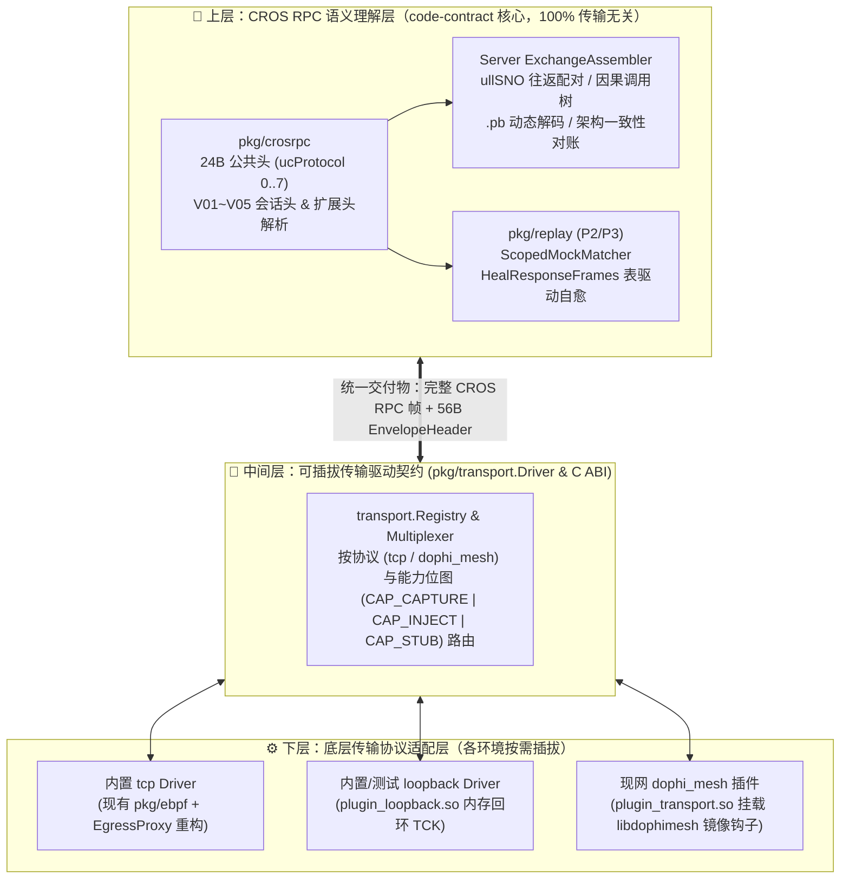
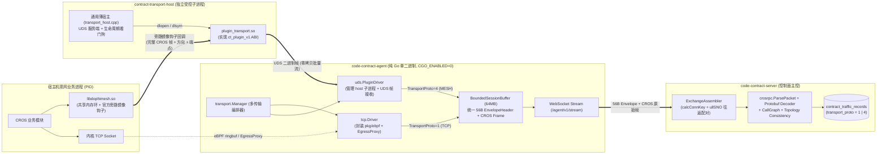
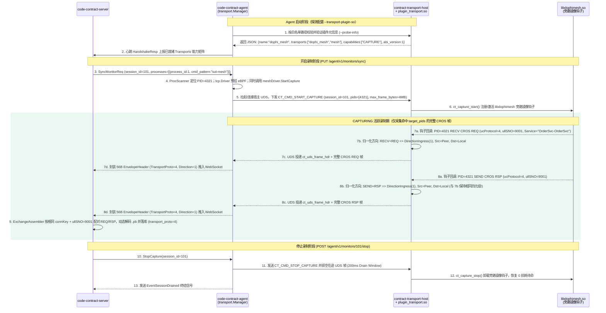

# ADR-22：Agent 可插拔传输层驱动架构（Pluggable Transport Driver）与 `dophi_mesh` 旁路镜像采集设计

- **文档编号**：`22-pluggable-transport-driver-and-mesh-capture-adr.md`
- **文档版本**：v1.0.0
- **日期**：2026-11-19
- **状态**：✅ 已采纳 (Accepted — v1.0.0，首期聚焦 P0 可插拔架构自举 + P1 `dophi_mesh` 旁路镜像只读采集)
- **关联特性**：`F-09`（数据面按需旁路采集）、`F-10`（CROS RPC 协议解析与分帧）、`F-11`（出站代理与多底座采集）、`F-12` / `F-13`（重放与二进制自愈）、`F-33` / `F-34`（CSG 双层自动发现与三模仿真）、**`F-35`（新增：Agent 可插拔传输驱动架构与 `dophi_mesh` 旁路镜像采集）**
- **关联设计**：[`01-cros-rpc-protocol-spec.md`](../07-references/01-cros-rpc-protocol-spec.md)、[`01-system-architecture.md`](../02-design/01-system-architecture.md)、[`02-data-plane-and-cros-rpc-engine.md`](../02-design/02-data-plane-and-cros-rpc-engine.md)、[`04-control-plane-and-web-console.md`](../02-design/04-control-plane-and-web-console.md)、[`05-database-schema.md`](../02-design/05-database-schema.md)
- **关联 ADR**：[`ADR-02`](./02-ebpf-hook-and-dual-subsystem-adr.md)、[`ADR-09`](./09-arch-process-ssot-and-ebpf-premount-standby-adr.md)、[`ADR-11`](./11-single-process-bidirectional-capture-and-recording-ux-adr.md)、[`ADR-21`](./21-csg-aware-agent-service-discovery-and-replay-mock-adr.md)
- **演进关系**：
  - **演进 `Non-Goal 1`**：保持「不做跨应用层协议框架（不支持 HTTP/REST、gRPC，仅支持 DOPHI `CROS RPC` + Protobuf Payload）」不变，但将底层传输从「仅限经内核 Socket 的 IPv4 TCP」演进为**「CROS RPC over 可插拔传输驱动（内置 `tcp` + 插件化 `dophi_mesh` 等）」**；
  - **演进 `Non-Goal 12④`（`ADR-21` D8）**：将 `dophi_mesh://` 从「仅支持控制面发现、数据面一刀切不支持」升级为**「按已加载 `transport.Driver` 的能力位图（`CapCapture | CapInject | CapStub`）动态放行」**——首期（P0+P1）加载 `plugin_transport.so` 后正式支持 `dophi_mesh://` 数据面只读旁路录制（`CapCapture`），重放注入与桩替身（`CapInject / CapStub`）按能力位图诊断并在 P2/P3 渐进激活。

### 修订记录

| 版本 | 日期 | 修订说明 |
| :--- | :--- | :--- |
| v1.0.0 | 2026-11-19 | **正式定稿**：基于现网 `dophi_mesh` 三大工程实证（① `dophi_mesh` 之上承载 100% 完整标准 CROS RPC 报文含 24B 公共头与会话头；② `libdophimesh.so` 已提供官方旁路镜像钩子；③ 全栈与插件同源工具链可控），确立「**传输可插拔 (`plugin_transport.so`) + 语义大一统 (`pkg/crosrpc`)**」分层架构，冻结 P0（`pkg/transport` 统一驱动接口与内置 `tcp` 无损重构）+ P1（`dophi_mesh` 旁路镜像只读采集全链路打通）设计规范。 |

---

## 1. 背景、现网实证与核心诉求 (Context & Verified Facts)

### 1.1 现网 `dophi_mesh` 的三项关键工程事实

在 [`ADR-21`](./21-csg-aware-agent-service-discovery-and-replay-mock-adr.md)（M28）完成现网 CSG 控制面双层自动发现后，我们对现网 `dophi_mesh://` 数据面传输机制完成了深入摸底，确认了以下三项决定架构走向的核心事实：

1. **事实一：`dophi_mesh` 是纯粹的 CROS 传输层，其上承载全量标准 CROS RPC 协议帧（含包头）**
   - `dophi_mesh` 采用共享内存环（Shared Memory Ring）在进程间高速传递消息，但它仅替换了 OSI 传输层（对应 `01-cros-rpc-protocol-spec.md` §3.1 中 `RPC_COMM_HEAD_S.ucProtocol = 4 (RPC_TRANSPORT_MESH)`，以及 CSG `aucSubTransType[4] = 1`）。
   - 在 `dophi_mesh` 之上传递的每一个消息单元，**100% 是完整的标准 CROS RPC 报文**：
     $$\text{Frame} = \underbrace{\text{24B } \texttt{RPC\_COMM\_HEAD\_S}}_{\texttt{"CSE.TCP"} + \texttt{ucProtocol=4}} + \underbrace{\texttt{RPC\_REQ/RSP/MNG\_HEAD\_S}}_{\text{V01}\sim\text{V05 会话头}} + \underbrace{\text{Extend Heads}}_{\text{DOTR Trace / TimeStamp}} + \underbrace{\text{Protobuf Payload}}_{\text{业务载荷}}$$
   - 这意味着 `code-contract` 现有的整套**语义层资产**——`pkg/crosrpc` 头部解析器、主控 `ExchangeAssembler`（按 `ullSNO` 请求/应答配对）、DOTR 因果调用树（`internal/server/callgraph`）、`.pb` 动态解码器（`internal/server/decoder`）、架构拓扑一致性比对（`internal/server/topology`）、乃至 `ScopedMockMatcher` 与 `HealResponseFrames`——**对 `dophi_mesh` 报文在语义上 100% 天然适用**！
2. **事实二：`libdophimesh.so` 已原生提供旁路镜像钩子（Mirror / Tap Hook）**
   - 共享内存无锁环（SPSC / MPSC Ring）的槽位在消费后会被立即覆写，若由外部进程直接 mmap 只读偷看共享内存环，必然面临读写竞态与丢包。
   - 现网 `libdophimesh.so` **已经提供了官方旁路镜像钩子**。通过对接该钩子，可以在不干扰业务环消费游标、零锁竞态的前提下，在消息收发切面直接拿到完整的 CROS RPC 消息帧字节与通道端点元数据。
3. **事实三：全栈同源开发，工具链与依赖版本 100% 可控**
   - `code-contract` 核心与现网环境适配插件 `plugin_transport.so` 由同一团队（独立全栈）开发维护，编译器、ABI 与依赖版本完全一致可控，无需设计冗余的跨团队防御性兼容层；
   - 唯一需要隔离的是**运行期宿主机环境差异**：现网宿主机带有 `~/SW/lib/libdophimesh.so` 等十余个 DOPRA 动态库，而开发机、CI 容器或纯 TCP 节点没有这些 `.so`。

### 1.2 现有 Agent 数据面的耦合痛点

尽管语义层天然与传输层无关，但当前 Agent 数据面实现（`pkg/ebpf` + `pkg/replay` + `internal/agent/server`）与 **IPv4 TCP 内核 Socket** 存在三处硬耦合：

| 位置 | 当前硬编码行为 | 对 `dophi_mesh` 造成的阻塞 |
| :--- | :--- | :--- |
| **1. `pkg/crosrpc/comm_head.go:55`** | `ValidateCommHead` 硬编码 `if h.TransportProto > 1 { return ErrInvalidTransport }` | 收到 `ucProtocol == 4 (RPC_TRANSPORT_MESH)` 的合法 CROS 报文时，在 Agent 与主控 `ParsePacket` 入口直接被当作非法报文拒绝 |
| **2. `pkg/ebpf/manager.go`** | 采集完全绑定 `cgroup/connect4` + `sys_enter/exit_{read,write,recvfrom,sendto}`，且 `SyncMonitors` 对 `ListenPort == 0` 的进程跳过入站钩子预热 | `dophi_mesh` 走共享内存环，不触发 Socket `connect()` 或 `read/write` 系统调用，eBPF Socket 钩子捕获数为 0；纯 Mesh 进程无 TCP `ListenPort` |
| **3. `internal/agent/server`** | `AgentServer` 直接持有 `*ebpf.Manager` 具体类型，缺少传输层抽象接口 | 无法在不侵入 Agent 核心控制流的前提下挂载 `plugin_transport.so` |

### 1.3 核心架构目标：「传输可插拔，语义大一统」



---

## 2. 核心架构决策矩阵 (Decisions)

| 编号 | 决策领域 | 选定方案 (v1.0) | 依据与核心收益 |
| :--- | :--- | :--- | :--- |
| **D1** | **分层边界与插件交付粒度** | 以**「单条完整 CROS RPC 消息帧 (`[]byte`，含 `24B RPC_COMM_HEAD_S` + 会话头 + 扩展头 + Payload) + 归一化通道端点元数据」**作为传输层与语义层的唯一分界线。插件**不交付**碎片字节流，也**不解析** `ServiceName/Operation/ullSNO/Protobuf` 语义 | `dophi_mesh` 镜像钩子本身即按完整 CROS 消息回调；插件只做薄搬运，语义解析、因果建树、`.pb` 解码与 Diff 100% 复用既有代码 |
| **D2** | **能力分级与首期范围（P0 + P1）** | 定义四级传输能力位图：`CapDiscover (1<<0)`、`CapCapture (1<<1)`、`CapInject (1<<2)`、`CapStub (1<<3)`。**首期严格执行 Step 1 (P0) + Step 2 (P1)**：<br>- **Step 1 (P0)**：抽取 `pkg/transport.Driver` 接口，将现有 eBPF + `EgressProxy` 无损重构为内置 `tcp` Driver，并打通 `plugin_loopback.so` 基准测试；<br>- **Step 2 (P1)**：实现 `dophi_mesh` 的 `plugin_transport.so`（对接 `libdophimesh` 旁路镜像钩子，声明 `CapCapture`），跑通 Mesh 流量录制、落盘、`.pb` 解码、因果树与拓扑一致性全链路；<br>- `CapInject` / `CapStub` 在接口与 C ABI 中预留完整签名，留待 P2 / P3 渐进验证 | 先以最小半径验证「插件抓取 `dophi_mesh` ➔ Agent ➔ Server 语义层」全链路畅通，零风险、不触碰生产写操作与端口游标红线 |
| **D3** | **`.so` 加载架构：同源 C ABI + 薄宿主进程主路径 (`contract-transport-host`)** | 1. 制定简洁统一的 C ABI 头文件 [`scripts/transport/contract_transport_plugin.h`](#51-标准-c-abi-契约-scripts-transport-contract_transport_pluginh)；<br>2. 默认通过仓内同源编译的轻量 C/C++ 薄宿主进程 **`contract-transport-host`** 调用 `dlopen("plugin_transport.so")`，经本地 Unix Domain Socket（UDS）向 Agent 高速流式投递采集帧（延续 [`ADR-21`](./21-csg-aware-agent-service-discovery-and-replay-mock-adr.md) `rpcmon_probe` 已验证成功的受控子进程模式）；<br>3. 同时因 Go 侧完全面向 `pkg/transport.Driver` 接口编程，在同工具链下天然支持通过可选 build tag 扩展进程内 Driver | 1. 保住 `code-contract-agent` **100% 纯 Go (`CGO_ENABLED=0`) 单二进制**，无 `libdophimesh.so` 的机器照常启动；<br>2. 将 DOPRA SDK 的 `LD_LIBRARY_PATH`、线程模型与内存生命周期完全隔离在薄宿主进程内，插件退出即 100% 释放共享内存映射；<br>3. 同人同工具链开发，宿主与插件在 `scripts/transport/` 一键同源编译 |
| **D4** | **`pkg/crosrpc` 协议校验解封与 TCP 滑窗隔离** | 1. **解封 `ValidateCommHead`**：将 `pkg/crosrpc/comm_head.go` 中 `h.TransportProto > 1` 放宽为校验合法枚举上界 `h.TransportProto > TransportCustomize (7)`，使 `ucProtocol == 4 (TransportMesh)` 在 `ParsePacket`、`ExchangeAssembler`、`Anatomy`、`Decoder`、`Diff` 中全面合法；<br>2. **保持 TCP `StreamFramer` 防伪帧严密性**：在 `StreamFramer` 中引入 `allowedProtoMask uint8`（默认仅允许 `0=DEFAULT, 1=TCP`），确保 TCP 字节流滑窗重同步时仍只认 `ucProtocol <= 1`，不在非 CROS TCP 连接上产生假阳性伪帧 | 一举打通主控与 Agent 全部语义层组件对 `ucProtocol = 4 (MESH)` 报文的解析，同时对现有 TCP 录制防伪帧能力 **0 劣化** |
| **D5** | **56B `EnvelopeHeader` 与数据库零迁移兼容** | 1. **保持 56B `EnvelopeHeader` 定长格式不变**：将偏移 `26..27` 的 `Reserved uint16` 拆分为偏移 `26` 的 **`TransportProto uint8`**（`0/1=TCP, 4=MESH`，若为 `0` 则主控回退取 `CommHead.TransportProto`）与偏移 `27` 的 `Reserved uint8`；<br>2. **Mesh 端点与通道映射**：`dophi_mesh://ipv4:<ip>:<port>` 的节点 IP 与 Mesh 端口写入 `SrcIPv4/DstIPv4/SrcPort/DstPort`（无显式端口时填进程 PID 低 16 位或逻辑端口），共享内存环通道 ID 写入 `ConnSeq uint32`；<br>3. **复用既有 DB 列**：`contract_traffic_records` 表已存在 `transport_proto` 列（`assembler.go:645` 自动取自 `comm.TransportProto`），**无需任何数据库 DDL 迁移**即可原生存储并向前端返回 `transport_proto = 4` | WebSocket 二进制流、Agent 64MB 有界缓冲区、主控 `ExchangeAssembler` 分片键 `calcConnKey` 与 PostgreSQL 分区表 **100% 零破坏无缝衔接** |
| **D6** | **方向归一化不变量 (`DirectionIngress` vs `DirectionEgress`)** | 插件或宿主在封装 `dophi_mesh` 镜像帧时，严格对齐 [`ADR-11`](./11-single-process-bidirectional-capture-and-recording-ux-adr.md) 方向不变量：<br>- **入站 (`DirectionIngress = 1`)**：被监控进程 **收到 `REQ (2)`** 或 **发出 `RSP (3) / RSP_SEG (4)`**（且端点四元组恒定保持 `Src = 远端调用方, Dst = 本机被监控进程`）；<br>- **出站 (`DirectionEgress = 2`)**：被监控进程 **发出 `REQ (2)`** 或 **收到 `RSP (3) / RSP_SEG (4)`**（且端点四元组恒定保持 `Src = 本机被监控进程, Dst = 远端服务提供方`） | 确保同一个 Mesh RPC 往返的 `REQ` 与 `RSP` 在主控 `ExchangeAssembler` 中落入同一个 `connKey` 并按 `ullSNO` 100% 聚合成单行 `TrafficRecord` |
| **D7** | **过滤条件下推与待命期零损耗** | 1. **平时零损耗**：未开启录制会话（`session_id == 0`）时，`dophi_mesh` 插件不挂载镜像回调或处于空置休眠态；<br>2. **过滤下推**：`StartCapture` 时将 `CaptureSpec`（目标 `PID` 列表、监听端口/Mesh 地址、`MaxFrameBytes`）下推至 `plugin_transport.so`，在镜像钩子内原地过滤非目标 PID 报文 | 避免宿主机上数百个非目标 Mesh 进程的高频共享内存流量涌入 UDS 与 Agent 内存池 |
| **D8** | **纯 Mesh 进程监控挂载与五出口卫生** | 1. 演进进程监控同步：当目标进程 `ListenPort == 0`（或声明含 `mesh` 传输）时，通过 `CmdPattern` / CSG 发现的 `PID` 定位进程后，同步交由 `dophi_mesh` Transport Driver 执行 `StartCapture`；<br>2. 外部宿主与插件纳入 Agent **五出口幂等清理**（正常停录、取消、`/purge`、主控失联 5 分钟、收到 `SIGINT/SIGTERM`） | 解决纯 `dophi_mesh://` 进程无 TCP `ListenPort` 无法录制入站流量的历史空白，并严守探针卫生红线 |

---

## 3. 整体分层架构与数据流设计 (Architecture & Data Flow)

### 3.1 Agent 内部双层架构与插件宿主拓扑



### 3.2 P1 `dophi_mesh` 旁路镜像录制全链路时序



---

## 4. Go 侧 `pkg/transport` 统一驱动接口与内置 `tcp` 重构设计 (Step 1 / P0)

### 4.1 `pkg/transport/driver.go` 核心契约定义

新建纯 Go 基础包 `pkg/transport`（严格遵守 `cmd/agent/deps_test.go`：零 CGO、零 GORM、零 `protoregistry` 依赖）：

```go
package transport

import (
	"context"
	"errors"
	"io"

	"code-contract/pkg/agentproto"
)

// Capability 传输驱动能力位图
type Capability uint32

const (
	CapDiscover Capability = 1 << iota // 1<<0: 传输层端点辅助枚举
	CapCapture                         // 1<<1: 只读旁路镜像采集 (P0/P1 核心)
	CapInject                          // 1<<2: 作为客户端主动注入 CROS 请求帧 (P2 预留)
	CapStub                            // 1<<3: 作为服务端挂载下游 Mock 桩替身 (P3 预留)
)

var (
	ErrCapabilityUnsupported = errors.New("transport: capability not supported by driver")
	ErrTransportNotFound     = errors.New("transport: no driver registered for scheme")
)

// DriverInfo 驱动元信息与能力声明（用于握手上报与能力门禁）
type DriverInfo struct {
	Name          string     `json:"name"`           // 驱动标识，如 "builtin-tcp", "plugin-dophi_mesh", "plugin-loopback"
	Version       string     `json:"version"`        // 驱动版本，如 "1.0.0"
	ABIVersion    uint32     `json:"abi_version"`    // C ABI 版本号（内置驱动为 1）
	Transports    []string   `json:"transports"`     // 支持的协议前缀列表，如 ["tcp"] 或 ["dophi_mesh", "mesh"]
	TransportCode uint8      `json:"transport_code"` // 对应 RPC_COMM_HEAD_S.ucProtocol (1=TCP, 4=MESH)
	Capabilities  Capability `json:"capabilities"`   // CapCapture | CapInject | CapStub
	PluginPath    string     `json:"plugin_path,omitempty"`
}

// TargetProcess 单个被监控目标进程的运行时解析信息
type TargetProcess struct {
	ProcessID  uint64                          `json:"process_id"`  // 主控 contract_processes.id
	PID        uint32                          `json:"pid"`         // 宿主机实测 OS PID
	ListenPort uint16                          `json:"listen_port"` // TCP 监听端口（纯 Mesh 进程为 0）
	CmdPattern string                          `json:"cmd_pattern"` // 命令行匹配模式
	Spec       agentproto.ProcessMonitorSpec   `json:"spec"`
}

// CaptureSpec 开启旁路采集的下推过滤规格
type CaptureSpec struct {
	SessionID      uint64          `json:"session_id"`
	MaxFrameBytes  int             `json:"max_frame_bytes"`
	MaxBufferBytes int             `json:"max_buffer_bytes"`
	Targets        []TargetProcess `json:"targets"`
}

// CapturedFrame 传输驱动向 Agent 缓冲区交付的标准化单帧结构
type CapturedFrame struct {
	SessionOrTaskID uint64
	ProcessID       uint64
	CapturedPID     uint32
	Direction       uint8   // agentproto.DirectionIngress (1) | DirectionEgress (2)
	TransportProto  uint8   // crosrpc.TransportTCP (1) | TransportMesh (4) | ...
	Flags           uint8   // agentproto.FlagIsTruncated | FlagHasGap
	CapturedAtNs    int64
	SrcIPv4         [4]byte
	DstIPv4         [4]byte
	SrcPort         uint16
	DstPort         uint16
	ConnSeq         uint32  // TCP 连接序号 或 Mesh 共享内存环通道 ID
	RawFrame        []byte  // 完整 CROS RPC 帧 (24B CommHead + SessionHead + ExtHead + Payload)
}

// FrameSink 采集帧统一回调（直接转化为 56B EnvelopeHeader 推入 BoundedSessionBuffer）
type FrameSink func(envelopeBytes []byte)

// Endpoint P2/P3 注入与桩替身端点描述符
type Endpoint struct {
	Transport string // "tcp" | "dophi_mesh"
	URI       string // "tcp://ipv4:127.0.0.1:18500" | "dophi_mesh://ipv4:10.29.92.80:2002"
	PID       uint32
}

// StubHandler P3 下游 Mock 桩请求处理回调（对接 pkg/replay.ScopedMockMatcher）
type StubHandler func(ctx context.Context, reqFrame []byte, peer Endpoint) (rspFrames [][]byte, hit bool)

// Driver 底层传输协议驱动统一接口（内置 tcp 与外部 plugin_transport.so 共同实现）
type Driver interface {
	Info() DriverInfo

	// P0/P1 采集生命周期接口
	StartCapture(ctx context.Context, spec CaptureSpec) error
	StopCapture(ctx context.Context, sessionID uint64) error

	// P2 主动请求注入接口（首期外部 Mesh 插件可返回 ErrCapabilityUnsupported）
	Call(ctx context.Context, target Endpoint, reqFrames [][]byte) (rspFrames [][]byte, err error)

	// P3 下游桩替身挂载接口（首期外部 Mesh 插件可返回 ErrCapabilityUnsupported）
	ServeStub(ctx context.Context, target Endpoint, handler StubHandler) (io.Closer, error)

	// 五出口幂等卸载与资源回收
	Close() error
}
```

### 4.2 内置 `tcp` Driver 无损封装策略

为确保现有 28 个 Milestone 的全部单测与 E2E 场景 **100% 零回归**：

1. **保留 `pkg/ebpf.Manager` 与 `pkg/replay` 现有公开 API 不变**：
   - 现有 `ebpf.Manager` 的 `ArmStandby`、`SyncMonitors`、`StopCapture`、`SetReplayMock`、`ResetPassthrough`、`PurgeAllMonitors` 原样保留；
2. **新增 `pkg/transport/tcp_driver.go`**：
   - 将 `*ebpf.Manager` 包装为实现 `transport.Driver` 的内置驱动（`Name: "builtin-tcp"`, `Transports: ["tcp"]`, `TransportCode: crosrpc.TransportTCP (1)`, `Capabilities: CapDiscover | CapCapture | CapInject | CapStub`）；
3. **新增 `pkg/transport/registry.go` (`Registry`)**：
   - 在 `AgentServer` 中维护 `*transport.Registry`，默认注册 `builtin-tcp`；
   - 当 Agent 启动参数传入 `--transport-plugin-so=/path/to/plugin_transport.so`（或环境变量 `CONTRACT_AGENT_TRANSPORT_PLUGIN_SO`）时，自动校验并注册外部插件驱动（如 `plugin-dophi_mesh`）；
   - 在 `handleMonitorsSync`（开启录制）时，除调用 `ebpfMgr.SyncMonitors` 外，同步构造 `CaptureSpec`（包含所有已解析到 `ResolvedPID > 0` 的目标进程，**不论其 `ListenPort` 是否为 `0`**）广播至所有已注册且具备 `CapCapture` 的外部插件驱动；
   - 在 `handleMonitorsStop`、`PurgeAll`、Watchdog 5 分钟失联与 `Shutdown` 时，同步遍历所有已注册插件驱动调用 `StopCapture` / `Close`。

---

## 5. `plugin_transport.so` C ABI 契约与 `dophi_mesh` 旁路镜像插件设计 (Step 2 / P1)

### 5.1 标准 C ABI 契约 (`scripts/transport/contract_transport_plugin.h`)

既然我们独立掌控全部代码与编译工具链，C ABI 的设计原则是**「极简、零冗余、直接贴合 `libdophimesh` 旁路镜像钩子与 56B `EnvelopeHeader` 字段」**。任何现网环境只需实现这一个头文件中的 6 个导出符号即可编译为 `plugin_transport.so`：

```c
// scripts/transport/contract_transport_plugin.h
// Code-Contract Pluggable Transport ABI v1
#ifndef CONTRACT_TRANSPORT_PLUGIN_H
#define CONTRACT_TRANSPORT_PLUGIN_H

#include <stdint.h>
#include <stddef.h>

#ifdef __cplusplus
extern "C" {
#endif

#define CT_TRANSPORT_ABI_VERSION 1u

// 能力位图 (与 Go transport.Capability 一一对应)
#define CT_CAP_DISCOVER (1u << 0)
#define CT_CAP_CAPTURE  (1u << 1)
#define CT_CAP_INJECT   (1u << 2)
#define CT_CAP_STUB     (1u << 3)

// 流量方向 (与 agentproto.DirectionIngress / DirectionEgress 一一对应)
#define CT_DIR_INGRESS  1u
#define CT_DIR_EGRESS   2u

// 传输协议码 (与 RPC_COMM_HEAD_S.ucProtocol 一一对应)
#define CT_PROTO_TCP    1u
#define CT_PROTO_DMS    2u
#define CT_PROTO_UC     3u
#define CT_PROTO_MESH   4u
#define CT_PROTO_DOMAIN 5u
#define CT_PROTO_FRPC   6u

// 帧标志位 (与 agentproto.Flag* 一一对应)
#define CT_FLAG_TRUNCATED (1u << 0)
#define CT_FLAG_HAS_GAP   (1u << 2)

// 插件静态元信息
typedef struct ct_plugin_info {
    uint32_t    abi_version;        // 必须填 CT_TRANSPORT_ABI_VERSION (1)
    const char* name;               // 如 "dophi_mesh" 或 "loopback"
    const char* version;            // 如 "1.0.0"
    const char* transports_csv;     // 支持的协议前缀(逗号分隔)，如 "dophi_mesh,mesh"
    uint8_t     transport_code;     // 默认 ucProtocol，如 CT_PROTO_MESH (4)
    uint32_t    capabilities;       // 如 CT_CAP_CAPTURE
} ct_plugin_info_t;

// 单个被监控目标进程过滤项
typedef struct ct_target_proc {
    uint64_t process_id;            // 主控 contract_processes.id
    uint32_t pid;                   // 宿主机目标进程 OS PID
    uint16_t listen_port;           // 可选端口 (纯 Mesh 可为 0)
    uint16_t reserved;
} ct_target_proc_t;

// 开启采集规格 (由宿主下推给插件)
typedef struct ct_capture_spec {
    uint64_t                session_id;
    uint32_t                max_frame_bytes;
    uint32_t                target_count;
    const ct_target_proc_t* targets;
} ct_capture_spec_t;

// 镜像采集到的单条完整 CROS RPC 帧事件 (插件 -> 宿主回调)
typedef struct ct_captured_frame {
    uint64_t       session_id;      // 录制会话 ID
    uint64_t       process_id;      // 归属主控 ProcessID (若插件未知填 0，由宿主按 captured_pid 自动回填)
    uint32_t       captured_pid;    // 触发钩子的本地业务进程 OS PID
    uint8_t        direction;       // CT_DIR_INGRESS (1) 或 CT_DIR_EGRESS (2)
    uint8_t        transport_proto; // CT_PROTO_MESH (4)
    uint8_t        flags;           // 0 或 CT_FLAG_TRUNCATED / CT_FLAG_HAS_GAP
    uint8_t        reserved;
    int64_t        captured_at_ns;  // 采集纳秒时间戳 (填 0 则由宿主自动填 CLOCK_REALTIME)
    uint8_t        src_ipv4[4];     // 源 IPv4 (网络字节序 4B，未知则填 127.0.0.1)
    uint8_t        dst_ipv4[4];     // 目的 IPv4 (网络字节序 4B，未知则填 127.0.0.1)
    uint16_t       src_port;        // 源端口 / Mesh 通道源标识 (主机序)
    uint16_t       dst_port;        // 目的端口 / Mesh 通道目的标识 (主机序)
    uint32_t       conn_seq;        // 共享内存环 ID / 逻辑通道序号 (同一个往返的 REQ 与 RSP 必须一致!)
    uint32_t       frame_len;       // frame_data 字节长度
    const uint8_t* frame_data;      // 指向完整 CROS RPC 报文的指针 (24B RPC_COMM_HEAD_S 起)
} ct_captured_frame_t;

// 宿主注入给插件的回调函数表
typedef struct ct_host_callbacks {
    void* user_data;
    // 插件在镜像钩子线程中调用此回调上送完整 CROS 帧（宿主保证线程安全并立即拷贝，插件返回后即可释放 frame_data）
    void (*on_captured_frame)(void* user_data, const ct_captured_frame_t* frame);
    // 结构化日志回调 (level: 0=DEBUG, 1=INFO, 2=WARN, 3=ERROR)
    void (*on_log)(void* user_data, int level, const char* message);
} ct_host_callbacks_t;

// ==================== 插件必须导出的符号表 ====================

// 1. 初始化插件并返回插件信息 (成功返回 0，失败返回非 0 错误码)
int ct_plugin_init(const ct_host_callbacks_t* host_cb, const char* config_json, ct_plugin_info_t* out_info);

// 2. 开启录制旁路采集 (挂载/激活 libdophimesh 旁路镜像钩子)
int ct_plugin_start_capture(const ct_capture_spec_t* spec);

// 3. 停止录制旁路采集 (卸载/静默旁路镜像钩子)
int ct_plugin_stop_capture(uint64_t session_id);

// 4. [P2 预留] 作为客户端注入请求帧并等待应答帧 (首期未实现可返回 -38 ENOSYS)
int ct_plugin_call(const char* target_uri, const uint8_t* req_frame, uint32_t req_len,
                   uint8_t* rsp_buf, uint32_t* inout_rsp_len, uint32_t timeout_ms);

// 5. [P3 预留] 退出并释放全部共享内存映射与钩子资源 (必须幂等)
void ct_plugin_cleanup(void);

#ifdef __cplusplus
}
#endif

#endif // CONTRACT_TRANSPORT_PLUGIN_H
```

### 5.2 `dophi_mesh` 镜像钩子方向与四元组归一化算法（核心契约）

在主控 `ExchangeAssembler`（`internal/server/recorder/assembler.go`）中，一条请求（`REQ`）与其对应的应答（`RSP / RSP_SEG`）能够配对合成为一行 `contract_traffic_records` 的充要条件是：
1. 落在同一个分片 Worker：`(sessionID, processID, calcConnKey(srcIP, srcPort, dstIP, dstPort, connSeq))` 完全相同；
2. 拥有相同的 `Direction`（同为 `DirectionIngress` 或同为 `DirectionEgress`）与相同的 `CommHead.SNO`（`ullSNO`）。

由于 `libdophimesh` 的旁路镜像钩子通常在**「发送切面 (`MESH_HOOK_TX / on_send`)」**和**「接收切面 (`MESH_HOOK_RX / on_recv`)」**触发，插件或宿主只需读取帧头第 23 字节 `ucMsgType = frame_data[22]`（`2=REQ, 3=RSP, 4=RSP_SEG`），按以下**确定性真值表**填写 `direction` 与 `(src, dst)`，即可 **100% 保证往返配对成功**：

| 钩子触发切面 | `frame_data[22]` (`ucMsgType`) | 业务含义（相对被监控进程 `Local`） | 归一化 `direction` | 归一化 `src` | 归一化 `dst` |
| :---: | :---: | :--- | :---: | :---: | :---: |
| **`RX` (接收)** | `2` (`RPC_MSG_TYPE_REQ`) | 收到上游发来的入站请求 | **`CT_DIR_INGRESS (1)`** | `Peer` (对端) | `Local` (本进程) |
| **`TX` (发送)** | `3 / 4` (`RSP / RSP_SEG`) | 向上游回写刚才入站请求的应答 | **`CT_DIR_INGRESS (1)`** | `Peer` (对端) | `Local` (本进程) |
| **`TX` (发送)** | `2` (`RPC_MSG_TYPE_REQ`) | 向下游服务发起出站调用请求 | **`CT_DIR_EGRESS (2)`** | `Local` (本进程) | `Peer` (对端) |
| **`RX` (接收)** | `3 / 4` (`RSP / RSP_SEG`) | 收到下游服务返回的出站调用应答 | **`CT_DIR_EGRESS (2)`** | `Local` (本进程) | `Peer` (对端) |

> [!TIP]
> **宿主自动兜底归一化**：为让 `plugin_transport.so` 编写极度省心，我们将上述「`PID -> ProcessID` 映射校验」与「`ucProtocol = 4` 默认回填」内置在通用宿主 `contract-transport-host`（以及 Go 侧 `uds.PluginDriver`）中。如果现网 `dophi_mesh` 帧头的 `ucProtocol` 在部分老版本 SDK 中填了 `0 (DEFAULT)`，插件/宿主上报的 `EnvelopeHeader.TransportProto = 4 (CT_PROTO_MESH)` 仍能确保主控 100% 识别其为 `dophi_mesh` 流量！

### 5.3 通用薄宿主 `contract-transport-host` 与 Agent 的 UDS 通信协议

`contract-transport-host` 是一个仅 ~250 行、零第三方依赖的标准 C++17 / C11 程序（源码置于 `scripts/transport/transport_host.cpp`，与 `scripts/csg/rpcmon_probe.cpp` 同级治理）：

1. **两种运行模式**：
   - **元信息探测模式（单次只读，`< 50ms`）**：
     `contract-transport-host --plugin /path/to/plugin_transport.so --probe-info`
     加载 `.so` 并调用 `ct_plugin_init`，向 `stdout` 打印单行 JSON `DriverInfo` 后立即调用 `ct_plugin_cleanup` 退出。
   - **采集流工作模式（录制期受控子进程）**：
     `contract-transport-host --plugin /path/to/plugin_transport.so --uds /var/run/code-contract/tp-<session_id>.sock`
2. **极简 UDS 二进制线协议（直接对齐 56B `EnvelopeHeader`）**：
   - **Agent $\rightarrow$ Host 控制指令**：发送定长头 + JSON `CaptureSpec`（启动时一次性下推）或 `STOP` 指令（或关闭 UDS 连接触发宿主立即卸载退出）；
   - **Host $\rightarrow$ Agent 数据帧流**：宿主在 `on_captured_frame` 回调中，**直接按 `agentproto.EnvelopeHeader` 的 56 字节网络大端格式**拼好信封头 + `frame_len` 字节 CROS 原始报文写回 UDS！
   - **关键收益**：Go 侧 `uds.PluginDriver` 从 UDS 读出一个完整包后，**连反序列化再序列化都不需要**，只需校验 56B 头部的 `Magic == 0x4354 ("CT")` 与 `PayloadLen`，即可 **零拷贝直接 `s.buffer.Push(rawEnvelopeBytes)`** 推入现有 WebSocket 发送队列！

---

## 6. 协议栈、信封与主控数据链路改动清单 (Protocol & Server Alignment)

### 6.1 `pkg/crosrpc`：解封 `TransportMesh (4)` 并隔离 TCP 滑窗

1. **`pkg/crosrpc/comm_head.go` — `ValidateCommHead` 放开合法传输枚举 `0..7`**：
   ```go
   // ValidateCommHead 按照 DOPHI CROS RPC 规范全面校验公共消息头合法性边界
   func ValidateCommHead(h CommHead) error {
       // 1. 魔术字校验 ("CSE.TCP")
       if !bytes.Equal(h.Magic[:], []byte(MagicPrefix)) {
           return ErrInvalidMagic
       }

       // 2. 传输协议校验：支持 CROS RPC 规范定义的全部传输底座 [0..TransportCustomize(7)]
       //    (0=DEFAULT, 1=TCP, 2=DMS, 3=UC, 4=MESH, 5=DOMAIN, 6=FRPC, 7=CUSTOMIZE)
       if h.TransportProto > TransportCustomize {
           return ErrInvalidTransport
       }
       // ... 其余 MsgType 与 HeadLen 校验保持不变
   ```
2. **`pkg/crosrpc/framer.go` — TCP 流式分帧器保留 `maxTransportProto` 滑窗防伪帧**：
   - `StreamFramer` 专用于从**无边界 TCP 字节流**中滑窗寻找 `"CSE.TCP"` 魔术字（如 `EgressProxy` 在 MySQL/PostgreSQL/HTTP 连接上旁路嗅探）。
   - 在 `StreamFramer` 中保持默认仅接受 `f.buf[7] <= TransportTCP (1)`（同时提供 `SetAllowAllTransports(true)` 供单元测试或多协议流使用），确保 TCP 随机二进制流不会因为放宽 `ValidateCommHead` 而增加任何假阳性碰撞概率。

### 6.2 `pkg/agentproto`：56B `EnvelopeHeader` 零破坏扩展与握手能力上报

1. **`pkg/agentproto/envelope.go` — 启用偏移 `26` 为 `TransportProto`**：
   ```go
   type EnvelopeHeader struct {
       Magic           uint16  `json:"magic"`              // 0..1: 0x4354 ("CT")
       ProtoVer        uint8   `json:"proto_ver"`          // 2: 1
       EventType       uint8   `json:"event_type"`         // 3
       SessionOrTaskID uint64  `json:"session_or_task_id"` // 4..11 (BE)
       ProcessID       uint64  `json:"process_id"`         // 12..19 (BE)
       CapturedPID     uint32  `json:"captured_pid"`       // 20..23 (BE)
       Direction       uint8   `json:"direction"`          // 24 (1=INGRESS, 2=EGRESS)
       Flags           uint8   `json:"flags"`              // 25
       TransportProto  uint8   `json:"transport_proto"`    // 26 (0/1=TCP, 4=MESH; 原 Reserved 高字节)
       Reserved        uint8   `json:"reserved"`           // 27 (0; 原 Reserved 低字节)
       CapturedAtNs    int64   `json:"captured_at_ns"`     // 28..35 (BE)
       SrcIPv4         [4]byte `json:"src_ipv4"`           // 36..39
       DstIPv4         [4]byte `json:"dst_ipv4"`           // 40..43
       SrcPort         uint16  `json:"src_port"`           // 44..45 (BE)
       DstPort         uint16  `json:"dst_port"`           // 46..47 (BE)
       ConnSeq         uint32  `json:"conn_seq"`           // 48..51 (BE)
       PayloadLen      uint32  `json:"payload_len"`        // 52..55 (BE)
   }
   ```
   - **100% 向后兼容证明**：旧版发送端写 `Reserved uint16 = 0` 时，新接收端读出 `TransportProto = 0`，在主控 `ExchangeAssembler` 中当 `env.TransportProto == 0` 时自动取 `comm.TransportProto`（若仍为 `0` 则归一为 `1=TCP`）；新版 Mesh 插件填 `env.TransportProto = 4 (TransportMesh)`，即使某条现网 Mesh 报文内部 `comm.TransportProto` 为 `0`，主控也能准确将其记录为 `transport_proto = 4`！
2. **`pkg/agentproto/protocol.go` — `HandshakeResp` 新增 `TransportDrivers` 能力清单**：
   ```go
   // TransportDriverCapability Agent 已加载的传输层驱动能力声明 (ADR-22)
   type TransportDriverCapability struct {
       Name          string   `json:"name"`           // "builtin-tcp" | "plugin-dophi_mesh"
       Version       string   `json:"version"`        // "1.0.0"
       Transports    []string `json:"transports"`     // ["tcp"] | ["dophi_mesh", "mesh"]
       TransportCode uint8    `json:"transport_code"` // 1 (TCP) | 4 (MESH)
       Capabilities  []string `json:"capabilities"`   // ["DISCOVER", "CAPTURE", "INJECT", "STUB"]
   }
   ```
   在 `HandshakeResp` 中新增可选字段 `TransportDrivers []TransportDriverCapability json:"transport_drivers,omitempty"`。

### 6.3 主控 `ExchangeAssembler` 与前端协议可视化

1. **主控 `internal/server/recorder/assembler.go`**：
   - 新增辅助函数 `resolveTransportProto(envProto, commProto uint8) uint8`：优先取非零的 `envProto`，其次取非零的 `commProto`，兜底为 `crosrpc.TransportTCP (1)`；
   - 落盘 `models.TrafficRecord.TransportProto` 自动写入 `4`（`dophi_mesh`）或 `1`（`tcp`）。
2. **主控 `internal/server/recorder/anatomy.go`（报文解剖抽屉）**：
   - 将公共头第 8 字节 `ucProtocol` 的可读名称映射补全：`0 -> "DEFAULT"`, `1 -> "TCP"`, `2 -> "DMS"`, `3 -> "UC"`, `4 -> "MESH (dophi_mesh)"`, `5 -> "DOMAIN"`, `6 -> "FRPC"`, `7 -> "CUSTOMIZE"`。

---

## 7. 物理防腐、安全红线与探针卫生 (Guardrails & Hygiene)

1. **`cmd/agent/deps_test.go` 物理防腐强断言**：
   - 将 `./pkg/transport` 纳入 `TestAgentDependencies_NoGormNoDynamicPBNoServer` 检查列表；
   - 新增专项断言 `TestTransportPackage_ZeroCGO`：通过 `go list -f "{{.CgoFiles}}" ./cmd/agent ./pkg/transport` 断言输出为空，确保 `code-contract-agent` 主二进制永不引入 CGO 依赖。
2. **宿主二进制与 `.so` 插件路径安全校验**：
   - 复用 `pkg/rpcmon.ValidateNativeConfig` 同等级安全防线：
     - `--transport-host-bin` 与 `--transport-plugin-so` 必须为绝对路径；
     - 拒绝符号链接（`os.ModeSymlink`）、拒绝非常规文件、拒绝 group-writable 或 world-writable（`perm & 0o022 != 0`）文件，严防权限提升与恶意 `.so` 注入；
     - 严禁通过 `sh -c` 启动宿主，必须使用 `exec.CommandContext` 直接传参，并在 Linux 下设置 `SysProcAttr{Pdeathsig: syscall.SIGKILL}`，确保即使 Agent 被 `kill -9`，宿主子进程也由内核自动立即回收。
3. **五出口幂等清理**：
   - 在 ① 正常 `StopCapture`、② 会话取消、③ `POST /agent/v1/purge`、④ 主控失联满 5 分钟 `GracePeriodWatchdog`、⑤ Agent 收到 `SIGINT/SIGTERM` 五个出口，统一调用 `transportRegistry.StopAllAndClean()`，关闭全部活跃 UDS 会话并终止采集子进程，确保现网 `libdophimesh` 旁路镜像钩子 100% 卸载、零残留。

---

## 8. 分阶段 TDD 实施路线图 (Implementation Roadmap — 拟 M29)

按照「先完成 Step 1 (P0) 架构自举与 Step 2 (P1) `dophi_mesh` 只读采集闭环」的约定，拆解为以下可独立 TDD 验收的交付单元：

| 阶段 | 任务单元 | 核心交付物 | 自动化 TDD 验收门禁 |
| :---: | :--- | :--- | :--- |
| **Step 1 (P0)**<br>协议解封与可插拔架构自举 | **M29-1：`pkg/crosrpc` 与 `pkg/agentproto` 协议层演进** | 1. `ValidateCommHead` 支持 `ucProtocol ∈ [0..7]`，`StreamFramer` 保持 TCP 滑窗 `<=1` 防伪帧；<br>2. `EnvelopeHeader` 偏移 `26` 启用 `TransportProto`；<br>3. `HandshakeResp` 新增 `TransportDrivers` 能力矩阵；<br>4. `ExchangeAssembler` 与 `Anatomy` 支持 `TransportMesh (4)` 落盘与解剖展示 | `go test -v ./pkg/crosrpc/... ./pkg/agentproto/... ./internal/server/recorder/...` 100% 通过：含 `ucProtocol=4 (MESH)` 帧解析、往返组装、解剖抽屉显示 `"MESH (dophi_mesh)"` 及 TCP 滑窗防伪帧回归单测 |
| **Step 1 (P0)**<br>协议解封与可插拔架构自举 | **M29-2：`pkg/transport` 统一驱动接口与内置 `tcp` Driver 重构** | 1. 实现 `pkg/transport`（`Driver`、`Registry`、`CaptureSpec`、`DriverInfo`）；<br>2. 将 `pkg/ebpf.Manager` 封装为内置 `tcp` Driver 并接入 `AgentServer`；<br>3. 更新 `cmd/agent/deps_test.go` 断言 `./pkg/transport` 零 CGO/零 DB | 现有全部 eBPF / Replay / AgentServer 单测 100% 零回归通过；`HandshakeResp` 默认返回 `builtin-tcp` 能力声明 |
| **Step 2 (P1)**<br>`dophi_mesh` 旁路镜像只读采集 | **M29-3：C ABI 头文件、通用薄宿主 `contract-transport-host` 与 UDS 驱动** | 1. 交付 `scripts/transport/contract_transport_plugin.h`、`transport_host.cpp` 与一键编译脚本 `build-transport-plugin.sh`；<br>2. 实现 `pkg/transport/uds_driver.go`（白名单路径校验、`--probe-info` 探测、UDS 零拷贝 56B 信封流读取、五出口清理）；<br>3. 实现参考插件 `plugin_loopback.cpp` 与 **`plugin_dophimesh.cpp`**（对接 `libdophimesh` 旁路镜像钩子 + 方向/四元组自动归一化） | 在单测中自动调用 `g++/gcc` 编译 `contract-transport-host` 与 `plugin_transport_mesh_mock.so`（模拟 `libdophimesh` 镜像钩子推送 `ucProtocol=4` 的 CROS REQ/RSP 帧），通过 `uds.PluginDriver` 端到端验证：进程过滤下推、双向 `INGRESS/EGRESS` 帧采集、主控 `ExchangeAssembler` 合成 `transport_proto=4` 记录、`.pb` 动态解码与五出口卸载零残留 |

---

## 9. 非目标边界 (Non-Goals)

1. **首期（P0 + P1）不实现 `dophi_mesh` 的主动报文注入（`CapInject`）与下游 Mock 桩替身（`CapStub`）**：首期仅聚焦 `CapCapture` 只读旁路录制以验证可插拔传输链路与语义层复用闭环；当用户对纯 `dophi_mesh` 录制记录发起重放时，系统基于 `Driver.Info().Capabilities` 诚实返回 `422 CSG_DATAPLANE_MESH_UNSUPPORTED`（P2/P3 再行扩展 `ct_plugin_call` 与 `Stub`）。
2. **不支持非 CROS RPC 协议**：可插拔传输层仅用于适配 CROS RPC 的不同底层传输载体（TCP、`dophi_mesh`、未来 FRPC/DMS），上层载荷仍严格限定为 DOPHI `CROS RPC` 帧格式与 Protobuf Payload。
3. **不在 `code-contract-agent` 主二进制内开启 CGO 或直接静态链接 `libdophimesh.so`**：所有 C/C++ `.so` 加载统一在同源编译的受控薄宿主子进程 `contract-transport-host` 中完成。
