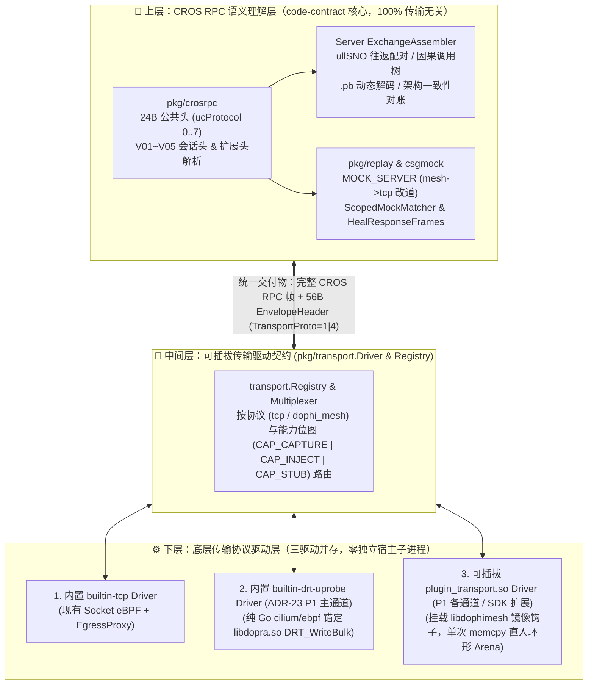

# ADR-22：Agent 可插拔传输层驱动架构（Pluggable Transport Driver）与 `dophi_mesh` 数据面采集设计

- **文档编号**：`22-pluggable-transport-driver-and-mesh-capture-adr.md`
- **文档版本**：v1.1.0
- **日期**：2026-11-19
- **状态**：✅ 已采纳 (Accepted — v1.1.0，与 [`ADR-23`](./23-dophi-mesh-uprobe-bypass-capture-adr.md) v1.0.0 协同定稿)
- **关联特性**：`F-09`（数据面按需旁路采集）、`F-10`（CROS RPC 协议解析与分帧）、`F-11`（出站代理与多底座采集）、`F-12` / `F-13`（重放与二进制自愈）、`F-33` / `F-34`（CSG 双层自动发现与三模仿真）、**`F-35`（新增：Agent 可插拔传输驱动架构与 `dophi_mesh` 旁路采集）**
- **关联设计**：[`01-cros-rpc-protocol-spec.md`](../07-references/01-cros-rpc-protocol-spec.md)、[`01-system-architecture.md`](../02-design/01-system-architecture.md)、[`02-data-plane-and-cros-rpc-engine.md`](../02-design/02-data-plane-and-cros-rpc-engine.md)、[`04-control-plane-and-web-console.md`](../02-design/04-control-plane-and-web-console.md)、[`05-database-schema.md`](../02-design/05-database-schema.md)
- **关联 ADR**：[`ADR-02`](./02-ebpf-hook-and-dual-subsystem-adr.md)、[`ADR-09`](./09-arch-process-ssot-and-ebpf-premount-standby-adr.md)、[`ADR-11`](./11-single-process-bidirectional-capture-and-recording-ux-adr.md)、[`ADR-21`](./21-csg-aware-agent-service-discovery-and-replay-mock-adr.md)、[`ADR-23`](./23-dophi-mesh-uprobe-bypass-capture-adr.md)
- **演进关系**：
  - **演进 `Non-Goal 1`**：保持「不做跨应用层协议框架（不支持 HTTP/REST、gRPC，仅支持 DOPHI `CROS RPC` + Protobuf Payload）」不变，但将底层传输从「仅限经内核 Socket 的 IPv4 TCP」演进为**「CROS RPC over 可插拔传输驱动（内置 `builtin-tcp` + 内置 `builtin-drt-uprobe` + 可选外部插件 `plugin_transport.so`）」**；
  - **演进 `Non-Goal 12④`（`ADR-21` D8）**：将 `dophi_mesh://` 从「仅支持控制面发现、数据面一刀切不支持」升级为**「按已注册 `transport.Driver` 的能力位图（`CapCapture | CapInject | CapStub`）动态放行」**——首期（P0+P1）正式支持 `dophi_mesh://` 数据面只读旁路录制（`CapCapture`），重放阶段继续沿用 ADR-21 `MOCK_SERVER`（将 `dophi_mesh://` 改写为 `tcp://`）或按能力位图诊断。

### 修订记录

| 版本 | 日期 | 修订说明 |
| :--- | :--- | :--- |
| v1.0.0 | 2026-11-19 | 初稿：确立「传输可插拔 (`pkg/transport.Driver` + `plugin_transport.so`) + 语义大一统 (`pkg/crosrpc`)」分层架构，解封 `ValidateCommHead` (`ucProtocol=4`) 与 56B `EnvelopeHeader` (`TransportProto`)。 |
| **v1.1.0** | **2026-11-19** | **融合 [`ADR-23`](./23-dophi-mesh-uprobe-bypass-capture-adr.md) 现网 `libdopra.so` DRT uprobe 实证并消除独立宿主子进程瓶颈**：1. **确立 P1 `dophi_mesh` 采集双轨制**：将 ADR-23 实证通过的 **`builtin-drt-uprobe`**（纯 Go `cilium/ebpf` 挂载 `libdopra.so` `DRT_WriteBulk`，零独立子进程、零 CGO、内核 RingBuf 单次拷贝直达 Agent）列为 P1 首选主通道；将 `plugin_transport.so`（C ABI 镜像钩子）列为备选与未来 SDK 级扩展通道；2. **砍掉冗余的 `contract-transport-host + UDS` 中间层**：修正初稿中“独立子进程走 UDS 零拷贝”的不严谨设计，明确无论主通道（内核 `bpf_probe_read_user` $\rightarrow$ `BPF_MAP_TYPE_RINGBUF`）还是备通道（单次 `memcpy` $\rightarrow$ 预分配 64MB 环形 Arena / `/dev/shm` 环）均严格遵循**「零中间宿主进程、仅 1 次内存拷贝直入环形缓冲区」**原则；3. 衔接 ADR-23 D7 现网首 24B 确认门禁。 |

---

## 1. 背景、现网实证与核心诉求 (Context & Verified Facts)

### 1.1 现网 `dophi_mesh` 的三项关键工程基石

结合 [`ADR-21`](./21-csg-aware-agent-service-discovery-and-replay-mock-adr.md)（M28）控制面实证与 [`ADR-23`](./23-dophi-mesh-uprobe-bypass-capture-adr.md)（`drt-uprobe-lab`）数据面实证，现网 `dophi_mesh://` 传输层具备以下工程特征：

1. **基石一：`dophi_mesh` 100% 绕开内核 Socket 系统调用，底层落入 `libdopra.so` 的 DRT 共享内存环**
   - 经 `ADR-23` 事实一与事实二实测：双进程 `MESH_Send / MESH_Recv` 全双工通信期间，`sys_enter_{read,write,recvfrom,sendto,connect}` 捕获数为 **0**；
   - `libdophimesh.so` 的全部写环操作收敛于 `libdopra.so` 的单一导出符号 **`DRT_WriteBulk(DRT_HANDLE handle, uint32 uiMsgNum, DRT_MSG_S astMsg[])`**（一次 `MESH_Send` 恒为 2-entry bulk：`astMsg[0]` 为 40B 环管理头，`astMsg[1]` 为业务载荷 `{pcMsg: +16(%dx), uiMsgLen: +24(%dx)}`）。
2. **基石二：`dophi_mesh` 是 CROS RPC 的底层传输载体（`ucProtocol = 4`），上层语义 100% 同构**
   - `dophi_mesh` 仅替换了 OSI 传输层（对应 `01-cros-rpc-protocol-spec.md` §3.1 中 `RPC_COMM_HEAD_S.ucProtocol = 4 (RPC_TRANSPORT_MESH)` 及 CSG `aucSubTransType[4] = 1`）。
   - 其上承载的业务消息为完整的标准 CROS RPC 报文（含 24B `RPC_COMM_HEAD_S` 公共头 + 多版本 `RPC_REQ/RSP/MNG_HEAD_S` 会话头 + 扩展头 + Protobuf Payload；由 `ADR-23` D7 门禁在现网首步核验 `astMsg[1]` 中 `"CSE.TCP"` 的起始偏移 `0` 或固定子头偏移 $N$）。
   - 因此，`code-contract` 现有的整套**语义层资产**——`pkg/crosrpc`、主控 `ExchangeAssembler`（按 `ullSNO` 请求/应答配对）、DOTR 因果调用树、`.pb` 动态解码器、架构拓扑一致性比对、乃至 `ScopedMockMatcher` 与 `HealResponseFrames`——**对 `dophi_mesh` 报文 100% 可直接复用**！
3. **基石三：全栈同源开发，且具备「内核 `uprobe` 纯 Go 直采」与「SDK `.so` 插件钩子」双重手段**
   - 一方面，我们已通过 `ADR-23` 实证了无需任何 C/C++ 插件即可由 Agent 内置 `cilium/ebpf` 直接挂载 `libdopra.so:DRT_WriteBulk` 捕获双向报文；
   - 另一方面，全栈工具链完全由我们独立掌控，对于存在官方 SDK 镜像钩子或定制传输封装的环境，可通过标准 `plugin_transport.so` 插拔接入。

### 1.2 现有 Agent 数据面的三处硬耦合痛点

| 位置 | 当前硬编码行为 | 对 `dophi_mesh` 造成的阻塞 |
| :--- | :--- | :--- |
| **1. `pkg/crosrpc/comm_head.go:55`** | `ValidateCommHead` 硬编码 `if h.TransportProto > 1 { return ErrInvalidTransport }` | 收到 `ucProtocol == 4 (RPC_TRANSPORT_MESH)` 的合法 CROS 报文时，在 Agent 与主控 `ParsePacket` 入口直接被当作非法报文拒绝 |
| **2. `pkg/ebpf/manager.go`** | 采集完全绑定 Socket `cgroup/connect4` + `sys_enter/exit_{read,write,recvfrom,sendto}`，且对 `ListenPort == 0` 的进程跳过入站采集 | `dophi_mesh` 走 DRT 共享内存环，Socket eBPF 钩子捕获数为 0；纯 Mesh 进程无 TCP `ListenPort` |
| **3. `internal/agent/server`** | `AgentServer` 直接耦合单一 `*ebpf.Manager`，缺少传输层抽象接口 | 无法按协议与能力位图统一编排 `builtin-tcp`、`builtin-drt-uprobe`（ADR-23）与 `plugin_transport.so` |

### 1.3 顶层分层架构：「传输可插拔，语义大一统」



---

## 2. 核心架构决策矩阵 (Decisions)

| 编号 | 决策领域 | 选定方案 (v1.1) | 依据与核心收益 |
| :--- | :--- | :--- | :--- |
| **D1** | **分层边界与驱动交付粒度** | 以**「单条完整 CROS RPC 消息帧 (`[]byte`，含 `24B RPC_COMM_HEAD_S` + 会话头 + 扩展头 + Payload) + 归一化通道端点元数据 (`CapturedFrame`)」**作为传输驱动层与语义层的唯一分界线。底层驱动**不交付**碎片字节流，也**不解析** `ServiceName/Operation/ullSNO/Protobuf` 语义 | 无论是 `DRT_WriteBulk` 的 `astMsg[1]`（ADR-23）还是 `libdophimesh` 镜像钩子，天然都是按完整消息帧传递；语义层与主控 100% 零改动复用 |
| **D2** | **能力分级与首期范围（P0 + P1）** | 定义四级传输能力位图：`CapDiscover (1<<0)`、`CapCapture (1<<1)`、`CapInject (1<<2)`、`CapStub (1<<3)`。**首期严格执行 Step 1 (P0) + Step 2 (P1)**：<br>- **Step 1 (P0)**：抽取 `pkg/transport.Driver` 接口，解封 `ValidateCommHead` (`ucProtocol=4`) 与 56B `EnvelopeHeader`，将现有 Socket eBPF 无损重构为 `builtin-tcp` Driver；<br>- **Step 2 (P1)**：在 `pkg/transport.Driver` 下落地 `dophi_mesh` 只读采集双轨驱动（主通道 **`builtin-drt-uprobe`** 见 [`ADR-23`](./23-dophi-mesh-uprobe-bypass-capture-adr.md)，备通道 **`plugin_transport.so`**），打通 Mesh 录制、落盘、`.pb` 解码、因果树与拓扑对账；<br>- **Mock 仿真边界保持正交**：重放继续复用 ADR-21 `MOCK_SERVER`（控制面快照将 `dophi_mesh://` 改写为 `tcp://`），不做共享内存环内核写注入 | 以最小半径和最高确定性打通现网 `dophi_mesh` 流量可观测性与活体契约闭环 |
| **D3** | **零独立宿主子进程与单次拷贝内存模型** | **彻底取消初稿中的 `contract-transport-host` 独立子进程与 UDS 转发层**，确保两条采集通道均达到物理极限的**「仅 1 次内存拷贝」**：<br>1. **主通道 `builtin-drt-uprobe`（ADR-23）**：在 `code-contract-agent` 进程内直接通过 `cilium/ebpf` 挂载 `DRT_WriteBulk` uprobe，内核 `bpf_probe_read_user` **1 次拷贝**写入 `BPF_MAP_TYPE_RINGBUF`，Agent 用户态直接读取并冠以 56B `EnvelopeHeader` 入队（**100% 纯 Go `CGO_ENABLED=0`、0 子进程**）；<br>2. **备通道 `plugin_transport.so`**：因全栈同团队同工具链构建，当启用 `.so` 插件时，直接通过进程内 `dlopen`（可选 build tag）或 `/dev/shm` 共享内存无锁环形 Arena 交互——钩子回调接收环槽位指针（0 拷贝），在钩子返回前**仅执行 1 次 `memcpy`** 写入预留好 56B 头部的 64MB 环形 Arena，Go 发送协程直接切片引用写出（**0 UDS 内核拷贝、0 序列化开销**） | 彻底解决独立宿主子进程带来的部署运维负担与 UDS 2~3 次拷贝开销 |
| **D4** | **`pkg/crosrpc` 协议校验解封与 TCP 滑窗隔离** | 1. **解封 `ValidateCommHead`**：将 `pkg/crosrpc/comm_head.go` 中 `h.TransportProto > 1` 放宽为校验合法枚举上界 `h.TransportProto > TransportCustomize (7)`，使 `ucProtocol == 4 (TransportMesh)` 在 `ParsePacket`、`ExchangeAssembler`、`Anatomy`、`Decoder`、`Diff` 中全面合法；<br>2. **保持 TCP `StreamFramer` 防伪帧严密性**：在面向无边界 TCP 字节流的 `StreamFramer` 中保持默认仅接受 `ucProtocol <= 1`，防止在 MySQL/Redis 等非 CROS TCP 连接上产生滑窗假阳性伪帧 | 一举打通主控与 Agent 全部语义层组件对 `ucProtocol = 4 (MESH)` 报文的解析，同时对现有 TCP 录制防伪帧能力 **0 劣化** |
| **D5** | **56B `EnvelopeHeader` 与数据库零迁移兼容** | 1. **保持 56B `EnvelopeHeader` 定长格式不变**：将偏移 `26..27` 的 `Reserved uint16` 拆分为偏移 `26` 的 **`TransportProto uint8`**（`0/1=TCP, 4=MESH`，若为 `0` 则主控回退取 `CommHead.TransportProto`）与偏移 `27` 的 `Reserved uint8`；<br>2. **Mesh 端点与通道映射**：`dophi_mesh://ipv4:<ip>:<port>` 的节点 IP 与端口（或进程 PID 低 16 位）写入 `SrcIPv4/DstIPv4/SrcPort/DstPort`，DRT 环通道标识写入 `ConnSeq uint32`；<br>3. **复用既有 DB 列**：`contract_traffic_records` 表已存在 `transport_proto` 列，**无需任何数据库 DDL 迁移**即可原生存储并向前端返回 `transport_proto = 4` | WebSocket 二进制流、Agent 64MB 有界缓冲区、主控 `ExchangeAssembler` 分片键 `calcConnKey` 与 PostgreSQL 分区表 **100% 零破坏无缝衔接** |
| **D6** | **方向归一化不变量 (`DirectionIngress` vs `DirectionEgress`)** | 采集驱动在封装 `dophi_mesh` 帧时，严格对齐 [`ADR-11`](./11-single-process-bidirectional-capture-and-recording-ux-adr.md) 方向不变量：<br>- **入站 (`DirectionIngress = 1`)**：被监控进程 **收到 `REQ (2)`** 或 **发出 `RSP (3) / RSP_SEG (4)`**（四元组恒定保持 `Src = 远端调用方, Dst = 本机被监控进程`）；<br>- **出站 (`DirectionEgress = 2`)**：被监控进程 **发出 `REQ (2)`** 或 **收到 `RSP (3) / RSP_SEG (4)`**（四元组恒定保持 `Src = 本机被监控进程, Dst = 远端服务提供方`） | 确保同一个 Mesh RPC 往返的 `REQ` 与 `RSP` 在主控 `ExchangeAssembler` 中落入同一个 `connKey` 并按 `ullSNO` 100% 聚合成单行 `TrafficRecord` |
| **D7** | **过滤条件下推与待命期零损耗** | 1. **平时零损耗**：未开启录制会话（`session_id == 0`）时，既不挂载 `DRT_WriteBulk` uprobe，也不激活 `.so` 镜像回调；<br>2. **PID 级精准过滤**：`StartCapture` 时将目标 `PID` 列表下推至内核 `perf_event_open(pid)` / `target_pids_map` 或插件过滤表，非目标进程的共享内存环操作 **0 采集** | 避免宿主机上数百个非目标 Mesh 进程的高频共享内存流量进入环形缓冲区 |
| **D8** | **纯 Mesh 进程监控挂载与五出口卫生** | 1. 演进进程监控同步：当目标进程 `ListenPort == 0`（纯 `dophi_mesh://` 进程）时，通过 `CmdPattern` / CSG 发现的 `PID` 定位进程后，自动交由已注册的 `dophi_mesh` Transport Driver（`builtin-drt-uprobe` 或 `plugin_transport.so`）执行 `StartCapture`；<br>2. 所有 Transport Driver 严格纳入 Agent **五出口幂等清理**（正常停录、取消、`/purge`、主控失联 5 分钟、收到 `SIGINT/SIGTERM`） | 彻底解决纯 `dophi_mesh://` 进程无 TCP `ListenPort` 无法录制流量的历史空白，并严守探针卫生红线 |

---

## 3. Go 侧 `pkg/transport` 统一驱动接口设计 (Step 1 / P0)

### 3.1 `pkg/transport/driver.go` 核心契约定义

新建纯 Go 基础包 `pkg/transport`（严格遵守 `cmd/agent/deps_test.go`：默认零 CGO、零 GORM、零 `protoregistry` 依赖）：

```go
package transport

import (
	"context"
	"errors"
	"io"

	"code-contract/pkg/agentproto"
)

// Capability 传输驱动能力位图
type Capability uint32

const (
	CapDiscover Capability = 1 << iota // 1<<0: 传输层端点辅助枚举
	CapCapture                         // 1<<1: 只读旁路镜像采集 (P0/P1 核心)
	CapInject                          // 1<<2: 作为客户端主动注入 CROS 请求帧 (P2 预留)
	CapStub                            // 1<<3: 作为服务端挂载下游 Mock 桩替身 (P3 预留)
)

var (
	ErrCapabilityUnsupported = errors.New("transport: capability not supported by driver")
	ErrTransportNotFound     = errors.New("transport: no driver registered for scheme")
)

// DriverInfo 驱动元信息与能力声明（用于握手上报与能力门禁）
type DriverInfo struct {
	Name          string     `json:"name"`           // "builtin-tcp" | "builtin-drt-uprobe" | "plugin-dophi_mesh"
	Version       string     `json:"version"`        // "1.0.0"
	ABIVersion    uint32     `json:"abi_version"`    // 1
	Transports    []string   `json:"transports"`     // ["tcp"] 或 ["dophi_mesh", "mesh"]
	TransportCode uint8      `json:"transport_code"` // 对应 RPC_COMM_HEAD_S.ucProtocol (1=TCP, 4=MESH)
	Capabilities  Capability `json:"capabilities"`   // CapCapture | CapInject | CapStub
	PluginPath    string     `json:"plugin_path,omitempty"`
}

// TargetProcess 单个被监控目标进程的运行时解析信息
type TargetProcess struct {
	ProcessID  uint64                        `json:"process_id"`  // 主控 contract_processes.id
	PID        uint32                        `json:"pid"`         // 宿主机实测 OS PID
	ListenPort uint16                        `json:"listen_port"` // TCP 监听端口（纯 Mesh 进程为 0）
	CmdPattern string                        `json:"cmd_pattern"` // 命令行匹配模式
	Spec       agentproto.ProcessMonitorSpec `json:"spec"`
}

// CaptureSpec 开启旁路采集的下推过滤规格
type CaptureSpec struct {
	SessionID      uint64          `json:"session_id"`
	MaxFrameBytes  int             `json:"max_frame_bytes"`
	MaxBufferBytes int             `json:"max_buffer_bytes"`
	Targets        []TargetProcess `json:"targets"`
}

// CapturedFrame 传输驱动向 Agent 缓冲区交付的标准化单帧结构
type CapturedFrame struct {
	SessionOrTaskID uint64
	ProcessID       uint64
	CapturedPID     uint32
	Direction       uint8   // agentproto.DirectionIngress (1) | DirectionEgress (2)
	TransportProto  uint8   // crosrpc.TransportTCP (1) | TransportMesh (4) | ...
	Flags           uint8   // agentproto.FlagIsTruncated | FlagHasGap
	CapturedAtNs    int64
	SrcIPv4         [4]byte
	DstIPv4         [4]byte
	SrcPort         uint16
	DstPort         uint16
	ConnSeq         uint32  // TCP 连接序号 或 DRT/Mesh 共享内存环通道 ID
	RawFrame        []byte  // 完整 CROS RPC 帧 (24B CommHead + SessionHead + ExtHead + Payload)
}

// FrameSink 采集帧统一回调（直接转化为 56B EnvelopeHeader 推入 BoundedSessionBuffer）
type FrameSink func(envelopeBytes []byte)

// Endpoint 注入与桩替身端点描述符
type Endpoint struct {
	Transport string // "tcp" | "dophi_mesh"
	URI       string // "tcp://ipv4:127.0.0.1:18500" | "dophi_mesh://ipv4:10.29.92.80:2002"
	PID       uint32
}

// StubHandler 下游 Mock 桩请求处理回调（对接 pkg/replay.ScopedMockMatcher）
type StubHandler func(ctx context.Context, reqFrame []byte, peer Endpoint) (rspFrames [][]byte, hit bool)

// Driver 底层传输协议驱动统一接口（builtin-tcp、builtin-drt-uprobe 与 plugin_transport.so 共同实现）
type Driver interface {
	Info() DriverInfo

	// P0/P1 采集生命周期接口
	StartCapture(ctx context.Context, spec CaptureSpec) error
	StopCapture(ctx context.Context, sessionID uint64) error

	// P2 主动请求注入接口（只读采集驱动返回 ErrCapabilityUnsupported）
	Call(ctx context.Context, target Endpoint, reqFrames [][]byte) (rspFrames [][]byte, err error)

	// P3 下游桩替身挂载接口（只读采集驱动返回 ErrCapabilityUnsupported）
	ServeStub(ctx context.Context, target Endpoint, handler StubHandler) (io.Closer, error)

	// 五出口幂等卸载与资源回收
	Close() error
}
```

### 3.2 `transport.Registry` 多驱动路由与主备优先级

1. **默认内置注册**：
   - `builtin-tcp`（封装现有 `pkg/ebpf.Manager` + `EgressProxy`，声明 `Transports: ["tcp"]`, `Capabilities: CapDiscover | CapCapture | CapInject | CapStub`）；
   - `builtin-drt-uprobe`（详见 [`ADR-23`](./23-dophi-mesh-uprobe-bypass-capture-adr.md)，当检测到宿主机或目标进程映射了 `libdopra.so` 且含 `DRT_WriteBulk` 符号时自动就绪，声明 `Transports: ["dophi_mesh", "mesh"]`, `Capabilities: CapCapture`）。
2. **可选插件覆盖/并存**：
   - 当显式指定 `--transport-plugin-so=/path/to/plugin_transport.so` 时，加载外部插件驱动；若与 `builtin-drt-uprobe` 声明了相同的 `dophi_mesh` scheme，支持通过 `--mesh-capture-driver=uprobe|plugin` 选择主用驱动并在异常时自动降级。

---

## 4. `plugin_transport.so` C ABI 与单次拷贝 Arena 契约（备通道 & SDK 扩展接口）

当特定环境需要对接 `libdophimesh.so` 官方旁路镜像钩子或扩展 SDK 级能力时，提供标准 C ABI 头文件 `scripts/transport/contract_transport_plugin.h`：

```c
// scripts/transport/contract_transport_plugin.h
// Code-Contract Pluggable Transport ABI v1
#ifndef CONTRACT_TRANSPORT_PLUGIN_H
#define CONTRACT_TRANSPORT_PLUGIN_H

#include <stdint.h>
#include <stddef.h>

#ifdef __cplusplus
extern "C" {
#endif

#define CT_TRANSPORT_ABI_VERSION 1u

#define CT_CAP_DISCOVER (1u << 0)
#define CT_CAP_CAPTURE  (1u << 1)
#define CT_CAP_INJECT   (1u << 2)
#define CT_CAP_STUB     (1u << 3)

#define CT_DIR_INGRESS  1u
#define CT_DIR_EGRESS   2u

#define CT_PROTO_TCP    1u
#define CT_PROTO_MESH   4u

typedef struct ct_plugin_info {
    uint32_t    abi_version;        // CT_TRANSPORT_ABI_VERSION (1)
    const char* name;               // 如 "dophi_mesh"
    const char* version;            // 如 "1.0.0"
    const char* transports_csv;     // "dophi_mesh,mesh"
    uint8_t     transport_code;     // CT_PROTO_MESH (4)
    uint32_t    capabilities;       // CT_CAP_CAPTURE
} ct_plugin_info_t;

typedef struct ct_target_proc {
    uint64_t process_id;
    uint32_t pid;
    uint16_t listen_port;
    uint16_t reserved;
} ct_target_proc_t;

typedef struct ct_capture_spec {
    uint64_t                session_id;
    uint32_t                max_frame_bytes;
    uint32_t                target_count;
    const ct_target_proc_t* targets;
} ct_capture_spec_t;

typedef struct ct_captured_frame {
    uint64_t       session_id;
    uint64_t       process_id;
    uint32_t       captured_pid;
    uint8_t        direction;       // CT_DIR_INGRESS (1) | CT_DIR_EGRESS (2)
    uint8_t        transport_proto; // CT_PROTO_MESH (4)
    uint8_t        flags;
    uint8_t        reserved;
    int64_t        captured_at_ns;
    uint8_t        src_ipv4[4];
    uint8_t        dst_ipv4[4];
    uint16_t       src_port;
    uint16_t       dst_port;
    uint32_t       conn_seq;        // 环 ID / 逻辑通道序号
    uint32_t       frame_len;
    const uint8_t* frame_data;      // 直接指向环槽位中的 CROS 报文起始地址 (0 拷贝传入)
} ct_captured_frame_t;

typedef struct ct_host_callbacks {
    void* user_data;
    // 钩子传入环槽位指针 frame->frame_data，回调内部直接 1 次 memcpy 写入预分配 64MB 环形 Arena (56B Header + Frame)
    void (*on_captured_frame)(void* user_data, const ct_captured_frame_t* frame);
    void (*on_log)(void* user_data, int level, const char* message);
} ct_host_callbacks_t;

int  ct_plugin_init(const ct_host_callbacks_t* host_cb, const char* config_json, ct_plugin_info_t* out_info);
int  ct_plugin_start_capture(const ct_capture_spec_t* spec);
int  ct_plugin_stop_capture(uint64_t session_id);
int  ct_plugin_call(const char* target_uri, const uint8_t* req_frame, uint32_t req_len,
                    uint8_t* rsp_buf, uint32_t* inout_rsp_len, uint32_t timeout_ms);
void ct_plugin_cleanup(void);

#ifdef __cplusplus
}
#endif

#endif // CONTRACT_TRANSPORT_PLUGIN_H
```

---

## 5. 方向与四元组归一化契约（`builtin-drt-uprobe` 与 `plugin_transport.so` 共用）

在主控 `ExchangeAssembler`（`internal/server/recorder/assembler.go`）中，一条请求（`REQ`）与其应答（`RSP / RSP_SEG`）配对合成为一行 `contract_traffic_records` 的充要条件是：
1. 落在同一个分片 Worker：`(sessionID, processID, calcConnKey(srcIP, srcPort, dstIP, dstPort, connSeq))` 完全相同；
2. 拥有相同的 `Direction`（同为 `DirectionIngress` 或同为 `DirectionEgress`）与相同的 `CommHead.SNO`（`ullSNO`）。

驱动根据触发切面（`TX` 发送 / `RX` 接收）与 CROS 公共头第 23 字节 `ucMsgType = frame_data[22]`（`2=REQ, 3=RSP, 4=RSP_SEG`），按以下**确定性真值表**填写 `direction` 与 `(src, dst)`：

| 触发切面 | `frame_data[22]` (`ucMsgType`) | 业务含义（相对被监控目标进程 `Target`） | 归一化 `direction` | 归一化 `src` | 归一化 `dst` |
| :---: | :---: | :--- | :---: | :---: | :---: |
| **`RX` (或对端 `DRT_WriteBulk` 发向 `Target`)** | `2` (`RPC_MSG_TYPE_REQ`) | `Target` 收到上游发来的入站请求 | **`CT_DIR_INGRESS (1)`** | `Peer` (对端) | `Target` (本进程) |
| **`TX` (`Target` 调用 `DRT_WriteBulk`)** | `3 / 4` (`RSP / RSP_SEG`) | `Target` 向上游回写刚才入站请求的应答 | **`CT_DIR_INGRESS (1)`** | `Peer` (对端) | `Target` (本进程) |
| **`TX` (`Target` 调用 `DRT_WriteBulk`)** | `2` (`RPC_MSG_TYPE_REQ`) | `Target` 向下游服务发起出站调用请求 | **`CT_DIR_EGRESS (2)`** | `Target` (本进程) | `Peer` (对端) |
| **`RX` (或下游 `DRT_WriteBulk` 回给 `Target`)** | `3 / 4` (`RSP / RSP_SEG`) | `Target` 收到下游服务返回的出站调用应答 | **`CT_DIR_EGRESS (2)`** | `Target` (本进程) | `Peer` (对端) |

---

## 6. 协议栈、信封与主控数据链路改动清单 (Protocol & Server Alignment)

### 6.1 `pkg/crosrpc`：解封 `TransportMesh (4)` 并隔离 TCP 滑窗

1. **`pkg/crosrpc/comm_head.go` — `ValidateCommHead` 放开合法传输枚举 `0..7`**：
   ```go
   func ValidateCommHead(h CommHead) error {
       if !bytes.Equal(h.Magic[:], []byte(MagicPrefix)) {
           return ErrInvalidMagic
       }
       // 支持 CROS RPC 规范定义的全部传输底座 [0..TransportCustomize(7)]
       // (0=DEFAULT, 1=TCP, 2=DMS, 3=UC, 4=MESH, 5=DOMAIN, 6=FRPC, 7=CUSTOMIZE)
       if h.TransportProto > TransportCustomize {
           return ErrInvalidTransport
       }
       // ... 其余 MsgType 与 HeadLen 校验保持不变
   ```
2. **`pkg/crosrpc/framer.go` — TCP 流式分帧器保持 `ucProtocol <= 1` 滑窗防伪帧**：
   - `StreamFramer` 专用于从无边界 TCP 字节流中滑窗寻找 `"CSE.TCP"` 魔术字，默认继续仅接受 `f.buf[7] <= TransportTCP (1)`，确保非 CROS TCP 连接不会出现滑窗假阳性。

### 6.2 `pkg/agentproto`：56B `EnvelopeHeader` 零破坏扩展与握手能力上报

1. **`pkg/agentproto/envelope.go` — 启用偏移 `26` 为 `TransportProto`**：
   ```go
   type EnvelopeHeader struct {
       Magic           uint16  `json:"magic"`              // 0..1: 0x4354 ("CT")
       ProtoVer        uint8   `json:"proto_ver"`          // 2: 1
       EventType       uint8   `json:"event_type"`         // 3
       SessionOrTaskID uint64  `json:"session_or_task_id"` // 4..11 (BE)
       ProcessID       uint64  `json:"process_id"`         // 12..19 (BE)
       CapturedPID     uint32  `json:"captured_pid"`       // 20..23 (BE)
       Direction       uint8   `json:"direction"`          // 24 (1=INGRESS, 2=EGRESS)
       Flags           uint8   `json:"flags"`              // 25
       TransportProto  uint8   `json:"transport_proto"`    // 26 (0/1=TCP, 4=MESH; 原 Reserved 高字节)
       Reserved        uint8   `json:"reserved"`           // 27 (0; 原 Reserved 低字节)
       CapturedAtNs    int64   `json:"captured_at_ns"`     // 28..35 (BE)
       SrcIPv4         [4]byte `json:"src_ipv4"`           // 36..39
       DstIPv4         [4]byte `json:"dst_ipv4"`           // 40..43
       SrcPort         uint16  `json:"src_port"`           // 44..45 (BE)
       DstPort         uint16  `json:"dst_port"`           // 46..47 (BE)
       ConnSeq         uint32  `json:"conn_seq"`           // 48..51 (BE)
       PayloadLen      uint32  `json:"payload_len"`        // 52..55 (BE)
   }
   ```
2. **`pkg/agentproto/protocol.go` — `HandshakeResp` 新增 `TransportDrivers` 能力清单**：
   ```go
   type TransportDriverCapability struct {
       Name          string   `json:"name"`           // "builtin-tcp" | "builtin-drt-uprobe" | "plugin-dophi_mesh"
       Version       string   `json:"version"`        // "1.0.0"
       Transports    []string `json:"transports"`     // ["tcp"] | ["dophi_mesh", "mesh"]
       TransportCode uint8    `json:"transport_code"` // 1 (TCP) | 4 (MESH)
       Capabilities  []string `json:"capabilities"`   // ["DISCOVER", "CAPTURE", "INJECT", "STUB"]
   }
   ```

### 6.3 主控 `ExchangeAssembler` 与 `Anatomy` 解剖抽屉

1. **`internal/server/recorder/assembler.go`**：
   - `resolveTransportProto(env.TransportProto, comm.TransportProto)`：优先取非零 `env.TransportProto`，其次取非零 `comm.TransportProto`，兜底为 `1 (TCP)`；
   - 落盘 `models.TrafficRecord.TransportProto` 自动写入 `4`（`dophi_mesh`）或 `1`（`tcp`）。
2. **`internal/server/recorder/anatomy.go`**：
   - 补全 `ucProtocol` 可读名称映射：`0 -> "DEFAULT"`, `1 -> "TCP"`, `2 -> "DMS"`, `3 -> "UC"`, `4 -> "MESH (dophi_mesh)"`, `5 -> "DOMAIN"`, `6 -> "FRPC"`, `7 -> "CUSTOMIZE"`。

---

## 7. 与 ADR-23 协同的统一 TDD 实施路线图（拟 M29）

| 阶段 | 任务单元 | 核心交付物 | 自动化 TDD 验收门禁 |
| :---: | :--- | :--- | :--- |
| **M29-1 (P0)** | **协议栈解封与 56B 信封扩展**（ADR-22） | 1. `ValidateCommHead` 支持 `ucProtocol ∈ [0..7]`，`StreamFramer` 保持 TCP 滑窗 `<=1` 防伪帧；<br>2. `EnvelopeHeader` 偏移 `26` 启用 `TransportProto`；<br>3. `ExchangeAssembler` 与 `Anatomy` 支持 `TransportMesh (4)` 落盘与解剖展示 | `go test -v ./pkg/crosrpc/... ./pkg/agentproto/... ./internal/server/recorder/...` 100% 全绿 |
| **M29-2 (P0)** | **`pkg/transport` 统一驱动接口与内置 `tcp` 重构**（ADR-22） | 1. 实现 `pkg/transport`（`Driver`、`Registry`、`CaptureSpec`、`DriverInfo`）；<br>2. 将 `pkg/ebpf.Manager` 无损封装为 `builtin-tcp` Driver；<br>3. `HandshakeResp` 上报 `TransportDrivers` 能力矩阵；`deps_test.go` 纳管 `./pkg/transport` | 现有全部 eBPF / Replay / AgentServer 单测 100% 零回归通过；`deps_test.go` 零 CGO / 零 DB 通过 |
| **M29-3 (P1)** | **ELF 符号解析器与 `builtin-drt-uprobe` 主通道驱动**（ADR-23） | 1. `pkg/transport/drt_symbols.go`：纯 Go `debug/elf` 解析 `libdopra.so` `.dynsym` 提取 `DRT_WriteBulk` / `DRT_ReadLen` / `DRT_ReadNoCheckLen` 偏移；<br>2. `pkg/transport/drt_uprobe_driver.go`：实现 `Driver` (`CapCapture`)，支持 `DRT_WriteBulk` 2-entry bulk 采集、方向归一化与五出口清理 | 夹具 `.so` 符号解析 100% 命中；双进程 200 次往返模拟 100% 捕获并在主控合成 `transport_proto=4` 记录，停录摘针后负控 0 事件 |
| **M29-4 (P1)** | **现网 D7 首帧核验与 `contract_transport_plugin.h` 备通道固化**（ADR-22 & ADR-23） | 1. 交付 `scripts/transport/contract_transport_plugin.h` 与现网 D7 Hex 验证脚本；<br>2. 根据现网 `astMsg[1]` 首 24B 实测结果校准 `payload_offset` | 现网 `dophi_mesh` 进程录制抓出完整请求/应答并在 `/debug` 展示调用树与 Protobuf JSON |

---

## 8. 非目标边界 (Non-Goals)

1. **不做 `dophi_mesh` 共享内存环的 Mock 桩替身**：重放阶段继续走 ADR-21 `MOCK_SERVER`（将 `dophi_mesh://` 改写为 `tcp://`）或按能力位图诊断；
2. **不引入独立宿主子进程 `contract-transport-host`**：主通道 `builtin-drt-uprobe` 在 Agent 进程内纯 Go + eBPF 完成，备通道 `.so` 走单次 `memcpy` 环形 Arena；
3. **不支持非 CROS RPC 协议**：上层载荷仍严格限定为 DOPHI `CROS RPC` 帧格式与 Protobuf Payload。
