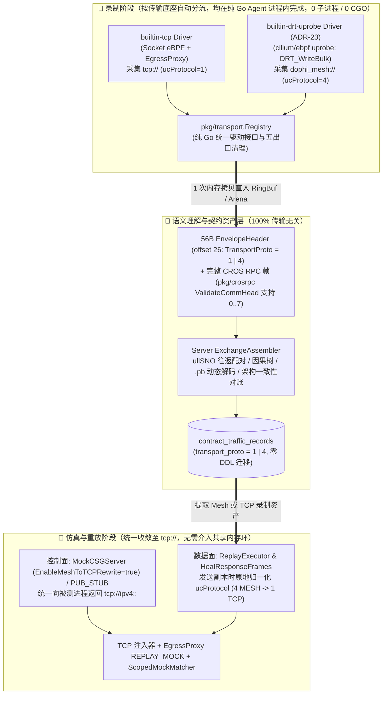

# ADR-22：Agent 纯 Go 可插拔传输层架构（`pkg/transport`）与「`dophi_mesh` 采集 ➔ `tcp://` 仿真重放」跨传输闭环设计

- **文档编号**：`22-pluggable-transport-driver-and-mesh-capture-adr.md`
- **文档版本**：v2.0.0
- **日期**：2026-11-19
- **状态**：✅ 已采纳 (Accepted — v2.0.0，与 [`ADR-23`](./23-dophi-mesh-uprobe-bypass-capture-adr.md) v1.1.0 协同定稿)
- **关联特性**：`F-09`（数据面按需旁路采集）、`F-10`（CROS RPC 协议解析与分帧）、`F-11`（出站代理与多底座采集）、`F-12` / `F-13`（重放与二进制自愈）、`F-33` / `F-34`（CSG 双层自动发现与三模仿真）、**`F-35`（Agent 纯 Go 可插拔传输驱动架构与 `dophi_mesh` 采集 ➔ TCP 重放跨传输闭环）**
- **关联设计**：[`01-cros-rpc-protocol-spec.md`](../07-references/01-cros-rpc-protocol-spec.md)、[`01-system-architecture.md`](../02-design/01-system-architecture.md)、[`02-data-plane-and-cros-rpc-engine.md`](../02-design/02-data-plane-and-cros-rpc-engine.md)、[`04-control-plane-and-web-console.md`](../02-design/04-control-plane-and-web-console.md)、[`05-database-schema.md`](../02-design/05-database-schema.md)
- **关联 ADR**：[`ADR-02`](./02-ebpf-hook-and-dual-subsystem-adr.md)、[`ADR-09`](./09-arch-process-ssot-and-ebpf-premount-standby-adr.md)、[`ADR-11`](./11-single-process-bidirectional-capture-and-recording-ux-adr.md)、[`ADR-21`](./21-csg-aware-agent-service-discovery-and-replay-mock-adr.md)、[`ADR-23`](./23-dophi-mesh-uprobe-bypass-capture-adr.md)
- **演进关系**：
  - **演进 `Non-Goal 1`**：保持「不做跨应用层协议框架（仅支持 DOPHI `CROS RPC` + Protobuf Payload）」不变，将底层传输从「仅限经内核 Socket 的 IPv4 TCP」演进为**「CROS RPC over 纯 Go 可插拔传输驱动（内置 `builtin-tcp` + 内置 `builtin-drt-uprobe`）」**；
  - **演进 `ADR-21` D8 与 `Non-Goal 12④`**：依据现网代码分析与实测——**Mock/重放阶段全部目标业务进程均支持 `tcp://`，只需 CSG（`MockCSGServer` / `PUB_STUB`）返回 `tcp://` 地址**——彻底打通「**现网 `dophi_mesh://` 零侵入采集（`ADR-23`）➔ 测试态 `tcp://` 无缝仿真重放**」全链路闭环，消除对 `dophi_mesh` 共享内存环做数据面注入/Mock 的复杂度。

### 修订记录

| 版本 | 日期 | 修订说明 |
| :--- | :--- | :--- |
| v1.0.0 | 2026-11-19 | 初稿：设想通过 `plugin_transport.so`（对接 `libdophimesh.so` 旁路镜像钩子）+ `contract-transport-host` 子进程实现传输层可插拔。 |
| v1.1.0 | 2026-11-19 | 融合 `ADR-23` `drt-uprobe-lab` 实证，将 `builtin-drt-uprobe` 提升为 P1 主通道，砍掉 `contract-transport-host` 子进程与 UDS。 |
| **v2.0.0** | **2026-11-19** | **依据两项现网关键证伪/实证结论彻底收敛架构（极简纯 Go 单二进制闭环）**：<br>1. **正式否决 `plugin_transport.so` + `libdophimesh.so` 钩子方案**：经代码分析与现网验证，`libdophimesh.so` 钩子**仅在本进程内部生效**，而 `dophi_mesh` 为点对点（P2P）网状拓扑，Agent 即使加载 `libdophimesh.so` 也无法监听其他业务进程之间的交互，无实用价值；彻底清除 C ABI（`contract_transport_plugin.h`）与外部 `.so` 加载负担，**`builtin-drt-uprobe`（[`ADR-23`](./23-dophi-mesh-uprobe-bypass-capture-adr.md)）成为 `dophi_mesh` 采集的唯一正式驱动**；<br>2. **正式确立「采集分流 (`tcp` / `dophi_mesh`)，仿真重放统一收敛 `tcp://`」闭环**：经现网验证，Mock 阶段目标进程全部支持 `tcp://`，只需 CSG/MockCSG 返回 `tcp://` 地址；补齐 **Mesh 录制帧 ➔ TCP 重放时的 `ucProtocol`（`4 -> 1`）发送期原地归一化** 与 `SimController` `MOCK_SERVER` 放行策略。 |

---

## 1. 背景、现网实证与否决方案记录 (Context & Rejected Alternatives)

### 1.1 现网代码分析与实测确立的四项决定性事实

| # | 现网事实 | 架构影响 |
| :-: | :--- | :--- |
| **F1** | **`libdophimesh.so` 钩子仅限本进程内生效，P2P 网状拓扑下 Agent 无法旁路监听他进程** | **彻底证伪 `plugin_transport.so` 方案**：Agent 作为独立旁路进程即使加载 `libdophimesh.so` 也听不到业务进程 A ↔ B 之间的共享内存环交互；若用 `LD_PRELOAD` 注入全部业务进程又破坏零侵入红线。该方案被正式否决 |
| **F2** | **内核 `uprobe` 锚定 `libdopra.so:DRT_WriteBulk` 可跨进程零侵入捕获本机任意 Mesh 流量（[`ADR-23`](./23-dophi-mesh-uprobe-bypass-capture-adr.md)）** | `builtin-drt-uprobe` 成为 `dophi_mesh` 数据面采集的**唯一正式驱动**：纯 Go（`CGO_ENABLED=0`）、零 `.so` 插件、零外部子进程、按 `target_pids` 内核级过滤，单次拷贝入 `BPF_MAP_TYPE_RINGBUF` |
| **F3** | **`dophi_mesh` 是 CROS 的底层传输层，其上承载全量标准 CROS 协议（含包头）** | 只需解封 `pkg/crosrpc.ValidateCommHead` (`ucProtocol=4`) 与 56B `EnvelopeHeader`，主控 `ExchangeAssembler`、`.pb` 动态解码、因果树、拓扑一致性比对 **100% 原样复用** |
| **F4** | **Mock/重放阶段，所有业务进程均支持 `tcp://`，只需 `csgserver` / `MockCSGServer` 返回 `tcp://` 地址** | **重放与仿真不需要任何 `dophi_mesh` 共享内存写注入/桩替身！** 只需控制面下发 `tcp://` 地址 + 数据面重放发送时将录制帧头 `raw[7]`（`ucProtocol: 4 -> 1`）原地归一化，即可实现「**现网 Mesh 录制 ➔ 测试态 TCP 无缝重放**」 |

### 1.2 否决方案永久记录 (Rejected Alternatives)

- **否决方案 A：外部 C/C++ 插件 `plugin_transport.so`（对接 `libdophimesh.so` 镜像钩子）+ 独立薄宿主 `contract-transport-host`**
  - **否决理由**：① `libdophimesh.so` 钩子仅能拦截当前进程自身的收发，而 `dophi_mesh` 是点对点网状共享内存架构，Agent 进程引入 `libdophimesh.so` 完全监听不到其他业务进程之间的点对点通信，几乎无使用价值；② 引入额外 C ABI、动态库构建与子进程维护复杂度，而纯 Go 内核 `uprobe`（`ADR-23`）已在现网实证零侵入跨进程捕获；③ Mock 阶段所有进程均原生支持 `tcp://`，亦不需要通过 `.so` 做 Mesh 注入或桩替身。
- **否决方案 B：为 `dophi_mesh` 实现共享内存环写注入（`CapInject`）与共享内存 Mock 桩（`CapStub`）**
  - **否决理由**：现网进程在 Mock/测试阶段均支持 `tcp://`，仅需控制面 `csgserver` / `MockCSGServer` 返回 `tcp://ipv4:<ip>:<port>` 地址即可复用成熟的 TCP `ReplayExecutor`、`EgressProxy REPLAY_MOCK` 与 `ScopedMockMatcher`。在共享内存环上重复造轮子做注入与 Mock 是纯粹的过度设计。

---

## 2. 终局极简架构：「采集多底座纯 Go 可插拔，语义与重放全栈大一统」



---

## 3. 核心架构决策矩阵 (Decisions)

| 编号 | 决策领域 | 选定方案 (v2.0) | 依据与核心收益 |
| :--- | :--- | :--- | :--- |
| **D1** | **纯 Go `pkg/transport.Driver` 传输抽象层** | 在 Agent 内抽取轻量纯 Go 接口 `pkg/transport.Driver`（零 CGO、零 C ABI、零 `.so` 加载），内置两大驱动：<br>1. **`builtin-tcp`**：无损封装现有 `pkg/ebpf.Manager` + `EgressProxy`（支持 `CapDiscover \| CapCapture \| CapInject \| CapStub`）；<br>2. **`builtin-drt-uprobe`**（详见 [`ADR-23`](./23-dophi-mesh-uprobe-bypass-capture-adr.md)）：基于 `debug/elf` + `cilium/ebpf` 锚定 `libdopra.so:DRT_WriteBulk`（支持 `CapCapture`） | 保持 Agent **100% 纯 Go (`CGO_ENABLED=0`) 单二进制**；解耦 `AgentServer` 与具体内核采集实现；未来若需扩展 `FRPC`/`Domain` 等底座，只需新增一个纯 Go `Driver` |
| **D2** | **`pkg/crosrpc` 协议校验解封与 TCP 滑窗隔离** | 1. **解封 `ValidateCommHead`**：将 `pkg/crosrpc/comm_head.go:55` 中 `h.TransportProto > 1` 放宽为校验合法 CROS 枚举上界 `h.TransportProto > TransportCustomize (7)`，使 `ucProtocol == 4 (TransportMesh)` 在 `ParsePacket`、`ExchangeAssembler`、`Anatomy`、`Decoder`、`Diff` 中全面合法；<br>2. **保持 TCP `StreamFramer` 防伪帧严密性**：面向无边界 TCP 字节流的 `StreamFramer` 默认继续仅接受 `ucProtocol <= 1`，确保非 CROS TCP 连接 0 假阳性伪帧 | 打通全系统对 `ucProtocol = 4 (MESH)` 报文的语义解析，同时对现有 TCP 录制防伪帧能力 0 劣化 |
| **D3** | **56B `EnvelopeHeader` 与数据库零迁移兼容** | 1. **保持 56B `EnvelopeHeader` 定长格式不变**：将偏移 `26..27` 的 `Reserved uint16` 拆分为偏移 `26` 的 **`TransportProto uint8`**（`0/1=TCP, 4=MESH`）与偏移 `27` 的 `Reserved uint8`；<br>2. **复用既有 DB 列**：`contract_traffic_records` 表已存在 `transport_proto` 列（`assembler.go` 自动取自 `env.TransportProto` 或 `comm.TransportProto`），**无需任何数据库 DDL 迁移**即可落盘区分 TCP (`1`) 与 Mesh (`4`) | WebSocket 流、Agent 64MB 缓冲、主控 `ExchangeAssembler` 分片键 `calcConnKey` 与分区表 100% 零破坏兼容 |
| **D4** | **方向归一化不变量 (`DirectionIngress` vs `DirectionEgress`)** | `builtin-drt-uprobe` 产出 `CapturedFrame` 时严格对齐 [`ADR-11`](./11-single-process-bidirectional-capture-and-recording-ux-adr.md) 方向不变量：结合触发方与 `ucMsgType = frame[22]`（`2=REQ, 3/4=RSP`），使入站 `REQ` 与入站 `RSP` 统一落为 `DirectionIngress (1)` 且保持恒定四元组 `(Src=Peer, Dst=Target)`，出站 `REQ` 与出站 `RSP` 统一落为 `DirectionEgress (2)` 且保持 `(Src=Target, Dst=Peer)` | 确保同一个 Mesh RPC 往返在主控 `ExchangeAssembler` 中 100% 聚合为单行 `TrafficRecord` |
| **D5** | **仿真与重放统一收敛 `tcp://` + `ucProtocol` 发送期自动改写 (`4 -> 1`)** | 依据事实 F4（Mock 阶段所有进程均支持 `tcp://`，只需 CSG 返回 `tcp://`）：<br>1. **控制面放行**：在 `internal/agent/csg/sim_controller.go`（`MOCK_SERVER` 模式）中，保留 `mock.EnableMeshToTCPRewrite(true)` 将快照 `dophi_mesh://` 改写为 `tcp://`，**取消 `meshOnlySubHook` 将其直接判错为 `422 CSG_DATAPLANE_MESH_UNSUPPORTED` 的旧限制**（改为在 `SandboxReport` 记录改写统计与提示），允许被测进程直接按返回的 `tcp://` 建连；在 `PUB_STUB` 模式下直接向 CSG 发布 `tcp://ipv4:<mock_addr>`；<br>2. **数据面 `ucProtocol` 自动归一化**：在 `pkg/replay/executor.go`（入站注入发包前）与 `pkg/replay/heal.go`（`HealResponseFrames` 出站 Mock 回包自愈时），若待经 TCP 发出的录制帧 `buf[7] == crosrpc.TransportMesh (4)`，在发送副本中将其原地改写为 **`crosrpc.TransportTCP (1)`** | **一举打通「现网 Mesh 录制 ➔ 测试态 TCP 无缝重放」全闭环**！无需维护任何 Mesh 注入/桩代码，且不改动原始录制二进制资产（仅改发送副本） |
| **D6** | **纯 Mesh 进程监控挂载、待命期零损耗与五出口卫生** | 1. 演进 `SyncMonitors`：当目标进程 `ListenPort == 0`（纯 `dophi_mesh://` 进程）时，按 `CmdPattern` / CSG 发现的 `PID` 定位后，自动交由 `builtin-drt-uprobe` 挂载录制；<br>2. **平时零损耗**：`ARMED` 待命期 0 uprobe 挂载，仅在 `CAPTURING` 期间按目标 `PID` 挂载 `DRT_WriteBulk`；<br>3. **五出口幂等清理**：正常停录、取消、`/purge`、Watchdog 5 分钟失联、`SIGINT/SIGTERM` 统一卸载全部 `Driver` 探针 | 严格遵守 `AGENTS.md` 探针卫生与低开销红线 |

---

## 4. 核心代码契约设计

### 4.1 `pkg/transport/driver.go`（纯 Go，零 CGO）

```go
package transport

import (
	"context"

	"code-contract/pkg/agentproto"
)

// Capability 传输驱动能力位图
type Capability uint32

const (
	CapDiscover Capability = 1 << iota // 1<<0: 传输层端点辅助发现
	CapCapture                         // 1<<1: 只读旁路采集
	CapInject                          // 1<<2: 主动注入 CROS 请求帧 (TCP)
	CapStub                            // 1<<3: 下游 Mock 桩替身 (TCP)
)

// DriverInfo 驱动元信息与能力声明（上报至 HandshakeResp.TransportDrivers）
type DriverInfo struct {
	Name          string     `json:"name"`           // "builtin-tcp" | "builtin-drt-uprobe"
	Version       string     `json:"version"`        // "1.0.0"
	Transports    []string   `json:"transports"`     // ["tcp"] | ["dophi_mesh", "mesh"]
	TransportCode uint8      `json:"transport_code"` // 1 (TCP) | 4 (MESH)
	Capabilities  Capability `json:"capabilities"`
	Available     bool       `json:"available"`      // 当前宿主机是否满足运行条件（如探测到 libdopra.so）
	Detail        string     `json:"detail,omitempty"`
}

// TargetProcess 单个被监控目标进程的运行时解析信息
type TargetProcess struct {
	ProcessID  uint64                        `json:"process_id"`
	PID        uint32                        `json:"pid"`
	ListenPort uint16                        `json:"listen_port"` // 纯 Mesh 进程为 0
	CmdPattern string                        `json:"cmd_pattern"`
	Spec       agentproto.ProcessMonitorSpec `json:"spec"`
}

// CaptureSpec 开启旁路采集的下推过滤规格
type CaptureSpec struct {
	SessionID      uint64
	MaxFrameBytes  int
	MaxBufferBytes int
	Targets        []TargetProcess
}

// FrameSink 采集帧统一回调（直接产出 56B EnvelopeHeader + CROS 原始帧推入 BoundedSessionBuffer）
type FrameSink func(envelopeBytes []byte)

// Driver 底层传输驱动统一接口（builtin-tcp 与 builtin-drt-uprobe 共同实现）
type Driver interface {
	Info() DriverInfo
	StartCapture(ctx context.Context, spec CaptureSpec) error
	StopCapture(ctx context.Context, sessionID uint64) error
	Close() error // 五出口幂等清理
}
```

### 4.2 协议栈、信封与跨传输重放精准改动清单

| 代码位置 | 改动内容 | 兼容性与回归保障 |
| :--- | :--- | :--- |
| **`pkg/crosrpc/comm_head.go`** | `ValidateCommHead` 放宽 `h.TransportProto > 1` $\rightarrow$ `h.TransportProto > TransportCustomize (7)` | `ucProtocol = 4 (TransportMesh)` 在 Agent 与主控全部解析点合法放行 |
| **`pkg/crosrpc/framer.go`** | `StreamFramer` 滑窗校验保留默认 `f.buf[7] <= TransportTCP (1)` | 维持 TCP 无边界流防假阳性伪帧能力 100% 不退化 |
| **`pkg/agentproto/envelope.go`** | 56B `EnvelopeHeader` 偏移 `26` 启用为 `TransportProto uint8`，偏移 `27` 保留 `Reserved uint8` | 定长 56B 布局 0 变化，旧发送端写 `0` 时主控自动回退取 `comm.TransportProto` |
| **`pkg/agentproto/protocol.go`** | `HandshakeResp` 新增 `TransportDrivers []TransportDriverCapability` | 上报 `builtin-tcp` 与 `builtin-drt-uprobe` 实时就绪状态 |
| **`internal/server/recorder/assembler.go` & `anatomy.go`** | `resolveTransportProto(envProto, commProto)` 写入既有列 `contract_traffic_records.transport_proto`；解剖抽屉映射 `4 -> "MESH (dophi_mesh)"` | 零数据库 DDL 迁移；`/debug` 自动区分展示 `TCP` / `MESH (dophi_mesh)` |
| **`pkg/replay/executor.go` & `pkg/replay/heal.go`** | 经 TCP 发送入站注入帧与自愈应答帧前，将发送副本的 `frame[7]`（若为 `4=MESH`）原地归一化为 `1=TCP` | 原始录制资产保持不可变；现网 Mesh 录制包 100% 兼容 TCP 重放 |
| **`internal/agent/csg/sim_controller.go`** | `MOCK_SERVER` 模式下放行 `meshOnlySub`（`MockCSGServer` 已自动将快照 `dophi_mesh://` 改写为 `tcp://`），不再误报 `422 CSG_DATAPLANE_MESH_UNSUPPORTED` | `SandboxReport` 忠实记录 `MeshRewrittenCount`，重放顺畅走 TCP |

---

## 5. 与 ADR-23 协同的统一 TDD 实施路线图（拟 M29）

| 阶段 | 任务单元 | 核心交付物 | 自动化 TDD 验收门禁 |
| :---: | :--- | :--- | :--- |
| **M29-1 (P0)** | **协议栈解封、56B 信封与 Mesh➔TCP 重放归一化**（ADR-22） | 1. `ValidateCommHead` 支持 `ucProtocol ∈ [0..7]`，`StreamFramer` 保持默认 `<=1`；<br>2. 56B `EnvelopeHeader` 偏移 `26` 启用 `TransportProto`；<br>3. `ExchangeAssembler` / `Anatomy` 支持 `TransportMesh (4)`；<br>4. `ReplayExecutor` / `HealResponseFrames` 实现发送副本 `ucProtocol (4 -> 1)` 归一化；`SimController` `MOCK_SERVER` 放行 Mesh 改道 TCP | `pkg/crosrpc`、`pkg/agentproto`、`pkg/replay`、`internal/agent/csg`、`internal/server/recorder` 全量单测全绿：验证用 `ucProtocol=4` 录制的报文在 TCP 重放中 100% `PASS` |
| **M29-2 (P0)** | **纯 Go `pkg/transport` 接口与 `builtin-tcp` 封装**（ADR-22） | 1. 实现 `pkg/transport`（`Driver`、`Registry`、`CaptureSpec`、`DriverInfo`）；<br>2. 将 `pkg/ebpf.Manager` 封装为 `builtin-tcp` Driver；<br>3. `HandshakeResp` 上报 `TransportDrivers`；`cmd/agent/deps_test.go` 纳管 `./pkg/transport`（零 CGO / 零 DB） | 现有全部 TCP / eBPF / Replay / AgentServer 单测 100% 零回归 |
| **M29-3 (P1)** | **ELF `.dynsym` 解析器与 `builtin-drt-uprobe` 驱动**（[`ADR-23`](./23-dophi-mesh-uprobe-bypass-capture-adr.md)） | 1. `pkg/transport/drt_symbols.go`：纯 Go `debug/elf` 解析目标进程映射的 `libdopra.so` `.dynsym` 提取 `DRT_WriteBulk` 偏移；<br>2. `pkg/ebpf/bpf/cros_probe.c` 新增 `SEC("uprobe/DRT_WriteBulk")` + `drt_ringbuf`；<br>3. `pkg/transport/drt_uprobe_driver.go` 实现 `Driver`（按目标 PID 挂载、双向 CROS 帧归一化、五出口清理） | 夹具 `.so` 符号解析 100% 命中；双进程 200 次 `DRT_WriteBulk` 模拟往返 100% 捕获并在主控聚合为 `transport_proto=4` + `.pb` 解码，停录摘针后负控 0 事件 |
| **M29-4 (P1)** | **现网 D7 首 24B 核验与偏移校准**（[`ADR-23`](./23-dophi-mesh-uprobe-bypass-capture-adr.md)） | 现网运行 D7 `:x64` Hex 探查配方确认 `astMsg[1]` 中 `"CSE.TCP"` 起始偏移（`0` 或固定子头 $N$）及 `astMsg[0]` 40B 环头通道字段偏移并固化 | 现网 `dophi_mesh` 业务进程录制一键呈现完整调用树与 Protobuf JSON，且该批次可直接走 `MOCK_SERVER` (`tcp://`) 完成回归重放 |

---

## 6. 非目标边界 (Non-Goals)

1. **不引入 `plugin_transport.so` C ABI、CGO 或外部宿主进程**：经现网证伪 `libdophimesh.so` 钩子仅限本进程内生效，无法跨进程旁路监听 P2P Mesh 流量；`code-contract-agent` 永久保持 100% 纯 Go (`CGO_ENABLED=0`) 单二进制。
2. **不做 `dophi_mesh` 共享内存环的数据面写注入与共享内存 Mock 桩**：Mock 阶段所有目标进程均支持 `tcp://`，统一由 `MockCSGServer` / `PUB_STUB` 返回 `tcp://` 地址并在发送副本中自动将 `ucProtocol` 从 `4` 归一化为 `1`。
3. **不支持非 CROS RPC 应用层协议**：上层载荷仍严格限定为 DOPHI `CROS RPC` 帧格式与 Protobuf Payload。
