# ADR-23：基于内核 uprobe 的 `dophi_mesh` 数据面旁路观测工程实证与纯 Go 采集通道裁决

- **文档编号**：`23-dophi-mesh-uprobe-bypass-capture-adr.md`
- **文档版本**：v1.0.0
- **日期**：2026-11-19
- **状态**：✅ 已采纳 (Accepted — v1.0.0，与 [`ADR-22`](./22-pluggable-transport-driver-and-mesh-capture-adr.md) v1.1.0 协同定稿)
- **关联特性**：`F-09`（数据面按需旁路采集）、`F-11`（出站代理与多底座采集）、`F-35`（Agent 可插拔传输驱动架构与 `dophi_mesh` 旁路采集，见 [`ADR-22`](./22-pluggable-transport-driver-and-mesh-capture-adr.md)）
- **关联设计**：[`02-data-plane-and-cros-rpc-engine.md`](../02-design/02-data-plane-and-cros-rpc-engine.md)、[`01-cros-rpc-protocol-spec.md`](../07-references/01-cros-rpc-protocol-spec.md)、[`01-system-architecture.md`](../02-design/01-system-architecture.md)
- **关联 ADR**：[`ADR-21`](./21-csg-aware-agent-service-discovery-and-replay-mock-adr.md)、[`ADR-22`](./22-pluggable-transport-driver-and-mesh-capture-adr.md)
- **演进关系**：
  - **深化 `ADR-22` 事实二**：将「`libdophimesh.so` 官方旁路镜像钩子」这一待对接前提，升级为「**已用内核 uprobe 对 `libdopra.so` DRT 共享内存环层完成实测**」的确定性工程结论；
  - **确立 `ADR-22` P1 `CapCapture` 双轨制（主通道 `builtin-drt-uprobe` + 备通道 `plugin_transport.so`）**：在 `pkg/transport.Driver` 统一接口下，新增一条**纯 Go (`CGO_ENABLED=0`)、零独立宿主子进程、零 C ABI 耦合**的 `builtin-drt-uprobe` 采集驱动作为 P1 `CapCapture` 首选主通道（直接解决 ADR-22 初稿中独立子进程与 UDS 多次拷贝的痛点）；
  - **不改写 Mock 边界**：Mock 与重放阶段继续沿用 ADR-21/ADR-22 既定的「服务发现改写 `tcp://`（`MOCK_SERVER`）」或按能力位图渐进扩展策略，**不 Mock `dophi_mesh` 共享内存环本身**，uprobe 通道严格限定为只读观测（`CapCapture`）。

### 修订记录

| 版本 | 日期 | 修订说明 |
| :--- | :--- | :--- |
| v0.1.0 | 2026-11-19 | 首次提出：汇总 DRT 共享内存环 uprobe 旁路观测的完整工程实证（符号锚定、fetchargs 能力边界、双向载荷捕获、inode 隔离与 mount namespace 卫生、性能与负控数据），并给出与 ADR-22 镜像钩子路径的取舍裁决建议，提交架构评审。 |
| **v1.0.0** | **2026-11-19** | **与 ADR-22 (v1.1.0) 协同评审定稿**：1. 正式确立「**ADR-22 定 `pkg/transport.Driver` 可插拔框架与协议/信封契约 + ADR-23 定 `builtin-drt-uprobe` 纯 Go 内核旁路采集主通道**」的双 ADR 正交分工；2. **关键工程补强（ftrace 实验室探针 vs `cilium/ebpf` 生产二进制采集）**：明确实验室 `ftrace :string` 用于符号验证与快速探查，而 Agent 生产级 `drt_uprobe_driver.go` 采用 `cilium/ebpf` `SEC("uprobe/DRT_WriteBulk")` + `bpf_probe_read_user` 按 `astMsg[1].uiMsgLen` (`+24(%dx)`) 完整读取含 `\x00` 字节的 CROS 二进制帧并直送 `BPF_MAP_TYPE_RINGBUF`（规避 ftrace `:string` 遇 `\x00` 截断与 256B 长度限制）；3. 细化 D7 现网首 24B 校验门禁的分支裁决树与 `astMsg[0]`（40B 环管理头）通道元数据提取规范。 |

---

## 1. 背景：ADR-22 定稿当日的三个工程疑点 (Context)

### 1.1 ADR-22 的采集机制建立在三个「待验证前提」之上

ADR-22 初稿为 P1（`dophi_mesh` 只读旁路录制）设计了 `plugin_transport.so` 镜像钩子路径，其成立依赖三个前提，同时带来了「是否需要独立宿主子进程、如何真正做到零拷贝/单次拷贝」的工程追问：

| 编号 | 前提 | 验证状态 |
| :--- | :--- | :--- |
| P1 | MESH 数据面完全绕开 socket，eBPF Socket 钩子捕获数为 0 | ✅ 本次已实证（见事实一） |
| P2 | `libdophimesh.so` 存在可直接由外部进程无损挂载的官方镜像钩子 | ⚠️ 未在外部进程实测，且若引入独立宿主进程 + UDS 会增加额外进程管理与内核拷贝开销 |
| P3 | 环上消息体（bulk `entry[1]`）即完整 CROS RPC 帧 | ⚠️ 结构性推断，需用现网字节确认起始偏移（见事实四与 D7 门禁） |

### 1.2 实验设计与方法论

- **环境**：Linux 内核 `6.4.0-150700.51-default`（x86_64），宿主机带 `~/SW/lib/libdophimesh.so`、`libdopra.so` 等 DOPRA 动态库；
- **受控流量源**：`trafficgen`（`libdophimesh` 收发 API 封装）双进程压测器，`MESH_Send` → `DRT_WriteBulk` 写环、`MESH_Recv` → `DRT_ReadLen/ReadNoCheckLen` 消费环；
- **观测手段**：ftrace `uprobe`（`/sys/kernel/tracing/uprobe_events`）+ `perf_event_open`，锚定 DRT 层导出符号；
- **负控（Negative Control）**：不注入探针先跑基线；摘除探针后复跑，确保事件数归零，排除环形缓冲残留与符号误锚定；
- **私有副本隔离**：全部探针挂载在 `~/Data/codes/drt-uprobe-lab/lib/libdopra.so` **私有副本 inode** 上，生产 `.so` 映射不受影响。

---

## 2. 工程实证结论：五项硬事实 (Verified Facts)

### 事实一：MESH 收发 100% 绕开 socket 系统调用

在 client/server 两进程 `MESH_Send/Recv` 全双工压测期间，`sys_enter_{read,write,recvfrom,sendto,connect}` uprobe/kprobe 探针捕获数为 **0**；同时 DRT 层探针稳定命中。这从内核层面证实了 ADR-22 §1.2 痛点 2：**共享内存环数据面与 `pkg/ebpf` 的 socket 采集面完全正交，不可能通过现有 Socket eBPF 通道兜底 MESH 流量**。

### 事实二：写侧唯一热点是 `DRT_WriteBulk`，一次 `MESH_Send` = 2-entry bulk = `[40B 环头][业务载荷]`

- `libdopra.so` `.dynsym` 实测偏移（私有副本，现网以 `readelf --dyn-syms` 或 Go 标准库 `debug/elf` 动态解析为准）：

| 符号 | 偏移 | 实测触发情况 |
| :--- | :--- | :--- |
| `DRT_WriteBulk` | `0x218d00` | ✅ 唯一稳定写热点（`libdophimesh` 内部共 6 处调用） |
| `DRT_Write` | `0x218f10` | ❌ 全程 0 命中 |
| `DRT_Read` | `0x21be00` | ❌ 0 命中 |
| `DRT_ReadLen` | `0x21be20` | ✅ 消费方向稳定命中 |
| `DRT_ReadNoCheckLen` | `0x21be70` | ✅ 消费方向稳定命中 |

- 函数签名（x86_64 System V ABI）：
  `DRT_WriteBulk(DRT_HANDLE handle /*RDI*/, uint32 uiMsgNum /*RSI*/, DRT_MSG_S astMsg[] /*RDX*/)`
  其中 `DRT_MSG_S` 为 16B 结构（`drt_client.h:117`）：
  $$\texttt{DRT\_MSG\_S} = \{\texttt{char* pcMsg}\ (8\text{B}),\ \texttt{uint32 uiMsgLen}\ (4\text{B}),\ \texttt{uint32 uiReserved}\ (4\text{B})\}$$
- 一次 `MESH_Send` 产生 `uiMsgNum = 2` 的 bulk：
  - `astMsg[0]`（偏移 `+0(%dx)`，`uiMsgLen = +8(%dx) = 40`）：**40B DRT 环管理头**；
  - `astMsg[1]`（偏移 `+16(%dx)`）：**业务载荷**，其指针与长度分别为 **`pcMsg = +16(%dx)`（64 位指针）**、**`uiMsgLen = +24(%dx)`（32 位无符号长度）**。

### 事实三：读侧入口参数无载荷，必须 uretprobe 才能拿到已消费字节

`DRT_ReadLen/ReadNoCheckLen` 在函数入口处，目标缓冲区尚未填充（`buffer` 内容为调用前残留），**入口探针只能拿到缓冲区指针与长度，拿不到消息字节**；消费侧载荷必须在 `uretprobe`（返回时）或配合 `$retval` 语义补齐。
- **关键推论**：由于本机进程 $A \leftrightarrow B$ 通过 `dophi_mesh` 通信时，**请求方发 `REQ` 会调用 `DRT_WriteBulk`，应答方发 `RSP` 也会调用 `DRT_WriteBulk`**，因此仅在写侧 `DRT_WriteBulk` 入口挂单颗 `uprobe`，即可同时捕获本机双向完整报文，天然规避 `uretprobe` 栈帧劫持开销！

### 事实四：环上载荷语义自由，CROS 帧偏移需现网 D7 门禁一次确认

实验载荷为自定义文本（`DRTLAB-SEQ-<n>-<token>` / `DRTLAB-ACK-<n>-<token>`，token = `splitmix64(pid<<32 ^ seq)`），**并非 CROS 帧**，uprobe 照单全收。这意味着：

- ADR-22 事实一「`dophi_mesh` 之上承载完整标准 CROS RPC 报文（含 24B `"CSE.TCP"` 公共头）」在 `astMsg[1]` 中存在两种可能的物理布局：
  1. **布局 A（零附加子头）**：`astMsg[1].pcMsg` 偏移 `0` 处直接就是 `"CSE.TCP"`（`0x43 53 45 2e 54 43 50`）24B `RPC_COMM_HEAD_S`；
  2. **布局 B（带固定 $N$ 字节 Mesh 传输子头）**：`astMsg[1].pcMsg` 前 $N$ 字节为 `libdophimesh` 内部传输子头，偏移 $+N$ 处为 `"CSE.TCP"` 24B `RPC_COMM_HEAD_S`（或 CROS 帧在 `MESH_Send` 入口组装）。
- **裁决建议（D7 门禁）**：P1 开工首步即在现网抓取 `astMsg[0]`（40B）与 `astMsg[1]` 前 64B 的十六进制字节（**注：现网二进制报文含 `\x00`，需使用 `:x64` 分段或 `cilium/ebpf` `bpf_probe_read_user` 抓取，不能用遇 `\x00` 截断的 `:string`**），一次确认 `"CSE.TCP"` 起始偏移 $N$。

### 事实五：uprobe fetchargs 能力边界明确，且与 `cilium/ebpf` 完美互补

| 约束 | ftrace `uprobe_events` 实测结论 | `cilium/ebpf` (BPF C `SEC("uprobe")`) 生产实现对应能力 |
| :--- | :--- | :--- |
| 参数提取上限 | 单事件 **15 个 fetchargs**，16 即 `EINVAL` | 无 15 个限制，直接读 `struct pt_regs *ctx` |
| `$argN` 语法 | 依赖 DWARF；`libdopra.so` 已 strip → 全部失效，必须用寄存器 | 直接通过 `PT_REGS_PARM1/2/3(ctx)`（即 `rdi/rsi/rdx`）读取，不依赖 DWARF |
| 寄存器语法 | `%si`（ESI=arg2）、`%dx`（EDX=arg3）可用；`%rsi/%rdi` 在该内核被拒 | BPF `pt_regs` 原生读取 64 位 `ctx->si`、`ctx->dx` |
| 嵌套解引用与二进制载荷 | `+16(%dx):x64` → `astMsg[1].pcMsg` ✅；`+0(+16(%dx)):string` 仅适用无 `\x00` 文本且限长 256B | 两次 `bpf_probe_read_user`：先读 `astMsg[0..1]` (`32B`)，再按 `astMsg[1].uiMsgLen` 完整读取**含 `\x00` 的任意长度二进制 CROS 帧**入 `BPF_MAP_TYPE_RINGBUF` |
| `$comm` / PID | `$comm` ✅ | `bpf_get_current_pid_tgid()` + `bpf_get_current_comm()` ✅ |

**结论：单事件内「`RDX (astMsg)` → `entry[0..1]` → `pcMsg` 载荷指针 → 完整二进制载荷字节」两级解引用可在纯内核态一次完成，直接写入 eBPF RingBuf 投递给 `code-contract-agent`，100% 无需独立 C 宿主子进程与 UDS 中转！**

### 实证结果汇总

| 指标 | 数值 |
| :--- | :--- |
| 业务消息数 | 200 |
| SEQ（client→server）捕获 | 200/200，token 全对 |
| ACK（server→client）捕获 | 200/200，token 全对 |
| 误捕（负控） | 0 |
| 序列化回环时延 | 基线 3.14ms → 挂针 8.48ms（+170%，单进程串行受 uprobe 同步陷页影响） |
| CPU 开销 | 忽略不计（串行负载过小，需并发基线复测） |

---

## 3. 核心决策矩阵 (Decisions)

| 编号 | 决策领域 | 选定方案 (v1.0) | 依据 |
| :--- | :--- | :--- | :--- |
| **D1** | **采集通道双轨制（统一于 ADR-22 `pkg/transport.Driver`）** | P1 `CapCapture` 在 `pkg/transport.Driver` 接口下提供两条对等实现：<br>1. **主通道 `builtin-drt-uprobe`（本 ADR）**：纯 Go（`debug/elf` 解析 `.dynsym` + `cilium/ebpf` 挂载 `DRT_WriteBulk` uprobe），**零独立宿主进程、零 CGO、零 UDS 拷贝**，内核 RingBuf 直达 Agent；<br>2. **备通道 `plugin_transport.so`（ADR-22）**：面向需要对接 SDK 专有钩子或未来 P2/P3 主动注入的场景，二者通过 `transport.Registry` 共存并互为降级 | 彻底消除了 ADR-22 初稿中「为何还要启动独立 `contract-transport-host` 子进程 + UDS 多次拷贝」的痛点，同时保留 `pkg/transport.Driver` 的可插拔架构弹性 |
| **D2** | **符号锚定策略（Go 标准库 `debug/elf` 动态解析）** | Agent 使用 Go 标准库 `debug/elf`（无需外部 `readelf` 命令）直接解析目标进程 `/proc/<pid>/maps` 中映射的 `libdopra.so` `.dynsym` 符号表，提取 `DRT_WriteBulk`、`DRT_ReadLen`、`DRT_ReadNoCheckLen` 的精确文件偏移 | 事实二；`debug/elf` 为 Go 纯标准库，天然兼容 strip 后的动态库且自动适配不同版本 `libdopra.so` 偏移 |
| **D3** | **写侧优先，读侧按需** | 双向消息在**发送方 `DRT_WriteBulk` 入口**均已完整组装（`REQ` 与 `RSP` 均在各自发送方调用 `DRT_WriteBulk` 时捕获全量载荷）；仅当单进程录制且对端不在本机监控范围、或需要「消费时刻」语义时，才按需挂载 `DRT_ReadLen/ReadNoCheckLen` 的 `uprobe + uretprobe`（通过 BPF Hash Map 暂存入口 `buf` 指针并在返回时拷贝） | 事实二 + 事实三；写侧入口采集天然规避 `uretprobe` 复杂度与额外陷页开销 |
| **D4** | **实验室 ftrace 语法冻结 & 生产 eBPF 二进制读取** | 1. **ftrace 诊断/实验室脚本**：fetchargs 上限冻结为 15，寄存器统一 `%si/%dx` 风格，禁用 `$argN`；<br>2. **Agent 生产驱动 (`drt_uprobe_driver.go`)**：统一使用 `cilium/ebpf` 加载预编译 BPF uprobe，在内核态通过 `bpf_probe_read_user` 读取 `astMsg[0]`（40B 环头）与 `astMsg[1]`（二进制 CROS 帧），支持含 `\x00` 的完整二进制报文（单帧上限 32KB，对齐现有 `ing_ringbuf`） | 事实五；既沉淀 ftrace 快速现场探查配方，又确保生产环境含 `\x00` 的二进制 CROS 报文 0 截断 |
| **D5** | **挂载卫生三原则** | ① **inode 与 PID 过滤隔离**：测试/实验优先私有副本挂载（`unshare -m --propagation private`）；现网录制仅在 `CAPTURING` 期间按 `target_pids_map` 过滤且仅挂单符号 `DRT_WriteBulk`，平时 `ARMED` 待命期 **0 uprobe 挂载（100% 零损耗）**；② **零全局 tracefs 污染**：使用 `cilium/ebpf` `perf_event_open` 匿名 FD 挂载 `bpf_link`，不写 `/sys/kernel/tracing/uprobe_events` 全局文件；③ **五出口幂等卸载**对齐 ADR-22 §7 | 事实四 + ADR-22 §7 探针卫生红线 |
| **D6** | **方向归一化与 `ExchangeAssembler` 配对** | uprobe 帧事件直接产出 ADR-22 定义的 `transport.CapturedFrame`（封装为 56B `EnvelopeHeader`，偏移 `26` `TransportProto = 4`）：<br>- 结合帧内 `RPC_COMM_HEAD_S.ucMsgType`（`2=REQ, 3/4=RSP`）与触发进程角色判定 `DirectionIngress (1)` / `DirectionEgress (2)`；<br>- 从 `astMsg[0]`（40B 环头）或 `DRT_HANDLE` 提取通道号填入 `ConnSeq` | 保证与主控 `ExchangeAssembler` 的 `connKey + ullSNO` 往返配对 100% 兼容 |
| **D7** | **现网 30 分钟首帧确认门禁** | P1 联调首步：在现网对一个 `dophi_mesh` 进程抓取 `astMsg[0]`（40B）与 `astMsg[1]` 前 64B 的原始十六进制字节（Hex Dump），确认 `"CSE.TCP"`（`43 53 45 2e 54 43 50`）在 `astMsg[1]` 中的起始偏移 `payload_offset`（预期为 `0` 或固定常数 $N$），以及 `astMsg[0]` 中源/目的标识偏移 | 事实四；彻底闭环最后一项现网字节级未知数 |

---

## 4. 与 ADR-22 的融合关系：为什么保留「ADR-22 + ADR-23」双文档并协同演进

我们将 **ADR-22** 与 **ADR-23** 定位为**「上下分层、主备协同」**的两篇互补架构决策，而非相互替代：

1. **ADR-22 负责「上层框架、协议解封与信封契约」（What & Contract）**：
   - 定义 `pkg/transport.Driver` Go 接口与 `transport.Registry`；
   - 解封 `pkg/crosrpc.ValidateCommHead` 对 `ucProtocol = 4 (TransportMesh)` 的限制；
   - 定义 56B `EnvelopeHeader` 偏移 `26` 的 `TransportProto = 4` 扩展及主控 `contract_traffic_records.transport_proto = 4` 落盘；
   - 保留 `plugin_transport.so` C ABI 作为需要调用专有 SDK 或未来实现 `CapInject / CapStub` 时的扩展接口（同时移除 ADR-22 初稿中强制走 `contract-transport-host` 独立子进程的设计）。
2. **ADR-23 负责「`dophi_mesh` 纯 Go 内核 uprobe 旁路采集通道的实证与落地」（How & Primary P1 Engine）**：
   - 直接实现 ADR-22 的 `transport.Driver` 接口（驱动名为 `builtin-drt-uprobe`）；
   - **直接回应了关于“独立子进程”与“零拷贝”的架构拷问**：使用 `builtin-drt-uprobe` 时，**根本不需要任何独立子进程，也不需要编译部署任何 `.so`**！数据直接由内核 BPF uprobe 在 `DRT_WriteBulk` 入口通过 `bpf_probe_read_user` **1 次拷贝**写入 `BPF_MAP_TYPE_RINGBUF`，由 `code-contract-agent` 在进程内直接读取并加上 56B `EnvelopeHeader` 发往主控。

| 维度 | 主通道：`builtin-drt-uprobe`（ADR-23） | 备通道：`plugin_transport.so`（ADR-22） |
| :--- | :--- | :--- |
| **实现的 Go 接口** | `pkg/transport.Driver` (`CapCapture`) | `pkg/transport.Driver` (`CapCapture`, 预留 `CapInject/CapStub`) |
| **是否需要独立宿主子进程** | **❌ 不需要（0 子进程，Agent 进程内 `cilium/ebpf` 直采）** | 按需（同工具链下可同进程 `dlopen` 或走 `/dev/shm` 共享内存环） |
| **Agent 纯 Go (`CGO_ENABLED=0`) 红线** | **✅ 100% 天然满足** | 若进程内 `dlopen` 需开启薄 CGO；若走外部共享内存环则保持 `CGO_ENABLED=0` |
| **数据拷贝次数（至 Agent 发送池）** | **仅 1 次**（内核 `bpf_probe_read_user` 从 `astMsg[1].pcMsg` 直拷入 `BPF_MAP_TYPE_RINGBUF`） | **仅 1 次**（钩子内 `memcpy` 至 Agent 预分配 Arena / `/dev/shm` 环） |
| **对现网 SDK 的依赖** | 仅依赖 `libdopra.so` 的 `.dynsym` 动态符号 `DRT_WriteBulk`（strip 后依然存在） | 依赖 `libdophimesh.so` 头文件与镜像钩子 API |
| **待命期（未录制时）业务损耗** | **0%（未开启录制时不 attach uprobe）** | **0%（未开启录制时不注册钩子）** |

---

## 5. 目标架构与内核单次拷贝数据流

```mermaid
flowchart LR
    subgraph Proc["宿主机目标业务进程 (PID)"]
        BIZ["CROS 业务模块"] --> LIBMESH["libdophimesh.so<br/>(MESH_Send / MESH_Recv)"] --> DRT["libdopra.so<br/>DRT_WriteBulk(handle, 2, astMsg)"]
    end

    subgraph Kernel["Linux 内核态 (仅 CAPTURING 期间挂载)"]
        UP["BPF uprobe: SEC('uprobe/DRT_WriteBulk')<br/>1. 读 RDX -> astMsg[0](40B环头) + astMsg[1](pcMsg, uiMsgLen)<br/>2. bpf_probe_read_user 单次拷贝入 RingBuf"]
        RB[("BPF_MAP_TYPE_RINGBUF<br/>(drt_ringbuf 16MB)")]
        UP -- "唯一 1 次拷贝" --> RB
    end

    subgraph Agent["code-contract-agent (纯 Go 单二进制, CGO_ENABLED=0)"]
        DRV["pkg/transport.DRTUprobeDriver<br/>(debug/elf 解析 .dynsym + cilium/ebpf link.Uprobe)"]
        ALT["备选: pkg/transport.PluginDriver<br/>(plugin_transport.so 镜像钩子)"]
        BUF["BoundedSessionBuffer (64MB)<br/>封装 56B EnvelopeHeader (TransportProto=4)"]
        WS["WebSocket Stream (/agent/v1/stream)"]
        DRV --> BUF
        ALT -. "降级/扩展" .-> BUF
        BUF --> WS
    end

    subgraph Server["code-contract-server (控制面主控)"]
        ASM["ExchangeAssembler<br/>(connKey + ullSNO 往返配对)"]
        DB[("contract_traffic_records<br/>(transport_proto = 4)")]
        ASM --> DB
    end

    DRT == "触发 uprobe" ==> UP
    RB == "mmap 内存零拷贝读取" ==> DRV
    WS == "56B Envelope + CROS 原始帧" ==> ASM
```



### 5.1 `DRT_WriteBulk` BPF Uprobe 核心采集逻辑（`pkg/ebpf/bpf/cros_probe.c` 增量）

```c
// DRT_MSG_S 16 字节结构体布局 (drt_client.h:117，经 drt-uprobe-lab 实证)
struct drt_msg_entry {
    __u64 pc_msg;      // +0: char* 缓冲区指针
    __u32 ui_msg_len;  // +8: 消息字节长度
    __u32 ui_reserved; // +12: 对齐保留
};

SEC("uprobe/DRT_WriteBulk")
int cros_drt_write_bulk(struct pt_regs *ctx) {
    __u64 pid_tgid = bpf_get_current_pid_tgid();
    __u32 pid = pid_tgid >> 32;

    // 1. O(1) 目标进程过滤（未纳管或未开启录制直接返回，耗时 < 50ns）
    struct target_proc *tp = bpf_map_lookup_elem(&target_pids_map, &pid);
    if (!tp || tp->session_id == 0)
        return 0;

    __u64 handle  = PT_REGS_PARM1(ctx); // RDI: DRT_HANDLE
    __u32 msg_num = (__u32)PT_REGS_PARM2(ctx); // RSI: uiMsgNum (MESH_Send 恒为 2)
    __u64 ast_ptr = PT_REGS_PARM3(ctx); // RDX: DRT_MSG_S astMsg[]
    if (msg_num < 2 || ast_ptr == 0)
        return 0;

    // 2. 一次性读取 astMsg[0] (40B 环头描述符) 与 astMsg[1] (业务载荷描述符)
    struct drt_msg_entry entries[2] = {};
    if (bpf_probe_read_user(&entries, sizeof(entries), (void *)ast_ptr) != 0)
        return 0;

    __u32 payload_len = entries[1].ui_msg_len;
    __u64 payload_ptr = entries[1].pc_msg;
    if (payload_len == 0 || payload_ptr == 0)
        return 0;

    // 3. 从 RingBuf 申请空间，拷贝 40B 环管理头 (astMsg[0]) + 完整二进制 CROS 帧 (astMsg[1])
    //    用户态 DRTUprobeDriver 直接从中提取 CROS 帧并封装 56B EnvelopeHeader (TransportProto=4)
    // ...
    return 0;
}
```

---

## 6. 安全红线与探针卫生 (Guardrails)

1. **按需动态挂载（待命期 0 uprobe 损耗）**：与现有 TCP `sys_enter_read/write` 钩子完全一致，`uprobe/DRT_WriteBulk` **仅在开启录制（`StartCapture` / `session_id > 0`）时动态 `Attach`**，停止录制（`StopCapture`）瞬间立即 `link.Close()` 卸载，确保现网业务进程在非录制期 **100% 不触发任何 uprobe 陷页**；
2. **私有副本与目标 PID 隔离**：实验室压测支持私有副本 + `unshare -m --propagation private` 隔离；现网录制时可在 `link.Uprobe` Options 中指定目标 `PID`（内核 `perf_event_open(pid)` 级过滤，仅对被选中的目标 PID 触发 uprobe，同机其他共享 `libdopra.so` 的进程连内核陷页都不触发！）；
3. **五出口幂等清理**对齐 ADR-22 §7：正常停录、取消、`/purge`、Watchdog 5 分钟失联、`SIGINT/SIGTERM` 退出信号均强制 `Close()` 全部 uprobe link；
4. **只读红线**：`builtin-drt-uprobe` 永不修改寄存器或用户态内存，永不实现 `CapInject/CapStub`；重放仿真继续走 ADR-21/22 的 `MOCK_SERVER`（`dophi_mesh://` 改写 `tcp://`）或插件通道；
5. **负控验收**：每次采集会话停止后强制断言事件流归零（负控），防探针泄漏。

---

## 7. 与 ADR-22 合并后的统一 TDD 路线图（拟 M29）

将 ADR-22（框架与协议解封）与 ADR-23（`builtin-drt-uprobe` 纯 Go 采集驱动）整合为同一个里程碑 **M29** 的四个递进阶段：

| 阶段 | 任务单元 | 交付物 | 验收门禁 |
| :--- | :--- | :--- | :--- |
| **M29-1 (P0)** | **协议栈解封与 56B 信封扩展**（ADR-22） | 1. `pkg/crosrpc.ValidateCommHead` 支持 `ucProtocol ∈ [0..7]`（含 `TransportMesh=4`），`StreamFramer` 保持默认 `<=1` 防伪帧；<br>2. 56B `EnvelopeHeader` 偏移 `26` 启用 `TransportProto`；<br>3. `ExchangeAssembler` 与 `Anatomy` 支持 `TransportMesh (4)` 落盘与解剖展示 | `go test -v ./pkg/crosrpc/... ./pkg/agentproto/... ./internal/server/recorder/...` 100% 全绿 |
| **M29-2 (P0)** | **`pkg/transport` 统一接口与内置 `tcp` 重构**（ADR-22） | 1. 实现 `pkg/transport`（`Driver`、`Registry`、`CaptureSpec`、`CapturedFrame`）；<br>2. 将现有 Socket eBPF 封装为 `builtin-tcp` Driver；<br>3. `HandshakeResp.TransportDrivers` 上报能力矩阵 | 现有全部 TCP / eBPF / Replay 单测 100% 零回归；`deps_test.go` 零 CGO / 零 DB 通过 |
| **M29-3 (P1)** | **ELF 符号解析器与 `builtin-drt-uprobe` 驱动**（ADR-23 主通道） | 1. `pkg/transport/drt_symbols.go`：基于 Go 标准库 `debug/elf` 解析 `libdopra.so` `.dynsym` 提取 `DRT_WriteBulk` / `DRT_ReadLen` / `DRT_ReadNoCheckLen` 文件偏移（strip 容错）；<br>2. `pkg/transport/drt_uprobe_driver.go`：实现 `transport.Driver`（`CapCapture`），支持 `perf_event` PID 级挂载、双向 CROS 帧提取、方向归一化与五出口卸载 | 1. 夹具 `.so` 符号偏移解析 100% 命中，缺失符号优雅降级；<br>2. 模拟双进程 `DRT_WriteBulk(handle, 2, [40B, CROS_Frame])` 200 次往返 100% 捕获、主控 `ExchangeAssembler` 合成 `transport_proto=4` 记录并完成 `.pb` 解码，停录摘针后负控 0 事件 |
| **M29-4 (P1)** | **现网 D7 首帧核验与 `plugin_transport.so` 备选接口固化**（ADR-22 & ADR-23） | 1. 固化 `scripts/transport/contract_transport_plugin.h` C ABI 与现网 D7 64B Hex Dump 核验脚本；<br>2. 根据现网 `astMsg[1]` 首 24B 实测结果校准 `payload_offset`（`0` 或固定子头长度 $N$） | 现网 `dophi_mesh` 进程录制会话一键抓出带 `"CSE.TCP"` 头的请求/应答并在 `/debug` 展示完整调用树与 Protobuf JSON |

---

## 8. 非目标边界 (Non-Goals)

1. **不做 `dophi_mesh` 共享内存环的内核态写注入/桩替身**：uprobe 严格只读（`CapCapture`）；Mock 仿真继续走 ADR-21 `MOCK_SERVER`（控制面快照将 `dophi_mesh://` 改写为 `tcp://`）或未来 P2/P3 的 `plugin_transport.so` SDK 通道；
2. **平时待命期（`ARMED`）绝不常驻挂载 uprobe**：严格遵循「开录 `Attach(PID)`、停录立即 `Close()`」，日常待命零损耗；
3. **不引入 CGO**：`builtin-drt-uprobe` 严格保持 `CGO_ENABLED=0`，纳入 `cmd/agent/deps_test.go` 物理防腐检查。

---

## 附录 A：实验室 ftrace 探查配方与现网 D7 Hex 验证命令（冻结参考）

### A.1 实验室文本载荷验证配方（`drt-uprobe-lab` 已验证）

```text
# 写侧双向载荷捕获（单事件，15 fetchargs 内，适用于 ASCII 文本压测载荷）
p:ct_write_bulk /home/fugui/Data/codes/drt-uprobe-lab/lib/libdopra.so:0x218d00
  bulk=+0(%dx):x64
  n=+0(%si):x64
  len1=+24(%dx):x64
  p1=+16(%dx):x64
  payload1=+0(+16(%dx)):string
  comm=$comm:string
```

### A.2 现网 D7 门禁：二进制 CROS 帧首 24B + 40B 环头 Hex 探查配方（防 `\x00` 截断）

由于真实 CROS RPC 报文（`24B RPC_COMM_HEAD_S`）第 8 字节起包含二进制 `ucProtocol`（`0x04`）、`ullSNO`、`uiLength`，含有 `\x00` 字节，现网 D7 确认时使用 `:x64` 读取 `astMsg[1].pcMsg` 的前 3 个 64 位字（24 字节）及 `astMsg[0].pcMsg` 的前 2 个 64 位字（16 字节）：

```text
# 现网 D7 30分钟门禁：读取 astMsg[1] 前 24B 二进制头 (w0 应为小端 0x045043542e455343 即 "CSE.TCP\x04")
p:ct_d7_verify /path/to/libdopra.so:0x218d00
  n=+0(%si):u32
  len0=+8(%dx):u32
  len1=+24(%dx):u32
  h0=+0(+0(%dx)):x64
  h1=+8(+0(%dx)):x64
  w0=+0(+16(%dx)):x64
  w1=+8(+16(%dx)):x64
  w2=+16(+16(%dx)):x64
  comm=$comm:string
```
- **判定准则**：在小端 x86_64 机器上，若 `"CSE.TCP"` 位于 `astMsg[1]` 偏移 `0`，则 `w0` 的低 7 字节必为 `0x5043542e455343`（ASCII `"CSE.TCP"`），最高字节（第 8 字节 `ucProtocol`）为 `0x04`（`RPC_TRANSPORT_MESH`）或 `0x00`。
