# ADR-23：基于内核 uprobe 的 `dophi_mesh` 数据面旁路观测工程实证与纯 Go 采集通道裁决

- **文档编号**：`23-dophi-mesh-uprobe-bypass-capture-adr.md`
- **文档版本**：v1.2.0
- **日期**：2026-11-28
- **状态**：✅ 已采纳 (Accepted — v1.2.0，补齐读侧 `DRT_ReadNoCheckLen` 全双工 `uprobe + uretprobe`)
- **关联特性**：`F-09`（数据面按需旁路采集）、`F-11`（出站代理与多底座采集）、`F-35`（Agent 纯 Go 可插拔传输驱动架构与 `dophi_mesh` 采集 ➔ TCP 重放跨传输闭环，见 [`ADR-22`](./22-pluggable-transport-driver-and-mesh-capture-adr.md)）
- **关联设计**：[`02-data-plane-and-cros-rpc-engine.md`](../02-design/02-data-plane-and-cros-rpc-engine.md)、[`01-cros-rpc-protocol-spec.md`](../07-references/01-cros-rpc-protocol-spec.md)、[`01-system-architecture.md`](../02-design/01-system-architecture.md)
- **关联 ADR**：[`ADR-21`](./21-csg-aware-agent-service-discovery-and-replay-mock-adr.md)、[`ADR-22`](./22-pluggable-transport-driver-and-mesh-capture-adr.md)
- **演进关系**：
  - **正式确立 `builtin-drt-uprobe` 为 `dophi_mesh` 数据面采集的唯一正式实现**：经现网代码分析与验证，`libdophimesh.so` 的钩子仅在本进程内生效，面对点对点网状（P2P）的 Mesh 共享内存拓扑，Agent 进程引入 `libdophimesh.so` 无法监听其他进程之间的交互，无使用价值；因此正式废弃 `plugin_transport.so` 备选通道，以本 ADR 实证通过的纯 Go 内核 uprobe（锚定 `libdopra.so:DRT_WriteBulk`）作为 `ADR-22` `pkg/transport.Driver` 的唯一 Mesh 采集实现；
  - **衔接 `ADR-22` v2.0.0「Mesh 采集 ➔ TCP 重放」跨传输闭环**：Mock/重放阶段全部业务进程均支持 `tcp://`，仅需 `csgserver` / `MockCSGServer` 返回 `tcp://` 地址并在 TCP 重放发包副本中将 `ucProtocol` (`4 -> 1`) 归一化，本 ADR 严格聚焦只读观测（`CapCapture`），绝不侵入或写改共享内存环。

### 修订记录

| 版本 | 日期 | 修订说明 |
| :--- | :--- | :--- |
| v0.1.0 | 2026-11-19 | 首次提出：汇总 DRT 共享内存环 uprobe 旁路观测的完整工程实证（符号锚定、fetchargs 能力边界、双向载荷捕获、inode 隔离与 mount namespace 卫生、性能与负控数据），提交架构评审。 |
| v1.0.0 | 2026-11-19 | 协同 ADR-22 评审定稿：区分实验室 `ftrace :string` 探针与生产 `cilium/ebpf` `bpf_probe_read_user` 二进制全帧拷贝（防 `\x00` 截断），细化 D7 现网首 24B `:x64` Hex 验证配方。 |
| v1.1.0 | 2026-11-19 | 协同 ADR-22 v2.0.0 最终收敛：依据现网证伪结论（`libdophimesh.so` 钩子仅限本进程内使用，P2P 网状架构下 Agent 侧引入无使用价值；Mock 阶段全部进程支持 `tcp://`），彻底移除 `plugin_transport.so` 备通道相关表述，确立 `builtin-drt-uprobe` 为 `dophi_mesh` 数据面只读采集的**唯一正式通道**，全栈保持 100% 纯 Go (`CGO_ENABLED=0`)、零子进程、零 `.so` 插件。 |
| **v1.2.0** | **2026-11-28** | **补齐读侧 `DRT_ReadNoCheckLen` 全双工 `uprobe + uretprobe`**：基于源码与 200:200 实测确认两段式读侧 ABI（`DRT_ReadLen` peek + `DRT_ReadNoCheckLen` 一次性拷贝 `[40B 环头][CROS 载荷]`，空环零触发），在 `cros_probe.c` 与 `DRTUprobeDriver` 中补齐单进程全双工采集（解决仅监控 B 时只捕到返回 `RSP`、捕不到入站 `REQ` 及出站 `RSP` 的盲区），并保持纯写模式向后兼容。 |

---

## 1. 背景与实验方法论 (Context & Methodology)

### 1.1 为什么只有内核 uprobe 才能零侵入观测 `dophi_mesh`

1. **Socket eBPF 失效（已实证）**：`dophi_mesh` 走共享内存环，完全绕开内核 Socket `read/write/connect` 系统调用；
2. **用户态 `libdophimesh.so` 钩子对外部 Agent 无效（已证实）**：`libdophimesh.so` 的回调钩子仅在当前进程地址空间内生效，而 `dophi_mesh` 是进程间点对点（P2P）网状直连拓扑。Agent 作为独立进程即便链接/加载 `libdophimesh.so`，也无法截获业务进程 A ↔ B 之间的共享内存环交互；
3. **内核 uprobe 天然跨进程、零侵入**：宿主机上所有使用 `dophi_mesh` 的业务进程均映射同一底层共享库 `libdopra.so`（DRT 共享内存环层），在内核态对 `libdopra.so` 导出符号挂载 `cilium/ebpf` uprobe，即可在不重启、不修改任何业务进程的前提下，按 `target_pids` 精准捕获任意本机业务进程之间的 P2P Mesh 交互。

### 1.2 实验设计与方法论 (`drt-uprobe-lab`)

- **环境**：Linux 内核 `6.4.0-150700.51-default`（x86_64），宿主机带 `~/SW/lib/libdophimesh.so`、`libdopra.so` 等 DOPRA 动态库；
- **受控流量源**：`trafficgen`（`libdophimesh` 收发 API 封装）双进程压测器，`MESH_Send` → `DRT_WriteBulk` 写环、`MESH_Recv` → `DRT_ReadLen/ReadNoCheckLen` 消费环；
- **观测手段**：ftrace `uprobe`（`/sys/kernel/tracing/uprobe_events`）+ `perf_event_open`，锚定 DRT 层导出符号；
- **负控（Negative Control）**：不注入探针先跑基线；摘除探针后复跑，确保事件数归零，排除环形缓冲残留与符号误锚定；
- **私有副本隔离**：全部探针挂载在 `~/Data/codes/drt-uprobe-lab/lib/libdopra.so` **私有副本 inode** 上，生产 `.so` 映射不受影响。

---

## 2. 工程实证结论：五项硬事实 (Verified Facts)

### 事实一：MESH 收发 100% 绕开 socket 系统调用

在 client/server 两进程 `MESH_Send/Recv` 全双工压测期间，`sys_enter_{read,write,recvfrom,sendto,connect}` 探针捕获数为 **0**；同时 DRT 层探针稳定命中。这从内核层面证实：**共享内存环数据面与 `pkg/ebpf` 的 socket 采集面完全正交，不可能通过现有 Socket eBPF 通道兜底 MESH 流量**。

### 事实二：写侧唯一热点是 `DRT_WriteBulk`，一次 `MESH_Send` = 2-entry bulk = `[40B 环头][业务载荷]`

- `libdopra.so` `.dynsym` 实测偏移（私有副本，生产环境由 Agent 通过 Go 标准库 `debug/elf` 动态解析目标进程映射的实际 `libdopra.so` `.dynsym`）：

| 符号 | 偏移 | 实测触发情况 |
| :--- | :--- | :--- |
| `DRT_WriteBulk` | `0x218d00` | ✅ 唯一稳定写热点（`libdophimesh` 内部共 6 处调用） |
| `DRT_Write` | `0x218f10` | ❌ 全程 0 命中 |
| `DRT_Read` | `0x21be00` | ❌ 0 命中 |
| `DRT_ReadLen` | `0x21be20` | ✅ 消费方向稳定命中 |
| `DRT_ReadNoCheckLen` | `0x21be70` | ✅ 消费方向稳定命中 |

- 函数签名（x86_64 System V ABI）：
  `DRT_WriteBulk(DRT_HANDLE handle /*RDI*/, uint32 uiMsgNum /*RSI*/, DRT_MSG_S astMsg[] /*RDX*/)`
  其中 `DRT_MSG_S` 为 16B 结构（`drt_client.h:117`）：
  $$\texttt{DRT\_MSG\_S} = \{\texttt{char* pcMsg}\ (8\text{B}),\ \texttt{uint32 uiMsgLen}\ (4\text{B}),\ \texttt{uint32 uiReserved}\ (4\text{B})\}$$
- 一次 `MESH_Send` 产生 `uiMsgNum = 2` 的 bulk：
  - `astMsg[0]`（偏移 `+0(%dx)`，`uiMsgLen = +8(%dx) = 40`）：**40B DRT 环管理头**；
  - `astMsg[1]`（偏移 `+16(%dx)`）：**业务载荷**，其指针与长度分别为 **`pcMsg = +16(%dx)`（64 位指针）**、**`uiMsgLen = +24(%dx)`（32 位无符号长度）**。

### 事实三：读侧两段式 ABI 与全双工补齐（`DRT_ReadNoCheckLen` 空环零触发）

`MESH_Recv` 接收路径为两段式（平级调用，非内部嵌套）：
1. `DRT_ReadLen(DRT_HANDLE_T handle /*RDI*/, VOS_UINT32 *puiMsgLen /*RSI*/) -> VOS_UINT32 /*RAX*/`：只 peek 环上长度（`*puiMsgLen = 40 + payload_len`），不消费、不推进读偏移；空环时返回 `DRT_ERRNO_READ_EMPTY` 后 `MESH_Recv` 直接返回；
2. `DRT_ReadNoCheckLen(DRT_HANDLE_T handle /*RDI*/, VOS_CHAR *pcMsgBuf /*RSI*/, VOS_UINT32 *puiMsgLen /*RDX*/) -> VOS_UINT32 /*RAX*/`：仅在环上有消息时被调用，一次性将 `[40B MESH_MSG_DATA_HEAD_S][CROS 载荷]` 拷贝入 `pcMsgBuf` 并通过 `*puiMsgLen` 回填实际字节数（返回值 `RAX == 0` 表示 `VOS_OK`）。

- **单进程盲区与全双工解法**：若仅挂写侧 `DRT_WriteBulk`，当 $A \to B$ 仅监控进程 $B$ 时，只能捕获 $B$ 回写的 `RSP`（落为 `RSP_ORPHAN`），漏掉入站 `REQ` 与 $B \to C$ 的出站 `RSP`。挂载 `DRT_ReadNoCheckLen` 的 `uprobe + uretprobe`（入口在 `drt_read_args_map[tgid_pid]` 暂存 `handle/buf_ptr/len_ptr`，`RAX == 0` 返回时读 `*len_ptr` 并拷贝 `[40B 头][载荷]`，标记 `source_kind = 1`）后：
  - **空环零触发**：无消息时 `DRT_ReadNoCheckLen` 根本不被调用，零空轮询开销；
  - **单进程全双工闭环**：$B$ 读侧收到的 `REQ`（`INGRESS`）与写侧发出的 `RSP` 在 $B$ 进程内完成往返配对；$B$ 写侧发出的 `REQ`（`EGRESS`）与读侧收到的 `RSP` 在 $B$ 进程内完成往返配对；
  - **多进程严格隔离**：当同时监控 $A$ 和 $B$ 且已挂载读侧探针时，$A$ 仅配对自身的 `EGRESS` 往返、$B$ 仅配对自身的 `INGRESS` 往返，杜绝跨进程抢占误配对；未找到读侧符号时自动回退纯写跨进程关联模式。

### 事实四：环上载荷语义自由，CROS 帧偏移需现网 D7 门禁一次确认

实验载荷为自定义文本（`DRTLAB-SEQ-<n>-<token>` / `DRTLAB-ACK-<n>-<token>`，token = `splitmix64(pid<<32 ^ seq)`），uprobe 照单全收。对于现网 CROS 业务进程，P1 开工首步（D7 门禁）需抓取 `astMsg[0]`（40B）与 `astMsg[1]` 前 64B 的十六进制字节（使用 `:x64` 或 eBPF dump，避免 `:string` 遇 `\x00` 截断），一次确认 `"CSE.TCP"`（`43 53 45 2e 54 43 50`）在 `astMsg[1]` 中的起始偏移 `payload_offset`（预期为 `0` 或固定子头长度 $N$）。

### 事实五：uprobe fetchargs 能力边界明确，且与 `cilium/ebpf` 完美互补

| 约束 | ftrace `uprobe_events` 实测结论（现场诊断/D7 探查） | `cilium/ebpf` (`SEC("uprobe/DRT_WriteBulk")`) 生产驱动 |
| :--- | :--- | :--- |
| 参数提取上限 | 单事件 **15 个 fetchargs**，16 即 `EINVAL` | 无限制，直接读 `struct pt_regs *ctx` |
| `$argN` 语法 | 依赖 DWARF；`libdopra.so` 已 strip → 失效，必须用寄存器 | 直接通过 `PT_REGS_PARM1/2/3(ctx)` 读取，不依赖 DWARF |
| 寄存器语法 | `%si`（ESI=arg2）、`%dx`（EDX=arg3）可用；`%rsi/%rdi` 被拒 | BPF `pt_regs` 原生读取 64 位 `ctx->di`、`ctx->si`、`ctx->dx` |
| 嵌套解引用与二进制载荷 | `+16(%dx):x64` → `astMsg[1].pcMsg` ✅；`:string` 仅适用无 `\x00` 文本且限长 256B | 两次 `bpf_probe_read_user`：先读 `astMsg[0..1]` (`32B`)，再按 `astMsg[1].uiMsgLen` 完整拷贝**含 `\x00` 的任意长度二进制 CROS 帧**入 `BPF_MAP_TYPE_RINGBUF` |
| `$comm` / PID | `$comm` ✅ | `bpf_get_current_pid_tgid()` + `bpf_get_current_comm()` ✅ |

### 实证结果汇总

| 指标 | 数值 |
| :--- | :--- |
| 业务消息数 | 200 |
| SEQ（client→server）捕获 | 200/200，token 全对 |
| ACK（server→client）捕获 | 200/200，token 全对 |
| 误捕（负控） | 0 |
| 序列化回环时延 | 基线 3.14ms → 挂针 8.48ms（+170%，单进程串行受 uprobe 同步陷页影响） |
| CPU 开销 | 忽略不计（串行负载过小，需并发基线复测） |

---

## 3. 核心决策矩阵 (Decisions)

| 编号 | 决策领域 | 选定方案 (v1.1) | 依据 |
| :--- | :--- | :--- | :--- |
| **D1** | **唯一正式采集驱动 (`builtin-drt-uprobe`)** | 实现 [`ADR-22`](./22-pluggable-transport-driver-and-mesh-capture-adr.md) 的纯 Go `pkg/transport.Driver` 接口（`CapCapture`）：使用 Go 标准库 `debug/elf` 解析 `.dynsym` + `cilium/ebpf` 挂载 `DRT_WriteBulk` uprobe，**零子进程、零 `.so` 插件、零 CGO**，内核 `bpf_probe_read_user` 单次拷贝入 `BPF_MAP_TYPE_RINGBUF` 直达 Agent | 彻底替代已证伪的 `libdophimesh.so` 进程内钩子方案，保持 Agent 纯 Go 单二进制与极简运维 |
| **D2** | **符号锚定策略 (`debug/elf` 动态解析)** | Agent 使用 Go 标准库 `debug/elf`（免外部 `readelf` 依赖）解析目标进程 `/proc/<pid>/maps` 映射的 `libdopra.so` `.dynsym`，动态提取 `DRT_WriteBulk`、`DRT_ReadLen`、`DRT_ReadNoCheckLen` 的精确文件偏移 | 事实二；strip 容错，自动适配不同版本 `libdopra.so` |
| **D3** | **写读全双工采集（写侧 `DRT_WriteBulk` + 读侧 `DRT_ReadNoCheckLen`）** | 默认按目标 PID 挂载写侧 `DRT_WriteBulk` `uprobe` 与读侧 `DRT_ReadNoCheckLen` `uprobe + uretprobe`（`BPF_MAP_TYPE_LRU_HASH` 暂存入口参数并在 `RAX==0` 返回时拷贝 `[40B 头][载荷]`，`source_kind=1`），支撑单进程全双工闭环与多进程方向隔离；读侧符号缺失或挂载失败时原子回滚并自动回退纯写模式 | 事实二 + 事实三；空环时 `DRT_ReadNoCheckLen` 零调用，兼顾单进程完整覆盖与空载零损耗 |
| **D4** | **实验室 ftrace 探查 + 生产 `cilium/ebpf` 二进制直采** | 现场探查/D7 验证使用冻结的 ftrace `:x64` 配方；Agent 生产代码使用 `cilium/ebpf` `bpf_probe_read_user` 完整拷贝含 `\x00` 字节的二进制 CROS 帧（单帧上限 32KB，对齐现有 `ing_ringbuf`） | 事实五；避免 `:string` 遇 `\x00` 截断真实二进制 CROS 报文 |
| **D5** | **挂载卫生三原则** | ① **待命期 0 uprobe 挂载**：仅在开启录制（`CAPTURING`）时按目标 `PID` 挂载 `DRT_WriteBulk`，停录瞬间立即 `link.Close()`，平时 0% 损耗；② **零 tracefs 污染**：通过 `cilium/ebpf` 匿名 `perf_event_open` FD 挂载 `bpf_link`，不写全局 `/sys/kernel/tracing/uprobe_events`；实验室压测支持私有副本 + `unshare -m --propagation private`；③ **五出口幂等卸载**对齐 ADR-22 §3 D6 | 严守现网探针零残留、低侵入红线 |
| **D6** | **方向归一化与 56B 信封输出** | 输出标准 56B `EnvelopeHeader`（偏移 `26` `TransportProto = 4`）：结合触发进程角色与帧内 `ucMsgType = frame[22]` 按 ADR-11 不变量归一化 `DirectionIngress (1)` / `DirectionEgress (2)`，通道标识来自 `astMsg[0]`（40B 环头）或 `DRT_HANDLE` 填入 `ConnSeq` | 与主控 `ExchangeAssembler` `connKey + ullSNO` 配对 100% 兼容 |
| **D7** | **现网 30 分钟首帧确认门禁** | P1 联调首步使用附录 A.2 的 `:x64` 配方抓现网 `astMsg[0]`（40B）与 `astMsg[1]` 前 24B 二进制头，确认 `"CSE.TCP"` 起始偏移 `payload_offset` 与环头通道字段偏移 | 事实四；闭环最后一项现网字节级未知数 |

---

## 4. 目标架构与内核单次拷贝数据流

```mermaid
flowchart LR
    subgraph Proc["宿主机目标业务进程 (PID A / PID B)"]
        BIZ["CROS 业务模块"] --> LIBMESH["libdophimesh.so<br/>(MESH_Send / MESH_Recv)"] --> DRT["libdopra.so<br/>DRT_WriteBulk(handle, 2, astMsg)"]
    end

    subgraph Kernel["Linux 内核态 (仅 CAPTURING 期间按 PID 挂载)"]
        UP["BPF uprobe: SEC('uprobe/DRT_WriteBulk')<br/>1. 读 RDX -> astMsg[0](40B环头) + astMsg[1](pcMsg, uiMsgLen)<br/>2. bpf_probe_read_user 单次拷贝入 RingBuf"]
        RB[("BPF_MAP_TYPE_RINGBUF<br/>(drt_ringbuf 16MB)")]
        UP -- "唯一 1 次内存拷贝" --> RB
    end

    subgraph Agent["code-contract-agent (100% 纯 Go 单二进制, CGO_ENABLED=0)"]
        DRV["pkg/transport.DRTUprobeDriver<br/>(debug/elf 解析 .dynsym + cilium/ebpf link.Uprobe)"]
        BUF["BoundedSessionBuffer (64MB)<br/>封装 56B EnvelopeHeader (TransportProto=4)"]
        WS["WebSocket Stream (/agent/v1/stream)"]
        DRV --> BUF --> WS
    end

    subgraph Server["code-contract-server (控制面主控)"]
        ASM["ExchangeAssembler<br/>(connKey + ullSNO 往返配对)"]
        DB[("contract_traffic_records<br/>(transport_proto = 4)")]
        ASM --> DB
    end

    DRT == "触发 uprobe" ==> UP
    RB == "mmap 零拷贝读取" ==> DRV
    WS == "56B Envelope + CROS 原始帧" ==> ASM
```



### 4.1 `DRT_WriteBulk` BPF Uprobe 核心采集逻辑（`pkg/ebpf/bpf/cros_probe.c` 增量）

```c
// DRT_MSG_S 16 字节结构体布局 (drt_client.h:117，经 drt-uprobe-lab 实证)
struct drt_msg_entry {
    __u64 pc_msg;      // +0: char* 缓冲区指针
    __u32 ui_msg_len;  // +8: 消息字节长度
    __u32 ui_reserved; // +12: 对齐保留
};

SEC("uprobe/DRT_WriteBulk")
int cros_drt_write_bulk(struct pt_regs *ctx) {
    __u64 pid_tgid = bpf_get_current_pid_tgid();
    __u32 pid = pid_tgid >> 32;

    // 1. O(1) 目标进程过滤（未纳管或未开启录制直接返回，耗时 < 50ns）
    struct target_proc *tp = bpf_map_lookup_elem(&target_pids_map, &pid);
    if (!tp || tp->session_id == 0)
        return 0;

    __u64 handle  = PT_REGS_PARM1(ctx);       // RDI: DRT_HANDLE
    __u32 msg_num = (__u32)PT_REGS_PARM2(ctx); // RSI: uiMsgNum (MESH_Send 恒为 2)
    __u64 ast_ptr = PT_REGS_PARM3(ctx);       // RDX: DRT_MSG_S astMsg[]
    if (msg_num < 2 || ast_ptr == 0)
        return 0;

    // 2. 一次性读取 astMsg[0] (40B 环头描述符) 与 astMsg[1] (业务载荷描述符)
    struct drt_msg_entry entries[2] = {};
    if (bpf_probe_read_user(&entries, sizeof(entries), (void *)ast_ptr) != 0)
        return 0;

    __u32 payload_len = entries[1].ui_msg_len;
    __u64 payload_ptr = entries[1].pc_msg;
    if (payload_len == 0 || payload_ptr == 0)
        return 0;

    // 3. 从 drt_ringbuf 申请空间，拷贝 40B 环管理头 (astMsg[0]) + 完整二进制 CROS 帧 (astMsg[1])
    //    用户态 DRTUprobeDriver 直接从中提取 CROS 帧并封装 56B EnvelopeHeader (TransportProto=4)
    return 0;
}
```

---

## 5. 安全红线与探针卫生 (Guardrails)

1. **按需动态挂载（待命期 0 uprobe 损耗）**：`uprobe/DRT_WriteBulk` 仅在开启录制（`StartCapture` / `session_id > 0`）时动态 `Attach`，停止录制（`StopCapture`）瞬间立即 `link.Close()`；
2. **目标 PID 级内核隔离**：在 `link.Uprobe` Options 中指定目标 `PID`（内核 `perf_event_open(pid)` 级过滤），同宿主机其他共享 `libdopra.so` 的非监控进程连内核陷页都不触发；实验室压测支持私有副本 + `unshare -m --propagation private`；
3. **五出口幂等清理**对齐 ADR-22：正常停录、取消、`/purge`、Watchdog 5 分钟失联、`SIGINT/SIGTERM` 退出信号均强制 `Close()` 全部 uprobe link；
4. **只读红线**：`builtin-drt-uprobe` 永不修改寄存器或用户态内存；重放与 Mock 全部走 ADR-21/22 的 `tcp://` 收敛路径；
5. **负控验收**：每次采集会话停止后强制断言事件归零（负控），防探针泄漏。

---

## 6. 统一 TDD 实施路线图（见 ADR-22 §5 M29）

本 ADR 对应 [`ADR-22 §5`](./22-pluggable-transport-driver-and-mesh-capture-adr.md#5-与-adr-23-协同的统一-tdd-实施路线图拟-m29) 中的 **M29-3（`drt_symbols.go` + `drt_uprobe_driver.go`）** 与 **M29-4（现网 D7 首 24B 核验与偏移校准）**，与 M29-1 / M29-2 同属单一里程碑交付。

---

## 7. 非目标边界 (Non-Goals)

1. **不做 `dophi_mesh` 共享内存环的写注入或 Mock 桩**：Mock 阶段全部业务进程均支持 `tcp://`，由 `MockCSGServer` / `PUB_STUB` 返回 `tcp://` 地址并在重放发包副本中自动将 `ucProtocol` (`4 -> 1`) 归一化；
2. **平时待命期（`ARMED`）绝不常驻挂载 uprobe**；
3. **不引入 CGO 或外部 `.so` 插件**：`builtin-drt-uprobe` 严格 `CGO_ENABLED=0`，纳入 `cmd/agent/deps_test.go` 物理防腐红线。

---

## 附录 A：实验室 ftrace 探查配方与现网 D7 Hex 验证命令（冻结参考）

### A.1 实验室文本载荷验证配方（`drt-uprobe-lab` 已验证）

```text
# 写侧双向载荷捕获（单事件，15 fetchargs 内，适用于 ASCII 文本压测载荷）
p:ct_write_bulk /home/fugui/Data/codes/drt-uprobe-lab/lib/libdopra.so:0x218d00
  bulk=+0(%dx):x64
  n=+0(%si):x64
  len1=+24(%dx):x64
  p1=+16(%dx):x64
  payload1=+0(+16(%dx)):string
  comm=$comm:string
```

### A.2 现网 D7 门禁：二进制 CROS 帧首 24B + 40B 环头 Hex 探查配方（防 `\x00` 截断）

真实 CROS RPC 报文（`24B RPC_COMM_HEAD_S`）第 8 字节起包含二进制 `ucProtocol`（`0x04`）、`ullSNO`、`uiLength`（含 `\x00`），现网 D7 核验须使用 `:x64` 读取 `astMsg[1].pcMsg` 前 24 字节及 `astMsg[0].pcMsg` 前 16 字节：

```text
# 现网 D7 30分钟门禁：读取 astMsg[1] 前 24B 二进制头 (w0 应为小端 0x045043542e455343 即 "CSE.TCP\x04")
p:ct_d7_verify /path/to/libdopra.so:0x218d00
  n=+0(%si):u32
  len0=+8(%dx):u32
  len1=+24(%dx):u32
  h0=+0(+0(%dx)):x64
  h1=+8(+0(%dx)):x64
  w0=+0(+16(%dx)):x64
  w1=+8(+16(%dx)):x64
  w2=+16(+16(%dx)):x64
  comm=$comm:string
```
- **判定准则**：在小端 x86_64 机器上，若 `"CSE.TCP"` 位于 `astMsg[1]` 偏移 `0`，则 `w0` 的低 7 字节必为 `0x5043542e455343`（ASCII `"CSE.TCP"`），最高字节（第 8 字节 `ucProtocol`）为 `0x04`（`RPC_TRANSPORT_MESH`）或 `0x00`。
