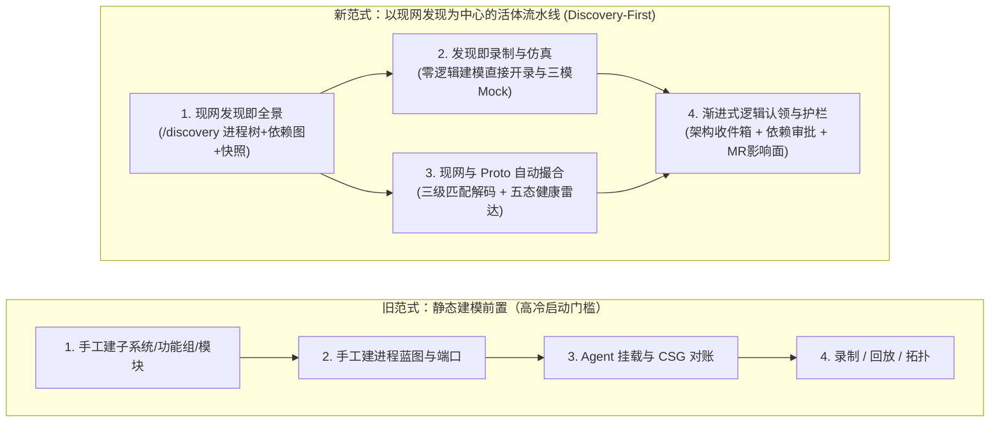
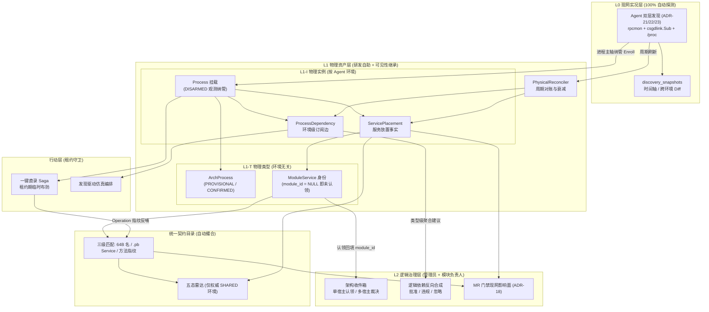
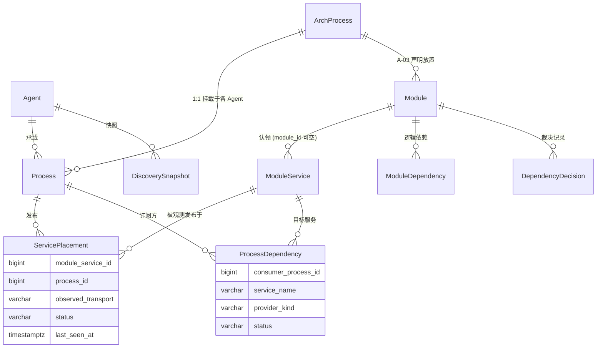
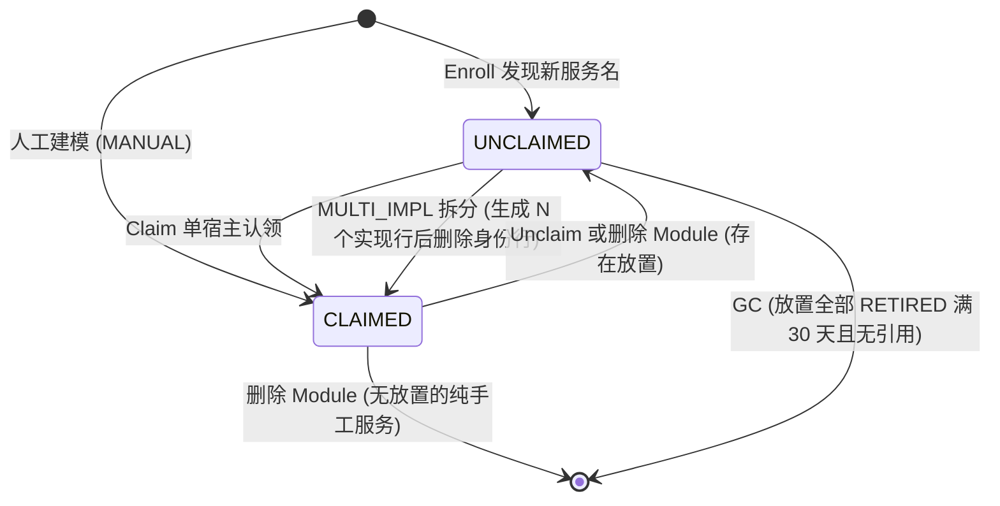

# ADR-24：以「现网发现」为中心的活体契约工作流水线与物理/逻辑双态架构决策

- **文档编号**：`24-csg-discovery-process-centric-and-physical-logical-boundary-adr.md`
- **文档版本**：v1.1.0
- **日期**：2026-11-25
- **状态**：✅ 修订定稿待实施 (Accepted — v1.1.0，经架构检视修订 6 项阻断问题，按 M30a / M30b / M31 / M32 分期落地)
- **关联特性**：`F-02`（物理进程蓝图与模块服务契约）、`F-05`（实测调用拓扑还原与一致性验证）、`F-08`（进程树选择与就绪诊断）、`F-15`（控制台信息架构）、`F-18`（活体参考文档与契约认领）、`F-28` / `F-31`（Git/MR 门禁与影响面分析）、`F-33`（CSG 现网服务与依赖双层自动发现及蓝图导入）、`F-34`（CSG 三模仿真测试）
- **关联设计**：[`01-system-architecture.md`](../02-design/01-system-architecture.md)、[`03-architecture-elements-and-topology.md`](../02-design/03-architecture-elements-and-topology.md)、[`04-control-plane-and-web-console.md`](../02-design/04-control-plane-and-web-console.md)、[`05-database-schema.md`](../02-design/05-database-schema.md)、[`01-http-api-contract.md`](../03-api/01-http-api-contract.md)
- **关联 ADR**：[`ADR-09`](./09-arch-process-ssot-and-ebpf-premount-standby-adr.md)、[`ADR-16`](./16-multi-implementation-service-contract-adr.md)、[`ADR-17`](./17-topology-single-layer-drilldown-and-layout-ux-adr.md)、[`ADR-18`](./18-proto-full-lifecycle-and-git-mr-governance-adr.md)、[`ADR-19`](./19-proto-contract-ia-unbundling-and-four-workbenches-adr.md)、[`ADR-21`](./21-csg-aware-agent-service-discovery-and-replay-mock-adr.md)、[`ADR-22`](./22-pluggable-transport-driver-and-mesh-capture-adr.md)、[`ADR-23`](./23-dophi-mesh-uprobe-bypass-capture-adr.md)
- **演进关系**：
  - **演进 [`ADR-19`](./19-proto-contract-ia-unbundling-and-four-workbenches-adr.md)**：平台侧边栏菜单由「5 组 13 项」升维为「**5 组 14 项**」，在「架构数字孪生」分组首位新增独立一级工作台 **`现网发现` (`/discovery`)**，确立其为平台工作流水线的核心起点；
  - **取代 [`ADR-21`](./21-csg-aware-agent-service-discovery-and-replay-mock-adr.md) D4 与 D5**：CSG 自动发现由“Agent 详情页辅助对账抽屉 + 强造假模块的蓝图导入器”，升级为**「L0 现网实况 ➔ L1 物理资产（类型 / 实例双粒度） ➔ L2 逻辑治理」三层解耦工作流**；
  - **演进 [`ADR-09`](./09-arch-process-ssot-and-ebpf-premount-standby-adr.md)**：保留物理/逻辑分离与 Agent 1:1 挂载底座，新增**「纳管 ≠ 布防」**原则（发现纳管的挂载缺省 `DISARMED`，常驻布防仍受 `ScopeWriteGuard` 守卫，录制期按租约临时布防），补齐**分层指纹稳定身份锚定**与**声明/观测分离的通信画像**，不再以 `DefaultListenPort == 0` 隐式猜测进程角色；
  - **演进 [`ADR-16`](./16-multi-implementation-service-contract-adr.md)**：`ModuleService` 扩展为「已认领 / 未认领」双态身份实体，物理放置事实下沉至新增的 `contract_service_placements` 关联表；同名 64B 服务被多个进程发布时以「多宿主」候选交由 L2 裁决为冗余部署或 `MULTI_IMPL` 拆分，严守既有唯一索引。

### 修订记录

| 版本 | 日期 | 修订说明 |
| :--- | :--- | :--- |
| v0.1.0 | 2026-11-25 | 草案：诊断“平铺服务列表”与“一键导入造假模块”两大结构错位，提出进程主轴视图及 3 种物理/逻辑导入边界候选方案，待拍板 4 项开放问题。 |
| v1.0.0 | 2026-11-25 | 定稿：确立「以现网发现为中心（Discovery-First）」流水线；新增 `/discovery` 工作台；采纳「物理态 `ModuleService`（`module_id` 可空 + `arch_process_id`）+ 物理进程订阅边表」模型；确立 L0/L1 研发自助 vs L2 `contract_admin` 守门；纳入快照持久化与双模 Diff。 |
| **v1.1.0** | **2026-11-25** | **架构检视修订（6 项 P0 + 11 项 P1 + 8 项完整性缺口全部闭环，见 §9.2）**：<br>1. **L1 双粒度建模**：区分「物理类型」（`ArchProcess`、`ModuleService` 身份）与「物理实例」（`Process`、新增 `contract_service_placements`、按 `agent_id` 维度的 `contract_process_dependencies`），**删除 v1.0.0 的单值 `ModuleService.arch_process_id`**，消除跨环境互相覆盖；<br>2. **与 ADR-16 唯一索引对齐**：一个 64B 名在 `uk_contract_mod_svc_name_excl` 作用域内至多一行身份记录，多宿主经放置表承载并以 `MULTI_HOST` 候选交 L2 裁决；<br>3. **双态状态机与不变量**：`module_id` 外键由 `CASCADE` 改为 `RESTRICT` 并由服务层显式迁移，新增 I1 ~ I8 不变量（含 A-03 认领一致性、Unclaim 依赖守卫、放置漂移检测）；<br>4. **纳管 ≠ 布防**：发现纳管挂载缺省 `DISARMED` 且不改变 `ExpectedArmedDigest`，常驻布防维持 `ScopeWriteGuard`，录制期按租约临时布防；<br>5. **来源与可见性隔离**：物理观测继承 Agent 公私域，`ArchProcess` 引入 `PROVISIONAL / CONFIRMED` 生命周期，全局收件箱、雷达与 MR 影响面仅统计 `SHARED` 权威环境；<br>6. **新增存量迁移、特性开关与回滚（§7）**、**L1 生命周期对账与衰减（§5.6）**、**测试与可度量验收（§8）**；<br>7. 指纹去除服务名参与并引入 `fingerprint_version`、一键直录改为 Saga、Stage 1 归因优先级修正、`PROTO_SYNC` 来源删除、L2 认领下放至模块/子系统负责人、雷达扩展为五态、分区表索引逐分区并发构建、快照脱敏；<br>8. 里程碑拆分为 **M30a（只读 L0，可立即实施）** 与 **M30b（Schema + 纳管 + 迁移）**。 |

---

## 1. 背景、旧范式反思与战略反转 (Context & Paradigm Shift)

### 1.1 旧范式「先静态建模、再发现匹配」的四大结构性错位

在 [`ADR-21`](./21-csg-aware-agent-service-discovery-and-replay-mock-adr.md)、[`ADR-22`](./22-pluggable-transport-driver-and-mesh-capture-adr.md) 与 [`ADR-23`](./23-dophi-mesh-uprobe-bypass-capture-adr.md) 落地后，Agent 已具备纯 Go 1 秒级全量发现本机进程、64B 服务实例（`tcp://` / `dophi_mesh://`）及客户端订阅边的能力，并能零侵入按需采集与仿真重放。然而平台顶层工作流依然固守早期假设——**“必须先手工建完静态架构元素，才能挂载、对账、录制、解码与回放”**，暴露出四重结构性错位：

1. **极高的冷启动门槛与价值倒挂**：用户安装好 Agent 后面对数百个线上进程与服务；若想发起一次录制或查看物理依赖拓扑，必须先手工创建 `Subsystem` → `FunctionalGroup` → `Module` → `ArchProcessGroup` → `ArchProcess` → 绑定端口 → 挂载 `Process`。
2. **现网发现隐藏过深且视角倒置（平铺服务列表 vs 进程主轴事实）**：入口深埋于 `Agent 与进程 → 选中单台 Agent → 打开抽屉`，主表以 64B `ServiceName` 平铺（可达数百行）。运行期客观实体是**操作系统进程 (`procName` + `PID`)**，平铺列表既淹没了“机器上有哪些进程、谁是纯客户端进程”，又制造了大量重复宿主进程噪音。
3. **现行「一键导入」以假模块污染逻辑架构**：[`models/arch.go`](../../models/arch.go) 中 `ModuleService.ModuleID` 与 `ModuleDependency.ConsumerModuleID` 强绑定 `NOT NULL`，导致 [`ImportCSGBlueprint`](../../internal/server/topology/csg_reconcile.go) 被迫要求必选 `Subsystem`，自动创建 `CSG_DISCOVERED` 功能组与 1:1 占位模块 `MOD_<procName>`。而**逻辑架构是人工设计产物，不可能通过端口和进程自动发现**；单物理进程常承载多个逻辑模块（`1 进程 : N 模块`），强行 1:1 造假模块只会污染逻辑树并增加拆分返工成本。
4. **“静态端口中心论”与“双套孤立认领流”**：仍以 `DefaultListenPort == 0` 隐式代表纯客户端进程，但在 CSG 动态端口与 `dophi_mesh://` 时代服务端也常见 `ListenPort == 0`；同时存在两套割裂的认领/对账逻辑（[`ListClaimableProtoServices`](../../internal/server/topology/claimable_service.go) 与 [`ReconcileLiveCSGWithSSOT`](../../internal/server/topology/csg_reconcile.go)），无法自动回答“哪些现网服务缺 `.proto`、哪些 `.pb` 无人认领、哪些 `.proto` 现网根本没跑”。

### 1.2 战略反转：以「现网发现」为中心的活体契约流水线 (Discovery-First)

**ADR-24 确立范式反转**：**物理事实自动发现、即时可用；逻辑架构按需认领、只做治理不做门槛。**



### 1.3 否决方案永久记录 (Rejected Alternatives)

| 被否决方案 | 否决理由 |
| :--- | :--- |
| **R1：继续在导入时生成 `CSG_DISCOVERED` 与 `MOD_<procName>` 占位假模块（含“可选过渡复选框”）** | 过渡期复选框会导致系统长期存在两套逻辑架构心智；假模块一旦被依赖或引用，后续拆分为 `1 进程 : N 模块` 时迁移成本极高。存量假模块按 §7.2 一次性迁移清理。 |
| **R2：不设 `/discovery` 工作台，发现功能继续留在 Agent 抽屉或塞进 `/topology` 附带 Tab** | 发现不仅是“画一张拓扑图”，更是**进程资产盘点、快照对比、一键直录、仿真编排与契约撮合**的调度起点；塞入 `/topology` 或深埋 `/agents` 抽屉会割裂“从发现到行动”的主动线。 |
| **R3：另建孤立的 `contract_discovered_services` 物理服务身份表** | 两张服务**身份**表会导致录制归因、`.pb` 解码映射、Diff 忽略规则、黄金用例与三模仿真出现双份查询与外键分裂，且认领需跨表搬迁。**注意**：本 ADR 否决的是“双份身份”，而非“放置关系独立建表”——服务身份唯一存于 `contract_module_services`，物理放置事实存于 `contract_service_placements`（见 D3）。 |
| **R4：将物理纳管继续限制为 `contract_admin` 专属** | 若研发在测试/联调机器上连“把发现的进程纳管并开录”都要找管理员审批，将摧毁自驱流水线的可用性。**前提约束**：自助纳管仅写入 `DISARMED` 观测挂载（不改变 Agent 网络路径），且观测数据继承 Agent 公私域（见 D4 / D5）。 |
| **R5：在 `ModuleService` 上增加单值 `arch_process_id`（v1.0.0 原方案）** | 服务落在哪个进程、走何种传输、最近一次可见均是**环境级事实**；单值字段导致联调环境（合并进程）与准生产环境（拆分进程）互相覆盖、先纳管者胜出，并与 `uk_contract_mod_svc_name_excl` 在多宿主场景冲突，同时与 `Module.ArchProcessID` 形成无约束的双路径。 |
| **R6：发现纳管即沿用 `ModuleSetting` 默认预挂策略进入 `ARMED`** | `ARMED` 会挂载 `connect4/sockops/sched` 钩子并令进程出向连接经由 `EgressProxy`（`ADR-09`）；全员自助批量纳管将改变共享环境中他人业务进程的网络路径，风险远高于写一行蓝图。 |
| **R7：L2 认领一律仅限 `contract_admin`** | 数百个待认领服务全部排队等管理员，冷启动门槛只是从 L1 平移到 L2。改为“结构变更由管理员守门、服务认领进**本人负责的** `Module` 可由模块/子系统负责人完成”。 |
| **R8：通用宿主进程以“发布服务名前缀”参与身份指纹** | 服务集合一变化指纹即漂移，与“跨重启稳定锚定”目标自相矛盾；改用入口脚本/主类等启动特征（见 §5.5）。 |

---

## 2. 核心架构决策矩阵 (Decisions)

| 编号 | 决策领域 | 选定方案 (v1.1.0) | 核心收益与边界约束 |
| :--- | :--- | :--- | :--- |
| **D1** | **控制台 IA 升维与 `/discovery` 一级工作台** | 在「架构数字孪生」分组首位新增 **`现网发现` (`/discovery`)**，菜单升级为 **「5 组 14 项」**；原 `/agents` 页 CSG 探测抽屉降级为轻量入口，深链跳转 `/discovery?agent_id=:id`；Agent 离线时回退展示最近快照并标注采集时间 | 为发现驱动流水线提供单一权威入口；集成进程主轴树表、零抓包实时依赖图、快照时间线 Diff、物理纳管与零建模直录 |
| **D2** | **L0 ➔ L1 ➔ L2 三层与 L1 双粒度** | 1. **L0 现网实况 (`Observed Reality`)**：自动发现快照（活体 PID、64B 服务、订阅边、端口池）；<br>2. **L1 物理资产 (`Physical Twin`)** 拆为两种粒度：<br>　· **L1-T 物理类型**（与环境无关）：`ArchProcess`、`ModuleService` 身份行；<br>　· **L1-I 物理实例**（按 Agent 环境）：`Process`、`ServicePlacement`、`ProcessDependency`；<br>3. **L2 逻辑治理 (`Logical Governance`)**：`Subsystem` / `FunctionalGroup` / `Module` / `ServiceContract` / `ModuleDependency` / `LayerLevel` | 跨环境差异（合并/拆分部署、TCP/Mesh 制式、本机/远端提供方）各自留痕、互不覆盖；逻辑架构 100% 纯净并支持 `1 进程 : N 模块` |
| **D3** | **服务双态身份 + 放置关联表 + 环境级依赖边** | 1. `contract_module_services.module_id` 改为可空（`NULL` = 未认领），外键改 `ON DELETE RESTRICT`，新增 `source` / `proto_match_confidence` / `proto_suggested_name` / `claimed_at` / `claimed_by`，并以 CHECK 约束未认领行必须为独占、无契约、发现来源；<br>2. 新增 **`contract_service_placements`**：`(module_service_id, process_id)` 唯一，承载端点、传输制式、实例数、`ACTIVE/STALE/RETIRED` 与首末可见时间；<br>3. 新增 **`contract_process_dependencies`**：以消费方 `process_id`（即 Agent 维度）为主键维度，记录提供方解析类型（本机已纳管 / 本机未纳管 / 远端 LDC / 未上线） | 同一 `ModuleService` 身份贯穿发现、解码、归因与认领；放置事实按环境独立，天然支持多宿主与跨环境对比，并可对照 `Module.ArchProcessID` 自动检出放置漂移 |
| **D4** | **纳管 ≠ 布防（Enroll / Arm 分离）** | 1. **纳管 (`Enroll`)**：新建挂载 `enroll_source = DISCOVERY`、`probe_desired_state = DISARMED`，不改变 `ExpectedArmedDigest`、不触发 `/agent/v1/monitors/arm`；<br>2. **常驻布防 (`Arm`)**：沿用既有 `/api/processes/:id/arm` 与 `arm-all`（`ScopeWriteGuard`：`SHARED` 仅管理员、`PRIVATE` 仅本人），`arm-all` 缺省排除发现纳管挂载；<br>3. **租约期临时布防 (`Lease-scoped Arm`)**：一键直录/仿真在持有排他租约期间将目标纳入采集规格，租约释放即恢复 `DISARMED` | 自助纳管只写观测事实、零网络路径副作用；需要完整出向采集的进程仍由负责人显式常驻布防 |
| **D5** | **来源与可见性隔离 + RBAC 重划** | 1. **可见性继承**：放置、依赖边、快照继承 Agent `SHARED/PRIVATE`；`ArchProcess` 引入 `PROVISIONAL`（仅 `PRIVATE` 环境观测，仅创建 Agent 的 owner 与管理员可见）与 `CONFIRMED`（人工创建 / 迁移 / 至少一个 `SHARED` 环境挂载，或管理员提升）；<br>2. **权威环境**：全局收件箱、五态雷达、MR 影响面与物理拓扑缺省视图仅统计 `SHARED` Agent 观测；<br>3. **权限**：L0 / L1 纳管与直录对已认证用户开放（受 Agent 可见性守卫 + 批量上限 + 排他租约）；L2 结构变更、`MULTI_IMPL` 拆分、依赖裁决、提升 `PROVISIONAL` 与新建 `ArchProcessGroup` 限 `contract_admin`；将服务认领进**本人负责**的 `Module` 可由 `Module.owner` / `Subsystem.owner` 完成 | 释放研发自助生产力，同时杜绝私有环境数据泄露进全局 SSOT 与治理大盘；避免 L2 成为新瓶颈 |
| **D6** | **稳定身份锚定与声明/观测分离画像** | 1. **分层身份指纹**：`P1 CmdPattern ➔ P2 identity_fingerprint（exeBase + 入口特征 + 规范化稳定参数，带 fingerprint_version，不含服务名）➔ P3 procName（低置信，需确认）`；多候选不自动绑定；<br>2. **画像分离**：`ArchProcess.declared_role`（人工声明，缺省 `UNKNOWN`）与 `Process.observed_role` / `observed_transports` / `observed_pids`（实例观测） | 跨重启稳定、跨环境可对齐；终结 `DefaultListenPort == 0` 歧义且不再出现跨环境画像互相覆盖 |
| **D7** | **快照持久化、双模 Diff 与 L1 生命周期对账** | 1. 新增 **`contract_discovery_snapshots`**（`content_hash` 去重、`is_pinned` 基准锁定、留存滚动、入库前脱敏、可见性继承 Agent）；同环境时间轴 Diff 与跨环境 Diff；<br>2. 控制面 **`PhysicalReconciler`** 周期刷新已纳管实例的观测字段，按 `ACTIVE ➔ STALE ➔ RETIRED` 衰减，Agent 离线冻结衰减，对无主身份与孤立 `PROVISIONAL` 进程执行受限 GC | 瞬态探测升级为可追溯资产时间线；L1 不会随时间腐化为过期蓝图 |
| **D8** | **发现即录制、发现驱动仿真与两阶段渐进归因** | 1. **一键直录 Saga**：纳管事务独立提交 ➔ 抢占租约 ➔ 创建会话 ➔ 下发 Agent，失败按步补偿，带幂等键；录制规格携带 `target_pids[]` 覆盖多实例；<br>2. **发现驱动仿真编排**：基于订阅在线状态推荐 `CLIENT_INJECT` / `PUB_STUB` / `MOCK_SERVER`；<br>3. **两阶段归因**：Stage 1 物理进程级归因（对端优先级：会话 `CSGSnapshots` ➔ 同环境放置端点 ➔ 权威环境唯一放置 ➔ 否则标记 `AMBIGUOUS`）+ `.pb` 解码；Stage 2 逻辑模块级归因，认领后经可续跑的归因任务回补历史 | 未做任何逻辑建模也能获得完整物理调用链与结构化报文；多宿主场景不误归因 |
| **D9** | **统一契约目录、五态雷达与架构收件箱** | 1. 合并 `claimable_service.go` 与 `csg_reconcile.go` 为**统一契约服务目录**，三级撮合（精确 ➔ DOPRA 规则 ➔ 方法指纹），仅 `EXACT` 自动落定，其余写建议待确认；<br>2. **五态雷达**：现网裸奔 / 无主孤儿 / 纸面僵尸 / 认领后消失 / 放置漂移；<br>3. `/architecture` 新增**架构收件箱**：单宿主认领、多宿主裁决（冗余部署或 `MULTI_IMPL` 拆分）、逻辑依赖反向合成（消费方多模块时给出候选）、MR 门禁现网影响面 | `.proto` 治理与现网事实咬合，消除双轨认领，实现自底向上治理闭环 |
| **D10** | **存量迁移、特性开关与可回滚交付** | 1. 一次性幂等迁移 `MigrateCSGPlaceholderModules` 清理存量 `CSG_DISCOVERED` / `MOD_*`（dry-run 报告、阻断清单、备份可回滚）；<br>2. `ModuleSetting` 特性开关 `discovery.v2_enabled` 控制所有新写路径；<br>3. 旧 `import-blueprint` 委托 `Enroll` 且不再造假模块，连续 14 天零调用后下线 | 逻辑架构“0 假模块”验收可达成；新能力可灰度、可功能回滚 |

---

## 3. 目标工作流水线与控制台信息架构 (Target Pipeline & IA)

### 3.1 四阶段活体契约闭环全景图



### 3.2 控制台导航升维：5 组 14 项菜单契约 (`frontend/src/menu.ts`)

延续 [`ADR-19`](./19-proto-contract-ia-unbundling-and-four-workbenches-adr.md) 的金字塔分组原则，将「架构数字孪生」从 2 项扩展为 **3 项**：

| 排序 | 一级分组 (`GroupTitle`) | 二级菜单 (`Label`) | 路由 (`Path`) | 权限 | 核心定位 |
| :---: | :--- | :--- | :--- | :--- | :--- |
| 1 | **全局概览** | `治理大盘` | `/dashboard` | 全员 | 契约健康度、五态服务雷达、门禁趋势 |
| **2** | **架构数字孪生** | **`现网发现`** *(新增核心起点)* | **`/discovery`** | **全员（受 Agent 可见性守卫）** | **进程主轴树表、零抓包实时依赖图、快照 Diff、观测纳管、一键直录与仿真编排** |
| 3 | **架构数字孪生** | `架构拓扑` | `/topology` | 全员 | 物理资产全景（无逻辑模块亦可连线，缺省权威环境视图）+ 逻辑治理图 + 实测一致性叠加（`ADR-17`） |
| 4 | **架构数字孪生** | `架构元素` | `/architecture` | 全员查 / 管理员与负责人改 | 逻辑蓝图台账 + **架构收件箱** + 依赖反向审批 |
| 5 | **Proto 契约治理** | `接口参考文档` | `/proto-docs` | 全员 | 全注释文档、Markdown 导出、统一契约目录查阅 |
| 6 | **Proto 契约治理** | `源码与 Git 仓` | `/proto-sources` | 全员 | 只读源码 `#L<n>` 定位、Git/外部仓同步、在线源码直编 |
| 7 | **Proto 契约治理** | `MR 门禁与规范` | `/proto-governance` | 全员 | MR 门禁流水（含现网影响面）、静态规则、词库、AST 重复簇 |
| 8 | **Proto 契约治理** | `描述集与依赖` | `/schemas` | 全员 | `.pb` 描述集资产台账、撮合触发与跨包依赖拓扑 |
| 9 | **契约核验与回归** | `契约采集` | `/record` | 全员 | 多进程协同录制（支持基于发现预设目标） |
| 10 | **契约核验与回归** | `事务分析` | `/debug` | 全员 | 报文因果树、时序泳道与四段解剖（物理+逻辑双态元数据水合） |
| 11 | **契约核验与回归** | `防劣化回归` | `/replay` | 全员 | 回归回放与基线对比（接入发现驱动三模仿真建议） |
| 12 | **契约核验与回归** | `黄金用例库` | `/golden-suites` | 全员 | 黄金回归用例集与契约基线管理 |
| 13 | **环境与治理** | `Agent 与进程` | `/agents` | 全员 | Edge Agent 纳管、探针健康、常驻布防与跳往 `/discovery?agent_id=:id` |
| 14 | **环境与治理** | `模块参数配置` | `/admin/settings` | `contract_admin` | 全局治理参数、特性开关、对账周期、快照留存与通知配置 |

### 3.3 `/discovery` 工作台核心交互架构（进程主轴 + 行动中心）

页面按「**选环境 ➔ 看实况 ➔ 对比快照 ➔ 行动（纳管 / 录制 / 仿真）**」组织，取代旧版扁平抽屉表格：

1. **顶部环境与动作栏**：
   - 选择目标 `Agent`（受 `SHARED/PRIVATE` 过滤，`PRIVATE` 环境显示“私有 · 仅本人可见”徽章）+ 单行候选 `CSG` 控制面选择器 + `[刷新]` + `[保存快照]` + `[快照对比]`；
   - 常态读取服务端短 TTL 缓存（§5.7）；Agent 离线时自动展示最近快照并提示“离线 · 采集于 HH:mm”；仅当降级为 `PROC_ONLY` 或接口报错时显示诊断告警。
2. **主视图双切换模式**：
   - **模式 A · 进程主轴分组树表（默认）**：
     - **一级行（物理进程）**：`[勾选框] | 进程名 (多实例徽章 "2 PIDs · 12345, 12398") | 观测角色 (SERVER / CLIENT_ONLY / DUAL) | 纳管状态 (未纳管 / 已纳管·未布防 / 已布防·就绪态) | 身份匹配 (已匹配 / 歧义待选 / 低置信) | 提供服务数 (如 12 · 4 待认领) | 传输制式 (TCP / MESH / MIXED) | 订阅下游数 | 行内操作 ([直录] / [仿真])`；
     - **纯客户端进程一等公民**：即使 `提供服务数 = 0` 亦作为一级行展示，展开可见其订阅的全部下游与提供方解析类型；
     - **二级子行（发布服务 / 订阅明细）**：64B `ServiceName`、监听端点（`tcp://...` / `dophi_mesh://...`）、**`.pb` 撮合徽章**（已匹配 / 建议待确认 / 裸奔）、**逻辑认领状态**、**多宿主标记**（同环境多个进程发布同名服务时）与下游订阅方数量；
     - **跨板 LDC 视图分离**：「本机进程（可纳管/可录制）」与「跨板 LDC 远端节点（只读参考）」页签切换；
     - **智能搜索联动**：搜索服务名或 `.pb` 名时自动高亮并展开命中的进程父行。
   - **模式 B · 零抓包实时依赖图**：直接利用 `rpcmon` 拉取的 `Servers` + `Clients` 构建「`订阅进程 ➔ 服务名 ➔ 发布进程`」关系图；点击节点切换 1-Hop Ego 聚焦，**未抓包、未建逻辑模块即可看清全机调用关系**。
3. **底部批处理行动条（勾选 1..N 个本机进程后出现）**：
   - **`[纳管到物理蓝图]`**：选择已有 `ArchProcessGroup`（缺省 `PGRP_CSG_AUTO`；新建分组需管理员），写入 `DISARMED` 观测挂载、服务放置与订阅边；`SHARED` 环境单次上限 50 个进程并二次确认；身份歧义或低置信进程需逐个确认；
   - **`[一键立即录制]`**：静默纳管（如尚未纳管）+ 抢占租约 + 租约期临时布防 + 启动 `RecordingSession`，跳转 `/record`；对未常驻布防的 TCP 进程提示“出向仅覆盖录制开始后新建连接”；
   - **`[编排仿真任务]`**：针对单个被测进程读取其订阅在线情况，预填 `CLIENT_INJECT` / `PUB_STUB` / `MOCK_SERVER` 策略，直达 `/replay`。

---

## 4. 数据模型与数据库 Schema 演进 (`contract_*`)

> 所有表名强制遵循 `contract_` 前缀；`cmd/agent` 及 `pkg/{crosrpc,agentproto,csgdlink,rpcmon,csgmock,ebpf,transport,replay}` 保持 **100% 零 DB、零 `.pb` 动态库、零 CGO**，本节演进仅作用于控制面 `cmd/server` 与 `models/`（唯一例外：§5.8 录制规格新增 `target_pids[]` 字段，属 `pkg/agentproto` 线上协议的向后兼容扩展）。

### 4.0 L1 双粒度建模原则

| 粒度 | 实体 | 语义 | 写入方 |
| :--- | :--- | :--- | :--- |
| **L1-T 物理类型** | `ArchProcess` | “一类进程”的全局蓝图（编码、名称、分组、启动特征、声明角色、身份指纹） | 人工 / `Enroll` 首次创建（之后人工字段不被覆盖） |
| **L1-T 物理类型** | `ModuleService`（身份行） | “一个运行期服务名”的唯一身份，承载 `.pb` 映射、Diff 忽略规则、认领归属 | 人工 / `Enroll` 首次发现 / L2 认领 |
| **L1-I 物理实例** | `Process` | 某 Agent 环境上对某 `ArchProcess` 的 1:1 挂载及观测画像 | 人工挂载 / `Enroll` / `PhysicalReconciler` |
| **L1-I 物理实例** | `ServicePlacement` | “某服务在某环境由某进程发布”的观测事实 | 仅 `Enroll` / `PhysicalReconciler` / 迁移任务 |
| **L1-I 物理实例** | `ProcessDependency` | “某环境某进程订阅某服务、提供方解析为何”的观测事实 | 仅 `Enroll` / `PhysicalReconciler` |

**铁律**：凡是随环境变化的事实（端点、传输制式、提供方位置、可见时间、存活状态、观测角色）只允许落在 L1-I；L1-T 只承载与环境无关的身份与人工声明。

### 4.1 `contract_arch_processes` 与 `contract_processes` 增量字段

| 表名 | 新增列 | SQL 类型与约束 | 语义说明 |
| :--- | :--- | :--- | :--- |
| `contract_arch_processes` | `declared_role` | `varchar(16) NOT NULL DEFAULT 'UNKNOWN'`（`CHECK IN ('UNKNOWN','SERVER','CLIENT_ONLY','DUAL')`） | 人工声明的通信角色；`UNKNOWN` 时 UI 以权威环境实例观测值展示 |
| `contract_arch_processes` | `identity_fingerprint` | `varchar(64) NOT NULL DEFAULT ''` | SHA-256 十六进制规范化身份指纹（§5.5） |
| `contract_arch_processes` | `fingerprint_version` | `smallint NOT NULL DEFAULT 0` | 指纹算法版本（`0` = 未计算）；复合普通索引 `idx_contract_arch_proc_fp (fingerprint_version, identity_fingerprint)`，**非唯一** |
| `contract_arch_processes` | `lifecycle` | `varchar(16) NOT NULL DEFAULT 'CONFIRMED'`（`CHECK IN ('PROVISIONAL','CONFIRMED')`） | 可见性生命周期（§5.4）；存量与人工创建行缺省 `CONFIRMED` |
| `contract_arch_processes` | `origin` | `varchar(16) NOT NULL DEFAULT 'MANUAL'`（`CHECK IN ('MANUAL','DISCOVERY','MIGRATED')`） | 创建来源 |
| `contract_arch_processes` | `origin_agent_id` | `bigint NULL`（FK ➔ `contract_agents.id` `ON DELETE SET NULL`） | 发现来源的首个 Agent，用于 `PROVISIONAL` 可见性判定 |
| `contract_processes` | `enroll_source` | `varchar(16) NOT NULL DEFAULT 'MANUAL'`（`CHECK IN ('MANUAL','DISCOVERY')`） | 挂载来源；`DISCOVERY` 挂载缺省 `DISARMED` 且被 `arm-all` 缺省排除 |
| `contract_processes` | `observed_role` | `varchar(16) NOT NULL DEFAULT 'UNKNOWN'`（同 `declared_role` 取值） | 该环境实例的观测角色 |
| `contract_processes` | `observed_transports` | `jsonb NOT NULL DEFAULT '[]'` | 观测到的传输制式集合（`["TCP"]` / `["MESH"]` / `["TCP","MESH"]`），供录制驱动选择 |
| `contract_processes` | `observed_pids` | `jsonb NOT NULL DEFAULT '[]'` | 最近一次观测命中的本机 PID 列表（多实例折叠） |
| `contract_processes` | `last_observed_at` | `timestamptz NULL` | 最近一次被发现确认的时间 |

> `DefaultListenPort` 列保留，语义降级为“静态端口提示”，**不再代表进程角色**。既有 `uk_contract_proc_agent_port`（`WHERE effective_listen_port > 0`）继续防止同机非零端口冲突；就绪诊断仅在 `effective_listen_port > 0` 且 `observed_role != 'CLIENT_ONLY'` 时校验监听端口，否则只要存活 PID 存在且对应 `pkg/transport.Driver` 可用即可 `READY`。

### 4.2 `contract_module_services` 双态身份演进

```sql
-- 1. 解除 module_id 强非空，并将逻辑模块删除外键由 CASCADE 改为 RESTRICT（删除路径由服务层显式迁移，见 §5.1）
ALTER TABLE contract_module_services ALTER COLUMN module_id DROP NOT NULL;
ALTER TABLE contract_module_services DROP CONSTRAINT IF EXISTS fk_contract_module_services_module;
ALTER TABLE contract_module_services DROP CONSTRAINT IF EXISTS fk_contract_modules_services;
ALTER TABLE contract_module_services
  ADD CONSTRAINT fk_contract_module_services_module
  FOREIGN KEY (module_id) REFERENCES contract_modules(id) ON UPDATE CASCADE ON DELETE RESTRICT;

-- 2. 新增来源、撮合与认领字段（注意：不新增 arch_process_id，物理放置见 §4.3）
ALTER TABLE contract_module_services
  ADD COLUMN IF NOT EXISTS source                 varchar(24)  NOT NULL DEFAULT 'MANUAL',
  ADD COLUMN IF NOT EXISTS proto_match_confidence varchar(16)  NOT NULL DEFAULT 'NONE',
  ADD COLUMN IF NOT EXISTS proto_suggested_name   varchar(128) NOT NULL DEFAULT '',
  ADD COLUMN IF NOT EXISTS claimed_at             timestamptz  NULL,
  ADD COLUMN IF NOT EXISTS claimed_by             integer      NOT NULL DEFAULT 0;

ALTER TABLE contract_module_services
  ADD CONSTRAINT chk_contract_mod_svc_source
  CHECK (source IN ('MANUAL', 'CSG_DISCOVERED', 'MIGRATED'));

ALTER TABLE contract_module_services
  ADD CONSTRAINT chk_contract_mod_svc_proto_conf
  CHECK (proto_match_confidence IN ('NONE', 'FINGERPRINT', 'HEURISTIC', 'EXACT', 'MANUAL'));

-- 3. 双态合法性（不变量 I1）：未认领行必须为独占、无契约、无实现键、来自发现或迁移
ALTER TABLE contract_module_services
  ADD CONSTRAINT chk_contract_mod_svc_unclaimed
  CHECK (module_id IS NOT NULL
         OR (contract_id IS NULL AND impl_key = '' AND source IN ('CSG_DISCOVERED', 'MIGRATED')));

CREATE INDEX IF NOT EXISTS idx_contract_mod_svc_unclaimed
  ON contract_module_services (service_name) WHERE module_id IS NULL;
```

* **与 [`ADR-16`](./16-multi-implementation-service-contract-adr.md) 唯一索引的精确关系**：
  * 既有 `uk_contract_mod_svc_name_excl ON (service_name) WHERE contract_id IS NULL OR is_custom_service_name = true` **保持不变**。由于未认领行恒为 `contract_id IS NULL`，它们全部落入该作用域，因此**每个 64B 名至多存在一行“独占或未认领”的身份记录**——这是本 ADR 有意利用的约束，而非冲突来源；
  * 同名服务被多个进程发布时，**不新增身份行**，而是在同一身份行下挂多条 `ServicePlacement`（§4.3）；
  * `MULTI_IMPL` 非自定义名（`contract_id IS NOT NULL AND is_custom_service_name = false`）的各实现行不在该作用域内，发现时按 §5.2 匹配规则把放置挂到对应实现行。
* **`.pb` 撮合写入策略**：`EXACT` 命中自动写入 `proto_service_name`；`HEURISTIC` / `FINGERPRINT` 仅写 `proto_suggested_name`，经人工确认后写入 `proto_service_name` 并置 `proto_match_confidence = 'MANUAL'`。
* **v1.0.0 的 `PROTO_SYNC` 来源删除**：仅有 `.pb`、无模块亦无放置的服务不落 `ModuleService` 行；“纸面僵尸”由 `ProtoOperation` 推导（§5.10）。

### 4.3 新增 `contract_service_placements`（服务放置事实表）

| 列名 | 类型与约束 | 说明 |
| :--- | :--- | :--- |
| `id` | `bigserial PRIMARY KEY` | 主键 |
| `module_service_id` | `bigint NOT NULL`（FK ➔ `contract_module_services.id` `ON DELETE CASCADE`） | 服务身份 |
| `process_id` | `bigint NOT NULL`（FK ➔ `contract_processes.id` `ON DELETE CASCADE`） | 发布该服务的环境实例（隐含 `agent_id` 与 `arch_process_id`） |
| `agent_id` | `bigint NOT NULL`（FK ➔ `contract_agents.id` `ON DELETE CASCADE`） | 冗余：所属环境，由 `process_id` 派生 |
| `arch_process_id` | `bigint NOT NULL`（FK ➔ `contract_arch_processes.id` `ON DELETE CASCADE`） | 冗余：所属物理类型，由 `process_id` 派生 |
| `raw_service_name` | `varchar(128) NOT NULL DEFAULT ''` | 最近一次观测的原始 64B 名（含 PID 后缀，便于排障） |
| `endpoints` | `jsonb NOT NULL DEFAULT '[]'` | 观测端点集合（`["tcp://10.0.0.1:31001","dophi_mesh://..."]`），多实例多端点合并 |
| `observed_transport` | `varchar(8) NOT NULL DEFAULT 'TCP'`（`CHECK IN ('TCP','MESH','MIXED')`） | 传输制式 |
| `instance_count` | `integer NOT NULL DEFAULT 1` | 同进程多实例数 |
| `status` | `varchar(16) NOT NULL DEFAULT 'ACTIVE'`（`CHECK IN ('ACTIVE','STALE','RETIRED')`） | 存活状态（§5.6） |
| `miss_count` | `integer NOT NULL DEFAULT 0` | 连续未观测次数 |
| `first_seen_at` / `last_seen_at` | `timestamptz NOT NULL DEFAULT now()` | 首次 / 最近确认时间 |
| `last_snapshot_id` | `bigint NULL`（FK ➔ `contract_discovery_snapshots.id` `ON DELETE SET NULL`） | 最近确认所依据的快照 |
| `created_at` / `updated_at` | 标准时间戳 | — |

* **唯一索引**：`uk_contract_svc_plc_tuple UNIQUE (module_service_id, process_id)`；普通索引 `idx_contract_svc_plc_arch (arch_process_id, status)`、`idx_contract_svc_plc_agent (agent_id, status)`。
* **冗余列一致性**：`agent_id` / `arch_process_id` 只能由写入路径从 `contract_processes` 派生，API 不接受外部传入；单测覆盖派生一致性。

### 4.4 新增 `contract_process_dependencies`（环境级物理订阅边）

| 列名 | 类型与约束 | 说明 |
| :--- | :--- | :--- |
| `id` | `bigserial PRIMARY KEY` | 主键 |
| `consumer_process_id` | `bigint NOT NULL`（FK ➔ `contract_processes.id` `ON DELETE CASCADE`） | 订阅方环境实例 |
| `agent_id` / `consumer_arch_process_id` | `bigint NOT NULL`（冗余，FK 同上 `CASCADE`） | 由 `consumer_process_id` 派生 |
| `service_name` | `varchar(128) NOT NULL` | 归一化 64B 目标服务名（`StripCSGPIDSuffix`） |
| `service_id` | `bigint NULL`（FK ➔ `contract_module_services.id` `ON DELETE SET NULL`） | 目标服务身份（已知时） |
| `provider_kind` | `varchar(24) NOT NULL DEFAULT 'OFFLINE'`（`CHECK IN ('LOCAL_ENROLLED','LOCAL_UNENROLLED','REMOTE_LDC','OFFLINE')`） | 提供方解析类型 |
| `provider_process_id` | `bigint NULL`（FK ➔ `contract_processes.id` `ON DELETE SET NULL`） | 同环境已纳管提供方 |
| `provider_arch_process_id` | `bigint NULL`（FK ➔ `contract_arch_processes.id` `ON DELETE SET NULL`） | 提供方物理类型（已知时） |
| `remote_node` | `varchar(128) NOT NULL DEFAULT ''` | 跨板 LDC 远端节点标识 |
| `resolved_endpoint` | `varchar(128) NOT NULL DEFAULT ''` | 解析到的提供方端点（供 §5.11 联动与归因） |
| `source` | `varchar(24) NOT NULL DEFAULT 'CSG_SUB'`（`CHECK IN ('CSG_SUB','TRAFFIC_OBSERVED')`） | 来源 |
| `status` / `miss_count` | 同 §4.3 | 存活状态与连续未观测次数 |
| `first_seen_at` / `last_seen_at` | `timestamptz NOT NULL DEFAULT now()` | 首次 / 最近确认时间 |
| `created_at` / `updated_at` | 标准时间戳 | — |

* **唯一索引**：`uk_contract_proc_dep_tuple UNIQUE (consumer_process_id, service_name)`；普通索引 `idx_contract_proc_dep_type (consumer_arch_process_id, service_name)`、`idx_contract_proc_dep_service (service_id)`。
* **类型级视图**：物理拓扑与依赖合成使用聚合查询（`GROUP BY consumer_arch_process_id, service_name`，过滤 `status != 'RETIRED'` 与权威环境），**不以单行覆盖表达跨环境事实**。
* **治理裁决不写入物理边**：v1.0.0 的 `IGNORED` 状态移除，物理边只记录事实；忽略/违规裁决落在 L2 的 `contract_dependency_decisions`（§4.7）。

### 4.5 新增 `contract_discovery_snapshots`（现网发现持久化快照）

| 列名 | 类型与约束 | 说明 |
| :--- | :--- | :--- |
| `id` | `bigserial PRIMARY KEY` | 主键 |
| `agent_id` | `bigint NOT NULL`（FK ➔ `contract_agents.id` `ON DELETE CASCADE`） | 所属环境；**可见性继承该 Agent 的 `SHARED/PRIVATE`** |
| `agent_name` | `varchar(128) NOT NULL` | 快照时刻 Agent 名称冗余 |
| `csg_addr` | `varchar(128) NOT NULL DEFAULT ''` | 探测的 CSG 控制面地址 |
| `discovery_mode` | `varchar(32) NOT NULL DEFAULT ''` | `CROSTCP_RPCMON` \| `CROSMESH_RPCMON` \| `PROC_ONLY` |
| `trigger_type` | `varchar(16) NOT NULL DEFAULT 'MANUAL'`（`CHECK IN ('MANUAL','AUTO','SCHEDULED')`） | 人工保存 / 实时探测结果变化时自动保存 / `PhysicalReconciler` 周期巡检 |
| `label` | `varchar(128) NOT NULL DEFAULT ''` | 可选标签（如 `v2.3.0-联调基线`） |
| `is_pinned` | `boolean NOT NULL DEFAULT false` | 锁定为基线，免疫滚动清理 |
| `content_hash` | `varchar(64) NOT NULL` | 规范化内容 SHA-256（剔除 PID、动态端口数值、时间戳，口径与 §5.7 Diff 一致） |
| `redaction_version` | `smallint NOT NULL DEFAULT 1` | 脱敏规则版本 |
| `summary_json` | `jsonb NOT NULL DEFAULT '{}'` | `{proc_count, client_only_proc_count, live_service_count, live_sub_count, remote_count, tcp_count, mesh_count}` |
| `payload_json` | `jsonb NOT NULL` | 规范化且**已脱敏**的 `CSGTopologyReport` + 进程指纹归组元信息 |
| `created_by` | `integer NOT NULL DEFAULT 0` | 触发用户（系统任务为 `0`） |
| `created_at` | `timestamptz NOT NULL DEFAULT now()` | 采集时间 |

* **索引**：`idx_contract_disc_snap_agent_time (agent_id, csg_addr, created_at DESC)`、`idx_contract_disc_snap_hash (agent_id, csg_addr, content_hash)`。
* **去重与容量**：`AUTO` / `SCHEDULED` 与最近一条同 `(agent_id, csg_addr)` 快照 `content_hash` 相同则跳过插入；每组保留最近 `N = 50` 条非置顶快照（`ModuleSetting` 可配），置顶快照每组上限 `20` 条（超限需先取消置顶），确保存储有界。

### 4.6 `contract_traffic_records` 物理归因扩展列与分区索引

在 [`models/recording.go`](../../models/recording.go) `TrafficRecord` 新增可空列 `src_arch_process_id bigint NULL`、`dst_arch_process_id bigint NULL`。`ADD COLUMN ... NULL` 对分区母表是元数据操作，但**索引构建需覆盖全部子分区，不是 O(1)**，按以下方式避免长时间锁表：

```sql
-- 1. 仅在母表登记索引（不扫描子分区）
CREATE INDEX IF NOT EXISTS idx_contract_tr_src_arch ON ONLY contract_traffic_records (src_arch_process_id);
-- 2. 逐个子分区并发构建并挂接（迁移任务循环执行，可中断续跑）
CREATE INDEX CONCURRENTLY IF NOT EXISTS idx_contract_tr_src_arch_p20261125 ON contract_traffic_records_p20261125 (src_arch_process_id);
ALTER INDEX idx_contract_tr_src_arch ATTACH PARTITION idx_contract_tr_src_arch_p20261125;
-- dst_arch_process_id 同理；新建分区自动继承母表索引定义
```

### 4.7 新增 L2 辅助表

| 表名 | 关键列 | 用途 |
| :--- | :--- | :--- |
| `contract_dependency_decisions` | `consumer_module_id`、`service_id`（唯一组合）、`decision`（`CHECK IN ('IGNORED','VIOLATION')`）、`reason`、`decided_by`、`decided_at` | 记录对“反向合成逻辑依赖建议”的忽略/违规裁决；批准则直接生成 `ModuleDependency` |
| `contract_attribution_jobs` | `job_type`（`CHECK IN ('REATTRIBUTE','MIGRATION')`）、`scope_json`、`status`（`PENDING/RUNNING/DONE/FAILED/CANCELLED`）、`cursor_session_id`、`processed`、`total`、`error`、`created_by`、时间戳 | 历史批次逻辑归因回补与迁移改写的可续跑、可取消、限速异步任务 |
| `contract_mig_backups` | `migration_key`、`entity`、`entity_id`、`payload jsonb`、`created_at` | §7.2 迁移前备份，支撑回滚 |

并在 [`models/db.go`](../../models/db.go) 的 `BusinessTableNames()` 中按外键拓扑顺序注册：`DiscoverySnapshot` ➔ `ServicePlacement` ➔ `ProcessDependency` ➔ `DependencyDecision` ➔ `AttributionJob` ➔ `MigBackup`。

### 4.8 L1 / L2 实体关系总览



---

## 5. 核心机制、算法契约与权限矩阵

### 5.1 服务双态状态机与不变量



| 编号 | 不变量 | 保障方式 |
| :---: | :--- | :--- |
| **I1** | 未认领行必须 `contract_id IS NULL`、`impl_key = ''`、`source ∈ {CSG_DISCOVERED, MIGRATED}` | DB CHECK `chk_contract_mod_svc_unclaimed` |
| **I2** | 每个 64B 名在“独占或未认领”作用域内至多一行身份 | 既有 `uk_contract_mod_svc_name_excl` |
| **I3** | 未认领身份必须至少有一条非 `RETIRED` 放置，否则进入 GC 候选 | `PhysicalReconciler` 周期校验 |
| **I4** | **A-03 认领一致性**：将服务认领进 `Module M` 时，该服务在权威环境的全部 `ACTIVE` 放置必须位于同一 `ArchProcess P`，且 `M.arch_process_id ∈ {NULL, P}`；`M.arch_process_id` 为空时回填为 `P` | 认领事务校验，不满足返 `422 CLAIM_PLACEMENT_MISMATCH` |
| **I5** | **放置漂移只告警不自动改写**：已认领服务出现位于 `ArchProcess ≠ Module.arch_process_id` 的 `ACTIVE` 放置时，标记 `PLACEMENT_DRIFT` | 雷达计算（§5.10） |
| **I6** | **依赖守卫**：Unclaim 或删除 Module 前，若服务被 `ModuleDependency.service_id` 引用，拒绝操作 | 服务层校验，返 `409 DEPENDENCY_REFERENCED` 并列出引用方 |
| **I7** | **回退合并**：服务回退为未认领时，若同名未认领身份已存在（`MULTI_IMPL` 场景），将放置合并至既有身份、并集合并 `diff_ignore_paths` 后删除回退行；否则原地清空 `module_id` / `contract_id` / `impl_key` 并置 `source = 'MIGRATED'` | 服务层事务 |
| **I8** | **放置与依赖边的单一写路径**：仅 `Enroll`、`PhysicalReconciler` 与迁移任务可写，API 不提供直接增删改 | 路由不暴露写接口 + 单测 |

**外键动作总表**：

| 外键 | v1.0.0 | v1.1.0 | 理由 |
| :--- | :--- | :--- | :--- |
| `module_services.module_id` | `SET NULL`（与 CHECK 冲突） | **`RESTRICT`** + 服务层显式迁移 | 删除 Module 走 §5.1 流程，杜绝 CHECK 违例与静默丢失 |
| `module_services.arch_process_id` | `CASCADE`（会级联删除已认领服务） | **删除该列** | 放置事实下沉 `ServicePlacement` |
| `service_placements.*` | — | 全部 `CASCADE` | 放置是观测事实，随实例/身份/环境消亡而消亡；无主身份由 GC 收尾 |
| `process_dependencies.consumer_*` | `CASCADE` | `CASCADE` | 同上 |
| `process_dependencies.service_id / provider_*` | `SET NULL` | `SET NULL` | 目标消失不影响订阅事实 |
| `processes.arch_process_id` | `RESTRICT`（既有） | 不变 | 删除 `ArchProcess` 须先卸载全部挂载，放置随之级联清除 |

**删除 Module 的服务层流程（单事务，`P1` 审计）**：锁定 Module ➔ 按 I6 校验依赖引用 ➔ 有放置的服务按 I7 回退为未认领 ➔ 无放置的手工服务删除 ➔ 删除 Module。

### 5.2 物理纳管 (`POST /api/discovery/enroll`) 事务契约

1. **输入**：`agent_id`、`csg_addr`、`selected_process_keys[]`（取自 `GET /api/discovery/live` 返回的规范化进程键）、可选 `process_group_id`（仅限已存在分组）、可选 `identity_overrides[]`（为歧义进程显式指定 `arch_process_id`）、`confirm_low_confidence: bool`。**不再要求 `subsystem_id` 与 `group_id`**。
2. **守卫 `ScopeEnrollGuard`（新增）**：`ScopeReadGuard`（Agent 可见）+ `SHARED` 环境单次 ≤ 50 个进程（`ModuleSetting` 可配，超限 `422 ENROLL_BATCH_LIMIT`）+ 每用户每 Agent 速率限制；特性开关 `discovery.v2_enabled` 关闭时返 `404`。
3. **单事务幂等写入**：
   1. `SELECT ... FOR UPDATE` 锁定 Agent 行，与既有 `PUT /api/agents/:id/process-mounts` 全量同步串行化（管理员并发全量同步将收到 `MOUNT_REVISION_CONFLICT` 并重试）；
   2. **身份解析**（§5.5）：多候选且未提供 `identity_overrides` ➔ 该进程返 `IDENTITY_AMBIGUOUS` 并跳过；仅 P3 命中且未 `confirm_low_confidence` ➔ 返 `LOW_CONFIDENCE_CONFIRM_REQUIRED` 并跳过；
   3. **`ArchProcess`**：缺失则创建（`origin = DISCOVERY`、`origin_agent_id`、`lifecycle` 按 §5.4、编码按 §5.4 生成、分组缺省 `PGRP_CSG_AUTO`）；已存在则**绝不覆盖** `Name`、`GroupID`、`DefaultCmdPattern`、`declared_role`、`Description`；`PROVISIONAL` 在 `SHARED` 环境被纳管时提升为 `CONFIRMED`；
   4. **`Process`**：缺失则创建（`enroll_source = DISCOVERY`、`probe_desired_state = DISARMED`、无覆盖项）并递增 `mounts_revision`，**不改变 `ExpectedArmedDigest`、不下发 `/agent/v1/monitors/arm`**；已存在（含人工挂载）只刷新 `observed_*` 与 `last_observed_at`，**绝不修改 `probe_desired_state` 与覆盖项**。因不改变 Agent 布防规格，**允许在他人持有租约期间纳管**；
   5. **服务身份与放置**：按排序后的 `StripCSGPIDSuffix(ServiceName)` 顺序加锁，逐个解析目标身份行：
      - (a) `uk_contract_mod_svc_name_excl` 作用域内已有同名行（独占已认领、自定义名多实现或未认领身份）➔ 直接挂放置；
      - (b) 否则存在同名 `MULTI_IMPL` 非自定义名实现行 ➔ 选择 `Module.arch_process_id` 等于当前 `ArchProcess` 的唯一实现行挂放置；无唯一匹配则创建未认领身份行并挂放置（雷达将其计为放置漂移/待裁决）；
      - (c) 否则创建未认领身份行（`module_id = NULL`、`source = CSG_DISCOVERED`）并挂放置；
      - 放置按 `(module_service_id, process_id)` upsert：`status = ACTIVE`、`miss_count = 0`、刷新端点/制式/实例数/`last_seen_at`；
   6. **订阅边**：按 `(consumer_process_id, service_name)` upsert，解析 `provider_kind`（同环境已纳管放置 ➔ `LOCAL_ENROLLED`；L0 本机可见但未纳管 ➔ `LOCAL_UNENROLLED`；跨板 ➔ `REMOTE_LDC`；否则 `OFFLINE`）与 `service_id`；
   7. 写入 `P2` 审计（含字段级 Diff）。
4. **提交后**：异步触发涉及身份的 `.pb` 自动撮合；若实时结果哈希变化则写入 `AUTO` 快照。
5. **响应**：逐进程返回 `{process_key, result: CREATED|MATCHED|AMBIGUOUS|LOW_CONFIDENCE|SKIPPED, arch_process_id, process_id, services_created, services_attached, deps_upserted, candidates?}`；重复提交相同请求除 `last_seen_at` 外零变化。
6. **旧接口兼容**：`POST /api/agents/:id/csg/import-blueprint` 在 M30b 起内部委托 `Enroll`，忽略 `subsystem_id` / `group_id`，响应附 `deprecated: true`，**绝不再创建 `CSG_DISCOVERED` / `MOD_*`**；在删除前继续维持 `contract_admin` 限制；连续 14 天零调用后于 M31 删除路由。

### 5.3 纳管与布防分离（演进 `ADR-09`）

| 动作 | 触发方式 | 权限 | Agent 侧效果 |
| :--- | :--- | :--- | :--- |
| **纳管 (`Enroll`)** | `/discovery` 批量纳管、直录前静默纳管 | `ScopeEnrollGuard` | 无：挂载为 `DISARMED`，不挂任何钩子，不经 `EgressProxy` |
| **常驻布防 (`Arm`)** | 既有 `POST /api/processes/:id/arm`、`POST /api/agents/:id/probes/arm-all` | `ScopeWriteGuard`（`SHARED` 仅管理员 / `PRIVATE` 仅本人） | `ADR-09` `ARMED`：`connect4/sockops/sched` + `EgressProxy` `PASSTHROUGH` |
| **租约期临时布防** | 一键直录、仿真编排 | 排他租约持有人 | 仅在 `CAPTURING` / `REPLAYING` 期间将目标纳入采集规格，租约释放后恢复 `DISARMED` |

* **`arm-all` 语义收紧**：新增可选参数 `include_discovered`（缺省 `false`），缺省跳过 `enroll_source = DISCOVERY` 的挂载，防止整机布防误伤观测挂载；`ModuleSetting` 默认预挂策略仅作用于人工挂载。
* **未常驻布防目标的采集覆盖度（如实告知）**：
  - `builtin-tcp`：入站为被动旁路，**完整覆盖**；出向仅覆盖录制开始后新建的连接，录制前已建立的直连长连接在诊断中呈现 `NEED_RECONNECT`，UI 提示“需完整出向采集请由负责人常驻布防或重启连接”；
  - `builtin-drt-uprobe`：按 `ADR-23` 本就仅在录制期按目标 PID 挂载，**完整覆盖**，五出口幂等清理不变。

### 5.4 来源与可见性隔离

| 规则 | 内容 |
| :---: | :--- |
| **V1** | `ServicePlacement`、`ProcessDependency`、`DiscoverySnapshot` 的可见性继承所属 Agent：`SHARED` 全员可见；`PRIVATE` 仅 `owner_id` 与 `contract_admin` 可见 |
| **V2** | `ArchProcess.lifecycle`：人工创建 / 迁移 / 至少一个 `SHARED` 环境挂载 ➔ `CONFIRMED`；仅经 `PRIVATE` 环境发现 ➔ `PROVISIONAL`，仅 `origin_agent_id` 的 owner 与管理员可见；`SHARED` 环境纳管时自动提升，管理员亦可手动提升 |
| **V3** | 未认领服务身份的全局可见条件：至少一条放置位于 `SHARED` 环境；否则仅在其 `PRIVATE` 环境 owner 的 `/discovery` 中可见 |
| **V4** | **权威环境**：全局收件箱、五态雷达、MR 影响面、纸面僵尸判定与物理拓扑缺省视图**只统计 `SHARED` Agent 的观测** |
| **V5** | **编码防泄露**：`PROVISIONAL` 进程编码自动生成为 `prv<agent_id>-<规范化进程名>`，避免占用或探测公共编码；提升时若规范化编码空闲则改名（引用均基于 `id`，改名无副作用） |
| **V6** | `PRIVATE` Agent 卸载全部挂载后，其放置/依赖边随 `Process` 级联清除；无任何挂载满 30 天的 `PROVISIONAL` 进程由 GC 删除 |

### 5.5 进程稳定身份锚定与多实例折叠

1. **分层匹配**（同一 `fingerprint_version` 内比较）：
   - **P1 人工/蓝图模式命中**：`/proc/<pid>/cmdline` 或 `exe` 匹配既有 `Process.OverrideCmdPattern` / `ArchProcess.DefaultCmdPattern` ➔ 直接绑定；
   - **P2 规范化指纹命中**：`identity_fingerprint = sha256("v1|" + exeBase + "|" + entryToken + "|" + stableArgs)`：
     - `exeBase` 仅取可执行文件 basename（跨环境安装路径不同亦可对齐）；
     - `entryToken`：`java` 取主类或 `-jar` 包 basename；`python*` / `node` / `sh` 等解释器取入口脚本 basename；其余为空；
     - `stableArgs`：剔除易变参数（端口、PID、IPv4/IPv6、`/tmp` 等临时路径、纯数字实例号、≥ 8 位十六进制串）与**敏感参数**（`password` / `passwd` / `token` / `secret` / `key=` 等）后排序拼接；
     - **不包含任何发布服务名**；
   - **P3 `procName` 兜底**：`cmdline` 不可读时使用规范化 `procName`（剔除尾部 `-<pid>`），标记**低置信**，纳管需显式确认。
2. **候选裁决**：0 个候选 ➔ 新建；1 个 ➔ 绑定；≥ 2 个 ➔ `IDENTITY_AMBIGUOUS`，**不自动绑定**，由用户在 `/discovery` 选择。
3. **算法升级**：`fingerprint_version` 递增时，后台对仍有存活观测的 `ArchProcess` 重算并写入新版本；新旧版本并存期间匹配优先使用新版本。
4. **多实例折叠**：同一宿主机上 ≥ 2 个 PID 命中同一身份时折叠为一级行，`Process.observed_pids` 记录全部 PID，放置的 `instance_count` 与 `endpoints` 合并；录制目标规则见 §5.8。

### 5.6 L1 生命周期对账与衰减 (`PhysicalReconciler`)

1. **执行主体**：控制面 `cmd/server` 后台任务；对每个**在线**且至少有一个 `enroll_source = DISCOVERY` 挂载的 Agent，按 `discovery.reconcile_interval`（缺省 10 分钟，带随机抖动）探测一次，与实时探测共享 singleflight 缓存（§5.7）；探测走 `RPCMonitorService`，不涉及 eBPF，租约期间照常执行但降为低优先级。
2. **刷新范围**：只刷新**已纳管实例**的放置、订阅边与 `observed_*`；**绝不自动纳管新进程**（新进程以“未纳管”出现在 `/discovery` 与快照 Diff 的 `ADDED_PROCESS` 中）。
3. **衰减规则**（阈值均可配）：本次未观测 ➔ `miss_count + 1`；`miss_count ≥ 3` 或 24 小时未见 ➔ `STALE`；`STALE` 满 7 天 ➔ `RETIRED`；再次观测 ➔ 立即恢复 `ACTIVE` 并清零。
4. **离线冻结**：Agent 离线或探测失败期间**冻结衰减**，避免运维停机导致大面积误退役。
5. **受限 GC**（每日一次）：未认领身份的放置全部 `RETIRED` 满 30 天，且未被 `ModuleDependency`、黄金用例或非空 `diff_ignore_paths` 引用 ➔ 删除；`PROVISIONAL` 进程见 V6；**已认领服务永不被 GC**。
6. **快照联动**：探测结果哈希变化时写入 `SCHEDULED` 快照（同哈希跳过）。

### 5.7 持久化快照、实时探测缓存与双模 Diff

1. **实时探测缓存**：`GET /api/discovery/live` 按 `(agent_id, csg_addr)` singleflight 合并并发请求，结果缓存 5 秒；`[刷新]` 强制绕过缓存，每用户每 Agent 限 1 次 / 3 秒；Agent 离线返回最近快照并附 `stale = true` 与 `captured_at`。
2. **入库前脱敏**：`payload_json` 中的 `cmdline` / 环境变量按 §5.5 敏感参数规则掩码为 `***`，记录 `redaction_version`；指纹计算同样排除敏感参数。
3. **对齐键**：`规范化进程键（identity_fingerprint 优先，次选 exeBase + entryToken，再次 procName）+ 规范化服务名（StripCSGPIDSuffix）`；对比剔除 PID、动态端口数值与时间戳。
4. **同环境时间轴 Diff（`T1 vs T2`）**：`ADDED_PROCESS` / `REMOVED_PROCESS`、`ADDED_SERVICE` / `REMOVED_SERVICE`、`TRANSPORT_CHANGED`（如 `TCP -> MESH`）、`ADDED_SUBSCRIPTION` / `REMOVED_SUBSCRIPTION`、`PROVIDER_KIND_CHANGED`（如本机 ➔ 远端）。典型价值：发版后核对“是否多订阅了非预期下游、或漏发布了关键服务”。
5. **跨环境 Diff（`Agent A vs Agent B`）**：忽略宿主 IP 与动态端口，比较进程覆盖度、服务集合、传输制式与订阅结构；双方可见性均需满足 V1。典型价值：排查“个人开发栈缺了公共测试栈的哪些上下游进程”。

### 5.8 一键直录 Saga 与两阶段渐进归因

1. **发现即录制 (`POST /api/discovery/quick-record`)**：请求携带 `agent_id`、`process_keys[]`、可选会话名/限流参数与**幂等键 `request_id`**，服务端按 Saga 执行：

   | 步骤 | 动作 | 失败处理 |
   | :---: | :--- | :--- |
   | 1 | 对未纳管进程执行 §5.2 `Enroll`（独立事务提交） | 歧义/低置信进程返回 `422` 并终止；已提交的纳管结果保留（`DISARMED`，无副作用） |
   | 2 | 抢占 Agent 排他租约 | `409 Conflict`，返回当前持锁人 |
   | 3 | 创建 `RecordingSession`（按 `observed_transports` 选择 `builtin-tcp` / `builtin-drt-uprobe`，携带 `target_pids[]`） | 释放租约 |
   | 4 | 下发 Agent 启动采集（租约期临时布防） | 会话置 `FAILED`、释放租约 |

   - 同一 `request_id` 重复提交返回同一会话，杜绝重试产生重复会话；
   - 响应附采集覆盖度告警（§5.3 `NEED_RECONNECT` 出向提示）；
   - **多实例**：录制规格携带 `target_pids[]`（缺省为 `observed_pids` 全集）；`builtin-tcp` 按 PID 集合过滤，`builtin-drt-uprobe` 对每个 PID 挂载并在五出口统一清理；单实例时退化为既有 `ResolvedPID` 语义。该字段是 `pkg/agentproto` 的向后兼容扩展（旧 Agent 忽略时仅采集主 PID 并在诊断中提示）。
2. **两阶段渐进归因 (`internal/server/topology/attribution.go`)**：
   - **Stage 1 · 物理进程级归因**：本地端由 `TrafficRecord.ProcessID ➔ Process.ArchProcessID` 确定（按 `Direction` 决定写入 `src` 或 `dst`）；对端按以下优先级解析：
     1. 本会话 `RecordingSession.CSGSnapshots` 中的端点 ➔ 服务 ➔ 同环境放置；
     2. 记录的对端 `IP:Port` 匹配同环境放置 `endpoints`（或已知其他 Agent 环境的放置端点）；
     3. `ServiceName` 对应身份在权威环境**恰有一个** `ACTIVE` 放置的 `ArchProcess`；
     4. 以上均不唯一 ➔ 置空并标记 `src/dst_attribution_mode = 'AMBIGUOUS'`，候选写入候选集字段，**不强行归因**；
     
     同步以已确认的 `proto_service_name`（或 `EXACT` 撮合结果）完成 `.pb` 字段级解码。
   - **Stage 2 · 逻辑模块级归因**：对已认领服务执行既有判定（`SINGLE_MODULE_PROC` / `TRACE_SPAN` / `UNIQUE_DEPEND` / `PROCESS_LEVEL`）写入 `src_module_id` / `dst_module_id`；认领发生后自动创建 `REATTRIBUTE` 类 `contract_attribution_jobs`，范围为包含被认领服务名的会话（命中 `idx_contract_tr_session_svc`），**按会话分批、限速、记录游标、可取消、可续跑**。

### 5.9 无逻辑模块物理拓扑渲染 (`internal/server/topology/graph_topology.go`)

1. 保留 `ADR-17` 单层平铺逐级下钻（`PROCESS_GROUP -> PROCESS -> MODULE`）与 ELK 正交布局。
2. **环境筛选**：缺省“全部权威环境（`SHARED`）”类型级聚合视图，可切换为“指定 Agent”实例视图；`PROVISIONAL` 进程仅在其 owner 查看对应 `PRIVATE` Agent 时出现。
3. **物理连线**：由 `contract_process_dependencies` 类型级聚合合成 `PROCESS -> PROCESS` 边（边详情列出底层服务名、出现环境数与认领状态）；`REMOTE_LDC` 渲染为每个远端节点一个虚拟外部节点，`OFFLINE` 渲染为“未上线服务”虚拟节点；服务被认领后同一连线叠加逻辑合规徽章（合规 / 越层 / 未声明）。
4. **规模护栏**：进程节点 > 150 时缺省按 `ArchProcessGroup` 折叠，平行边聚合并标注数量；单视图上限 500 节点 / 2000 边，超限提示收窄环境或分组。

### 5.10 统一契约服务目录、五态雷达与架构收件箱

合并 [`claimable_service.go`](../../internal/server/topology/claimable_service.go) 与 [`csg_reconcile.go`](../../internal/server/topology/csg_reconcile.go)，构建**统一契约服务目录**：

1. **三级自动匹配（64B 运行期名 ⇄ `.pb` Service）**：
   - **`EXACT`**：命中 `ProtoOperation.ServiceName` 或既有 `ModuleService.ProtoServiceName` ➔ 自动写入 `proto_service_name`；
   - **`HEURISTIC`**：拆解 `<Class[:31]>-<Svr[:31]>` 与已激活 `ProtoOperation.ProtoService`（含包名/短名）比对，唯一命中 ➔ 写入 `proto_suggested_name`；
   - **`FINGERPRINT`**：已有录制流量但无映射时，以录制 `Operation` 方法集合与已激活 `ProtoOperation` 索引求覆盖度（≥ 80% 且唯一）➔ 写入 `proto_suggested_name`；
   - 建议的确认权限：未认领身份由任意可见用户确认（`P2`）；已认领服务由 `contract_admin` 或模块负责人确认（`P1`）。
2. **五态健康雷达**（接入 `/dashboard` 与 `/proto-docs`，**仅统计权威环境**）：

   | 状态 | 判定 |
   | :--- | :--- |
   | 🔴 **现网裸奔 (`SHADOW_LIVE`)** | 存在非 `RETIRED` 放置，但无已确认 `.pb` 映射 |
   | 🟡 **无主孤儿 (`UNCLAIMED_ORPHAN`)** | 已确认 `.pb` 映射且存在放置，但 `module_id IS NULL` |
   | ⚪ **纸面僵尸 (`PHANTOM_PROTO`)** | `ProtoOperation` 定义的服务在权威环境无任何非 `RETIRED` 放置或订阅边 |
   | 🟣 **认领后消失 (`VANISHED_CLAIMED`)** | 已认领服务曾有放置，但当前权威环境放置全部 `RETIRED` |
   | 🟠 **放置漂移 (`PLACEMENT_DRIFT`)** | 已认领服务存在 `ArchProcess ≠ Module.arch_process_id` 的 `ACTIVE` 放置（I5） |

3. **架构收件箱 (`/architecture` · Discovery Inbox)**：按 `CONFIRMED` 状态的 `ArchProcess` 分组，列出未认领身份、多宿主候选、放置漂移与依赖建议：
   - **单宿主认领**：勾选同一进程下的服务批量认领进不同 `Module`（`1 进程 : N 模块`），满足 I4；
   - **多宿主裁决**（同一身份在权威环境有 ≥ 2 个不同 `ArchProcess` 的 `ACTIVE` 放置）：
     - (a) **冗余部署**：所有放置实为同一类进程（身份误拆）➔ 引导合并 `ArchProcess` 后再单宿主认领；
     - (b) **`MULTI_IMPL` 拆分**（仅管理员）：指定或新建 `ServiceContract`，为每个 `ArchProcess` 指定目标 `Module` 与 `impl_key`，系统生成各实现行（`contract_id` 非空、非自定义名）并迁移对应放置，最后删除未认领身份行；
   - **逻辑依赖反向合成**：对类型级订阅边 `(consumer ArchProcess, service)`，当目标服务已认领、且消费方进程已承载认领模块时生成建议；**消费方进程承载 N 个模块时**，优先使用 Stage 2 归因得到的源模块，否则列出全部候选模块由管理员选择；已存在 `ModuleDependency` 或 `contract_dependency_decisions` 记录的组合不再提示；批准 ➔ 经 `ValidateDependencyGuard`（层级 + 环路）生成 `ModuleDependency`，违规/忽略 ➔ 写入裁决表；
   - **MR 门禁影响面（`ADR-18`）**：Breaking Change 检查时查询权威环境的放置与订阅边，在评审评论中输出“该服务当前在 **X 个环境**由 **N 个物理进程**发布、被 **M 个消费方进程**订阅，请确认兼容升级窗口”；`PRIVATE` 环境不计入、不披露。

### 5.11 与 `ADR-09` 布防规则的联动（M31，缺省关闭）

`ModuleSetting` 开关 `discovery.auto_downstreams` 开启后，对**已常驻布防**的进程，将同环境 `ACTIVE` 且 `resolved_endpoint` 为 TCP 端点的订阅边自动并入 `connect4` 下游规则集（与 `ExtraDownstreams` 取并集），规则集变化按既有机制重算 `ExpectedArmedDigest` 并刷新 `READY / NEED_RECONNECT`。`dophi_mesh` 订阅不需要 `connect4` 规则，不参与联动。

### 5.12 权限边界与审计矩阵 (RBAC & Audit Matrix)

| 操作域 | 具体能力 | 权限要求 | 守卫 | 审计 |
| :--- | :--- | :--- | :--- | :--- |
| **L0 现网实况** | 实时探测、查看树表与依赖图、查看/对比快照 | 已认证 | `ScopeReadGuard`（`PRIVATE` 仅 owner 与管理员） | 查询无 |
| **L0 快照维护** | 保存、打标签、置顶、删除非置顶快照 | 已认证 | `ScopeReadGuard`；`SHARED` 环境置顶/删除限创建人与管理员 | `P2` |
| **L1 观测纳管** | `Enroll`（`DISARMED` 挂载 + 放置 + 订阅边） | 已认证 | `ScopeEnrollGuard`（可见性 + 批量上限 + 速率限制）；不得修改既有挂载的布防状态与覆盖项 | `P2` |
| **L1 常驻布防** | `arm` / `disarm` / `arm-all` / `disarm-all` | 既有规则 | `ScopeWriteGuard`（`SHARED` 仅管理员 / `PRIVATE` 仅本人） | `P2` |
| **L1 快速核验** | 一键直录、发现驱动仿真编排 | 已认证 | Agent 可见性 + 排他租约（`409`） | `P2` |
| **L1 撮合确认** | 确认未认领身份的 `.pb` 建议 | 已认证 | 可见性（V3） | `P2` |
| **L1 资产提升** | `PROVISIONAL ➔ CONFIRMED`、新建 `ArchProcessGroup` | **`contract_admin`** | — | **`P1`** |
| **L2 逻辑蓝图** | `Subsystem` / `FunctionalGroup` / `Module` 增删改、`LayerLevel` | **`contract_admin`** | 全局 SSOT | **`P1`** |
| **L2 服务认领** | 认领进 / 取消认领出**本人负责的** `Module` | **`Module.owner` / `Subsystem.owner` / `contract_admin`** | I4 / I6 / I7 | **`P1`** |
| **L2 多宿主裁决** | `MULTI_IMPL` 拆分、`ServiceContract` 创建与绑定 | **`contract_admin`** | `ADR-16` 互斥规则 | **`P1`** |
| **L2 依赖治理** | 批准建议为 `ModuleDependency`、标记违规/忽略 | **`contract_admin`** | `ValidateDependencyGuard` | **`P1`** |
| **环境与配置** | 特性开关、对账周期、快照留存、批量上限、迁移执行 | **`contract_admin`** | — | **`P1`** |

---

## 6. 控制面 REST API 契约蓝图

> 详细字段级 Schema 在 `03-api/01-http-api-contract.md` 同步冻结。

| 方法与路径 | 权限 | 阶段 | 核心职责 |
| :--- | :--- | :--- | :--- |
| `GET /api/discovery/live` | `ScopeReadGuard` | M30a | 以进程主轴聚合格式返回实时探测结果（多 PID 折叠、纯客户端、跨板 LDC 分组、纳管/认领/撮合徽章）；5 秒 singleflight 缓存；离线回退快照（`stale`、`captured_at`） |
| `GET /api/discovery/snapshots` | `ScopeReadGuard` | M30a | 分页查询快照时间线（按 `agent_id`、`csg_addr`、`is_pinned` 过滤） |
| `POST /api/discovery/snapshots` | `ScopeReadGuard` | M30a | 手动保存快照（脱敏、`content_hash` 去重、容量滚动） |
| `PATCH /api/discovery/snapshots/:id` / `DELETE ...` | `ScopeReadGuard` + 创建人或管理员 | M30a | 更新 `label` / `is_pinned` 或删除非置顶快照 |
| `GET /api/discovery/snapshots/diff` | `ScopeReadGuard`（双方） | M30a | `left_snapshot_id` vs `right_snapshot_id`（或 `live_agent_id`），输出时间轴 / 跨环境 Diff |
| `POST /api/discovery/enroll` | `ScopeEnrollGuard` | M30b | 观测纳管（§5.2），逐进程返回结果与歧义候选 |
| `GET /api/discovery/physical` | `ScopeReadGuard` | M30b | 查询指定 Agent 或权威环境的放置与订阅边（供物理资产视图与拓扑） |
| `POST /api/agents/:id/probes/arm-all` | `ScopeWriteGuard` | M30b | 既有接口新增 `include_discovered`（缺省 `false`） |
| `POST /api/admin/arch-processes/:id/promote` | **`contract_admin`** | M30b | `PROVISIONAL ➔ CONFIRMED` |
| `POST /api/admin/migrations/csg-placeholder-modules` | **`contract_admin`** | M30b | 存量假模块迁移（`dry_run` / 执行 / `rollback`，§7.2） |
| `POST /api/discovery/quick-record` | 已认证 + 可见性 + 租约 | M31 | 一键直录 Saga（幂等键 `request_id`） |
| `POST /api/discovery/simulation-plan` | 已认证 + 可见性 | M31 | 基于订阅在线状态生成三模仿真推荐 |
| `GET /api/catalog/services` | 已认证 | M31 | 统一契约目录 + 撮合结果 + 五态雷达分类（权威环境） |
| `POST /api/catalog/correlate` | 已认证 | M31 | 触发三级撮合 |
| `POST /api/catalog/services/:id/confirm-proto` | 按 §5.10 确认权限 | M31 | 确认 `proto_suggested_name` |
| `GET /api/arch/inbox` | 已认证 | M32 | 架构收件箱：未认领身份、多宿主候选、放置漂移、依赖建议 |
| `POST /api/arch/services/claim` | 模块/子系统负责人或 **`contract_admin`** | M32 | 单宿主批量认领（I4），自动创建回补归因任务 |
| `POST /api/arch/services/split-multi-impl` | **`contract_admin`** | M32 | 多宿主 `MULTI_IMPL` 拆分 |
| `POST /api/arch/services/unclaim` | 模块/子系统负责人或 **`contract_admin`** | M32 | 取消认领（I6 / I7） |
| `POST /api/arch/dependency-suggestions/decide` | **`contract_admin`** | M32 | 批准 / 违规 / 忽略反向合成建议 |
| `GET /api/attribution-jobs/:id` / `POST .../cancel` | 已认证 / 创建人或管理员 | M32 | 归因回补任务进度与取消 |

**新增错误码**：`422 IDENTITY_AMBIGUOUS`、`422 LOW_CONFIDENCE_CONFIRM_REQUIRED`、`422 ENROLL_BATCH_LIMIT`、`422 CLAIM_PLACEMENT_MISMATCH`、`409 DEPENDENCY_REFERENCED`、`409 LEASE_CONFLICT`（沿用既有租约冲突语义）。

---

## 7. 存量迁移、特性开关与回滚

### 7.1 Schema 迁移顺序（M30b，幂等，经 `models/db.go` 执行）

1. `contract_arch_processes` / `contract_processes` 新增列（§4.1）；
2. `contract_module_services` 可空化、外键改 `RESTRICT`、新增列与 CHECK（§4.2）；
3. 新建 `contract_discovery_snapshots` ➔ `contract_service_placements` ➔ `contract_process_dependencies` ➔ `contract_dependency_decisions` ➔ `contract_attribution_jobs` ➔ `contract_mig_backups`；
4. `contract_traffic_records` 新增列，并以迁移任务逐分区并发建索引（§4.6）。

### 7.2 存量占位假模块迁移 `MigrateCSGPlaceholderModules`

1. **识别**：所属功能组 `code = 'CSG_DISCOVERED'`、模块 `code LIKE 'MOD\_%'`、`arch_process_id IS NOT NULL`，且未被人工改造（名称仍为导入生成值、`updated_by = created_by`、描述为空或为导入默认文案）。
2. **阻断（不自动迁移，列入人工处置清单）**：模块作为 `ModuleDependency` 的消费方或提供方；其服务被 `ModuleDependency.service_id` 引用；模块是 `ServiceContract` 定义方；其服务 `contract_id IS NOT NULL`；模块含非导入来源的服务。
3. **转换**（逐模块单事务）：
   - 写入 `contract_mig_backups`（模块、服务、相关行的完整快照）；
   - 服务置 `module_id = NULL`、`source = 'MIGRATED'`；
   - 为每个挂载了 `module.arch_process_id` 的 `Process` 生成放置（`status = STALE`、`first_seen_at = last_seen_at = 服务 updated_at`），等待 `PhysicalReconciler` 现网复核后转 `ACTIVE`；
   - `ArchProcess.origin` 置 `MIGRATED`、`lifecycle = CONFIRMED`；
   - 删除占位模块；功能组 `CSG_DISCOVERED` 变空后删除。
4. **流量改写**：以 `MIGRATION` 类 `contract_attribution_jobs` 按会话分批，将 `src/dst_module_id` 指向占位模块的记录改写为对应 `src/dst_arch_process_id` 并清空模块 ID。
5. **dry-run 报告**：可迁移模块数、服务数、将生成的放置数、受影响流量会话数、阻断清单及原因；**正式执行前必须由管理员审阅 dry-run 报告**。
6. **幂等与回滚**：以 `migration_key` 标记已处理实体，重复执行自动跳过；`rollback` 依据备份重建模块与服务归属（仅对迁移后未再被认领的服务生效）。

### 7.3 特性开关与旧接口下线

- `ModuleSetting` `discovery.v2_enabled`（M30b 发布时缺省 `false`，dry-run 审阅通过并执行迁移后开启）：控制 `Enroll`、`quick-record`、物理拓扑放置数据源、`import-blueprint` 委托行为。M30a 的只读能力不受开关控制。
- `import-blueprint`：开关开启后委托 `Enroll`（§5.2 第 6 条），连续 14 天零调用后于 M31 删除路由与前端入口。

### 7.4 回滚策略

- **功能回滚**：关闭 `discovery.v2_enabled` ➔ 新写路径关闭，拓扑回退为仅基于逻辑模块的物理连线（ADR-24 之前行为），已写入的 `DISARMED` 挂载与放置无副作用，可保留；
- **迁移回滚**：§7.2 第 6 条；
- **Schema 回滚不在支持范围**：`module_id` 可空化在存在未认领行后不可逆，回滚以功能开关为准。

---

## 8. 测试与验收策略

### 8.1 TDD 用例矩阵（Red ➔ Green ➔ Refactor；DB 用例统一使用 `code-common/backend/testdb.SetupIsolatedDB(t)`）

| 里程碑 | 必测用例 |
| :--- | :--- |
| **M30a** | 进程主轴聚合（多 PID 折叠、纯客户端一级行、跨板 LDC 分离）；singleflight 与 TTL 缓存；离线回退快照；PID/动态端口变化下 `content_hash` 不变；留存 FIFO 跳过置顶、置顶上限；全部 Diff 类型；`cmdline` 敏感参数脱敏；`PRIVATE` Agent 实况/快照对他人返 `403` |
| **M30b** | `Enroll` 幂等（重复提交零新增）；同环境多宿主同名服务 ➔ 1 身份 + 2 放置；跨环境不同宿主互不覆盖；`MULTI_IMPL` 按 `arch_process_id` 挂放置；已认领独占服务直接挂放置；绝不覆盖人工字段；新挂载 `DISARMED` 且 `ExpectedArmedDigest` 不变；`arm-all` 缺省跳过发现挂载；`SHARED` 批量上限；身份歧义/低置信返回码；`PRIVATE` 来源 `PROVISIONAL` 对他人与全局视图不可见、`SHARED` 纳管自动提升；CHECK 违例（未认领行带 `contract_id`）；删除 Module 三条路径（回退 / 合并 / `409`）；迁移 dry-run、执行、重复执行、回滚；对账衰减、离线冻结、GC 不删已认领服务 |
| **M31** | 直录 Saga 各步失败补偿与幂等键；`NEED_RECONNECT` 覆盖度告警；`target_pids[]` 多实例；Stage 1 对端优先级与 `AMBIGUOUS` 不强归因；分区索引存在性；撮合三级写入策略（仅 `EXACT` 自动落定）；五态雷达仅统计权威环境 |
| **M32** | 认领 RBAC（负责人认领进本人模块成功、他人模块 `403`、普通用户 `403`）；I4 不一致返 `422`；`MULTI_IMPL` 拆分后放置迁移正确；Unclaim 有依赖返 `409`；消费方多模块时依赖建议给出候选；裁决记录抑制重复建议；归因任务分批、取消、续跑；MR 影响面不含 `PRIVATE` 环境 |

### 8.2 可度量验收基线

| 指标 | 口径 | 目标 |
| :--- | :--- | :--- |
| Agent 侧全量发现耗时 | 500 进程 / 2000 服务规模，`rpcmon` + `/proc` | P95 ≤ 1 s（沿用 `ADR-21` 基线） |
| `GET /api/discovery/live` 端到端 | 同规模，缓存未命中 / 命中 | P95 ≤ 2 s / ≤ 200 ms |
| `Enroll` 50 进程批次 | 含服务与订阅边 upsert | P95 ≤ 3 s |
| 物理拓扑渲染 | 500 节点 / 2000 边上限内 | 首屏 ≤ 3 s |
| 逻辑纯净度 | M30b 迁移执行后 | `CSG_DISCOVERED` / `MOD_*` 非阻断项为 0 |

---

## 9. 开放问题闭环与架构红线核验

### 9.1 v0.1.0 草案四大开放问题

| # | 原开放问题 | v1.1.0 最终裁决 |
| :---: | :--- | :--- |
| **Q1** | 未拆逻辑 `Module` 时，物理拓扑与流量归因如何工作？ | `module_id` 可空的服务身份 + 环境级 `ServicePlacement` / `ProcessDependency` + `TrafficRecord.{src,dst}_arch_process_id`：物理拓扑按订阅边类型级聚合渲染，录制 Stage 1 完成物理归因与 `.pb` 解码，认领后经归因任务回补 Stage 2。 |
| **Q2** | `server_pid` 重启变化，如何稳定匹配既有 `ArchProcess`？ | P1 `CmdPattern` ➔ P2 版本化指纹（`exeBase + entryToken + stableArgs`，不含服务名）➔ P3 低置信 `procName`；多候选不自动绑定；多 PID 折叠至 `observed_pids`。 |
| **Q3** | `.pb` 可认领服务流如何与 CSG 认领流合并？ | 统一契约目录 + 三级撮合；无论先有 `.pb` 还是先发现服务，最终收敛至同一 `ModuleService` 身份行并接受一次认领；多宿主走裁决流程。 |
| **Q4** | 纯客户端进程的蓝图配置与探针策略？ | `declared_role` / `observed_role` 显式化；纯客户端一等公民入树、入图、入 `Enroll`；就绪检查不校验监听端口；发现纳管缺省 `DISARMED`。 |

### 9.2 v1.0.0 架构检视问题闭环

| 检视项 | 问题摘要 | 闭环位置 |
| :--- | :--- | :--- |
| **P0-1** | L1 混淆物理类型与物理实例 | D2、D3、§4.0、§4.3、§4.4 |
| **P0-2** | 与 `ADR-16` 唯一索引冲突 | §4.2 兼容说明、§5.2 第 3.5 步、§5.10 多宿主裁决 |
| **P0-3** | FK 动作与 CHECK 矛盾、双路径无不变量 | §5.1（I1 ~ I8、外键动作总表、删除流程） |
| **P0-4** | Enroll 触发布防 | D4、§5.3 |
| **P0-5** | 私有环境数据写入全局 SSOT | D5、§5.4 |
| **P0-6** | 缺存量假模块迁移 | D10、§7.2 |
| P1-1 | L1 生命周期与衰减 | §5.6 |
| P1-2 | 指纹稳定性与版本 | §5.5 |
| P1-3 | 多实例录制目标 | §5.8 第 1 条 |
| P1-4 | 直录单事务不可行 | §5.8 Saga |
| P1-5 | Stage 1 归因优先级 | §5.8 第 2 条 |
| P1-6 | `PROTO_SYNC` 与 CHECK 冲突 | §4.2（删除该来源） |
| P1-7 | 认领集中于管理员 | R7、§5.12 |
| P1-8 | 实时探测负载与离线兜底 | §5.7 第 1 条 |
| P1-9 | 分区索引与历史重算成本 | §4.6、§5.8 Stage 2 |
| P1-10 | 快照敏感信息 | §4.5、§5.7 第 2 条 |
| P1-11 | 角色默认值误导 | §4.1（`UNKNOWN`） |
| 缺口 1 ~ 8 | 迁移回滚、测试策略、雷达状态、`ADR-09` 联动、LDC 地位、拓扑规模、被演进 ADR 标注、可度量 AC | §7、§8.1、§5.10、§5.11、§4.4 / §5.9、§5.9、文首演进关系与 `ADR-21` 标注、§8.2 |

### 9.3 与工程架构红线（`AGENTS.md`）的一致性核验

1. **主从物理防腐（遵守）**：新增表与字段只存在于控制面与 PostgreSQL；`cmd/agent` 与 `pkg/*` 继续零 DB、零 `.pb` 动态库、零 CGO（`target_pids[]` 为协议字段扩展，不引入依赖）。
2. **协议与契约唯一性（遵守）**：`builtin-tcp`（`ucProtocol=1`）与 `builtin-drt-uprobe`（`ucProtocol=4`）双底座发现与录制，仿真重放统一收敛 `tcp://`；`EXCLUSIVE` 与 `MULTI_IMPL` 约束及既有唯一索引保持不变。
3. **公私域隔离与排他租约（受控演进）**：`SHARED/PRIVATE` 可见性与单 Agent 单租约互斥（`409`）不变，并新增观测数据可见性继承（V1 ~ V6）。**M30b 实施时同步修订红线 #3**，建议文本：“三级架构元素与 `.pb` 为全局唯一公共 SSOT；**L1 观测纳管（`POST /api/discovery/enroll`）对已认证用户开放，仅写入 `DISARMED` 挂载与观测事实且可见性继承 Agent 公私域；常驻布防沿用 `ScopeWriteGuard`；L2 逻辑结构变更、多实现拆分与依赖裁决严格限 `contract_admin`，服务认领限模块/子系统负责人或 `contract_admin`**”。
4. **重放零外泄、真实 CSG 零污染与探针卫生（遵守并更正 v1.0.0 表述）**：发现纳管**不改变 Agent 布防规格**（缺省 `DISARMED`、`ExpectedArmedDigest` 不变）；录制期临时布防严格限定在租约内并于释放时恢复；`ARMED` 期 0 uprobe 与五出口幂等清理不变；绝不向真实 CSG 发送 `GET_BIND_ADDR` / `FREE_BIND_ADDR`。
5. **拓扑单层平铺与布局校准（遵守）**：物理边复用 `ADR-17` 单层平铺与 ELK 正交布局，不引入嵌套外框；新增规模护栏（§5.9 第 4 条）。

---

## 10. 分期演进路线图与前置已完成项

### 10.1 分期实施计划 (M30a ~ M32)

| 里程碑 | 阶段主题 | 核心交付范围 | 核心验收标准 (AC) |
| :--- | :--- | :--- | :--- |
| **M30a** | **只读破冰：`/discovery` 工作台与快照 Diff（可立即实施）** | 1. 菜单升级 5 组 14 项，落地 `/discovery` 进程主轴树表（纯客户端行、多 PID 折叠、跨板 LDC 页签）与零抓包实时依赖图；<br>2. `contract_discovery_snapshots` 与快照 CRUD、时间轴/跨环境 Diff、脱敏、缓存与离线回退；<br>3. `/agents` 抽屉降级为深链入口 | 满足 §8.2 发现与接口耗时基线；`PRIVATE` 越权 `403`；PID/端口抖动不产生重复快照；§8.1 M30a 用例全绿 |
| **M30b** | **物理/逻辑解耦：Schema、观测纳管与存量迁移** | 1. §7.1 Schema 迁移（双态身份、放置表、环境级依赖边、L2 辅助表、`ArchProcess` / `Process` 新字段）；<br>2. `POST /api/discovery/enroll`（`ScopeEnrollGuard`、`DISARMED`、身份歧义处理）与 `arm-all` 语义收紧；<br>3. `PhysicalReconciler` 对账衰减与 GC；`PROVISIONAL` 生命周期与提升；<br>4. 物理拓扑无模块直接画边（权威环境视图 + 规模护栏）；<br>5. `MigrateCSGPlaceholderModules`（dry-run 审阅后执行）与 `discovery.v2_enabled` 开关；<br>6. 同步更新 `01-feature-matrix.md`、`02-design/*`、`03-api/*` 与 `AGENTS.md` 红线 #3 | 普通研发可自助纳管且 Agent 布防规格不变；逻辑架构 0 假模块（非阻断项）；0 个 `Module` 时物理拓扑可画出真实进程连线；跨环境放置互不覆盖；§8.1 M30b 用例全绿 |
| **M31** | **倍增层：发现即录制/仿真、两阶段归因与统一撮合** | 1. `quick-record` Saga（租约期临时布防、`target_pids[]`）与 `simulation-plan`；<br>2. `TrafficRecord.{src,dst}_arch_process_id`（逐分区并发索引）与两阶段 `OfflineBatchAttribution`；<br>3. 统一契约目录 + 三级撮合 + 五态雷达（接入治理大盘）；<br>4. `discovery.auto_downstreams` 联动（缺省关闭）；<br>5. 下线 `import-blueprint` | 从空白系统启动，选中发现进程一次点击即可完成录制、`.pb` 自动解码与进程级拓扑还原；多宿主服务不误归因；大盘呈现五态指标 |
| **M32** | **护城河层：架构收件箱、依赖反向审批与 MR 现网影响面** | 1. 架构收件箱：单宿主认领（负责人可认领进本人模块）、多宿主裁决（冗余合并 / `MULTI_IMPL` 拆分）、放置漂移处置；<br>2. 逻辑依赖反向合成（多模块消费方候选）与裁决持久化；<br>3. 认领触发的可续跑归因回补任务；<br>4. `ADR-18` MR 门禁接入权威环境影响面 | `1 进程 : N 模块` 拆分无返工；逻辑依赖可从现网事实审批合成；MR 评论精确告警受影响环境数、发布进程数与订阅进程数 |

### 10.2 前置已完成项 (Prerequisite UI Cleanup)

作为本 ADR 的前置铺垫，已先行完成原「CSG 现网服务探测与蓝图对账」抽屉的顶栏与筛选区瘦身（提交 `ba87979`、`4b5e08e`）：
- 将「目标节点」固定为只读展示，移除手动 CSG 地址输入框，保留极简刷新图标按钮；
- 将「候选 CSG 控制面」合并为顶栏单行下拉选择器，选中即自动重探；
- 移除常态「发现模式」展示（仅在 `PROC_ONLY` 降级或失败时通过诊断告警呈现）及顶部 4 张冗余 KPI 卡片，将「已纳管 / 现网数」内联至 Tab 徽章，并将筛选栏压缩为单行，为 M30a 迁出为独立 `/discovery` 进程主轴工作台扫清视觉空间约束。
