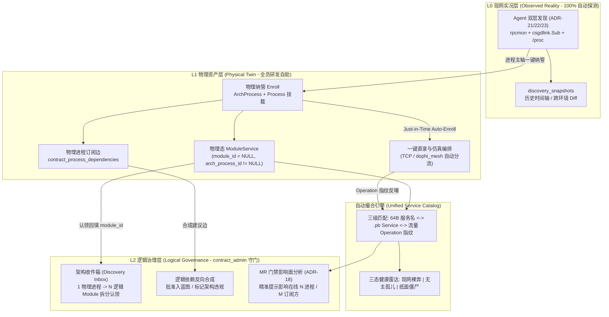

# ADR-24：以「现网发现」为中心的活体契约工作流水线与物理/逻辑双态架构决策

- **文档编号**：`24-csg-discovery-process-centric-and-physical-logical-boundary-adr.md`
- **文档版本**：v1.0.0
- **日期**：2026-11-25
- **状态**：✅ 已定稿待实施 (Accepted — v1.0.0，待按 M30 ~ M32 分期落地)
- **关联特性**：`F-02`（物理进程蓝图与模块服务契约）、`F-05`（实测调用拓扑还原与一致性验证）、`F-08`（进程树选择与就绪诊断）、`F-15`（控制台信息架构）、`F-18`（活体参考文档与契约认领）、`F-28` / `F-31`（Git/MR 门禁与影响面分析）、`F-33`（CSG 现网服务与依赖双层自动发现及蓝图导入）、`F-34`（CSG 三模仿真测试）
- **关联设计**：[`01-system-architecture.md`](../02-design/01-system-architecture.md)、[`03-architecture-elements-and-topology.md`](../02-design/03-architecture-elements-and-topology.md)、[`04-control-plane-and-web-console.md`](../02-design/04-control-plane-and-web-console.md)、[`05-database-schema.md`](../02-design/05-database-schema.md)、[`01-http-api-contract.md`](../03-api/01-http-api-contract.md)
- **关联 ADR**：[`ADR-09`](./09-arch-process-ssot-and-ebpf-premount-standby-adr.md)、[`ADR-16`](./16-multi-implementation-service-contract-adr.md)、[`ADR-17`](./17-topology-single-layer-drilldown-and-layout-ux-adr.md)、[`ADR-18`](./18-proto-full-lifecycle-and-git-mr-governance-adr.md)、[`ADR-19`](./19-proto-contract-ia-unbundling-and-four-workbenches-adr.md)、[`ADR-21`](./21-csg-aware-agent-service-discovery-and-replay-mock-adr.md)、[`ADR-22`](./22-pluggable-transport-driver-and-mesh-capture-adr.md)、[`ADR-23`](./23-dophi-mesh-uprobe-bypass-capture-adr.md)
- **演进关系**：
  - **演进 [`ADR-19`](./19-proto-contract-ia-unbundling-and-four-workbenches-adr.md)**：平台侧边栏菜单由「5 组 13 项」升维为「**5 组 14 项**」，在「架构数字孪生」分组首位新增独立一级工作台 **`现网发现` (`/discovery`)**，将其确立为整个平台工作流水线的核心起点；
  - **演进 [`ADR-21`](./21-csg-aware-agent-service-discovery-and-replay-mock-adr.md) D4 与 D5**：将 CSG 自动发现从“Agent 详情页的辅助对账抽屉”与“强造假模块的蓝图导入器”，升级为**「L0 现网实况快照 ➔ L1 物理资产沉淀 ➔ L2 逻辑架构认领」三层解耦工作流**；物理纳管与发现直录向全员研发自助开放，`contract_admin` 守门聚焦于 L2 逻辑架构与公共规则配置；
  - **演进 [`ADR-09`](./09-arch-process-ssot-and-ebpf-premount-standby-adr.md)**：保留物理/逻辑分离与 Agent 1:1 挂载底座，补齐**基于分层指纹的稳定进程身份锚定**与**显式进程通信画像（`process_role` / `observed_transports`）**，不再以 `DefaultListenPort == 0` 隐式猜测纯客户端或纯 `dophi_mesh://` 进程。

### 修订记录

| 版本 | 日期 | 修订说明 |
| :--- | :--- | :--- |
| v0.1.0 | 2026-11-25 | 草案：诊断“平铺服务列表”与“一键导入造假模块”两大结构错位，提出进程主轴视图及 3 种物理/逻辑导入边界候选方案，待拍板 4 项开放问题。 |
| **v1.0.0** | **2026-11-25** | **正式定稿（Accepted）**：确立「**以现网发现为中心（Discovery-First）**」的全新工作流水线与四项核心拍板：<br>1. 新增独立一级工作台 **`现网发现` (`/discovery`)** 作为平台核心工作起点；<br>2. 采纳 **「物理态 `ModuleService`（允许 `module_id = NULL` + 新增 `arch_process_id`）+ 物理进程订阅边表 (`contract_process_dependencies`)」** 的彻底解耦模型；<br>3. 确立 **L0/L1 研发自助 vs L2 `contract_admin` 守门** 的 RBAC 分界（全员研发可在 `/discovery` 发起物理纳管与零建模直录）；<br>4. 纳入 **`contract_discovery_snapshots` 持久化快照、时间轴变更 Diff 与跨环境对比 Diff** 引擎，并完整闭环 v0.1.0 草案全部开放问题。 |

---

## 1. 背景、旧范式反思与战略反转 (Context & Paradigm Shift)

### 1.1 旧范式「先静态建模、再发现匹配」的四大结构性错位

在 [`ADR-21`](./21-csg-aware-agent-service-discovery-and-replay-mock-adr.md)、[`ADR-22`](./22-pluggable-transport-driver-and-mesh-capture-adr.md) 与 [`ADR-23`](./23-dophi-mesh-uprobe-bypass-capture-adr.md) 落地后，Agent 已具备纯 Go 1 秒级全量发现本机进程、64B 服务实例（`tcp://` / `dophi_mesh://`）及客户端订阅边的能力，并能零侵入按需采集与仿真重放。然而，平台顶层工作流依然固守早期假设——**“必须先手工建完静态架构元素，才能挂载、对账、录制、解码与回放”**，在实际落地中暴露出四重结构性错位：

1. **极高的冷启动门槛与价值倒挂**：
   - 用户安装好 Agent 后，面对的是数百个线上运行进程与服务；若想发起一次录制或查看物理依赖拓扑，却必须先在「架构元素」手工创建 `Subsystem` → `FunctionalGroup` → `Module` → `ArchProcessGroup` → `ArchProcess` → 绑定端口 → 挂载 `Process`。
2. **现网发现隐藏过深且视角倒置（平铺服务列表 vs 进程主轴事实）**：
   - 现网发现入口深埋于 `Agent 与进程 → 选中单台 Agent → 打开抽屉`，且主表以 64B `ServiceName` 平铺（可达数百行）。但运行期客观实体是**操作系统进程 (`procName` + `PID`)**，每个进程发布若干服务并订阅若干下游；平铺列表既淹没了“机器上究竟有哪些进程、谁是纯客户端进程（`提供服务数 = 0`）”，又制造了大量重复宿主进程噪音。
3. **现行「一键导入」以假模块污染逻辑架构纯净度**：
   - 现有模型（[`models/arch.go`](../../models/arch.go)）中 `ModuleService.ModuleID` 与 `ModuleDependency.ConsumerModuleID` 强绑定 `NOT NULL`，导致 [`ImportCSGBlueprint`](../../internal/server/topology/csg_reconcile.go) 被迫要求必选 `Subsystem`，自动创建 `CSG_DISCOVERED` 功能组与 1:1 占位模块 `MOD_<procName>`。
   - 然而**逻辑架构（子系统 / 功能组 / FM 模块拆分）是人工架构设计产物，不可能通过端口和进程自动发现**。同机进程常跨多个子系统，单物理进程常承载多个逻辑模块（`1 进程 : N 模块`），强行 1:1 造假模块只会污染逻辑树并增加后续拆分返工成本。
4. **“静态端口中心论”与“双套孤立认领流”**：
   - [`models/arch.go`](../../models/arch.go) 仍以 `DefaultListenPort == 0` 隐式代表纯客户端进程，但在 CSG 动态端口与 `dophi_mesh://` 时代，服务端也常见 `ListenPort == 0`（纯 Mesh）；
   - 同时系统存在两套割裂的认领/对账逻辑：从 `.pb` 出发的 [`ListClaimableProtoServices`](../../internal/server/topology/claimable_service.go) 与从 CSG 出发的 [`ReconcileLiveCSGWithSSOT`](../../internal/server/topology/csg_reconcile.go)，导致无法自动回答“哪些现网服务缺 `.proto`（裸奔）、哪些有 `.pb` 却没人认领（孤儿）、哪些 `.proto` 现网根本没跑（僵尸）”。

### 1.2 战略反转：以「现网发现」为中心的活体契约流水线 (Discovery-First)

**ADR-24 正式确立范式反转**：**物理事实自动发现、即时可用；逻辑架构按需认领、只做治理不做门槛。**


### 1.3 否决方案永久记录 (Rejected Alternatives)

| 被否决方案 | 否决理由 |
| :--- | :--- |
| **方案 R1：继续在导入时生成 `CSG_DISCOVERED` 与 `MOD_<procName>` 占位假模块（含“可选过渡复选框”）** | 过渡期复选框会导致系统长期存在两套逻辑架构心智，假模块一旦被依赖或引用，后续拆分为 `1 进程 : N 模块` 时迁移成本极高；必须一步到位确保逻辑架构 100% 纯净。 |
| **方案 R2：不设 `/discovery` 工作台，将发现功能继续留在 Agent 抽屉或塞进 `/topology` 附带 Tab** | 发现不仅是“画一张拓扑图”，更是**进程资产盘点、快照对比、一键直录、仿真编排与契约撮合**的核心调度起点；塞入 `/topology` 或深埋在 `/agents` 抽屉会割裂“从发现到行动”的主动线。 |
| **方案 R3：保持 `ModuleService` 绝对纯逻辑，另建一张孤立的 `contract_discovered_services` 物理服务表** | 两张服务表会导致录制归因、`.pb` 解码映射、Diff 忽略规则、黄金用例与三模仿真全部出现双份查询与外键分裂，且“认领”动作需要跨表搬迁关联记录；复用 `contract_module_services` 并允许 `module_id` 可空是最干净的平滑演进。 |
| **方案 R4：继续将物理蓝图纳管限制为 `contract_admin` 专属权限** | 物理世界里“一台机器上跑着哪些进程、各自发布了什么服务”是客观观测事实，而非主观治理规范；若普通研发在测试/联调机器上连“把发现的进程纳管并开录”都要找管理员审批，将直接摧毁自驱流水线的可用性。 |

---

## 2. 核心架构决策矩阵 (Decisions)

| 编号 | 决策领域 | 选定方案 (v1.0.0) | 核心收益与边界约束 |
| :--- | :--- | :--- | :--- |
| **D1** | **控制台 IA 升维与 `/discovery` 一级工作台** | 在全局侧边栏「架构数字孪生」分组首位新增独立一级工作台 **`现网发现` (`/discovery`)**，全平台菜单由 `ADR-19` 的「5 组 13 项」升级为 **「5 组 14 项」**；原 `/agents` 页 CSG 探测抽屉降级为轻量入口，点击「进入现网发现工作台」深链跳转 `/discovery?agent_id=:id` | 为“发现驱动流水线”提供单一权威入口；集成进程主轴树表、零抓包实时拓扑、快照时间线 Diff、一键物理纳管与零建模直录 |
| **D2** | **L0 ➔ L1 ➔ L2 三层解耦模型** | 严格划分三层认知边界：<br>1. **L0 现网实况层 (`Observed Reality`)**：100% 自动发现快照（活体 PID、64B 服务、订阅边、端口池）；<br>2. **L1 物理资产层 (`Physical Digital Twin`)**：`ArchProcess` + `Process` + 物理态 `ModuleService`（`module_id = NULL`）+ 物理订阅边 `ProcessDependency`，**无需任何逻辑模块即可完整运作**；<br>3. **L2 逻辑治理层 (`Logical Governance`)**：`Subsystem` / `FunctionalGroup` / `Module` / `ServiceContract` / `ModuleDependency` / `LayerLevel` | **彻底打破“先画逻辑架构才能用平台”的枷锁**；物理资产即时服务于拓扑、录制、解码与仿真，逻辑架构 100% 纯净并支持 `1 进程 : N 模块` 精准拆分 |
| **D3** | **物理态 `ModuleService` 与物理进程依赖表** | 1. 演进 `contract_module_services`：**`module_id` 改为可空 (`*uint64`)**（`NULL` 即表示“已物理发现、待逻辑认领”），新增 **`arch_process_id *uint64`**、**`source`**（`MANUAL \| CSG_DISCOVERED \| PROTO_SYNC`）、`observed_transport`、`last_seen_at`、`proto_match_confidence`，附加表约束 `CHECK (module_id IS NOT NULL OR arch_process_id IS NOT NULL)` 且删除 `Module` 时物理发现服务回退为 `module_id = NULL`（`ON DELETE SET NULL`）；<br>2. 新增 **`contract_process_dependencies`** 表持久化「消费方物理进程 ➔ 64B 目标服务 / 提供方物理进程」物理订阅边 | 同一张 `ModuleService` 实体无缝贯穿物理发现、自动解码、流量归因与逻辑认领全生命周期；物理拓扑画布无需逻辑模块即可渲染完整进程间依赖边 |
| **D4** | **发现快照持久化与双模 Diff 引擎** | 新增 **`contract_discovery_snapshots`** 表，支持自动/手动保存完整发现快照（带 `content_hash` 幂等去重、`is_pinned` 基准锁定与按 `(agent_id, csg_addr)` 留存滚动上限），并提供 **同环境时间轴 Diff（`T1 vs T2`）** 与 **跨环境 Diff（`Agent A vs Agent B`）**，按规范化进程指纹与 `StripCSGPIDSuffix(ServiceName)` 对齐 | 把“瞬态探测数据”升级为“可追溯的活体资产时间线”，一眼定位发版前后或环境之间缺失的服务与新增的越界订阅 |
| **D5** | **RBAC 权限重划（L0/L1 自助 vs L2 管理员守门）** | 1. **L0 探测/快照 + L1 物理纳管 (`Enroll`) + 零建模直录 (`Quick Record`)**：对所有**已认证研发人员**开放（严格受 `Agent` 的 `SHARED/PRIVATE` 可见性守卫与单机排他租约约束），操作均记录 `P2` 审计日志；<br>2. **L2 逻辑架构与公共规则治理**：严格限定 **`contract_admin`**（`RequireAdmin("contract_admin")` + `P1` 审计），包含 `Subsystem`/`FunctionalGroup`/`Module` 增删改、将物理服务认领 (`Claim`) 进逻辑模块、批准/阻断 `ModuleDependency`、多实现 `ServiceContract` 与 `LayerLevel` 配置 | 既释放研发人员自助发现与测试的生产力，又死守公共逻辑架构蓝图与治理规则的权威防线（同步演进 `AGENTS.md` 红线 #3 中旧版 `import-blueprint` 限制） |
| **D6** | **进程稳定身份锚定与显式通信画像** | 1. **分层进程身份指纹**：`ArchProcess` 新增 `identity_fingerprint`，按「已有 `CmdPattern` 匹配 ➔ 剥离易变端口/PID/临时路径的 `exe + 规范化参数`（通用宿主进程辅以发布服务集合前缀消歧）」稳定锚定跨重启进程；同机多实例 PID 自动折叠展示；<br>2. **显式通信画像**：`ArchProcess` / `Process` 新增 `process_role`（`SERVER \| CLIENT_ONLY \| DUAL`）与 `observed_transports`（`TCP \| MESH \| MIXED`），彻底终结以 `DefaultListenPort == 0` 猜测纯客户端/Mesh 进程的歧义 | 彻底解决进程重启 PID 变化导致的重复建档与误判，使纯客户端进程与纯 `dophi_mesh://` 服务端的探针就绪诊断更加精准 |
| **D7** | **发现即录制、发现驱动仿真与两阶段渐进归因** | 1. **一键直录 (`Just-in-Time Auto-Enroll`)**：用户在 `/discovery` 勾选任意进程直接开录，后端事务内幂等完成物理纳管（`ArchProcess` + `Process`）并按 `observed_transports` 自动匹配 `builtin-tcp` / `builtin-drt-uprobe` 驱动；<br>2. **发现驱动仿真编排**：选中待测进程即基于其 CSG `Subscriptions` 在线状态智能推荐 `CLIENT_INJECT` / `PUB_STUB` / `MOCK_SERVER` 组合；<br>3. **两阶段渐进归因**：`OfflineBatchAttribution` 第一阶段 100% 完成 **物理进程级归因 (`SrcArchProcess -> DstArchProcess`) + `.pb` 解码**；第二阶段待逻辑认领后增量补齐 `SrcModuleID` / `DstModuleID` 与逻辑违规判断 | 彻底打通“发现 ➔ 录制 ➔ 解码 ➔ 仿真”零障碍通道，未做任何逻辑建模也能获得完整物理调用链与 `.pb` 结构化报文 |
| **D8** | **统一契约目录、三方自动撮合与架构收件箱** | 1. 合并原 `.pb` 认领（`claimable_service.go`）与 CSG 对账（`csg_reconcile.go`）为**「统一契约服务目录」**，通过三级自动匹配引擎（精确/别名 ➔ DOPRA `<Class>-<Svr>` 规则 ➔ 录制 `Operation` 方法指纹反推）自动撮合「现网 64B ⇄ `.pb` ⇄ 逻辑模块」；<br>2. 输出三态健康雷达（**现网裸奔 / 无主孤儿 / 纸面僵尸**）并接入治理大盘；<br>3. `/architecture` 页新增**「待认领资产收件箱 (Discovery Inbox)」**，支持 1 进程拆 N 模块批量认领、基于物理订阅边反向合成逻辑依赖建议，并在 MR 门禁（`ADR-18`）中附带「受影响现网进程与订阅方」影响面分析 | 让 `.proto` 契约治理与现网运行事实真正咬合，消除两套认领体系割裂，实现自底向上的架构治理闭环 |

---

## 3. 目标工作流水线与控制台信息架构 (Target Pipeline & IA)

### 3.1 四阶段活体契约闭环全景图



### 3.2 控制台导航升维：5 组 14 项菜单契约 (`frontend/src/menu.ts`)

延续 [`ADR-19`](./19-proto-contract-ia-unbundling-and-four-workbenches-adr.md) 的金字塔分组原则，将「架构数字孪生」从 2 项扩展为 **3 项**，全平台菜单升级为 **5 组 14 项**：

| 排序 | 一级分组 (`GroupTitle`) | 二级菜单 (`Label`) | 路由 (`Path`) | 权限 | 核心定位 |
| :---: | :--- | :--- | :--- | :--- | :--- |
| 1 | **全局概览** | `治理大盘` | `/dashboard` | 全员 | 契约健康度、三态服务雷达（裸奔/孤儿/僵尸）、门禁趋势 |
| **2** | **架构数字孪生** | **`现网发现`** *(新增核心起点)* | **`/discovery`** | **全员** | **进程主轴探测树表、零抓包实时拓扑、快照 Diff、物理纳管、一键直录与仿真编排** |
| 3 | **架构数字孪生** | `架构拓扑` | `/topology` | 全员 | 物理资产全景图（支持无逻辑模块连线）+ 逻辑治理图 + 实测一致性叠加（`ADR-17`） |
| 4 | **架构数字孪生** | `架构元素` | `/architecture` | 全员查 / 管理员改 | 逻辑架构蓝图台账 + **待认领物理资产收件箱 (Discovery Inbox)** + 依赖反向审批 |
| 5 | **Proto 契约治理** | `接口参考文档` | `/proto-docs` | 全员 | 全注释文档、Markdown 导出、统一契约目录查阅 |
| 6 | **Proto 契约治理** | `源码与 Git 仓` | `/proto-sources` | 全员 | 只读源码 `#L<n>` 定位、Git/外部仓同步、在线源码直编 |
| 7 | **Proto 契约治理** | `MR 门禁与规范` | `/proto-governance` | 全员 | MR 门禁流水（含现网影响面分析）、静态规则、词库、AST 重复簇 |
| 8 | **Proto 契约治理** | `描述集与依赖` | `/schemas` | 全员 | `.pb` 描述集资产台账、自动撮合触发与跨包依赖拓扑 |
| 9 | **契约核验与回归** | `契约采集` | `/record` | 全员 | 多进程协同录制（支持基于发现预设目标） |
| 10 | **契约核验与回归** | `事务分析` | `/debug` | 全员 | 报文因果树、时序泳道与四段解剖（物理+逻辑双态元数据水合） |
| 11 | **契约核验与回归** | `防劣化回归` | `/replay` | 全员 | 契约回归回放引擎与基线对比（接入发现驱动三模仿真建议） |
| 12 | **契约核验与回归** | `黄金用例库` | `/golden-suites` | 全员 | 黄金回归用例集与契约基线管理 |
| 13 | **环境与治理** | `Agent 与进程` | `/agents` | 全员 | Edge Agent 纳管、探针健康与跳往 `/discovery?agent_id=:id` 快捷入口 |
| 14 | **环境与治理** | `模块参数配置` | `/admin/settings` | `contract_admin` | 全局治理参数、规则开关、快照留存策略与通知配置 |

### 3.3 `/discovery` 工作台核心交互架构（进程主轴 + 行动中心）

`/discovery` 页面按「**选环境 ➔ 看实况 ➔ 对比快照 ➔ 行动（纳管 / 录制 / 仿真）**」组织，彻底取代旧版扁平抽屉表格：

1. **顶部环境与动作栏**：
   - 选择目标 `Agent`（受 `SHARED/PRIVATE` 权限过滤）+ 单行候选 `CSG` 控制面选择器 + `[立即探测]` + `[保存快照]` + `[快照对比]`；
   - 仅当降级为 `PROC_ONLY` 或接口报错时显示诊断告警，常态保持高屏效。
2. **主视图双切换模式**：
   - **模式 A · 进程主轴分组树表（默认）**：
     - **一级行（物理进程组）**：`[勾选框] | 展开箭头 + 宿主进程名 (折叠多实例 PID 徽章，如 "2 PIDs · 12345, 12398") | 角色标签 (SERVER / CLIENT_ONLY / DUAL) | 物理纳管状态 (未纳管 / 已纳管 · 就绪态) | 提供服务数 (如 12 · 4 待认领) | 传输协议 (TCP / dophi_mesh / MIXED) | 订阅下游数 | 行内快捷操作 ([直录] / [仿真])`；
     - **纯客户端进程显式一等公民**：即使 `提供服务数 = 0`（仅出现在 `Subscriptions` 中），亦作为一级进程行展示，展开可见其订阅的全部下游服务与解析归属；
     - **二级子行（进程发布服务 / 订阅明细）**：展示 64B `ServiceName`、真实监听 URI（`tcp://...` 或 `dophi_mesh://...`）、**自动撮合的 `.pb` 契约徽章**（已匹配 / 缺 `.pb` 裸奔）、**逻辑认领状态**（已认领进某 `Module` / 待认领）与下游订阅方数量；
     - **跨板 LDC 视图分离**：提供「本机进程（可纳管/可录制）」与「跨板 LDC 远端节点（只读参考）」页签切换，防止跨板节点与本机 PID 混淆；
     - **智能搜索联动**：搜索服务名或 `.pb` 名时自动高亮并展开命中的进程父行。
   - **模式 B · 零抓包实时依赖图**：
     - 直接利用 `rpcmon` 一次拉取的 `Servers` + `Clients` 构建「`订阅进程 ➔ 服务名 ➔ 发布进程`」交互式关系图；点击任意进程节点可切换 1-Hop Ego 聚焦，**未抓过一个包、未建过一个逻辑模块即可看清全机调用关系**。
3. **底部悬浮批处理行动条（勾选任意 1..N 个本机进程后出现）**：
   - **`[物理纳管到蓝图]`**：选择目标 `ArchProcessGroup`（默认 `PGRP_CSG_AUTO` 或新建），写入 `ArchProcess` + `Process` + 物理 `ModuleService` + `ProcessDependency`；
   - **`[一键立即录制]`**：自动静默物理纳管（如尚未纳管）+ 自动创建并启动 `RecordingSession`，直接跳转 `/record` 实时采集流；
   - **`[编排仿真任务]`**：针对单个被测进程，读取其 `Subscriptions` 在线情况预填充 `CLIENT_INJECT` / `PUB_STUB` / `MOCK_SERVER` 策略，直达 `/replay`。

---

## 4. 数据模型与数据库 Schema 演进 (`contract_*`)

> 所有表名强制遵循 `contract_` 前缀规范；`cmd/agent` 及 `pkg/{crosrpc,agentproto,csgdlink,rpcmon,csgmock,ebpf,transport,replay}` 保持 **100% 零 DB、零 `.pb` 动态库、零 CGO**，本节全部表结构演进均仅作用于控制面 `cmd/server` 与 `models/`。

### 4.1 `contract_arch_processes` 与 `contract_processes` 增量字段

为替代“以 `DefaultListenPort == 0` 猜测纯客户端”并解决进程重启身份漂移，新增以下字段：

| 表名 | 新增列 | SQL 类型与约束 | 语义说明 |
| :--- | :--- | :--- | :--- |
| `contract_arch_processes` | `process_role` | `varchar(16) NOT NULL DEFAULT 'DUAL'` (`CHECK IN ('SERVER','CLIENT_ONLY','DUAL')`) | 显式进程通信角色；纯订阅无服务进程标记为 `CLIENT_ONLY`，纯 `dophi_mesh` 服务端亦可明确标为 `SERVER` |
| `contract_arch_processes` | `observed_transports` | `jsonb NOT NULL DEFAULT '[]'` | 观测到的传输协议集合（如 `["TCP"]`、`["MESH"]`、`["TCP","MESH"]`），供录制驱动选择与前端提示 |
| `contract_arch_processes` | `identity_fingerprint` | `varchar(128) NOT NULL DEFAULT ''`（普通索引 `idx_contract_arch_proc_fp`） | 规范化进程身份指纹（见 §5.2），用于跨重启与多节点发现稳定匹配既有 `ArchProcess` |
| `contract_processes` | `observed_pids` | `jsonb NOT NULL DEFAULT '[]'` | 最近一次发现/诊断中匹配到该 `ArchProcess` 的运行期本机 PID 列表（支持多实例折叠展示） |

> 既有 `effective_listen_port` 唯一索引（`WHERE effective_listen_port > 0`）继续保留以防止同机非零静态端口冲突；对于 `effective_listen_port = 0` 的纯客户端或纯 `dophi_mesh://` 进程，探针就绪检查不再校验监听端口，只要存活 PID 存在且对应 `pkg/transport.Driver` 可用即可进入 `READY`。

### 4.2 `contract_module_services` 物理/逻辑双态演进

在 [`models/arch.go`](../../models/arch.go) 中，将 `ModuleService` 升级为统一承载“物理发现态（未认领）”与“逻辑归属态（已认领）”的双态契约实体：

```sql
-- 1. 解除 module_id 强非空约束，并将逻辑模块删除外键调整为 ON DELETE SET NULL
ALTER TABLE contract_module_services ALTER COLUMN module_id DROP NOT NULL;

-- 2. 新增物理归属与自动撮合字段
ALTER TABLE contract_module_services
  ADD COLUMN IF NOT EXISTS arch_process_id        bigint NULL REFERENCES contract_arch_processes(id) ON UPDATE CASCADE ON DELETE CASCADE,
  ADD COLUMN IF NOT EXISTS source                 varchar(24) NOT NULL DEFAULT 'MANUAL',
  ADD COLUMN IF NOT EXISTS observed_transport     varchar(16) NOT NULL DEFAULT '',
  ADD COLUMN IF NOT EXISTS last_seen_at           timestamptz NULL,
  ADD COLUMN IF NOT EXISTS proto_match_confidence varchar(16) NOT NULL DEFAULT 'NONE';

-- 3. 数据完整性守护：一条服务必须至少归属于「一个逻辑模块」或「一个物理进程」
ALTER TABLE contract_module_services
  ADD CONSTRAINT chk_contract_mod_svc_owner
  CHECK (module_id IS NOT NULL OR arch_process_id IS NOT NULL);

ALTER TABLE contract_module_services
  ADD CONSTRAINT chk_contract_mod_svc_source
  CHECK (source IN ('MANUAL', 'CSG_DISCOVERED', 'PROTO_SYNC'));

ALTER TABLE contract_module_services
  ADD CONSTRAINT chk_contract_mod_svc_proto_conf
  CHECK (proto_match_confidence IN ('NONE', 'FINGERPRINT', 'HEURISTIC', 'EXACT', 'MANUAL'));

CREATE INDEX IF NOT EXISTS idx_contract_mod_svc_arch_proc
  ON contract_module_services (arch_process_id);
```

* **与 [`ADR-16`](./16-multi-implementation-service-contract-adr.md) 索引兼容性说明**：
  * 既有部分唯一索引 `uk_contract_mod_svc_name_excl`（`WHERE contract_id IS NULL OR is_custom_service_name = true`）继续保障独占服务的全局运行期 `service_name` 唯一性；
  * 既有 `uk_contract_mod_svc_contract_impl` 与 `uk_contract_mod_svc_contract_mod` 仅在 `contract_id IS NOT NULL` 时生效；未认领的物理态服务（`module_id IS NULL`）默认 `contract_id IS NULL`（多实现契约挂载属于 L2 逻辑认领阶段绑定），因此**零冲突兼容多实现契约**。
* **防误删保护**：当管理员删除一个逻辑 `Module` 时，若该服务仍带有 `arch_process_id`（物理发现来源），通过 `ON DELETE SET NULL` 仅清空 `module_id`（回退为「待认领物理服务」），保留历史流量关联与物理拓扑；若 `arch_process_id IS NULL`（纯手工逻辑服务），则可在业务层按原逻辑清理或拦截。

### 4.3 新增 `contract_process_dependencies`（物理进程订阅边表）

承载 L1 层「谁订阅了谁」的客观物理依赖事实（含纯客户端进程出边及尚未被任何 `Module` 认领的服务），支撑无逻辑模块时的物理拓扑渲染与逻辑依赖反向合成：

| 列名 | 类型与约束 | 说明 |
| :--- | :--- | :--- |
| `id` | `bigserial PRIMARY KEY` | 主键 |
| `consumer_arch_process_id` | `bigint NOT NULL` (FK -> `contract_arch_processes.id` `ON DELETE CASCADE`) | 订阅方/消费方物理进程 |
| `service_name` | `varchar(128) NOT NULL` | 归一化 64B 目标服务名（`StripCSGPIDSuffix`） |
| `service_id` | `bigint NULL` (FK -> `contract_module_services.id` `ON DELETE SET NULL`) | 若目标服务已纳管入 `contract_module_services`，关联其 ID |
| `provider_arch_process_id` | `bigint NULL` (FK -> `contract_arch_processes.id` `ON DELETE SET NULL`) | 若提供方在本机已知，关联提供方物理进程；远端 LDC/未上线时为 `NULL` |
| `is_cross_node` | `boolean NOT NULL DEFAULT false` | 是否订阅跨板 LDC 远端节点服务 |
| `source` | `varchar(24) NOT NULL DEFAULT 'CSG_SUB'` | 来源：`CSG_SUB` \| `TRAFFIC_OBSERVED` |
| `status` | `varchar(16) NOT NULL DEFAULT 'ACTIVE'` (`CHECK IN ('ACTIVE','STALE','IGNORED')`) | 活跃 / 最近快照未出现 / 管理员标记忽略 |
| `first_seen_at` | `timestamptz NOT NULL DEFAULT now()` | 首次发现时间 |
| `last_seen_at` | `timestamptz NOT NULL DEFAULT now()` | 最近一次快照确认时间 |
| `created_by` / `updated_by` / `created_at` / `updated_at` | 标准审计时间戳列 | 同其他 `contract_*` 模型 |

* **唯一元组索引**：`uk_contract_proc_dep_tuple UNIQUE (consumer_arch_process_id, service_name)`，保证重复纳管 100% 幂等刷新 `last_seen_at` 与 `provider_arch_process_id`。

### 4.4 新增 `contract_discovery_snapshots`（现网发现持久化快照表）

把瞬态 `CSGTopologyReport` 沉淀为可追溯、可锁定基线、可跨时间与跨环境对比的资产时间线：

| 列名 | 类型与约束 | 说明 |
| :--- | :--- | :--- |
| `id` | `bigserial PRIMARY KEY` | 主键 |
| `agent_id` | `bigint NOT NULL` (FK -> `contract_agents.id` `ON DELETE CASCADE`) | 所属环境 Agent |
| `agent_name` | `varchar(128) NOT NULL` | 快照时刻 Agent 名称冗余，便于审计展示 |
| `csg_addr` | `varchar(128) NOT NULL DEFAULT ''` | 探测的 CSG 控制面地址（如 `10.29.92.80:31806`） |
| `discovery_mode` | `varchar(32) NOT NULL DEFAULT ''` | `CROSTCP_RPCMON` \| `CROSMESH_RPCMON` \| `PROC_ONLY` |
| `trigger_type` | `varchar(16) NOT NULL DEFAULT 'MANUAL'` (`CHECK IN ('MANUAL','AUTO','SCHEDULED')`) | 触发方式：人工保存 / 探测变动自动保存 / 定时巡检 |
| `label` | `varchar(128) NOT NULL DEFAULT ''` | 可选标签（如 `v2.3.0-联调基线`） |
| `is_pinned` | `boolean NOT NULL DEFAULT false` | 锁定为基线快照，**免疫自动滚动清理** |
| `content_hash` | `varchar(64) NOT NULL` | 对规范化（剔除易变 `PID` 与时间戳后的）进程/服务/订阅列表计算的 SHA-256，用于同环境连续探测去重 |
| `summary_json` | `jsonb NOT NULL DEFAULT '{}'` | 轻量化摘要：`{proc_count, client_only_proc_count, live_service_count, live_sub_count, remote_count, tcp_count, mesh_count}` |
| `payload_json` | `jsonb NOT NULL` | 完整结构化快照（规范化后的 `CSGTopologyReport` + 进程指纹归组元信息） |
| `created_by` | `integer NOT NULL DEFAULT 0` | 触发用户 ID（遵循 `Agent` 可见性守卫） |
| `created_at` | `timestamptz NOT NULL DEFAULT now()` | 快照采集时间 |

* **复合索引**：`idx_contract_disc_snap_agent_time (agent_id, csg_addr, created_at DESC)` 与 `idx_contract_disc_snap_hash (agent_id, csg_addr, content_hash)`。
* **去重与容量控制**：
  * 自动保存模式下，若与最近一条同 `(agent_id, csg_addr)` 快照的 `content_hash` 完全一致，仅刷新既有记录元信息或跳过插入，避免刷库；
  * 每组 `(agent_id, csg_addr)` 默认保留最近 `N = 50` 条非 `is_pinned` 快照（可通过 `ModuleSetting` 配置），超出部分按 FIFO 清理，确保磁盘占用有界。

### 4.5 `contract_traffic_records` 轻量物理归因扩展列

为支撑“无逻辑模块即可完成第一阶段物理归因”，在 [`models/recording.go`](../../models/recording.go) `TrafficRecord` 新增两个可空列（PostgreSQL 对分区母表执行 `ADD COLUMN ... NULL` 无默认重写开销，属于 O(1) 元数据操作）：

- `src_arch_process_id bigint NULL`（索引 `idx_contract_tr_src_arch`）
- `dst_arch_process_id bigint NULL`（索引 `idx_contract_tr_dst_arch`）

并在 [`models/db.go`](../../models/db.go) 的 `BusinessTableNames()` 中按外键拓扑顺序注册 `DiscoverySnapshot` 与 `ProcessDependency`。

---

## 5. 核心机制、算法契约与权限矩阵

### 5.1 物理纳管 (`EnrollCSGDiscovery`) 事务契约

取代现有 `ImportCSGBlueprint` 中强制创建 `CSG_DISCOVERED` 与 `MOD_<procName>` 的旧逻辑：

1. **输入极简化**：仅接收 `agent_id`、`csg_addr`、可选 `process_group_id`（缺省落入 `PGRP_CSG_AUTO`）、以及勾选的本机 `selected_processes[]`（或 `service_names[]`），**不再要求 `subsystem_id` 与 `group_id`**。
2. **单事务幂等写入**：
   - 按 `identity_fingerprint` 或 `code` 查找/创建 `ArchProcess`，更新 `process_role`（`SERVER` / `CLIENT_ONLY` / `DUAL`）与 `observed_transports`，**绝不覆盖人工已修改的 `Name`、`GroupID` 或 `DefaultCmdPattern`**；
   - 幂等创建/更新 `contract_processes` 在当前 `agent_id` 上的 1:1 挂载（记录 `observed_pids`）；
   - 对选中进程发布的本地服务，按排序后 `StripCSGPIDSuffix(ServiceName)` 悲观锁顺序，幂等写入 `contract_module_services`：
     - **若该服务已存在且已有 `module_id`（已逻辑认领）**：**严格保留其 `module_id` 与 `contract_id`**，仅更新 `arch_process_id`（若为空）、`observed_transport` 与 `last_seen_at`；
     - **若为新发现服务**：以 `module_id = NULL, arch_process_id = ap.ID, source = 'CSG_DISCOVERED'` 写入待认领物理服务池；
   - 对选中进程（含纯客户端进程）的 `Subscriptions`，幂等写入 `contract_process_dependencies`，并尽最大努力回填已知的 `service_id` 与本机 `provider_arch_process_id`；
   - 事务提交后异步/同步触发一次 **L0/L1 ➔ `.pb` 自动撮合**，即时标出已知 `.pb` 契约映射；若新增了 `Process` 挂载，递增 `Agent.MountsRevision`。
3. **旧接口兼容策略**：现有 `POST /api/agents/:id/csg/import-blueprint` 在 M30 期间标记为 `@Deprecated`（不再强制造假模块，或内部委托 `Enroll` + 仅在显式传 `subsystem_id` 时提供只挂不造假模块的提示），待新工作台验证稳定后下线。

### 5.2 进程稳定身份锚定与多实例折叠

解决开放问题「现网 `server_pid` 每次重启都会变化，如何避免重复建档」：

1. **分层匹配优先级**：
   - **P1 人工/蓝图模式命中**：若本机 `/proc/<pid>/cmdline` 或 `exe` 匹配既有 `Process.OverrideCmdPattern` / `ArchProcess.DefaultCmdPattern`，直接绑定该 `ArchProcess`；
   - **P2 规范化指纹命中**：计算 `identity_fingerprint = sha256(exeBase + "|" + stableRoleArgs)`：
     - 剥离易变运行参数（`--port=*`、`-p *`、`--pid*`、临时实例号、IPv4 地址等）；
     - 若 `exeBase` 为通用运行时/容器名（如 `java`、`python3`、`app_runner`），拼接其入口脚本名或**排序后前 2 个发布服务名前缀**作为防碰撞特征；
   - **P3 `procName` 兜底归组**：当 `cmdline` 不可读（`RPCMonitorService` 无 `/proc` 权限）时，降级使用规范化 `procName`（剔除尾部 `-<pid>`）。
2. **多实例折叠规则**：
   - 同一台宿主机上出现 2 个及以上 PID 命中同一个 `identity_fingerprint`（例如多 Worker 进程）时，在「现网发现」主表中**折叠为同一物理进程一级行**，展示 `2 PIDs (12345, 12398)` 并合并去重其发布服务与订阅边；不同实例监听不同端口时在二级服务行展开多端点标签。

### 5.3 持久化快照与双模 Diff 算法（Timeline & Cross-Env）

对比时剔除易变运行态噪音（OS `PID`、动态临时端口数值、毫秒时间戳），以**「规范化进程键 (`identity_fingerprint` 优先，次选 `procName`) + 规范化服务名 (`StripCSGPIDSuffix`)」**作为对齐键：

* **同环境时间轴 Diff（`Snapshot A @ T1` vs `Snapshot B @ T2`）**：
  - 精确识别：`ADDED_PROCESS` / `REMOVED_PROCESS`、进程内 `ADDED_SERVICE` / `REMOVED_SERVICE`、传输协议变更（如 `TCP -> MESH`）、`ADDED_SUBSCRIPTION` / `REMOVED_SUBSCRIPTION`；
  - 典型价值：发版回归后一键核对“新版本是否多订阅了非预期下游、或漏发布了一个关键服务”。
* **跨环境 Diff（`Agent Env A` vs `Agent Env B`，如联调环境 vs 准生产环境）**：
  - 忽略两台机器不同的宿主 IP 与动态端口，纯粹比较**进程覆盖度、服务契约集合、传输协议制式与订阅拓扑结构**；
  - 典型价值：在仿真测试或上线前快速排查“个人开发栈到底缺了公共测试栈的哪几个上游/下游进程”。

### 5.4 一键直录与两阶段渐进流量归因

1. **发现即录制 (`POST /api/discovery/quick-record`)**：
   - 前端传入 `agent_id` + 选中的 `process_keys`（及可选会话名称/限流参数）；
   - 服务端在一个事务内先对未纳管进程执行幂等 `Enroll`（`ArchProcess` + `Process` 挂载），再校验/获取 `Agent` 排他录制租约（`RECORDING`），自动根据 `observed_transports` 装配采集参数启动 `RecordingSession`；
   - `Agent` 侧按 `ADR-22 / ADR-23` 路由至 `builtin-tcp` 或 `builtin-drt-uprobe`（`ARMED` 期 0 uprobe 挂载，仅录制期按目标 PID 挂载，五出口幂等清理）。
2. **两阶段渐进归因 (`internal/server/topology/attribution.go`)**：
   - **Stage 1 · 物理进程级归因（无条件成功）**：在 `OfflineBatchAttribution` 中，优先基于 `TrafficRecord.ProcessID -> Process.ArchProcessID` 确定本地进程，结合 `ServiceName` 命中物理态 `ModuleService.arch_process_id` 与 `RecordingSession.CSGSnapshots` 确定对端 `ArchProcessID`，**写入 `src_arch_process_id` 与 `dst_arch_process_id`**；同步通过统一撮合后的 `ProtoServiceName` 完成 `.pb` 字段级解码；
   - **Stage 2 · 逻辑模块级归因（增量增强）**：对已认领进 `Module` 的服务，继续执行原有的 3 级源模块判定（单模块独占 `SINGLE_MODULE_PROC` / `TRACE_SPAN` / `UNIQUE_DEPEND` / `PROCESS_LEVEL`）并写入 `src_module_id` / `dst_module_id`；当架构师后续在「架构收件箱」认领了某物理服务后，提供**「重算历史批次逻辑归因」**异步任务，无损补全历史批次的逻辑拓扑一致性报告。
3. **无逻辑模块物理拓扑渲染 (`internal/server/topology/graph_topology.go`)**：
   - 保留 `ADR-17` 单层平铺逐级下钻交互（`PROCESS_GROUP -> PROCESS -> MODULE`）；
   - 当 `PROCESS` 尚未认领任何 `Module` 时，物理拓扑不再是孤岛：**由 `contract_process_dependencies` 直接合成 `PROCESS -> PROCESS` 物理连线（或 `PROCESS -> 外部/未上线服务` 节点）**，并在边详情中列出所有底层服务名及认领状态；一旦相关服务被认领进 `Module`，同一物理连线自动叠加逻辑合规徽章（合规 / 越层 / 未声明）。

### 5.5 统一契约服务目录、三方自动撮合与架构收件箱

合并原 [`claimable_service.go`](../../internal/server/topology/claimable_service.go) 与 [`csg_reconcile.go`](../../internal/server/topology/csg_reconcile.go)，构建**统一契约服务目录**：

1. **三级自动匹配引擎（64B 运行期名 ⇄ `.pb` Service）**：
   - **L1 精确/别名匹配 (`EXACT`)**：匹配 `ProtoOperation.ServiceName` 或既有 `ModuleService.ProtoServiceName`；
   - **L2 DOPRA 规则启发式匹配 (`HEURISTIC`)**：将 CSG 64B 名称 `<Class[:31]>-<Svr[:31]>` 拆解，与全局已激活 `ProtoOperation.ProtoService`（含包名/短名）比对；唯一高精度命中时自动建议或按配置自动绑定 `proto_service_name`；
   - **L3 流量方法指纹反推 (`FINGERPRINT`)**：当某服务尚无 `.pb` 映射但已有录制流量时，提取其录制报文中的唯一 `Operation` 方法名集合，与全局已激活 `ProtoOperation` 索引求集合覆盖度（如命中率 >= 80% 且唯一），自动推荐对应 `.pb` 服务。
2. **三态健康雷达（接入 `/dashboard` 治理大盘与 `/proto-docs` 目录）**：
   - 🔴 **现网裸奔服务 (`SHADOW_LIVE`)**：现网已发现（或已入物理池），但匹配不到任何已激活 `.pb`；
   - 🟡 **无主孤儿服务 (`UNCLAIMED_ORPHAN`)**：已匹配到 `.pb` 且在物理池中存在，但 `module_id IS NULL`（尚未归属任何逻辑模块与责任人）；
   - ⚪ **纸面僵尸契约 (`PHANTOM_PROTO`)**：`.pb` 中定义了服务，但在所有纳管环境的最近发现快照中均未出现任何发布方或订阅方。
3. **「架构收件箱 (Discovery Inbox)」与 MR 门禁联动**：
   - 在 `/architecture` 提供待认领物理服务收件箱（按 `ArchProcess` 分组，支持搜索与筛选），`contract_admin` 可将一个大进程下的服务**拆分勾选认领进不同的逻辑 `Module`**（`POST /api/arch/services/claim`），彻底实现 `1 物理进程 : N 逻辑模块`；
   - 基于物理进程下的 `contract_process_dependencies`，系统自动识别“消费方与提供方均已认领逻辑模块、但 `contract_module_dependencies` 尚无声明”的候选边，呈现在「**待审批逻辑依赖建议**」列表，管理员一键选择 **`[批准加入逻辑蓝图]`** 或 **`[标记为违规依赖]`**；
   - 在 `ADR-18` Git MR 门禁流水执行 Breaking Change 检查时，自动查询 `contract_module_services` 与 `contract_process_dependencies`，在 MR 评审评论中精准输出：**“该 `.proto` 服务当前在现网被 N 个物理进程发布、被 M 个客户端进程订阅，请确认兼容升级窗口”**。

### 5.6 权限边界与审计矩阵 (RBAC & Audit Matrix)

遵循用户拍板决定 #3，明确划定「L0/L1 自助」与「L2 管理员守门」的精确界线：

| 操作域 | 具体能力 | 权限要求 | 可见性与并发守卫 | 审计级别 |
| :--- | :--- | :--- | :--- | :--- |
| **L0 现网实况** | 触发 CSG 探测、查看进程主轴树表与实时图、保存/置顶/对比快照 | 已认证用户 | `Agent` `SHARED` 全员可见 / `PRIVATE` 仅 `owner_id` 或管理员可见；`POST` 快照保存记审计 | 查询无 / 写入 `P2` |
| **L1 物理资产** | 物理纳管 (`Enroll` 创建/更新 `ArchProcess` / `Process` / 物理服务 / 物理订阅边) | 已认证用户 | `Agent` 可见性守卫 + **禁止修改已认领服务的 `module_id`** | `P2` |
| **L1 快速核验** | 在 `/discovery` 发起「一键直录」与「发现驱动仿真编排」 | 已认证用户 | `Agent` 可见性守卫 + **Agent 排他租约 (`409 Conflict`)** | `P2` |
| **L1 辅助撮合** | 触发 64B ⇄ `.pb` 自动撮合预览、查看三态健康雷达 | 已认证用户 | 只读/幂等建议；写定未确认的低置信映射需人工确认 | 查询无 / 绑定 `P2` |
| **L2 逻辑蓝图** | `Subsystem` / `FunctionalGroup` / `Module` 增删改、`LayerLevel` 设置 | **`contract_admin`** | 全局公共 SSOT，严格管理员守门 | **`P1`** |
| **L2 逻辑认领** | 将物理服务认领 (`Claim`) 进 `Module`、取消认领 (`Unclaim`)、绑定 `MULTI_IMPL` | **`contract_admin`** | 校验 `ServiceContract` 与 `ArchProcess` 互斥规则（`ADR-16`） | **`P1`** |
| **L2 依赖治理** | 批准物理依赖升格为 `ModuleDependency`、阻断/忽略违规依赖 | **`contract_admin`** | 执行 `ValidateDependencyGuard`（层级 + 环路校验） | **`P1`** |
| **环境与配置** | 公共 `SHARED` Agent 纳管参数、快照保留天数/容量配置 | **`contract_admin`** | 个人 `PRIVATE` Agent 仍归创建者认领管理 | **`P1`** |

---

## 6. 控制面 REST API 契约蓝图

> 以下为 `ADR-24` 新增及重构的核心控制面接口清单（详细字段级 Schema 将在 `03-api/01-http-api-contract.md` 同步冻结）：

| 方法与路径 | 权限 | 所属阶段 | 核心职责 |
| :--- | :--- | :--- | :--- |
| `GET /api/discovery/live` | 已认证 + Agent 守卫 | M30 | 以**进程主轴聚合格式**返回指定 `agent_id`（及可选 `csg_addr`）实时探测结果（含本机进程折叠分组、纯客户端进程、跨板 LDC 分组、自动撮合状态与物理/逻辑双态徽章） |
| `POST /api/discovery/enroll` | 已认证 + Agent 守卫 | M30 | 物理纳管：幂等写入 `ArchProcess` + `Process` 挂载 + 物理 `ModuleService`（`module_id = NULL`）+ `ProcessDependency`，零逻辑假模块 |
| `GET /api/discovery/snapshots` | 已认证 + Agent 守卫 | M30 | 分页查询发现快照历史时间线（支持按 `agent_id`、`csg_addr`、`is_pinned` 过滤） |
| `POST /api/discovery/snapshots` | 已认证 + Agent 守卫 | M30 | 手动保存或置顶基线快照（带 `content_hash` 去重与容量滚动策略） |
| `PATCH /api/discovery/snapshots/:id` / `DELETE ...` | 已认证 + Agent 守卫 | M30 | 更新快照 `label` / `is_pinned` 状态或删除非置顶快照 |
| `GET /api/discovery/snapshots/diff` | 已认证 + Agent 守卫 | M30 | 支持 `left_snapshot_id` vs `right_snapshot_id`（或 `live_agent_id`），统一输出**同环境时间轴 Diff** 与 **跨环境 Diff** |
| `POST /api/discovery/quick-record` | 已认证 + Agent 守卫 | M31 | 一键直录：事务内完成选中进程的 Just-in-Time 物理纳管并直接拉起 `RecordingSession` |
| `POST /api/discovery/simulation-plan` | 已认证 + Agent 守卫 | M31 | 基于选定被测进程的现网订阅在线状态，智能生成 `CLIENT_INJECT` / `PUB_STUB` / `MOCK_SERVER` 推荐仿真编排方案 |
| `GET /api/catalog/services` | 已认证 | M31 | **统一契约服务目录**：合并 `.pb` 与 CSG 物理池，返回精确/启发/指纹撮合结果与三态雷达分类（`SHADOW_LIVE` / `UNCLAIMED_ORPHAN` / `PHANTOM_PROTO`） |
| `POST /api/catalog/correlate` | 已认证 | M31 | 手动或批量触发 64B 服务名 ⇄ `.pb` 三级自动撮合引擎 |
| `GET /api/arch/inbox` | 已认证 | M32 | **架构收件箱**：按 `ArchProcess` 分组列出 `module_id IS NULL` 的待认领物理服务，以及待审批的合成逻辑依赖建议 |
| `POST /api/arch/services/claim` | **`contract_admin`** | M32 | 批量将物理态 `ModuleService` 认领进指定 `Module`（支持 `1 进程拆 N 模块`、`ServiceContract` 绑定及触发历史录制批次二次逻辑归因） |
| `POST /api/arch/services/unclaim` | **`contract_admin`** | M32 | 将服务从逻辑 `Module` 剥离回物理待认领池（仅限存在 `arch_process_id` 的物理服务） |
| `POST /api/arch/dependencies/synthesize` | **`contract_admin`** | M32 | 批量批准或忽略由 `contract_process_dependencies` 反向合成的逻辑依赖建议边 |

---

## 7. 草案开放问题闭环与既有架构红线护栏

### 7.1 v0.1.0 草案四大开放问题正式闭环

| # | 原开放问题 | ADR-24 v1.0.0 最终裁决 |
| :---: | :--- | :--- |
| **Q1** | 未拆逻辑 `Module` 时，物理拓扑连线与流量归因如何工作？ | 通过 `ModuleService.module_id` 可空 + `contract_process_dependencies` + `TrafficRecord.{src,dst}_arch_process_id` 实现 **L1 物理层完全自洽**：物理拓扑直接按物理进程订阅边渲染连线，流量录制在 Stage 1 无条件完成物理进程归因与 `.pb` 解码，后续逻辑认领再增量补齐 Stage 2。 |
| **Q2** | 现网 `server_pid` 重启变化，如何稳定匹配既有 `ArchProcess` 并避免重复？ | 引入 `ArchProcess.identity_fingerprint`（P1 人工 `CmdPattern` ➔ P2 `exeBase + 规范化非易变参数 + 通用宿主服务前缀` ➔ P3 `procName`）三层匹配，并在宿主维将多 PID 实例折叠展示（`observed_pids[]`）。 |
| **Q3** | 既有 `.pb` “可认领服务”流如何与 CSG 64B 服务认领流合并？ | 废弃割裂的两套列表，统一收敛为「**统一契约服务目录**」+ 三级撮合引擎（精确/规则/方法指纹），无论先有 `.pb` 还是先发现 CSG 服务，最终均收敛至同一条 `ModuleService` 记录并接受一次认领。 |
| **Q4** | 纯客户端进程（原 `DefaultListenPort = 0`）的物理蓝图配置与探针策略？ | 废弃以端口 `0` 推断角色的隐式约定，引入显式 `process_role` (`CLIENT_ONLY | SERVER | DUAL`) 与 `observed_transports`；纯客户端进程一等公民入树、入图、入 `Enroll`，就绪检查仅核验存活 PID 与对应传输驱动可用性，严守 `ARMED` 期 0 uprobe 卫生准则。 |

### 7.2 与工程架构红线（`AGENTS.md`）的一致性核验

1. **主从物理防腐（100% 遵守）**：所有新增表（`contract_discovery_snapshots`、`contract_process_dependencies`）与字段演进均只存在控制面与 PostgreSQL；`cmd/agent` 及九大 `pkg/*` 基础包继续严禁引入数据库、`.pb` 动态库与 CGO。
2. **协议与契约唯一性（100% 遵守）**：支持 `builtin-tcp`（`ucProtocol=1`）与 `builtin-drt-uprobe`（`ucProtocol=4`）双底座发现与录制，仿真重放统一收敛 `tcp://`，保留 `EXCLUSIVE` 与 `MULTI_IMPL` 约束。
3. **公私域隔离与排他租约（受控演进）**：`Agent` 与 `RecordingSession` 的 `SHARED/PRIVATE` 可见性隔离及单 Agent 单租约互斥（`409 Conflict`）保持不变；**在 M30 实施时同步修订 `AGENTS.md` 红线 #3**——将“现网 CSG 导入 `import-blueprint` 严格限 `contract_admin`”演进为“**L1 物理纳管 (`Enroll`) 对研发自助开放（受 Agent 可见性守卫），L2 逻辑架构与服务认领严格限 `contract_admin`**”。
4. **重放零外泄、真实 CSG 零污染与探针卫生（100% 遵守）**：`Just-in-Time Auto-Enroll` 仅写控制面蓝图，绝不改变 Agent 在 `ARMED` 待命期 0 uprobe 挂载与五出口幂等清理的铁律，绝不向真实 CSG 发送 `GET_BIND_ADDR`/`FREE_BIND_ADDR`。
5. **拓扑单层平铺与布局校准（100% 遵守）**：新增物理进程边完全复用 `ADR-17` 单层平铺逐级下钻与 ELK 正交布局引擎，不引入嵌套外框破坏布局精度。

---

## 8. 分期演进路线图与前置已完成项

### 8.1 分期实施计划 (M30 ~ M32)

| 里程碑 | 阶段主题 | 核心交付范围 | 核心验收标准 (AC) |
| :--- | :--- | :--- | :--- |
| **M30** | **破冰层：`/discovery` 工作台、物理/逻辑解耦与快照 Diff** | 1. 菜单升级 5 组 14 项，落地 `/discovery` 进程主轴树表（含纯客户端行、多 PID 折叠、跨板 LDC 隔离页签）与零抓包实时依赖图；<br>2. Schema 演进：`contract_module_services` 可空 `module_id` + `arch_process_id`、新增 `contract_process_dependencies` & `contract_discovery_snapshots`、`ArchProcess` 身份指纹与显式 `process_role`；<br>3. `POST /api/discovery/enroll`（全员自助 + Agent 守卫，彻底消灭 `CSG_DISCOVERED`/`MOD_*` 假模块）+ 快照时间轴/跨环境 Diff + 物理拓扑无模块直接画边；<br>4. 同步更新 `01-feature-matrix.md`、`02-design/*`、`03-api/*` 与 `AGENTS.md` 红线 #3 | 安装 Agent 后 1 秒可见完整进程树与依赖图；普通研发可自助纳管物理进程与服务且逻辑架构树 0 假模块；物理拓扑画布在 0 个 `Module` 时即可画出真实进程连线；支持同/跨环境快照 Diff |
| **M31** | **倍增层：发现即录制/仿真、两阶段归因与统一契约撮合** | 1. `/discovery` 一键直录（`quick-record` Just-in-Time Auto-Enroll）与发现驱动仿真推荐（`simulation-plan`）；<br>2. `TrafficRecord` 增加 `{src,dst}_arch_process_id` 与两阶段 `OfflineBatchAttribution`；<br>3. 合并 `.pb` 认领与 CSG 对账为「统一契约目录」+ 三级自动撮合引擎（精确/规则/方法指纹）+ 三态健康雷达（接入治理大盘） | 从空白系统启动，选中发现进程 1 次点击即可完成录制、`.pb` 自动解码与进程级拓扑还原；大盘精确呈现裸奔/孤儿/僵尸三态服务指标 |
| **M32** | **护城河层：架构收件箱、依赖反向审批与 MR 现网影响面** | 1. `/architecture` 上线「待认领资产收件箱」，支持 `contract_admin` 将 1 个物理进程下的服务拆分认领进 N 个 `Module`（含历史录制批次二次逻辑归因重算）；<br>2. 基于物理订阅边反向合成逻辑依赖建议（批准/忽略）；<br>3. `ADR-18` Git MR 门禁接入现网在线进程与订阅方影响面分析 | `1 进程 : N 模块` 真实拆分无返工；逻辑依赖无需人工逐条重录，可从现网依赖审批合成；MR 评论精确告警受影响的现网在线进程数与下游订阅进程 |

### 8.2 前置已完成项 (Prerequisite UI Cleanup)

作为本 ADR 演进的前置铺垫，已先行完成原「CSG 现网服务探测与蓝图对账」抽屉的顶栏与筛选区瘦身（对应提交 `ba87979`、`4b5e08e`）：
- 将「目标节点」固定为只读展示，移除手动 CSG 地址输入框，保留极简刷新图标按钮；
- 将「候选 CSG 控制面」合并为顶栏单行下拉选择器，选中即自动重探；
- 移除常态「发现模式」展示（仅在 `PROC_ONLY` 降级或失败时通过诊断告警呈现）及顶部 4 张冗余 KPI 卡片，将「已纳管 / 现网数」内联至 Tab 徽章，并将筛选栏压缩为单行，为 M30 迁出为独立 `/discovery` 进程主轴工作台扫清视觉空间约束。
