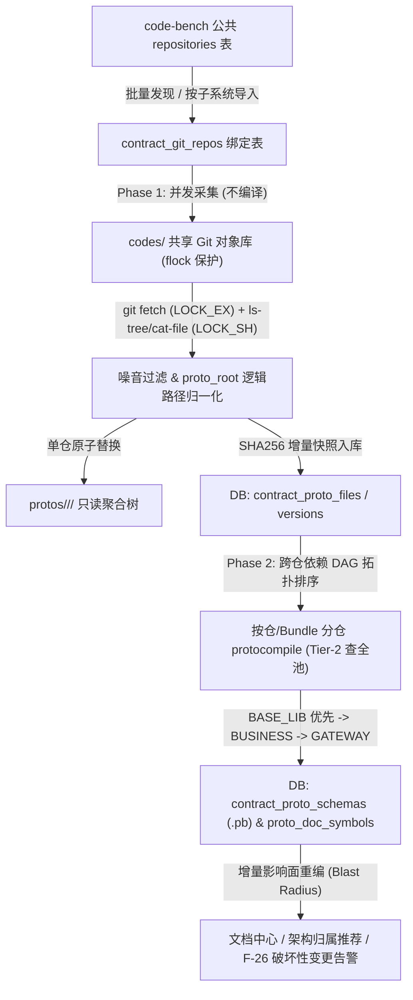

# ADR-26：复用平台代码仓与共享宿主机 Git 缓存，构建按子系统组织的只读聚合 Proto 目录树与两阶段跨仓编译架构

- **文档编号**：`26-shared-git-cache-and-subsystem-proto-tree-adr.md`
- **状态**：Proposed (已评审共识，待分期实施)
- **日期**：2026-11-26
- **关联与演进关系**：
  - 修订并补充 [`ADR-18`](./18-proto-full-lifecycle-and-git-mr-governance-adr.md)：针对真实业务 Polyrepo 场景新增 `PLATFORM_SHARED` 平台代码仓共享模式与宿主机共享 Git 缓存协议；原基于独立 REST API / `go-git memfs` 的拉取路径收敛保留为 `EXTERNAL_STANDALONE` 兼容模式（服务未进入平台仓的外部独立仓）。
  - 关联 [`ADR-10`](./10-enhanced-proto-schema-file-management-adr.md)（全局单一生效 `.pb` 池与冲突仲裁）、[`ADR-16`](./16-multi-implementation-service-contract-adr.md)（多实现服务契约）、[`ADR-19`](./19-proto-contract-ia-unbundling-and-four-workbenches-adr.md)（`/contract/proto-sources` 源码与 Git 仓工作台）。

---

## 1. 背景与问题陈述 (Context & Problem Statement)

在 `ADR-18` 落地（M22~M26）过程中，`code-contract` 先期参考独立契约 Monorepo 假设设计了 Git 对接机制。然而，在接入平台真实微服务研发体系后，各业务团队的 `.proto` 文件并非集中存放在单一契约仓库，而是**分散在各自的业务代码仓（Polyrepo）中，每个代码仓定义了自身对外提供的 `Service` 与 `Message`**；与此同时，CodeBench 平台及周边子系统已经对这批代码仓建立了资产台账与本地克隆缓存。

当前工作区在代码仓管理与同步上存在明显割裂：

| 子系统 | 仓库元数据来源 | 同步方式与鉴权 | 本地存储目录 |
| :--- | :--- | :--- | :--- |
| **`code-bench`** | 公共表 `repositories`（含 URL、分支、部门、`ServiceGroup` 子系统、负责人等） | 仅维护平台元数据真值源，不执行拉取 | 无 |
| **`code-shield`** | 复用公共表 `repositories` | 复用 `code-common/backend/gitsync`（走宿主机统一 Git/SSH 凭据，免逐仓配 Token） | `<storage.root>/codes/<repoPath>` |
| **`code-archdoc`** | 复用公共表 `repositories` | 复用 `code-common/backend/gitsync`（`Depth: 1`） | `<data_dir>/sandbox_dir/repo_<id>` |
| **`code-contract`** | 独立建表 `contract_git_repos`（要求手动填写仓库名、URL、Token/SSH Key、Bundle） | 自建 GitLab/GitHub/Gitea REST API 或 `go-git` + `memfs` 内存克隆 | 无落盘（整仓拉入内存） |

将这套“独立手工填表 + 整仓内存克隆 + 单仓即拉即编”模型直接套用于数十至上百个业务代码仓，暴露出 **4 个核心痛点**：

1. **重复录入与逐仓配凭证**：`code-bench` 已纳管全部业务代码仓，`code-contract` 要求管理员或研发在 `/contract/proto-sources` 逐仓重填 URL、分支与 PAT/SSH 凭据，运维成本高且元数据易漂移。
2. **大仓内存克隆隐患与存储浪费**：真实业务仓通常包含海量 C++/Go/Java 源码与历史对象。`memfs_sync.go` 将整仓克隆到内存极易引发耗时过长或 OOM；同时宿主机上 `code-shield` 已经通过 `gitsync` 维护了同一批代码仓的本地拷贝，多服务各自重复 `git clone / git pull` 浪费大量磁盘与网络带宽。
3. **跨进程共享同一物理目录的并发隐患**：虽然 `code-shield` 与 `code-contract` 同机共享同一份 `codes/` 数据根目录在思路上合理，但 `code-common/backend/gitsync/lock.go` 当前的 `GetPathLock` 仅是**进程内 `sync.Mutex`**；且 `code-shield` 扫描时会修改工作区（`checkout` / `reset --hard` / `clean -fd` / `AutoHealCache` 删库重建），若多个进程直接共用工作树，必然导致分支切换踩踏、`index.lock` 冲突甚至目录被误删。
4. **单仓即拉即编无法直接应对 Polyrepo 交叉依赖与副本冲突**：
   - `SyncRepo` 在单仓拉取后立刻执行 `protocompile`：当业务仓 A `import` 业务仓 B 的 Message，而 B 尚未入库时，A 会直接 `MISSING_IMPORTS` 失败；
   - 业务仓内部常混杂 `third_party/`、`vendor/`、`test/`、`mock/` 等噪音 `.proto`，或因本地编译便利拷贝了上游服务的 `.proto` 副本；若不加以过滤与权威仲裁，直接编译会导致 `CompileTrialPool` 报出大量 `(service_name, operation)` 全局唯一性 `409 Conflict`。

---

## 2. 核心架构裁决 (Architectural Decisions)

### 2.1 平台代码仓真值源统一与共享数据根目录

1. **打通 `code-bench` 公共 `repositories` 元数据**：
   - `code-contract` 不再要求业务仓在接入前手工重复录入 URL 与认证信息；
   - 在 `contract_git_repos` 中引入 **`platform_repo_id`**（唯一索引关联公共 `repositories.id`）、**`source_mode`**（`PLATFORM_SHARED` 默认 | `EXTERNAL_STANDALONE` 兼容）与 **`sync_strategy`**（`FETCH_AND_READ` 默认 | `LOCAL_CACHE_ONLY`）；
   - `/contract/proto-sources` 主接入入口升级为 **「从平台代码仓批量扫描发现与一键导入」**：支持按 `code-bench` 的部门 / 子系统（`service_group`）筛选，后端自动探测宿主机 `codes/`（或按需拉取）中包含 `.proto` 文件的仓库，预览其 `.proto` 数量、推测的 `proto_roots` 与导出 `Service` 列表，勾选后批量纳管并默认按仓库名自动生成 Bundle 与目标 `ProtoSchema`。
2. **统一共享数据根目录 (`storage.root`)**：
   - `code-contract` 配置文件新增 `storage.root` 配置项，在同机部署模式下与 `code-shield` 指向**宿主机上的同一个数据根目录**（例如 `/data/codebench`）：
     - `<storage.root>/codes/`：与 `code-shield` 共享的 Git 仓库物理缓存与对象库；
     - `<storage.root>/protos/`：`code-contract` 专属的按子系统组织的只读聚合 Proto 目录树（详见 §2.3）。
   - 共享仓模式默认复用宿主机统一配置的 Git/SSH 凭据，免除逐仓填写 Token；仅当存在未接入 `code-bench` 的外部独立契约仓时，保留 `EXTERNAL_STANDALONE` 模式沿用 `ADR-18` 的加密凭证与 REST/`memfs` 路径。

---

### 2.2 跨进程共享 `codes/` 的并发安全与零工作树侵入读取

为彻底消除多进程共用宿主机 `codes/` 目录的竞态风险，对 `code-common/backend/gitsync` 与读取协议作出如下刚性约束：

1. **升级跨进程文件读写锁（`syscall.Flock`）**：
   - 在 `code-common/backend/gitsync` 中新增基于 Linux `flock` 的跨进程锁（锁文件集中置于 `<storage.root>/codes/.locks/<repo_hash>.lock`，避免在仓库工作树内生成未跟踪文件）：
     - **独占写锁（`LOCK_EX`）**：执行 `git fetch`、`git clone`、`checkout`、`reset` 及 `AutoHealCache` 重建目录时必须持有；
     - **共享读锁（`LOCK_SH`）**：只读遍历源码、`git ls-tree` / `git cat-file` 读取对象时持有。持 `LOCK_SH` 期间其他进程的 `LOCK_EX` 将安全排队等待，**严禁在未获取 `LOCK_EX` 时执行 `os.RemoveAll`**。
2. **统一物理目录映射与防浅克隆降级**：
   - 在 `code-common/backend/gitsync` 下沉唯一权威路径解析函数 **`ResolveRepoLocalPath(codesRoot, repoURL)`**，统一兼容 `https://`、`ssh://` 与 SCP 风格 `git@host:group/repo.git` URL，取代各子系统自写的 URL 解析逻辑，确保 `code-shield` 与 `code-contract` 100% 命中同一 `<storage.root>/codes/<repo_path>` 目录；
   - 共享 `codes/` 后，统一禁止对已存在完整历史（非 shallow）的本地仓执行 `--depth=1` 降级，保障各模块历史 Commit 追溯与 Diff 完整性。
3. **确立 `code-contract`「无工作树 Git 对象直读协议」**：
   - `code-contract` 同步或读取共享仓时，**绝对不触碰工作树（严禁执行 `git checkout` / `git reset --hard` / `git clean`）**，从而与 `code-shield` 正在扫描的特性分支实现 **100% 零冲突共存**：
     - 当 `sync_strategy = FETCH_AND_READ` 时，先在 `LOCK_EX` 下执行增量对象拉取：`git -C <localPath> fetch origin +refs/heads/<branch>:refs/remotes/origin/<branch>`（若未曾克隆则先初始化或 `clone --no-checkout` / 标准克隆）；
     - 当 `sync_strategy = LOCAL_CACHE_ONLY` 时，直接跳过网络 `fetch` 阶段；
     - 随后在 `LOCK_SH` 下直接查询远端跟踪引用 `refs/remotes/origin/<branch>`（或本地既有目标分支 ref）：
       1. `git -C <localPath> ls-tree -r --name-only <ref> -- '*.proto'`：毫秒级精准列出全仓所有 `.proto` 路径，跳过数万个业务源码文件；
       2. `git -C <localPath> cat-file --batch`：直接从 `.git` 对象库流式读取 `.proto` 源码内容与 Blob SHA，结合 `git log -1` 提取 Commit SHA、Author 与 Commit Message，天然具备原子快照一致性。

---

### 2.3 按子系统组织的只读聚合 Proto 目录树 (`<storage.root>/protos/`)

将分散在各业务代码仓的 `.proto` 收集成一棵统一目录树，并作为 **`code-contract` 内部专属的只读派生视图（Derived Materialized Tree）** 持久化在 `<storage.root>/protos/`：

1. **事实源边界（SSOT）铁律**：
   - 各业务代码仓依然是 `.proto` 的唯一写入口（SSOT）；`<storage.root>/protos/` 是平台单向同步生成的只读派生视图，**严禁任何人工或工具直接编辑该目录下的文件**。
2. **物理目录结构（按子系统 -> 代码仓分层聚合）**：
   ```text
   <storage.root>/protos/
   ├── _base/                              # 标记为 BASE_LIB 的公共基础契约仓
   │   └── common-proto/
   │       ├── .proto-meta.json            # 血缘元数据 (repo_id/branch/commit_sha/proto_roots/category)
   │       └── common/
   │           └── header.proto
   ├── trade/                              # 对应 code-bench 代码仓的子系统标识 (service_group)
   │   ├── order-svc/
   │   │   ├── .proto-meta.json
   │   │   └── proto/order/v1/order.proto
   │   └── payment-svc/
   │       ├── .proto-meta.json
   │       └── api/payment/v1/payment.proto
   └── _unassigned/                        # 尚未分配子系统的代码仓兜底分组
       └── legacy-svc/
           └── ...
   ```
   - 第一层目录优先按 `code-bench` 中仓库所属 **子系统 (`service_group`)** 组织（若仓库被标记为 `BASE_LIB` 公共基础库，统一归入 `_base/`；未配置子系统时归入 `_unassigned/`）；
   - 第二层为 **`<repo_name>/`**（或多 Bundle 场景下的 `<repo_name>/<bundle_name>/`），内部保留仓内清洗后的相对路径，并附带 `.proto-meta.json` 记录来源 `platform_repo_id`、`commit_sha`、推断/配置的 `proto_roots`、`category` 与文件 SHA256 清单。
3. **单仓子树原子刷新与僵尸清理**：
   - 同步单个代码仓时，先在同级临时目录 `<storage.root>/protos/.tmp/<repo>_<ts>` 写入本次抽取且通过噪音过滤的全部 `.proto` 与 `.proto-meta.json`，校验无误后通过原子目录替换更新目标子树，彻底清除仓内已被删除或重命名的 `.proto`；同步联动将 DB `contract_proto_files` 中缺失的记录置为 `is_deleted = true`。
4. **物理分仓 + 前端双视图浏览**：
   - 物理目录按「子系统 / 代码仓」分层存放，确保 100% 不发生同名文件静默覆盖，且血缘/属主清晰；
   - 前端 `/contract/proto-sources` 源码浏览树支持一键切换 **「按子系统 / 代码仓树」**（定位仓库归属与同步状态）与 **「按 Proto Package 逻辑树」**（按 `package` 层级跨仓检索 Service / Message 并跳转源码行号）。

---

### 2.4 仓内噪音过滤、Proto Root 自动探测与跨仓冲突仲裁

针对业务代码仓 `.proto` 组织不规范及跨仓拷贝副本问题，建立三层自动化治理防线：

1. **默认噪音排除规则（`exclude_globs`）**：
   - 新接入的平台代码仓默认注入企业通用排除清单：`third_party/**`、`vendor/**`、`node_modules/**`、`**/test/**`、`**/testdata/**`、`**/mock/**`、`**/examples/**`，支持在仓库/Bundle 级别自定义增删白黑名单，避免测试/三方 `.proto` 污染聚合目录树。
2. **`proto_root` / `include_dirs` 自动推断与可选仓内声明**：
   - **自动推断**：扫描仓内 `.proto` 的 `import "..."` 语句并与仓内文件相对路径做后缀匹配（例如文件位于 `idl/proto/order/v1/order.proto` 而内部声明 `import "order/v1/types.proto"`），自动反推出 `proto_root = idl/proto`，确保写入 `contract_proto_files.file_path` 与 `protocompile` 的是规范逻辑导入路径；
   - **可选仓内契约文件**：支持在代码仓根目录识别可选的 `.contract-proto.yaml`（显式声明 `category`、`proto_roots`、`exclude` 或 Monorepo 多 Bundle 拆分规则）；无此文件时完全依赖平台自动探测与 Web 配置覆盖。
3. **跨仓重复 Service 与拷贝副本的「权威归属仲裁」**：
   - 在落盘与编译前执行跨仓预检，识别两类冲突：
     - **公共基础文件重复**：多个业务仓拷贝了同一份基础 `.proto`（如 `common/header.proto`）。只要对应基础仓标记为 `BASE_LIB`，既有 `DBProtoSourceProvider` 与 `Registry.Reload` 的 **`BASE_LIB` 最高优先级覆盖机制** 会自动以基础仓为权威，忽略业务仓副本；
     - **同名 `package.Service` 冲突**：当两个业务仓均定义了同一个 `package.Service`（常见于调用方为了本地编译拷贝了被调方的 `.proto`）时，系统在同步摘要与冲突仲裁面板高亮列出所有候选仓，由架构师或负责人一键指认**唯一权威定义仓**，其余非权威仓自动将该文件加入 `exclude_globs`（或标记为外部只读依赖，跳过 `ProtoOperation` 抽取），防止激活时触发 `409 Conflict`。

---

### 2.5 「统一收树、分仓编译」两阶段同步与增量联动

针对全量/批量同步与跨仓依赖，将原「单仓拉完即编译」升级为**「采集与编译解耦」的两阶段流水线**，同时坚守一条核心边界：

> **核心红线：统一收树，分仓编译。** 严禁将 `protos/` 整棵大树合并编译成一个单一 `ProtoSchema`（受 16MB 描述集上限约束，且单仓语法错误会拖垮全平台契约发布、破坏独立版本回滚与 Breaking Change 门禁）。



1. **Phase 1 — 并发采集与收树（Collect）**：
   - 对选定仓库/全量子系统并发执行共享对象库同步与 `.proto` 抽取，完成噪音过滤、逻辑路径归一化、`protos/<subsystem>/<repo>/` 原子写盘及 `contract_proto_files` / `contract_proto_file_versions` 的 SHA256 增量入库；本阶段**不触发编译**，确保所有被依赖的 `.proto` 源码均先落池。
2. **Phase 2 — 全局依赖 DAG 拓扑编译（Topological Compile）**：
   - 基于阶段 1 入库源码中的 `import` 声明构建跨仓依赖有向无环图，按 `BASE_LIB -> 上游 BUSINESS -> 下游 BUSINESS -> GATEWAY` 拓扑顺序逐仓（按 Bundle）调用 `protocompile`；
   - 编译过程中，四级解析器的 Tier 2 (`DBProtoSourceProvider`) 直接读取全库最新 `contract_proto_files` 源码（`BASE_LIB` 优先），即使两个业务仓存在文件级交叉引用（A 的 Service 引用 B 的 Message，B 的 Service 引用 A 的 Message），也能一次性编译通过；
   - 若仍发生 `MISSING_IMPORTS`，诊断信息需增强跨仓路径提示（检索全池近似后缀匹配，提示该文件可能位于哪个已纳管仓库及其子目录，辅助修正 `include_dirs`）。
3. **单仓增量更新与下游影响面重编（Blast Radius）**：
   - 日常单仓提交变更并触发同步后，仅对该仓执行 Phase 1 增量采集；随后结合依赖关系图计算受影响集合（本仓 + 直接/间接 `import` 该仓变更文件的下游 Bundle），按拓扑序执行局部重编并自动触发 `F-26` 破坏性变更检查与告警。
4. **架构归属推荐与 MR 门禁衔接**：
   - 编译产出的 `ProtoOperation`（`package.Service`）结合关联 `repositories` 的 `ServiceGroup`、`Department` 与 `Owner`，可自动向架构工作台推荐目标 `Subsystem` 与 `Module` 归属；
   - 设计态 MR 门禁继续沿用 [`virtual_tree.go`](../../internal/server/gitclient/virtual_tree.go) 的「DB 目标分支基线 + MR 变更补丁」全量内存合成算法，可无缝复用跨仓源码池完成编译与 `F-26` 影响面分析。

---

## 3. 关键方案权衡 (Alternatives Considered)

| 决策维度 | 备选方案 A（已否决） | 本 ADR 采纳方案（Recommended） | 裁决理由 |
| :--- | :--- | :--- | :--- |
| **`protos/` 目录组织方式** | 按逻辑 `import` 路径直接平铺（如 `protos/order/v1/order.proto`） | **物理按 `<subsystem>/<repo>/` 分层聚合 + DB 逻辑路径索引 + 前端双视图** | 业务 Polyrepo 常存在同名文件或拷贝副本，直接平铺会发生静默覆盖且难以按仓原子清理删除文件；物理分层 100% 避免覆盖、血缘直观，逻辑路径索引与 Tier 2 解析器同样保障 `import` 畅通。 |
| **编译粒度策略** | 将 `protos/` 整棵树合并编译为全平台单一 `.pb` `ProtoSchema` | **统一收树，按仓 / Bundle 拓扑分仓编译** | 单个 `.pb` 受 16MB 限制、容错性差（单仓语法错误拖垮全公司契约），且破坏服务级独立版本号、Diff 忽略继承与破坏性变更门禁。 |
| **Git 仓库拉取与缓存** | 各子系统独立 clone 或延续 `go-git memfs` 整仓内存克隆 | **共享宿主机 `<storage.root>/codes/` + `flock` 跨进程锁 + 无工作树对象直读** | 业务代码仓体积庞大，`memfs` 内存消耗大且重复拉取；共享 `codes/` 配合 `fetch + ls-tree + cat-file` 既复用已有缓存与宿主机凭据，又与 `code-shield` 工作区零冲突。 |

---

## 4. 数据模型、配置与公共库演进摘要

1. **`code-contract` 配置扩展（`config/config.go` 与 `config.yaml.example`）**：
   - 新增 `storage.root`（默认 `./data`；生产同机部署指向与 `code-shield` 相同的宿主机根目录，自动映射 `<root>/codes` 与 `<root>/protos`）。
2. **`contract_git_repos` 模型扩展（`models/git_repo.go`）**：
   - 新增 `platform_repo_id`（`*uint64`，唯一索引关联 `repositories.id`）、`source_mode`（`PLATFORM_SHARED` | `EXTERNAL_STANDALONE`）、`sync_strategy`（`FETCH_AND_READ` | `LOCAL_CACHE_ONLY`）、`subsystem_code`（冗余缓存子系统目录名）。
3. **`code-common/backend/gitsync` 公共能力下沉**：
   - 升级 `GetPathLock` / 新增 `FlockRepoLock`（支持 `LOCK_SH` / `LOCK_EX` 跨进程文件锁）；
   - 新增 `ResolveRepoLocalPath(codesRoot, repoURL string) (string, error)`；
   - 新增无工作树对象库操作：`FetchBranchRef`、`ListFilesAtRef`（`git ls-tree`）、`ReadBlobsBatch`（`git cat-file --batch`）与 `ReadCommitMeta`。
4. **物理防腐边界维持不变**：
   - 上述 `gitsync` 与本地文件树读取仅限控制面 `cmd/server` 调用；`cmd/agent` 及九大防腐核心包（`pkg/{crosrpc,agentproto,csgdlink,rpcmon,csgmock,ebpf,transport,replay}`）继续严格保持零 Git、零 DB、零 `.pb`、零 CGO 依赖。

---

## 5. 风险缓解与分期实施路线图

| 阶段 | 核心交付范围 | 风险与缓解措施 |
| :--- | :--- | :--- |
| **Phase 1：共享底座统一** | 1. `code-common/backend/gitsync` 补齐跨进程 `flock`、`ResolveRepoLocalPath` 与无工作树对象直读 API；<br/>2. `code-shield` 接入新路径解析与跨进程锁保护；<br/>3. `code-contract` 新增 `storage.root` 配置并验证多进程并发读写零冲突。 | **风险**：`AutoHealCache` 在读期间删库。<br/>**缓解**：强制所有删库自愈必须先升级/获取 `LOCK_EX`，只读操作统一持 `LOCK_SH`。 |
| **Phase 2：平台仓打通与两阶段收树编译** | 1. `contract_git_repos` 关联 `repositories.id`；<br/>2. `/contract/proto-sources` 支持按子系统批量扫描发现并导入平台仓；<br/>3. 实现 `<storage.root>/protos/<subsystem>/<repo>/` 原子物化与前端「仓树 / Package 树」双视图；<br/>4. 实现 Phase 1 全量采集 + Phase 2 跨仓依赖 DAG 拓扑编译。 | **风险**：老业务仓 `proto_root` 不统一导致 `MISSING_IMPORTS`。<br/>**缓解**：内置 `import` 后缀自动反推 `proto_root`，并在编译报错中附带全池近似路径候选定位提示。 |
| **Phase 3：冲突仲裁与增量影响面联动** | 1. 跨仓重复 `package.Service` 自动检测与权威归属指认 UI；<br/>2. 单仓变更后按依赖图自动触发下游受影响 Bundle 局部重编与 `F-26` 告警；<br/>3. 结合 `repositories.service_group / owner` 自动推荐架构 `Subsystem / Module` 归属。 | **风险**：调用方仓拷贝被调方 `.proto` 触发 `409` 激活冲突。<br/>**缓解**：同步前预检拦截并可视化引导架构师指定权威 Owner 仓，非权威仓自动排除或降级为外部只读引用。 |
