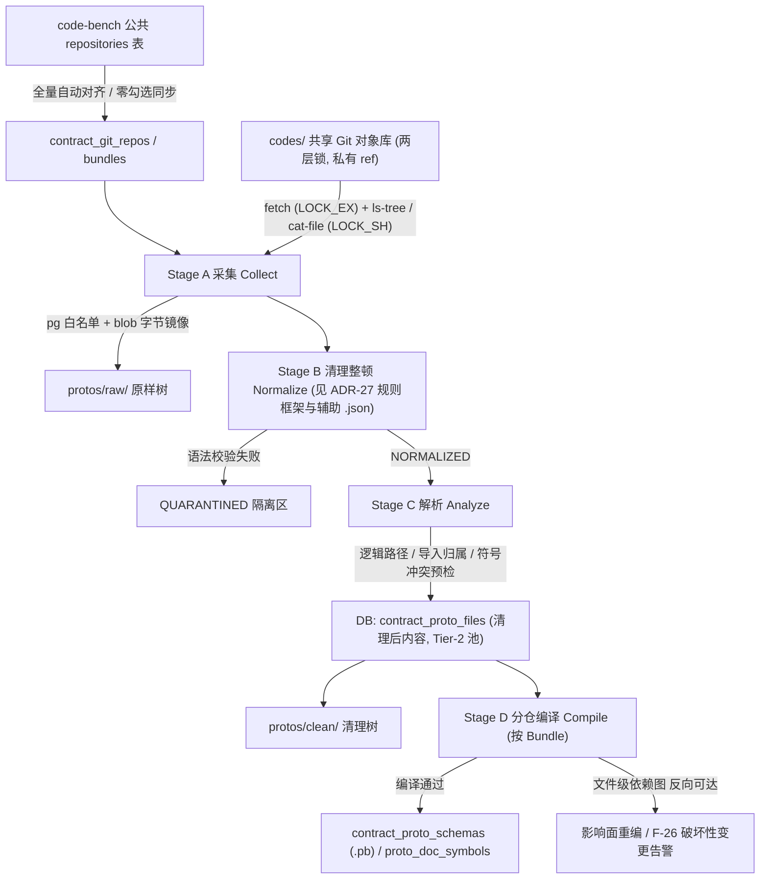

# ADR-26：复用平台代码仓与共享宿主机 Git 缓存，构建「采集 → 清理整顿 → 解析 → 分仓编译」四段式跨仓 Proto 流水线与按子系统组织的只读聚合目录树

- **文档编号**：`26-shared-git-cache-and-subsystem-proto-tree-adr.md`
- **状态**：Implemented（M33~M36 已交付）/ Revised（r4，配套 [`ADR-27`](./27-proto-export-directory-and-normalization-governance-adr.md) 待实施）
- **日期**：2026-11-27
- **修订记录**：
  - r1：初稿，确立共享 `codes/` 缓存、无工作树直读、按子系统聚合目录树与两阶段编译。
  - r2：依据评审意见修订——采集范围改为 `pg` 目录白名单；在采集与编译之间**预留「清理整顿」环节**（规则由后续 ADR 定义）；修正 `ls-tree` 通配符、目录原子替换、仓级依赖成环、共享缓存浅克隆降级、远端跟踪引用互踩等技术缺陷；补充权威关系、命名规范化、同步触发、存量迁移、上线顺序与验收标准。
  - r3：明确 `pg` 目录严格全小写（不含 `PG` / `Pg` 等大小写变体）；记录从 `raw` 到 `clean` 清理阶段预留辅助 `.json` 映射与清理规则配置文件，留待后续 ADR 定义。
  - r4：面向 500+ 平台仓规模收口架构——**正式废除独立 Git 仓管理（下线 `EXTERNAL_STANDALONE` 与独立接入入口），确立 `code-bench` `repositories` 为全局唯一真值源**；废除逐仓勾选导入，改为「零勾选全量自动对齐 + 双按钮异步同步（默认「仅同步已有缓存」、按需「缺失时自动拉取」）」与 `NO_PROTO` / `NO_LOCAL_CACHE` 静默状态分层；导出后目标目录治理、Stage B 清理规则框架与双子标签 IA 正式独立立项至 [`ADR-27`](./27-proto-export-directory-and-normalization-governance-adr.md)。
- **关联与演进关系**：
  - 修订并替代 [`ADR-18`](./18-proto-full-lifecycle-and-git-mr-governance-adr.md) 中的仓库接入部分：针对真实业务 Polyrepo 场景确立 `PLATFORM_SHARED` 唯一共享模式与宿主机共享 Git 缓存协议；原独立 REST API / `go-git memfs` / `EXTERNAL_STANDALONE` 独立管理路径正式下线，所有仓库统一由 `code-bench` 管理。
  - 关联 [`ADR-10`](./10-enhanced-proto-schema-file-management-adr.md)（全局单一生效 `.pb` 池与冲突仲裁）、[`ADR-16`](./16-multi-implementation-service-contract-adr.md)（多实现服务契约）、[`ADR-19`](./19-proto-contract-ia-unbundling-and-four-workbenches-adr.md)（`/contract/proto-sources` 源码与 Git 仓工作台）。
  - **配套演进 ADR**：[`ADR-27`](./27-proto-export-directory-and-normalization-governance-adr.md)（《500+ 平台仓全量同步、导出目录治理与 Stage B 清理整顿架构决策》）承接 r4 规模化全量对齐、方案 A 仓级目标目录调整、Stage B 清理规则与辅助 `.json` 治理闭环。

---

## 1. 背景与问题陈述 (Context & Problem Statement)

在 `ADR-18` 落地（M22~M26）过程中，`code-contract` 先期参考独立契约 Monorepo 假设设计了 Git 对接机制。然而，在接入平台真实微服务研发体系后发现：

- 各业务团队的 `.proto` 并非集中存放在单一契约仓库，而是**分散在各自的业务代码仓（Polyrepo）中**，每个代码仓定义自身对外提供的 `Service` 与 `Message`；
- 按企业约定，`.proto` 仅分布在代码仓**根目录下的 `pg/` 目录**与**一级子目录下的 `pg/` 目录**（即 `<repo>/pg/**`、`<repo>/<dir>/pg/**`）及其任意深度子目录中；
- 大量存量 `.proto` **书写不规范，直接 `protoc` / `protocompile` 无法编译通过**，必须先经过清理整顿才能成为合法 Proto；
- CodeBench 平台及周边子系统已经对这批代码仓建立了资产台账与本地克隆缓存。

当前工作区在代码仓管理与同步上存在明显割裂：

| 子系统 | 仓库元数据来源 | 同步方式与鉴权 | 本地存储目录 |
| :--- | :--- | :--- | :--- |
| **`code-bench`** | 公共表 `repositories`（含 URL、分支、部门、`ServiceGroup` 子系统、负责人等） | 仅维护平台元数据真值源，不执行拉取 | 无 |
| **`code-shield`** | 复用公共表 `repositories` | 复用 `code-common/backend/gitsync`（宿主机统一 Git/SSH 凭据；`Depth: 0` 完整克隆 + `checkout -B` / `reset --hard` / `clean -fd`） | `<data_dir>/codes/<url.Path 去 .git>` |
| **`code-archdoc`** | 复用公共表 `repositories` | 复用 `code-common/backend/gitsync`（`Depth: 1`） | `<data_dir>/sandbox_dir/repo_<id>`（独立目录，不参与共享） |
| **`code-contract`** | 独立建表 `contract_git_repos`（手动填写仓库名、URL、Token/SSH Key、Bundle） | 自建 GitLab/GitHub/Gitea REST API 或 `go-git` + `memfs` 内存克隆 | 无落盘（整仓拉入内存） |

将「独立手工填表 + 整仓内存克隆 + 单仓即拉即编」模型直接套用于数十至上百个业务代码仓，暴露出 **5 个核心痛点**：

1. **重复录入与逐仓配凭证**：`code-bench` 已纳管全部业务代码仓，`code-contract` 仍要求逐仓重填 URL、分支与 PAT/SSH 凭据，运维成本高且元数据易漂移。
2. **大仓内存克隆隐患与存储浪费**：业务仓包含海量 C++/Go/Java 源码与历史对象，`memfs_sync.go` 整仓内存克隆易耗时过长或 OOM；宿主机上 `code-shield` 已维护同一批仓库的本地拷贝，各服务重复 `clone / fetch` 浪费磁盘与带宽。
3. **跨进程共享同一物理目录的并发隐患**：`gitsync/lock.go` 的 `GetPathLock` 仅为**进程内 `sync.Mutex`**；`code-shield` 同步时会改写工作区（`checkout -B` / `reset --hard` / `clean -fd`）、清理 `.git/*.lock`（`CleanStaleGitLocks`）乃至 `AutoHealCache` 删库重建；`gitsync.FetchCommitMetadata` 还会对仓库执行 `fetch --depth=1 <sha>`，在完整仓上会写入 shallow 边界。多进程直接共用必然导致踩踏、误删活跃锁文件与历史降级。
4. **源码不规范，无法直接编译**：存量 `.proto` 存在大量不合规写法，若采集后直接进入编译源码池，将以「坏源码」污染全局 Tier-2 解析，拖垮无关仓库的编译。
5. **单仓即拉即编无法应对 Polyrepo 交叉依赖与副本冲突**：
   - 业务仓 A `import` 业务仓 B 的 Message，而 B 尚未入库时，A 直接 `MISSING_IMPORTS`；
   - 调用方为本地编译便利拷贝了被调方 `.proto` 副本，同一逻辑导入路径或同一全限定符号被多仓提供，导致 Tier-2 解析结果不确定、编译报 `already defined`，或激活时触发 `(service_name, operation)` 全局唯一性 `409 Conflict`。

---

## 2. 核心架构裁决 (Architectural Decisions)

### 2.1 平台代码仓真值源统一与存储目录

1. **确立 `code-bench` 公共 `repositories` 为全局唯一真值源（禁止独立接入仓库）**：
   - 所有业务代码仓必须在 `code-bench` 公共表 `repositories` 中统一维护，`code-contract` **禁止独立创建、编辑仓库基础信息或单独维护 Git 凭据**；
   - `contract_git_repos` 定位收敛为公共 `repositories` 的 **1:1 契约治理扩展表**：**`platform_repo_id`** 约束为 **`NOT NULL` 唯一索引**（关联 `repositories.id`），**`source_mode`** 固定为 `PLATFORM_SHARED`；**`sync_strategy`** 支持 `LOCAL_CACHE_ONLY`（默认读取宿主机共享缓存）与 `FETCH_AND_READ`（缺失或显式请求时由共享协议拉取）；
   - URL、分支、子系统（`service_group`）、部门、负责人及启停状态（`is_active`）一律**实时引用** `repositories`，`contract_git_repos` 仅保存 contract 侧特有治理配置（`proto_status`、采集规则覆盖、导出目录覆写、清理规则、Bundle 与同步状态）；
   - 面对 500+ 平台仓规模，`/contract/proto-sources` **彻底废除逐仓勾选导入与 `+ 接入 Git 仓库` 独立入口**，升级为**「零勾选全量自动对齐 + 双按钮异步同步控制台 + 导出后治理台账」**（具体交互、状态分层与批处理机制见 [`ADR-27`](./27-proto-export-directory-and-normalization-governance-adr.md)）。
2. **存储目录配置（可拆分）**：
   - 新增 `storage.root`（默认 `./data`），以及可选覆盖项 `storage.codes_dir`（为空取 `<root>/codes`）与 `storage.protos_dir`（为空取 `<root>/protos`）；
   - 同机部署时 `codes_dir` 与 `code-shield` 指向宿主机同一目录；异机或容器隔离部署时 contract 可使用独立 `codes_dir`，协议不变，仅失去缓存复用收益。
3. **独立模式与 `memfs` 彻底下线（r4 修订）**：
   - 原 `EXTERNAL_STANDALONE` 模式、`<codes_dir>/_external/<git_repo_id>/` 目录、`POST /api/git-repos` 独立创建接口、前端 `+ 接入 Git 仓库` 按钮及 `关联平台仓` 迁移按钮全部下线；
   - `go-git memfs` 路径已下线，全系统仅保留宿主机共享 `codes/` 的 `flock` + 无工作树对象直读一套 Git 读取路径。

---

### 2.2 跨进程共享 `codes/` 的并发安全与零工作树侵入读取

1. **两层锁：进程内 `RWMutex` + 跨进程 `flock`**：
   - 锁文件集中置于 `<codes_dir>/.locks/<sha1(仓库绝对路径)>.lock`（不在仓库工作树内产生未跟踪文件）；目录权限 `0775`、文件 `0664`，要求共享进程同 uid 或同属组；
   - `GetPathLock` 升级为按路径的 `sync.RWMutex`，再叠加**每次获取独立打开文件描述符**的 `flock`（flock 语义绑定 open file description，同进程多 goroutine 仅靠 flock 不可靠）；两层统一按「先进程内、后跨进程」顺序获取，逆序释放；
   - **独占锁 `LOCK_EX`**：`clone`、`fetch`、`checkout`、`reset`、`clean`、`CleanStaleGitLocks`、`AutoHealCache` 删库重建时必须持有。**严禁在未持有 `LOCK_EX` 时执行 `os.RemoveAll` 或删除 `.git/*.lock`**（否则可能删除另一进程正在使用的活跃锁）；
   - **共享锁 `LOCK_SH`**：`ls-tree`、`cat-file`、`log` 等只读对象操作时持有，**持锁范围仅限对象读取本身**；读出内容后立即释放，清理、解析、编译均在锁外进行，避免 `code-shield` 写锁长期饥饿（flock 不保证公平性）；
   - 获取采用 `LOCK_NB` + 退避轮询（50ms → 1s），响应 `context` 取消；默认超时 `LOCK_EX` 10 分钟、`LOCK_SH` 2 分钟，写锁等待超过阈值时输出告警日志；
   - 进程崩溃时 flock 由内核自动释放，无需残留锁清理；
   - **适用边界**：不支持 NFS 等网络文件系统；容器部署要求同一宿主内核、bind mount 同一宿主路径。
2. **统一物理路径映射（向后兼容）**：
   - 在 `gitsync` 下沉唯一权威函数 **`ResolveRepoLocalPath(codesRoot, repoURL)`**，兼容 `https://`、`ssh://` 与 SCP 风格 `git@host:group/repo.git`；
   - **必须与 `code-shield` 现有映射逐字节一致**（`https/ssh` URL 取 `TrimSuffix(TrimPrefix(u.Path, "/"), ".git")`），否则全部缓存将被重新克隆；Phase 1 提供对 `repositories` 全量记录的映射回归校验脚本；
   - 现有映射不含 host，跨 Git 服务器的同名 `group/repo` 会碰撞：使用前校验目标目录 `remote.origin.url` 与期望 URL 归一化后一致，不一致则拒绝操作并告警（不自动覆盖）；
   - 映射结果需做路径穿越校验（禁止 `..`、绝对路径与控制字符）。
3. **共享缓存防浅克隆降级**：
   - 对已存在的非 shallow 仓库（`git rev-parse --is-shallow-repository` 为 `false`），`gitsync` 内**所有** `--depth` 参数一律忽略；
   - 修正 `FetchCommitMetadata`：非 shallow 仓禁止 `fetch --depth=1 <sha>`，改为不带深度的按需拉取，避免写入 `.git/shallow`，进而导致 `code-shield` 变更规划判定 `ErrInsufficientHistory`。
4. **`code-contract`「无工作树 Git 对象直读协议」**：
   - contract **永不触碰工作树与 index**（严禁 `checkout` / `reset` / `clean`），**永不改写仓库配置与 `code-shield` 依赖的引用**；
   - **私有引用命名空间**：`FETCH_AND_READ` 时在 `LOCK_EX` 下执行
     `git -c gc.auto=0 -c maintenance.auto=false -C <localPath> fetch --no-tags --no-write-fetch-head <repoURL> +refs/heads/<branch>:refs/contract/heads/<branch>`
     直接使用 `repositories.URL`，不依赖、不修改 `origin` 配置，也不改写 `refs/remotes/origin/*`；关闭自动 gc，避免 fetch 结束后后台 gc 与他方删库重建并发；私有引用同时保护所读对象不被 prune；
   - 本地尚无克隆时，在 `LOCK_EX` 下执行完整 `clone --no-checkout`（不带 `--depth`），后续 `code-shield` 首次同步时自行检出工作树；
   - `LOCAL_CACHE_ONLY` 时跳过网络拉取，只读 `code-shield` 维护的 `refs/remotes/origin/<branch>`；
   - 分支解析与 `code-shield` 共用同一函数（含 `repositories.Branch` 为空时的 `master` 默认值及 `main` 回退），解析结果记入 `resolved_branch`；
   - 对象读取细则见 §2.3.2。
5. **上线顺序约束**：必须**先升级 `code-shield`**（接入两层锁与新路径映射），再开启 contract 的共享写操作。contract 提供开关 `storage.shared_write_enabled`（默认 `false`）：关闭期间 `PLATFORM_SHARED` 仓库只能使用 `LOCAL_CACHE_ONLY` 只读模式，读取失败时自动重试。

---

### 2.3 采集范围：`pg` 目录白名单

1. **默认采集规则（全局可配、仓库级可覆盖）**：
   - `collect_globs` 默认 `["pg/**/*.proto", "*/pg/**/*.proto"]`，即仓库根目录 `pg/` 与一级子目录下 `pg/` 及其任意深度子目录；
   - `pg` 目录名**严格区分大小写且固定为全小写 `pg`**，`PG`、`Pg` 等大小写变体一律不纳入采集范围；
   - 二级过滤 `exclude_globs` 默认 `["**/test/**", "**/testdata/**", "**/mock/**", "**/examples/**", "**/third_party/**", "**/vendor/**"]`，支持仓库 / Bundle 级增删；
   - 白名单之外的 `.proto` 一律不采集（不进入 raw 树与数据库），仅在导出与治理统计中给出「白名单外 `.proto` 数量」作为提示；
   - **500+ 仓毫秒快筛与静默归类（r4 修订）**：全量对齐探测阶段**严禁使用全仓 `git ls-tree -r`**，统一通过 `derivePGPrefixes` 仅列举顶层与一级目录判定是否存在合法 `pg/` 目录。未命中任何 `pg/`（或命中后白名单文件数为 0）的仓库标记 `proto_status = NO_PROTO`：**不创建空 Bundle、不在 `protos/` 生成空目录、默认不在源码树展示**；后续 commit 变更且新增 `pg/` 时自动晋升为 `HAS_PROTO`。
2. **对象读取实现（`git ls-tree` 不支持通配符与 `:(glob)` 魔法，必须按前缀列举）**：
   1. `git ls-tree -z -d --name-only <ref>`：列出顶层目录，命中 `pg`；
   2. `git ls-tree -z -d --name-only <ref> -- <dir1>/ <dir2>/ ...`：单次调用列出全部一级目录的子目录，命中 `<dir>/pg`；
   3. `git ls-tree -z -r <ref> -- pg <dirA>/pg <dirB>/pg ...`：按前缀递归列出，输出含 `mode`、`type`、`blob SHA` 与路径；
   4. 在 Go 中按 `collect_globs` / `exclude_globs`（doublestar 语义）过滤 `.proto` 后缀。若仓库自定义的 `collect_globs` 无法推导出前缀，则退化为全量 `ls-tree -z -r` 后在 Go 内匹配；
   5. 以 blob SHA 与数据库 `raw_blob_sha` 比对，**仅对新增或变更的 blob** 执行 `git cat-file --batch` 流式读取，天然增量；
   6. `git log -1 --format=<...> <ref>` 读取分支末端 Commit SHA、作者、时间与提交说明，作为本次采集快照的血缘元数据（**逐文件最后修改提交不在本 ADR 范围**，见 §6）。
   - 所有命令使用 `-z`，规避 `core.quotePath` 对非 ASCII 路径的转义。
3. **安全与资源限制**：
   - 仅接受 mode `100644` / `100755` 的 blob；跳过符号链接（`120000`）与子模块（`160000`）并在采集报告中记录；
   - 识别 Git LFS 指针文件，标记 `QUARANTINED`（原因 `LFS_POINTER`）；
   - 单文件上限 `max_file_bytes`（默认 2 MiB），单仓文件数上限 `max_files_per_repo`（默认 5000，超出时告警并中止该仓本次采集）；
   - 路径校验：禁止 `..`、绝对路径与控制字符。

---

### 2.4 四段式流水线：采集 → 清理整顿 → 解析 → 分仓编译

> **核心红线一：统一收树，分仓编译。** 严禁将 `protos/` 整棵大树合并编译成单一 `ProtoSchema`（受 16MB 描述集上限约束；单仓错误会拖垮全平台契约发布，并破坏独立版本回滚与 Breaking Change 门禁）。
>
> **核心红线二：未经清理整顿的原始源码，严禁进入 Tier-2 编译源码池。**



#### 2.4.1 Stage A — 采集（Collect）

- 按 §2.2.4 / §2.3 完成对象拉取与白名单抽取，产物为「仓内原始路径 → 原始字节 + blob SHA」集合；
- 本阶段**只做字节级处理**（路径过滤、mode / 大小 / LFS 检查、SHA 计算），**不做任何 Proto 语法解析**；
- 输出写入 raw 树（§2.5），数据库记录 `repo_file_path`、`raw_blob_sha`，状态置为 `COLLECTED`；仓内已删除或移出白名单的文件置为 `is_deleted = true`。

#### 2.4.2 Stage B — 清理整顿（Normalize，**预留环节**）

本 ADR **不定义具体清理规则**，只固化接口与数据契约，供后续《业务 Proto 清理整顿规则》ADR 填充：

1. **接口契约**：

   ```go
   // Normalizer 将单仓（或单 Bundle）原始 .proto 集合清理为合法 Proto 源码。
   type Normalizer interface {
       Version() string // 规则集版本号（含规则与辅助映射配置摘要），参与增量键与审计
       Normalize(ctx context.Context, in NormalizeInput) (NormalizeOutput, error)
   }
   // NormalizeInput：仓库元数据 + 原始文件集合（repo_file_path → 原始字节）+ 辅助规则映射配置（预留）。
   // NormalizeOutput：逐文件清理后内容、诊断信息（规则 ID / 级别 / 行号）、
   //   行号映射 line_map（清理后行 → 原始行；声明 line-preserving 时可为空）。
   ```

   - 以**整仓文件集合**作为输入，为后续跨文件规则（如 import 路径改写）预留空间；
   - **辅助 `.json` 映射与清理规则配置**：从 `raw/` 清理到 `clean/` 时，由 [`ADR-27`](./27-proto-export-directory-and-normalization-governance-adr.md) 正式定义辅助 `.json` 治理配置（含仓级导出目录映射、仓内路径裁剪重写、Stage B 清理规则集与仓库级覆写）的 JSON Schema、Web 双向编排、Dry-Run 预览与增量失效机制；`NormalizeInput` 传入该配置，且规范摘要并入 `normalizer_version`；
   - 输出必须是确定性的：同一输入（含辅助配置）与同一 `Version()` 产出逐字节相同的结果。
2. **默认实现**：`PassthroughNormalizer`（`Version() = "passthrough-0"`）原样透传，确保在规则 ADR 落地前流水线可端到端运行。
3. **后置语法校验（入池门禁）**：清理产物须通过 `protocompile` **仅解析、不链接**的语法检查。失败的文件标记 `QUARANTINED`（原因 `PARSE_FAILED`，附诊断），**不进入 Tier-2 源码池**，且不影响同仓其他文件与其他仓库；链接期错误（如缺失 import）归入 Stage D 的 Bundle 级编译诊断。
4. **增量键**：`(raw_blob_sha, normalizer_version)` 均未变化则跳过清理。规则或辅助 `.json` 映射配置升级后（带动 `normalizer_version` 变化），可**直接基于 `raw/` 树或 Git 对象全量重跑清理，无需重新 `git fetch`**。
5. **行号映射**：规则须优先保持行号不变；无法保持时必须输出 `line_map`，供前端源码跳转、编译诊断与 F-26 报告回溯到原始行。
6. **MR 门禁一致性**：[`virtual_tree.go`](../../internal/server/gitclient/virtual_tree.go) 合成「目标分支基线 + MR 变更补丁」时，补丁文件须经**同一白名单与同一版本 Normalizer**；清理失败在门禁结果中单独呈现为 `NORMALIZE_FAILED`，与编译失败区分。

#### 2.4.3 Stage C — 解析（Analyze）

仅对 `NORMALIZED` 文件执行（Proto 语义分析建立在清理后的源码之上）：

1. **逻辑导入路径与 `include_dirs` 推断**：
   - 默认候选根目录为该文件所属的 `pg` 目录；
   - 其次扫描 `import "..."` 语句，与仓内文件路径做后缀匹配反推 `proto_root`；
   - Bundle 显式配置优先于推断；
   - 结果写入 `contract_proto_files.file_path`（逻辑导入路径）与 Bundle `include_dirs_json`。
2. **导入路径归属登记**：维护「逻辑导入路径 → 权威提供方（仓库 / Bundle）」，为 Tier-2 提供确定性解析（规则见 §2.6）。
3. **符号冲突预检**：抽取全限定名（`package.Service` / `Message` / `Enum` / `Extension`），与全池比对，产出冲突清单（§2.6）。

#### 2.4.4 Stage D — 分仓编译（Compile）

1. **按 Bundle 编译**：四级解析器的 Tier-2（`DBProtoSourceProvider`）只读取 `NORMALIZED` 且非外部副本的源码，并按导入归属登记解析。
   - 由于 Tier-2 直接读源码池而非已编译 `.pb`，**编译顺序不影响正确性**；仓库间互相引用（A 引用 B 的 Message，B 又引用 A 的 Message）同样可以一次编译通过；
   - 执行顺序仅作调度优化：`BASE_LIB` Bundle 优先，以便尽早暴露公共错误。
2. **依赖图建在文件级**：Protobuf 禁止文件级循环 import，因此文件级依赖图是 DAG；投影到 Bundle 级后可能成环，按强连通分量（SCC）缩点，同一 SCC 内的 Bundle 作为一组重编。
3. **增量影响面（Blast Radius）**：单仓变更后，以变更文件为起点在文件级依赖图上反向求可达集，映射到受影响的 Bundle，执行局部重编并触发 `F-26` 破坏性变更检查。
4. **`MISSING_IMPORTS` 诊断增强**：在全池中按路径后缀检索近似候选，提示其所在仓库与 `pg` 目录，并区分「候选文件处于 `QUARANTINED`」与「全池无候选」两种情况。
5. **发布门禁**：只有编译通过的 Bundle 才会产出 `ProtoSchema` 并进入 `ADR-10` 的激活流程。Phase 2 期间（Normalizer 仍为透传）默认只做**试编译并出报告，不自动激活**（`auto_activate` 强制为 `false`）。

---

### 2.5 按子系统组织的只读聚合 Proto 目录树（`<protos_dir>/`）

1. **事实源与权威关系**：

   | 层级 | 定位 | 可重建来源 |
   | :--- | :--- | :--- |
   | 业务代码仓 Git | `.proto` 唯一写入口（SSOT） | — |
   | `protos/raw/` | Stage A 原样镜像，供清理工具（含外部脚本）输入、问题排查 | Git 对象 |
   | DB `contract_proto_files` | **编译与浏览的权威派生数据**（清理后内容 + 状态 + 血缘） | raw + Normalizer（及辅助规则配置 `.json`） |
   | `protos/clean/` | 清理与目录治理后物化视图（支持 ADR-27 方案 A 仓级目标目录调整），供人工查阅、离线 `protoc`、IDE 等外部工具使用 | DB + 治理配置 |

   - 两棵目录树均为只读派生视图，**严禁人工或工具直接编辑**；`protos/raw/` 严格保留原始血缘（不接受目录重定位），导出后治理统一作用于 `protos/clean/` 与 DB；
   - **写入顺序**：raw 新版本写入临时目录 → Stage B / C → DB 事务提交 → 原子切换 raw 与 clean 链接；
   - **崩溃恢复**：后台对账任务比对 `.proto-meta.json` 中的 `commit_sha` / `normalizer_version` 与 DB，不一致时重建对应子树。
2. **物理目录结构**：

   ```text
   <protos_dir>/
   ├── raw/
   │   ├── trade/                          # 子系统目录（service_group 规范化 slug）
   │   │   └── order-svc -> ../../.versions/raw/<git_repo_id>/<commit12>_<ts>/
   │   └── _unassigned/                    # 未配置子系统的兜底分组
   │       └── legacy-svc -> ...
   ├── clean/
   │   └── trade/
   │       └── order-svc -> ../../.versions/clean/<git_repo_id>/<commit12>_<normver>_<ts>/
   ├── .versions/                          # 实体版本目录，按稳定 git_repo_id 组织
   │   ├── raw/<git_repo_id>/<commit12>_<ts>/
   │   │   ├── .proto-meta.json            # repo_id / branch / commit_sha / 文件清单与 blob SHA
   │   │   ├── pg/...                      # 保留仓内原始相对路径
   │   │   └── <dir>/pg/...
   │   └── clean/<git_repo_id>/<...>/
   │       ├── .proto-meta.json            # 另含 normalizer_version / 隔离文件清单
   │       └── .normalize-report.json      # 逐文件诊断与 line_map 摘要
   └── .tmp/
   ```

   - 第一层按 `code-bench` 子系统（`service_group`）组织，第二层为仓库名；仓内保留原始相对路径（`pg/...`、`<dir>/pg/...`），确保**同名文件不会静默覆盖**，血缘直观；
   - `BASE_LIB` / `BUSINESS` / `GATEWAY` 是 **Bundle 级属性**（`contract_git_proto_bundles.category`），**不参与物理目录分层**，仅在前端视图中区分，避免类别调整引发目录搬迁。
3. **命名规范化（slug）**：
   - `service_group`（自由文本，最长 30 字符）与仓库名转换规则：保留 `[A-Za-z0-9._-]`，其余字符替换为 `-` 并折叠连续 `-`；
   - 结果为空或与其他子系统 / 仓库碰撞时追加 `-<sha1 前 6 位>`；
   - 保留名 `_unassigned`、`.versions`、`.tmp` 禁止使用；
   - slug 缓存于 `contract_git_repos.subsystem_slug`。
4. **原子刷新、搬迁与回收**（`rename(2)` 无法原子覆盖非空目录，故采用「版本目录 + 符号链接切换」）：
   - **刷新**：新版本写入 `.tmp/` → 校验 → `rename` 到 `.versions/.../<新版本>/` → 创建临时链接后 `rename` 覆盖正式链接（符号链接覆盖符号链接是原子的）→ 每仓保留最近 2 个版本，其余异步回收；
   - **搬迁**：子系统或仓库名变更时，仅新建目标链接并删除旧链接，实体目录不动；
   - **全局回收**：定期清理不在纳管清单中的孤儿链接与版本目录；
   - 刷新时同步将 DB 中缺失的文件置为 `is_deleted = true`。
5. **前端双子标签与双视图（r4 演进）**：`/contract/proto-sources` 拆分为 **「源码浏览」** 与 **「仓库导出与治理」** 两个清晰子标签页（详见 [`ADR-27`](./27-proto-export-directory-and-normalization-governance-adr.md)）。其中「源码浏览」支持两种目录树视图（默认仅展示含有效 Proto 的仓库，并支持按子系统聚合与懒加载）：
   - **「按子系统 / 代码仓树」**：定位归属，展示 `COLLECTED / NORMALIZED / QUARANTINED` 状态与同步新鲜度，可对比原始与清理后的内容；
   - **「按 Proto Package 逻辑树」**：跨仓检索 Service / Message，并经 `line_map` 跳转到原始源码行。

---

### 2.6 跨仓导入归属与符号冲突仲裁

1. **导入路径确定性解析**：同一逻辑导入路径（如 `common/header.proto`）被多个仓库提供时，按以下顺序裁决：
   1. 人工指认的权威提供方（`MANUAL`）；
   2. `BASE_LIB` Bundle（`BASE_LIB`）；
   3. 全池唯一提供方（`AUTO`）；
   4. 以上均不满足时，判为 `IMPORT_AMBIGUOUS` 编译错误并列出全部候选，**严禁静默择一**。
2. **符号冲突**：在全限定名层面比对 `Service` / `Message` / `Enum` / `Extension`：
   - **内容一致的拷贝副本**（规范化后内容哈希相同）：存在权威方时，非权威副本自动标记 `is_external_copy = true`；
   - **内容不一致**：进入冲突仲裁面板，由架构师或负责人指认唯一权威定义仓。
3. **外部副本处理**：标记 `is_external_copy` 的文件保留在 raw / clean 树中以便追溯，但**不向 Tier-2 提供、不抽取 `ProtoOperation`**（不再通过追加 `exclude_globs` 隐藏，避免丢失可见性），以此防止激活时 `409 Conflict`。
4. 仲裁规则中涉及源码改写的部分（如将副本 import 重定向到权威路径），交由后续清理整顿 ADR 统一定义。

---

### 2.7 同步触发、调度与新鲜度

1. **触发方式**：
   - **定时增量**：默认 `*/30 * * * *`，可配；自动对齐 `code-bench` 新增/变更/停用仓库，并默认采用**「仅同步已有缓存」**策略；
   - **手动全量 / 局部异步同步（双按钮策略，r4 修订）**：由于 `code-shield` 每日全量拉取代码，提供两个显式操作按钮（详见 [`ADR-27`](./27-proto-export-directory-and-normalization-governance-adr.md)）：
     - **「仅同步已有缓存」**（默认推荐）：仅读取宿主机 `codes/` 中已存在的共享缓存；若缺失（多因权限不足或仓库已失效），**不主动执行网络拉取**，标记为 `NO_LOCAL_CACHE` 并计入统计；
     - **「缺失时自动拉取」**：显式请求对缓存缺失仓执行共享写拉取（受 `storage.shared_write_enabled` 与按 Host 限流保护）；
   - **Webhook**：可选，复用 `ADR-18` 的 Webhook 鉴权；
   - **`LOCAL_CACHE_ONLY` 模式**：定时检查 `refs/remotes/origin/<branch>` 是否变化，有变化才执行后续阶段。
2. **并发与限流（面向 500+ 仓持久化批处理）**：
   - 全局 worker 池默认 4 个，可配；
   - 按 Git 服务器限速；
   - 同一仓库用 singleflight 合并重复请求；
   - 全量同步通过持久化批处理任务（`contract_proto_sync_jobs`）分批执行与断点重试（取消 10 分钟硬超时限制），通过 SSE 实时推送汇总进度，避免与 `code-shield` 扫描高峰争抢写锁。
3. **新鲜度**：记录 `last_fetched_at`、`ref_commit_time`、`last_collected_commit`。UI 对超过阈值（默认 24h）未更新的仓库标记「缓存陈旧」，缓存依赖 `code-shield` 的仓库额外提示其新鲜度来源。

---

## 3. 关键方案权衡 (Alternatives Considered)

| 决策维度 | 备选方案（已否决） | 本 ADR 采纳方案 | 裁决理由 |
| :--- | :--- | :--- | :--- |
| **采集范围** | 全仓 `*.proto` + 黑名单排除 | **`pg` 目录白名单 + 二级黑名单** | 契合企业 `pg` 目录约定，噪音更少、范围确定、可前缀列举，性能可预期；黑名单只能兜底。 |
| **原始源码处置** | 采集后直接入库、直接编译 | **raw / clean 分层，经清理整顿与语法门禁后才入池** | 存量源码大量无法编译，直接入池会污染全局 Tier-2；分层后可在规则升级时只重新清理、无需重新拉取，并保留原始可追溯性。 |
| **`protos/` 组织方式** | 按逻辑 `import` 路径平铺 | **物理按 `<subsystem>/<repo>/` 分层（链接）+ 按稳定 ID 存放版本实体 + DB 逻辑路径索引 + 前端双视图** | 平铺会静默覆盖且难以按仓清理；链接与实体分离使子系统变更、原子刷新零拷贝。 |
| **编译粒度** | 整树合并编译为单一 `.pb` | **统一收树，按 Bundle 分仓编译** | 规避 16MB 上限与单点故障，保持服务级独立版本与破坏性变更门禁。 |
| **编译顺序** | 仓级 DAG 拓扑排序后才能编译 | **Tier-2 读源码池，顺序无关；文件级依赖图只用于影响面计算** | 仓级依赖可能成环，强行拓扑排序不成立；文件级依赖图天然无环。 |
| **Git 拉取与缓存** | 各自独立 clone，或延续 `memfs` | **共享 `codes/` + 两层锁 + 私有 ref 命名空间 + 无工作树直读** | 复用缓存与宿主机凭据；私有 ref 与关闭自动 gc，保证对 `code-shield` 零副作用。 |
| **仓库真值源（r4）** | 允许独立接入 Git 仓（`EXTERNAL_STANDALONE`） | **完全取消独立接入，`code-bench` `repositories` 为全局唯一真值源** | 杜绝 URL/分支/凭据/子系统多头漂移，集中管控 Git 权限与资产台账，降低运维心智负担。 |
| **批量发现方式（r4）** | 按页预览 `pg/` 并逐行勾选导入 | **500+ 仓零勾选全量自动对齐 + 无 `pg/` 仓毫秒快筛静默** | 500+ 仓规模下逐行勾选与单页表格不可用；全量导出后再分层治理更符合真实工作流。 |
| **全量同步策略（r4）** | 缺失缓存默认自动 `clone` | **提供「仅同步已有缓存」（默认）与「缺失时自动拉取」双按钮** | `code-shield` 每日全量拉取代码，缺失仓多为无权限或已失效，默认不主动拉取避免雪崩与无效报错。 |
| **目录原子刷新** | 直接 `rename` 覆盖目录 / 先删后写 | **版本目录 + 符号链接原子切换** | `rename(2)` 不能覆盖非空目录；先删后写会出现空窗与半成品状态。 |

---

## 4. 数据模型、配置与公共库演进摘要

1. **配置扩展（`config/config.go` 与 `config.yaml.example`）**：

   ```yaml
   storage:
     root: ./data
     codes_dir: ""               # 为空则 <root>/codes；同机部署指向 code-shield 的 codes 目录
     protos_dir: ""              # 为空则 <root>/protos
     shared_write_enabled: false # code-shield 完成两层锁升级前保持 false
   proto_collect:
     collect_globs: ["pg/**/*.proto", "*/pg/**/*.proto"]
     exclude_globs: ["**/test/**", "**/testdata/**", "**/mock/**", "**/examples/**", "**/third_party/**", "**/vendor/**"]
     max_file_bytes: 2097152
     max_files_per_repo: 5000
     sync_cron: "*/30 * * * *"
     sync_concurrency: 4
     stale_threshold: 24h
   ```

2. **`contract_git_repos`（`models/git_repo.go`）**：收敛为 `repositories` 的 1:1 契约治理扩展表：
   - **`platform_repo_id`**（`uint64`，**`NOT NULL` 唯一索引**，r4 收口）、`source_mode`（固定 `PLATFORM_SHARED`）、`sync_strategy`（`LOCAL_CACHE_ONLY` | `FETCH_AND_READ`）；
   - `proto_status`（`PENDING` | `HAS_PROTO` | `NO_PROTO` | `NO_LOCAL_CACHE` | `EXCLUDED` | `SYNC_FAILED`）、`sync_enabled`（默认 `true`，允许导出后在 contract 侧停用采集）；
   - `subsystem_slug`、`resolved_branch`、导出目录与清洗治理配置字段（见 [`ADR-27`](./27-proto-export-directory-and-normalization-governance-adr.md)）；
   - `collect_globs_json` / `exclude_globs_json`（可空，非空即覆盖全局）；
   - `last_fetched_at`、`ref_commit_time`、`last_collected_commit`。

   所有字段以 `repositories` 的 `repo_url` / `default_branch` / `service_group` / `is_active` 为唯一事实源；废除独立 `CredentialsEnc` / `WebhookSecretEnc` 录入入口（历史独立仓按 URL 归并或归档清理）。
3. **`contract_proto_files`**：
   - 沿用 `repo_file_path`（仓内原始路径）与 `file_path`（逻辑导入路径，由 Stage C 填充）；`content_sha256` 定义为**清理后内容**的哈希；
   - 新增 `raw_blob_sha`、`normalizer_version`、`pipeline_status`（`COLLECTED` | `NORMALIZED` | `QUARANTINED`）、`status_reason`、`line_map_json`（可空，表示行号不变）、`is_external_copy`；
   - Tier-2 查询条件统一增加 `pipeline_status = 'NORMALIZED' AND is_external_copy = false AND is_deleted = false`。
4. **新增 `contract_proto_import_owners`**：
   - 字段：`logical_path`（唯一）、`owner_git_repo_id`、`owner_bundle_id`、`source`（`MANUAL` | `BASE_LIB` | `AUTO`）、`updated_by`；
   - 写操作接入 `code-common/backend/audit` 记录字段级 Diff 审计。
5. **`code-common/backend/gitsync` 公共能力**：
   - 锁：`GetPathLock` 升级为 `RWMutex`；新增 `AcquireRepoLock(ctx, codesRoot, localPath, mode)`（两层锁、`LOCK_NB` 轮询、超时）；`CleanStaleGitLocks` 与 `AutoHealCache` 改为仅在 `LOCK_EX` 内调用；
   - 路径：`ResolveRepoLocalPath(codesRoot, repoURL string) (string, error)`（兼容现有映射 + origin URL 一致性校验）；
   - 防降级：`IsShallowRepository`，并修正 `Sync` / `FetchCommitMetadata` 的 `--depth` 守卫；
   - 对象直读：`FetchBranchToRef`（私有命名空间、`gc.auto=0`）、`ListTreeEntries`（`-z`、带 mode 与 SHA、按前缀）、`ReadBlobsBatch`（`cat-file --batch`）、`ReadCommitMeta`、`ResolveBranch`（与 `code-shield` 共用）。
6. **存量迁移（r4 修订）**：
   - 取消 `EXTERNAL_STANDALONE` 长期兼容与手工关联迁移流：升级迁移脚本以 `ResolveRepoLocalPath` 归一化 URL 自动匹配 `repositories` 补全 `platform_repo_id` 并清除历史冗余凭据；无法匹配 `repositories` 的孤儿手工仓记录直接标记归档清理（待用户在 `code-bench` 纳管后自动对齐）；
   - 既有 `contract_proto_files` 回填 `raw_blob_sha`，并按 `passthrough-0` 标记 `NORMALIZED`，保证升级前后编译结果不变。
7. **物理防腐边界维持不变**：`gitsync`、目录树与 Normalizer 仅限控制面 `cmd/server` 调用；`cmd/agent` 及防腐核心包（`pkg/{crosrpc,agentproto,csgdlink,rpcmon,csgmock,ebpf,transport,replay}`）继续保持零 Git、零 DB、零 `.pb`、零 CGO 依赖。

---

## 5. 风险缓解与分期实施路线图

| 阶段 | 核心交付范围 | 验收标准 | 风险与缓解措施 |
| :--- | :--- | :--- | :--- |
| **Phase 1：共享底座统一** | 1. `gitsync` 两层锁、`ResolveRepoLocalPath`、浅克隆守卫（含 `FetchCommitMetadata`）、对象直读 API；<br/>2. `code-shield` 接入新锁与路径映射并**先行上线**；<br/>3. contract 新增 `storage.*` 配置与 `shared_write_enabled` 开关。 | 1. 多进程压测（shield 同步循环 + contract fetch / 读取循环 ≥ 1000 轮），无仓库损坏、无误删锁、无死锁；<br/>2. `repositories` 全量路径映射回归 100% 一致；<br/>3. 共享仓操作前后 `is-shallow-repository` 与 `refs/remotes/origin/*` 保持不变。 | **风险**：`AutoHealCache` 在读期间删库；未升级的 shield 不认锁。<br/>**缓解**：删库强制持 `LOCK_EX`；严格执行上线顺序，开关默认关闭。 |
| **Phase 2：平台仓打通 + 白名单采集 + 预留清理层** | 1. `contract_git_repos` 关联 `repositories`，按子系统批量发现与导入（每个 `pg` 目录一个候选 Bundle）；<br/>2. `pg` 白名单采集与 raw 树（版本目录 + 链接切换）；<br/>3. `Normalizer` 接口 + `PassthroughNormalizer` + 语法门禁 + 文件状态机；<br/>4. 存量迁移脚本；<br/>5. 现网**基线报告**：白名单内文件数、语法通过率、试编译通过率、错误类型分布。 | 1. 单仓增量采集只读取变更 blob；<br/>2. raw 树与 Git 快照逐字节一致；<br/>3. `QUARANTINED` 文件不出现在 Tier-2；<br/>4. 基线报告产出，作为《业务 Proto 清理整顿规则》ADR 的输入。 | **风险**：透传阶段大量文件被隔离或编译失败。<br/>**缓解**：本阶段只试编译、出报告，强制不自动激活；隔离仅影响自身文件。 |
| **Phase 3：解析编译 + 清理树 + 双视图** | 1. Stage C：逻辑路径推断、导入归属登记、符号冲突预检；<br/>2. Stage D：按 Bundle 编译、文件级依赖图、SCC 分组；<br/>3. clean 树物化与对账任务；<br/>4. 前端双视图、原始 / 清理后对比、`line_map` 跳转；<br/>5. MR 门禁接入同一 Normalizer；<br/>6. 接入清理整顿 ADR 的首版规则。 | 1. 相同输入重复运行产出逐字节一致；<br/>2. `IMPORT_AMBIGUOUS` 不会静默择一；<br/>3. MR 门禁与同步链路编译结果一致。 | **风险**：存量仓 `proto_root` 不统一导致 `MISSING_IMPORTS`。<br/>**缓解**：默认以 `pg` 目录为根，结合 import 后缀反推，诊断中附带全池近似候选。 |
| **Phase 4：冲突仲裁与增量影响面联动** | 1. 跨仓符号冲突仲裁 UI 与权威指认；<br/>2. 单仓变更后触发影响面局部重编与 `F-26` 告警；<br/>3. 结合 `service_group` / `owner` 推荐架构 `Subsystem` / `Module` 归属；<br/>4. Webhook 触发；<br/>5. 下线 `memfs` 路径。 | 1. 激活阶段 `409 Conflict` 在预检阶段被 100% 拦截；<br/>2. 影响面重编覆盖全部受影响 Bundle 且不多编。 | **风险**：调用方仓拷贝被调方 `.proto` 引发激活冲突。<br/>**缓解**：同步前预检拦截，非权威副本自动标记为外部副本。 |

> **r4 演进说明**：上表 M33~M36 为本 ADR 首版交付基线；r4 确立的「独立仓全面下线、500+ 仓全量对齐与双按钮同步、导出后目录调整与清理规则治理、双子标签 IA」并入 [`ADR-27`](./27-proto-export-directory-and-normalization-governance-adr.md) 的 **M37~M39** 实施路线图。

---

## 6. 待后续 ADR / 迭代决议事项

1. **导出后目录治理与 Stage B 清理整顿规则（已立项）**：已独立立项为 [`ADR-27`](./27-proto-export-directory-and-normalization-governance-adr.md)，正式定义方案 A 仓级目标目录调整、仓内路径裁剪重写、Stage B 全局/仓库清理规则框架、辅助 `.json` 治理配置 Schema、Dry-Run 预览与 500+ 仓双子标签工作台。具体业务规则 ID（`NORM-*`）随现网基线报告迭代扩充。
2. 多分支 / Tag 契约采集（当前只采集 `repositories.Branch` 单分支）。
3. 逐文件最后修改提交（`git log -1 -- <path>`）的按需计算与缓存策略。
4. `ResolveRepoLocalPath` 引入 host 维度以消除跨服务器同名碰撞（需要 `code-shield` 协同迁移缓存目录）。
5. `protos/clean/` 对外部工具的正式消费接口（如只读共享目录、打包下载、`buf` 工作区生成）。

---

## 7. 文档联动

依据工作区 SDD 规范，本 ADR 定稿后须同步补齐：

- `docs/01-features`：平台仓发现导入、白名单采集、清理层、双视图等特性条目；
- `docs/02-design`：四段式流水线、两层锁、目录树与对账任务设计；
- `docs/03-api`：发现预览、批量导入、同步触发、冲突仲裁与导入归属接口；
- `docs/04-tasks`：按 §5 的四个 Phase 拆分的里程碑任务。

每个 Phase 均遵循 TDD：涉及 DB 的单测使用 `testdb.SetupIsolatedDB(t)`，多进程锁通过子进程集成测试覆盖。
