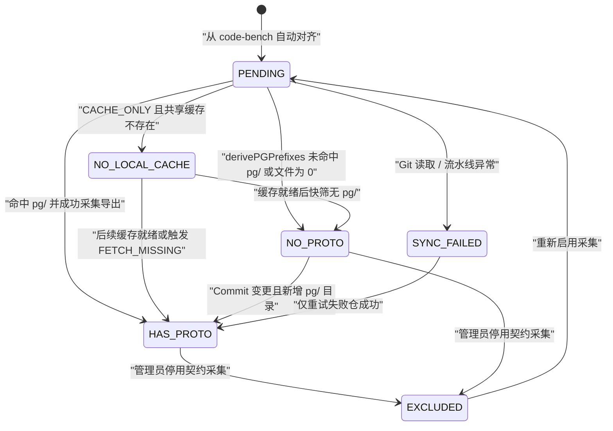
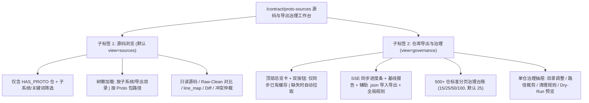

# ADR-27：500+ 平台仓全量零勾选同步、导出后目录治理与 Stage B 清理整顿架构决策

- **文档编号**：`27-proto-export-directory-and-normalization-governance-adr.md`
- **状态**：Proposed（r1，待实施 M37~M39）
- **日期**：2026-11-27
- **关联与演进关系**：
  - 承接并演进 [`ADR-26 (r4)`](./26-shared-git-cache-and-subsystem-proto-tree-adr.md)（共享宿主机 Git 缓存与四段式跨仓 Proto 流水线），正式落地其预留的「从 `raw/` 到 `clean/` 的清理整顿规则与辅助 `.json` 映射配置」；
  - 废除 [`ADR-18`](./18-proto-full-lifecycle-and-git-mr-governance-adr.md) 遗留的独立 Git 仓接入与凭据维护模型；
  - 关联 [`ADR-19`](./19-proto-contract-ia-unbundling-and-four-workbenches-adr.md)（`/contract/proto-sources` 工作台信息架构）与 [`ADR-10`](./10-enhanced-proto-schema-file-management-adr.md)（全局单一生效 `.pb` 池与冲突仲裁）。

---

## 1. 背景与问题陈述 (Context & Problem Statement)

`ADR-26` 首版（M33~M36）交付后，在面对平台真实 **500+ 业务代码仓** 的规模化使用与走查时，暴露出 4 个核心架构与体验断点：

1. **双轨管理破坏唯一真值源**：前端仍保留 `+ 接入 Git 仓库`（允许独立填报仓库 URL、分支、Token/SSH Key 与删除仓库），与 `code-bench` 公共 `repositories` 表并行存在，既带来权限/凭据分散管理的合规隐患，也容易造成元数据漂移。
2. **「逐仓勾选导入」在 500+ 仓规模下不可用**：当前 `PlatformRepoImportDrawer` 按 `page_size=50` 展示表格让用户逐行勾选导入，同时主下拉框截断为前 100 仓、双视图树一次拉取全量文件。现实中用户并不需要在导入前浏览 500 个仓库并逐一勾选，而是希望**全部仓一键统一导入采集**，先看全貌、再治理。
3. **无缓存仓盲目拉取与全仓扫描的性能/权限风险**：`code-shield` 几乎每天都会全量拉取平台代码，宿主机共享缓存已覆盖绝大多数有效仓；少数在缓存中缺失的仓，往往是因为**权限不够或代码仓本身已废弃/不存在**，无需由 `code-contract` 主动拉取。同时，当前探测逻辑对全仓执行 `git ls-tree -r`，在 500+ 大仓并发时开销过大，且未区分「无 `pg/` 目录的普通仓」与「待处理仓」。
4. **导出后缺少细粒度治理入口**：当前导出后无法对特定仓库调整目标导出目录（如修正 `code-bench` 中未分好子系统的 `_unassigned` 仓、或统一深浅不一的 `pg/` 路径），也未落地 `ADR-26 §2.4.2` 预留的**辅助 `.json` 映射与 Stage B 清理整顿规则闭环**，导致大量存量不规范 `.proto` 缺少“导出 → 试算预览 → 调整清理规则 → 免网络重出树”的治理抓手。

---

## 2. 核心架构裁决 (Architectural Decisions)

### 2.1 全局唯一真值源与独立仓彻底下线

1. **唯一真值源原则**：`code-bench` 公共 `repositories` 表为平台代码仓的**全局唯一真值源（SSOT）**。`code-contract` **严禁**再提供任何独立录入 Git 仓库、维护仓库基础信息或单独配置 PAT / SSH Key 的能力。
2. **UI 全面裁剪**：
   - 删除 `/contract/proto-sources` 顶部的 `+ 接入 Git 仓库` 主按钮与 `关联平台仓` 按钮；
   - 将原 `GitRepoConfigDrawer` 重构为 **「单仓契约治理抽屉」**：仓库名、Git 地址、默认分支、`service_group`、部门、负责人全部**只读展示**（提供跳转 `code-bench` 仓库管理页的链接），移除 `provider`、`repo_url`、`auth_type`、凭据、Webhook Secret 输入框；
   - 不允许在 `code-contract` 中删除仓库，改为提供 **「停用/排除契约采集」** 开关（`sync_enabled = false`，即标记 `EXCLUDED`）。
3. **后端与路由下线**：
   - 下线 `POST /api/git-repos`、`POST /api/git-repos/:id/link-platform` 与 `DELETE /api/git-repos/:id` 对外入口；
   - 删除 `EXTERNAL_STANDALONE` 模式及 `<codes_dir>/_external/<git_repo_id>/` 存储分支；
   - `contract_git_repos.platform_repo_id` 约束为 **`NOT NULL` 唯一索引**，`source_mode` 固定为 `PLATFORM_SHARED`。
4. **生命周期自动跟随 `code-bench`**：
   - 定时巡检与全量同步前，先执行一次轻量元数据对齐：
     - `repositories` 新增 `is_active = true` 记录 → 自动幂等创建对应的 `contract_git_repos` 记录（`proto_status = PENDING`）；
     - `repositories` 变更 `service_group` / `name` / `branch` / `url` → 自动同步快照并由目录树对账器零拷贝刷新软链（除非该仓在治理层显式覆写了目标导出目录）；
     - `repositories.is_active = false` → 自动标记归档并关闭采集，随后由对账器异步清理 `protos/{raw,clean}` 软链与孤儿版本目录。

---

### 2.2 500+ 平台仓全量对齐与双按钮异步同步引擎

废除「发现列表 → 逐行勾选 → 导入」流程，改为**「全量自动对齐 + 双按钮异步批处理同步」**，并引入 6 态仓库契约状态机对 500+ 仓做静默分层：



1. **双按钮同步策略（清晰分离读缓存与网络拉取边界）**：

   | 按钮名称 | 后端模式 (`cache_policy`) | 执行语义 | 适用场景（默认推荐） |
   | :--- | :--- | :--- | :--- |
   | **「仅同步已有缓存」**（主按钮，定时任务默认采用） | `CACHE_ONLY` | 只读取宿主机共享 `codes/` 目录中已由 `code-shield` 拉取的缓存（`refs/remotes/origin/<branch>` 或已有 `refs/contract/heads/<branch>`）；**若本地缓存不存在，不执行网络 `clone`/`fetch`**，直接置为 `NO_LOCAL_CACHE` 计入汇总统计并继续下一仓。 | **日常高频首选**。因为 `code-shield` 几乎每天全量拉取平台仓，缺失缓存的仓库通常是权限不足或仓库已废弃，避免无意义的拉取失败告警风暴。 |
   | **「缺失时自动拉取」**（次按钮，需显式二次确认） | `FETCH_MISSING` | 对已有缓存仓增量 `fetch`；对本地尚无缓存的仓库在 `LOCK_EX` 下执行 `clone --no-checkout`（受 `storage.shared_write_enabled` 与按 Git Host 限流保护）。若服务端关闭 `shared_write_enabled`，则前端禁用该按钮并给出配置提示。 | 确需绕过 `code-shield` 扫描周期、立刻补全特定新仓或局部子系统仓时显式触发。 |

2. **500+ 仓毫秒级 `pg/` 快筛（禁止全仓 `ls-tree -r`）**：
   - `Collector` 对每个有缓存的仓库先执行 `derivePGPrefixes`（仅两步轻量命令：`ls-tree -d` 查顶层目录 + 一次批量 `ls-tree -d` 查一级子目录），耗时通常仅数毫秒；
   - 若未命中任何全小写 `pg/` 目录（或命中后白名单 `.proto` 数量为 0），立即标记 `proto_status = NO_PROTO`（记录 `last_collected_commit` 以供后续跳过未变更 commit），**不创建空 Bundle、不在 `protos/` 生成空目录、不在「源码浏览」树展示**；
   - 仅当 `proto_status = HAS_PROTO` 且尚无 Bundle 时，才为每个命中的 `pg` 目录自动生成默认 `GitProtoBundle`（`AutoActivate = false`）。
3. **持久化异步批处理任务（`contract_proto_sync_jobs`）**：
   - 替代原 10 分钟硬超时的内存 goroutine，支持作用域：`ALL`（全量 500+ 仓）、`DEPARTMENT`、`SERVICE_GROUP`、`FAILED_ONLY`（仅重试失败仓）、`SELECTED`；
   - 复用 `SyncScheduler` 的有界 Worker 池（默认 4 并发）、按 Git Host 限速、`singleflight` 与 `commit_sha` 未变跳过机制；
   - 实时写入 `total_repos / processed_repos / has_proto_count / no_proto_count / no_cache_count / failed_count / skipped_unchanged_count`，并通过 SSE（`proto_sync_job.progress`）推送给前端进度条。

---

### 2.3 导出后目录治理（方案 A：仓级目标目录重定位 + 仓内路径裁剪重写）

全量导出的价值在于**先看见所有 `.proto` 全貌，再对导出结构做确定性治理**。按照选定的**方案 A（仓级目标目录重定位）**，架构边界如下：

1. **`raw/` 不动，`clean/` 可治理**：
   - `protos/raw/<service_group_slug>/<repo_slug>/...` 作为 Stage A 原样镜像，**永远严格忠实于 `code-bench` 原始子系统名与仓内 `pg/` 相对路径**，保留血缘底稿；
   - 所有目录调整与路径治理仅作用于 `protos/clean/` 与 DB `contract_proto_files.file_path`。
2. **仓级目标导出目录覆写（方案 A）**：
   - 每个 `HAS_PROTO` 仓库在 `protos/clean/` 下独占一个目标目录：
     `protos/clean/<effective_subsystem>/<effective_repo_dir>/`；
   - 默认值继承自 `code-bench` 的 `NormalizeSlug(service_group)` 与 `NormalizeSlug(repo.Name)`；
   - 管理员可在治理层为任意仓库设置覆写：`export_target_subsystem`（如将 `_unassigned` 修正归并到 `trade`）与 `export_target_repo_dir`（如规范化历史命名 `legacy-svc-v1` → `order-service`）；
   - **全局唯一性硬约束**：所有有效仓的 `(effective_subsystem, effective_repo_dir)` 必须全局唯一，配置保存及导入校验时检测碰撞并直接返回 `409 Conflict`，从结构上杜绝多仓互相覆盖文件，从而完整保留 `ADR-26` 的「版本目录 + 符号链接零拷贝原子切换」机制。
3. **仓内子路径裁剪与重映射**：
   - 针对各团队仓内 `pg/` 层级不统一的问题（如 `pg/v1/order.proto`、`server/pg/proto/order.proto`、`api/pg/order.proto`），支持按仓配置有序规则：
     - `strip_prefixes`：剥离导出相对路径前缀（如将 `server/pg/proto/` 剥离为空，使输出路径落为 `clean/trade/order-service/order.proto`）；
     - `path_rewrites`：精确前缀替换（如 `pg/internal/ -> internal/`）；
   - **仓内碰撞检测**：若同一仓库的多个文件经裁剪重写后映射到同一目标路径，Dry-Run 与保存门禁直接拦截并列出冲突源文件，严禁静默覆盖；
   - 默认同步将裁剪后的规范相对路径作为 Stage C 逻辑导入路径 `file_path` 候选（Bundle 显式 `include_dirs` 仍具备最高优先级）。
4. **采集范围细化**：
   - 支持在导出后按仓追加 `exclude_globs`（排除特定废弃/测试/第三方副本目录）、放开非标仓的 `collect_globs`，或将纯噪音/工具仓直接设为 `EXCLUDED`（同时触发 `ProtoTreeManager` 回收其 `protos/clean/` 软链）。

---

### 2.4 Stage B 清理整顿规则框架与辅助 `.json` 治理配置契约

本节正式定义 `ADR-26 §2.4.2` 预留的 Stage B 清理规则框架与辅助 `.json` 配置文件契约。

1. **三层叠加清理流水线**：
   - **Layer 1 — 全局内置规则库（可按规则 ID 开关与排序）**：基于全量导出基线报告的高频错误沉淀标准化、确定性清理器（首批预置框架规则如下，具体业务正则/AST 规则随基线报告迭代扩充）：
     - `NORM-001`（`encoding_and_eol`）：剥离 UTF-8 BOM、统一换行符为 LF；
     - `NORM-002`（`syntax_header_fix`）：为缺失 `syntax = "proto2";` / `"proto3";` 声明的存量文件补齐默认 `syntax` 头（并记录 `line_map` 偏移）；
     - `NORM-003`（`package_normalize`）：规范化缺失或非法字符的 `package` 声明；
     - `NORM-004`（`nonstandard_directive_strip`）：剥离业务历史自定义非标注解/宏块（保留语义注释，按需输出 `line_map`）；
     - `NORM-005`（`import_path_rewrite`）：结合路径裁剪规则与 `contract_proto_import_owners` 权威裁决表，将相对路径或外部副本 `import` 改写为规范逻辑路径；
   - **Layer 2 — 仓级规则覆写**：允许特定历史仓禁用某条全局规则、补充专属正则替换（`regex_rewrites`）或追加 `import_rewrites`；
   - **Layer 3 — 文件级豁免 / 隔离**：支持对个别不可修复的废弃 `.proto` 文件配置规则豁免或显式标记隔离。

2. **辅助 `.json` 治理配置契约（`proto-governance.v1.json`）**：

   面对 500+ 仓，既支持在 Web UI 单仓/全局配置，也支持将整套治理配置导出为标准 `.json` 批量编辑后再校验导入（双向同一份 SSOT）：

   ```json
   {
     "schema_version": "proto-governance/v1",
     "revision": 12,
     "global": {
       "collect_globs": ["pg/**/*.proto", "*/pg/**/*.proto"],
       "exclude_globs": ["**/test/**", "**/testdata/**", "**/mock/**"],
       "enabled_rules": ["NORM-001", "NORM-002", "NORM-003", "NORM-005"],
       "default_syntax": "proto3",
       "import_rewrites": {
         "common/legacy_header.proto": "base/common/header.proto"
       }
     },
     "repos": {
       "legacy-order-repo": {
         "platform_repo_id": 1042,
         "sync_enabled": true,
         "export_target_subsystem": "trade",
         "export_target_repo_dir": "order-service",
         "strip_prefixes": ["server/pg/proto/", "pg/"],
         "path_rewrites": {
           "legacy/": "v1/"
         },
         "extra_exclude_globs": ["**/deprecated/**"],
         "disabled_rules": ["NORM-003"],
         "regex_rewrites": [
           {
             "id": "custom-option-strip",
             "pattern": "^\\s*option\\s+\\(legacy_tag\\)\\s*=.*?;\\s*$",
             "replacement": "",
             "multiline": true
           }
         ],
         "import_rewrites": {}
       }
     }
   }
   ```

   - **持久化与增量失效**：治理配置按版本持久化在控制面数据库表 `contract_proto_governance_configs` 中，变更写入 `code-common/backend/audit`；运行时生成规范化 JSON 字节传入 `NormalizeInput.AuxConfigJSON`，`EffectiveNormalizerVersion` 将其 SHA-256 摘要并入 `normalizer_version`；
   - **安全性护栏**：禁止在正则表达式中引入高回溯风险写法（校验编译或使用线性匹配引擎 / 超时保护），禁止 `strip_prefixes` 与 `path_rewrites` 产生 `..` 或绝对路径。

3. **「修改 → Dry-Run 预览 → 免网络一键重出树」治理闭环**：
   - 用户调整目录映射或清理规则（无论通过 Web 表单还是上传 `.json`），先调用 **Dry-Run 预览接口**：直接读取 DB 中的 `raw_content_text`（或 `protos/raw/`）在内存中执行路径映射 + Stage B 清理 + `protocompile` 语法校验（**零 Git 网络、零写盘**）；
   - 前端并排展示：**目标目录变化前后对照、源码清理 Unified Diff、语法通过率 / 隔离文件数变化、路径碰撞告警**；
   - 确认生效后持久化配置，并触发全局或受影响仓库的 **免网络重清洗（`re-normalize`）**，原子切换 `protos/clean/` 符号链接并刷新 Stage C/D 编译结果与基线报告。

---

### 2.5 `/contract/proto-sources` 双子标签信息架构（IA）与 500+ 仓交互规范

保持 `/contract/proto-sources` 路由不变（兼容所有既有深链 `?file_id=`、`?repo_id=`、`?bundle_id=`、`#L<n>`），在页面顶部引入两个职责正交的子标签页（通过 `?view=sources|governance` 同步）：



1. **子标签一：「源码浏览」（默认 `?view=sources`）**：
   - **500+ 仓降噪**：仓库筛选器默认**仅列出 `proto_status = HAS_PROTO` 且 `sync_enabled = true` 的仓库**，改为「子系统下拉 + 远端搜索选择器」（替代全量平铺 `<select>`），支持按导出后目标目录分组；
   - **树接口懒加载优化**：`GET /api/proto-files/tree` 支持先返回分组摘要（子系统 / 仓库 / 包名 + 文件计数 + 异常计数），点击展开节点时再按 `git_repo_id` 或 `package_name` 拉取文件明细，避免单屏渲染上万条 DOM；
   - 保留只读源码、Raw/Clean 双态对比、`line_map` 跳转、Commit Diff、远端一致性对账与冲突仲裁入口。
2. **子标签二：「仓库导出与治理」（`?view=governance`）**：
   - **顶部同步控制台**：
     - 汇总指标卡：平台活跃仓总数、`HAS_PROTO`、无 `pg/`（`NO_PROTO`）、无缓存（`NO_LOCAL_CACHE`）、已停用（`EXCLUDED`）、同步失败（`SYNC_FAILED`）；
     - 两个清晰同步按钮：**「仅同步已有缓存」**（主按钮）与 **「缺失时自动拉取」**（次按钮，带确认提示），并支持按子系统过滤同步范围及 **「仅重试失败仓」**；
     - 同步运行态：实时进度条 + 仅折叠/展开展示异常与失败仓明细；
     - 全局治理操作区：**「全局清理规则配置」**、**「导出治理 JSON」**、**「导入治理 JSON（含 Dry-Run 校验）」**、**「基线试编译报告」**；
   - **下方 500+ 仓治理台账**：
     - 严格遵循工作区通用分页规范：`useSearchParams` 同步 `page`/`pageSize`/筛选条件，每页 `15/25/50/100`（默认 `25`）；
     - 状态分面筛选 Tab：`全部` / `含 Proto (HAS_PROTO)` / `无 pg/ 目录 (NO_PROTO)` / `无本地缓存 (NO_LOCAL_CACHE)` / `失败 (SYNC_FAILED)` / `已停用 (EXCLUDED)`；
     - 表格列展示：平台仓名 & `service_group`（只读） | 契约状态 & 缓存状态 | 目标导出目录（`clean/...`，标注是否覆写） | 文件统计（白名单 / 已清洗 / 隔离） | 操作（`目录与清理治理`、`免网络重清洗`、`启用/停用采集`）。

---

## 3. 关键方案权衡 (Alternatives Considered)

| 决策维度 | 备选方案（已否决） | 本 ADR 采纳方案 | 裁决理由 |
| :--- | :--- | :--- | :--- |
| **目标目录调整粒度** | 方案 B：多仓合并导出到同一目标目录 | **方案 A：仓级独立目标目录重定位 + 仓内路径裁剪** | 保持仓级版本目录与符号链接零拷贝原子切换，全局目录碰撞在配置期 409 拦截，杜绝多仓静默覆盖。 |
| **无缓存仓同步策略** | 默认对所有未命中缓存的仓自动 `git clone` | **双按钮显式分离：「仅同步已有缓存」（默认）vs「缺失时自动拉取」** | `code-shield` 每日全量拉取；无缓存仓多为权限不足或已废弃，默认静默归类 `NO_LOCAL_CACHE` 显著降低噪声与锁争抢。 |
| **治理配置维护形式** | 仅纯文件手改 JSON，或仅纯 Web 表单逐仓点选 | **Web 可视化台账 + 标准 `.json` 导入/导出双向互通 + Dry-Run 预览** | 单仓调试用 UI 直观安全，500+ 仓批量调整（如统一裁剪前缀）用 `.json` 批处理高效，同一 SSOT 与版本号校验。 |
| **前端工作台结构** | 在原「源码浏览」页面继续叠加弹窗与 500 行表格 | **拆分为「源码浏览」与「仓库导出与治理」双子标签页** | 研发消费契约源码与架构师治理 500+ 仓导出规则关注点正交，拆分后日常浏览零噪音。 |

---

## 4. 数据模型与 API 契约演进摘要

1. **`contract_git_repos` 演进字段**：
   - `platform_repo_id` 收口为 `uint64 NOT NULL` 唯一索引；
   - 新增：`proto_status`（`PENDING` | `HAS_PROTO` | `NO_PROTO` | `NO_LOCAL_CACHE` | `EXCLUDED` | `SYNC_FAILED`）、`sync_enabled`（`bool`，默认 `true`）；
   - 新增：`export_target_subsystem`、`export_target_repo_dir`、`strip_prefixes_json`、`path_rewrites_json`、`repo_normalize_config_json`（仓库级补充清理规则与豁免配置）；
   - 保留既有 `subsystem_slug`（用于 `raw/` 血缘）与 `collect_globs_json` / `exclude_globs_json`。
2. **新增 `contract_proto_sync_jobs`**：
   - 字段：`id`、`scope`（`ALL` | `DEPARTMENT` | `SERVICE_GROUP` | `FAILED_ONLY` | `SELECTED`）、`cache_policy`（`CACHE_ONLY` | `FETCH_MISSING`）、`filter_json`、`status`（`RUNNING` | `COMPLETED` | `PARTIAL_FAILED` | `FAILED`）、各类状态计数（`total_repos`、`processed_repos`、`has_proto_count`、`no_proto_count`、`no_cache_count`、`failed_count`、`skipped_unchanged_count`）、`error_summary_json`、`triggered_by`、`started_at`、`finished_at`。
3. **新增 `contract_proto_governance_configs`**：
   - 存储辅助 `.json` 治理配置版本快照：`id`、`revision`、`config_sha256`、`config_json`（JSONB）、`updated_by`、`created_at`、`is_active`；写操作接入 `code-common/backend/audit` 记录字段级 Diff 审计。
4. **核心 API 变更清单**：
   - **下线接口**：`POST /api/git-repos`、`POST /api/git-repos/:id/link-platform`、`DELETE /api/git-repos/:id`、`GET /api/git-repos/platform-discover`、`POST /api/git-repos/platform-import`；
   - **同步与控制台接口**：
     - `POST /api/git-repos/sync-all`（支持 `cache_policy: CACHE_ONLY | FETCH_MISSING`、scope 过滤，返回 `job_id` 与 SSE 实时进度）；
     - `GET /api/git-repos/sync-summary`（返回 500+ 仓各状态计数与最近一次任务状态）；
     - `GET /api/git-repos/sync-jobs/:jobId`（查询任务详情与失败仓明细）；
   - **导出治理与清理规则接口**：
     - `GET /api/git-repos`（升级支持 `proto_status`、`service_group`、`sync_enabled`、`search` 筛选与标准分页）；
     - `PUT /api/git-repos/:id/governance`（保存单仓目标导出目录、路径裁剪重写、采集排除与仓级清理规则，含全局目标目录碰撞 409 校验）；
     - `POST /api/git-repos/:id/governance/dry-run`（免网络试算单仓路径对照 + 清理 Diff + 语法通过率）；
     - `GET /api/proto-governance/config` & `PUT /api/proto-governance/config`（读取/更新全局治理配置及辅助 `.json` 导出导入）；
     - `POST /api/proto-governance/dry-run`（对整份 `.json` 配置执行全局碰撞校验与受影响仓 Dry-Run 预览）；
     - `POST /api/proto-governance/apply-and-renormalize`（应用配置并批量触发受影响仓免网络 Stage B~D 重出树）；
   - **源码浏览树懒加载扩展**：`GET /api/proto-files/tree` 新增 `summary_only=true` 与按组展开参数，适配 500+ 仓万级文件场景。

---

## 5. 分期实施路线图与验收标准 (M37 ~ M39)

| 里程碑 | 核心交付范围 | 关键验收标准 (AC) |
| :--- | :--- | :--- |
| **M37：唯一真值源收口与 500+ 全量双按钮同步** | 1. 下线独立仓管理（`EXTERNAL_STANDALONE`、`POST /api/git-repos`、独立凭据及 `_external` 目录），收口 `platform_repo_id NOT NULL` 与存量归并迁移；<br/>2. 实现 `code-bench` 全量自动对齐、`derivePGPrefixes` 毫秒快筛、`NO_PROTO` / `NO_LOCAL_CACHE` 状态分层；<br/>3. 交付 `sync-all` 双按钮（`CACHE_ONLY` / `FETCH_MISSING`）、`contract_proto_sync_jobs` 持久化进度与 SSE 推送。 | 1. 模拟 500 平台仓压测：全量对齐 + `CACHE_ONLY` 快筛无 OOM、无全仓 `ls-tree -r` 调用；<br/>2. 缓存缺失仓在 `CACHE_ONLY` 模式下 100% 标记 `NO_LOCAL_CACHE` 且不触发 `git clone/fetch`；<br/>3. 无 `pg/` 仓不生成空 Bundle 与空 `protos/` 目录。 |
| **M38：方案 A 导出目录治理与 Stage B 清理框架** | 1. 实现 `export_target_subsystem` / `export_target_repo_dir` 覆写、全局目录碰撞 409 拦截与 `ProtoTreeManager` 零拷贝迁链；<br/>2. 实现 `strip_prefixes` / `path_rewrites` 及仓内碰撞检测；<br/>3. 实现 Stage B 内置规则库（`NORM-001`~`NORM-005`）、辅助 `.json` Schema 校验导入导出、配置摘要并入 `normalizer_version` 与 Dry-Run 预览闭环。 | 1. `protos/raw/` 在治理前后保持逐字节与原路径不变；<br/>2. 修改导出目录或清理规则后，Dry-Run 准确产出路径对照与源码 Diff，应用后免网络重出树原子切换 `protos/clean/`；<br/>3. 重复目录映射与正则碰撞被 100% 拦截。 |
| **M39：双子标签 IA 与 500+ 仓前端治理台账** | 1. 重构 `/contract/proto-sources` 为「源码浏览」与「仓库导出与治理」双子标签页（保留深链兼容）；<br/>2. 源码浏览侧完成 `HAS_PROTO` 默认过滤、远程搜仓与双视图树分组懒加载；<br/>3. 治理台账侧交付汇总卡片、双按钮确认交互、SSE 进度条、标准分页表格、单仓治理抽屉（含 Dry-Run 对比）与辅助 `.json` 双向编辑。 | 1. 移除所有 `+ 接入 Git 仓库`、`平台仓逐行勾选` 与 `关联平台仓` 交互；<br/>2. 500+ 仓分页与状态筛选符合工作区通用分页规范（`15/25/50/100`，默认 `25`）；<br/>3. 前后端 `make lint`、`make test`、`make build` 全绿通过。 |

---

## 6. 文档联动与实施前置约束

进入 M37 编码前，须依工作区 SDD 规范同步更新：
- `docs/01-features/01-feature-matrix.md`：补充 500+ 全量对齐、双按钮同步策略、方案 A 导出治理与双子标签特性条目；
- `docs/02-design/04-control-plane-and-web-console.md` & `05-database-schema.md`：冻结新增表结构、状态机与双子标签交互契约；
- `docs/03-api/01-http-api-contract.md`：冻结新旧接口清单与 RBAC / 审计要求；
- `docs/04-tasks/01-roadmap.md` 及 M37~M39 作战卡：拆分 TDD 任务并通过 `testdb.SetupIsolatedDB(t)` 保障数据隔离验证。
