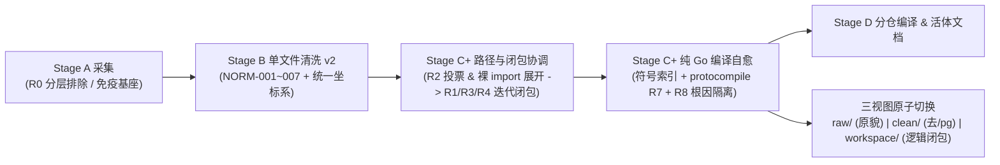

# ADR-28：现网 uService 清洗转换、clean 目录去 /pg 扁平化与全池编译收敛架构决策

- **文档编号**：`28-uservice-normalization-pg-flattening-and-compile-closure-adr.md`
- **状态**：已实施 (Implemented，M40~M42 全量交付)
- **日期**：2026-11-27
- **关联与演进关系**：
  - 承接并演进 [`ADR-26 (r4)`](./26-shared-git-cache-and-subsystem-proto-tree-adr.md)（四段式跨仓 Proto 流水线与聚合目录树）与 [`ADR-27 (r1)`](./27-proto-export-directory-and-normalization-governance-adr.md)（500+ 平台仓全量同步、方案 A 目录治理与 Stage B 清洗框架）；
  - 将现网 1,438 个原始 `.proto` 语料（23 个子系统目录、R0 过滤后 309 个 `uService` 文件、50 个缺失共享基座）的实证清洗规则（R0–R8）与 **`clean/` 去 `/pg` 目录扁平化**正式工程化落地到 `code-contract`；
  - 关联 [`ADR-10`](./10-enhanced-proto-schema-file-management-adr.md)（全局单一生效 `.pb` 池与冲突仲裁）与 [`ADR-19`](./19-proto-contract-ia-unbundling-and-four-workbenches-adr.md)（`/contract/proto-sources` 工作台信息架构）。

---

## 1. 背景与问题陈述 (Context & Problem Statement)

`ADR-27` 交付了平台仓全量同步、方案 A 目录治理与 `rule-normalizer/v1` 基础清洗框架（`NORM-001`~`NORM-005`）。随后基于现网真实导出语料（`/home/fugui/Data/protos/raw`，共计 **1,438 个 `.proto` 文件、23 个子系统目录**）进行的摸底梳理与原型脚本验证，暴露出当前清洗流水线与现网语法/组织形态之间存在 **7 个结构性断点**。

### 1.1 现网语料摸底实证指标（区分 R0 前 / R0 后口径）

| 摸底维度 | 统计口径 | 实测规模与特征 |
| :--- | :--- | :--- |
| **语料规模与变体副本** | R0 前 → R0 后 | R0 前原始 **1,438** 文件；R0 预过滤变体/历史代次子目录后为 **1,164** 文件（跳过 **274** 个纯重复副本，占 **19%**）。 |
| **服务文件识别** | R0 后（1,164） | 共 **309** 个含 `uService` 定义的文件（309/309 缺 `syntax`），**必须按文件内容而非文件名识别**：其中 15 个 `uService` 文件不以 `Service` 命名（如 `PSRSMCImpl.proto`、`ReticleStagePhyT.proto`），另有 164 个以 `Service` 命名的文件不含 `uService`（实为普通 Msg）。 |
| **接口与全量语法形态** | R0 前（1,438） | `interface` 总数 **7,213**（7,192 个带 `return`，**21** 个 oneway/`event` 无返回型）；**344/344** 个原始 `uService` 文件均缺失 `syntax` 声明；**87** 个文件含 `oneof`；**345** 个文件含 `package`。 |
| **自定义扩展与隐式类型** | R0 前（1,438） | **530** 个文件含自定义字段选项（`cmRange`×56,372、`readOnly`、`visibility`、`description`、`units` 等）；大量 `uService` 直接引用 `VoidType` 等隐式预载类型而不写 `import`。 |
| **依赖闭包与共享基座** | R0 后（1,164） | 服务依赖闭包 **701** 文件（309 Service + 392 Msg）+ **50** 个需从平台共享 `include` 树收割的缺失依赖；唯一 `import` 路径 **461** 条；其中裸文件名 `import`（无路径）**15** 处。 |
| **目录启发式偏差与冲突** | R0 前 vs R0 后 | **65/170** 个物理目录不符合 `<subsys>/<component>/pg` 路径启发式（如 `<subsys>/mconst/pg` 等 `extpg` 目录）；同名冲突逻辑路径 R0 前 **44** 组 → R0 后 **27** 组（最终映射去重后全池共 **656** 个闭包逻辑路径）。 |

### 1.2 当前 `code-contract` 清洗流水线（`rule-normalizer/v1`）的 7 大断点

| 断点编号 | 现网语料实情 | `code-contract` 当前实现 | 导致后果 |
| :--- | :--- | :--- | :--- |
| **G-1：缺少 `uService` DSL 转换（R5）** | R0 后 309 个（R0 前 344 个）服务文件使用私有 `uService` / `interface ... return ... (timeout:N)` / 块内 `import` / 隐式 `VoidType` 语法。 | `rule_normalizer.go`（`NORM-004`）仅剥离 C 预处理指令与 `DOPHI_*` 宏，无 `uService` 转换器。 | 全部核心 Service 文件在 Stage B `ParseProtoSyntaxOnly` 被直接隔离（`QUARANTINED`）。 |
| **G-2：缺失 `syntax` 默认版本错位（R5/R6）** | R0 前 344/344（R0 后 309/309）`uService` 及大量存量 Msg 缺 `syntax`，且实际为 **proto2** 语义（`required` / `default` / 非零首项 enum）。 | `DefaultGovernanceConfig()` 默认 `default_syntax = "proto3"`。 | 补全 `proto3` 后在 `protocompile` 语法门禁阶段直接报错失败。 |
| **G-3：R6 细节语法覆盖不足** | 存在单引号 `import 'x.proto'`、`import` 漏分号、重复 `package` 声明、15 处裸文件名 `import`。 | `importStmtRegex` 强依赖末尾 `;`；无多 `package` 去重；不补全裸文件名目录前缀。 | 漏分号与多 `package` 无法通过语法门禁；裸文件名 `import` 无法跨文件链接。 |
| **G-4：历史代次/集成仓副本未预过滤（R0）** | 顶层 `3M`（139 文件中 98 个与主仓重复）及 `alpha/beta/m1/m2/m3/m1_alpha/m1_beta1/link/il/fconst` 贡献 0 个独有服务却制造大量冲突。 | `DefaultExcludeGlobs()` 仅排除 `test/testdata/mock/examples/third_party/vendor`。 | 同名冲突暴增（27→44 组），触发大量 `IMPORT_AMBIGUOUS` 与无 `package` 顶层符号冲突。 |
| **G-5：单仓启发式路径映射失准（R2/R3）** | 65/170 目录无法靠单仓目录结构反推真实逻辑路径；全池存在 27 组同名文件消歧场景。 | `analyzer.go`（`InferLogicalPathsAndIncludeDirs`）仅在单仓内做后缀匹配，缺省直接剥离 `pg/` 前缀。 | 推导出的 `file_path` 与其它仓库的 `import` 路径不匹配，跨仓链接断裂。 |
| **G-6：共享基座缺失（R4）** | `OptionsExtensions.proto`、`sw/pg/BasicTypeMsg.proto`、`ltcomm/ltdd/pg/Gt*Msg.proto` 等 50 个依赖位于 `include/` 或 `ltcommon/`。 | Stage A 仅采集各仓 `pg/**/*.proto` 与 `*/pg/**/*.proto`。 | 530 个带自定义选项文件与 `VoidType` 引用全部链接失败。 |
| **G-7：开环流水线与多余 `/pg` 目录层级** | 语料存在漏写 `import`、错写路径、引用坏 variant 等脏数据；同时下游希望 `clean/` 去除冗余的 `/pg` 目录层级。 | Stage D 编不过直接报失败无反馈修复；`clean/` 仍保留 `pg/` 子目录层级。 | 无法达到全池零报错收敛，且 `clean/` 目录树多一层 `/pg` 冗余。 |

---

## 2. 核心架构裁决 (Architectural Decisions)

### 2.1 `clean/` 目录与逻辑路径去 `/pg` 扁平化（`NORM-007` / `strip_pg_segment`）

为简化清理后产物目录结构、使 `clean/` 下比 `raw/` 少一个 `/pg` 层级，同时绝对不破坏原始血缘与 `import` 可编译性，裁决如下：

1. **`raw/` 严格保真不动，`clean/` 与逻辑工作区统一去除独立 `/pg` 目录段**：
   - `protos/raw/<service_group_slug>/<repo_slug>/<orig_repo_path>` 作为 Stage A 原样底稿，**永远保留原始含 `pg/` 相对路径**与字节内容；
   - 新增确定性路径段剥离函数 `StripPGPathSegment(relPath string) string` 与统一坐标归一化出口 `NormalizeLogicalPath(relPath string, stripPG bool) string`：按 POSIX `/` 切分路径段，当 `stripPG = true` 时仅移除**严格等于 `"pg"` 且非最后一段文件名**的独立路径段（例如 `pg/A.proto` → `A.proto`，`wsttp/pg/B.proto` → `wsttp/B.proto`，`a/b/pg/sub/C.proto` → `a/b/sub/C.proto`）。
   - **精确边界保护**：仅匹配完整段名 `"pg"`，**严禁使用子串替换**，确保 `extpg`、`intpg`、`pggen`、`pg_common`、`mypg` 等目录名以及文件名 `pg.proto` 绝对不被误伤。

2. **全池单一坐标系原则与单仓逃生舱边界**：
   - `global.strip_pg_segment`（默认 `true`）是**全池共享逻辑坐标系的全局开关**。`file_path`（逻辑路径）、`workspace/` 与全部文件内非 WKT `import` 语句**全池强制在同一坐标系内对齐**，**严禁**某个仓库在逻辑路径/导入空间单独关闭剥离（否则全局去 `/pg`、单仓不去 `/pg` 必然导致跨仓 `import` 断链）。
   - 若单仓存在 `disable_strip_pg_segment: true` 逃生舱，**其作用域严格限定于该仓磁盘 `clean/<subsys>/<repo>/` 目录树的展示路径（`clean_rel_path`）**，不得撕裂全池逻辑路径（`file_path`）与 `import` 坐标系。

   当 `global.strip_pg_segment = true` 时，以下 4 个维度必须通过 `NormalizeLogicalPath` **同步、等幂地**执行剥离：

   | 维度 | 变更前（含 `/pg`） | 变更后（去 `/pg` 扁平化） |
   | :--- | :--- | :--- |
   | **仓级 `clean/` 导出路径 (`clean_rel_path`)** | `clean/ws/wsttp-repo/pg/WSTTPService.proto`<br/>`clean/ws/wsttp-repo/wsttp/pg/WSTTPMsg.proto`<br/>`clean/rs/rs-repo/extpg/Foo.proto` | `clean/ws/wsttp-repo/WSTTPService.proto`<br/>`clean/ws/wsttp-repo/wsttp/WSTTPMsg.proto`<br/>`clean/rs/rs-repo/extpg/Foo.proto`（非独立 `pg` 段，保留） |
   | **全池逻辑路径 (`file_path`) 与 `workspace/`** | `ws/wsttp/pg/WSTTPService.proto`<br/>`sw/pg/BasicTypeMsg.proto`<br/>`ltcommon/pg/OptionsExtensions.proto`<br/>`ltcomm/ltdd/pg/GtPosMsg.proto` | `ws/wsttp/WSTTPService.proto`<br/>`sw/BasicTypeMsg.proto`<br/>`ltcommon/OptionsExtensions.proto`<br/>`ltcomm/ltdd/GtPosMsg.proto` |
   | **文件内非 WKT `import` 语句** | `import "sw/pg/BasicTypeMsg.proto";`<br/>`import "ws/wsttp/pg/WSTTPMsg.proto";`<br/>`import "google/protobuf/empty.proto";` | `import "sw/BasicTypeMsg.proto";`<br/>`import "ws/wsttp/WSTTPMsg.proto";`<br/>`import "google/protobuf/empty.proto";`（WKT 豁免不变） |
   | **隐式注入与 R7 自动修复产物** | 配置真值源：`sw/pg/BasicTypeMsg.proto` | 经 `NormalizeLogicalPath` 统一产出：`import "sw/BasicTypeMsg.proto";` |

3. **裸文件名 `import` 展开顺序**：
   - 对于无 `/` 的裸文件名 `import "Foo.proto";`，在 Stage C+ 获得当前文件在统一坐标系下的逻辑目录 `<logical_dir>`（已去 `/pg`）后，直接展开为 `<logical_dir>/Foo.proto`（例如当前文件逻辑路径为 `track/ths/Bar.proto`，则展开为 `track/ths/Foo.proto`）。

4. **映射执行顺序与双层碰撞门禁（仓内 + 全池剥离）**：
   - `ApplyIntraRepoPathMapping` 确定性执行序为：`strip_prefixes` → `path_rewrites` → `StripPGPathSegment`（若启用）→ `SanitizeProtoRelPath`；
   - **第一层（仓内碰撞门禁）**：沿用 `MapAndValidateIntraRepoPaths`，若某仓库同时存在 `a/pg/X.proto` 与 `a/X.proto`，Dry-Run 与保存门禁直接拦截，运行时标记 `QUARANTINED`（`INTRA_REPO_PATH_CONFLICT`）；
   - **第二层（全池剥离碰撞检测）**：Stage C+ 覆盖**全部服务仓闭包逻辑路径 + R4 收割共享基座路径**执行全池剥离前后碰撞比对，确保剥离动作本身**不新增任何跨仓路径碰撞**（`post_strip_collisions \ pre_strip_collisions == ∅`；若 `repo1` 的 `a/pg/X.proto` 与 `repo2`/基座的 `a/X.proto` 因去 `/pg` 产生未在原池出现的新冲突组，立即在协调报告中显式拦截告警，严禁悄悄扩大冲突集）；
   - `contract_proto_files.repo_file_path` 保持原仓含 `pg/` 路径不变，`file_path` 与 `clean_rel_path` 存储归一化后路径；`strip_pg_segment` 开关状态摘要纳入 `normalizer_version`，配置切换时自动失效缓存并触发增量重洗。

---

### 2.2 Stage A 变体副本预过滤（R0）与共享基座正规入池（R4）

1. **R0 两级分层预过滤（适配单仓模型，严禁误伤 `BASE_LIB`）**：
   - 鉴于 `proto_cleaner.py` 扫描 `<subsys>/<repo>/<rel>` 全局目录树，而 `code-contract` Stage A（[collector.go](file:///home/fugui/codes/code-contract/internal/server/gitclient/collector.go)）按**单仓内相对路径**匹配，`exclude_globs` 无法匹配顶层子系统名（如 `3M`），且 `**/il/**`、`**/link/**` 等通用短词存在误伤共享基座的风险（实证反例：`il/ilfmp/ILFMPCommon.proto` 等 8 个文件位于 `clean_proto/il/ilfmp/` 下且为在用共享基座）。因此 R0 拆为两级并加作用域隔离：
     - **仓库/子系统级排除**：`global.exclude_subsystems`（如 `["3M"]`，匹配 `code-bench` 的 `service_group`）与 `global.exclude_repo_patterns`；
     - **仓内变体子目录排除**：`global.exclude_globs` 排除 `**/alpha/**`、`**/beta/**`、`**/m1/**`、`**/m2/**`、`**/m3/**`、`**/m1_alpha/**`、`**/m1_beta1/**`、`**/fconst/**` 等历史变体，对 `il`/`link` 类短词仅以精确前缀规则（如 `il/pg/**`、`*/il/pg/**` 或显式仓排除）配置。
   - **作用域红线**：R0 的 `exclude_subsystems` 与 `exclude_globs` **仅作用于普通业务仓 Stage A 采集，严禁作用于 `shared_base_sources` 与 R4 共享基座收割通道**。
   - 明确**不排除** `lpcs`、`extpg`、`intpg`、`interface`、`message` 等贡献真实服务依赖闭包的目录；不对 `*TC.proto` 写硬编码黑名单，交由 R1 闭包隔离。

2. **R4 共享基座双通道策略（收割真文件，严禁生成假 Stub）**：
   - 严禁使用 stub 策略（会丢失 `cmRange`/`readOnly`/`visibility`/`description` 等自定义字段选项并污染消息语义）。
   - **通道 A（首选：正规 `BASE_LIB` 源声明）**：在 `proto-governance/v1` 新增 `global.shared_base_sources[]`，按优先级声明共享基座物理目录或仓库白名单（如 `devbench-hpmc-simulator/include`、`ltcommon/pg`），以 `Category = BASE_LIB` 正规采集入池（免疫 R0 排除规则），完整纳入 `OptionsExtensions.proto`、`sw/pg/*`、`ltcomm/ltdd/pg/Gt*Msg.proto` 及递归依赖。
   - **通道 B（兜底：全池按需内存索引收割器）**：当全池协调发现闭包内仍有未知非 WKT `import`、或 **R7 中发现未导入且仅在共享基座索引中唯一定义的隐式符号** 时，按 `codes_dir` 优先路径（`include/`、`ltcommon/` 等）从**单次构建的内存索引**（含文件名索引与共享基座符号索引，绝不循环 `exec("find")` 子进程）中收割对应 `.proto` 及递归依赖，写入平台系统基座仓（标记 `is_harvested_base = true`、`Category = BASE_LIB`），并完整经过 Stage B 清洗（含统一坐标归一化）。

---

### 2.3 Stage B 升级为 `rule-normalizer/v2`（R5 + R6 + `NORM-007` + 精确 `line_map`）

将 [rule_normalizer.go](file:///home/fugui/codes/code-contract/internal/server/gitclient/rule_normalizer.go) 的版本前缀由 `rule-normalizer/v1` 升级为 **`rule-normalizer/v2`**（利用现有 `(raw_blob_sha, normalizer_version)` 增量键，升级后重跑可免 `git fetch` 自动全量重洗），形成 8 步确定性规则链：

1. **`NORM-001`（`encoding_and_eol`，前置最先）**：剥离 UTF-8 BOM（`\xEF\xBB\xBF` 与 `\uFEFF`）并统一 CRLF/CR 为 LF，杜绝 BOM 干扰后续 `syntax` 检测而生成重复声明。
2. **`NORM-004`（`nonstandard_directive_strip`）**：剥离 C/C++ 预处理指令（`#include`/`#define`/`#ifdef`/`#pragma` 等）与已知历史非标宏行，保留注释。
3. **自定义正则重写（`regex_rewrites`）**：叠加执行全局与仓级正则替换规则。
4. **`NORM-006`（`uservice_to_proto_service`，新增）**：封装为独立模块 `internal/server/gitclient/uservice_converter.go`，采用**注释感知状态机**（严格跳过 `//` 行注释与 `/* ... */` 块注释，支持多行折行 `interface` 签名与换行 `{`）：
   - **按内容识别**：仅当词法扫描命中有效 `uService <Name> {` 声明时标记 `is_uservice_source = true` 并触发转换，严禁依据文件名后缀判断；
   - **服务与 RPC 转换**：
     - `uService X {` → `service X {`；
     - `interface M(Req) return (Rep) (timeout:N);` → `rpc M(Req) returns (Rep); // @uservice: timeout:N`（将 `(timeout:N)` / `(event)` 元数据转为行尾结构化注释保留，兼顾标准 `protoc` 编译与文档/仿真元数据留存）；
     - 无 `return` 型 `interface M(Req);` 或 `(event)` 型（现网 21 处）→ `rpc M(Req) returns (google.protobuf.Empty);`；
   - **块内 `import` 提升**：识别 `service` 块内 `import`（同时支持单引号/双引号、有无分号、`public`/`weak`），提升至文件头部与文件级 `import` 合并去重；
   - **单一真值源的隐式符号补齐（`global.implicit_symbol_imports`）**：配置中**仅维护一份原始规范路径真值**（如 `google.protobuf.Empty -> google/protobuf/empty.proto`、`VoidType -> sw/pg/BasicTypeMsg.proto`），运行时自动注入后统一交由 `NormalizeLogicalPath(p, global.StripPGSegment)` 归一（开启去 `/pg` 时产出 `sw/BasicTypeMsg.proto`，关闭时保持 `sw/pg/BasicTypeMsg.proto`，既无双真值源冲突，又保证开关双向可逆）；
   - **未识别语句保护**：`uService` 块内无法匹配的残留非注释语句转为 `// UNCONVERTED: <line>` 并输出 `WARNING` 诊断，防止误放行或静默丢失。
5. **`NORM-003`（`package_normalize`，增强）**：除修复 `/`、`-` 与非法字符外，新增**重复 `package` 声明去重**（仅保留首条有效 `package` 声明，后续重复声明转为 `// <line> // dedup` 并记录 `INFO` 诊断）。
6. **`NORM-005`（`import_path_rewrite`，增强）**：
   - 放宽语法正则以兼容单引号 `import 'x'` 与缺失末尾分号 `;` 的 `import` 语句（统一改写为双引号并补齐 `;`）；
   - 依次应用全局/仓级 `import_rewrites`、仓内路径映射与 `ImportOwners` 权威映射。
7. **`NORM-007`（`pg_segment_flatten`，新增）**：当 `global.strip_pg_segment = true` 时，对文件逻辑路径、文件内全部非 WKT `import` 执行 `StripPGPathSegment`，使所有产物在进入 Stage C+ 前即对齐至同一逻辑坐标系；若单仓未设置 `disable_strip_pg_segment`，仓级 `clean_rel_path` 同步去 `/pg`。
8. **`NORM-002`（`syntax_header_fix`，增强）**：将 `global.default_syntax` 枚举扩展为 `"auto" | "proto2" | "proto3"`：
   - `"auto"`（默认）：若文件为 `is_uservice_source = true`，或正文（非注释区）检测到 `required` 字段修饰符、`[default = ...]` 选项，则补齐 `syntax = "proto2";`，否则回退 `proto3`；
   - 现网全量治理预设可直接配置为 `"proto2"`。

**精确 `line_map` 约束**：`NORM-006` 块内 `import` 提升、`NORM-002` 补头以及后续 Stage C+ 的 R7 `import` 插改，全链路必须通过 `trackedLine{text, rawLine}` 维持清洗后行号到原稿行号的精确 `line_map`，保障前端代码查看器与静态检查波浪线定位准确。

---

### 2.4 新增全池 Stage C+ 协调与纯 Go `protocompile` 闭环自愈（R1 + R2 + R3 + R7 + R8）

当前流水线（[compiler_pipeline.go](file:///home/fugui/codes/code-contract/internal/server/gitclient/compiler_pipeline.go)）按单仓独立运行，无法解决跨仓投票映射、多仓同名消歧与全池编译自愈。本 ADR 裁决在 `Stage B` 与 `Stage D / 三视图落盘` 之间新增全池协调层 **Stage C+（`pool_reconciler.go`）**：



#### 1. 统一坐标空间与 R2 全池投票法逻辑路径推导
- **统一坐标系硬约束**：进入 Stage C+ 的所有文件内 `import` 路径、投票候选前缀与启发式兜底前缀，在参与投票计票与 R3 比较前，**必须全部已由 `NormalizeLogicalPath(p, global.StripPGSegment)` 归一化到同一空间**（当 `strip_pg_segment = true` 时，全池仅在去 `/pg` 空间运算，严禁出现含 `/pg` 与去 `/pg` 票型分裂或字符串失配）。
- **投票规则**：收集全池所有 `NORMALIZED` 文件的合法 `import`（排除 WKT 与无 `/` 的裸文件名 `import`）；若 `import` 路径 `L` 的 `basename` 在全池仅命中唯一物理文件 `T`，则对 `T` 所在物理目录 `dir(T)` 投一票 `dir(L)`（已归一化）。
- **裁决优先级与平票收口**：**管理员显式 `strip_prefixes` / `path_rewrites`（归一化后） > 全池投票得票最高前缀（平票时按字典序确定性取首项） > 归一化后的启发式 `<subsys_lower>/<comp_lower>`**。
- **裸文件名展开**：拿到每个物理目录在统一坐标系下的逻辑前缀 `<logical_dir>` 后，统一将全部裸文件名 `import "Foo.proto";` 补全为 `<logical_dir>/Foo.proto`。

#### 2. 顺序依赖与 R1 / R3 / R4 协同迭代闭包
原语料中部分 `import` 路径存在漏写、错写或跨代引用，**严禁在未清洗/未归一前直接跑 BFS**。Stage C+ 必须严格遵循以下顺序：
1. Stage B 先完成 `NORM-006` 隐式 `import` 注入（如 `VoidType`）与 `NORM-007` 路径归一化；
2. R2 完成物理目录逻辑前缀投票与裸文件名 `import` 展开；
3. **R1 闭包 BFS 与 R3 消歧、R4 按需收割协同迭代**：
   - 以全池 `is_uservice_source = true` 文件为初始队列；
   - 出队文件 `p` 的每条非 WKT `import L` 按以下顺序解析目标文件：
     - ① 精确逻辑路径命中唯一文件 → 入队；
     - ② 精确路径有多个候选 → 立即执行 R3 多级消歧择一入队；
     - ③ 全池无精确命中 → 若通道 B 基座索引命中，则触发 **R4 收割**（新收割文件经 Stage B 归一后入队继续 BFS）；否则按 **`basename` 兜底匹配**（若命中多个同 `basename` 候选，**必须经过 R3 消歧择一入队，严禁把全部候选一并拉入闭包**，并标记为兜底边供后续 R7 `fix(a)` 修正）。
   - 非闭包文件（如数百个 `*TC.proto`）**保留在数据库与 `raw/` / `clean/` 中供源码检索查阅**；全池服务编译、`workspace/` 导出与 R7 回路默认仅作用于 `in_service_closure = true`（可配 `closure_only`）。

#### 3. R3 多级确定性自动消歧与冲突差异报告
- 同一逻辑路径存在多个物理候选文件时，按以下严格顺序裁决权威归属：
  1. `MANUAL`（管理员在冲突仲裁台人工指认，最高优先级）；
  2. `BASE_LIB`（唯一基座库，包含 R4 收割基座）；
  3. **目录逻辑前缀匹配**：候选目录逻辑前缀（统一坐标系）恰好等于 `import` 字面目录前缀（统一坐标系）；
  4. **自由目录认领**：唯一尚无投票前缀的候选目录认领该前缀；
  5. **同顶层子系统优先**；
  6. **同仓库谱系优先**（如 `LT-` 谱系前缀一致）；
  7. **大仓自洽优先**（该物理目录在语料中含 `.proto` 文件数较多者），最终按字典序确定性收口。
- 非胜出副本自动标记 `is_external_copy = true`。协调报告中的 `conflicts` 除列出候选路径外，**必须附带各候选的 `content_sha256`、`content_identical`（内容是否一致）及各候选独有符号差异清单（`symbol_diff`）**，辅助架构师快速识别内容不等价副本（如 `DCECPMsg.proto` 差异）进行人工复核。

#### 4. R7 纯 Go `protocompile` 内存编译反馈回路（基于全池符号倒排索引）
- 查证 `github.com/bufbuild/protocompile@v0.14.1`（`linker/resolve.go`）确认：`protocompile` 链接失败仅输出结构化未知符号错误（`unknown type` / `unknown request type` / `unknown response type` / `unknown extendee type` / `unknown extension`），**不提供** `protoc` 特有的 `"X seems to be defined in T, which is not imported"` 提示文案。
- 因此，本 ADR 裁决 **R7 不依赖诊断文案中的目标文件名提示**，而是直接复用 Stage B `ParseProtoSyntaxOnly` 已提取的 `Symbols` 构建全池内存倒排索引 **`symbol -> defining_files[]`**（及 R4 共享基座符号索引），联合 `protocompile` 的 `reporter.Handler` 诊断驱动 4 类修复（最多 `max_r7_rounds` 轮，默认 12）：
  - **`fix(a)` 错路径重写**：`unknown <sym>` 在池内倒排索引命中定义文件 `T`，且当前文件已 `import` 同 `basename` 的其他错误路径 → 将该 `import` 重写为 `T`（候选序：同目录 > 同组件前缀 > 字典序，且校验目标文件与同目录兄弟无无-`package` 顶层符号碰撞）。
  - **`fix(b)` 缺失补录（同目录兄弟优先 + 隐式符号触发 R4）**：`unknown <sym>` 未被当前文件 `import` →
    - 若当前文件同目录兄弟文件在倒排索引中定义了 `<sym>`，**优先插入同目录兄弟**（避免跨路径引入两个无 `package` 文件引发 `already defined` 级联冲突）；
    - 否则若池内唯一/消歧命中定义文件 `T` → 插入 `import "T";`；
    - 否则若共享基座索引唯一命中 `<sym>`（如未写 `import` 的隐式公共类型）→ 触发 **R4 通道 B 按需收割**入池并插入 `import`（严禁对非基座普通业务符号盲目收割）。
  - **`fix(c)` 坏依赖切换**：导入的文件 `P` 未找到或编译报错 → 在已清理文件池中查找同名且已过门禁的替代路径（优先同目录、错误最少），维护 `(file, basename, target)` 已试集合防震荡。
  - **`variant swap` 未定义符号切换**：`unknown <sym>` 且当前文件引用了多候选冲突路径 → 在未占用的冲突 variant 中切换至在倒排索引中定义了该符号的副本并重新清洗。
- **终止条件硬约束**：`fix(a)`、`fix(b)`、`fix(c)`、`variant swap` **四类修复中任一类产生至少 1 处有效改写即计为有进展**；仅当四类合计改写数均为 0 或达到 `max_r7_rounds` 时才终止 R7 进入 R8，严禁因遗漏 `fix(c)` 进展而提前落入 R8 造成误隔离。
- **可追溯与固化闭环**：R7 产生的所有源码修改同步更新 `content_text`、`line_map_json`、`auto_fix_count` 与 `AUTO_FIX_*` 诊断条目（写回 `.normalize-report.json` 与协调报告），并支持管理员在前端一键固化（Promote）为静态 `proto-governance/v1` 规则（`import_rewrites` 或 `MANUAL` 归属）。

#### 5. R8 根因优先固损隔离
- 当 R7 收敛后全池仍存在无法自动修复的编译错误时，进入 R8 隔离循环（上限 `max_r8_rounds`，默认 150 轮防死循环）：
  - 选 victim 时赋予**根因错误**（`already defined`、`multiple package`、语法解析根错误）显著高于**受害者错误**（`unknown type`、`not defined`、`was not found`）的权重，优先隔离真正破坏全局命名空间的根因文件，大幅降低级联误伤；
  - 将选中的 victim 置为 `pipeline_status = QUARANTINED` 并记录详细 `status_reason` 及错误计数，移出本轮编译集后继续循环，直至编译集全部通过（或达轮数上限）并输出最终 `quarantined` 清单。

#### 6. 全池确定性硬约束
- 鉴于 Go 语言 `map` 迭代顺序随机化，Stage C+ 所有环节——包括 R2 投票计票与平票收口、R1 BFS 队列扩展、R3 候选枚举与 `conflicts` 排序、R7 诊断遍历与修复应用、R8 victim 计数与字典序破平——**必须全部基于显式排序后的切片执行**，严格保证**同输入 + 同配置必产生完全一致的输出与报告**。

---

### 2.5 磁盘三视图原子落盘（`raw/`、`clean/` 去 `/pg`、`workspace/`）

扩展 `ProtoTreeManager`（[proto_tree.go](file:///home/fugui/codes/code-contract/internal/server/gitclient/proto_tree.go)），在宿主机 `<protos_dir>` 下维护三棵职责清晰、均通过 `.tmp` + `.versions` 零拷贝原子软链切换的只读目录树：

| 目录视图 | 路径格式 | 内容与职责 |
| :--- | :--- | :--- |
| **`raw/`（原始底稿）** | `<protos_dir>/raw/<subsys_slug>/<repo_slug>/<orig_repo_path>` | **永不修改、保留 `/pg` 与原始字节**，作为平台唯一只读源码血缘底稿。 |
| **`clean/`（仓级去 `/pg` 治理视图）** | `<protos_dir>/clean/<export_subsys>/<export_repo_dir>/<flattened_rel_path>` | 继承 ADR-27 方案 A 仓级目录治理解耦，**默认去除独立 `/pg` 层级**（少一层目录；单仓若设 `disable_strip_pg_segment` 仅影响此视图），含单仓 `.proto-meta.json` 与 `.normalize-report.json`。 |
| **`workspace/`（全池扁平编译工作区，新增）** | `<protos_dir>/workspace/<logical_path_without_pg>` | 按全池 R2+R3+R7+R8 收敛后的逻辑路径（**已去 `/pg`**）扁平导出全部闭包文件 + R4 共享基座，附带全池 `.clean-report.json`；任何下游 `protoc` / CI 工具只需指定单一 `--proto_path=<protos_dir>/workspace` 即可全量零报错编译。 |

---

## 3. 治理配置 Schema 演进与方案权衡 (Configuration & Alternatives Considered)

### 3.1 `proto-governance/v1` 向后兼容扩展契约

在保持 `schema_version = "proto-governance/v1"` 向后兼容的前提下，扩展 `global` 与单仓配置字段如下（支持前端预设一键载入与 JSON 导入导出）：

```json
{
  "schema_version": "proto-governance/v1",
  "revision": 20,
  "global": {
    "collect_globs": ["pg/**/*.proto", "*/pg/**/*.proto"],
    "exclude_subsystems": ["3M"],
    "exclude_repo_patterns": [],
    "exclude_globs": [
      "**/test/**", "**/testdata/**", "**/mock/**", "**/examples/**", "**/third_party/**", "**/vendor/**",
      "**/alpha/**", "**/beta/**", "**/m1/**", "**/m2/**", "**/m3/**",
      "**/m1_alpha/**", "**/m1_beta1/**", "**/fconst/**"
    ],
    "enabled_rules": [
      "NORM-001", "NORM-004", "NORM-006", "NORM-003", "NORM-005", "NORM-007", "NORM-002"
    ],
    "default_syntax": "proto2",
    "strip_pg_segment": true,
    "implicit_symbol_imports": {
      "google.protobuf.Empty": "google/protobuf/empty.proto",
      "VoidType": "sw/pg/BasicTypeMsg.proto"
    },
    "shared_base_sources": [
      { "path_hint": "devbench-hpmc-simulator/include", "priority": 1 },
      { "path_hint": "ltcommon/pg", "priority": 2 }
    ],
    "pool_reconcile": {
      "closure_only": true,
      "enable_r7_auto_fix": true,
      "max_r7_rounds": 12,
      "enable_r8_quarantine": true,
      "max_r8_rounds": 150
    },
    "import_rewrites": {},
    "regex_rewrites": []
  },
  "repos": {
    "legacy-special-repo": {
      "disable_strip_pg_segment": false,
      "disabled_rules": []
    }
  }
}
```

> 注：`repos.<name>.disable_strip_pg_segment` 仅影响该仓 `clean/` 磁盘展示目录（`clean_rel_path`），不改变全池逻辑路径（`file_path`）与 `import` 坐标系；`implicit_symbol_imports` 始终只填写一份原始规范路径真值，运行时经 `NormalizeLogicalPath` 统一转换。

### 3.2 关键架构权衡

| 决策维度 | 已否决方案 | 本 ADR 采纳方案 | 裁决理由 |
| :--- | :--- | :--- | :--- |
| **编译自愈执行引擎** | 在 Go 中反复 `exec` 外部 `/usr/bin/protoc` 与 `find` 子进程，并正则匹配 `"seems to be defined in"` | **纯 Go `bufbuild/protocompile` 内存编译回路 + 全池符号倒排索引 + 内存目录索引** | `protocompile@v0.14.1` 不输出 `seems to be defined in`，且 `code-contract` 单二进制零外部工具依赖；复用 Stage B 符号索引更稳定且支持未导入隐式符号触发 R4 收割。 |
| **`/pg` 消除作用范围** | 连同 `raw/` 一起去 `/pg`，或允许单仓修改全池逻辑坐标系，或投票后再去 `/pg` | **`raw/` 保真；Stage B 即完成坐标归一化，全池共享单一去 `/pg` 坐标系；单仓开关仅限仓级 `clean/` 展示** | 消除 Stage C+ 双坐标空间失配与跨仓断链；保留 `raw/` 确保溯源与可逆重洗。 |
| **非闭包文件处理（如 `*TC.proto`）** | Stage A 直接物理过滤丢弃 | **采集入库保留源码可浏览，通过 `in_service_closure` 标签从服务编译集隔离** | 兼顾资产盘点完整度与全池编译收敛，避免误删潜在后续新增服务的依赖。 |
| **缺失共享依赖处理** | 动态生成空 message stub | **R4 从真实共享目录/基座仓收割并标 `BASE_LIB`（且免疫 R0 排除规则）** | 保留真实字段结构与 `OptionsExtensions.proto` 自定义选项定义，同时杜绝 `**/il/**` 误杀在用基座。 |
| **`uService` 转换方式** | 原型脚本式单行正则全局替换且重排丢弃行号 | **注释感知状态机 + `trackedLine` 精确 `line_map` + 元数据行尾注释** | 免疫块注释/多行签名/单引号陷阱，且完整保留前端错误跳转所需的原稿行号映射。 |

---

## 4. 数据模型、API 与前端交互演进摘要

1. **数据模型增量变更**：
   - `contract_proto_files` 新增字段：
     - `clean_rel_path`（`varchar(512)`：仓级 `clean/` 去 `/pg` 后的导出相对路径）；
     - `is_uservice_source`（`bool`：内容级识别是否含 `uService` 声明）；
     - `in_service_closure`（`bool`：是否位于服务依赖闭包内）；
     - `is_harvested_base`（`bool`：是否由 R4 自动收割入池的共享基座）；
     - `auto_fix_count`（`int`：经 R7 编译反馈自动修复的次数）。
   - 新增 `contract_proto_pool_reconcile_runs` 表：持久化每次全池 Stage C+ 协调运行摘要、`.clean-report.json` 结构化报告（`logical_map`、`conflicts` 含哈希与 `symbol_diff`、`auto_fixes`、`quarantined`、`harvested`、`stats`）、触发人与耗时。
2. **核心 API 增量清单**：
   - `POST /api/proto-governance/reconcile-pool`（需 `contract_admin` 权限，写入审计）：异步触发全池 Stage C+ 协调（R1~R4 + R7 + R8）与 `protos/workspace/` 原子导出，并通过 SSE 事件 `proto_pool_reconcile.progress` 推送阶段进度；
   - `GET /api/proto-governance/reconcile-runs/latest` & `GET /api/proto-governance/reconcile-runs/:id`：分页/只读查询全池协调报告（冲突组及差异摘要、自愈补丁明细、收割基座与隔离根因）；
   - `POST /api/proto-governance/auto-fixes/promote`（需 `contract_admin` 权限，记录 P1 审计）：将 R7 产生的特定自动修复规则固化写入 `contract_proto_governance_configs`（`import_rewrites` 或 `MANUAL` 归属）；
   - 既有接口增强：`GET /api/proto-files` 新增 `in_service_closure`、`is_uservice_source` 筛选；`POST /api/proto-governance/dry-run` 与 `POST /api/git-repos/:id/governance/dry-run` 同步展示去 `/pg` 前后路径对照、全池剥离碰撞检测、`NORM-006` 转换 Diff 及 `line_map` 预览。
3. **前端 `/contract/proto-sources` 增量交互**：
   - **「仓库导出与治理」子页**：
     - 全局治理配置抽屉新增 `NORM-006`、`NORM-007 (clean 去 /pg 扁平化)`、`default_syntax (auto/proto2/proto3)`、`implicit_symbol_imports`、`shared_base_sources`、`exclude_subsystems` 配置项，并提供 **「载入现网 uService + 去 /pg 治理预设」** 快捷按钮；
     - 顶部控制台新增 **「全池编译收敛与工作区导出」** 操作入口及报告抽屉（分 Tab 展示带哈希/符号 diff 的 `conflicts`、`auto_fixes`（支持勾选固化）、`quarantined`、`harvested`），点击文件路径可直达源码对比查看器。
   - **「源码浏览」子页**：
     - 筛选栏新增「仅看服务闭包（排除 `*TC` 等非闭包文件）」开关；
     - 文件节点与阅读器头部标注 `uService 已转换`、`R7 自动修复`、`R4 收割基座` 徽标，支持 `clean`（去 `/pg` 转换稿）与 `raw`（原稿含 `pg/` 与 `uService`）逐行对照及精确 `line_map` 跳转。

---

## 5. 分期实施路线图与验收标准 (M40 ~ M42)

| 里程碑 | 核心交付范围 | 关键验收标准 (AC) |
| :--- | :--- | :--- |
| **M40：Stage B `rule-normalizer/v2` 与 `clean/` 去 `/pg` 扁平化** | 1. 新增 `uservice_converter.go` 实现 `NORM-006`（注释感知状态机、块内 `import` 提升、oneway→Empty、`implicit_symbol_imports` 单一真值源、metadata 注释）；<br/>2. 新增 `NORM-007`（`StripPGPathSegment` 与 `NormalizeLogicalPath` 统一坐标系联动）及全池剥离碰撞门禁；<br/>3. 强化 `NORM-002`（`auto/proto2`）、`NORM-003`（`package` 去重）、`NORM-005`（单引号/漏分号修复），内置 R0 分层排除预设与精确 `line_map`。 | 1. R0 后样本 309 个 `uService` 文件经 `rule-normalizer/v2` 处理后单文件 `ParseProtoSyntaxOnly` 通过率 100%；<br/>2. `clean/` 目录树中不再出现独立 `/pg` 子目录，且 `extpg`/`intpg` 目录名零误伤，`raw/` 逐字节与原路径不变；<br/>3. 含块内 `import` 提升与补头的样本 `line_map` 映射 100% 精确。 |
| **M41：R4 共享基座入池与全池 Stage C+ 协调（R1/R2/R3）** | 1. 实现 `shared_base_sources` 配置及按需内存索引收割器（`is_harvested_base` / `BASE_LIB`，免疫 R0 排除）；<br/>2. 实现 `pool_reconciler.go` 统一去 `/pg` 坐标系下的 R2 投票映射（平票字典序收口）与裸文件名 `import` 展开；<br/>3. 实现 R1/R3/R4 协同迭代闭包与附带哈希/符号差异的 `conflicts` 报告。 | 1. 65 类非启发式目录（如 `mconst`）全池投票逻辑路径映射准确对齐；<br/>2. `OptionsExtensions.proto`、`BasicTypeMsg.proto` 与 `il/ilfmp/*` 基座作为 `BASE_LIB` 完整入池且已去 `/pg`；<br/>3. 裸文件名 `import` 100% 自动展开，全池剥离新增碰撞数 `== 0`。 |
| **M42：纯 Go `protocompile` R7 自愈、R8 隔离、`workspace/` 导出与治理台闭环** | 1. 基于 `bufbuild/protocompile` + 全池符号倒排索引实现确定性 R7 回路（四类 fix 联合判定进展）与 `AUTO_FIX_*` 回写；<br/>2. 实现带 `max_r8_rounds` 上限的 R8 根因优先固损隔离；<br/>3. 实现 `protos/workspace/` 原子落盘与 `.clean-report.json`、全池协调 API、SSE 进度及前端报告/一键固化交互。 | 1. **平台通用不变量**：任意合规仓库集全池协调可确定性复现，剥离新增碰撞 `== 0`，全过程零外部 `protoc`/`find` 进程调用，闭包编译 **0 error**；<br/>2. **冻结基准快照回归测试**（2026-11 现网 1,438 文件离线包）：稳定命中 `309` services、闭包 `701 + 50` 收割基座、`656` 个去 `/pg` 逻辑路径、`conflicts = 27`、`quarantined = 0`、`15` 处裸 `import` 全展开；<br/>3. 前后端 `make lint`、`make test`（基于 `testdb.SetupIsolatedDB(t)`）、`make build` 全绿通过。 |

---

## 6. 文档联动与实施前置约束

进入 M40 编码前，须依工作区 SDD 规范同步更新以下文档并冻结契约：
- `docs/01-features/01-feature-matrix.md`：补充 `uService` 转换、`clean/` 去 `/pg` 扁平化、R0–R8 全池协调与 `workspace/` 编译导出特性条目；
- `docs/02-design/04-control-plane-and-web-console.md` & `05-database-schema.md`：冻结 `contract_proto_files` 新增列、`contract_proto_pool_reconcile_runs` 表结构及全池协调状态机；
- `docs/03-api/01-http-api-contract.md`：冻结 `reconcile-pool`、`reconcile-runs`、`auto-fixes/promote` 接口契约、RBAC（`contract_admin`）与审计级别；
- `docs/04-tasks/01-roadmap.md` 及 M40~M42 作战卡：拆分 TDD 任务（Red → Green → Refactor），涉及 DB 读写测试严格使用 `code-common/backend/testdb.SetupIsolatedDB(t)`。
