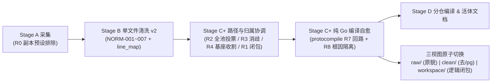

# ADR-28：现网 uService 清洗转换、clean 目录去 /pg 扁平化与全池编译收敛架构决策

- **文档编号**：`28-uservice-normalization-pg-flattening-and-compile-closure-adr.md`
- **状态**：Proposed（r1，待进入 M40~M42 实施）
- **日期**：2026-11-27
- **关联与演进关系**：
  - 承接并演进 [`ADR-26 (r4)`](./26-shared-git-cache-and-subsystem-proto-tree-adr.md)（四段式跨仓 Proto 流水线与聚合目录树）与 [`ADR-27 (r1)`](./27-proto-export-directory-and-normalization-governance-adr.md)（500+ 平台仓全量同步、方案 A 目录治理与 Stage B 清洗框架）；
  - 将现网 1,438 个原始 `.proto` 语料（23 个子系统目录、309 个 `uService` 文件、7,213 个 `interface`、530 个含自定义选项文件、50 个缺失共享基座）的实证清洗规则（R0–R8）与 **`clean/` 去 `/pg` 目录扁平化**正式工程化落地到 `code-contract`；
  - 关联 [`ADR-10`](./10-enhanced-proto-schema-file-management-adr.md)（全局单一生效 `.pb` 池与冲突仲裁）与 [`ADR-19`](./19-proto-contract-ia-unbundling-and-four-workbenches-adr.md)（`/contract/proto-sources` 工作台信息架构）。

---

## 1. 背景与问题陈述 (Context & Problem Statement)

`ADR-27` 交付了平台仓全量同步、方案 A 目录治理与 `rule-normalizer/v1` 基础清洗框架（`NORM-001`~`NORM-005`）。随后基于现网真实导出语料（`/home/fugui/Data/protos/raw`，共计 **1,438 个 `.proto` 文件、23 个子系统目录**）进行的摸底梳理与原型脚本验证，暴露出当前清洗流水线与现网语法/组织形态之间存在 **7 个结构性断点**。

### 1.1 现网语料摸底实证指标

| 摸底维度 | 实测规模与特征 |
| :--- | :--- |
| **语料规模与变体副本** | 原始 **1,438** 文件；R0 预过滤变体/历史代次子目录后为 **1,164** 文件（跳过 **274** 个纯重复副本，占 **19%**）。 |
| **服务文件识别** | 共 **309** 个含 `uService` 定义的文件，**必须按文件内容而非文件名识别**：其中 15 个 `uService` 文件不以 `Service` 命名（如 `PSRSMCImpl.proto`、`ReticleStagePhyT.proto`），另有 164 个以 `Service` 命名的文件不含 `uService`（实为普通 Msg）。 |
| **接口与语法形态** | `interface` 总数 **7,213**（7,192 个带 `return`，**21** 个 oneway/`event` 无返回型）；**344/344** `uService` 文件均缺失 `syntax` 声明；**87** 个文件含 `oneof`；**345** 个文件含 `package`。 |
| **自定义扩展与隐式类型** | **530** 个文件含自定义字段选项（`cmRange`×56,372、`readOnly`、`visibility`、`description`、`units` 等）；大量 `uService` 直接引用 `VoidType` 等隐式预载类型而不写 `import`。 |
| **依赖闭包与共享基座** | 服务依赖闭包 **701** 文件（309 Service + 392 Msg）+ **50** 个需从平台共享 `include` 树收割的缺失依赖；唯一 `import` 路径 **461** 条；其中裸文件名 `import`（无路径）**15** 处。 |
| **目录启发式偏差与冲突** | **65/170** 个物理目录不符合 `<subsys>/<component>/pg` 路径启发式（如 `<subsys>/mconst/pg` 等 `extpg` 目录）；同名冲突逻辑路径在 R0 前为 **44** 组、R0 后收敛为 **27** 组。 |

### 1.2 当前 `code-contract` 清洗流水线（`rule-normalizer/v1`）的 7 大断点

| 断点编号 | 现网语料实情 | `code-contract` 当前实现 | 导致后果 |
| :--- | :--- | :--- | :--- |
| **G-1：缺少 `uService` DSL 转换（R5）** | 309 个服务文件使用私有 `uService` / `interface ... return ... (timeout:N)` / 块内 `import` / 隐式 `VoidType` 语法。 | `rule_normalizer.go`（`NORM-004`）仅剥离 C 预处理指令与 `DOPHI_*` 宏，无 `uService` 转换器。 | 309 个核心 Service 文件在 Stage B `ParseProtoSyntaxOnly` 全部被隔离（`QUARANTINED`）。 |
| **G-2：缺失 `syntax` 默认版本错位（R5/R6）** | 344/344 `uService` 及大量存量 Msg 缺 `syntax`，且实际为 **proto2** 语义（`required` / `default` / 非零首项 enum）。 | `DefaultGovernanceConfig()` 默认 `default_syntax = "proto3"`。 | 补全 `proto3` 后在 `protocompile` 语法门禁阶段直接报错失败。 |
| **G-3：R6 细节语法覆盖不足** | 存在单引号 `import 'x.proto'`、`import` 漏分号、重复 `package` 声明、15 处裸文件名 `import`。 | `importStmtRegex` 强依赖末尾 `;`；无多 `package` 去重；不补全裸文件名目录前缀。 | 漏分号与多 `package` 无法通过语法门禁；裸文件名 `import` 无法跨文件链接。 |
| **G-4：历史代次/集成仓副本未预过滤（R0）** | 顶层 `3M`（139 文件中 98 个与主仓重复）及 `alpha/beta/m1/m2/m3/m1_alpha/m1_beta1/link/il/fconst` 贡献 0 个独有服务却制造大量冲突。 | `DefaultExcludeGlobs()` 仅排除 `test/testdata/mock/examples/third_party/vendor`。 | 同名冲突暴增（27→44 组），触发大量 `IMPORT_AMBIGUOUS` 与无 `package` 顶层符号冲突。 |
| **G-5：单仓启发式路径映射失准（R2/R3）** | 65/170 目录无法靠单仓目录结构反推真实逻辑路径；全池存在 27 组同名文件消歧场景。 | `analyzer.go`（`InferLogicalPathsAndIncludeDirs`）仅在单仓内做后缀匹配，缺省直接剥离 `pg/` 前缀。 | 推导出的 `file_path` 与其它仓库的 `import` 路径不匹配，跨仓链接断裂。 |
| **G-6：共享基座缺失（R4）** | `OptionsExtensions.proto`、`sw/pg/BasicTypeMsg.proto`、`ltcomm/ltdd/pg/Gt*Msg.proto` 等 50 个依赖位于 `include/` 或 `ltcommon/`。 | Stage A 仅采集各仓 `pg/**/*.proto` 与 `*/pg/**/*.proto`。 | 530 个带自定义选项文件与 `VoidType` 引用全部链接失败。 |
| **G-7：开环流水线与多余 `/pg` 目录层级** | 语料存在漏写 `import`、错写路径、引用坏 variant 等脏数据；同时下游希望 `clean/` 去除冗余的 `/pg` 目录层级。 | Stage D 编不过直接报失败无反馈修复；`clean/` 仍保留 `pg/` 子目录层级。 | 无法达到全池零报错收敛，且 `clean/` 目录树多一层 `/pg` 冗余。 |

---

## 2. 核心架构裁决 (Architectural Decisions)

### 2.1 `clean/` 目录与逻辑路径去 `/pg` 扁平化（`NORM-007` / `strip_pg_segment`）

为简化清理后产物目录结构、使 `clean/` 下比 `raw/` 少一个 `/pg` 层级，同时绝对不破坏原始血缘与 `import` 可编译性，裁决如下：

1. **`raw/` 严格保真不动，`clean/` 与逻辑工作区统一去除独立 `/pg` 目录段**：
   - `protos/raw/<service_group_slug>/<repo_slug>/<orig_repo_path>` 作为 Stage A 原样底稿，**永远保留原始含 `pg/` 相对路径**与字节内容；
   - 新增确定性路径段剥离函数 `StripPGPathSegment(relPath string) string`：按 POSIX `/` 切分路径段，仅移除**严格等于 `"pg"` 且非最后一段文件名**的独立路径段（例如 `pg/A.proto` → `A.proto`，`wsttp/pg/B.proto` → `wsttp/B.proto`，`a/b/pg/sub/C.proto` → `a/b/sub/C.proto`）。
   - **精确边界保护**：仅匹配完整段名 `"pg"`，**严禁使用子串替换**，确保 `extpg`、`intpg`、`pggen`、`pg_common`、`mypg` 等目录名以及文件名 `pg.proto` 绝对不被误伤。

2. **路径与 `import` 双向联动规则**：
   当全局开关 `strip_pg_segment = true`（默认开启；支持单仓 `disable_strip_pg_segment: true` 逃生舱）时，以下 4 个维度必须**同步、等幂地**执行 `StripPGPathSegment`：

   | 维度 | 变更前（含 `/pg`） | 变更后（去 `/pg` 扁平化） |
   | :--- | :--- | :--- |
   | **仓级 `clean/` 导出路径 (`clean_rel_path`)** | `clean/ws/wsttp-repo/pg/WSTTPService.proto`<br/>`clean/ws/wsttp-repo/wsttp/pg/WSTTPMsg.proto`<br/>`clean/rs/rs-repo/extpg/Foo.proto` | `clean/ws/wsttp-repo/WSTTPService.proto`<br/>`clean/ws/wsttp-repo/wsttp/WSTTPMsg.proto`<br/>`clean/rs/rs-repo/extpg/Foo.proto`（非独立 `pg` 段，保留） |
   | **全池逻辑路径 (`file_path`) 与 `workspace/`** | `ws/wsttp/pg/WSTTPService.proto`<br/>`sw/pg/BasicTypeMsg.proto`<br/>`ltcommon/pg/OptionsExtensions.proto`<br/>`ltcomm/ltdd/pg/GtPosMsg.proto` | `ws/wsttp/WSTTPService.proto`<br/>`sw/BasicTypeMsg.proto`<br/>`ltcommon/OptionsExtensions.proto`<br/>`ltcomm/ltdd/GtPosMsg.proto` |
   | **文件内非 WKT `import` 语句** | `import "sw/pg/BasicTypeMsg.proto";`<br/>`import "ws/wsttp/pg/WSTTPMsg.proto";`<br/>`import "google/protobuf/empty.proto";` | `import "sw/BasicTypeMsg.proto";`<br/>`import "ws/wsttp/WSTTPMsg.proto";`<br/>`import "google/protobuf/empty.proto";`（WKT 豁免不变） |
   | **隐式注入与 R7 自动修复产物** | 自动插入 `import "sw/pg/BasicTypeMsg.proto";` | 自动插入去 `/pg` 后的规范路径 `import "sw/BasicTypeMsg.proto";` |

3. **裸文件名 `import` 展开顺序**：
   - 对于无 `/` 的裸文件名 `import "Foo.proto";`，在 Stage C+ 获得当前文件去 `/pg` 后的逻辑目录 `<logical_dir>` 后，直接展开为 `<logical_dir>/Foo.proto`（例如当前文件逻辑路径为 `track/ths/Bar.proto`，则展开为 `track/ths/Foo.proto`）。
4. **映射执行顺序与仓内碰撞门禁**：
   - `ApplyIntraRepoPathMapping` 确定性执行序为：`strip_prefixes` → `path_rewrites` → `StripPGPathSegment`（当启用时）→ `SanitizeProtoRelPath`；
   - 沿用 `MapAndValidateIntraRepoPaths` 进行多对一碰撞检查：若某仓库同时存在 `a/pg/X.proto` 与 `a/X.proto`，去 `/pg` 后将碰撞为 `a/X.proto`，Dry-Run 与保存门禁直接拦截并列出冲突源文件；运行时命中碰撞的文件标记 `QUARANTINED`（`INTRA_REPO_PATH_CONFLICT`），严禁静默覆盖；
   - `contract_proto_files.repo_file_path` 保持原仓含 `pg/` 路径不变，`file_path` 与 `clean_rel_path` 存储去 `/pg` 后路径；`strip_pg_segment` 开关状态摘要纳入 `normalizer_version`，配置切换时自动失效缓存并触发增量重洗。

---

### 2.2 Stage A 变体副本预过滤（R0）与共享基座正规入池（R4）

1. **R0 多代次/集成仓副本预过滤（配置化预设）**：
   - 在 `proto-governance/v1` 的 `global.exclude_globs` 中提供「现网多代次副本过滤」预设（支持管理员按需增删，不写死在 Go 代码中）：
     - `**/3M/**`、`**/alpha/**`、`**/beta/**`、`**/m1/**`、`**/m2/**`、`**/m3/**`、`**/m1_alpha/**`、`**/m1_beta1/**`、`**/link/**`、`**/il/**`、`**/fconst/**`；
   - 明确**不排除** `lpcs`、`extpg`、`intpg`、`interface`、`message` 等贡献真实服务依赖闭包的目录；
   - 不针对 `*TC.proto` 触发器/配置数据维护硬编码黑名单，交由 2.4 节 R1 闭包标记自然隔离出服务编译集，同时保留其只读源码浏览能力。

2. **R4 共享基座双通道策略（收割真文件，严禁生成假 Stub）**：
   - 实证表明，生成缺失类型 stub 会丢失字段选项（如 `cmRange`/`readOnly`/`visibility`/`description`）并污染真实消息结构，因此**严禁使用 stub 策略**。
   - **通道 A（首选：正规 `BASE_LIB` 源声明）**：在 `proto-governance/v1` 新增 `global.shared_base_sources[]`，按优先级声明共享基座物理目录或仓库白名单（如 `devbench-hpmc-simulator/include`、`ltcommon/pg`），以 `Category = BASE_LIB` 正规采集入池。`OptionsExtensions.proto`、`sw/pg/*`、`ltcomm/ltdd/pg/Gt*Msg.proto` 及其递归依赖由此获得完整版本管理与最高导入优先级。
   - **通道 B（兜底：全池按需内存索引收割器）**：当全池协调发现闭包内仍有未知非 WKT `import` 时，按配置好的 `codes_dir` 优先路径（`include/`、`ltcommon/` 等）从**单次构建的内存文件名索引**（绝不循环 `exec("find")` 子进程）中收割对应 `.proto` 及递归依赖，写入平台系统基座仓（标记 `is_harvested_base = true`、`Category = BASE_LIB`），并完整经过 Stage B 清洗（含去 `/pg` 扁平化）。

---

### 2.3 Stage B 升级为 `rule-normalizer/v2`（R5 + R6 + `NORM-007` + 精确 `line_map`）

将 [rule_normalizer.go](file:///home/fugui/codes/code-contract/internal/server/gitclient/rule_normalizer.go) 的版本前缀由 `rule-normalizer/v1` 升级为 **`rule-normalizer/v2`**（利用现有 `(raw_blob_sha, normalizer_version)` 增量键，升级后重跑可免 `git fetch` 自动全量重洗），形成 8 步确定性规则链：

1. **`NORM-001`（`encoding_and_eol`，前置最先）**：剥离 UTF-8 BOM（`\xEF\xBB\xBF` 与 `\uFEFF`）并统一 CRLF/CR 为 LF，杜绝 BOM 干扰后续 `syntax` 检测而生成重复声明。
2. **`NORM-004`（`nonstandard_directive_strip`）**：剥离 C/C++ 预处理指令（`#include`/`#define`/`#ifdef`/`#pragma` 等）与已知历史非标宏行，保留注释。
3. **自定义正则重写（`regex_rewrites`）**：叠加执行全局与仓级正则替换规则。
4. **`NORM-006`（`uservice_to_proto_service`，新增）**：封装为独立模块 `internal/server/gitclient/uservice_converter.go`，采用**注释感知状态机**（严格跳过 `//` 行注释与 `/* ... */` 块注释，支持多行折行 `interface` 签名与换行 `{`）：
   - **按内容识别**：仅当词法扫描命中有效 `uService <Name> {` 声明时标记 `is_uservice_source = true` 并触发转换，严禁依据文件名后缀判断；
   - **服务与 RPC 转换**：
     - `uService X {` → `service X {`；
     - `interface M(Req) return (Rep) (timeout:N);` → `rpc M(Req) returns (Rep); // @uservice: timeout:N`（将 `(timeout:N)` / `(event)` 元数据转为行尾结构化注释保留，兼顾标准 `protoc` 编译与文档/仿真元数据留存）；
     - 无 `return` 型 `interface M(Req);` 或 `(event)` 型（现网 21 处）→ `rpc M(Req) returns (google.protobuf.Empty);`；
   - **块内 `import` 提升**：识别 `service` 块内 `import`（同时支持单引号/双引号、有无分号、`public`/`weak`），提升至文件头部与文件级 `import` 合并去重；
   - **隐式符号补齐（`global.implicit_symbol_imports`）**：配置驱动按需补齐 `import`（默认内置：`google.protobuf.Empty -> google/protobuf/empty.proto`，`VoidType -> sw/pg/BasicTypeMsg.proto`；当启用 `NORM-007` 时自动映射为 `sw/BasicTypeMsg.proto`）；
   - **未识别语句保护**：`uService` 块内无法匹配的残留非注释语句转为 `// UNCONVERTED: <line>` 并输出 `WARNING` 诊断，防止误放行或静默丢失。
5. **`NORM-003`（`package_normalize`，增强）**：除修复 `/`、`-` 与非法字符外，新增**重复 `package` 声明去重**（仅保留首条有效 `package` 声明，后续重复声明转为 `// <line> // dedup` 并记录 `INFO` 诊断）。
6. **`NORM-005`（`import_path_rewrite`，增强）**：
   - 放宽语法正则以兼容单引号 `import 'x'` 与缺失末尾分号 `;` 的 `import` 语句（统一改写为双引号并补齐 `;`）；
   - 依次应用全局/仓级 `import_rewrites`、仓内路径映射与 `ImportOwners` 权威映射。
7. **`NORM-007`（`pg_segment_flatten`，新增）**：当 `strip_pg_segment = true` 且单仓未设置 `disable_strip_pg_segment` 时，对导出路径及文件内全部非 WKT `import` 执行 `StripPGPathSegment`。
8. **`NORM-002`（`syntax_header_fix`，增强）**：将 `global.default_syntax` 枚举扩展为 `"auto" | "proto2" | "proto3"`：
   - `"auto"`（默认）：若文件为 `is_uservice_source = true`，或正文（非注释区）检测到 `required` 字段修饰符、`[default = ...]` 选项，则补齐 `syntax = "proto2";`，否则回退 `proto3`；
   - 现网全量治理预设可直接配置为 `"proto2"`。

**精确 `line_map` 约束**：`NORM-006` 块内 `import` 提升、`NORM-002` 补头以及后续 Stage C+ 的 R7 `import` 插改，全链路必须通过 `trackedLine{text, rawLine}` 维持清洗后行号到原稿行号的精确 `line_map`，保障前端代码查看器与静态检查波浪线定位准确。

---

### 2.4 新增全池 Stage C+ 协调与纯 Go `protocompile` 闭环自愈（R1 + R2 + R3 + R7 + R8）

当前流水线（[compiler_pipeline.go](file:///home/fugui/codes/code-contract/internal/server/gitclient/compiler_pipeline.go)）按单仓独立运行，无法解决跨仓投票映射、多仓同名消歧与全池编译自愈。本 ADR 裁决在 `Stage B` 与 `Stage D / 双视图落盘` 之间新增全池协调层 **Stage C+（`pool_reconciler.go`）**：



#### 1. R2 全池投票法逻辑路径推导
- 收集全池所有 `NORMALIZED` 文件的合法 `import`（排除 WKT 与无 `/` 的裸文件名 `import`）；
- 若某个 `import` 路径 `L` 的 `basename` 在全池中仅命中唯一的物理文件 `T`，则对 `T` 所在物理目录 `dir(T)` 投一票 `dir(L)`；
- 逻辑目录前缀裁决优先级：**管理员显式 `strip_prefixes` / `path_rewrites` > 全池投票得票最高前缀 > 启发式 `<subsys_lower>/<comp_lower>`**（最后再经 `NORM-007` 去除独立 `/pg` 段）；
- 拿到每个物理目录的逻辑前缀后，统一将所有 15 处裸文件名 `import "Foo.proto";` 补全为 `<logical_dir>/Foo.proto`。

#### 2. R1 服务依赖闭包标记
- 以全池 `is_uservice_source = true` 文件为种子集合，沿解析后的 `import` 有向边做确定性 BFS，将可达文件全部标记为 `in_service_closure = true`；
- 非闭包文件（如数百个 `*TC.proto`）**保留在数据库与 `raw/` / `clean/` 中供源码检索查阅**，不破坏资产全貌；全池服务编译、`workspace/` 导出与 R7 反馈回路默认仅作用于 `in_service_closure = true`（支持按 `closure_only` 参数开关）。

#### 3. R3 多级确定性自动消歧（与 `contract_proto_import_owners` 协同）
- 同一逻辑路径存在多个物理候选文件时，按以下严格顺序裁决权威归属：
  1. `MANUAL`（管理员在冲突仲裁台人工指认，最高优先级）；
  2. `BASE_LIB`（唯一基座库，包含 R4 收割基座）；
  3. **目录逻辑前缀匹配**：候选目录逻辑前缀恰好等于 `import` 字面目录前缀；
  4. **自由目录认领**：唯一尚无投票前缀的候选目录认领该前缀；
  5. **同顶层子系统优先**；
  6. **同仓库谱系优先**（如 `LT-` 谱系前缀一致）；
  7. **大仓自洽优先**（该物理目录在语料中含 `.proto` 文件数较多者），最终按字典序确定性收口。
- 非胜出副本自动标记 `is_external_copy = true`，所有发生多候选裁决的冲突组完整记入协调报告 `conflicts`，供架构师在控制台事后复核或通过 `MANUAL` 覆写。

#### 4. R7 纯 Go `protocompile` 内存编译反馈回路（取代外部 `protoc`）
- 放弃调用外部 `/usr/bin/protoc` 子进程与解析英文 stderr 文本的做法，直接在内存中复用 `bufbuild/protocompile`（自带标准 WKT resolver，无需 `/usr/include`）与结构化 `reporter.Handler` 诊断，循环执行最多 12 轮直至编译 0 error 或无有效修复进展：
  - **`fix(a)` 错路径重写**：诊断定位符号在 `T` 定义且当前文件已 `import` 同 `basename` 的其他错误路径 → 将该 `import` 重写为 `T`（候选序：同目录 > 同组件前缀 > 字典序，且校验目标文件与同目录兄弟无无-`package` 顶层符号碰撞）。
  - **`fix(b)` 缺失补录（同目录兄弟优先）**：诊断定位符号在 `T` 定义但未被当前文件 `import` → 先检查当前文件同目录兄弟文件是否已定义该符号，若有则优先插入同目录兄弟（避免跨路径引入两个无 `package` 文件引发 `already defined` 级联冲突，这是原语料消除 7 个隔离项的决定性规则），否则插入 `import "T";`。
  - **`fix(c)` 坏依赖切换**：`Import P was not found or had errors` → 在已清理文件池中查找同名且已过门禁的替代路径（优先同目录、错误最少），维护 `(file, basename, target)` 已试集合防震荡。
  - **`variant swap` 未定义符号切换**：符号未定义且当前文件引用了多候选冲突路径 → 在未占用的冲突 variant 中切换至实际定义了该符号的副本并重新清洗。
- **可追溯与固化闭环**：R7 产生的所有源码修改同步更新 `content_text`、`line_map_json`、增量 `auto_fix_count` 与 `AUTO_FIX_*` 诊断条目（写回 `.normalize-report.json` 与协调报告），并支持管理员在前端一键固化（Promote）为静态 `proto-governance/v1` 规则（`import_rewrites` 或 `MANUAL` 归属）。

#### 5. R8 根因优先固损隔离
- 当 R7 收敛后全池仍存在无法自动修复的编译错误时，进入 R8 隔离循环：
  - 选 victim 时赋予**根因错误**（`already defined`、`multiple package`、语法解析根错误）显著高于**受害者错误**（`not defined`、`was not found`）的权重，优先隔离真正破坏全局命名空间的根因文件，大幅降低级联误伤；
  - 将选中的 victim 置为 `pipeline_status = QUARANTINED` 并记录详细 `status_reason` 及错误计数，移出本轮编译集后重跑 R7/编译校验，直至编译集全部通过并输出最终 `quarantined` 清单。

---

### 2.5 磁盘三视图原子落盘（`raw/`、`clean/` 去 `/pg`、`workspace/`）

扩展 `ProtoTreeManager`（[proto_tree.go](file:///home/fugui/codes/code-contract/internal/server/gitclient/proto_tree.go)），在宿主机 `<protos_dir>` 下维护三棵职责清晰、均通过 `.tmp` + `.versions` 零拷贝原子软链切换的只读目录树：

| 目录视图 | 路径格式 | 内容与职责 |
| :--- | :--- | :--- |
| **`raw/`（原始底稿）** | `<protos_dir>/raw/<subsys_slug>/<repo_slug>/<orig_repo_path>` | **永不修改、保留 `/pg` 与原始字节**，作为平台唯一只读源码血缘底稿。 |
| **`clean/`（仓级去 `/pg` 治理视图）** | `<protos_dir>/clean/<export_subsys>/<export_repo_dir>/<flattened_rel_path>` | 继承 ADR-27 方案 A 仓级目录治理解耦，**默认去除独立 `/pg` 层级**（少一层目录），含单仓 `.proto-meta.json` 与 `.normalize-report.json`。 |
| **`workspace/`（全池扁平编译工作区，新增）** | `<protos_dir>/workspace/<logical_path_without_pg>` | 按全池 R2+R3+R7+R8 收敛后的逻辑路径（**已去 `/pg`**）扁平导出全部闭包文件 + R4 共享基座，附带全池 `.clean-report.json`；任何下游 `protoc` / CI 工具只需指定单一 `--proto_path=<protos_dir>/workspace` 即可全量零报错编译。 |

---

## 3. 治理配置 Schema 演进与方案权衡 (Configuration & Alternatives Considered)

### 3.1 `proto-governance/v1` 向后兼容扩展契约

在保持 `schema_version = "proto-governance/v1"` 向后兼容的前提下，扩展 `global` 与单仓配置字段如下（支持前端预设一键载入与 JSON 导入导出）：

```json
{
  "schema_version": "proto-governance/v1",
  "revision": 20,
  "global": {
    "collect_globs": ["pg/**/*.proto", "*/pg/**/*.proto"],
    "exclude_globs": [
      "**/test/**", "**/testdata/**", "**/mock/**", "**/examples/**", "**/third_party/**", "**/vendor/**",
      "**/3M/**", "**/alpha/**", "**/beta/**", "**/m1/**", "**/m2/**", "**/m3/**",
      "**/m1_alpha/**", "**/m1_beta1/**", "**/link/**", "**/il/**", "**/fconst/**"
    ],
    "enabled_rules": [
      "NORM-001", "NORM-004", "NORM-006", "NORM-003", "NORM-005", "NORM-007", "NORM-002"
    ],
    "default_syntax": "proto2",
    "strip_pg_segment": true,
    "implicit_symbol_imports": {
      "google.protobuf.Empty": "google/protobuf/empty.proto",
      "VoidType": "sw/pg/BasicTypeMsg.proto"
    },
    "shared_base_sources": [
      { "path_hint": "devbench-hpmc-simulator/include", "priority": 1 },
      { "path_hint": "ltcommon/pg", "priority": 2 }
    ],
    "pool_reconcile": {
      "closure_only": true,
      "enable_r7_auto_fix": true,
      "max_r7_rounds": 12,
      "enable_r8_quarantine": true
    },
    "import_rewrites": {},
    "regex_rewrites": []
  },
  "repos": {
    "legacy-special-repo": {
      "disable_strip_pg_segment": false,
      "disabled_rules": []
    }
  }
}
```

### 3.2 关键架构权衡

| 决策维度 | 已否决方案 | 本 ADR 采纳方案 | 裁决理由 |
| :--- | :--- | :--- | :--- |
| **编译自愈执行引擎** | 在 Go 中反复 `exec` 外部 `/usr/bin/protoc` 与 `find` 子进程 | **纯 Go `bufbuild/protocompile` 内存编译回路 + 单次内存文件索引** | `code-contract` 单二进制零外部工具依赖，内存结构化诊断免除了进程开销与英文 stderr 正则脆弱性。 |
| **`/pg` 消除作用范围** | 连同 `raw/` 一起去 `/pg`，或只改 `clean/` 磁盘路径不改 `import` | **`raw/` 保持原貌；`clean/` + `workspace/` + `file_path` + 非 WKT `import` 同步去 `/pg`** | 磁盘路径与 `import` 若不联动则编译必断；保留 `raw/` 确保溯源与可逆重洗。 |
| **非闭包文件处理（如 `*TC.proto`）** | Stage A 直接物理过滤丢弃 | **采集入库保留源码可浏览，通过 `in_service_closure` 标签从服务编译集隔离** | 兼顾资产盘点完整度与全池编译收敛，避免误删潜在后续新增服务的依赖。 |
| **缺失共享依赖处理** | 动态生成空 message stub | **R4 从真实共享目录/基座仓收割并标 `BASE_LIB`** | 保留真实字段结构与 `OptionsExtensions.proto` 自定义选项定义，彻底杜绝语义失真。 |
| **`uService` 转换方式** | 原型脚本式单行正则全局替换且重排丢弃行号 | **注释感知状态机 + `trackedLine` 精确 `line_map` + 元数据行尾注释** | 免疫块注释/多行签名/单引号陷阱，且完整保留前端错误跳转所需的原稿行号映射。 |

---

## 4. 数据模型、API 与前端交互演进摘要

1. **数据模型增量变更**：
   - `contract_proto_files` 新增字段：
     - `clean_rel_path`（`varchar(512)`：仓内去 `/pg` 后的清洗相对路径）；
     - `is_uservice_source`（`bool`：内容级识别是否含 `uService` 声明）；
     - `in_service_closure`（`bool`：是否位于服务依赖闭包内）；
     - `is_harvested_base`（`bool`：是否由 R4 自动收割入池的共享基座）；
     - `auto_fix_count`（`int`：经 R7 编译反馈自动修复的次数）。
   - 新增 `contract_proto_pool_reconcile_runs` 表：持久化每次全池 Stage C+ 协调运行摘要、`.clean-report.json` 结构化报告（`logical_map`、`conflicts`、`auto_fixes`、`quarantined`、`harvested`、`stats`）、触发人与耗时。
2. **核心 API 增量清单**：
   - `POST /api/proto-governance/reconcile-pool`（需 `contract_admin` 权限，写入审计）：异步触发全池 Stage C+ 协调（R1~R4 + R7 + R8）与 `protos/workspace/` 原子导出，并通过 SSE 事件 `proto_pool_reconcile.progress` 推送阶段进度；
   - `GET /api/proto-governance/reconcile-runs/latest` & `GET /api/proto-governance/reconcile-runs/:id`：分页/只读查询全池协调报告（冲突组、自愈补丁明细、收割基座与隔离根因）；
   - `POST /api/proto-governance/auto-fixes/promote`（需 `contract_admin` 权限，记录 P1 审计）：将 R7 产生的特定自动修复规则固化写入 `contract_proto_governance_configs`（`import_rewrites` 或 `MANUAL` 归属）；
   - 既有接口增强：`GET /api/proto-files` 新增 `in_service_closure`、`is_uservice_source` 筛选；`POST /api/proto-governance/dry-run` 与 `POST /api/git-repos/:id/governance/dry-run` 同步展示去 `/pg` 前后路径对照、`NORM-006` 转换 Diff 及 `line_map` 预览。
3. **前端 `/contract/proto-sources` 增量交互**：
   - **「仓库导出与治理」子页**：
     - 全局治理配置抽屉新增 `NORM-006`、`NORM-007 (clean 去 /pg 扁平化)`、`default_syntax (auto/proto2/proto3)`、`implicit_symbol_imports`、`shared_base_sources` 配置项，并提供 **「载入现网 uService + 去 /pg 治理预设」** 快捷按钮；
     - 顶部控制台新增 **「全池编译收敛与工作区导出」** 操作入口及报告抽屉（分 Tab 展示 `conflicts`、`auto_fixes`（支持勾选固化）、`quarantined`、`harvested`），点击文件路径可直达源码对比查看器。
   - **「源码浏览」子页**：
     - 筛选栏新增「仅看服务闭包（排除 `*TC` 等非闭包文件）」开关；
     - 文件节点与阅读器头部标注 `uService 已转换`、`R7 自动修复`、`R4 收割基座` 徽标，支持 `clean`（去 `/pg` 转换稿）与 `raw`（原稿含 `pg/` 与 `uService`）逐行对照及精确 `line_map` 跳转。

---

## 5. 分期实施路线图与验收标准 (M40 ~ M42)

| 里程碑 | 核心交付范围 | 关键验收标准 (AC) |
| :--- | :--- | :--- |
| **M40：Stage B `rule-normalizer/v2` 与 `clean/` 去 `/pg` 扁平化** | 1. 新增 `uservice_converter.go` 实现 `NORM-006`（注释感知状态机、块内 `import` 提升、oneway→Empty、`implicit_symbol_imports`、metadata 注释）；<br/>2. 新增 `NORM-007`（`StripPGPathSegment` 路径与非 WKT `import` 双向联动）及碰撞门禁；<br/>3. 强化 `NORM-002`（`auto/proto2`）、`NORM-003`（`package` 去重）、`NORM-005`（单引号/漏分号修复），内置 R0 预设排除与精确 `line_map`。 | 1. 现网样本 309 个 `uService` 文件经 `rule-normalizer/v2` 处理后单文件 `ParseProtoSyntaxOnly` 通过率 100%；<br/>2. `clean/` 目录树中不再出现独立 `/pg` 子目录，且 `extpg`/`intpg` 目录名零误伤，`raw/` 逐字节与原路径不变；<br/>3. 含块内 `import` 提升与补头的样本 `line_map` 映射 100% 精确。 |
| **M41：R4 共享基座入池与全池 Stage C+ 协调（R1/R2/R3）** | 1. 实现 `shared_base_sources` 配置及按需内存索引收割器（`is_harvested_base` / `BASE_LIB`）；<br/>2. 实现 `pool_reconciler.go` 全池 R2 投票映射（去 `/pg`）与裸文件名 `import` 展开；<br/>3. 实现 R1 服务依赖闭包标记（`in_service_closure`）与 R3 多级确定性消歧。 | 1. 65 类非启发式目录（如 `mconst`）全池投票逻辑路径映射准确对齐；<br/>2. `OptionsExtensions.proto` 与 `BasicTypeMsg.proto` 作为 `BASE_LIB` 生效且已去 `/pg`；<br/>3. 15 处裸文件名 `import` 100% 自动展开，27 组同名冲突形成确定性裁决与 `conflicts` 报告。 |
| **M42：纯 Go `protocompile` R7 自愈、R8 隔离、`workspace/` 导出与治理台闭环** | 1. 基于 `bufbuild/protocompile` 实现内存 R7 回路（fix a/b/c + variant swap）与 `AUTO_FIX_*` 回写；<br/>2. 实现 R8 根因优先固损隔离；<br/>3. 实现 `protos/workspace/` 原子落盘与 `.clean-report.json`、全池协调 API、SSE 进度及前端报告/一键固化交互。 | 1. 使用现网 1,438 文件基准语料运行端到端全池收敛测试：闭包全量编译 **0 error、`quarantined = 0`**，全过程零外部 `protoc`/`find` 进程调用；<br/>2. 全部 R7 修复可追溯到 `line_map` 并支持管理员一键固化为静态配置；<br/>3. 前后端 `make lint`、`make test`（基于 `testdb.SetupIsolatedDB(t)`）、`make build` 全绿通过。 |

---

## 6. 文档联动与实施前置约束

进入 M40 编码前，须依工作区 SDD 规范同步更新以下文档并冻结契约：
- `docs/01-features/01-feature-matrix.md`：补充 `uService` 转换、`clean/` 去 `/pg` 扁平化、R0–R8 全池协调与 `workspace/` 编译导出特性条目；
- `docs/02-design/04-control-plane-and-web-console.md` & `05-database-schema.md`：冻结 `contract_proto_files` 新增列、`contract_proto_pool_reconcile_runs` 表结构及全池协调状态机；
- `docs/03-api/01-http-api-contract.md`：冻结 `reconcile-pool`、`reconcile-runs`、`auto-fixes/promote` 接口契约、RBAC（`contract_admin`）与审计级别；
- `docs/04-tasks/01-roadmap.md` 及 M40~M42 作战卡：拆分 TDD 任务（Red → Green → Refactor），涉及 DB 读写测试严格使用 `code-common/backend/testdb.SetupIsolatedDB(t)`。
