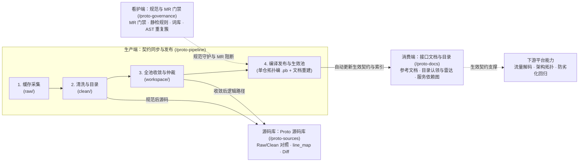
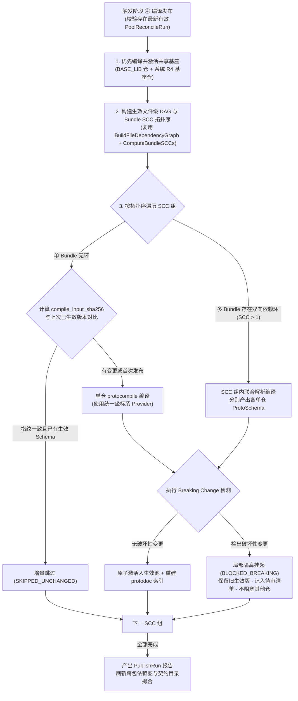

# ADR-29：「Proto 契约治理」四阶段可视化流水线闭环与四菜单信息架构重构决策

- **文档编号**：`29-proto-contract-pipeline-closure-and-ia-redesign-adr.md`
- **状态**：Proposed（待架构师评审）
- **日期**：`2026-11-27`
- **关联与演进关系**：
  - 演进 [`ADR-19`](./19-proto-contract-ia-unbundling-and-four-workbenches-adr.md)（「Proto 契约治理」四工作台信息架构）；
  - 承接并闭环 [`ADR-26 (r4)`](./26-shared-git-cache-and-subsystem-proto-tree-adr.md)（共享缓存四段式流水线）、[`ADR-27 (r1)`](./27-proto-export-directory-and-normalization-governance-adr.md)（500+ 平台仓全量同步与导出目录治理）及 [`ADR-28`](./28-uservice-normalization-pg-flattening-and-compile-closure-adr.md)（`uService` 清洗转换、去 `/pg` 扁平化与 Stage C+ 全池编译收敛）；
  - 关联 [`ADR-10`](./10-enhanced-proto-schema-file-management-adr.md)（单一生效 `.pb` 池）、[`ADR-16`](./16-multi-implementation-service-contract-adr.md)（接口库与多实现契约）与 [`ADR-24`](./24-csg-discovery-process-centric-and-physical-logical-boundary-adr.md)（统一契约目录与五态雷达）。

---

## 1. 背景与问题陈述 (Context & Problem Statement)

`ADR-26` ~ `ADR-28` 已在服务端沉淀了相当完备的底层能力：共享宿主机 Git 缓存同步（`CACHE_ONLY` / `FETCH_MISSING`）、`rule-normalizer/v2`（`uService` 转换、去 `/pg` 扁平化、`line_map` 追踪）、全池 Stage C+ 收敛（R1~R4 闭环与共享基座收割 + R7 纯 Go `protocompile` 编译自愈 + R8 根因隔离）及 `protos/workspace/` 原子导出。

然而，站在**终端用户（研发消费接口文档 / 管理员把缓存 `.proto` 清洗发布为可用契约）**的使用目的审视当前控制台，从“缓存获取 `.proto` → 清洗规整 → 全池收敛 → 产出接口文档”之间存在 **5 个结构性断层**：

### 1.1 Stage C+ 与 Stage D / 活体文档之间存在“断头路”
沿着真实代码执行链路追踪，采集清洗与最终可用文档之间目前是断裂的：
1. **同步期单仓盲编译必然受挫且默认不激活**：在 [ProtoExportGovernancePane.tsx](file:///home/fugui/codes/code-contract/frontend/src/pages/ProtoSchemaWorkbenchPage/ProtoExportGovernancePane.tsx) 触发「仅同步已有缓存」后，[platform_sync_job.go](file:///home/fugui/codes/code-contract/internal/server/gitclient/platform_sync_job.go#L150) 与 [compiler_pipeline.go](file:///home/fugui/codes/code-contract/internal/server/gitclient/compiler_pipeline.go#L1356-L1385) 按**单仓独立**执行 Stage A→B→D。此时全池投票（R2）、基座收割（R4）与跨仓编译自愈（R7）尚未运行，单仓往往编不过；即便编译成功，自动生成的 `GitProtoBundle` 默认 `AutoActivate = false`，产物仅停留在未激活草稿态，**「接口参考文档」页面完全不可见**。
2. **全池收敛完即戛然而止**：用户在前端点击「全池编译收敛与工作区导出」后，[pool_reconciler.go](file:///home/fugui/codes/code-contract/internal/server/gitclient/pool_reconciler.go#L927-L1137) 的 `RunPoolReconcile` 成功消除了冲突与报错并落盘 `protos/workspace/`——**但到此就结束了**，既没有驱动编译生成各仓 `.pb` 描述集（`ProtoSchema`）、也没有激活生效池，更没有调用 `protodoc.RebuildForSchema` 更新接口参考文档索引。
3. **最后一公里推给用户自己拼装**：用户切去「接口参考文档」发现仍为空或仍是旧版，必须再摸索到最底部的「描述集与依赖」（`/schemas`）手动排查、补编与逐个激活。

### 1.2 菜单按“内部技术组件”划分，消费与运维主次倒挂
当前 [menu.ts](file:///home/fugui/codes/code-contract/frontend/src/menu.ts#L50-L74) 下 `Proto 契约治理` 的 4 个一级子菜单是历史演进叠加的产物：
- **中间编译器产物独占一级菜单**：`描述集与依赖`（`/schemas`）把 `.pb` DescriptorSet 这种底层编译产物抬成了平级一级菜单，普通研发无法理解“源码、描述集、接口文档”的因果关系；而高价值的「跨包依赖关系图」却深埋在 `/schemas` 的第二个 Tab 中。
- **生产主入口被藏在二级页签**：整套从缓存采集、规则清洗到全池收敛的生产控制台，被塞在 `源码与 Git 仓`（`/proto-sources`）的**第二个子标签**（`?view=governance`）中，默认打开却是只读「源码浏览」。

### 1.3 同类闭环动作被撕裂到多个页面与抽屉
同一件事在界面上往往要“在一个地方看问题、去另一个地方改配置、回第三个地方重跑”：
- 查看 R3 同路径冲突与 `symbol_diff` 在「仓库导出与治理 → 查看最近协调报告」抽屉（[PoolReconcileReportDrawer.tsx](file:///home/fugui/codes/code-contract/frontend/src/pages/ProtoSchemaWorkbenchPage/PoolReconcileReportDrawer.tsx)）；
- 真正点击「冲突仲裁」指认权威提供方，却要切回「源码浏览」Tab 右上角打开另一个独立抽屉（[ProtoConflictArbitrationDrawer.tsx](file:///home/fugui/codes/code-contract/frontend/src/pages/ProtoSchemaWorkbenchPage/ProtoConflictArbitrationDrawer.tsx)）；
- 「基线试编译报告」另开独立 Modal，单仓「重洗」在治理表行内，单仓「立即同步 / 远端 SHA256 对账」又留在源码浏览页工具栏。

### 1.4 工具栏平行堆叠，缺少因果引导与“变更漂移（Stale）”感知
当前治理控制台顶部横向平铺了 6 个平级按钮（`仅同步已有缓存`、`缺失时自动拉取`、`全池编译收敛与工作区导出`、`查看最近协调报告`、`全局清理规则与 JSON`、`基线试编译报告`）：
- 新手无法判断它们的**先后因果顺序**；
- 管理员调整了清洗规则、修改了某仓导出目录或仲裁了一条冲突后，界面**没有明确告知下游哪一步已过期（Stale）、应当重跑哪一步**，只能凭经验试错。

### 1.5 内部工程黑话直出，文档工作台内部亦存在视图重叠
- 界面大量直出实现态枚举与算法代号（`HAS_PROTO`、`NO_LOCAL_CACHE`、`CACHE_ONLY`、`Clean 目标导出目录（方案 A）`、`Stage C+`、`R3/R7/R8`），提高了解读门槛；
- [ProtoDocsWorkbenchPage.tsx](file:///home/fugui/codes/code-contract/frontend/src/pages/ProtoSchemaWorkbenchPage/ProtoDocsWorkbenchPage.tsx#L214-L243) 下同时并列了「全注释参考文档」「契约认领与方法目录」「统一契约目录与五态雷达」三个视图，后两者均为服务认领与治理目录，职责明显重叠。

---

## 2. 核心架构裁决 (Architectural Decisions)

跳出当前“以底层模块为界面单元”的拼盘逻辑，围绕**“消费契约 / 浏览源码 / 生产发布 / 规范门禁”**四大明确目的，重新组织 `Proto 契约治理` 的信息架构与端到端流水线。

### 2.1 「Proto 契约治理」四菜单信息架构重塑（演进 ADR-19）

**保留 4 个二级菜单**，但彻底更换组织原则——**消费端、源码库、生产流水线、看护门禁**各司其职，将孤立的 `/schemas`（`.pb` 描述集管理）拆解并融入正确的上下文中：



#### 新旧 4 菜单定位与路由对照

| 排序 | 新菜单名称 | 路由 | 目标受众 | 核心职责与整合变更 |
| :---: | :--- | :--- | :--- | :--- |
| **1** | **接口文档与目录** | `/proto-docs` | 全员研发 / 架构师 | **高频消费首页**：整合为 3 个正交视图——① `全注释参考文档`；② `服务目录与认领`（融合原“契约认领与方法目录”与“统一契约目录五态雷达”）；③ `服务依赖图`（从原 `/schemas` 提升至此，支持点击节点直达接口文档或源码）。 |
| **2** | **Proto 源码库** | `/proto-sources` | 研发 / 契约维护者 | **纯粹的只读规范源码浏览台**：保留 `HAS_PROTO` 过滤、子系统/包双视图懒加载树、仅看服务闭包开关、Raw vs Clean 行级对照、`line_map` 跳转、Commit Diff 与远端 SHA256 对账；**彻底剥离**原 `?view=governance` 运维页签与冲突仲裁抽屉，仅在单仓头部保留「前往流水线治理此仓 ↗」跳链。 |
| **3** | **契约同步与发布** | `/proto-pipeline` | 管理员 / 架构师 | **端到端四阶段可视化流水线工作台（新增）**：承接原 `/proto-sources?view=governance` 与原 `/schemas` 的 `.pb` 生命周期管理，串联「① 缓存采集 → ② 清洗与目录 → ③ 全池收敛与仲裁 → ④ 编译发布与生效池」，提供「一键同步并发布」与各阶段漂移提醒。 |
| **4** | **规范与 MR 门禁** | `/proto-governance` | 架构师 / 质量守门人 | **持续看护工作台**：延续原 4 个平铺子标签（`Git MR 门禁流水`、`静态检查规则`、`领域标准词库`、`体检报告与 AST 重复簇`）。 |

#### 无损深链与历史路由重定向契约
为保证通知中心、Markdown 手册、大盘与架构详情页的历史链接 100% 不失效，更新 `App.tsx` 中的 `SchemasRouteWrapper` 并新增 `ProtoSourcesRouteWrapper`：

| 旧路径 / 查询参数 | 重定向目标 | 保留的查询参数 / Hash |
| :--- | :--- | :--- |
| `/proto-sources?view=governance` | `/proto-pipeline` | `repo_id`、`search` 等 |
| `/schemas`（无 `tab` 或 `tab=assets`） | `/proto-pipeline?stage=publish` | `schema_id`、`category`、`status`、`search` |
| `/schemas?tab=graph` | `/proto-docs?docs_view=graph` | `active_only`、`schema_id` |
| `/schemas?tab=docs` / `tab=catalog` | `/proto-docs?docs_view=reference\|catalog` | `service_name`、`schema_id`、`claimed_status`、`state` |
| `/schemas?tab=sources` | `/proto-sources` | `file_id`、`repo_id`、`bundle_id`、`#L<n>` |
| `/schemas?tab=mr-gates\|lint-*` | `/proto-governance?gov_tab=*` | `runId`、`mr_page` 等（同步更新后端 `mr_runner.go` 站内信默认链接为 `/proto-governance?gov_tab=mr-gates&runId=%d`） |

---

### 2.2 「契约同步与发布」四阶段可视化流水线设计 (`/proto-pipeline`)

将原治理页横向堆叠的 6 个平行按钮与分散抽屉，重构为**「全局主路径控制条 + 四阶段 Stepper 导航卡 + 下方阶段专属工作区」**。

#### 2.2.1 顶部全局操作栏与四阶段 Stepper

```text
┌────────────────────────────────────────────────────────────────────────────────────────┐
│ [ ▶ 一键同步并发布（仅读缓存） ]    [ ⚙ 清洗规则配置 (rev.20) ]    [ 外部 .pb 兜底导入 ▾ ] │
│ 实时任务条：全流程作业 #12 · 阶段 ③/④ 全池收敛中... [查看阶段明细]                         │
├──────────────────┬──────────────────┬──────────────────┬───────────────────────────────┤
│ ① 缓存采集        │ ② 清洗与目录      │ ③ 全池收敛与仲裁  │ ④ 编译发布与生效池             │
│ 12 仓含 Proto     │ 680 通过 · 12 隔离│ 0 报错 · 3 冲突   │ 309 服务已生效 · 2 仓待审阻断   │
│ ● 已同步 (10m前)  │ ⚠ 规则已改，待重洗 │ ○ 等待上游重洗    │ ● 存在增量待发布               │
└──────────────────┴──────────────────┴──────────────────┴───────────────────────────────┘
```

- **90% 日常主路径（Happy Path）**：管理员点击左上角唯一主按钮 **「一键同步并发布（仅读缓存）」**，系统依次串联执行 `① 扫描本地缓存 → ② 规则清洗 → ③ 全池依赖收敛 → ④ 单仓拓扑编译发布与文档重建`。全流程绿灯完成后，顶部弹出明确结果条：**“本次发布 309 个服务 / 7,213 个接口，已更新文档索引 → [前往接口文档 ↗]”**。
- **10% 治理排障路径（Exception Path）**：任一阶段卡片出现黄灯（存在待处理项或上游变更漂移）或红灯（失败/阻断），点击该阶段卡片即可在下方直接展开其专属工作区完成处置与单步重跑，不再跳页或嵌套多层抽屉。
- **上游变更漂移（Stale）自动感知**：后端 `GET /api/proto-pipeline/overview` 根据各阶段时间戳与配置版本号计算漂移标记，彻底消除“改了配置不知道该重跑哪一步”的心智负担：
  1. 任一仓更新到新 Commit 或手工调整了某仓采集/排除开关 → **阶段 ②** 亮起 `待重新清洗`；
  2. 全局或单仓 `proto-governance/v1` 规则变更（`config_sha256` 变化）或执行了单仓重洗 → **阶段 ②/③** 按需亮起 `规则已变更，建议免网络重洗` / `待重新收敛`；
  3. 阶段 ③ 完成人工冲突仲裁（`contract_proto_import_owners` 变更）或固化了自动修复补丁 → **阶段 ③** 亮起 `仲裁已更新，待重新收敛`；
  4. 阶段 ③ 产出了更新的 `PoolReconcileRun` 或有单仓输入指纹变化 → **阶段 ④** 亮起 `有新收敛结果待发布`。

#### 2.2.2 四阶段下方工作区设计

| 阶段 | 工作区核心职责 | 操作与台账内容（收口与降噪） |
| :--- | :--- | :--- |
| **① 缓存采集** | 掌握平台 500+ 代码仓的本地缓存就绪度与 Proto 探测覆盖率 | • 顶部操作：`扫描本地缓存`（默认 `CACHE_ONLY`）、`补拉缺失缓存`（仅当存在「本地未缓存」且 `shared_write_enabled=true` 时激活，带二次确认）、`重试失败仓`。<br>• 6 态汇总胶囊筛选：全部 / 含 Proto / 无 Proto / 本地未缓存 / 同步失败 / 已停用。<br>• **极简台账列**：代码仓（只读，含子系统与默认分支） \| 缓存与采集状态 \| 最近同步 Commit \| 操作（`启用/排除采集`、`单仓拉取`）。不再混杂清洗统计与导出路径。 |
| **② 清洗与目录** | 把 `raw/` 原始文件清洗为合规 `.proto` 并规整 `clean/` 目录归属 | • 顶部规则摘要条：直观展示已启用的核心规则状态（如 `uService 自动转换`、`去 /pg 扁平化`、`默认 proto2`、`排除子系统: 3M`、`共享基座源: 2`），提供 `编辑规则与 JSON`、`载入现网预设`、`免网络全量重洗`（支持全局 Dry-Run 预览）。<br>• **异常优先排序**：默认将「含隔离文件 (`quarantined > 0`)」或「未分配子系统 (`_unassigned`)」的仓库置顶。<br>• 台账列：代码仓 \| 清洗后归属目录（标明是否覆写） \| 文件统计（采集 / 通过 / 隔离） \| 操作（`调整目录与规则`（含单仓 Dry-Run Diff）、`免网络重洗`、`查看 Raw/Clean 对比 ↗`）。 |
| **③ 全池收敛与仲裁** | **收口合一**：将原分散在 3 处的协调报告、冲突仲裁与基线试编译全部内联到本阶段 | • 顶部动作：`重新全池收敛`（纯 Go 内存秒级重跑 R1~R4 + R7 + R8 并导出 `workspace/`）。<br>• **4 个内联子视图**（点击即可在当前页处置）：<br>  1. **同名冲突仲裁（R3 合并仲裁台）**：同屏展示所有冲突路径、`content_identical` 内容等价性标签、各候选独有符号差异（`symbol_diff`），**每组直接提供「设为权威提供方」操作按钮**，写回 `contract_proto_import_owners` 后直接提示「重新全池收敛」验证；<br>  2. **自动修复补丁（R7）**：列出路径重写/补全/切换详情，支持预览源码 Diff 并勾选「固化进清洗规则」；<br>  3. **编译隔离与根因诊断（R8）**：明确区分「根因错误文件」与「受牵连文件」，点击直接侧滑只读源码抽屉定位到 `#L<n>`；<br>  4. **自动收割基座（R4）**：展示从 `include/`、`ltcommon/` 等目录自动收割入池的共享基座清单。 |
| **④ 编译发布与生效池** | **补齐最后一公里**：将收敛后的单仓编译为 `.pb`、过破坏性门禁、激活并刷新接口文档 | • **待发布变更队列**：展示上次发布后有变更的单仓清单、自动跳过的未变更仓数、以及「破坏性变更待审阻断」单仓（含 `BreakingRuleViolation` 与受影响下游服务清单）。<br>• 顶部操作：`编译并发布生效`（主按钮，支持按全部/指定子系统发布）；右上角折叠收口 `外部 .pb 兜底导入` 与 `在线编译` 入口（继承原 `SchemaUploadModal`）。<br>• **生效契约版本台账**：承接原 `/schemas` 资产表，按单仓/Bundle 展示当前生效版本、接口数、认领率、破坏性审计标记，支持查看详情抽屉、下载 `.pb`、停用或回滚至历史版本。 |

---

### 2.3 打通“断头路”：基于 Stage C+ 收敛池的单仓拓扑编译与分级发布引擎

遵循**保留单仓 / Bundle 粒度**的裁决，同时彻底消除“同步阶段单仓盲编失败”与“全池收敛完不生成文档”的问题，后端流水线职责重划如下：

#### 1. 阶段 ①② 与 编译 解耦：`sync-all` 默认 `skip_compile = true`
- 修改 [platform_sync_job.go](file:///home/fugui/codes/code-contract/internal/server/gitclient/platform_sync_job.go) 的 `SyncAllRequest` 与批处理流水线：批量采集/重洗默认仅运行 **Stage A（采集） + Stage B（`rule-normalizer/v2` 清洗落库与 `raw/`/`clean/` 树更新）**，不再在跨仓坐标系尚未对齐前逐仓触发 `CompileAndSaveSchema`。
- 收益：500+ 仓全量同步无需承担无效的 `protocompile` 与 `lint` 失败开销，状态干净收敛为 `HAS_PROTO / NO_PROTO / NO_LOCAL_CACHE / SYNC_FAILED / EXCLUDED`。
- 兼容保留：单仓“立即同步”（`POST /api/git-repos/:id/sync`）与 Git Webhook 触发仍可通过参数按需保留增量编译能力，用于日常单仓快速验证。

#### 2. 阶段 ④ 单仓拓扑编译与分级发布引擎（`PublishWorkspaceBundles`）
在 `internal/server/gitclient/` 新增发布编排器，严格消费最近一次成功完成的 Stage C+ 全池协调结果（`ProtoFile` 中已对齐去 `/pg` 坐标系、完成 R4 基座收割、应用 R7 自动修复、标记 `is_external_copy = false` 且非 `QUARANTINED` 的文件集合）：



关键工程规则如下：
1. **基座先行激活**：先编译并激活所有 `Category = BASE_LIB` 的 Bundle（包括 `SystemSharedBasePlatformRepoID` 下由 R4 自动收割入池的共享基座文件），确保所有业务仓编译时均能从生效池与统一坐标系 Provider 解析到 `OptionsExtensions.proto`、`BasicTypeMsg.proto` 等基础定义。
2. **保留单仓粒度与 SCC 联编兜底**：每个含有效服务/消息文件的 `GitProtoBundle` 独立产出一个 `ProtoSchema`（`Name = bundle.TargetSchemaName`）并保持既有 `ProtoOperation` 归属与 `ServiceContractGroup` 血缘；当 `ComputeBundleSCCs` 检测到多仓互相 `import` 构成强连通分量（`len(scc) > 1`）时，编译期将组内文件合并进同一虚拟 `SourceProvider` 完成 `protocompile`，再分别按各自所属文件切片落盘为独立单仓 `ProtoSchema` 并批次原子激活。
3. **输入指纹增量跳过（`compile_input_sha256`）**：对每个 Bundle 计算确定性指纹 `SHA-256(排序后的 (file_path, content_sha256) + 直接/传递依赖文件 content_sha256 + entry_points)`；若与当前生效 Schema 的指纹完全一致且未传 `force_recompile=true`，直接跳过编译与文档重建，使日常百仓增量发布控制在秒级。
4. **破坏性变更局部隔离（Partial Publish）**：单仓若存在 `SchemaBreakingError`（如删接口、改字段类型/Tag），**仅挂起该单仓的激活动作**（以未激活版本保留在台账中，原已生效版本继续服务现网解码与文档），将其记录到本次发布报告的 `breaking_items`（含 `breaking_rules` 与 `affected_dependents`），**其余无破坏性变更的仓库正常发布生效并立即更新「接口参考文档」**。管理员在阶段 ④ 工作区核验后，填写 `breaking_reason` 一键放行（沿用 `allow_breaking=true` 与 P1 审计）。
5. **文档与目录联动**：任一 `ProtoSchema` 激活成功后，立即调用 `protodoc.RebuildForSchema(db, schema)` 重建接口文档符号与黄金样本，并在整批发布收尾时触发一次异步的统一目录 `.pb` 撮合刷新，使「接口文档与目录」即时反映最新契约。

#### 3. 一键全流程编排（`RunFullProtoPipeline`）
当管理员点击「一键同步并发布」时，服务端创建一条持久化编排任务（`contract_proto_pipeline_runs`），按序异步驱动：
`COLLECT & NORMALIZE (Stage A+B, skip_compile=true) → RECONCILE_POOL (Stage C+ R1~R8) → PUBLISH_BUNDLES (Stage D 单仓拓扑编译激活 + 文档重建)`，全程通过 SSE 事件 `proto_pipeline.progress` 实时驱动前端 4 阶段 Stepper 进度条，且支持从任意中断或 Stale 阶段断点续跑。

---

### 2.4 消费端聚合与「去黑话」交互规范

#### 1. 「接口文档与目录」（`/proto-docs`）三视图收拢
将原 [ProtoDocsWorkbenchPage.tsx](file:///home/fugui/codes/code-contract/frontend/src/pages/ProtoSchemaWorkbenchPage/ProtoDocsWorkbenchPage.tsx) 的 3 个 Tab 整理为职责不重叠的消费三视图：
- **`reference`（参考文档）**：全注释服务树 + 方法签名 + 字段字典 + `@em` 枚举检索 + 黄金示例 JSON + Markdown 导出 + 行号直达 `/proto-sources`。
- **`catalog`（服务目录与认领）**：合并原 `catalog-ops`（契约认领与方法目录）与 `unified-catalog`（统一契约目录与五态雷达），以顶部五态雷达胶囊（`全部 / 健康 / 未认领孤儿 / 阴影在线 / 幻影订阅 / 漂移`）统一筛选服务清单，行内展开即可完成模块认领与方法查看，消除两张功能相近的目录表。
- **`graph`（服务依赖图）**：直接挂载原 `ProtoDependenciesGraphPane`，支持点击节点直达该服务的参考文档或流水线对应仓位。

#### 2. 界面文案「去黑话」规范
生产界面面向研发与管理员统一使用业务语言，算法代号与底层枚举仅保留在 Tooltip 或技术详情抽屉中：

| 原界面文案 | 新规范业务文案 |
| :--- | :--- |
| `HAS_PROTO` / `NO_PROTO` / `NO_LOCAL_CACHE` / `EXCLUDED` | **含 Proto** / **无 Proto** / **本地未缓存** / **已排除** |
| `CACHE_ONLY` / `仅同步已有缓存` | **扫描本地缓存**（说明：仅读取宿主机已有缓存，不触发网络拉取） |
| `FETCH_MISSING` / `缺失时自动拉取` | **补拉缺失缓存** |
| `Clean 目标导出目录（方案 A）` | **清洗后归属目录** |
| `全池编译收敛与工作区导出` | **全池依赖收敛** |
| `R3 冲突与 symbol_diff` / `R7 自动修复` / `R8 根因隔离` / `R4 基座收割` | **同名冲突仲裁** / **自动修复补丁** / **编译隔离诊断** / **共享基座收割** |
| `Stage C+` / `Monorepo Bundles` | **全池依赖收敛** / **契约包 (Bundles)** |

---

## 3. 关键方案权衡 (Alternatives Considered)

| 决策维度 | 备选方案（未采纳） | 本 ADR 采纳方案 | 裁决理由 |
| :--- | :--- | :--- | :--- |
| **侧边栏菜单数量** | 收拢为 3 项（把源码浏览降级为「接口文档」内的子标签） | **保留 4 项菜单**：`接口文档与目录`、`Proto 源码库`、`契约同步与发布`、`规范与 MR 门禁` | 研发日常直接按仓库/子系统检索 `.proto` 源码（含 Raw/Clean 对比与历史 Diff）仍是独立高频诉求，单列菜单可避免文档页过于臃肿，同时清晰分离「消费文档」「浏览源码」「生产流水线」「看护门禁」四类心智模型。 |
| **阶段 ④ 编译发布粒度** | 按平台子系统（`service_group`）聚合打包为单一大型 `.pb` 描述集 | **保留单仓 / Bundle 粒度编译与发布** | 完美延续现有 `GitProtoBundle` → `ProtoSchema` → `ServiceContractGroup` → `ModuleService` 血缘映射与破坏性变更按仓精准阻断能力；跨仓复杂依赖通过 Stage C+ 统一坐标系和阶段 ④ `BASE_LIB` 先行 + SCC 拓扑编译彻底解决，无需打破原有单仓资产模型。 |
| **同步期是否顺带单仓编译** | 保持 `sync-all` 期间每仓同步后立即单仓编译 | **`sync-all` 默认 `skip_compile = true`，统一交由阶段 ④ 拓扑编译** | 未经 Stage C+ 全池对齐和 R4/R7 修复前，单仓盲编必然大面积报错且产生大量无效未激活草稿；解耦后 500+ 仓采集清洗与全池拓扑编译各司其职、速度与确定性大幅提升。 |
| **冲突仲裁交互载体** | 保留在「源码浏览」右上角独立抽屉，与协调报告抽屉分离 | **收口并内联至流水线阶段 ③「同名冲突仲裁」视图** | 看差异（`content_identical` / `symbol_diff`）与拍板裁决（写入 `contract_proto_import_owners`）本身就是同一个原子决策动作，内联合一消除跨页来回切换。 |

---

## 4. 数据模型、API 与前端演进摘要

### 4.1 数据模型增量变更
1. **`contract_git_proto_bundles`（`models/git_repo.go`）扩展字段**：
   - `last_publish_input_sha256`（`varchar(64)`）：上次成功发布入生效池的拓扑编译输入指纹（用于阶段 ④ 增量跳过）；
   - `last_publish_status`（`varchar(32)`）：`PENDING | PUBLISHED | SKIPPED | BLOCKED_BREAKING | FAILED`；
   - `pending_breaking_schema_id`（`*uint64`）：检出破坏性变更而被局部挂起的待放行草稿 `ProtoSchema` ID。
2. **新增 `contract_proto_publish_runs`**：
   - 记录每次阶段 ④ 批量编译发布结果：`id`、`pool_reconcile_run_id`、`status`（`RUNNING | COMPLETED | PARTIAL_BLOCKED | FAILED`）、`total_bundles`、`published_count`、`skipped_count`、`breaking_blocked_count`、`failed_count`、`details_json`（JSONB：逐仓编译结果、破坏性违规与受影响下游）、`triggered_by`、`duration_ms`、`started_at`、`finished_at`。
3. **新增 `contract_proto_pipeline_runs`**：
   - 记录一键四阶段流水线端到端编排状态：`id`、`from_stage`（`COLLECT | NORMALIZE | RECONCILE | PUBLISH`）、`current_stage`、`status`、`sync_job_id`、`reconcile_run_id`、`publish_run_id`、`error_message`、`triggered_by`、`started_at`、`finished_at`。

### 4.2 核心 API 契约演进
- **`GET /api/proto-pipeline/overview`**：聚合返回 4 阶段实时状态摘要、各阶段水位时间戳/版本与 **Stale 漂移标记**（`normalize_stale`、`reconcile_stale`、`publish_stale` 及原因文案）。
- **`POST /api/proto-pipeline/run`**（需 `contract_admin` 权限，记录 P2 审计）：触发一键四阶段编排作业（支持 `from_stage`、`cache_policy`、`force_recompile`），返回 `pipeline_run_id` 并通过 SSE `proto_pipeline.progress` 推送阶段推进。
- **`GET /api/proto-pipeline/runs/:id`**：查询编排作业及关联各子任务状态。
- **`POST /api/proto-governance/publish-workspace`**（需 `contract_admin` 权限，记录 P1/P2 审计）：单独触发阶段 ④ 单仓拓扑编译发布（支持指定 `bundle_ids`、`force_recompile`、`sync` 同步/异步模式），通过 SSE `proto_publish.progress` 推送进度。
- **`GET /api/proto-governance/publish-runs/latest`** & **`GET /api/proto-governance/publish-runs/:id`**：查询阶段 ④ 发布报告与逐仓破坏性阻断明细。
- **`POST /api/proto-governance/publish-runs/:id/approve-breaking`**（需 `contract_admin` 权限，强制校验非空 `breaking_reason` 并写入 P1 审计）：对发布报告中被 `BLOCKED_BREAKING` 挂起的指定 `schema_ids` 执行人工放行激活与 `protodoc` 重建。
- **既有接口增强**：`POST /api/git-repos/sync-all` 新增布尔字段 `skip_compile`（默认 `true`，向后兼容显式传 `false`）。

### 4.3 前端模块重构清单
- **`menu.ts` & `App.tsx`**：更新 4 菜单项（新增 `/proto-pipeline`），重构 `SchemasRouteWrapper` 与 `ProtoSourcesRouteWrapper` 实现全量旧深链无损重定向。
- **新增 `ProtoPipelineWorkbenchPage/`**（承接并升级原 `ProtoExportGovernancePane`）：
  - `PipelineStepperHeader`（一键同步发布按钮 + 4 阶段状态/Stale 卡片 + 实时进度条）；
  - `StageCollectPane`（阶段 ① 极简 500+ 仓采集台账）；
  - `StageNormalizePane`（阶段 ② 异常置顶清洗台账 + 规则摘要 + Dry-Run 抽屉复用）；
  - `StageReconcilePane`（阶段 ③ 内联 4 视图：合并 R3 差异与冲突裁决、R7 补丁固化、R8 根因诊断、R4 收割清单）；
  - `StagePublishPane`（阶段 ④ 待发布队列 + 破坏性阻断人工放行面板 + 生效版本台账 + 外部 `.pb` 兜底导入入口）。
- **`ProtoDocsWorkbenchPage` & `ProtoSourcesWorkbenchPage`**：前者整合 `reference / catalog / graph` 三视图；后者移除 `?view=governance` 与冲突仲裁抽屉，专注纯净只读源码与对比体验。

---

## 5. 分期实施路线图与验收标准 (M43 ~ M45)

| 里程碑 | 核心交付范围 | 关键验收标准 (AC) |
| :--- | :--- | :--- |
| **M43：后端单仓拓扑发布引擎与一键流水线闭环** | 1. 新增 `contract_proto_publish_runs` 与 `contract_proto_pipeline_runs` 模型及 Bundle 指纹字段；<br/>2. 实现 `PublishWorkspaceBundles`（`BASE_LIB` 先行 + Tarjan SCC 拓扑序编译 + 输入指纹跳过 + 破坏性局部隔离挂起与 P1 放行 + `protodoc.RebuildForSchema` 联动）；<br/>3. `sync-all` 默认 `skip_compile=true` 解耦，新增 `/api/proto-pipeline/*` 与 `/api/proto-governance/publish-workspace` 系列接口及 SSE 事件。 | 1. 端到端集成测试（`testdb.SetupIsolatedDB`）：从本地 Git 沙箱缓存触发一键流水线，阶段 ①→②→③→④ 自动推进，最终 `contract_proto_schemas` 生效且 `/api/proto-docs/tree` 可立即查到服务与 RPC；<br/>2. 构造含破坏性变更仓 + 合规仓混编：合规仓正常更新文档，破坏性仓被局部挂起且填入 `breaking_reason` 后可独立放行；<br/>3. 未变更 Bundle 二次发布 100% 命中 `SKIPPED_UNCHANGED`。 |
| **M44：`/proto-pipeline` 四阶段可视化流水线工作台** | 1. 实现顶部一键主路径与 4 阶段 Stepper + Stale 漂移提示；<br/>2. 实现阶段 ①~④ 专属内联工作区，完成 R3 报告与 `contract_proto_import_owners` 人工仲裁合一、阶段 ④ 破坏性放行与生效版本台账；<br/>3. 完成全部界面文案业务化（去黑话）改造。 | 1. 改规则或仲裁冲突后，`/overview` 与 Stepper 正确点亮对应阶段 Stale 提示；<br/>2. 阶段 ③ 内可直接查看 `symbol_diff` 并完成权威提供方指认，无需跳转其他页面或打开双层抽屉；<br/>3. `make lint`、`make test` 全绿，无硬编码色值或 `>= 1000` z-index 违规。 |
| **M45：四菜单 IA 切换、消费端聚合与全链路回归** | 1. 切换 `menu.ts` 为新 4 菜单；<br/>2. `/proto-docs` 合入 `服务依赖图` 并融合方法目录与五态雷达；`/proto-sources` 剥离治理运维杂项；<br/>3. 落地全量旧深链无损重定向及站内信链接更新。 | 1. 所有历史 URL（`/schemas`、`/schemas?tab=graph`、`/proto-sources?view=governance` 等）100% 无损跳转且保留 Query 与 `#L<n>`；<br/>2. 面向测试沙箱执行 E2E 验证，确认「一键同步并发布 → 接口文档可见 → 源码对比定位」全链路畅通。 |

---

## 6. 架构师评审讨论议题 (Open Questions for Architecture Review)

提请架构师团队围绕以下 **5 个核心边界决策** 进行讨论确认，确认后即可进入 `01-features` / `02-design` / `03-api` 文档同步与 M43~M45 实施：

1. **阶段 ① `sync-all` 默认跳过编译（`skip_compile=true`）的边界**：
   - **提案**：全量同步作业默认只做采集与清洗，把编译统一收口到阶段 ④；仅单仓手动「立即同步」或 Git Webhook 保留可选即时增量编译。
   - **待确认**：是否接受批量同步不再逐仓产出未激活的失败/草稿 `ProtoSchema`？
2. **阶段 ④「一键同步并发布」对无破坏性变更仓的自动激活策略**：
   - **提案**：若阶段 ③ 无未解决的致命阻塞且单仓未检出 Breaking Change，**自动激活入生效池并刷新文档**（让“一键同步并发布”真正达成所见即所得）；仅破坏性变更仓留置人工确认放行。
   - **待确认**：现网生产环境是否允许无破坏性变更自动激活，还是需要配置开关支持“仅生成待发布预览，由管理员二次点击确认生效”？
3. **存在未人工裁决的内容不等价冲突（R3 `content_identical=false`）时阶段 ④ 的态度**：
   - **提案**：默认采纳 R3 7 级确定性规则自动选出的胜出方继续编译发布，并在阶段 ④ 顶部给出黄色风险提示（引导至阶段 ③ 复核），不硬阻断整批发布；管理员可按需勾选「存在未裁决内容冲突时阻断涉及仓发布」严格模式。
   - **待确认**：默认采用“告警+自动裁决放行”还是“对涉及冲突仓默认挂起等待人工拍板”？
4. **跨仓循环依赖（SCC `len > 1`）的编译落盘方式**：
   - **提案**：编译期合并同一虚拟文件集过 `protocompile`，落盘仍拆分为各单仓独立 `ProtoSchema`（包含其闭包必需描述信息）并作为同一事务批次激活，保持单仓台账与认领归属不变。
   - **待确认**：现网 309 个服务仓中若出现互引闭环，是否接受在多仓各自 `DescriptorBytes` 中携带闭环依赖文件描述符，还是强制要求架构上先拆解依赖环？
5. **手工上传 `.pb` 与在线 `.proto` 直编的长期定位**：
   - **提案**：将外部 `.pb` 上传保留在阶段 ④ 右上角「外部 `.pb` 兜底导入」（用于暂未纳入 Git 缓存的第三方黑盒二进制接口）；评估现有 `SchemaUploadModal` 中的「在线文本直编 `.proto`」是否继续保留或逐步收敛为仅 Git 源驱动。
