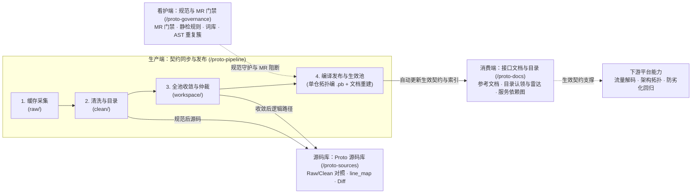
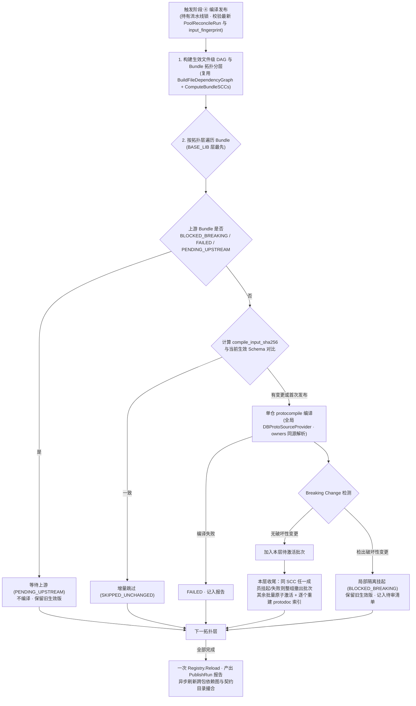

# ADR-29：「Proto 契约治理」四阶段可视化流水线闭环与四菜单信息架构重构决策

- **文档编号**：`29-proto-contract-pipeline-closure-and-ia-redesign-adr.md`
- **状态**：Implemented（r4，2026-11-27 评审确认，M43~M45 已交付）
- **日期**：`2026-11-27`
- **修订记录**：
  - r1：初稿，确立「接口文档与目录 / Proto 源码库 / 契约同步与发布 / 规范与 MR 门禁」四菜单与四阶段可视化流水线，提出阶段 ④ 单仓拓扑编译发布引擎。
  - r2：增补「完全自封闭」裁决，下线外部 `.pb` 上传与在线 `.proto` 直编入池入口。
  - r3：依据代码对照评审修订——① 补齐 **R3 胜出方持久化**，使阶段 ④ 编译解析与阶段 ③ 收敛结果同源（原方案在内容不等价冲突下必然 `ImportAmbiguousError`）；② 新增**破坏性挂起下游传播（`PENDING_UPSTREAM`）**，堵住下游内嵌新版依赖描述符绕过挂起的漏洞；③ 新增**收敛输入指纹校验与全局流水线互斥锁**；④ 收口单仓同步 / Webhook / MR 合入等**绕过阶段 ④ 的激活入口**；⑤ 编译指纹改存 `ProtoSchema`；⑥ 激活入口增加**来源守卫**，禁止历史外部来源再入池；⑦ 删除冗余的 SCC 联合编译分支，修正「基座先行激活」的理由；⑧ 新接口统一收拢至 `/api/proto-pipeline/*`；⑨ 补全 `docs_view` 旧值兼容、嵌入/独立双路由注册、测试夹具迁移与若干表述勘误。
  - r4：架构评审确认，状态转为 Accepted。第 6 节 5 项待确认议题全部按提案采纳并改写为「已确认决策」；正文同步落地 `publish_mode`（默认 `AUTO`）、`block_on_unresolved_conflict` 严格模式开关（默认关闭）、MR 合入 5 分钟去抖增量流水线与历史归档资产 30 天提醒（不强制停用）。
- **关联与演进关系**：
  - 演进 [`ADR-19`](./19-proto-contract-ia-unbundling-and-four-workbenches-adr.md)（「Proto 契约治理」四工作台信息架构）；
  - 承接并闭环 [`ADR-26 (r4)`](./26-shared-git-cache-and-subsystem-proto-tree-adr.md)（共享缓存四段式流水线）、[`ADR-27 (r1)`](./27-proto-export-directory-and-normalization-governance-adr.md)（500+ 平台仓全量同步与导出目录治理）及 [`ADR-28`](./28-uservice-normalization-pg-flattening-and-compile-closure-adr.md)（`uService` 清洗转换、去 `/pg` 扁平化与 Stage C+ 全池编译收敛）；
  - 关联 [`ADR-10`](./10-enhanced-proto-schema-file-management-adr.md)（单一生效 `.pb` 池）、[`ADR-16`](./16-multi-implementation-service-contract-adr.md)（接口库与多实现契约）与 [`ADR-24`](./24-csg-discovery-process-centric-and-physical-logical-boundary-adr.md)（统一契约目录与五态雷达）；
  - **正式废止**历史手工上传 `.pb` 描述集与在线文本框直编 `.proto` 录入入口，确立「所有契约 100% 源自平台 Git 代码仓缓存」的完全自封闭系统边界。

---

## 1. 背景与问题陈述 (Context & Problem Statement)

`ADR-26` ~ `ADR-28` 已在服务端沉淀了相当完备的底层能力：共享宿主机 Git 缓存同步（`CACHE_ONLY` / `FETCH_MISSING`）、`rule-normalizer/v2`（`uService` 转换、去 `/pg` 扁平化、`line_map` 追踪，含 Stage B 规则 R5/R6）、全池 Stage C+ 收敛（R1~R4 闭环与共享基座收割 + R7 纯 Go `protocompile` 编译自愈 + R8 根因隔离）及 `protos/workspace/` 原子导出。

然而，站在**终端用户（研发消费接口文档 / 管理员把缓存 `.proto` 清洗发布为可用契约）**的使用目的审视当前控制台，从“缓存获取 `.proto` → 清洗规整 → 全池收敛 → 产出接口文档”之间存在 **6 个结构性断层**：

### 1.1 Stage C+ 与 Stage D / 活体文档之间存在“断头路”
沿着真实代码执行链路追踪，采集清洗与最终可用文档之间目前是断裂的：
1. **同步期单仓盲编译必然受挫且默认不激活**：在 [ProtoExportGovernancePane.tsx](file:///home/fugui/codes/code-contract/frontend/src/pages/ProtoSchemaWorkbenchPage/ProtoExportGovernancePane.tsx) 触发「仅同步已有缓存」后，[platform_sync_job.go](file:///home/fugui/codes/code-contract/internal/server/gitclient/platform_sync_job.go#L150) 与 [compiler_pipeline.go](file:///home/fugui/codes/code-contract/internal/server/gitclient/compiler_pipeline.go#L1356-L1385) 按**单仓独立**执行 Stage A→B→D。此时全池投票（R2）、基座收割（R4）与跨仓编译自愈（R7）尚未运行，单仓往往编不过；即便编译成功，自动生成的 `GitProtoBundle` 默认 `AutoActivate = false`，产物仅停留在未激活草稿态，**「接口参考文档」页面完全不可见**。
2. **全池收敛完即戛然而止**：用户在前端点击「全池编译收敛与工作区导出」后，[pool_reconciler.go](file:///home/fugui/codes/code-contract/internal/server/gitclient/pool_reconciler.go#L927-L1137) 的 `RunPoolReconcile` 成功消除了冲突与报错并落盘 `protos/workspace/`——**但到此就结束了**，既没有驱动编译生成各仓 `.pb` 描述集（`ProtoSchema`）、也没有激活生效池，更没有调用 `protodoc.RebuildForSchema` 更新接口参考文档索引。
3. **最后一公里推给用户自己拼装**：用户切去「接口参考文档」发现仍为空或仍是旧版，必须再摸索到最底部的「描述集与依赖」（`/schemas`）手动排查、补编与逐个激活。

### 1.2 菜单按“内部技术组件”划分，消费与运维主次倒挂
当前 [menu.ts](file:///home/fugui/codes/code-contract/frontend/src/menu.ts#L50-L74) 下 `Proto 契约治理` 分组的 4 个二级菜单是历史演进叠加的产物：
- **中间编译器产物独占菜单**：`描述集与依赖`（`/schemas`）把 `.pb` DescriptorSet 这种底层编译产物抬成了平级菜单，普通研发无法理解“源码、描述集、接口文档”的因果关系；而高价值的「跨包依赖关系图」却深埋在 `/schemas` 的第二个 Tab 中。
- **生产主入口被藏在子页签**：整套从缓存采集、规则清洗到全池收敛的生产控制台，被塞在 `源码与 Git 仓`（`/proto-sources`）的**第二个子标签**（`?view=governance`）中，默认打开却是只读「源码浏览」。

### 1.3 同类闭环动作被撕裂到多个页面与抽屉
同一件事在界面上往往要“在一个地方看问题、去另一个地方改配置、回第三个地方重跑”：
- 查看 R3 同路径冲突与 `symbol_diff` 在「仓库导出与治理 → 查看最近协调报告」抽屉（[PoolReconcileReportDrawer.tsx](file:///home/fugui/codes/code-contract/frontend/src/pages/ProtoSchemaWorkbenchPage/PoolReconcileReportDrawer.tsx)）；
- 真正点击「冲突仲裁」指认权威提供方，却要切回「源码浏览」Tab 右上角打开另一个独立抽屉（[ProtoConflictArbitrationDrawer.tsx](file:///home/fugui/codes/code-contract/frontend/src/pages/ProtoSchemaWorkbenchPage/ProtoConflictArbitrationDrawer.tsx)）；
- 「基线试编译报告」另开独立 Modal，单仓「重洗」在治理表行内，单仓「立即同步 / 远端 SHA256 对账」又留在源码浏览页工具栏。

### 1.4 工具栏平行堆叠，缺少因果引导与“变更漂移（Stale）”感知
当前治理控制台顶部横向平铺了 6 个平级按钮（`仅同步已有缓存`、`缺失时自动拉取`、`全池编译收敛与工作区导出`、`查看最近协调报告`、`全局清理规则与 JSON`、`基线试编译报告`）：
- 新手无法判断它们的**先后因果顺序**；
- 管理员调整了清洗规则、修改了某仓导出目录或仲裁了一条冲突后，界面**没有明确告知下游哪一步已过期（Stale）、应当重跑哪一步**，只能凭经验试错。

### 1.5 内部工程黑话直出，文档工作台内部亦存在视图重叠
- 界面大量直出实现态枚举与算法代号（`HAS_PROTO`、`NO_LOCAL_CACHE`、`CACHE_ONLY`、`Clean 目标导出目录（方案 A）`、`Stage C+`、`R3/R7/R8`），提高了解读门槛；
- [ProtoDocsWorkbenchPage.tsx](file:///home/fugui/codes/code-contract/frontend/src/pages/ProtoSchemaWorkbenchPage/ProtoDocsWorkbenchPage.tsx#L214-L243) 下同时并列了「全注释参考文档」「契约认领与方法目录」「统一契约目录与五态雷达」三个视图，后两者均为服务认领与治理目录，职责明显重叠。

### 1.6 编译解析链路与收敛结果脱节，激活入口多头并存（r3 代码对照新增）
即使补上“收敛后自动编译”，按现有实现直接串联仍会出现以下隐性缺陷：
1. **R3 胜出方未进入编译解析依据**：编译所用 [`DBProtoSourceProvider`](file:///home/fugui/codes/code-contract/internal/server/decoder/protocompile.go#L225-L300) 按 `contract_proto_import_owners` → 唯一 `BASE_LIB` → 全池唯一的顺序解析，多候选即返回 `ImportAmbiguousError`；而 `RunPoolReconcile` 只把 R3 七级规则的胜出结果写入报告，**不写 `import_owners`**（该表仅由 `analyzer.SyncImportOwnersForRepo` 在全池唯一时写 `AUTO`）。落选候选仍为 `NORMALIZED` 且 `file_path` 已被改写为同一逻辑路径，内容不等价冲突在编译期必然报歧义。
2. **单仓描述集自包含传递依赖**：[`protocompile.go`](file:///home/fugui/codes/code-contract/internal/server/decoder/protocompile.go#L815-L852) 会把全部传递依赖的 `FileDescriptorProto` 内嵌进每个单仓 `.pb`，且编译读取数据库**源码**而非生效池。上游仓若因破坏性变更被挂起，下游按新源码编译后照常激活，新版上游定义便随下游 `.pb` 进入生效池。
3. **收敛结果原地改写、无快照水位**：[`persistPoolReconcileOutput`](file:///home/fugui/codes/code-contract/internal/server/gitclient/pool_reconciler.go#L1152-L1295) 原地更新 `ProtoFile.file_path` 与最新版本 `content_text`，未记录输入快照；收敛与编译之间若有单仓同步、Webhook 或 MR 合入写入，编译输入即为新旧坐标系混杂态。
4. **多条绕过统一流水线的激活路径**：单仓「立即同步」/ Webhook（`AutoActivate`）与 MR 合入（[`MRAutoPublishAutoActivate`](file:///home/fugui/codes/code-contract/internal/server/gitclient/mr_runner.go#L905-L931)）均可单仓盲编并直接激活；`activate` / `batch-activate` 亦可重新激活历史 `UPLOAD_PB` / `ONLINE_COMPILE` 版本。

---

## 2. 核心架构裁决 (Architectural Decisions)

跳出当前“以底层模块为界面单元”的拼盘逻辑，围绕**“消费契约 / 浏览源码 / 生产发布 / 规范门禁”**四大明确目的，重新组织 `Proto 契约治理` 的信息架构与端到端流水线。

### 2.1 「Proto 契约治理」四菜单信息架构重塑（演进 ADR-19）

**保留 4 个二级菜单**，但彻底更换组织原则——**消费端、源码库、生产流水线、看护门禁**各司其职，将孤立的 `/schemas`（`.pb` 描述集管理）拆解并融入正确的上下文中：



#### 新旧 4 菜单定位与路由对照

| 排序 | 新菜单名称 | 路由 | 目标受众 | 核心职责与整合变更 |
| :---: | :--- | :--- | :--- | :--- |
| **1** | **接口文档与目录** | `/proto-docs` | 全员研发 / 架构师 | **高频消费首页**：整合为 3 个正交视图——① `全注释参考文档`；② `服务目录与认领`（融合原“契约认领与方法目录”与“统一契约目录五态雷达”）；③ `服务依赖图`（从原 `/schemas` 提升至此，支持点击节点直达接口文档或源码）。 |
| **2** | **Proto 源码库** | `/proto-sources` | 研发 / 契约维护者 | **纯粹的只读规范源码浏览台**：保留 `HAS_PROTO` 过滤、子系统/包双视图懒加载树、仅看服务闭包开关、Raw vs Clean 行级对照、`line_map` 跳转、Commit Diff 与远端 SHA256 对账；**彻底剥离**原 `?view=governance` 运维页签与冲突仲裁抽屉，仅在单仓头部保留「前往流水线治理此仓 ↗」跳链。 |
| **3** | **契约同步与发布** | `/proto-pipeline` | 管理员 / 架构师 | **端到端四阶段可视化流水线工作台（新增）**：承接原 `/proto-sources?view=governance` 与原 `/schemas` 的 `.pb` 生命周期管理，串联「① 缓存采集 → ② 清洗与目录 → ③ 全池收敛与仲裁 → ④ 编译发布与生效池」，提供「一键同步并发布」与各阶段漂移提醒。 |
| **4** | **规范与 MR 门禁** | `/proto-governance` | 架构师 / 质量守门人 | **持续看护工作台**：延续原 4 个平铺子标签（`Git MR 门禁流水`、`静态检查规则`、`领域标准词库`、`体检报告与 AST 重复簇`）。 |

#### 无损深链与历史路由重定向契约
为保证通知中心、Markdown 手册、大盘与架构详情页的历史链接 100% 不失效，更新 `App.tsx` 中的 `SchemasRouteWrapper`、新增 `ProtoSourcesRouteWrapper`，并在 `ProtoDocsWorkbenchPage` 内归一化 `docs_view` 旧值：

| 旧路径 / 查询参数 | 重定向目标 | 保留的查询参数 / Hash |
| :--- | :--- | :--- |
| `/proto-sources?view=governance` | `/proto-pipeline` | `repo_id`、`search` 等 |
| `/schemas`（无 `tab` 或 `tab=assets`） | `/proto-pipeline?stage=publish` | `schema_id`、`category`、`status`、`search` |
| `/schemas?tab=graph` | `/proto-docs?docs_view=graph` | `active_only`、`schema_id` |
| `/schemas?tab=docs` | `/proto-docs?docs_view=reference` | `service_name`、`schema_id` |
| `/schemas?tab=catalog` | `/proto-docs?docs_view=catalog`（原映射 `catalog-ops` 同步改写） | `claimed_status`、`state`、`schema_id` |
| `/proto-docs?docs_view=catalog-ops` / `docs_view=unified-catalog` | `/proto-docs?docs_view=catalog`（页面内 `replace` 归一化） | 全部筛选参数；同步修正大盘硬编码链接 [DashboardWorkbenchPage.tsx#L478](file:///home/fugui/codes/code-contract/frontend/src/pages/DashboardWorkbenchPage/DashboardWorkbenchPage.tsx#L478) |
| `/schemas?tab=sources` | `/proto-sources` | `file_id`、`repo_id`、`bundle_id`、`#L<n>` |
| `/schemas?tab=mr-gates\|lint-*` | `/proto-governance?gov_tab=*` | `runId`、`mr_page` 等（同步更新后端 [mr_runner.go](file:///home/fugui/codes/code-contract/internal/server/gitclient/mr_runner.go#L606) 两处站内信默认链接为 `/proto-governance?gov_tab=mr-gates&runId=%d`） |

> [!IMPORTANT]
> `/proto-pipeline` 及上述重定向必须同时注册在 `App.tsx` 的**嵌入模式与独立模式两套路由**中，并覆盖 `${MODULE_BASE_PATH}` 前缀变体，重定向目标统一经 `resolveModulePath` 计算，确保微前端嵌入与独立访问行为一致。

---

### 2.2 「契约同步与发布」四阶段可视化流水线设计 (`/proto-pipeline`)

将原治理页横向堆叠的 6 个平行按钮与分散抽屉，重构为**「全局主路径控制条 + 四阶段 Stepper 导航卡 + 下方阶段专属工作区」**。

#### 2.2.1 顶部全局操作栏与四阶段 Stepper

```text
┌────────────────────────────────────────────────────────────────────────────────────────┐
│ [ ▶ 一键同步并发布（仅读缓存） ]    [ ⚙ 清洗规则配置 (rev.20) ]                          │
│ 实时任务条：全流程作业 #12 · 阶段 ③/④ 全池收敛中... [查看阶段明细]                         │
├──────────────────┬──────────────────┬──────────────────┬───────────────────────────────┤
│ ① 缓存采集        │ ② 清洗与目录      │ ③ 全池收敛与仲裁  │ ④ 编译发布与生效池             │
│ 12 仓含 Proto     │ 680 通过 · 12 隔离│ 0 报错 · 3 冲突   │ 309 服务已生效 · 2 仓待审阻断   │
│ ● 已同步 (10m前)  │ ⚠ 规则已改，待重洗 │ ○ 等待上游重洗    │ ● 存在增量待发布               │
└──────────────────┴──────────────────┴──────────────────┴───────────────────────────────┘
```

- **90% 日常主路径（Happy Path）**：管理员点击左上角唯一主按钮 **「一键同步并发布（仅读缓存）」**，系统依次串联执行 `① 扫描本地缓存 → ② 规则清洗 → ③ 全池依赖收敛 → ④ 单仓拓扑编译发布与文档重建`。全流程完成后，顶部弹出明确结果条：**“本次发布 309 个服务 / 7,213 个接口，已更新文档索引；2 仓待审、5 仓等待上游 → [前往接口文档 ↗]”**。
- **10% 治理排障路径（Exception Path）**：任一阶段卡片出现黄灯（存在待处理项或上游变更漂移）或红灯（失败/阻断），点击该阶段卡片即可在下方直接展开其专属工作区完成处置与单步重跑，不再跳页或嵌套多层抽屉。
- **流水线运行互斥**：流水线（含任一单阶段重跑）运行期间，Stepper 显示锁定状态，其余写入类按钮置灰并提示“流水线作业 #N 运行中”（后端互斥见 §2.3.0）。
- **上游变更漂移（Stale）自动感知**：后端 `GET /api/proto-pipeline/overview` 根据各阶段水位（时间戳、配置版本号、收敛输入指纹）计算漂移标记，彻底消除“改了配置不知道该重跑哪一步”的心智负担：
  1. 任一仓更新到新 Commit 或手工调整了某仓采集/排除开关 → **阶段 ②** 亮起 `待重新清洗`；
  2. 全局或单仓 `proto-governance/v1` 规则变更（`config_sha256` 变化）或执行了单仓重洗 → **阶段 ②/③** 按需亮起 `规则已变更，建议免网络重洗` / `待重新收敛`；
  3. 阶段 ③ 完成人工冲突仲裁（`contract_proto_import_owners` 中 `MANUAL` 记录变更）或固化了自动修复补丁 → **阶段 ③** 亮起 `仲裁已更新，待重新收敛`；
  4. 单仓「立即同步」、Webhook 或 MR 合入落库改写了参与收敛的文件（实时全池输入指纹 ≠ 最近一次收敛记录的 `input_fingerprint`）→ **阶段 ③/④** 亮起 `源码已变化，待重新收敛`；
  5. 阶段 ③ 产出了更新的 `PoolReconcileRun`，或存在 `PENDING_UPSTREAM` / 已放行待重编的单仓 → **阶段 ④** 亮起 `有新收敛结果待发布`。

#### 2.2.2 四阶段下方工作区设计

| 阶段 | 工作区核心职责 | 操作与台账内容（收口与降噪） |
| :--- | :--- | :--- |
| **① 缓存采集** | 掌握平台 500+ 代码仓的本地缓存就绪度与 Proto 探测覆盖率 | • 顶部操作：`扫描本地缓存`（默认 `CACHE_ONLY`）、`补拉缺失缓存`（仅当存在「本地未缓存」且 `shared_write_enabled=true` 时激活，带二次确认）、`重试失败仓`。<br>• 6 态汇总胶囊筛选：全部 / 含 Proto / 无 Proto / 本地未缓存 / 同步失败 / 已停用。<br>• **极简台账列**：代码仓（只读，含子系统与默认分支） \| 缓存与采集状态 \| 最近同步 Commit \| 操作（`启用/排除采集`、`单仓拉取`）。不再混杂清洗统计与导出路径。 |
| **② 清洗与目录** | 把 `raw/` 原始文件清洗为合规 `.proto` 并规整 `clean/` 目录归属 | • 顶部规则摘要条：直观展示已启用的核心规则状态（如 `uService 自动转换`、`去 /pg 扁平化`、`默认 proto2`、`排除子系统: 3M`、`共享基座源: 2`），提供 `编辑规则与 JSON`、`载入现网预设`、`免网络全量重洗`（支持全局 Dry-Run 预览）。<br>• **异常优先排序**：默认将「含隔离文件 (`quarantined > 0`)」或「未分配子系统 (`_unassigned`)」的仓库置顶。<br>• 台账列：代码仓 \| 清洗后归属目录（标明是否覆写） \| 文件统计（采集 / 通过 / 隔离） \| 操作（`调整目录与规则`（含单仓 Dry-Run Diff）、`免网络重洗`、`查看 Raw/Clean 对比 ↗`）。 |
| **③ 全池收敛与仲裁** | **收口合一**：将原分散在 3 处的协调报告、冲突仲裁与基线试编译全部内联到本阶段 | • 顶部动作：`重新全池收敛`（纯 Go 内存重跑 R1~R4 + R7 + R8 并导出 `workspace/`，同时持久化 R3 胜出方，见 §2.3.0）。<br>• **4 个内联子视图**（点击即可在当前页处置）：<br>  1. **同名冲突仲裁（R3 合并仲裁台）**：同屏展示所有冲突路径、`content_identical` 内容等价性标签、各候选独有符号差异（`symbol_diff`）、当前胜出来源（`人工指定 / 共享基座 / 自动裁决`），**每组直接提供「设为权威提供方」操作按钮**，写回 `contract_proto_import_owners`（`MANUAL`）后直接提示「重新全池收敛」验证；<br>  2. **自动修复补丁（R7）**：列出路径重写/补全/切换详情，支持预览源码 Diff 并勾选「固化进清洗规则」；<br>  3. **编译隔离与根因诊断（R8）**：明确区分「根因错误文件」与「受牵连文件」，点击直接侧滑只读源码抽屉定位到 `#L<n>`；人工指定的权威文件若编译失败，在此标注“请复核仲裁”而非被自动切换；<br>  4. **自动收割基座（R4）**：展示从 `include/`、`ltcommon/` 等目录自动收割入池的共享基座清单。 |
| **④ 编译发布与生效池** | **补齐最后一公里**：将收敛后的单仓编译为 `.pb`、过破坏性门禁、激活并刷新接口文档 | • **待发布变更队列**：展示上次发布后有变更的单仓清单、自动跳过的未变更仓数、「破坏性变更待审阻断」单仓（含 `BreakingRuleViolation` 与受影响下游服务清单）以及因上游挂起/失败而「等待上游」的单仓。<br>• 顶部操作：`编译并发布生效`（主按钮，支持按全部/指定子系统发布）；**严格自封闭**，仅承接阶段 ③ 收敛后的平台 Git 仓产物，不提供任何外部 `.pb` 上传或 `.proto` 手工录入入口。<br>• **生效契约版本台账**：承接原 `/schemas` 资产表，按单仓/Bundle 展示当前生效版本、接口数、认领率、破坏性审计标记，支持查看详情抽屉、只读下载 `.pb`、停用或回滚至**同仓 Git 来源**历史版本；历史外部来源记录单列「历史归档」分组，仅可查看/停用/删除。 |

> [!NOTE]
> **仲裁优先级裁决（r3）**：R3 胜出顺序中人工指定（`MANUAL`）为最高优先级，R7 变体切换（`ForcedVariantWinner`）**不得覆盖** `MANUAL` 仲裁，仅可在非人工裁决的冲突组内生效。需调整 [selectR3Winner](file:///home/fugui/codes/code-contract/internal/server/gitclient/pool_reconciler.go#L677-L684) 现有 tier 0/1 次序。

---

### 2.3 打通“断头路”：基于 Stage C+ 收敛池的单仓拓扑编译与分级发布引擎

遵循**保留单仓 / Bundle 粒度**的裁决，同时彻底消除“同步阶段单仓盲编失败”与“全池收敛完不生成文档”的问题，后端流水线职责重划如下：

#### 0. 前置保障：收敛结果同源解析、输入快照与全局互斥
1. **R3 胜出方持久化（解析同源）**：`RunPoolReconcile` 成功落盘时，在同一事务内将每个多候选逻辑路径的 R3 胜出方 upsert 进 `contract_proto_import_owners`，`Source = R3_AUTO`；**不覆盖** `MANUAL` 与 `BASE_LIB` 记录，并清理本轮已不存在冲突的过期 `R3_AUTO` 记录。`DBProtoSourceProvider` 解析顺序保持「owners 优先」不变，从而阶段 ④ 编译与阶段 ③ 收敛对同一逻辑路径**必然选中同一提供方**，不再出现 `ImportAmbiguousError`。
2. **收敛输入指纹（快照校验）**：`contract_proto_pool_reconcile_runs` 新增 `input_fingerprint`，取值为收敛落盘后全部参与文件 `(proto_file_id, file_path, content_sha256, pipeline_status)` 排序后的 SHA-256。阶段 ④ 启动时重算实时指纹，若不一致则拒绝发布（`RECONCILE_STALE`）并点亮阶段 ③ Stale，防止消费新旧坐标系混杂的输入。
3. **全局流水线互斥锁**：`sync-all`、全量/单仓重洗、全池收敛、阶段 ④ 发布、单仓「立即同步」落库与 MR 合入落库，统一在 PostgreSQL 会话级 advisory lock（键 `contract_proto_pipeline`）下执行写入。一键流水线持锁贯穿全程；单仓同步与 MR 合入落库等待锁（默认超时 10 分钟后转入重试队列），Webhook 事件入队延后处理。该锁天然覆盖多实例部署。

#### 1. 阶段 ①② 与编译解耦：`sync-all` 默认 `skip_compile = true`
- 修改 [platform_sync_job.go](file:///home/fugui/codes/code-contract/internal/server/gitclient/platform_sync_job.go) 的 `SyncAllRequest` 与批处理流水线：批量采集/重洗默认仅运行 **Stage A（采集） + Stage B（`rule-normalizer/v2` 清洗落库与 `raw/`/`clean/` 树更新）**，不再在跨仓坐标系尚未对齐前逐仓触发 `CompileAndSaveSchema`。
- 收益：500+ 仓全量同步无需承担无效的 `protocompile` 与 `lint` 失败开销，状态干净收敛为 `HAS_PROTO / NO_PROTO / NO_LOCAL_CACHE / SYNC_FAILED / EXCLUDED`。

#### 2. 激活入口收口：所有进入生效池的写入只经阶段 ④
| 入口 | 现状 | r3 裁决 |
| :--- | :--- | :--- |
| 单仓「立即同步」`POST /api/git-repos/:id/sync` / Git Webhook | 单仓编译，`AutoActivate` 时直接激活 | 可选保留编译用于快速验证，但**强制 `AutoActivate = false`**，产物标记为预览（不进生效池、不重建文档）；落库后点亮阶段 ③/④ Stale。 |
| MR 合入自动发布（`MRAutoPublish = AUTO_ACTIVATE`） | 合入后单仓编译并直接激活 | 语义改为“合入落库后**自动入队一次 `from_stage = RECONCILE` 的增量流水线**”（同仓 5 分钟内去抖合并），由阶段 ③④ 统一收敛、编译、过破坏性门禁并激活；`COMPILE_ONLY` 等非激活模式行为不变。 |
| `activate` / `batch-activate` / 回滚 | 可激活任意来源历史版本 | 增加来源守卫，仅允许 `GIT_SYNC` / `GIT_MR_AUTO` / `GIT_PIPELINE` 来源（见 §2.5）。 |

#### 3. 阶段 ④ 单仓拓扑编译与分级发布引擎（`PublishWorkspaceBundles`）
在 `internal/server/gitclient/` 新增发布编排器，严格消费最近一次成功完成且输入指纹仍然有效的 Stage C+ 全池协调结果（`ProtoFile` 中已对齐去 `/pg` 坐标系、完成 R4 基座收割、应用 R7 自动修复、标记 `is_external_copy = false` 且非 `QUARANTINED` 的文件集合）：



关键工程规则如下：
1. **编译解析来自源码而非生效池**：现有编译经 `DBProtoSourceProvider` 读取全池规范化源码并将传递依赖内嵌入各单仓 `.pb`，因此编译成功**不依赖**上游是否已激活。按拓扑层（`BASE_LIB` 层最先，含 `SystemSharedBasePlatformRepoID` 下 R4 收割的共享基座）推进的真实目的是：① 先确定上游的发布结论，以便决定下游是否需要等待；② 保证生效池按依赖顺序原子切换，避免下游先于上游生效。
2. **保留单仓粒度，SCC 仅用于批次一致性**：每个含有效服务/消息文件的 `GitProtoBundle` 独立产出一个 `ProtoSchema`（`Name = bundle.TargetSchemaName`），保持既有 `ProtoOperation` 归属与 `ServiceContractGroup` 血缘。跨仓 Bundle 互引在**文件级无环**时由全局 Provider 天然可编（文件级成环为 protobuf 非法定义，直接按编译失败处理），故**不设 SCC 联合编译分支**；`ComputeBundleSCCs` 识别出的多仓强连通分量（`len(scc) > 1`）作为同一激活单元——同进同退、同挂起。
3. **破坏性挂起向下游传播（`PENDING_UPSTREAM`）**：由于下游 `.pb` 内嵌上游描述符，上游 Bundle 一旦为 `BLOCKED_BREAKING`、`BLOCKED_CONFLICT` 或 `FAILED`，其在文件级 DAG 上的全部传递下游**本轮不编译、不激活**，标记为 `PENDING_UPSTREAM` 并保留各自旧生效版本，杜绝新版上游定义经下游绕过门禁进入生效池；管理员放行或修复上游后，`approve-breaking` 自动为这些下游补发一次增量发布。
4. **输入指纹增量跳过（`compile_input_sha256`）**：对每个 Bundle 计算确定性指纹 `SHA-256(normalizer_version + compiler_version + entry_points + include_dirs + 排序后的 (file_path, content_sha256)（含直接与传递依赖文件）)`，**写入产出的 `ProtoSchema.compile_input_sha256`**；发布时与该 Bundle 当前**生效** Schema 的指纹比对，一致且未传 `force_recompile=true` 则跳过编译与文档重建。指纹随生效版本走，回滚、停用或人工放行后比较对象自动正确。
5. **破坏性变更局部隔离（Partial Publish）**：单仓若存在 `SchemaBreakingError`（如删接口、改字段类型/Tag），**仅挂起该单仓（及其 SCC 组与传递下游）的激活动作**（以未激活版本保留在台账中，原已生效版本继续服务现网解码与文档），将其记录到本次发布报告的 `breaking_items`（含 `breaking_rules` 与 `affected_dependents`），**其余无关仓库正常发布生效并立即更新「接口参考文档」**。管理员在阶段 ④ 工作区核验后，填写 `breaking_reason` 一键放行（沿用 `allow_breaking=true` 与 P1 审计）。
6. **批量激活与文档联动**：每个拓扑层的待激活批次复用 `Registry.BatchActivate` 在单事务内切换；`ProtoSchema` 激活成功后调用 `protodoc.RebuildForSchema(db, schema)` 重建接口文档符号与黄金样本；整次发布收尾时仅触发**一次** `Registry.Reload` 与一次异步统一目录 `.pb` 撮合刷新。
7. **扇出与限流**：日常无基座变更时，绝大多数 Bundle 命中 `SKIPPED_UNCHANGED`，发布耗时与“变更仓数 × 单仓编译耗时”成正比；共享基座变更会使全部传递下游指纹失效并全量重编，因此同一拓扑层内以有界并发（默认 4，可配置）编译，发布报告给出本次扇出规模与耗时，阶段 ④ 卡片在扇出超过阈值（默认 100 仓）时提示预计耗时。
8. **发布模式与冲突严格模式（r4 确认）**：
   - **`publish_mode = AUTO | PREVIEW`**（环境级配置 `config.yaml` → `proto_pipeline.publish_mode`，默认 `AUTO`）：`AUTO` 下无破坏性变更的 Bundle 编译后自动激活并刷新文档；`PREVIEW` 下阶段 ④ 仅产出未激活待发布版本（`last_publish_status = PENDING`），由管理员在阶段 ④ 工作区点击「确认生效」后按同一拓扑分层与挂起传播规则批量激活。生产环境可按需切换为 `PREVIEW`。
   - **`block_on_unresolved_conflict`**（`proto-governance/v1` 规则配置项，默认 `false`）：关闭时，存在未人工裁决且 `content_identical = false` 的冲突组，按 `R3_AUTO` 胜出方继续发布，阶段 ④ 顶部黄色提示并在发布报告中为涉及仓打「自动裁决风险」标记；开启时，涉及仓挂起为 `BLOCKED_CONFLICT`（视同挂起，向下游传播 `PENDING_UPSTREAM`），待人工指定权威提供方并重新收敛后再发布。

#### 4. 一键全流程编排（`RunFullProtoPipeline`）
当管理员点击「一键同步并发布」时，服务端创建一条持久化编排任务（`contract_proto_pipeline_runs`），持有流水线锁按序异步驱动：
`COLLECT_NORMALIZE (Stage A+B, skip_compile=true) → RECONCILE (Stage C+：R1~R4 + R7 + R8，持久化 R3 胜出方与 input_fingerprint) → PUBLISH (Stage D 单仓拓扑编译激活 + 文档重建)`，全程通过 SSE 事件 `proto_pipeline.progress`（复用 [sse_handler.go](file:///home/fugui/codes/code-contract/handlers/sse_handler.go) 通道）实时驱动前端 4 阶段 Stepper 进度条，且支持从任意中断或 Stale 阶段断点续跑（`from_stage`）。

---

### 2.4 消费端聚合与「去黑话」交互规范

#### 1. 「接口文档与目录」（`/proto-docs`）三视图收拢
将原 [ProtoDocsWorkbenchPage.tsx](file:///home/fugui/codes/code-contract/frontend/src/pages/ProtoSchemaWorkbenchPage/ProtoDocsWorkbenchPage.tsx) 的 3 个 Tab 整理为职责不重叠的消费三视图（`docs_view` 取值 `reference | catalog | graph`，旧值 `catalog-ops` / `unified-catalog` 归一化为 `catalog`）：
- **`reference`（参考文档）**：全注释服务树 + 方法签名 + 字段字典 + `@em` 枚举检索 + 黄金示例 JSON + Markdown 导出 + 行号直达 `/proto-sources`。
- **`catalog`（服务目录与认领）**：合并原 `catalog-ops`（契约认领与方法目录）与 `unified-catalog`（统一契约目录与五态雷达），以顶部胶囊（`全部` + 五态 `健康 / 未认领孤儿 / 阴影在线 / 幻影订阅 / 漂移`）统一筛选服务清单，行内展开即可完成模块认领与方法查看，消除两张功能相近的目录表；原 `claimed_status=UNCLAIMED` 筛选映射为「未认领孤儿」。
- **`graph`（服务依赖图）**：直接挂载原 `ProtoDependenciesGraphPane`，支持点击节点直达该服务的参考文档或流水线对应仓位。

#### 2. 界面文案「去黑话」规范
生产界面面向研发与管理员统一使用业务语言，算法代号与底层枚举仅保留在 Tooltip 或技术详情抽屉中：

| 原界面文案 | 新规范业务文案 |
| :--- | :--- |
| `HAS_PROTO` / `NO_PROTO` / `NO_LOCAL_CACHE` / `EXCLUDED` | **含 Proto** / **无 Proto** / **本地未缓存** / **已排除** |
| `CACHE_ONLY` / `仅同步已有缓存` | **扫描本地缓存**（说明：仅读取宿主机已有缓存，不触发网络拉取） |
| `FETCH_MISSING` / `缺失时自动拉取` | **补拉缺失缓存** |
| `Clean 目标导出目录（方案 A）` | **清洗后归属目录** |
| `全池编译收敛与工作区导出` | **全池依赖收敛** |
| `R3 冲突与 symbol_diff` / `R7 自动修复` / `R8 根因隔离` / `R4 基座收割` | **同名冲突仲裁** / **自动修复补丁** / **编译隔离诊断** / **共享基座收割** |
| `Stage C+` / `Monorepo Bundles` | **全池依赖收敛** / **契约包 (Bundles)** |
| `SKIPPED_UNCHANGED` / `BLOCKED_BREAKING` / `BLOCKED_CONFLICT` / `PENDING_UPSTREAM` | **未变更跳过** / **破坏性变更待审** / **冲突待裁决** / **等待上游** |
| `UPLOAD_PB` / `ONLINE_COMPILE` | **历史归档（手工上传）** / **历史归档（在线直编）** |

---

### 2.5 完全自封闭系统裁决：禁止外部 `.pb` 上传与外部 `.proto` 录入

随着全平台 500+ 代码仓共享缓存与 `shared_base_sources` 共享基座收割机制完备，`code-contract` 已不再需要外部黑盒输入。为保证契约资产的**100% 可追溯性、编译坐标系一致性与零悬空血缘**，正式裁决系统进入**完全自封闭模式**：

1. **契约来源唯一性红线**：所有进入生效池的 `ProtoSchema`、`ProtoOperation` 与接口参考文档，**必须 100% 源自平台 Git 代码仓缓存**（含 `shared_base_sources` 共享基座），经四阶段流水线确定性产出。**严禁**添加任何脱离平台 Git 代码仓的外部 `.pb` 二进制文件或外部 `.proto` 文本源码，从而彻底杜绝无源码锚点（`#L<n>` 悬空）、绕过静态规范与 MR 门禁、以及破坏 Stage C+ 单一坐标系的隐患。
2. **前端全面下线手工录入入口**：彻底移除 [SchemaUploadModal.tsx](file:///home/fugui/codes/code-contract/frontend/src/pages/ProtoSchemaWorkbenchPage/SchemaUploadModal.tsx) 及界面中所有「上传描述集 (`.pb`)」「在线源码直编 (`.proto`)」「上传新版本」操作按钮，同步删除 `schemaApi.uploadProtoSchema` / `compileProtoSchema` 客户端方法；生效台账仅保留版本检视、同源历史回滚、停用与 `.pb` 只读下载导出能力。
3. **后端写入口收口与清理**：下线外部手工入池路由 `POST /api/proto-schemas`（`UploadProtoSchema`）与 `POST /api/proto-schemas/compile`（`CompileProtoSchema`），仅保留由 `gitclient` 流水线与 MR 门禁内部调用的 `Registry.CompileAndSaveSchema` 路径；`ProtoSourceType` 新增 `GIT_PIPELINE` 标识阶段 ④ 产物，与 `GIT_SYNC`（单仓预览/存量）、`GIT_MR_AUTO` 共同构成合法来源集合。
4. **激活入口来源守卫**：`Registry.ActivateSchemaVersion`、`Registry.BatchActivate` 及回滚路径对目标 Schema 校验 `SourceType ∈ {GIT_SYNC, GIT_MR_AUTO, GIT_PIPELINE}`，历史 `UPLOAD_PB` / `ONLINE_COMPILE` 版本一律拒绝激活（HTTP `422`，错误码 `SCHEMA_SOURCE_ARCHIVED`），防止外部来源经“回滚 / 再激活”重新入池。
5. **存量外部来源退场（自然替换 + 对账）**：存量 `UPLOAD_PB` / `ONLINE_COMPILE` 记录转为只读「历史归档」，**当前已生效者保持生效**以避免解码空窗；阶段 ④ 激活某 Git 来源 Schema 时，若其服务全名集合覆盖了某归档生效 Schema 的全部服务，则自动停用该归档 Schema 并记 P2 审计。阶段 ④ 工作区提供「历史归档对账」清单，列出仍在生效且未被 Git 来源覆盖的归档资产及其服务覆盖率，由管理员手动停用。**不设强制停用截止期**（避免解码空窗）；上线满 30 天后，系统对仍生效且未被 Git 来源完全覆盖的归档资产，向 `contract_admin` 及关联模块负责人发送一次站内信提醒（此后每 30 天重复，直至停用或被覆盖）。
6. **测试夹具迁移**：现有 5 个测试文件约 25 处依赖 `/api/proto-schemas/compile` 构造数据（`proto_compile_test.go` 13、`arch_proto_agent_test.go` 5、`proto_doc_handler_test.go` 4、`proto_breaking_test.go` 2、`lint_vocab_handler_test.go` 1）。M43 提供测试辅助函数（直接调用 `Registry.CompileAndSaveSchema`，`SourceType = GIT_SYNC`）完成迁移；`proto_compile_test.go` 中路径穿越、语法错误等安全用例下沉至 Registry 层保留覆盖，路由层仅断言 `404`。

---

## 3. 关键方案权衡 (Alternatives Considered)

| 决策维度 | 备选方案（未采纳） | 本 ADR 采纳方案 | 裁决理由 |
| :--- | :--- | :--- | :--- |
| **侧边栏菜单数量** | 收拢为 3 项（把源码浏览降级为「接口文档」内的子标签） | **保留 4 项菜单**：`接口文档与目录`、`Proto 源码库`、`契约同步与发布`、`规范与 MR 门禁` | 研发日常直接按仓库/子系统检索 `.proto` 源码（含 Raw/Clean 对比与历史 Diff）仍是独立高频诉求，单列菜单可避免文档页过于臃肿，同时清晰分离「消费文档」「浏览源码」「生产流水线」「看护门禁」四类心智模型。 |
| **阶段 ④ 编译发布粒度** | 按平台子系统（`service_group`）聚合打包为单一大型 `.pb` 描述集 | **保留单仓 / Bundle 粒度编译与发布** | 延续现有 `GitProtoBundle` → `ProtoSchema` → `ServiceContractGroup` → `ModuleService` 血缘映射与破坏性变更按仓精准阻断能力；跨仓依赖通过 Stage C+ 统一坐标系与全局源码 Provider 解决，无需打破原有单仓资产模型。 |
| **跨仓互引（SCC）编译方式** | SCC 组内合并虚拟 `SourceProvider` 联合编译后再按文件切片落盘 | **不设联编分支**，全局 Provider 逐仓编译，SCC 仅作为同进同退的激活单元 | 编译本就读取全池源码，文件级无环的跨仓互引天然可编；文件级成环在 protobuf 中非法，联编亦无法挽救。删除该分支可减少一条复杂且无增益的代码路径。 |
| **上游挂起时下游处理** | 下游编译时把被挂起文件回落为其当前生效版本内容 | **下游传播挂起（`PENDING_UPSTREAM`）**，上游放行后自动补发 | 回落方案会让下游 `.pb` 基于与源码树不一致的内容编译，`line_map` / `#L<n>` 与 Raw/Clean 对照全部失真，且需维护“生效内容 Provider”第二套解析；传播挂起语义简单、可审计，代价仅是下游延后一轮发布。 |
| **R3 结果如何进入编译** | 阶段 ④ 新建基于收敛报告快照的专用 Provider | **R3 胜出方以 `R3_AUTO` 写入 `import_owners`**，复用现有 Provider | owners 表已是 Provider、MR 门禁与源码浏览共同的权威归属来源；写入后所有消费方同源，且人工仲裁台可直观看到“自动裁决”并一键改为 `MANUAL`。 |
| **同步期是否顺带单仓编译** | 保持 `sync-all` 期间每仓同步后立即单仓编译 | **`sync-all` 默认 `skip_compile = true`，统一交由阶段 ④ 拓扑编译** | 未经 Stage C+ 全池对齐和 R4/R7 修复前，单仓盲编必然大面积报错且产生大量无效未激活草稿；解耦后 500+ 仓采集清洗与全池拓扑编译各司其职、速度与确定性大幅提升。 |
| **MR 合入自动激活** | 保持合入后单仓编译直接激活 | **改为入队增量流水线（`from_stage = RECONCILE`）** | 单仓直接激活绕过全池坐标系、破坏性挂起传播与指纹台账；全池收敛为纯内存计算，增量流水线额外开销可接受。 |
| **冲突仲裁交互载体** | 保留在「源码浏览」右上角独立抽屉，与协调报告抽屉分离 | **收口并内联至流水线阶段 ③「同名冲突仲裁」视图** | 看差异（`content_identical` / `symbol_diff`）与拍板裁决（写入 `contract_proto_import_owners`）本身就是同一个原子决策动作，内联合一消除跨页来回切换。 |
| **契约来源封闭性** | 保留「外部 `.pb` 上传」或「在线 `.proto` 直编」作为兜底入口 | **完全自封闭：所有 `.pb` 与文档 100% 源自平台 Git 仓，全面禁止外部上传/录入与历史外部版本再激活** | 平台已覆盖全部业务仓与共享基座缓存；外部 `.pb`/`.proto` 会导致源码血缘缺失、`#L<n>` 跳转失效、绕过静态门禁与坐标系污染。 |
| **存量外部来源退场** | 上线时一键批量停用全部 `UPLOAD_PB` / `ONLINE_COMPILE` | **只读归档 + Git 同名服务覆盖后自动停用 + 对账清单** | 批量停用会在 Git 流水线首次发布前造成流量解码与文档空窗；按服务覆盖率自然替换可无缝过渡。 |

---

## 4. 数据模型、API 与前端演进摘要

### 4.1 数据模型增量变更
1. **`contract_proto_schemas`（`models/proto_schema.go`）扩展字段**：
   - `compile_input_sha256`（`varchar(64)`，默认空）：产出该版本时的拓扑编译输入指纹（阶段 ④ 增量跳过比对对象）；
   - `publish_run_id`（`*uint64`）：产出该版本的阶段 ④ 发布批次；
   - `ProtoSourceType` 枚举新增 `GIT_PIPELINE`。
2. **`contract_git_proto_bundles`（`models/git_repo.go`）扩展字段**：
   - `last_publish_status`（`varchar(32)`）：`PENDING | PUBLISHED | SKIPPED_UNCHANGED | BLOCKED_BREAKING | BLOCKED_CONFLICT | PENDING_UPSTREAM | FAILED`；
   - `last_publish_run_id`（`*uint64`）：最近一次参与的发布批次；
   - `pending_breaking_schema_id`（`*uint64`）：检出破坏性变更而被局部挂起的待放行草稿 `ProtoSchema` ID。
3. **`contract_proto_import_owners`**：`source` 取值扩展为 `MANUAL | BASE_LIB | AUTO | R3_AUTO`。
4. **`contract_proto_pool_reconcile_runs`**：新增 `input_fingerprint`（`varchar(64)`）收敛输入快照指纹。
5. **新增 `contract_proto_publish_runs`**：
   - 记录每次阶段 ④ 批量编译发布结果：`id`、`pool_reconcile_run_id`、`publish_mode`（`AUTO | PREVIEW`）、`status`（`RUNNING | COMPLETED | PREVIEW_READY | PARTIAL_BLOCKED | FAILED | REJECTED_STALE`）、`total_bundles`、`published_count`、`skipped_count`、`breaking_blocked_count`、`conflict_blocked_count`、`pending_upstream_count`、`failed_count`、`details_json`（JSONB：逐仓编译结果、破坏性违规、受影响下游与等待上游原因）、`triggered_by`、`duration_ms`、`started_at`、`finished_at`。
6. **新增 `contract_proto_pipeline_runs`**：
   - 记录一键四阶段流水线端到端编排状态：`id`、`from_stage`（`COLLECT_NORMALIZE | RECONCILE | PUBLISH`）、`current_stage`、`status`、`trigger_source`（`MANUAL | MR_MERGE | SCHEDULE`）、`sync_job_id`、`reconcile_run_id`、`publish_run_id`、`error_message`、`triggered_by`、`started_at`、`finished_at`。

### 4.2 核心 API 契约演进
新增接口统一收拢至 `/api/proto-pipeline/*`；既有 `/api/proto-governance/*`（`config`、`dry-run`、`apply-and-renormalize`、`reconcile-pool`、`reconcile-runs`、`auto-fixes/promote`）保持路径不变以兼容 M40~M42 前端与测试，后续另行评估迁移别名。

- **`GET /api/proto-pipeline/overview`**：聚合返回 4 阶段实时状态摘要、各阶段水位时间戳/版本、当前锁持有作业与 **Stale 漂移标记**（`normalize_stale`、`reconcile_stale`、`publish_stale` 及原因文案）。
- **`POST /api/proto-pipeline/run`**（`requireAdmin`，即 `contract_admin`，记录 P2 审计）：触发一键四阶段编排作业（支持 `from_stage`、`cache_policy`、`force_recompile`），返回 `pipeline_run_id` 并通过 SSE `proto_pipeline.progress` 推送阶段推进；锁被占用时返回 `409` 与当前作业 ID。
- **`GET /api/proto-pipeline/runs/:id`**：查询编排作业及关联各子任务状态。
- **`POST /api/proto-pipeline/publish`**（`requireAdmin`，记录 P1/P2 审计）：单独触发阶段 ④ 单仓拓扑编译发布（支持指定 `bundle_ids`、`subsystem`、`force_recompile`、`sync` 同步/异步模式），通过 SSE `proto_publish.progress` 推送进度；收敛输入指纹失效时返回 `409 RECONCILE_STALE`。
- **`GET /api/proto-pipeline/publish-runs/latest`** & **`GET /api/proto-pipeline/publish-runs/:id`**：查询阶段 ④ 发布报告与逐仓破坏性阻断 / 等待上游明细。
- **`POST /api/proto-pipeline/publish-runs/:id/approve-breaking`**（`requireAdmin`，强制校验非空 `breaking_reason` 并写入 P1 审计）：对发布报告中被 `BLOCKED_BREAKING` 挂起的指定 `schema_ids` 执行人工放行激活与 `protodoc` 重建，并自动为其 `PENDING_UPSTREAM` 下游补发增量发布。
- **`POST /api/proto-pipeline/publish-runs/:id/confirm-preview`**（`requireAdmin`，记录 P2 审计）：在 `publish_mode = PREVIEW` 模式下，对 `PREVIEW_READY` 发布批次的待发布版本执行二次确认生效，按同一拓扑分层与挂起传播规则批量激活并重建 `protodoc` 索引。
- **既有接口增强与下线**：
  - `POST /api/git-repos/sync-all` 新增布尔字段 `skip_compile`（默认 `true`，向后兼容显式传 `false`）；
  - `POST /api/git-repos/:id/sync` 编译产物强制不激活；
  - `POST /api/proto-schemas/:id/activate`、`/batch-activate` 增加来源守卫（`422 SCHEMA_SOURCE_ARCHIVED`）；
  - **下线外部入池接口**：移除 `POST /api/proto-schemas`（外部 `.pb` 手工上传）与 `POST /api/proto-schemas/compile`（外部 `.proto` 在线直编入池），确保契约写入完全自封闭。

### 4.3 前端模块重构清单
- **`menu.ts` & `App.tsx`**：更新 4 菜单项（新增 `/proto-pipeline`），在嵌入/独立两套路由及 `${MODULE_BASE_PATH}` 变体中注册新路由，重构 `SchemasRouteWrapper`（`tab=catalog` 改指 `docs_view=catalog`）与新增 `ProtoSourcesRouteWrapper` 实现全量旧深链无损重定向；同步修正 `DashboardWorkbenchPage` 硬编码的 `docs_view=catalog-ops` 链接。
- **新增 `ProtoPipelineWorkbenchPage/`**（承接并升级原 `ProtoExportGovernancePane`）：
  - `PipelineStepperHeader`（一键同步发布按钮 + 4 阶段状态/Stale 卡片 + 实时进度条 + 锁定态）；
  - `StageCollectPane`（阶段 ① 极简 500+ 仓采集台账）；
  - `StageNormalizePane`（阶段 ② 异常置顶清洗台账 + 规则摘要 + Dry-Run 抽屉复用）；
  - `StageReconcilePane`（阶段 ③ 内联 4 视图：合并 R3 差异与冲突裁决、R7 补丁固化、R8 根因诊断、R4 收割清单）；
  - `StagePublishPane`（阶段 ④ 待发布队列 + 破坏性阻断人工放行面板 + 等待上游清单 + 生效版本只读台账/回滚/导出 `.pb` + 历史归档对账）。
- **组件退场**：下线并删除 `SchemaUploadModal.tsx`、`schemaApi.uploadProtoSchema` / `compileProtoSchema` 及各页面中的手工上传 `.pb` / 在线直编 `.proto` 触发按钮。
- **`ProtoDocsWorkbenchPage` & `ProtoSourcesWorkbenchPage`**：前者整合 `reference / catalog / graph` 三视图并归一化旧 `docs_view` 取值；后者移除 `?view=governance` 与冲突仲裁抽屉，专注纯净只读源码与对比体验。

---

## 5. 分期实施路线图与验收标准 (M43 ~ M45)

| 里程碑 | 核心交付范围 | 关键验收标准 (AC) |
| :--- | :--- | :--- |
| **M43：后端单仓拓扑发布引擎与一键流水线闭环** | 1. 模型增量（§4.1）与 R3 胜出方 `R3_AUTO` 持久化、`input_fingerprint`、流水线 advisory lock、`selectR3Winner` 仲裁优先级调整；<br/>2. 实现 `PublishWorkspaceBundles`（拓扑分层 + SCC 激活单元 + 指纹跳过 + 破坏性挂起与 `PENDING_UPSTREAM` 传播 + P1 放行与下游补发 + 批量激活与 `protodoc.RebuildForSchema` 联动）；<br/>3. `sync-all` 默认 `skip_compile=true`，单仓同步强制不激活，MR `AUTO_ACTIVATE` 改为入队增量流水线；新增 `/api/proto-pipeline/*` 接口及 SSE 事件；激活来源守卫；下线外部手工入池路由并完成测试夹具迁移。 | 1. 端到端集成测试（`testdb.SetupIsolatedDB`）：从本地 Git 沙箱缓存触发一键流水线，阶段 ①→②→③→④ 自动推进，最终 `contract_proto_schemas` 生效且 `/api/proto-docs/tree` 可立即查到服务与 RPC；<br/>2. 构造内容不等价的同路径冲突且无人工仲裁：阶段 ④ 按 R3 胜出方编译成功，无 `ImportAmbiguousError`；<br/>3. 构造基座仓破坏性变更 + 依赖它的业务仓 + 无关合规仓：合规仓正常生效，基座仓 `BLOCKED_BREAKING`、业务仓 `PENDING_UPSTREAM` 且生效池中基座定义保持旧版；放行后业务仓自动补发生效；<br/>4. 收敛后篡改任一参与文件内容，阶段 ④ 返回 `RECONCILE_STALE`；流水线运行中再次触发返回 `409`；<br/>5. 未变更 Bundle 二次发布 100% 命中 `SKIPPED_UNCHANGED`；回滚到旧版本后再次发布按新比对对象正确重编；<br/>6. 外部上传与在线编译路由返回 `404`，激活 `UPLOAD_PB` 版本返回 `422`；`make test`、`make lint` 全绿。 |
| **M44：`/proto-pipeline` 四阶段可视化流水线工作台** | 1. 实现顶部一键主路径与 4 阶段 Stepper + Stale 漂移提示 + 锁定态；<br/>2. 实现阶段 ①~④ 专属内联工作区，完成 R3 报告与 `contract_proto_import_owners` 人工仲裁合一、阶段 ④ 破坏性放行、等待上游清单、生效版本台账与历史归档对账；<br/>3. 移除 `SchemaUploadModal` 及全部外部 `.pb`/`.proto` 上传入口，并完成界面文案业务化（去黑话）改造。 | 1. 改规则、仲裁冲突或单仓同步落库后，`/overview` 与 Stepper 正确点亮对应阶段 Stale 提示；<br/>2. 阶段 ③ 内可直接查看 `symbol_diff` 与胜出来源并完成权威提供方指认，无需跳转其他页面或打开双层抽屉；<br/>3. 全站前端不存在任何外部 `.pb` 上传或 `.proto` 手工录入入口，`make lint`、`make test` 全绿。 |
| **M45：四菜单 IA 切换、消费端聚合与全链路回归** | 1. 切换 `menu.ts` 为新 4 菜单，嵌入/独立双路由注册；<br/>2. `/proto-docs` 合入 `服务依赖图` 并融合方法目录与五态雷达；`/proto-sources` 剥离治理运维杂项；<br/>3. 落地全量旧深链无损重定向、`docs_view` 旧值归一化及站内信与大盘链接更新。 | 1. 所有历史 URL（`/schemas`、`/schemas?tab=graph`、`/proto-sources?view=governance`、`/proto-docs?docs_view=catalog-ops` 等）在嵌入与独立模式下 100% 无损跳转且保留 Query 与 `#L<n>`；<br/>2. 面向测试沙箱执行 E2E 验证，确认「一键同步并发布 → 接口文档可见 → 源码对比定位」全链路畅通。 |

---

## 6. 已确认的边界决策 (Resolved Decisions)

r3 第 6 节提请确认的 5 项产品与运维边界决策，已于 `2026-11-27` 评审中**全部按提案采纳**，作为 `01-features` / `02-design` / `03-api` / `04-tasks` 同步与 M43~M45 实施的约束基线：

| # | 议题 | 确认结论 | 落地位置 |
| :---: | :--- | :--- | :--- |
| 1 | `sync-all` 默认跳过编译 | **采纳**：全量同步只做采集与清洗（`skip_compile` 默认 `true`），编译统一收口到阶段 ④；单仓「立即同步」/ Webhook 编译产物仅作预览、强制不激活，单仓同步不再具备直接上线能力。 | §2.3.1、§2.3.2、§4.2 |
| 2 | 无破坏性变更仓的自动激活 | **采纳**：环境级配置 `proto_pipeline.publish_mode = AUTO \| PREVIEW`，默认 `AUTO`；生产环境可按需切换为 `PREVIEW`，由管理员在阶段 ④ 二次确认生效。 | §2.3.3 规则 8 |
| 3 | 未人工裁决的内容不等价冲突 | **采纳**：默认「告警 + 按 `R3_AUTO` 胜出方放行」，阶段 ④ 黄色提示并在发布报告标记「自动裁决风险」；提供 `block_on_unresolved_conflict` 严格模式开关（默认关闭），开启后涉及仓挂起为 `BLOCKED_CONFLICT` 并向下游传播。 | §2.3.0、§2.3.3 规则 8 |
| 4 | MR 合入 `AUTO_ACTIVATE` 语义变更 | **采纳**：改为合入落库后入队 `from_stage = RECONCILE` 的增量流水线，同仓 5 分钟去抖合并，接受分钟级生效时延；**不提供**单 Bundle 免去抖的即时触发选项（如后续出现明确诉求另行评估）。 | §2.3.2 |
| 5 | 存量 `UPLOAD_PB` / `ONLINE_COMPILE` 资产退场 | **采纳**：只读归档、禁止再激活；当前生效者保持生效，被 Git 来源服务全集覆盖后自动停用；其余经「历史归档对账」清单人工停用。**不设强制停用截止期**，上线满 30 天起每 30 天对未覆盖的生效归档资产发送站内信提醒。 | §2.5.4、§2.5.5 |

> [!IMPORTANT]
> 后续实施若需偏离上表任一结论，须以本 ADR 新修订版本（r5+）记录变更理由后方可执行。
