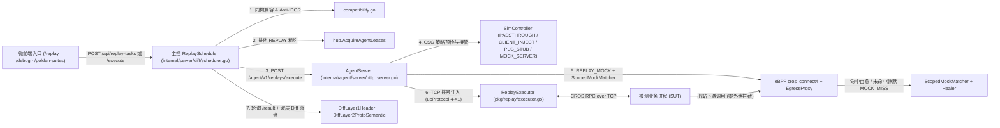

# ADR-31：RPC 离线自愈重放端到端代码审计、生产就绪修复决策与用户操作规范

- **文档编号**：`31-rpc-replay-end-to-end-audit-and-production-readiness-adr.md`
- **状态**：Proposed（2026-11-28，待评审后分期实施）
- **日期**：`2026-11-28`
- **关联与演进**：`ADR-02`、`ADR-09`、`ADR-12`、`ADR-14`、`ADR-16`、`ADR-21`、`ADR-22`、`ADR-23`、`ADR-24`

---

## 1. 背景与现状盘点

截至 `v0.5.0`，`code-contract` 平台已经完成了 Git 契约入库流水线、架构对齐以及现网 RPC 流量采集（TCP Socket eBPF 与 `dophi_mesh` uprobe 旁路采集）的落地。在首次面向真实业务系统正式启用 **“RPC 请求回放，验证现有系统功能”** 能力前，我们对控制面、数据面与微前端三端进行了全链路代码级审计，以确认：
1. 当前端到端链路是否可以直接在真实系统跑通；
2. 存在哪些阻断级（P0）或体验/契约级（P1/P2）断点，以及为什么既有单测未能暴露；
3. 后续应如何架构收敛与修复，以及终端用户应遵循怎样的标准操作规范。

### 1.1 现有 4 大用户入口

| 入口 | 路由 / API 契约 | 设计定位与适用场景 |
| :--- | :--- | :--- |
| **防劣化回归工作台（按录制批次）** | 前端 `/replay` (`ReplayWorkbenchPage`) 后端 `POST /api/replay-tasks` | 选定一次录制批次与多条 `INGRESS` 请求，向同构目标进程注入流量并执行双层 Diff，适合版本发布前批量回归。 |
| **事务分析闭包重放（单条调试）** | 前端 `/debug` (`SinglePacketReplayDrawer`) 后端 `GET /api/traffic-records/:id/replay-closure` + `POST /api/replay-tasks` | 针对单条入口事务预览下游 `ScopedMock` 闭包及有状态前置依赖链，勾选连带前序事务后发起精确调试。 |
| **黄金契约套件脱机回归** | 前端 `/golden-suites` (`GoldenSuiteExecuteModal`) 后端 `POST /api/golden-suites/:id/execute` | 基于沉淀固化的自包含快照（入站请求/应答 + 下游 `ScopedMocks` + CSG 快照 + 忽略规则）脱离原始分区反复回归。 |
| **CI/CD 自动化强阻断门禁** | `POST /api/gates/evaluate` (`EvaluateGate`) | 同步阻塞式回归指定 `ArchProcess` 下的生效黄金套件，串联“架构漂移校验 (`422 GATED_VIOLATION`) + 响应 Diff 校验 (`422 GATED_BREAKING_DIFF`)”。 |

### 1.2 全链路组件架构与已就绪核心能力

代码审计确认，以下底层核心引擎骨架**已基本就绪**：
1. **双层回归 Diff 引擎**（[`internal/server/diff/engine.go`](file:///home/fugui/codes/code-contract/internal/server/diff/engine.go)）：
   - `DiffLayer1Header`：校验证明 `MsgType`、`StatusCode`、`RspMsgNo` 一致性（天然豁免服务端时间戳、`ullSNO`、`aucTraceBuff`、`ullClientSendTime`），Payload 字节完全一致时直接短路 `PASS`。
   - `DiffLayer2ProtoSemantic`：基于全局激活的 `.pb` 描述集执行 `protoreflect` 类型感知语义树比对，免疫 `Map` 迭代乱序、支持 `Repeated` 保序、检出未定义 `<unknown_fields>`，并合并任务/方法/服务三级 `ignore_paths`。
2. **下游二进制 Mock 匹配与协议头自愈**（[`pkg/replay/matcher.go`](file:///home/fugui/codes/code-contract/pkg/replay/matcher.go)、[`pkg/replay/healer.go`](file:///home/fugui/codes/code-contract/pkg/replay/healer.go)）：
   - `ScopedMockMatcher` 支持按 `RecordID` 局部作用域 + `DstTag` 多实现标签隔离 + 全局兜底分层匹配（精确 Payload SHA-256 优先，顺序队列兜底）。
   - `HealSingleResponseFrame` 与 `NormalizeFrameTransportForTCP` 支持按实时请求原地覆写 `ullSNO`、`aucTraceBuff`、`ullClientSendTime`、服务/方法回显及传输协议号归一化（`4 -> 1`）。
   - `MOCK_MISS` 严格执行 Fail-Closed 静默策略，严禁向真实下游外泄连接或字节。
3. **内核出站重定向与零外泄代理**（[`pkg/ebpf/bpf/cros_probe.c`](file:///home/fugui/codes/code-contract/pkg/ebpf/bpf/cros_probe.c)、[`pkg/ebpf/egress_proxy.go`](file:///home/fugui/codes/code-contract/pkg/ebpf/egress_proxy.go)）：
   - `cros_connect4` / `cros_sock_ops` 将纳管目标进程的出站 TCP 连接透明重定向至本地 `EgressProxy`，`ModeReplayMock` 下对已登记下游端点及含 CROS 魔术字流量物理切断真实后端拨号。
4. **CSG 四模仿真控制器与五出口自洁**（[`internal/agent/csg/sim_controller.go`](file:///home/fugui/codes/code-contract/internal/agent/csg/sim_controller.go)、[`pkg/csgmock/mockserver.go`](file:///home/fugui/codes/code-contract/pkg/csgmock/mockserver.go)）：
   - 完整实现 `PASSTHROUGH`、`CLIENT_INJECT`、`PUB_STUB`（含前置 `Sub==0` 防抢占门禁、严禁 `GET_BIND_ADDR`/`FREE_BIND_ADDR`）、`MOCK_SERVER`（内置 `MockCSGServer` + `dophi_mesh:// -> tcp://` 改写放行）。
5. **排他租约与同构兼容校验**（[`internal/server/diff/compatibility.go`](file:///home/fugui/codes/code-contract/internal/server/diff/compatibility.go)、[`internal/server/hub/lease.go`](file:///home/fugui/codes/code-contract/internal/server/hub/lease.go)）：
   - 单 Agent 排他 `REPLAY` 租约防止并发干扰；`ValidateReplayProcessCompatibilityWithStrategy` 校验公私域 Anti-IDOR、目标进程端口与跨进程模块子集兼容性。

---

## 2. 全链路审计结论与问题分级清单

**总体裁决**：当前**无法直接作为可信工具在真实系统跑通**。虽然底层各部件骨架齐全，但主控、Agent 与前端衔接处存在 **3 项 P0 阻断缺陷、3 项 P1 契约/交互/运行期缺陷、1 项 P2 协议健壮性缺陷**。若不修复直接上线使用，将出现 **“被测系统报错或返回错误字段但报告永远显示 `PASS`”** 以及 **“单条重放按钮无法点击”** 等严重失真。

### 2.1 P0 阻断缺陷（必须优先修复）

#### P0-1：Agent 丢弃真实响应帧 + 主控静默回退基线导致“永远假 PASS”（最致命）
- **Agent 侧证据**（[`pkg/replay/executor.go`](file:///home/fugui/codes/code-contract/pkg/replay/executor.go#L344-L377)）：
  - 在 `ExecuteWithMatcher` 收到真实 SUT 返回的 `MsgTypeRsp` 帧后，循环仅执行 `gotRsp = true; passed++; break`，**直接丢弃了 `frameData` 原始字节**，既没有保存每条请求的 `ActualRspHex`，也没有记录单请求的真实 `LatencyUs`、状态码或错误信息。
  - 返回给主控的 `ReplayTaskResultResp.Details` 填入的是一段人类可读摘要字符串（`fmt.Sprintf("重放完成: 总计 %d, 成功 %d...", ...)`），而非主控所期待的 `[]agentproto.ReplayItemDetail` JSON 数组。
- **主控侧证据**（[`internal/server/diff/scheduler.go`](file:///home/fugui/codes/code-contract/internal/server/diff/scheduler.go#L515-L601) 与 [`scheduler.go`](file:///home/fugui/codes/code-contract/internal/server/diff/scheduler.go#L1388-L1493)）：
  - 会话重放（`pollAndEvaluateSessionReplayWithCtx`）与黄金套件重放（`pollAndEvaluateSuiteReplay`）在 `json.Unmarshal([]byte(result.Details), &details)` 失败后静默忽略错误，导致 `detailMap` 恒为空。
  - 随后代码第 533 行（以及第 1409 行）将 `actualRsp` 默认赋值为录制基线本身（`actualRsp := rec.RawRspPacket` / `item.RawRspPacket`），等同于 **`DiffLayer1Header(expectedRsp, expectedRsp)` 自己与自己比对**，必然短路 `PASS`。
  - 更严重的是，第 572 行（及第 1463 行）在 `detailMap` 未命中时仅兜底判断了 `result.Status == models.ReplayResultMockMiss`；若 Agent 执行返回 `ERROR`（如拨号目标端口失败）、`TIMEOUT`（等待应答超时）或 `CANCELLED`，主控仍会把全部条目误判为 `PASS`，从而使任务终态失真。
  - 同时，[`models.ReplayItem`](file:///home/fugui/codes/code-contract/models/replay.go#L75-L79) 的 `LatencyUs` 硬编码为 `100`，`ActualPayload` 从未调用 `decoder.Registry` 解码落盘。
- **既有测试未暴露原因**：
  - 门禁集成测试 [`handlers/csg_sc17_e2e_test.go`](file:///home/fugui/codes/code-contract/handlers/csg_sc17_e2e_test.go#L258) 中 Mock 的 Agent HTTP 服务手工构造了合法 JSON 数组 `Details`；
  - 连带真实 `AgentServer` 的端到端测试中，SUT 被测服务恰好返回了与基线完全相同的应答载荷，恰好掩盖了 `actualRsp` 未采用真实回包的逻辑漏洞。

#### P0-2：「事务分析」单条报文闭包重放入口前端不可用
- **候选目标进程过滤条件过期**（[`SinglePacketReplayDrawer.tsx`](file:///home/fugui/codes/code-contract/frontend/src/pages/TrafficDebugWorkbenchPage/SinglePacketReplayDrawer.tsx#L82-L89)）：
  - `candidateProcesses` 强校验 `const pModules = p.process_modules ?? []; if (pModules.length === 0) return false;`。
  - 自 `ADR-09` 重构引入 `ArchProcess` 蓝图后，[`models/agent.go`](file:///home/fugui/codes/code-contract/models/agent.go#L75-L115) 与 [`handlers/process_handler.go`](file:///home/fugui/codes/code-contract/handlers/process_handler.go#L46-L99) 已不再定义及返回 `process_modules` 嵌套字段。因此前端候选列表**恒为空**，提示“未检测到挂载了同构模块且 `listen_port > 0` 的可用服务端业务进程”，按钮永久禁用。
- **异步建单后未轮询终态且缺失 CSG 参数**（[`SinglePacketReplayDrawer.tsx`](file:///home/fugui/codes/code-contract/frontend/src/pages/TrafficDebugWorkbenchPage/SinglePacketReplayDrawer.tsx#L413-L428)）：
  - `POST /api/replay-tasks` 创建任务后立即返回 `LifecycleState="ARMED"` 并异步执行，但组件在 `createReplayTask` 返回后直接请求 `listReplayItems(created.id)`，此时尚无落盘明细；此外抽屉也未提供 `csg_strategy` / `csg_addr` 选择。

#### P0-3：纯 `dophi_mesh`（无 TCP 监听端口）进程无法被直接注入
- **数据面注入限制**（[`pkg/replay/executor.go`](file:///home/fugui/codes/code-contract/pkg/replay/executor.go#L216-L224)、[`internal/agent/csg/sim_controller.go`](file:///home/fugui/codes/code-contract/internal/agent/csg/sim_controller.go#L184-L188)）：
  - `ReplayExecutor` 仅通过 TCP `net.Dialer` 向目标进程发送经 `NormalizeFrameTransportForTCP` 归一化（`ucProtocol: 4 -> 1`）的 CROS RPC 帧，符合 `ADR-22` / `ADR-23`“仿真重放统一收敛至 `tcp://`”约束。
  - 若现网被测进程**仅**注册并监听 `dophi_mesh://` 而未开启任何 TCP 监听端口，`CLIENT_INJECT` 会返回 `422 CSG_DATAPLANE_MESH_UNSUPPORTED`，静态端口拨号亦无法建连。用户必须在验证环境为被测进程开启 TCP 监听，方可执行跨传输（Mesh 采集 → TCP 注入）回归。

---

### 2.2 P1 契约、交互与运行期缺陷

#### P1-1：前后端 JSON 字段契约失配，导致报告抽屉恒报错且统计空白
- **任务汇总字段失配**：
  - 后端 [`models/replay.go`](file:///home/fugui/codes/code-contract/models/replay.go#L45-L51) 输出字段为 `total_requests`、`passed_requests`、`mock_hit_count`、`mock_miss_count`、`violation_count`、`observed_egress_calls`、`mock_events`。
  - 前端 [`frontend/src/types/replay.ts`](file:///home/fugui/codes/code-contract/frontend/src/types/replay.ts#L61-L70)、[`ReplayTaskTable.tsx`](file:///home/fugui/codes/code-contract/frontend/src/pages/ReplayWorkbenchPage/ReplayTaskTable.tsx#L66-L67) 与 [`ReplayReportDrawer.tsx`](file:///home/fugui/codes/code-contract/frontend/src/pages/ReplayWorkbenchPage/ReplayReportDrawer/ReplayReportDrawer.tsx#L138-L142) 读取 `failed_requests`、`mock_miss_requests`，导致表格与报告汇总栏始终为空白或 `undefined`。
- **Layer 1 头层断言卡片失配（恒红误报）**：
  - 后端 [`models/replay.go`](file:///home/fugui/codes/code-contract/models/replay.go#L75-L83) 输出 `baseline_status`、`actual_status`（`U64Numeric` 序列化为字符串），且无 `header_diff_passed` 与 `sno` 字段。
  - 前端 [`HeaderAssertionCard.tsx`](file:///home/fugui/codes/code-contract/frontend/src/pages/ReplayWorkbenchPage/ReplayReportDrawer/HeaderAssertionCard.tsx#L13-L28) 读取 `item.header_diff_passed`、`item.baseline_status_code`、`item.actual_status_code`，导致即使断言完全通过，卡片也**恒显示红色“头层断言失败 (FAILED)”与实际状态码 `-`**。
- **Mock 命中时间线从未回填**：
  - `ReplayTask.MockEvents` 与 `ReplayItem.MockTrace` 在 [`scheduler.go`](file:///home/fugui/codes/code-contract/internal/server/diff/scheduler.go) 中从未赋值写入，`MockHitMissTimeline` 永远呈现“未触发 Mock 规则”。

#### P1-2：跨 Agent/跨进程选单逻辑缺陷与页面联动/实时刷新缺失
- **跨进程选单自相矛盾**（[`ReplayTaskCreatorModal.tsx`](file:///home/fugui/codes/code-contract/frontend/src/pages/ReplayWorkbenchPage/ReplayTaskCreatorModal.tsx#L56-L62)）：
  - 弹窗使用用户选择的**目标进程** `selectedProcessId` 去查询 `listTrafficRecords({ session_id, process_id: selectedProcessId })`。在最典型的“将 A 环境录制的流量回放到 B 环境同构进程”（`source_process_id != target_process_id`）场景下，因 B 环境进程 ID 在 A 批次中无记录，导致列表为空、无法勾选请求。
- **`/discovery` 跳转预填未接线**：
  - [`DiscoveryWorkbenchPage.tsx`](file:///home/fugui/codes/code-contract/frontend/src/pages/DiscoveryWorkbenchPage/DiscoveryWorkbenchPage.tsx#L726) 跳转到 `/replay?agent_id=...&arch_process_id=...&strategy=...`，但 [`ReplayWorkbenchPage.tsx`](file:///home/fugui/codes/code-contract/frontend/src/pages/ReplayWorkbenchPage/ReplayWorkbenchPage.tsx#L39-L43) 仅识别 `auto_create=1` 和 `session_id`，未消费 `agent_id`、`arch_process_id`、`strategy` 参数。
- **实时进度推送未闭环**：
  - [`handlers/sse_handler.go`](file:///home/fugui/codes/code-contract/handlers/sse_handler.go#L253-L275) 已定义 `BroadcastReplayItemDone` 与 `BroadcastReplayCompleted`，但 [`scheduler.go`](file:///home/fugui/codes/code-contract/internal/server/diff/scheduler.go) 并未调用推送；前端 `ReplayWorkbenchPage` 亦未订阅 SSE 或在存在 `ARMED`/`INJECTING` 任务时自动轮询刷新。

#### P1-3：宿主机 eBPF 预挂状态、`NEED_RECONNECT` 与 `MOCK_SERVER` 建连时机约束
- **必须提前 `ARMED` 并消除存量长连接**：
  - [`pkg/ebpf/manager.go`](file:///home/fugui/codes/code-contract/pkg/ebpf/manager.go#L804-L829) 的 `SetReplayMock` 仅更新已在 `monitoredProcs` 中的进程模式，不会主动执行 `attachLocked()`。若目标进程未在主控完成预挂载（`ARMED`），Agent 的出站 Mock 拦截将不生效。
  - [`internal/agent/server/http_server.go`](file:///home/fugui/codes/code-contract/internal/agent/server/http_server.go#L878-L892) 在回放前检测目标进程若存在直连下游或 CSG 的存量 TCP 长连接（未经过 `EgressProxy`），会直接以 `409 NEED_RECONNECT` 拒绝回放。
- **`MOCK_SERVER` 对 CSG 存量长连接的拦截时机边界**：
  - [`pkg/ebpf/egress_proxy.go`](file:///home/fugui/codes/code-contract/pkg/ebpf/egress_proxy.go#L426-L429) 的 `tryHandleCSGConn` 仅在 `EgressProxy` 接收**新建连接**时切入 `MockCSGServer`。若被测进程在启动时即与真实 CSG 建立了持久化 `dlink` 连接且回放期间不重连，该旧连接不会自动重路由至 `MockCSGServer`（但经过 `EgressProxy` 的业务下游出站调用仍会被 `ScopedMockMatcher` 拦截，确保业务数据面零外泄）。

---

### 2.3 P2 协议分片与执行健壮性缺陷

#### P2-1：多段分片应答 (`MsgTypeRspSeg`) 缺失聚合与单条超时中断整批
- [`pkg/replay/executor.go`](file:///home/fugui/codes/code-contract/pkg/replay/executor.go#L344-L358) 仅在 `msgType == crosrpc.MsgTypeRsp` 时结束等待，未处理 `MsgTypeRspSeg`（多段分片响应的连续拼接与末片判定，参考 `pkg/crosrpc/constants.go` 分片机制）。
- 当批量请求中某一条触发超时时，当前逻辑在第 335 行直接 `return res, nil` 中止后续请求，未继续收集已有或剩余明细。

---

## 3. 核心架构与修复设计决策（D1 ~ D5）

为将 RPC 离线回放能力打磨至可信赖的生产验证级水平，同时严格坚守“Agent 九包零 `.pb`/零 DB/零 CGO”物理防腐红线，制定以下 5 项架构决策：

### 决策 D1：Agent → Server 结构化回放结果回传契约（零 `.pb` 约束下）
1. **扩展 `agentproto.ReplayTaskResultResp` 与 `ReplayItemDetail`**（[`pkg/agentproto/protocol.go`](file:///home/fugui/codes/code-contract/pkg/agentproto/protocol.go)）：
   - `ReplayItemDetail` 增补字段：
     - `SeqNo int64`
     - `LatencyUs int64`（Agent 侧实测从写入入站帧到收齐末段应答帧的微秒耗时）
     - `ActualRspHex string`（单帧应答原始字节，保留兼容）
     - `ActualRspSegsHex []string`（支持多段 `MsgTypeRspSeg` 应答分片列表）
     - `MockTrace []MockTraceEvent`（该请求周期内关联的出站 Mock 命中/未命中轨迹，仅含元信息：`sno`、`service_name`、`operation`、`hit_kind`、`healed_fields`、`is_miss`、`dst_addr`，零 `.pb` 依赖）
   - `ReplayTaskResultResp` 增补强类型切片 `Items []ReplayItemDetail` 与 `MockEvents []MockTraceEvent`，`Details` 继续保留人类可读摘要或作为向后兼容回退（主控优先读取 `Items`，若为空再尝试解析 `Details` JSON 数组）。
2. **`pkg/replay/executor.go` 改造**：
   - 使用高精计时记录每条请求的真实 `LatencyUs`；
   - 完整保留 SUT 返回的 `MsgTypeRsp`（及聚合 `MsgTypeRspSeg` 分片帧）原始字节至 `ActualRspHex` / `ActualRspSegsHex`；
   - 由 `ScopedMockMatcher` 记录结构化 `MockTraceEvent`（区分 `EXACT_HASH` / `ORDER_FALLBACK` / `ONEWAY_HIT` / `MISS` 及被自愈字段清单 `["ullSNO", "aucTraceBuff", "ullClientSendTime", "ucProtocol"]`），并在每个 `activeRecordID` 结束时精确归属到 `ReplayItemDetail.MockTrace`。

### 决策 D2：主控 Fail-Closed 零假通过裁决铁律
1. **彻底删除自我回退**：在 [`internal/server/diff/scheduler.go`](file:///home/fugui/codes/code-contract/internal/server/diff/scheduler.go) 的会话重放与黄金套件重放两条评估路径中，**永久移除 `actualRsp := rec.RawRspPacket` / `item.RawRspPacket` 的赋值**。
2. **严格 Fail-Closed 缺省裁决**：
   - 若 Agent 返回任务级 `Status` 为 `ERROR`、`TIMEOUT`、`CANCELLED`，或某条请求在 `Items` / `detailMap` 中缺失、或非 `ONEWAY` 请求回收到的 `actualRsp` 为空，该条目**必须**判定为 `ERROR` / `TIMEOUT` / `FAILED`（优先透传 Agent 返回的 `d.Status` 与 `d.ErrorMessage`，其次透传任务级 `result.Status`），**绝不允许落入 `PASS`**。
   - 仅当真实回收到非空 `actualRsp` 后，才执行 `DiffLayer1Header` + `DiffLayer2ProtoSemantic`。
3. **解码落盘与实时广播**：
   - `ReplayItem` 真实写入 `LatencyUs`、`ActualStatus`、`RawActualPacket`、`MockTrace`；当 `s.dec != nil` 时按操作 Schema 解码 `actualRsp` 写入 `ActualPayload`（`jsonb`），并在任务总结写入 `MockEvents`。
   - 评估落盘后调用 `SSEBroker.BroadcastReplayItemDone` 与 `BroadcastReplayCompleted`，通知前端即时更新。

### 决策 D3：前后端模型字段统一与 Report 抽屉修复
1. **后端 `models.ReplayTask` / `models.ReplayItem` 序列化兼容与补齐**：
   - `ReplayTask` 补充派生只读字段（或前端统一按以下权威契约消费）：`failed_requests`（统计非 `PASS` 条目数）、`mock_miss_requests`（与 `mock_miss_count` 对齐）、`timeout_requests`、`error_requests`。
   - `ReplayItem` 补充或由前端统一对齐：`sno`（从关联 `TrafficRecord`/`GoldenSuiteItem` 或 `RawActualPacket` 解析填充）、`baseline_status_code` / `actual_status_code`（或前端兼容读取 `baseline_status` / `actual_status` 数字字符串）、`header_diff_passed`（由 `field_diffs` 是否含 `header.status_code` 及 `result_status` 精确推导，消除全量恒红误判）。
2. **同步修正 [`frontend/src/types/replay.ts`](file:///home/fugui/codes/code-contract/frontend/src/types/replay.ts)、[`ReplayTaskTable.tsx`](file:///home/fugui/codes/code-contract/frontend/src/pages/ReplayWorkbenchPage/ReplayTaskTable.tsx)、[`ReplayReportDrawer.tsx`](file:///home/fugui/codes/code-contract/frontend/src/pages/ReplayWorkbenchPage/ReplayReportDrawer/ReplayReportDrawer.tsx) 与 [`HeaderAssertionCard.tsx`](file:///home/fugui/codes/code-contract/frontend/src/pages/ReplayWorkbenchPage/ReplayReportDrawer/HeaderAssertionCard.tsx)**，确保卡片与表格真实反映实际断言结果。

### 决策 D4：打通单条闭包重放与跨进程创建工作流
1. **修复 `SinglePacketReplayDrawer`**（[`SinglePacketReplayDrawer.tsx`](file:///home/fugui/codes/code-contract/frontend/src/pages/TrafficDebugWorkbenchPage/SinglePacketReplayDrawer.tsx)）：
   - 候选目标进程匹配从已废弃的 `p.process_modules` 迁移为基于 **`ArchProcessID` 同构匹配**（结合 `record.process_id` 对应的 `arch_process_id`，或后端 `ListProcesses` 补齐 `arch_process_id` 与所属模块 ID/服务列表）；仍保留 `listen_port > 0`（除非选择 `CLIENT_INJECT`）过滤与个人 `PRIVATE` + `ONLINE` + 空闲租约优先排序。
   - 抽屉内提供 `csg_strategy` 与 `csg_addr` 选择器，并在 `createReplayTask` 后通过轮询 `getReplayTask`（或订阅 SSE）直到 `lifecycle_state` 进入 `COMPLETED` / `FAILED` / `CANCELLED`，再拉取 `listReplayItems` 渲染真实 `HeaderAssertionCard`、`ProtoFieldDiffTable` 与 `MockHitMissTimeline`。
2. **修复 `ReplayTaskCreatorModal` 跨进程选单**（[`ReplayTaskCreatorModal.tsx`](file:///home/fugui/codes/code-contract/frontend/src/pages/ReplayWorkbenchPage/ReplayTaskCreatorModal.tsx)）：
   - 解耦 **“来源录制进程筛选（可选，默认展示该 `session_id` 下全部可重放 `INGRESS` 记录或按所选记录反推 `source_process_id`）”** 与 **“目标验证进程选择（`target_process_id`）”**，并按目标进程的 `ArchProcessID` 高亮推荐同构记录，彻底打通跨 Agent/跨环境重放。
   - 在弹窗中校验用户勾选项是否均归属同一 `source_process_id`（避免混选多个源进程）。
3. **补齐 `/discovery` 预填与自动刷新**：
   - `ReplayWorkbenchPage` 解析 URL 参数 `agent_id`、`arch_process_id`、`strategy`、`auto_create` 并透传至 `ReplayTaskCreatorModal`；当存在 `ARMED` / `INJECTING` 任务时启用有界轮询或 SSE 监听自动刷新列表。

### 决策 D5：数据面传输边界与 eBPF 预挂防呆加固
1. **明确坚守纯 TCP 注入边界**：按 `ADR-22` / `ADR-23` 既定红线，**不在 Agent 引入 `dophi_mesh` 共享内存主动注入驱动**，回放数据面统一收敛至 `tcp://`；验证环境若采集自 `dophi_mesh`，需在被测进程侧开启 TCP 监听通道配合 `MOCK_SERVER` 或 `PUB_STUB` 执行跨传输回归。
2. **eBPF 预挂与 `NEED_RECONNECT` 防呆优化**：
   - `AgentServer.handleExecuteReplay` 若发现 `ebpfMgr` 尚未对目标进程 `ARMED`（`!m.attached` 或缺失目标 `monitoredProcs`），应返回明确可操作的 409 诊断（引导在控制台对进程执行 `Arm` 预挂载，并重启目标进程使出站连接经 `EgressProxy`），禁止静默绕过出站拦截导致真实下游漏网。
   - 创建任务弹窗与黄金套件执行弹窗前置展示目标进程的 `probe_status`（`ARMED` / `DISARMED` / `NEED_RECONNECT` / `WAITING_PROC`）与拦截就绪提示。

---

## 4. 用户标准操作手册（User Operational Playbook）

> **注意**：在阶段 5 的 P0/P1 修复落地前，用户应知晓“真实回包对比”和“单条闭包重放 UI”处于受限不可用状态；修复完成后，完整操作流程如下。

### 第 0 步：环境与资产前置条件 Checklist

| 序号 | 检查项 | 操作位置与要求 | 不满足时的影响 |
| :--- | :--- | :--- | :--- |
| 1 | **契约 `.pb` 已入库并激活** | 「契约入库流水线」(`/proto-pipeline`) 确认相关服务对应的 Proto 描述集处于 `ACTIVE` 状态；若 CSG 64B 服务名（如 `OrderServiceImpl-OrderService`）与 `.proto` 全限定名不同，需在服务目录补充 `proto_service_name` 映射。 | Layer 2 退化为原始字节对比（`<raw_bytes>`），无法展示字段级 Diff 也无法使用 `ignore_paths`。 |
| 2 | **架构进程蓝图对齐** | 「架构元素」(`/architecture`) 或「现网发现」(`/discovery`) 确认来源进程与目标进程归属同一 `ArchProcess`（或目标进程承载请求所需的全部功能模块）。 | 跨进程同构校验报错 `400`。 |
| 3 | **特权 Agent 就绪与进程 `ARMED`** | 在验证机以 `root` 或具备 `CAP_BPF + CAP_NET_ADMIN + CAP_PERFMON + CAP_SYS_PTRACE` 启动 `code-contract-agent`；在「Agent 与进程」(`/agents`) 挂载目标 `ArchProcess` 并开启 **待命预挂 (`ARMED`)**。 | 未 `ARMED` 或无权限无法拦截目标进程的出站调用。 |
| 4 | **消除存量长连接** | 若被测进程有下游依赖且需使用 Mock 隔离，**必须在 Agent `ARMED` 后重启一次被测业务进程**，确保其出站建连与 CSG 连接经过内核 `cgroup/connect4` 与 `EgressProxy`。 | Agent 检测到存量直连会拦截并返回 `409 NEED_RECONNECT`。 |
| 5 | **开启 TCP 监听通道** | 验证环境目标进程需监听 IPv4 TCP 端口（`listen_port > 0` 或向 CSG 注册 `tcp://` 端点）。 | 纯 `dophi_mesh://` 无 TCP 端口的进程无法注入（`CLIENT_INJECT` 返 `422`）。 |
| 6 | **拥有可重放录制素材** | 在「流量采集」(`/record`) 完成录制并停录，确保包含 `direction = INGRESS`、`is_truncated = false`、`exchange_type != REQ_ONLY`（即 `is_replayable = true`）的成对记录；若需隔离下游，同批次应包含该进程的 `EGRESS` 成对流量（建议关闭过激的源头噪音过滤，避免同步依赖缺失）。 | 截断帧与无应答帧不允许用于重放；缺少 `EGRESS` 记录将触发 `MOCK_MISS`。 |

### 第 1 步：选择业务入口

1. **批量回归（按录制批次）**：进入「流量核验与回归 → **防劣化回归**」(`/replay`) → 点击 **+ 创建同构重放任务**（或从「流量采集」批次行点击“创建重放”）→ 选择来源批次、勾选 `INGRESS` 请求、指定目标同构进程与 CSG 策略后发起。
2. **单条事务调试（带因果闭包与前置链）**：进入「流量核验与回归 → **事务分析**」(`/debug`) → 展开事务树选中某条 `INGRESS` 记录 → 打开单条重放抽屉，预览 `ScopedMock` 闭包与自动识别的有状态前置依赖链（如“查单”自动勾选前序“下单”）→ 选择目标进程发起验证。
3. **黄金用例库脱机回归**：在「事务分析」将高价值事务沉淀为「**黄金用例库**」(`/golden-suites`) → 点击 **立即脱机回归**，选择目标环境 Agent 与 CSG 策略即可脱离原录制分区反复验证。
4. **CI/CD 自动化门禁**：流水线调用 `POST /api/gates/evaluate`（携带 `X-Contract-CI-Token` 或管理员 JWT），传入 `target_arch_process_id` 与共享 `env_agent_id`，接口阻塞等待并返回 `200 PASSED` 或 `422 GATED_VIOLATION` / `422 GATED_BREAKING_DIFF` 及 PR/MR Markdown 报告。

### 第 2 步：CSG 控制面仿真策略 (`csg_strategy`) 选型矩阵

| 策略 | 适用场景 | 核心机理 | 前置门禁 / 风险提示 |
| :--- | :--- | :--- | :--- |
| **`PASSTHROUGH`**（默认） | 静态直连进程，或同机已按静态端口部署、仅需 `EgressProxy` 按历史 `IP:Port` 拦截出站 Mock | Agent 直连目标 `effective_listen_port`；`EgressProxy` 在 `ModeReplayMock` 下拦截发往已知下游端口的请求并返回 `ScopedMock`。 | 若目标进程依赖 CSG 动态发现下游，建议使用下方三种策略。 |
| **`CLIENT_INJECT`** | 验证环境被测进程使用 CSG 动态端口（重启后端口变化），且整套链路或下游已在线可用 | Agent 向真实 CSG 发送 `SUB` 解析目标服务实时 `tcp://ip:port` 后直接拨号注入，随后立即 `UNSUB`。 | 若目标服务在 CSG 仅注册了 `dophi_mesh://`，直接拦截返回 `422 CSG_DATAPLANE_MESH_UNSUPPORTED`。 |
| **`PUB_STUB`** | **下游服务全部停机缺席**，仅拉起单个被测进程做孤立验证，且被测进程通过 CSG 订阅下游 | Agent 先对所有下游服务执行 `Sub==0` 检查，确认全部离线后将本地 MockServer 端口 `PUB` 至真实 CSG；任务结束自动 `UNPUB`。 | **防抢占红线**：任一下游服务当前在线（`Sub > 0`），立即返回 `409 CSG_SERVICE_ALREADY_PUBLISHED` 拒绝污染现网；严禁向真实 CSG 发 `GET_BIND_ADDR` / `FREE_BIND_ADDR`。 |
| **`MOCK_SERVER`** | 下游在现网在线（不能抢占真实 CSG）、或原始流量为 `dophi_mesh://` 需改写为 `tcp://` 做进程内全隔离仿真 | Agent 启动进程内内存版 `MockCSGServer` 沙箱，经 `EgressProxy` 拦截目标进程的 CSG `dlink` 连接并自动执行 `dophi_mesh:// -> tcp://` 改写；结束输出 `CSGSandboxReport`。 | 真实 CSG 零连接泄漏；需确保目标进程在 Agent `ARMED` 后重启，以使 `dlink` 连接经过 `EgressProxy`。 |

### 第 3 步：结果判读、故障定位与动态消噪

1. **全序裁决优先级**：系统按 `ERROR > TIMEOUT > MOCK_MISS > FAILED > PASS` 聚合每条条目与整个任务的终态。
2. **故障定位路径**：
   - **`MOCK_MISS`**：说明新版本被测代码发起了录制基线未包含的下游调用，或请求参数变更未命中 Mock（Agent 已静默阻断，0 字节外泄）。打开报告抽屉中的“下游二进制 Mock 命中与自愈追踪”及时序泳道定位缺失调用。
   - **`FAILED`**：查看 Layer 1 协议状态码差异与 Layer 2 Protobuf 字段级 Diff 表（`MODIFIED` / `ADDED` / `REMOVED`），结合四段报文解剖对比基线与实际响应。
   - **架构漂移告警 (`ViolationCount > 0`)**：查看实测出站调用 (`observed_egress_calls`)，核查代码是否调用了未在静态架构依赖中报备的新服务。
3. **离线重算消噪 (`Rediff`)**：
   - 若确认某些字段差异属于合法动态噪音（如 `header.server_time`、`items[*].trace_token`），无需重新注入流量，直接在报告抽屉点击 **「离线重算双层 Diff」**（`POST /api/replay-tasks/:id/rediff`），输入 `extra_ignore_paths` 基于已落盘的 `RawActualPacket` 即时刷新全序裁决；长期稳定噪音可固化至契约方法或黄金套件 `extra_ignore_paths`。

### 第 4 步：使用仓库 `demo/` 靶场开展零风险端到端验证

仓库 [`demo/`](file:///home/fugui/codes/code-contract/demo/README.md) 内置了完整的 CROS RPC + CSG 仿真测试集群（`csgserver` + `sut-order (:9001)` + 4 个下游服务 + `code-contract-agent` + TUI 客户端）：
1. 在 `demo/` 目录执行 `./start.sh` 拉起 8 窗格完整集群；
2. 在「Agent 与进程」纳管 `demo` 的 Agent 并 `ARMED`，按需重启 `sut-order` 确保出站经代理；
3. 在「流量采集」启动录制，通过 TUI 客户端按 `[2]`（正向正常下单）或 `[8]`（并发双渠道订单）注入流量后停录；
4. 依次验证：
   - 修改 `sut-order` 代码使其返回不同字段值或状态码，验证 `/replay` 必须准确检出 **`FAILED` + 精确 `FieldDiffs`**（反假通过验收）；
   - 停掉全部 `backend-*` 下游进程，发起 **`PUB_STUB`** 孤立重放，验证全流程 `PASS` 且结束后 `make csg-status` 无残留桩；
   - 保留下游在线，发起 **`MOCK_SERVER`** 沙箱隔离重放，验证 `CSGSandboxReport` 零泄漏。

---

## 5. 后续分期实施计划与 TDD 强制验收标准

### 5.1 分期改造路线

| 阶段 | 涵盖修复项 | 核心目标 | 涉及主要文件 |
| :--- | :--- | :--- | :--- |
| **Phase 1（P0 核心阻断清零）** | D1 + D2 + D4（`SinglePacketReplayDrawer` 核心修复） | 打通 Agent 真实回包/耗时回传、主控 Fail-Closed 真实 Diff 落盘，以及单条闭包重放可用性 | `pkg/agentproto/protocol.go`、`pkg/replay/executor.go`、`pkg/replay/matcher.go`、`internal/server/diff/scheduler.go`、`frontend/src/pages/TrafficDebugWorkbenchPage/SinglePacketReplayDrawer.tsx` |
| **Phase 2（P1 契约对齐与体验闭环）** | D3 + D4（跨进程创建、`/discovery` 预填、SSE/轮询刷新） | 消除前后端字段失配与误红提示，打通跨进程创建与实时进度感知 | `models/replay.go`、`frontend/src/types/replay.ts`、`ReplayTaskTable.tsx`、`ReplayReportDrawer.tsx`、`HeaderAssertionCard.tsx`、`ReplayTaskCreatorModal.tsx`、`ReplayWorkbenchPage.tsx` |
| **Phase 3（P2 健壮性与靶场全真演练）** | P2-1 + D5 | 支持 `MsgTypeRspSeg` 多分片应答聚合、单条超时隔离、eBPF 预挂防呆诊断，并在 `demo/` 靶场完成全套故障注入验收 | `pkg/replay/executor.go`、`internal/agent/server/http_server.go`、`handlers/*_test.go` |

### 5.2 TDD 强制验收标准（Acceptance Criteria）

- **AC-01（反假通过红线）**：对真实循环回放 SUT 修改响应 Protobuf 某业务字段值或 `StatusCode`，发起 `POST /api/replay-tasks` 与 `POST /api/golden-suites/:id/execute`，任务必须判定为 `FAILED`，`ReplayItem.FieldDiffs` 必须精确包含变动字段路径、`Expected` 与 `Actual`，且 `RawActualPacket` 为 SUT 真实回包字节而非基线拷贝。
- **AC-02（异常态不吞错）**：当目标进程端口不可达（`ERROR`）、阻塞不回包（`TIMEOUT`）或被手动取消（`CANCELLED`）时，主控 `ReplayTask.ResultStatus` 与对应 `ReplayItem.ResultStatus` 必须准确落盘为对应异常态，严禁误判 `PASS`。
- **AC-03（Mock 轨迹与真实耗时）**：重放存在下游出站调用的事务时，`ReplayItem.LatencyUs` 反映真实执行微秒耗时（`> 0` 且非硬编码 `100`），`ReplayTask.MockEvents` 与 `ReplayItem.MockTrace` 准确记录命中策略（`EXACT_HASH`/`ORDER_FALLBACK`/`MISS`）与自愈字段。
- **AC-04（单条闭包重放端到端）**：`SinglePacketReplayDrawer` 基于 `ArchProcessID` 正确列出同构目标进程，点击“发起闭包验证”后等待任务进入终态并原地渲染准确的 `HeaderAssertionCard`（绿标 `PASS` 或准确状态码对比）、`ProtoFieldDiffTable` 与 `MockHitMissTimeline`。
- **AC-05（跨进程重放创建与 UI 契约）**：在 `ReplayTaskCreatorModal` 中选择不同于源进程的同构目标进程时仍可正常筛选并勾选源批次 `INGRESS` 请求；`ReplayTaskTable`、`ReplayReportDrawer` 与 `HeaderAssertionCard` 所有计数与状态标签无 `undefined` 或误报。
- **AC-06（物理防腐与回归基线）**：`cmd/agent/deps_test.go` 全绿（Agent 九包维持零 `.pb`、零数据库、零 CGO），`make test`、`make lint` 与 `demo/` 靶场端到端实测全通过。
