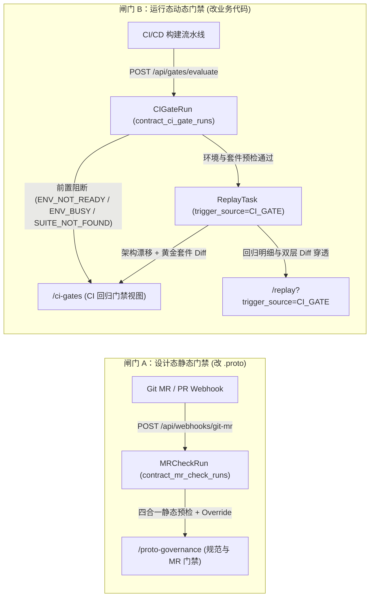
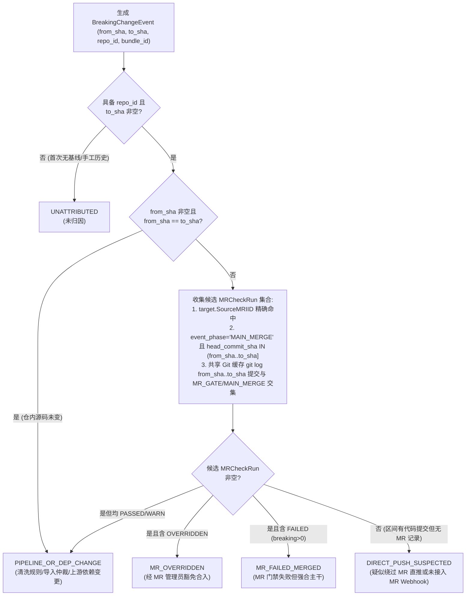

# ADR-32：五线活体契约飞轮动线校准、双闸门可视拉通、破坏性变更 MR 溯源与黄金用例反向滋养架构决策

- **文档编号**：`32-five-lines-flywheel-ux-dual-gate-and-audit-traceability-adr.md`
- **状态**：Proposed（2026-11-28，待评审后分期实施）
- **日期**：`2026-11-28`
- **关联与演进**：`ADR-14`、`ADR-18`、`ADR-24`、`ADR-29`、`ADR-30`、`ADR-31`

---

## 1. 背景、产品评审与代码现状校准

`v0.5.0` 完成五大核心主线文档体系收敛、非阻断式上线破坏性变更审计归口（[`handlers/breaking_audit_handler.go`](file:///home/fugui/codes/code-contract/handlers/breaking_audit_handler.go)）以及 RPC 离线重放端到端审计（`ADR-31`）后，产品侧围绕“五线飞轮”提出了 4 项用户动线与闭环演进建议。

在正式进入排期前，我们对控制面后端、数据模型与微前端代码进行了逐项实证核验，区分出 **「已实现能力」、「真实断层」与「工程风险」**：

| 维度 | 现网代码实现基线 | 真实断层 / 需校准点 |
| :--- | :--- | :--- |
| **菜单与信息架构** | [`frontend/src/menu.ts`](file:///home/fugui/codes/code-contract/frontend/src/menu.ts) 按 `ADR-30` 组织为 6 组 14 项；主线 3（采集/调试）与主线 4（黄金套件/重放）已合并在「流量核验与回归」分组，主线 5 独立为「开发合规」。 | ① 「架构与契约对齐」分组内 `现网发现` 排在第 3 位，与 `ADR-24` Discovery-First 因果链逆序； ② 「流量核验与回归」中 `防劣化回归 (/replay)` 排在 `黄金用例库 (/golden-suites)` 之前，与“采 → 析 → 存 → 验”沉淀顺序倒置。 |
| **设计态 MR 与运行态 CI 双闸门** | 设计态 MR 门禁已拥有完整页面 `/proto-governance`；运行态 CI 门禁 [`POST /api/gates/evaluate`](file:///home/fugui/codes/code-contract/handlers/gate_handler.go#L60-L360) 目前为纯 API，通过时生成 `trigger_source='CI_GATE'` 的 `ReplayTask`（[`models/replay.go`](file:///home/fugui/codes/code-contract/models/replay.go#L14)）。 | ① [`ReplayTaskListQuery`](file:///home/fugui/codes/code-contract/internal/server/diff/scheduler.go#L51-L60) 与 [`ReplayWorkbenchPage.tsx`](file:///home/fugui/codes/code-contract/frontend/src/pages/ReplayWorkbenchPage/ReplayWorkbenchPage.tsx) 不支持按 `trigger_source` 筛选和展示，`CI_GATE` 淹没在普通任务中； ② 环境离线（`GATED_ENV_NOT_READY`）、租约忙（`GATED_ENV_BUSY`）或无套件（`SUITE_NOT_FOUND`）等前置拦截**不会创建 `ReplayTask`**，控制台存在盲区。 |
| **破坏性变更审计溯源** | [`models.BreakingChangeEvent`](file:///home/fugui/codes/code-contract/models/breaking_audit.go#L22-L46) 已记录 `PublishRunID`、`GitRepoID`、`BundleID`、`FromSchemaID`/`ToSchemaID` 及合规规则明细，但在 `persistBreakingChangeObservation`（[`internal/server/decoder/breaking.go`](file:///home/fugui/codes/code-contract/internal/server/decoder/breaking.go#L990-L1068)）中未抄录 Commit SHA 或 MR 信息。 | ① 缺少 `from_commit_sha` / `to_commit_sha` 与 `MRCheckRun` 关联字段，无法直接判定该次上线不兼容是“经 MR Override 豁免合入”还是“绕过 MR 直推”； ② 顺带发现 [`models/db.go`](file:///home/fugui/codes/code-contract/models/db.go#L20-L65) 的 `BusinessTableNames()` 尚未补录 `BreakingChangeEvent{}.TableName()`。 |
| **黄金用例反向滋养契约库与大盘** | **已实现**：[`MatchGoldenSamples`](file:///home/fugui/codes/code-contract/internal/server/protodoc/sample_json.go#L202-L255) 与 [`ServiceReferenceDocView.tsx`](file:///home/fugui/codes/code-contract/frontend/src/pages/ProtoSchemaWorkbenchPage/ServiceReferenceDocView.tsx#L162-L306) 已将 `ACTIVE` 黄金套件真实 JSON 样本投射至 `/proto-docs` 方法卡片并支持回切 AST 缺省样例。 | ① **跳转断链 Bug**：`/proto-docs` 跳 `/golden-suites?search=<serviceName>` 时，[`ListGoldenSuites`](file:///home/fugui/codes/code-contract/handlers/golden_suite_handler.go#L55-L58) 仅搜套件 `code/name/description`，不匹配 `GoldenSuiteItem.service_name`； ② 前端硬编码只取 `golden_samples[0]`，无法浏览其余样本； ③ `/proto-docs` 与 `/proto-catalog` 缺少黄金覆盖率与最近回归健康态； ④ [`internal/server/dashboard/overview.go`](file:///home/fugui/codes/code-contract/internal/server/dashboard/overview.go#L498-L500) 在 `evalCount == 0` 时把 `PassRate30d` 置为 `1.0`（100%），导致“零用例拿满分”。 |

---

## 2. 决策一：顺应因果链的菜单顺序校准（演进 ADR-30）

维持 `ADR-30` 定义的 **6 组 14 项**（Phase B 完整版若引入独立 CI 门禁视图则扩展为 6 组 15 项）整体骨架不变，调整以下两个业务分组内的二级菜单排列顺序：

1. **「架构与契约对齐」分组顺序调整**：
   - 调整前：`契约认领与雷达 (/proto-catalog)` → `架构元素 (/architecture)` → `现网发现 (/discovery)` → `架构拓扑 (/topology)`
   - 调整后：**`现网发现 (/discovery)` → `契约认领与雷达 (/proto-catalog)` → `架构元素 (/architecture)` → `架构拓扑 (/topology)`**
   - **设计依据**：呼应 `ADR-24` Discovery-First 工作流——新用户先看现网实况与 `Enroll`，再到目录雷达完成 `.pb` 撮合与认领，继而管理逻辑模块，最后在单层平铺拓扑核验结果。
   - **静态先行团队兜底约束**：针对尚未部署 Agent、先梳理 `.proto` 与逻辑架构的团队，`/discovery` 空态页面必须提供清晰的双引导卡片（“去「Agent 与进程」接入现网节点” + “跳过现网，先前往「契约认领与雷达」进行静态认领”），避免首次点击落空。
2. **「流量核验与回归」分组顺序调整**：
   - 调整前：`流量采集 (/record)` → `事务分析 (/debug)` → `防劣化回归 (/replay)` → `黄金用例库 (/golden-suites)`
   - 调整后：**`流量采集 (/record)` → `事务分析 (/debug)` → `黄金用例库 (/golden-suites)` → `防劣化回归 (/replay)`**
   - **设计依据**：严格映射 **「采 → 析 → 存 → 验」** 的测试资产沉淀顺序（先录制流量、再解剖与固化高价值事务为黄金套件，最后在回归台集中发起与查看批次/套件/CI 重放结论）。

**受影响基线清单**：[`frontend/src/menu.ts`](file:///home/fugui/codes/code-contract/frontend/src/menu.ts#L46-L94)、[`frontend/src/__tests__/MenuAndLegacyRoutes.test.tsx`](file:///home/fugui/codes/code-contract/frontend/src/__tests__/MenuAndLegacyRoutes.test.tsx#L35-L44)、[`docs/05-adr/30-contract-library-and-three-lines-ia-adr.md`](file:///home/fugui/codes/code-contract/docs/05-adr/30-contract-library-and-three-lines-ia-adr.md)。

---

## 3. 决策二：设计态 MR 门禁与运行态 CI 门禁双闸门拉通

系统面向研发改动的两道质量闸门目前处于“静态闸门重可视化、动态闸门纯 API 化”的不对称状态：

### 3.1 信息架构裁决：不向 `/proto-governance` 硬塞第 6 个 Tab
[`ProtoGovernanceWorkbenchPage.tsx`](file:///home/fugui/codes/code-contract/frontend/src/pages/ProtoSchemaWorkbenchPage/ProtoGovernanceWorkbenchPage.tsx#L150-L207) 当前已承载 `Git MR 门禁流水`、`破坏性变更审计`、`静态检查规则`、`领域标准词库`、`体检报告与 AST 重复簇` **5 个静态规范 Tab**，操作上下文均围绕 `.proto` 源码与 Git 仓。若将依赖 `ArchProcess` + 共享测试 `Agent` + `GoldenSuite` 的运行态 CI 回归强行并入同一 Tab 栏，会造成受众混乱与标签溢出。因此采用**分两期演进**策略：

### 3.2 Phase A（P0 轻量拉通，零新增表）
1. **后端检索增强**：扩展 [`ReplayTaskListQuery`](file:///home/fugui/codes/code-contract/internal/server/diff/scheduler.go#L51-L60) 增加 `TriggerSource`（`form:"trigger_source"`）与 `ArchProcessID`（`form:"arch_process_id"`）过滤，使 `GET /api/replay-tasks` 支持按 `CI_GATE`、`GOLDEN_SUITE`、`SINGLE_DEBUG`、`MANUAL` 精准筛选。
2. **重放工作台可见性**：在 [`ReplayWorkbenchPage.tsx`](file:///home/fugui/codes/code-contract/frontend/src/pages/ReplayWorkbenchPage/ReplayWorkbenchPage.tsx) 顶部筛选条增加 `trigger_source` 下拉筛选；在 [`ReplayTaskTable.tsx`](file:///home/fugui/codes/code-contract/frontend/src/pages/ReplayWorkbenchPage/ReplayTaskTable.tsx) 增加「触发来源」徽标列与「架构违规边数 (`violation_count`)」摘要列。
3. **大盘穿透**：治理大盘 [`RegressionDefenseCard`](file:///home/fugui/codes/code-contract/frontend/src/pages/DashboardWorkbenchPage/DashboardWorkbenchPage.tsx#L347-L410) 增加「查看 CI 门禁与权威回归流水」直达按钮，跳转 `/replay?trigger_source=CI_GATE`。

### 3.3 Phase B（P2 完整双闸门台账，覆盖前置拦截态）
1. **新增 `contract_ci_gate_runs`（`models.CIGateRun`）**：
   - 每次调用 [`EvaluateGate`](file:///home/fugui/codes/code-contract/handlers/gate_handler.go#L60-L360) 无论成功、违规阻断还是前置失败（`GATED_ENV_NOT_READY`、`GATED_ENV_BUSY`、`SUITE_NOT_FOUND`），均以 `finally` 模式持久化一条门禁评估流水。
   - 核心字段：`id`、`gate_run_no`、`arch_process_id`、`env_agent_id`、`golden_suite_id`（可空）、`replay_task_id`（可空）、`gate_status`（`PASSED | GATED_VIOLATION | GATED_BREAKING_DIFF | GATED_ENV_NOT_READY | GATED_ENV_BUSY | SUITE_NOT_FOUND | ERROR`）、`violation_count`、`passed_requests`、`total_requests`、`duration_ms`、`markdown_report`、以及可选调用方上下文（`caller_repo`、`caller_commit_sha`、`caller_mr_iid`、`pipeline_url`）。
   - **向后兼容**：`GateEvaluateReq` 新增的可选上下文参数均为非必填，保证既有 CI 脚本 100% 零破坏兼容；执行触发仍严格保留 `CIOrAdminGuard()`。
2. **新增只读门禁控制台路由与菜单**：
   - 新增只读接口 `GET /api/ci-gate-runs` 与 `GET /api/ci-gate-runs/:id`（受常规认证守卫保护，按共享环境可见性过滤）。
   - 在「开发合规」分组下新增第 2 个平级菜单 **`CI 回归门禁` (`/ci-gates`)**，与 `规范与 MR 门禁` (`/proto-governance`) 构成“静态设计闸门 + 动态运行闸门”完整双翼，支持查看每次评估的 `MarkdownReport` 凭证并一键穿透 `/debug?replay_task_id=<id>`。

---

## 4. 决策三：上线破坏性变更审计与 MR 门禁多态关联溯源

### 4.1 必须规避的 3 个 Git 归因陷阱
[`models.BreakingChangeEvent`](file:///home/fugui/codes/code-contract/models/breaking_audit.go#L22-L46) 目前没有 Commit SHA 字段，但落地溯源时**严禁采用 `ProtoSchema.SourceCommitSHA == MRCheckRun.HeadCommitSHA` 的简单等值匹配**，否则会在以下 3 类真实场景中高频误报“绕过 MR 直推主干”：
1. **Squash Merge / Merge Commit 导致 SHA 漂移**：`MRCheckRun(MR_GATE)` 记录的是特性分支 `head_commit_sha`（[`models/mr_gate.go`](file:///home/fugui/codes/code-contract/models/mr_gate.go#L36)），合入目标分支后生成新的合并 Commit SHA，主干拉取的 `ProtoSchema.SourceCommitSHA` 与原 `MR_GATE` SHA 必然不同。
2. **多 MR 批量聚合发布**：阶段 ④ 发布（[`workspace_publisher.go`](file:///home/fugui/codes/code-contract/internal/server/gitclient/workspace_publisher.go#L664)）记录的是当前仓库最新同步 `HEAD`，若 `FromVersion → ToVersion` 跨度内合入了多个 MR，破坏性改动可能位于区间中段的某个 MR，而非 `HEAD` 提交。
3. **非源码改动引发破坏性 Diff**：管理员修改全局 Stage B 清洗规则、调整 `ProtoImportOwner` 跨仓权威归属或上游 `BASE_LIB` 升级时，即使当前仓 `from_commit_sha == to_commit_sha` 也会触发新版本编译并产生 `BreakingChangeEvent`，此类事件绝非“绕过 MR 直推”。

### 4.2 数据模型扩展与持久化补漏
1. **扩展 `models.BreakingChangeEvent`（[`models/breaking_audit.go`](file:///home/fugui/codes/code-contract/models/breaking_audit.go)）**：
   - `FromCommitSHA` (`size:64`, 可空/空串) 与 `ToCommitSHA` (`size:64`, 建索引)：在 [`persistBreakingChangeObservation`](file:///home/fugui/codes/code-contract/internal/server/decoder/breaking.go#L990-L1068) 中直接从 `active.SourceCommitSHA` 与 `target.SourceCommitSHA` 抄录。
   - `AttributionStatus` (`size:32`, 默认 `'UNATTRIBUTED'`, CHECK 约束 5 态枚举) 与 `AttributionSummary` (`type:text`)。
   - `PrimaryMRRunID` (`*uint64`, `REFERENCES contract_mr_check_runs(id) ON DELETE SET NULL`)、`PrimaryMRIID` (`*int`)、`RelatedMRRunIDsJSON` (`jsonb`, `[]uint64`)。
2. **清表 SSOT 补全**：同步将 `BreakingChangeEvent{}.TableName()`（及后续 `CIGateRun{}.TableName()`）补充进 [`models.BusinessTableNames()`](file:///home/fugui/codes/code-contract/models/db.go#L20-L65)。

### 4.3 五态归因状态机与匹配算法

- **前端呈现**：[`BreakingAuditWorkbenchPane.tsx`](file:///home/fugui/codes/code-contract/frontend/src/pages/ProtoSchemaWorkbenchPage/BreakingAuditWorkbenchPane.tsx) 列表与详情抽屉增加「MR 溯源结论」徽标、`from_commit_sha..to_commit_sha` 短链、以及一键跳转 `/proto-governance?gov_tab=mr-gates&runId=<primary_mr_run_id>` 的合规穿透镜。

---

## 5. 决策四：黄金用例向契约库、目录雷达与治理大盘的反向滋养

结合现有 [`MatchGoldenSamples`](file:///home/fugui/codes/code-contract/internal/server/protodoc/sample_json.go#L202-L255) 实现，按以下 4 点补齐双向飞轮闭环：

1. **修复 `/proto-docs → /golden-suites` 服务筛选断链（P0）**：
   - [`ListGoldenSuites`](file:///home/fugui/codes/code-contract/handlers/golden_suite_handler.go#L33-L75) 新增 `service_name` 查询参数，使用 `EXISTS (SELECT 1 FROM contract_golden_suite_items i WHERE i.suite_id = contract_golden_suites.id AND i.service_name = ?)` 精准过滤包含该服务用例的套件。
   - [`ServiceReferenceDocView.tsx`](file:///home/fugui/codes/code-contract/frontend/src/pages/ProtoSchemaWorkbenchPage/ServiceReferenceDocView.tsx#L444-L451) 的「关联黄金用例」按钮改为跳转 `/golden-suites?service_name=${encodeURIComponent(detail.service_name)}`；[`GoldenSuitesWorkbenchPage.tsx`](file:///home/fugui/codes/code-contract/frontend/src/pages/GoldenSuitesWorkbenchPage/GoldenSuitesWorkbenchPage.tsx) 读取并展示 `service_name` 筛选标签与重置操作。
2. **开放契约文档多黄金样本切换（P0）**：
   - [`ServiceReferenceDocView.tsx`](file:///home/fugui/codes/code-contract/frontend/src/pages/ProtoSchemaWorkbenchPage/ServiceReferenceDocView.tsx#L162-L306) 为 `method.golden_samples`（最多 5 条）提供样本下拉/胶囊切换器（展示 `suite_code`、`remark` 与 `decode_status`），并增加点击直达对应 `/golden-suites?search=${encodeURIComponent(activeGolden.suite_code)}` 的跳转链接。
3. **向契约库与目录雷达投射「黄金覆盖率 + 最近权威回归态」（P1）**：
   - **契约库详情（[`extractor.go`](file:///home/fugui/codes/code-contract/internal/server/protodoc/extractor.go) / `ProtoServiceDocDetailDTO`）**：增加服务级 `golden_coverage`（`covered_method_count`、`total_method_count`、`active_suite_count`、`latest_regression_status`、`latest_regression_at`）及方法级 `latest_regression_status`。
   - **契约目录与五态雷达（[`catalog.go`](file:///home/fugui/codes/code-contract/internal/server/topology/catalog.go#L896) / `UnifiedServiceCatalogDTO`）**：增加 `golden_suite_count`、`golden_item_count`、`golden_method_coverage`、`latest_regression_status`，支持按“无黄金用例保护的已认领服务”筛选。
   - **零 `bytea` / 零 N+1 性能红线**：所有聚合必须通过针对 `contract_golden_suite_items`（`JOIN contract_golden_suites WHERE status='ACTIVE'`）和 `contract_replay_items`（限定关联 `GOLDEN_SUITE`/`CI_GATE` 任务）的单次批量 `GROUP BY` 查询完成，**严禁读取 `raw_req_packet` / `raw_rsp_packet` / `raw_actual_packet` 等 `bytea` 列或逐服务循环查询**。
4. **治理大盘消除“零用例满分”盲区（P1，严格守住 `40+30+30` 健康分契约）**：
   - 保持 [`overview.go`](file:///home/fugui/codes/code-contract/internal/server/dashboard/overview.go#L36-L44) 的 `HealthScore`（`40 + 30 + 30`）既有公式与兼容单测不变；
   - 在 [`RegressionDefenseDTO`](file:///home/fugui/codes/code-contract/internal/server/dashboard/overview.go#L64-L70) 中新增显性覆盖指标：`has_evaluations_30d`（`bool`）、`active_golden_suite_count`、`golden_covered_services`、`golden_service_coverage_ratio`。
   - 前端 [`RegressionDefenseCard`](file:///home/fugui/codes/code-contract/frontend/src/pages/DashboardWorkbenchPage/DashboardWorkbenchPage.tsx#L347-L410) 在 `has_evaluations_30d == false`（即 `gate_evaluations_30d == 0`）时，将门禁通过率渲染为 **「暂无评估」**（而非具有误导性的 `100.0%`），并展示「黄金套件服务覆盖率」磁贴与行动提示。

---

## 6. 分期实施路线、TDD 验收与 Non-Goals

### 6.1 分期实施建议（与 `ADR-31` 协同）

> **依赖提示**：由于 `P1/P2` 会将回归状态投射到 `/proto-docs`、`/proto-catalog` 与 `/ci-gates` 控制台，**建议在 `ADR-31` P0 修复（反“假 PASS”）合并后再上线 P1/P2**，避免把失真的 `PASS` 结论扩散至全平台看板。

| 阶段 | 优先级 | 包含决策项 | 涉及主要文件 |
| :--- | :--- | :--- | :--- |
| **Phase 1：动线与断链快修** | **P0** | 决策一（菜单顺序校准 + `/discovery` 空态双引导） 决策二 Phase A（`/replay` 按 `trigger_source` 筛选与展示、大盘穿透） 决策四 #1/#2（`GET /api/golden-suites?service_name=` 与多样本切换） | `frontend/src/menu.ts`、`MenuAndLegacyRoutes.test.tsx`、`DiscoveryWorkbenchPage`、`internal/server/diff/scheduler.go`、`ReplayWorkbenchPage`、`ReplayTaskTable.tsx`、`DashboardWorkbenchPage.tsx`、`handlers/golden_suite_handler.go`、`ServiceReferenceDocView.tsx`、`GoldenSuitesWorkbenchPage.tsx` |
| **Phase 2：溯源与反向滋养** | **P1** | 决策三（`BreakingChangeEvent` SHA 抄录 + 5 态 MR 溯源 + `BusinessTableNames` 补全） 决策四 #3/#4（契约库/目录黄金覆盖率批量聚合 + 大盘零评估区分与覆盖率磁贴） | `models/breaking_audit.go`、`models/db.go`、`internal/server/decoder/breaking.go`、`handlers/breaking_audit_handler.go`、`BreakingAuditWorkbenchPane.tsx`、`internal/server/protodoc/`、`internal/server/topology/catalog.go`、`internal/server/dashboard/overview.go` |
| **Phase 3：双闸门完整控制台** | **P2** | 决策二 Phase B（`models.CIGateRun` 持久化、`EvaluateGate` 落库含前置失败态、`/ci-gates` 菜单与页面） | `models/ci_gate.go`、`models/db.go`、`handlers/gate_handler.go`、`handlers/routes.go`、`frontend/src/menu.ts`、新增 `CIGatesWorkbenchPage` |

### 6.2 强制验收标准（Acceptance Criteria）
- **AC-01（菜单与路由回归）**：[`MenuAndLegacyRoutes.test.tsx`](file:///home/fugui/codes/code-contract/frontend/src/__tests__/MenuAndLegacyRoutes.test.tsx) 断言两组新顺序全绿，且历史书签路由重定向零回归。
- **AC-02（双闸门流水可观测）**：`GET /api/replay-tasks?trigger_source=CI_GATE` 精确过滤；Phase B 上线后，模拟 `AGENT_OFFLINE`（`503 GATED_ENV_NOT_READY`）、`ENV_BUSY`（`503 GATED_ENV_BUSY`）、`GATED_VIOLATION`（`422`）与 `PASSED`（`200`）均能在 `contract_ci_gate_runs` 与 `/ci-gates` 查到对应凭证与 `MarkdownReport`。
- **AC-03（破坏性审计 5 态溯源防误报）**：构造 Squash Merge 场景（`MR_GATE` 源分支 SHA 不同于主干 Merge SHA，经 `MAIN_MERGE` 或本地 Git 祖先区间匹配），验证有 `OVERRIDDEN` MR 记录时准确判为 `MR_OVERRIDDEN` 而非 `DIRECT_PUSH_SUSPECTED`；构造同 SHA 仅改 Stage B 清洗规则场景，准确判为 `PIPELINE_OR_DEP_CHANGE`。
- **AC-04（反向滋养与性能红线）**：`/proto-docs` 点击「关联黄金用例」进入 `/golden-suites?service_name=...` 可准确命中所属套件；多样本可切换；`/proto-docs` 与 `/api/catalog/services` 的覆盖率聚合单测断言 SQL 查询次数为常数 `O(1)` 且零 `bytea` 列投影；`evalCount == 0` 时大盘展示「暂无评估」且不破坏现有 `HealthScore` 单元测试断言。

### 6.3 Non-Goals（明确不做）
1. 不修改 `cmd/agent` 数据面采集/重放二进制协议及 `pkg/transport`、`pkg/replay` 核心包（保持 `cmd/agent/deps_test.go` 物理防腐红线）。
2. 不回退“取消入库与激活阻断”原则——`BreakingChangeEvent` 保持非阻断审计与合规追责定位，MR 溯源仅做客观归因展示，不阻塞流水线发布。
3. 不改动治理大盘 `HealthScore` `40 + 30 + 30` 既有评分权重与兼容字段，避免破坏外部基线契约。
